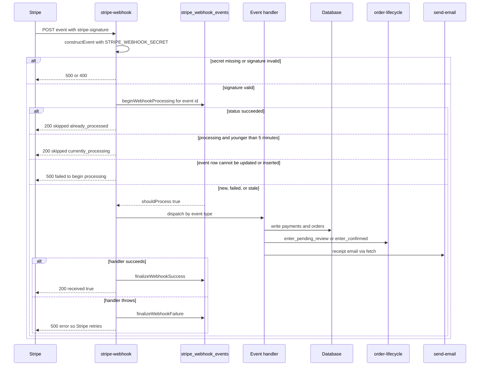
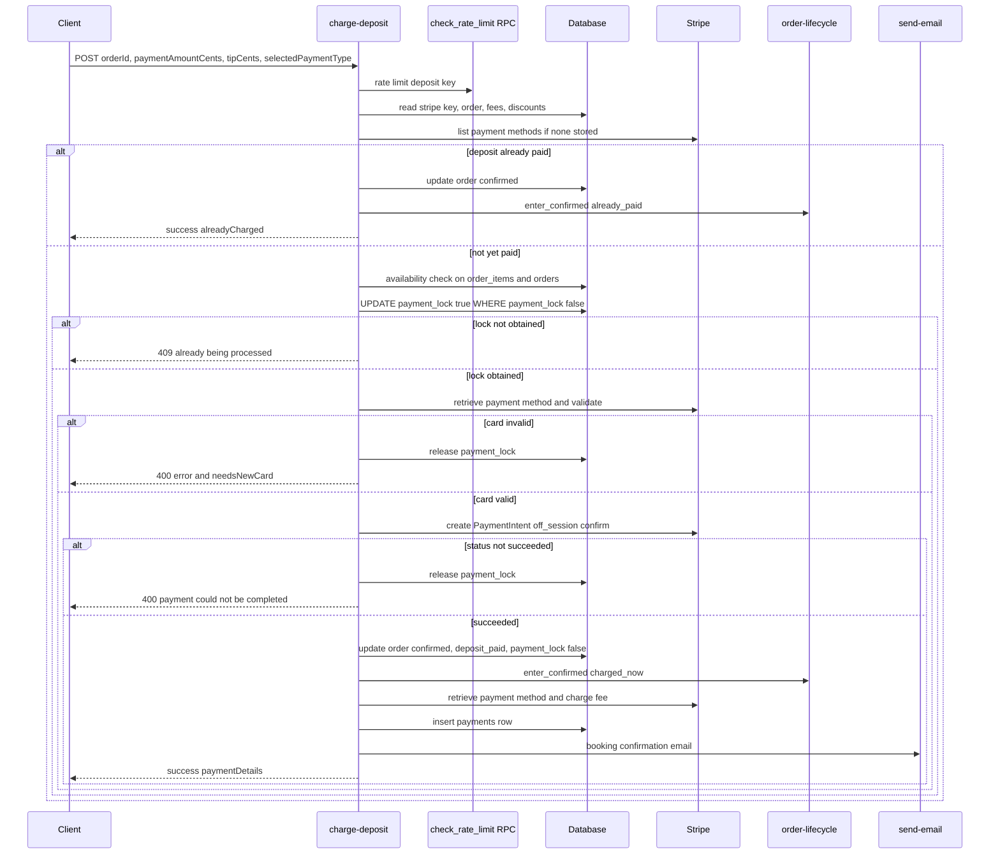
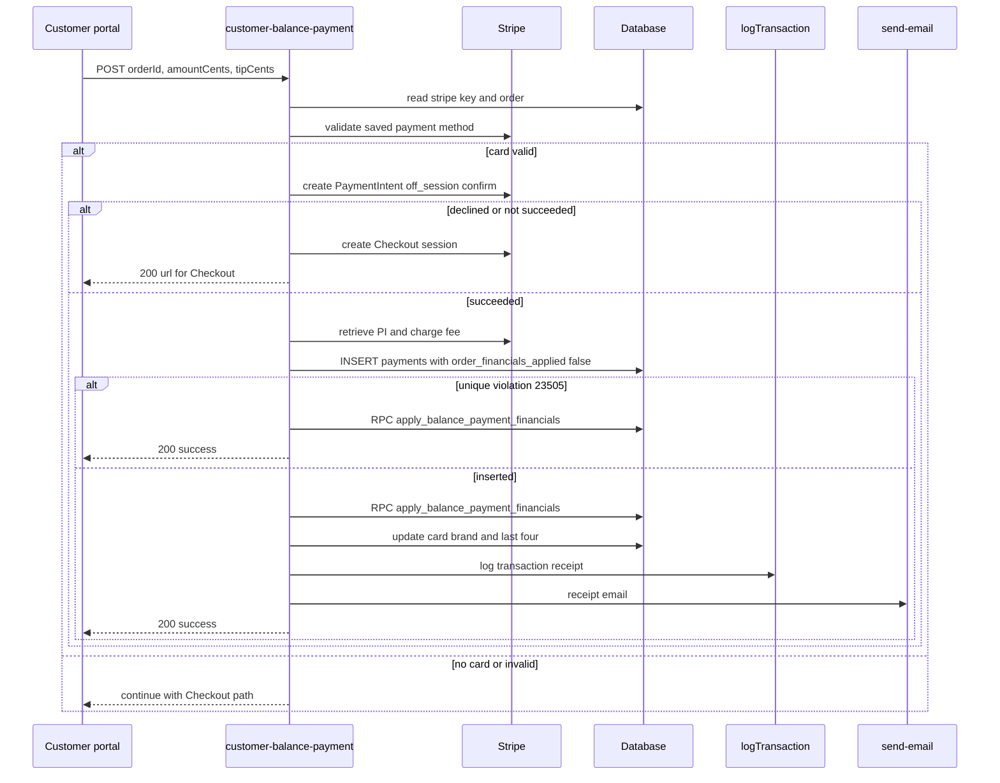
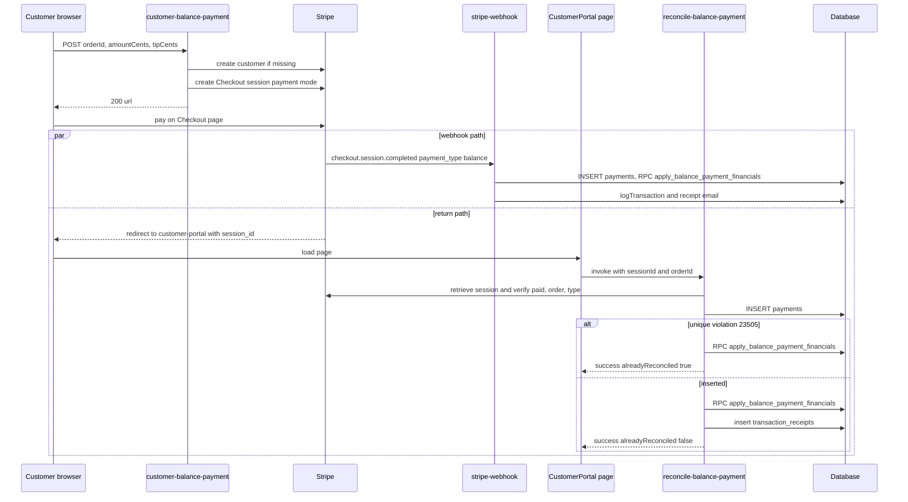
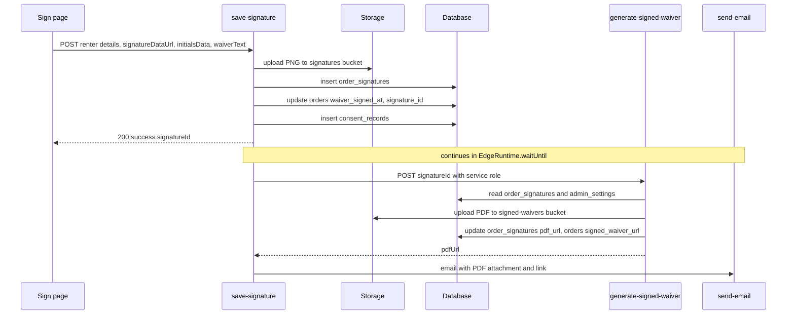
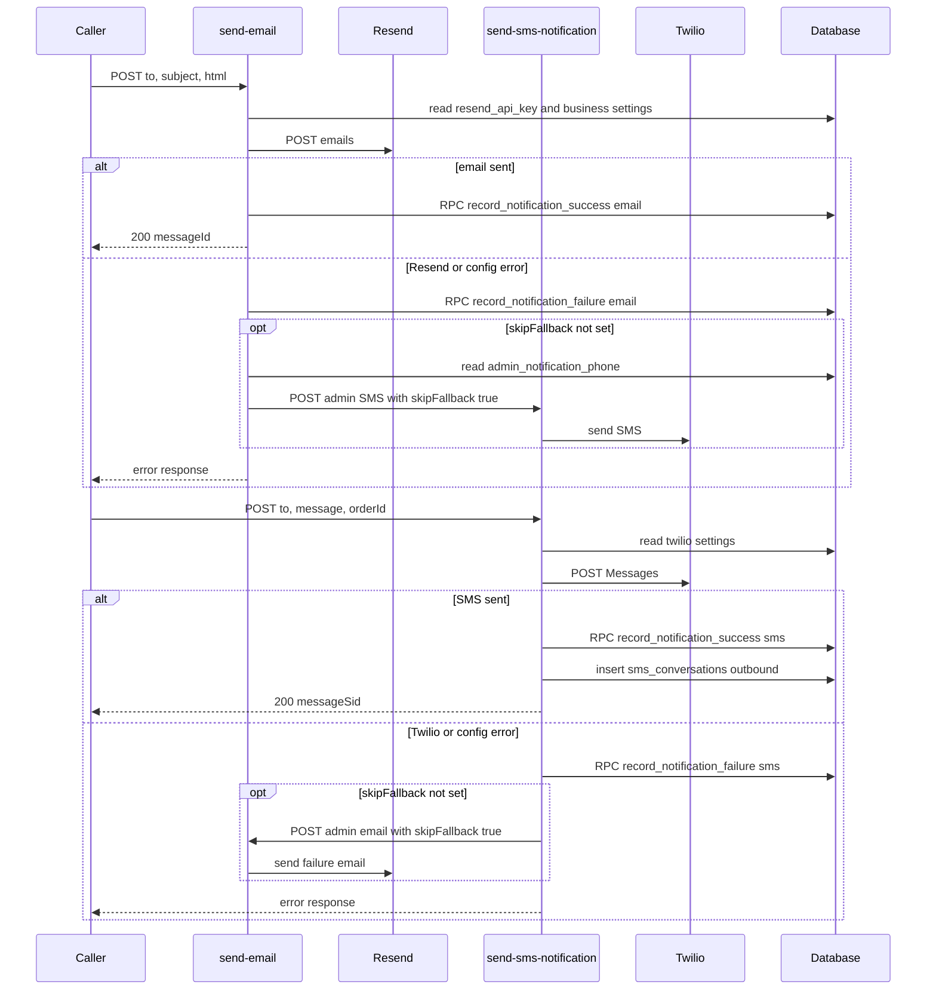

# Edge Function API Reference (Production)

Scope: the 44 Supabase Edge Functions deployed in the Production project `qaagfafagdpgzcijnfbw`.

Sources used for this document:

- Branch `main` snapshot: `supabase/functions/*`, `supabase/functions/_shared/*`, `supabase/config.toml`, and `src/` (for callers). 39 functions have source in `main`.
- Deployed source read directly from Production (read-only) for the 5 functions that have no source in the repository: `backfill-card-details`, `verify-payment`, `get-streetview-heading`, `create-order-short-link`, `submit-contact-inquiry`. Each of these is marked "source is deployed in Production only (not in the repository)".
- The deployed `verify_jwt` flag for every function was read from the Production function list and compared with `supabase/config.toml`. For all 39 functions that have a `config.toml` entry the deployed value equals the configured value. The 5 Production-only functions have no `config.toml` entry.

Behaviour described here is what the code does. Where a function reads a value that is configured elsewhere (admin_settings, secrets), only the key name is given, never a value. Function bodies were read from the `main` snapshot. The deployed bundles of 8 repository functions (`stripe-refund`, `stripe-charge`, `stripe-checkout`, `upload-physical-waiver`, `record-cash-payment`, `twilio-webhook`, `get-waiver-status`, `send-invoice`) were read from Production and compared with `main`: handlers, constants, status codes, table and RPC names and the bundled `_shared` copies match. The other 31 repository functions were not compared with their deployed bundles. `record-consent` is deployed as an empty file (version 37), as in `main`.

---

## 1. Conventions that apply to every function

### 1.1 Base URL and invocation

- URL: `https://qaagfafagdpgzcijnfbw.supabase.co/functions/v1/<function-name>`.
- Browser callers use `fetch` with `Authorization: Bearer <anon key or user access token>` and usually `Apikey: <anon key>`, or `supabase.functions.invoke(name, { body })`.
- Function-to-function calls use either `fetch(<SUPABASE_URL>/functions/v1/<name>)` with `Authorization: Bearer <service role key>`, or `supabaseClient.functions.invoke(name, { body })` from a service-role client.

### 1.2 What `verify_jwt` means here

- `verify_jwt = true`: the Supabase gateway rejects the request unless `Authorization` carries a valid JWT signed by the project. The anon key, the service-role key and a signed-in user's access token are all valid JWTs. The gateway check alone does not establish who the caller is. Functions that need an identity do their own `auth.getUser()` and role lookup (see "Caller authorization" in each section).
- `verify_jwt = false`: the gateway forwards the request without checking `Authorization`. Any protection is whatever the function code does itself.
- Four functions (`backfill-payment-methods`, `customer-cancel-order`, `stripe-charge`, `stripe-refund`) create their Supabase client with the service-role key but pass the caller's `Authorization` header as a global header on that client. For these functions the caller's header, not the service-role key, is the bearer token that PostgREST receives for their table queries. All other functions use a service-role client with no forwarded caller header for their table queries; `promote-media` additionally builds an anon-key client with the caller's header that is used only for `auth.getUser()` and the `get_user_role` RPC.

### 1.3 Caller classes used in this document

| Class | Meaning |
|---|---|
| anonymous | No credential is checked by the code. |
| platform JWT | `verify_jwt = true` and the code does no further identity check. Any valid project JWT passes. |
| JWT user | Code calls `auth.getUser()` and requires a user. No role check. |
| role lookup | JWT user plus a role check (`user_roles` table or `get_user_role` RPC). |
| token | A portal/invoice link token from `invoice_links.link_token`, validated in code. |
| signature | Stripe `stripe-signature` HMAC check. |
| service role | Called internally with the service-role key. |

### 1.4 CORS

- Every function except `checkout-bridge` (no `OPTIONS` handling; it answers every method with the HTML page) and `record-consent` (empty bundle) answers `OPTIONS` with status `200` and CORS headers.
- `Access-Control-Allow-Origin: *` on every response that carries CORS headers.
- `Access-Control-Allow-Headers: Content-Type, Authorization, X-Client-Info, Apikey` on every response that carries CORS headers.
- `Access-Control-Allow-Methods` varies per function: some declare `POST, OPTIONS`, one declares `GET, OPTIONS` (`get-stripe-publishable-key`), some `GET, POST, OPTIONS`, some `GET, POST, PUT, DELETE, OPTIONS`. The declared list does not restrict the real method except where the code checks `req.method` (listed per function).
- `generate-blank-waiver` additionally sends `Access-Control-Expose-Headers: Content-Disposition`.
- Only 4 repository functions import `_shared/cors.ts` (`get-payment-method`, `get-session-metadata`, `promote-media`, `save-payment-method-from-session`) plus deployed-only `verify-payment`. All others define `corsHeaders` inline.
- `checkout-bridge` (all responses) and `twilio-webhook` (non-`OPTIONS` responses) return HTML/XML and do not add CORS headers to those responses.

### 1.5 Error response conventions

There is no single error envelope. The shapes in use:

| Shape | Used by |
|---|---|
| `{ "error": "<message>" }` | most functions |
| `{ "success": false, "error": "<message>" }` | charge-deposit, stripe-checkout, save-signature, save-payment-method-from-session, save-signup-address, backfill-payment-methods, generate-signed-waiver, backfill-oauth-customers, create-order-short-link, order-lifecycle (`success:false` for lifecycle refusals), send-sms-notification (Twilio configuration errors only) |
| `{ "error": "...", "details": ... }` | customer-cancel-order, send-email (Resend error), verify-payment, send-error-notification |
| `{ "error": "<message>", "retry_after": <seconds> }` with `429` | rate-limited functions (via `createRateLimitResponse`); the response also carries a `Retry-After` header (default `60`; `X-RateLimit-Remaining` / `X-RateLimit-Reset` are set only if the RPC result contains them, which denials from the Production RPC do not, see 1.6) |
| plain text `Method not allowed` with `405` | charge-deposit, stripe-checkout, save-payment-method-from-session, save-signature, generate-signed-waiver |
| JSON `{ "error": "Method not allowed" }` with `405` | order-lifecycle, generate-blank-waiver, get-waiver-status, upload-physical-waiver, promote-media, submit-contact-inquiry |
| TwiML/XML always `200` | twilio-webhook |
| HTML page | checkout-bridge |

Status code habits: `400` validation, `401` missing/invalid user, `403` role/token failure, `404` not found, `409` conflict/lock, `422` business-rule refusal (mileage, cash/check), `429` rate limit, `500` unexpected, `502` upstream (Google), `503` availability check unavailable, `207` partial success (stripe-refund), `410` removed/deprecated, `415` unsupported upload type (upload-physical-waiver).

### 1.6 Rate limiting mechanism

`_shared/rate-limit.ts` calls the Postgres RPC `check_rate_limit(p_identifier, p_endpoint, p_max_requests, p_window_seconds)` with the service role. If the RPC errors or throws, the helper returns `{ allowed: true }` (fails open). Identifier is built from the first valid IP in `x-forwarded-for` (or `x-real-ip`) plus an optional secondary id and a prefix: `prefix|ip:<ip>|id:<secondary>`. A name with no entry in `RATE_LIMIT_CONFIGS` and no custom config uses 10 requests / 60 s. Only `charge-deposit` and `stripe-checkout` pass `requireIdentifier = true`; when the identifier is empty the helper returns `{ allowed: false, reason: 'missing_identifier' }` and those two functions answer `400`. The Production RPC (table `rate_limits`, read from the function definition) returns `{ allowed: true, requests_remaining, reset_at }` when allowed; when denied it returns `reason` `rate_limit_exceeded` with `retry_after` = seconds left in the window, `rate_limit_exceeded_blocked` with `retry_after` 300 (once a window's count reaches 3 x the maximum, which blocks the identifier/endpoint pair for 5 minutes), or `temporarily_blocked` with `retry_after` = seconds left in the block. Denials carry no `requests_remaining` / `reset_at`, so a `429` has `Retry-After` and no `X-RateLimit-*` headers. Only `temporarily_blocked` selects the "temporarily blocked" message text; every other denial uses "Rate limit exceeded. Please try again later.". `RATE_LIMIT_CONFIGS` has default entries for 9 endpoints; the helper is only actually invoked by `charge-deposit`, `stripe-checkout`, `stripe-charge`, `stripe-refund` and `submit-contact-inquiry` (see per-function sections). The other configured names (`customer-balance-payment`, `customer-cancel-order`, `save-signature`, `send-invoice`, `send-sms-notification`) have configuration entries but their function code does not call the helper.

### 1.7 Secrets, environment and admin_settings

- Platform-provided env: `SUPABASE_URL`, `SUPABASE_SERVICE_ROLE_KEY`, `SUPABASE_ANON_KEY`.
- Configured env read by code: `STRIPE_SECRET_KEY` (webhook, get-payment-method, get-session-metadata, and deployed verify-payment), `STRIPE_WEBHOOK_SECRET` (stripe-webhook), `GOOGLE_MAPS_API_KEY` (calculate-route-mileage, deployed get-streetview-heading), `SITE_URL` (send-invoice; deployed create-order-short-link also reads `APP_URL`).
- Most Stripe functions do not use `STRIPE_SECRET_KEY`; they read the key from `admin_settings.stripe_secret_key` through the service role and construct the Stripe client per request (API version `2024-10-28.acacia`). Functions using the env var use API version `2024-11-20.acacia` (webhook uses `2024-10-28.acacia`).
- Resend and Twilio credentials live only in `admin_settings`: `resend_api_key`; `twilio_account_sid`, `twilio_auth_token`, `twilio_from_number`.

### 1.8 Idempotency and locking patterns (summary)

| Pattern | Where |
|---|---|
| `orders.payment_lock` boolean claimed by conditional UPDATE (`payment_lock=false` -> `true`), released on failures and set `false` in the success update | charge-deposit |
| Insert of the `payments` row first, treating a unique violation (`23505`) on `payments.stripe_payment_intent_id` as "another writer already inserted", plus the `payments.order_financials_applied` flag and RPC `apply_balance_payment_financials`. In Production `payments` has a non-unique btree index on `stripe_payment_intent_id` and no unique constraint on it (checked in `pg_indexes` and `pg_constraint`), so the database does not return `23505` for a second insert with the same PaymentIntent id; the RPC locks the first `payments` row matching the PaymentIntent id (`FOR UPDATE`) and applies the balance change once while `order_financials_applied` is false | customer-balance-payment, reconcile-balance-payment, stripe-webhook |
| `stripe_webhook_events` table keyed on Stripe event id (`processing` / `succeeded` / `failed`, 5 minute stale window) | stripe-webhook via `_shared/webhook-idempotency.ts` |
| `order-lifecycle` alert flags `pending_review_admin_alerted`, `confirmed_admin_alerted` | order-lifecycle |
| Atomic Postgres RPCs `record_cash_payment`, `record_check_payment` | record-cash-payment, record-check-payment |
| Existing-row check before insert (`refunded_payment_id`, `stripe_refund_id`) | stripe-webhook `charge.refunded` |

---

## 2. Function index

JWT = deployed `verify_jwt`. Class uses section 1.3 names. Tables lists tables read or written directly by the function itself (RPC names are in the sections).

| Name | JWT | Caller class | Purpose | Tables touched |
|---|---|---|---|---|
| auth-email-hook | false | anonymous | Deprecated stub, always `410` | none |
| backfill-card-details | true | platform JWT | Fill missing card brand/last4 on orders from Stripe (deployed only) | admin_settings, orders |
| backfill-oauth-customers | true | JWT user | Create/link a `customers` row for the signed-in OAuth user | customers, contacts |
| backfill-payment-methods | true | role lookup (ADMIN/MASTER) | Fill missing payment method type/brand/last4 on `payments` from Stripe | user_roles, admin_settings, payments |
| calculate-route-mileage | true | role lookup (master/admin/crew) | Driving-mile total for a day's route via Google Distance Matrix | user_roles, daily_mileage_logs, task_status, orders, addresses, admin_settings |
| charge-deposit | true | platform JWT | Off-session charge of deposit or balance on saved card | admin_settings, orders, order_custom_fees, order_discounts, order_items, order_changelog, payments, customers, order_items->units |
| checkout-bridge | false | anonymous | HTML page that postMessages checkout result to opener | none |
| create-admin-user | true | platform JWT | One-time creation of first ADMIN user | user_roles, admin_settings (+ auth admin API) |
| create-order-short-link | true | platform JWT | Create portal short link via RPC (deployed only) | none directly (RPC `create_order_short_link`) |
| customer-balance-payment | false | anonymous | Customer pays remaining balance: card on file or Checkout | admin_settings, orders, payments, order_custom_fees, order_discounts, transaction_receipts, customers, addresses, order_items |
| customer-cancel-order | false | optional JWT / token / email match | Cancel an order and notify | orders, invoice_links, order_changelog, task_status, admin_settings, sms_message_templates, payments |
| fix-payment-method | false | anonymous | Recover `stripe_payment_method_id` from a Checkout session | admin_settings, orders |
| generate-blank-waiver | false | anonymous (optional token) | Render blank waiver PDF for an order | invoice_links, orders, admin_settings |
| generate-signed-waiver | false | anonymous (internal use) | Render signed waiver PDF, store it, link it | order_signatures, admin_settings, orders, storage `signed-waivers` |
| get-payment-method | true | platform JWT | Brand/last4 for a Stripe payment method id | none |
| get-session-metadata | false | anonymous | Metadata/payment status of a Checkout session | none |
| get-stripe-publishable-key | false | anonymous | Return the publishable key | admin_settings |
| get-streetview-heading | false | anonymous | Compass heading from nearest Street View panorama (deployed only) | none |
| get-user-info | true | role lookup (master/admin) | Email/name for auth user ids | user_roles (+ auth admin API) |
| get-waiver-status | false | anonymous (token/role for signed URL) | Waiver signing status for an order | invoice_links, orders, order_signatures, storage `physical-waivers` |
| order-lifecycle | false | anonymous | Status transition + admin alerts for pending_review / confirmed | orders, order_changelog, admin_settings |
| promote-media | true | role lookup (admin/master) | Copy admin photo into unit gallery or hero carousel | order_lot_pictures, order_pictures, task_status, units, unit_media, hero_carousel_images, storage |
| reconcile-balance-payment | false | anonymous | Post-Checkout idempotent write of balance payment | admin_settings, payments, orders, transaction_receipts, order_custom_fees, order_discounts |
| record-cash-payment | true | role lookup (master/admin/crew) | Record cash payment atomically | user_roles, orders, admin_settings, transaction_receipts (RPC `record_cash_payment`) |
| record-check-payment | true | role lookup (master/admin/crew) | Record check payment atomically | same as cash (RPC `record_check_payment`) |
| record-consent | true | n/a (source file is empty) | Called by signup/auth code; no handler in source | none |
| save-payment-method-from-session | true | platform JWT | Save PM from a Checkout session onto the order | admin_settings, orders |
| save-pending-consent | false | anonymous | Removed endpoint, always `410` | none |
| save-signature | false | anonymous | Store e-signature, consent, then generate PDF + email | order_signatures, orders, consent_records, storage `signatures` |
| save-signup-address | false | JWT user | Upsert address and set as customer default | customers, addresses |
| send-email | true | platform JWT | Send email via Resend, record failure, SMS fallback | email_templates, orders, customers, admin_settings (+ RPCs) |
| send-error-notification | false | anonymous | Email admin a client-side error report | admin_settings |
| send-invoice | true | platform JWT | Create invoice link, email/SMS it to customer | orders, customers, addresses, order_custom_fees, order_discounts, invoice_links |
| send-sms-notification | true | platform JWT | Send SMS via Twilio, log conversation, email fallback | sms_message_templates, orders, admin_settings, sms_conversations (+ RPCs) |
| stripe-charge | true | role lookup (ADMIN/MASTER) | Admin charge of saved card (balance/damage) | user_roles, orders, admin_settings, payments |
| stripe-checkout | true | platform JWT | Create Stripe Checkout session (deposit / setup / booking) | admin_settings, orders (+ RPC `check_date_blackout`) |
| stripe-refund | true | role lookup (admin/master) | Refund against Stripe PaymentIntents, record refunds | user_roles, admin_settings, orders, order_refunds, payments (+ RPC) |
| stripe-webhook | false | signature | Process Stripe events | stripe_webhook_events, orders, payments, invoice_links, order_refunds, transaction_receipts, admin_settings, customers |
| submit-contact-inquiry | true | platform JWT | Persist website inquiry, email admin (deployed only) | contact_inquiries, admin_settings |
| sync-google-calendar | true | platform JWT | Sync per-date order summary events to Google Calendar | admin_settings, orders, customers, google_calendar_sync, google_calendar_sync_queue |
| twilio-status-callback | true | platform JWT | Update SMS delivery status | sms_conversations |
| twilio-webhook | false | anonymous | Inbound SMS handler with TwiML auto-reply | sms_conversations, customers, orders |
| upload-physical-waiver | true | role lookup (admin/master/crew) or token | Record paper waiver (file or no-photo override) | invoice_links, orders, order_signatures, storage `physical-waivers` |
| verify-payment | true | platform JWT | Verify a Checkout session and update order if webhook has not (deployed only) | orders, invoice_links, payments |

---

## 3. Shared module map (`supabase/functions/_shared`)

| File | Purpose | Used by |
|---|---|---|
| `admin-settings.ts` | `getAdminSetting` / `getMultipleAdminSettings` with 5 minute in-memory cache, and `ADMIN_SETTING_KEYS` constants (`stripe_secret_key`, `stripe_publishable_key`, `admin_notification_phone`, `admin_email`, `twilio_account_sid`, `twilio_auth_token`, `twilio_phone_number`) | no function imports it |
| `cors.ts` | `corsHeaders` (methods `GET, POST, PUT, DELETE, OPTIONS`) and `handleCorsPreflightSync(req)` | get-payment-method, get-session-metadata, promote-media, save-payment-method-from-session (and deployed verify-payment) |
| `fmt.ts` | `LOGO_URL` (public-assets logo), `DEFAULT_PHONE` `(313) 889-3860`, `formatCurrency(cents)` -> `$x.xx`, `formatPaymentMethodLabel(type, brand, last4)` | charge-deposit, customer-balance-payment, order-lifecycle, reconcile-balance-payment, record-cash-payment, record-check-payment, stripe-webhook/emails.ts, payment-receipt-email.ts |
| `format-order-id.ts` | `formatOrderId(id)` = first 8 chars uppercased (the customer-visible order number) | customer-balance-payment, customer-cancel-order, order-lifecycle, record-cash-payment, record-check-payment, send-sms-notification, stripe-charge, transaction-logger.ts |
| `payment-receipt-email.ts` | `buildPaymentReceiptEmail(opts)` HTML receipt (event details, items, pricing, payment box, banner slot) | record-cash-payment, record-check-payment |
| `payment-validation.ts` | `validatePaymentMethod(pmId, stripe)`: retrieves PM; invalid when no `customer` attached, card expired, or `resource_missing`; returns `needsNewCard`, warning when expiring within 30 days, and exp/last4 | charge-deposit, customer-balance-payment, stripe-charge |
| `rate-limit.ts` | `getIdentifier`, `buildRateLimitKey`, `checkRateLimit`, `createRateLimitResponse`, `RATE_LIMIT_CONFIGS` (section 1.6) | charge-deposit, stripe-charge, stripe-checkout, stripe-refund (and deployed submit-contact-inquiry) |
| `transaction-logger.ts` | `logTransaction`: inserts `transaction_receipts` (`transaction_type` one of `deposit`, `balance`, `refund`, `tip`, `full_payment`; returns `receipt_number`, or `null` on insert error or when no row came back), then fire-and-forget admin email via `send-email` (`functions.invoke`; subject `Transaction Receipt <n> - <label>` where the label is e.g. `Deposit Payment`, `Balance Payment`, `Refund`) and marks `receipt_sent_to_admin` / `admin_notified_at`. Reads `admin_settings.admin_email` | customer-balance-payment, record-cash-payment, record-check-payment, stripe-webhook/handlers.ts |
| `waiver-pdf.ts` | jsPDF layout helpers: `parseWaiverSections`, `renderPageHeader`, `stampAllPageHeaders/Footers`, `fetchLogoDataUrl`, `INLINE_INITIALS_SECTIONS` {6,8,9}, `SECTION_INITIALS_KEYS` | generate-blank-waiver, generate-signed-waiver |
| `webhook-idempotency.ts` | `beginWebhookProcessing`, `finalizeWebhookSuccess`, `finalizeWebhookFailure` over `stripe_webhook_events`; legacy `checkWebhookIdempotency` | stripe-webhook |

Non-shared helper files: `stripe-webhook/handlers.ts` (event handlers), `stripe-webhook/emails.ts` (`sendCheckoutBalanceReceiptEmail`, `sendDepositReceiptEmail`; both POST to `send-email` with service-role bearer plus `Apikey` anon header). `supabase/functions/deno.json` maps `npm:stripe` to `stripe@20.0.0` and supabase-js to `2.57.4`.

---

## 4. Function reference

Format per function: Purpose; Auth; Rate limiting; Request; Success; Errors; Side effects; Idempotency; Called from; Env and settings; Notes.

### 4.1 auth-email-hook

- **Purpose**: Deprecated stub. Previously an Auth "send email" hook; now returns `410`.
- **verify_jwt**: false (config.toml false).
- **Caller authorization**: none checked.
- **Rate limiting**: none.
- **Request**: any method. No body read.
- **Success**: none.
- **Errors**: always `410` `{ "error": "This endpoint is deprecated. Auth emails are handled by Supabase default sending.", "deprecated": true }`. `OPTIONS` -> `200`.
- **Side effects**: none.
- **Idempotency**: n/a.
- **Called from**: no caller found in application code.
- **Env/settings**: none.
- **Notes**: header comment states Supabase Auth sends its own emails and the function must not be configured as a hook target.

### 4.2 backfill-card-details (source is deployed in Production only (not in the repository))

- **Purpose**: For every order that has `stripe_payment_method_id` and a null `payment_method_brand` or `payment_method_last_four`, retrieve the PaymentMethod from Stripe and fill the missing fields.
- **verify_jwt**: true (no config.toml entry).
- **Caller authorization**: gateway JWT only. The code builds a service-role client and does not read the caller identity.
- **Rate limiting**: none.
- **Request**: `POST` (method not checked); body not read. CORS methods declared: `POST, OPTIONS`.
- **Success**: `200` `{ "total": <orders scanned>, "updated": n, "failed": n, "errors": ["<orderId>: <message>", ...] }`.
- **Errors**: `500` `{ "error": "Stripe not configured" }` (no `admin_settings.stripe_secret_key`), `500` `{ "error": "<db message>" }` for the orders query, `500` `{ "error": "<message>" }` for unexpected errors. An order whose Stripe payment method has neither a card brand nor last4 is counted in `failed` without an `errors` entry.
- **Side effects**: reads `admin_settings`, reads `orders`, Stripe `paymentMethods.retrieve` per order (API version `2024-10-28.acacia`), updates `orders.payment_method_brand` / `payment_method_last_four` only for fields that are currently empty.
- **Idempotency**: re-running only fills still-empty fields.
- **Called from**: no caller found in application code.
- **Env/settings**: `SUPABASE_URL`, `SUPABASE_SERVICE_ROLE_KEY`; `admin_settings.stripe_secret_key`.
- **Notes**: processes all matching orders in one invocation, sequentially.

### 4.3 backfill-oauth-customers

- **Purpose**: Ensure a `customers` row exists for the signed-in (OAuth) user; link an existing row by email if one exists.
- **verify_jwt**: true.
- **Caller authorization**: JWT user. `Authorization` header required; token resolved with `auth.getUser(token)` on a service-role client. No role check; acts only on the caller's own user.
- **Rate limiting**: none.
- **Request**: `POST` (method not checked), no body fields read.
- **Success**: `200` JSON (no explicit status; default), one of:
  - `{ "success": true, "message": "Customer record already exists", "customer_id": "<uuid>" }`
  - `{ "success": true, "message": "Linked existing customer to user", "customer_id": "<uuid>" }` (only reached when the insert fails and a customer with the same email exists; that row's `user_id`, `oauth_provider` and `oauth_profile_data` are set; no `contacts` upsert on this path)
  - `{ "success": true, "message": "Customer record created successfully", "customer_id": "<uuid>", "profile": { "first_name", "last_name", "email", "phone" } }`
- **Errors**: `400` `{ "success": false, "error": "<message>" }` for every failure (no header, not authenticated, DB error). Missing header message: `No authorization header`; invalid: `Not authenticated`.
- **Side effects**: reads/inserts/updates `customers` (`user_id`, names from `user_metadata.full_name`/`name` or email local part, `phone`, `oauth_provider`, `oauth_profile_data`), upserts `contacts` on `email` with `source: 'oauth_backfill'` (contact failure is logged, not returned).
- **Idempotency**: first check is "customer with this user_id exists".
- **Called from**: `src/contexts/CustomerProfileContext.tsx`.
- **Env/settings**: `SUPABASE_URL`, `SUPABASE_SERVICE_ROLE_KEY`.

### 4.4 backfill-payment-methods

- **Purpose**: For `payments` rows with a PaymentIntent id and null `payment_method`, retrieve the PI from Stripe and fill `payment_method`, `payment_brand`, `payment_last4`.
- **verify_jwt**: true.
- **Caller authorization**: role lookup. A client built with the service-role key but forwarding the caller's `Authorization` header resolves the user with `auth.getUser()`; then `user_roles.role` must equal exactly `ADMIN` or `MASTER` (upper-case comparison).
- **Rate limiting**: none.
- **Request**: `POST` or `GET` (method not checked), no body fields.
- **Success**: `200` `{ "success": true, "message": "No payments to backfill", "updated": 0 }` or `{ "success": true, "message": "Backfill complete", "total": n, "updated": n, "failed": n, "errors": [..] | undefined }`.
- **Errors**: `401` `{ "success": false, "error": "Unauthorized" }`; `403` `{ "success": false, "error": "Admin access required" }`; `500` `{ "success": false, "error": "Stripe not configured" }`; `500` `{ "success": false, "error": "<message>" }`.
- **Side effects**: reads `user_roles`, `admin_settings`, `payments`; Stripe `paymentIntents.retrieve(expand payment_method)`; updates `payments`.
- **Idempotency**: only rows with null `payment_method` are processed.
- **Production data note**: `user_roles.role` values in Production are lower-case (`master`, `customer`); this function compares against upper-case `ADMIN` / `MASTER`.
- **Called from**: `src/hooks/useAdminSettings.ts`.
- **Env/settings**: `SUPABASE_URL`, `SUPABASE_SERVICE_ROLE_KEY`; `admin_settings.stripe_secret_key`.

### 4.5 calculate-route-mileage

- **Purpose**: Compute driving miles for a day's route (home base -> each driveable stop in `task_status` order -> home base) and the resulting end-of-day odometer value.
- **verify_jwt**: true.
- **Caller authorization**: role lookup. Bearer token resolved by `auth.getUser(token)` (401 if missing/invalid); `user_roles.role` lower-cased must be `master`, `admin` or `crew` (403 otherwise).
- **Rate limiting**: none.
- **Request**: JSON `{ "date": "YYYY-MM-DD" (required), "userId": "<uuid>" (optional, default = caller) }`.
- **Success**: `200` `{ "success": true, "totalMiles": number, "calculatedEndMileage": number (1 dp), "startMileage": number, "stopCount": n, "segments": [{ "from", "to", "distanceMiles" }], "resolvedDate": "YYYY-MM-DD", "usedNearbyDate": boolean }`.
- **Errors**: `401` `{ "error": "Unauthorized: missing bearer token." | "Unauthorized: invalid or expired token." }`; `403` `{ "error": "Forbidden: admin or crew role required." }`; `400` `{ "error": "Missing required field: date (YYYY-MM-DD)" }`; `422` start mileage not recorded, or no qualifying tasks within +/-3 days, or Distance Matrix element not OK; `500` Google key not configured or unexpected; `502` Google HTTP failure.
- **Side effects**: reads `user_roles`, `daily_mileage_logs.start_mileage` (for `date` and target user), `task_status` joined to `orders`/`addresses` for dates `date, -1, +1, -2, +2, -3, +3` (first date with qualifying stops wins; statuses `confirmed`, `in_progress`, `completed`), `admin_settings` (home base keys). One Google Distance Matrix request per segment. No writes. Order of checks: bearer token, user, role, body `date`, start mileage (`422`), task search, home base, Google key, segments. Duplicate `order_id` rows in `task_status` count once.
- **Idempotency**: read-only.
- **Called from**: `src/components/calendar/MileageModal.tsx`.
- **Env/settings**: `GOOGLE_MAPS_API_KEY`, `SUPABASE_URL`, `SUPABASE_SERVICE_ROLE_KEY`; admin_settings keys `home_address_lat`, `home_address_lng`, `home_base_address`, `business_address`, `home_address_line1`, `home_address_city`, `home_address_state`, `home_address_zip`. Home base resolution order: `home_address_lat` + `home_address_lng`, else `home_base_address`, else `business_address`, else `home_address_line1` joined with city/state/zip, else the fallback coordinate `42.2808,-83.3863`.
- **Notes**: Logs each segment's full Google response to function logs.

### 4.6 charge-deposit

- **Purpose**: Off-session charge of the deposit (default) or balance (`selectedPaymentType = "balance"`) plus tip on the order's saved card, then confirm the order.
- **verify_jwt**: true.
- **Caller authorization**: platform JWT. No `getUser` or role check; the request is accepted with the anon key. Identity is not used in the function.
- **Rate limiting**: `checkRateLimit('charge-deposit', "deposit|ip:<ip>|id:<orderId>", default, requireIdentifier=true)` = 10 requests / 60 s. If neither IP nor `orderId` is known: `400`. `missing_identifier` -> `400`. The rate-limit check runs before the `Missing orderId` check.
- **Request**: `POST` only (`405` plain text otherwise). JSON:
  - `orderId` string, required.
  - `paymentAmountCents` number, optional; used when numeric and > 0, otherwise `orders.customer_selected_payment_cents` then `deposit_due_cents`.
  - `tipCents` number, optional; used when numeric, otherwise `orders.tip_cents` (or 0).
  - `selectedPaymentType` string, optional; otherwise `orders.customer_selected_payment_type` or `"deposit"`. Value `"balance"` switches to the balance branch.
- **Success** (`200`):
  - `{ "success": true, "paymentDetails": { "paymentIntentId", "chargeId", "amountCents", "paymentMethod", "paymentBrand", "paymentLast4" } }`
  - `{ "success": true, "alreadyCharged": true }` when a deposit was already paid for at least the amount (deposit branch), or when balance due is already 0 (balance branch).
  - `{ "success": false, "chargeSucceeded": true, "error": "Payment was processed but order update failed. Please contact support.", "paymentIntentId" }` with HTTP `200` if Stripe charged but the order update failed (also writes an `order_changelog` row `change_type: 'payment_error'`).
- **Errors**:
  - `400` `{ success:false, error }`: unable to identify client; `Missing orderId`; `No payment method on file for this order`; `No deposit amount configured for this order`; card validation failure `{ error: <reason>, needsNewCard }`; PaymentIntent status not `succeeded` `{ error, paymentIntentId }`.
  - `404` `Order not found`.
  - `409` item availability conflict ("no longer available for the event date"), `This order is already being processed` (lock held), `The balance due has changed` (balance branch amount > fresh `balance_due_cents`).
  - `429` rate limit.
  - `500` Stripe not configured, order query/lock/re-read failure, unexpected error (the lock is released if the charge had not succeeded). A thrown Stripe card error also lands here with the Stripe message.
  - `503` availability check threw.
- **Side effects** (in order): read `admin_settings.stripe_secret_key`; read `orders` (scalar columns), `order_custom_fees`, `order_discounts`; resolve payment method (if `stripe_payment_method_id` empty, Stripe `paymentMethods.list(customer, card, 1)` and write the id back); already-paid short circuit (updates `orders.status='confirmed'`, selected payment fields, tip; invokes `order-lifecycle` `enter_confirmed` with `paymentOutcome: 'already_paid'`); availability check against other orders on the same `unit_id`s whose status is in `pending_review, awaiting_customer_approval, approved, confirmed, in_progress, completed` and dates overlap; claim `payment_lock`; (balance branch) re-read fresh balance; `validatePaymentMethod`; write `payment_method_validated_at`, exp month/year, last4; Stripe `paymentIntents.create({ amount: payment + tip, currency usd, customer, payment_method, off_session: true, confirm: true, metadata: { order_id, payment_type } })`; order update (deposit branch: `status 'confirmed'`, `deposit_paid_cents`, `stripe_payment_status 'paid'`, recomputed `balance_due_cents`, tip, selected payment, `payment_lock false`; balance branch: `balance_paid_cents`, `balance_due_cents`, tip, `payment_lock false`, status unchanged); deposit branch only: `order-lifecycle` `enter_confirmed` (`charged_now`); Stripe retrieve PM and charge (fees); insert `payments` row (`type deposit|balance`, fee and net); deposit branch only: build and send booking confirmation/receipt email through `send-email` (subject `Booking Confirmed - Receipt for Order #<shortId>`; email failure is logged only). When `order-lifecycle` is invoked its failures are logged and do not change the response.
- **Idempotency/locking**: `orders.payment_lock` conditional update (409 when already true); already-paid and zero-balance short circuits. There is no Stripe idempotency key on the PaymentIntent create call. The `payments` insert has no conflict handling and is non-fatal.
- **Called from**: `src/components/customer-portal/ApprovalModal.tsx` (bearer = user access token or anon key), `src/pages/CustomerPortal.tsx` (`supabase.functions.invoke`), `src/lib/orderApprovalService.ts`, `src/components/admin/TaskDetailModal.tsx`.
- **Env/settings**: `SUPABASE_URL`, `SUPABASE_SERVICE_ROLE_KEY`; admin_settings `stripe_secret_key`, `business_name`, `business_phone`, `business_email`, `logo_url`.
- **Notes**: The email uses portal URL `https://bouncepartyclub.com/customer-portal/<orderId>`. In the deposit branch the new `balance_due_cents` is computed from order columns (`subtotal_cents`, `travel_fee_cents`, `surface_fee_cents`, `same_day_pickup_fee_cents`, `same_day_weekday_delivery_fee_cents`, `generator_fee_cents`, `tax_cents`) plus custom fees minus discounts (percentage discounts computed on `subtotal_cents`) minus the payment amount, floored at 0; the `*_waived` flags are not read. The PaymentIntent metadata `payment_type` is the resolved `selectedPaymentType` string.

### 4.7 checkout-bridge

- **Purpose**: Returns a small HTML page that posts `{ type: 'BPC_CHECKOUT_COMPLETE', orderId, session_id }` to `window.opener` and closes the window.
- **verify_jwt**: false.
- **Caller authorization**: none.
- **Rate limiting**: none.
- **Request**: any method (including `OPTIONS`; there is no preflight handling); query parameters `orderId`, `session_id`, `origin` (target origin for `postMessage`, default `*`).
- **Success**: `200` `text/html; charset=utf-8`, `cache-control: no-store`.
- **Errors**: none defined.
- **Side effects**: none. Does not touch the database or Stripe.
- **Called from**: no caller found in application code.
- **Env/settings**: none.
- **Notes**: Values are inserted into the script via `JSON.stringify`. No CORS headers on the response.

### 4.8 create-admin-user

- **Purpose**: Bootstrap the first admin account. Refuses when an admin already exists.
- **verify_jwt**: true.
- **Caller authorization**: platform JWT only. The code does not read the caller. Protection is the "admin already exists" guard.
- **Rate limiting**: none.
- **Request**: JSON `{ "email": string (required), "password": string (required, min 6), "twilioAccountSid"?, "twilioAuthToken"?, "twilioFromNumber"? }`.
- **Success**: `200` `{ "success": true, "user": { "id", "email" } }`.
- **Errors**: `400` `Missing email or password`, `Password must be at least 6 characters`, `Admin user already exists`; `500` `{ "error": <message> }`.
- **Side effects**: RPC `get_admin_users` (Production definition: returns users whose `user_roles.role` is lower-case `admin` or `master`); `auth.admin.createUser({ email, password, email_confirm: true, user_metadata: { role: 'ADMIN' } })`; insert `user_roles { user_id, role: 'ADMIN' }`; if all three Twilio fields are present, `UPDATE admin_settings SET value` for keys `twilio_account_sid`, `twilio_auth_token`, `twilio_from_number` (update only, rows must exist). The result of `get_admin_users`, the `user_roles` insert and the `admin_settings` updates is not checked for errors; an error from `get_admin_users` leaves the existing-admin guard unevaluated.
- **Idempotency**: second call fails at the existing-admin guard.
- **Called from**: no caller found in application code.
- **Env/settings**: `SUPABASE_URL`, `SUPABASE_SERVICE_ROLE_KEY`.

### 4.9 create-order-short-link (source is deployed in Production only (not in the repository))

- **Purpose**: Create a portal short link for an order through the Postgres RPC `create_order_short_link` and return the portal URL.
- **verify_jwt**: true (no config.toml entry).
- **Caller authorization**: platform JWT. The RPC is invoked with the service-role key via REST.
- **Rate limiting**: none.
- **Request**: JSON `{ "order_id": string (required) }`. Method not checked.
- **Success**: `200` `{ "success": true, "short_code": "<code>", "portal_url": "<base>/portal/<short_code>" }`. Base = `SITE_URL`, else `APP_URL`, else `https://bouncyhousehub.com`.
- **Errors**: `400` `{ "success": false, "error": "Missing order ID" }`; `400` with the RPC result body when `rpcResult.success` is falsy; `500` `{ "success": false, "error": <message> }` (also for a request body that is not JSON; the RPC HTTP status is not inspected, only the JSON body).
- **Side effects**: `POST /rest/v1/rpc/create_order_short_link` with body `{ p_order_id }`. Table effects are inside the RPC. A search of `pg_proc` in the Production `public` schema (name pattern `%short_link%`) finds no function with this name, so the RPC response has no `success` field and the function answers `400` with that response body.
- **Idempotency**: determined by the RPC.
- **Called from**: no caller found in application code.
- **Env/settings**: `SUPABASE_URL`, `SUPABASE_SERVICE_ROLE_KEY`, `SITE_URL`, `APP_URL`.
- **Notes**: The portal path generated here is `/portal/<code>`; `send-invoice` generates `/i/<code>` links from `invoice_links.short_code`.

### 4.10 customer-balance-payment

- **Purpose**: Customer-facing payment of the remaining balance plus optional tip. Path A charges the card on file off-session; Path B creates a Stripe Checkout session.
- **verify_jwt**: false.
- **Caller authorization**: anonymous. The code takes `orderId` from the body and does not verify the caller.
- **Rate limiting**: none in code (a config entry of 5 / 60 s exists in `RATE_LIMIT_CONFIGS` but the helper is not called).
- **Request**: JSON `{ "orderId": string, "amountCents": number, "tipCents"?: number }`. Amounts are rounded and clamped to >= 0; total (amount + tip) must be > 0. `Origin`/`Referer` header decides the Checkout redirect origin (default `https://bouncepartyclub.com`).
- **Success**:
  - Path A: `200` `{ "success": true }`.
  - Path B: `200` `{ "url": "<Stripe Checkout URL>" }`.
- **Errors**: `400` `{ "error": "Invalid request: orderId required and total must be > 0." }`; `404` `{ "error": "Order not found.", "detail" }`; `500` `{ "error": "Stripe not configured." }` or `{ "error": <message> }` (includes failures of `apply_balance_payment_financials` or the payment insert).
- **Side effects**:
  - Read `admin_settings.stripe_secret_key`; read `orders` with addresses, customers, order_items(units).
  - Path A (when `stripe_payment_method_id` and `stripe_customer_id` exist and `validatePaymentMethod` is valid): Stripe `paymentIntents.create` (`off_session`, `confirm`, metadata `{ order_id, payment_type: 'balance', tip_cents, source: 'customer_balance_payment_edge_fn' }`). A thrown Stripe error falls through to Path B; a non-`succeeded` status cancels the intent and then falls through to Path B. If `validatePaymentMethod` returns invalid, Path B is also used (with the existing Stripe customer). After success: Stripe retrieve PI (expand payment_method, latest_charge) and charge fee; **insert `payments` row first** (`type 'balance'`, `order_financials_applied false`); on unique violation `23505`, call RPC `apply_balance_payment_financials` and return success; otherwise RPC `apply_balance_payment_financials(p_pi_id, p_order_id, p_balance_cents, p_tip_cents, p_pm_id, p_customer_id)`; update `orders.payment_method_brand/last_four`; `logTransaction` (type `balance`); receipt email by `fetch` to `send-email` (service-role bearer + `Apikey` anon header); failures of the email are logged only.
  - Path B: create a Stripe customer if the order has none (writes `orders.stripe_customer_id`); `checkout.sessions.create` mode `payment`, line items "Order Balance Payment" and "Crew Tip", `setup_future_usage: off_session`, metadata `{ order_id, payment_type: 'balance', tip_cents }` on both session and PaymentIntent, `success_url = <origin>/customer-portal/<orderId>?payment=success&session_id={CHECKOUT_SESSION_ID}`, `cancel_url = <origin>/customer-portal/<orderId>?tab=payment&tip=<tipCents>`. DB writes for Path B happen later in `stripe-webhook` and `reconcile-balance-payment`.
- **Idempotency**: `payments` insert-first with `23505` handling + `order_financials_applied` flag + RPC (see 1.8 for what the Production `payments` table enforces). No `payment_lock` use in this function. No Stripe idempotency key.
- **Called from**: `src/components/customer-portal/PaymentTab.tsx` (bearer = anon key).
- **Env/settings**: `SUPABASE_URL`, `SUPABASE_SERVICE_ROLE_KEY`, `SUPABASE_ANON_KEY`; admin_settings `stripe_secret_key`, `business_name`, `business_phone`, `logo_url`.
- **Notes**: The amount charged is `amountCents + tipCents` from the request; the function does not compare it with `orders.balance_due_cents`.

### 4.11 customer-cancel-order

- **Purpose**: Cancel an order (customer or staff), write the changelog, clear scheduled tasks, and notify admin and customer.
- **verify_jwt**: false.
- **Caller authorization**: mixed.
  - If the `Authorization` header is `Bearer ...` and `auth.getUser()` resolves a user, the caller is treated as authenticated (`userId` set). No role lookup. Authenticated callers skip ownership checks and may also cancel `in_progress` orders.
  - Otherwise the caller must prove ownership by `invoiceLinkToken` (must match `invoice_links.link_token` for this `orderId`, and not be expired) or, when no token is sent, by `customerEmail` matching the order customer's email (case-insensitive).
- **Rate limiting**: none in code (config entry 3 / 300 s exists, not invoked).
- **Request**: JSON `{ "orderId": string, "cancellationReason": string (required; at least 10 characters after trimming; the untrimmed value is stored), "adminOverrideRefund"?: boolean, "customerEmail"?: string, "invoiceLinkToken"?: string }`.
- **Success**: `200` `{ "success": true, "message": "Your order has been cancelled.", "refundPolicy": "refund_requested" | "no_refund" | "pending_review", "refundMessage": string, "hoursUntilEvent": "<n.n>" }`.
- **Errors**: `400` missing/short reason, or status not cancellable (customer: `draft, pending_review, awaiting_customer_approval, confirmed`; authenticated adds `in_progress`); `403` invalid/expired token, missing or mismatching email; `404` `Order not found`; `500` `{ "error", "details" }`.
- **Side effects**: update `orders` (`status 'cancelled'`, `cancellation_reason`, `cancelled_at`, `cancelled_by`, `refund_requested = (adminOverrideRefund === true)`); insert `order_changelog` (`change_type 'cancellation'`); delete `task_status` rows for the order; read `admin_settings` `admin_email` (fallback `admin@bouncepartyclub.com`), `admin_phone`, `app_url`; `fetch` to `send-email` (admin, plain text); if `admin_phone` and template `order_cancelled_admin` exists in `sms_message_templates`, `fetch` to `send-sms-notification` (admin); if the customer has a phone, `fetch` to `send-sms-notification` (customer; mentions refund review only if a succeeded `payments` row exists). Notification failures are logged and do not fail the request.
- **Idempotency**: a second call fails the status check (cancelled is not cancellable). No Stripe refund is issued here.
- **Called from**: `src/components/customer-portal/CancelOrderModal.tsx`, `src/components/admin/TaskDetailModal.tsx`.
- **Env/settings**: `SUPABASE_URL`, `SUPABASE_SERVICE_ROLE_KEY`; admin_settings `admin_email`, `admin_phone`, `app_url`.
- **Notes**: The Supabase client forwards the caller's `Authorization` header (the code passes it with a non-null assertion, so a missing header is sent as a null header value). Table queries, `order_changelog`/`task_status` writes and the `admin_settings` reads in this function use that header as the bearer token (section 1.2). The calls to `send-email` and `send-sms-notification` use the service-role key and no `Apikey` header. The admin SMS uses the `order_cancelled_admin` template text to build the message, then sends it as a plain `to`/`message` request.

### 4.12 fix-payment-method

- **Purpose**: Recover an order's `stripe_payment_method_id` by finding its Checkout session at Stripe.
- **verify_jwt**: false.
- **Caller authorization**: anonymous.
- **Rate limiting**: none.
- **Request**: JSON `{ "orderId": string }` (method not checked).
- **Success**: `200` `{ "success": true, "paymentMethodId": "<pm_...>" }`.
- **Errors**: `400` `Missing orderId` or `No Stripe customer ID on order`; `404` `Order not found`, `No checkout session found for this order`, `Could not extract payment method from session`; `500` `Stripe not configured`, `Failed to update order`, or `{ error: <message> }`.
- **Side effects**: reads `admin_settings.stripe_secret_key`, `orders.stripe_customer_id`; Stripe `checkout.sessions.list(customer, limit 20)` filtered by `metadata.order_id`; `checkout.sessions.retrieve` (expand payment_intent, payment_intent.payment_method); updates `orders.stripe_payment_method_id`.
- **Idempotency**: repeat calls write the same value.
- **Called from**: no caller found in application code.
- **Env/settings**: `SUPABASE_URL`, `SUPABASE_SERVICE_ROLE_KEY`; `admin_settings.stripe_secret_key`.

### 4.13 generate-blank-waiver

- **Purpose**: Return a blank liability-waiver PDF populated with the business info and, if known, the renter name, address and date for an order.
- **verify_jwt**: false.
- **Caller authorization**: anonymous. If `token` is supplied it is looked up in `invoice_links`; only an expired link for the same order is refused (`403`). A missing or non-matching token does not block the request.
- **Rate limiting**: none.
- **Request**: `POST` only. JSON `{ "orderId": string (required), "token"?: string }`.
- **Success**: `200` `application/pdf` binary body, `Content-Disposition: attachment; filename="BPC-Liability-Waiver-<LastName>-<event_date>.pdf"` (`<LastName>` is the customer's last name reduced to letters and digits, or `Customer`; `<event_date>` is `orders.event_date`, or today's date when empty), `Cache-Control: no-store`.
- **Errors**: `405` JSON; `400` `{ "error": "orderId required" }`; `403` `{ "error": "Link expired" }`; `404` `{ "error": "Order not found" }`; `500` `{ "error": <message> }`.
- **Side effects**: reads `invoice_links`, `orders` (+customers, addresses, parks acknowledgment fields), `admin_settings`; fetches the logo URL over HTTP; renders with `jspdf@2.5.2`. No writes.
- **Idempotency**: read-only.
- **Called from**: `src/components/waiver/WaiverTab.tsx`.
- **Env/settings**: `SUPABASE_URL`, `SUPABASE_SERVICE_ROLE_KEY`; admin_settings `logo_url`, `business_name`, `business_name_short`, `business_legal_entity`, `business_address`, `business_phone`, `business_email`.
- **Notes**: The waiver text is generated inside this function by `generateWaiverText(...)` and the file comment states it must stay in sync with `src/lib/waiverContent.ts`. Section 15 (county parks acknowledgment) is added when `orders.parks_acknowledgment_required` and `parks_acknowledgment_county` are set. Sections 6, 8, 9 get blank initials/date lines.

### 4.14 generate-signed-waiver

- **Purpose**: Render the signed waiver PDF from an `order_signatures` row, upload it, and link it.
- **verify_jwt**: false.
- **Caller authorization**: anonymous in code (knowledge of `signatureId`). In practice invoked by `save-signature` with the service-role bearer.
- **Rate limiting**: none.
- **Request**: `POST` only (`405` plain text). JSON `{ "signatureId": string }`.
- **Success**: `200` `{ "success": true, "pdfUrl": "<public URL>", "message": "Signed waiver PDF generated successfully" }`.
- **Errors**: `400` `{ "success": false, "error": "Missing signatureId" }`; `404` `{ "success": false, "error": "Signature not found" }`; `500` `{ "success": false, "error": "Failed to upload PDF: ..." | <message> }`.
- **Side effects**: reads `order_signatures` (waiver snapshot, initials, signer fields, signature image URL, IP), `admin_settings`; fetches logo and signature image over HTTP; uploads to storage bucket `signed-waivers` as `waiver-<order_id>-<timestamp>.pdf` (`upsert false`); updates `order_signatures.pdf_url`, `pdf_generated_at`; updates `orders.signed_waiver_url`.
- **Idempotency**: each call creates a new object with a timestamped name and overwrites the two URL columns.
- **Called from**: `save-signature` (inside `EdgeRuntime.waitUntil`). No browser caller found.
- **Env/settings**: `SUPABASE_URL`, `SUPABASE_SERVICE_ROLE_KEY`; admin_settings `logo_url`, `business_name`, `business_name_short`, `business_legal_entity`, `business_address`, `business_phone`, `business_email`.
- **Notes**: "Date Signed" is formatted in `America/Detroit` (the code then replaces the text ` EDT` with ` EST`). Footer reads `Signed by: <signer_name>  ·  <date>`; the last content page carries the ESIGN/UETA notice and `Document ID: <signature id>` when space remains.

### 4.15 get-payment-method

- **Purpose**: Return brand and last4 for a Stripe payment method id.
- **verify_jwt**: true.
- **Caller authorization**: platform JWT.
- **Rate limiting**: none.
- **Request**: JSON `{ "paymentMethodId": string }`.
- **Success**: `200` `{ "last4": string|null, "brand": string|null }`.
- **Errors**: `400` `{ "error": "Missing paymentMethodId" }`; `500` `{ "error": <message> }`.
- **Side effects**: Stripe `paymentMethods.retrieve` with the `STRIPE_SECRET_KEY` env var (API `2024-11-20.acacia`). No database access.
- **Called from**: no caller found in application code.
- **Env/settings**: `STRIPE_SECRET_KEY`.

### 4.16 get-session-metadata

- **Purpose**: Return metadata, payment status and total of a Stripe Checkout session.
- **verify_jwt**: false.
- **Caller authorization**: anonymous.
- **Rate limiting**: none.
- **Request**: JSON `{ "sessionId": string }`.
- **Success**: `200` `{ "metadata": { ... } | null, "payment_status": string, "amount_total": number|null }`.
- **Errors**: `400` `{ "error": "Missing sessionId" }`; `500` `{ "error": <message> }`.
- **Side effects**: Stripe `checkout.sessions.retrieve` using `STRIPE_SECRET_KEY` env.
- **Called from**: `src/hooks/usePaymentCompletion.ts`.
- **Env/settings**: `STRIPE_SECRET_KEY`.

### 4.17 get-stripe-publishable-key

- **Purpose**: Return the Stripe publishable key.
- **verify_jwt**: false.
- **Caller authorization**: anonymous.
- **Rate limiting**: none.
- **Request**: any method; no body.
- **Success**: `200` `{ "publishableKey": "<pk_...>" }`.
- **Errors**: `500` `{ "error": "Stripe publishable key not configured" }` or `{ "error": <message> }`.
- **Side effects**: reads `admin_settings.stripe_publishable_key`.
- **Called from**: no caller found in application code.
- **Env/settings**: `SUPABASE_URL`, `SUPABASE_SERVICE_ROLE_KEY`; `admin_settings.stripe_publishable_key`.

### 4.18 get-streetview-heading (source is deployed in Production only (not in the repository))

- **Purpose**: Given a latitude/longitude, find the nearest Google Street View panorama and return the compass heading from the panorama toward the point.
- **verify_jwt**: false (no config.toml entry).
- **Caller authorization**: anonymous.
- **Rate limiting**: none.
- **Request**: query string `?lat=<number>&lng=<number>` (any method; CORS declares `GET, OPTIONS`).
- **Success** (`200`): `{ "heading": number (0-360), "panoLat", "panoLng", "buildingLat", "buildingLng", "distanceMeters" }`. Soft failures are also `200` with `heading: null`: `{ "heading": null, "reason": "metadata_fetch_failed" | "no_panorama" (+ "metaStatus") | "panorama_too_close" (+ "distanceMeters", panorama within 2 m) | "error" (+ "message") }`.
- **Errors**: `400` `{ "error": "Missing or invalid lat/lng parameters" }`; `500` `{ "error": "Google Maps API key not configured" }`.
- **Side effects**: one Google Street View Metadata API request. No database access.
- **Idempotency**: read-only.
- **Called from**: no caller found in application code.
- **Env/settings**: `GOOGLE_MAPS_API_KEY`.

### 4.19 get-user-info

- **Purpose**: Resolve auth users' email, display name and creation date for admin screens.
- **verify_jwt**: true.
- **Caller authorization**: role lookup. Bearer token -> `auth.getUser(token)`; `user_roles.role` lower-cased must be `master` or `admin`. Failures throw and are returned as `400`.
- **Rate limiting**: none.
- **Request**: JSON `{ "user_ids": string[] | "all" }`.
- **Success**: `200` `{ "userInfo": { "<userId>": { "email", "full_name", "created_at"? } } }`. Unknown ids map to `{ "email": "Unknown", "full_name": "Unknown User" }`.
- **Errors**: `400` `{ "error": "No authorization header" | "Not authenticated" | "Not authorized" | "user_ids must be an array or \"all\"" | "Failed to fetch all users" }`.
- **Side effects**: reads `user_roles`; Auth admin API `listUsers()` (first page only, no pagination arguments) or `getUserById` per id.
- **Called from**: `src/components/admin/BusinessAnalytics.tsx`, `src/components/admin/ChangelogTab.tsx`, `src/components/calendar/DayViewModal.tsx`.
- **Env/settings**: `SUPABASE_URL`, `SUPABASE_SERVICE_ROLE_KEY`.

### 4.20 get-waiver-status

- **Purpose**: Return whether and how an order's waiver was signed, with a signed download URL for a paper-waiver file for authorized callers.
- **verify_jwt**: false.
- **Caller authorization**: status itself is anonymous (`orderId` required). A signed URL for a stored paper-waiver file is returned only when (a) `token` matches an unexpired `invoice_links` row for this order, or (b) the `Authorization` bearer resolves to a user (via anon client) whose `get_user_role` RPC result is `admin`, `master` or `crew`.
- **Rate limiting**: none.
- **Request**: `POST` only. JSON `{ "orderId": string, "token"?: string }`.
- **Success**: `200`
  - not signed or order missing: `{ "signed": false, "data": null }`
  - signed: `{ "signed": true, "data": { "signed_at", "signer_name", "waiver_version", "initials_data", "signature_image_url", "pdf_url", "waiver_type": "digital" | "paper_with_photo" | "paper_no_photo", "physical_waiver": null | { "has_file", "signed_url" (1 hour, or null), "file_type", "uploaded_at", "upload_source" } } }`. `physical_waiver` is populated only when `waiver_version === 'paper'`.
- **Errors**: `405`, `400` `{ "error": "orderId required" }`, `500` `{ "error": "Failed to load waiver status" | <message> }`.
- **Side effects**: reads `invoice_links`, `orders(id)`, `order_signatures` (the `order_signatures` lookup uses `maybeSingle` by `order_id`); storage `physical-waivers` `createSignedUrl(path, 3600)`; RPC `get_user_role(user_id_input)` (Production definition: returns the lower-cased `user_roles.role`, or `customer` when the user has no row; `promote-media` and `upload-physical-waiver` use the same RPC).
- **Called from**: `src/components/waiver/WaiverTab.tsx`, `src/components/admin/task-detail/TaskDetailCustomerInfo.tsx`.
- **Env/settings**: `SUPABASE_URL`, `SUPABASE_SERVICE_ROLE_KEY`, `SUPABASE_ANON_KEY`.

### 4.21 order-lifecycle

- **Purpose**: Single place that moves an order into `pending_review` or `confirmed` (when needed), writes the status changelog, and sends the one-time admin alerts (SMS + email).
- **verify_jwt**: false.
- **Caller authorization**: anonymous. Browser code calls it with the anon key; edge functions call it with the service role.
- **Rate limiting**: none.
- **Request**: `POST` only. JSON:
  - `action`: `"enter_pending_review"` | `"enter_confirmed"` (required)
  - `orderId`: string (required)
  - `source`: string (label stored in changelog notes; default `standard_checkout` / `unknown`)
  - `paymentOutcome`: string (confirmed only; default `already_paid`; the server does not validate it against a list. The values with an admin-alert label are `waived, already_paid, charged_now, zero_due_with_card, full_paid, custom_paid, cash` (the browser type `PaymentOutcome` in `src/lib/orderLifecycle.ts` lists the same seven); any other string is used as its own label)
  - `oldStatusHint`: string (confirmed only; used as changelog `old_value` when the status is already `confirmed`)
- **Success**: `200` `{ "success": true }` or `{ "success": true, "alreadySent": true }`.
- **Errors**: `405`; `400` `{ "error": "Missing required fields: orderId, action" }`; `400` `{ "error": "Unknown action: <x>" }`; `400` `{ "success": false, "error": "<reason>" }` for refusals: order not found / DB error, `Cannot enter pending_review from status: <s>` (allowed from `draft`, `pending_review`), `Cannot enter confirmed from status: <s>` (allowed from `draft, pending_review, awaiting_customer_approval, confirmed`), `Cannot confirm: deposit of $x has not been collected (paid: $y)` (when `deposit_due_cents > 0`, `deposit_paid_cents < deposit_due_cents` and `paymentOutcome` not in `waived, already_paid, cash, charged_now`), `Failed to update status`; `500` `{ "error": <message> }`.
- **Side effects**:
  - `enter_pending_review`: if `pending_review_admin_alerted` false: update `orders.status` `draft -> pending_review` (guarded by `.eq('status','draft')`), insert `order_changelog` (`status_change`, `notes: 'Booking request submitted via <source>'`), SMS to admin via `send-sms-notification`, email via `send-email`, then set `pending_review_admin_alerted = true`.
  - `enter_confirmed`: if `confirmed_admin_alerted` false: update `status -> confirmed` when not already (not for `cancelled, void, completed`), changelog row `Order confirmed via <source> (payment: <outcome>)`, admin SMS ("BOOKING CONFIRMED!") and email, then set `confirmed_admin_alerted = true`.
  - Admin notification target: `admin_settings.admin_notification_phone` (SMS) and `admin_email` (email).
- **Idempotency**: `*_admin_alerted` flags; repeated calls return `{ success: true, alreadySent: true }`. The status check (and, for `enter_confirmed`, the deposit check) runs before the flag check, so a repeated call after the order has left the allowed statuses returns the refusal instead of `alreadySent`. The flag is set after the notification calls, so concurrent first calls can both pass the flag check.
- **Called from**: `src/lib/orderLifecycle.ts` (`fetch` with the anon key as bearer; used by `src/hooks/usePaymentCompletion.ts`, `src/lib/orderCreation.ts`, `src/lib/orderSaveService.ts`, `src/lib/orderApprovalService.ts`, `src/components/customer-portal/ApprovalModal.tsx`, `src/components/customer-portal/InvoiceAcceptanceView.tsx`), `src/pages/CustomerPortal.tsx` (`supabase.functions.invoke`), edge functions `charge-deposit` and `stripe-webhook`.
- **Env/settings**: `SUPABASE_URL`, `SUPABASE_SERVICE_ROLE_KEY`; admin_settings `admin_notification_phone`, `admin_email`, `business_name`, `business_phone`.
- **Notes**: Admin email links use `https://bouncepartyclub.com/admin?...`.

### 4.22 promote-media

- **Purpose**: Copy an admin-visible photo (lot, order or delivery) into a unit's gallery or the hero carousel, with a marketing-consent gate.
- **verify_jwt**: true.
- **Caller authorization**: role lookup. A user-scoped client (anon key + caller `Authorization`) calls `auth.getUser()` and RPC `get_user_role`; role must be `admin` or `master`. DB and storage work uses a service-role client.
- **Rate limiting**: none.
- **Request**: `POST` only. JSON:
  - `source_type`: `"lot"` | `"order"` | `"delivery"` (required)
  - `source_id`: string (required). UUID of `order_lot_pictures` / `order_pictures`, or for delivery `delivery-<task_status_uuid>-<last 16 chars of URL>`.
  - `action`: `"unit"` | `"carousel"` (required)
  - `target_unit_id`: string (required when `action = unit`)
  - `target_mode`: `"dry" | "water" | "both"` (default `dry`; `both` stores `mode 'dry'`, `visibility_mode 'both'`; any other value is treated as `dry`)
  - `carousel_title`, `carousel_description`: optional strings (carousel only)
  - `consent_confirmed`: must be exactly `true`
- **Success**: `200`
  - unit: `{ "success": true, "action": "unit", "unit_media_id", "public_url", "storage_path", "unit_id", "unit_name" }`
  - carousel: `{ "success": true, "action": "carousel", "carousel_image_id", "public_url", "storage_path", "display_order" }`
- **Errors**: `405`; `400` validation (invalid JSON, missing fields, no consent, bad action, ineligible source type, source/unit not found, delivery id format, delivery URL not present in `task_status.delivery_images`); `401` `Missing Authorization header` / `Not authenticated` (the body, consent, action and source-type checks run before the `Authorization` check, so those `400`s are returned without a credential); `403` `admin or master role required to promote media`; `500` role check failure, DB lookup, download/upload failure, or insert failure after upload (message includes the destination path for manual cleanup).
- **Side effects**: reads the source table (`order_lot_pictures` bucket `lot-pictures`, `order_pictures` bucket `order-pictures`, or `task_status.delivery_images` bucket `public-assets`); downloads the file; uploads to `unit-images/promoted/<name>-<ts>.<ext>` or `carousel-media/promoted/...`; inserts `unit_media` (sort = max+1, `is_featured false`) or `hero_carousel_images` (`is_active true`, `display_order` = max+1).
- **Idempotency**: none; every call creates a new object and row.
- **Called from**: `src/components/admin/photos/PromoteToUnitModal.tsx`, `src/components/admin/photos/PromoteToCarouselModal.tsx`.
- **Env/settings**: `SUPABASE_URL`, `SUPABASE_ANON_KEY`, `SUPABASE_SERVICE_ROLE_KEY`.

### 4.23 reconcile-balance-payment

- **Purpose**: After the customer returns from the balance Checkout session, verify the session with Stripe and idempotently apply the payment if the webhook has not yet done so.
- **verify_jwt**: false.
- **Caller authorization**: anonymous. Authority comes from Stripe: the session must be `mode: payment`, `payment_status: paid`, and its `metadata.order_id` must equal the request `orderId` and `metadata.payment_type` must be `balance`.
- **Rate limiting**: none.
- **Request**: JSON `{ "sessionId": string, "orderId": string }`.
- **Success**: `200` `{ "success": true, "alreadyReconciled": false }` (this call wrote the row) or `{ "success": true, "alreadyReconciled": true }` (a payment row already existed; the RPC was called to make sure financials were applied; an error from that RPC is logged and the response is still this success body). `200` `{ "success": false, "reason": "payment_not_complete", "payment_status": "<status>" }` when unpaid.
- **Errors**: `400` `sessionId and orderId are required`, `Session is not a payment mode session`, `Order ID mismatch`, `Session is not a balance payment`; `500` `Stripe not configured`, `Failed to retrieve Stripe session`, `No PaymentIntent on session`, `Failed to insert payment record`, `Order financial update failed after payment insert`, or `{ error: <message> }`.
- **Side effects**: Stripe `checkout.sessions.retrieve` (expand `payment_intent`, `payment_intent.payment_method`) and `charges.retrieve` (fee); the balance amount is `amount_total` minus `metadata.tip_cents`; insert `payments` (`type 'balance'`, `order_financials_applied false`); RPC `apply_balance_payment_financials`; insert `transaction_receipts` directly (type `balance`; admin email from `logTransaction` is not sent on this path); read order, `order_custom_fees`, `order_discounts`; receipt email via `send-email`.
- **Idempotency**: see 1.8; safe to call repeatedly. The receipt email is sent by the call that inserted the payment row.
- **Called from**: `src/pages/CustomerPortal.tsx` (`supabase.functions.invoke`).
- **Env/settings**: `SUPABASE_URL`, `SUPABASE_SERVICE_ROLE_KEY`, `SUPABASE_ANON_KEY`; admin_settings `stripe_secret_key`, `business_name`, `business_phone`, `logo_url`.

### 4.24 record-cash-payment

- **Purpose**: Staff records a cash payment against an order in one atomic DB transaction, then logs a receipt and emails the customer.
- **verify_jwt**: true.
- **Caller authorization**: role lookup. Bearer -> `auth.getUser(token)`; `user_roles.role` lower-cased in `master, admin, crew`.
- **Rate limiting**: none.
- **Request**: JSON `{ "orderId": string, "amountCents": number (> 0), "tipCents"?: number }` (rounded, clamped at 0).
- **Success**: `200` `{ "success": true, "paymentType": "deposit" | "balance", "newBalanceDue": number, "receiptNumber": string|null (null when `logTransaction` returned null or was skipped), "statusChanged": string|null }`.
- **Errors**: `401` missing/invalid bearer; `403` `Forbidden: admin or crew role required.`; `400` `Invalid request: orderId required and amountCents must be > 0.`; RPC error: `422` when the message contains `exceeds effective balance`, `Order not found` or `Cannot record payment`, otherwise `500`, body `{ "error": <message> }`; `500` unexpected.
- **Side effects**: RPC `record_cash_payment(p_order_id, p_amount_cents, p_tip_cents, p_acting_user_id)` (Production function definition: locks the order row `FOR UPDATE`; raises `amount_cents must be greater than zero`, `Order not found: <id>`, `Cannot record payment on a <status> order` for `void` / `cancelled`, and `Payment of <n> cents exceeds effective balance due of <m> cents` when the amount exceeds `balance_due_cents - balance_paid_cents` while that is above 0; classifies the payment as `deposit` when `deposit_required` is not false and `deposit_paid_cents` is 0, otherwise `balance`; inserts one `payments` row (`type`, `amount_cents` = amount + tip, `status 'succeeded'`, `payment_method 'cash'`); updates `deposit_paid_cents`, `balance_paid_cents`, `balance_due_cents` (recomputed from subtotal, fees, tax, custom fees minus the sum of discount `amount_cents`), `tip_cents`, and `status` (`awaiting_customer_approval` or `pending_review` become `confirmed`); writes `order_changelog` rows with `change_type 'cash_payment'`; returns `payment_id`, `payment_type`, `new_balance_due`, `status_changed`, `customer_id`, `event_date`, `total_cents`, `amount_cents`, `tip_cents`); then best-effort: `logTransaction` (method `cash`, amount + tip), customer receipt email built by `buildPaymentReceiptEmail` and sent through `send-email` (invoke from service-role client).
- **Idempotency**: none beyond the RPC's own rules; each successful call records a payment.
- **Production schema note**: `transaction_receipts` has unique constraints `unique_receipt_pi_type (stripe_payment_intent_id, transaction_type)` and `unique_receipt_charge_type (stripe_charge_id, transaction_type)`, both `NULLS NOT DISTINCT`. Cash and check receipts have null PaymentIntent and charge ids, so at most one such row can exist per `transaction_type` across the table; a further insert is rejected, `logTransaction` returns `null` (logged) and the response has `receiptNumber: null`.
- **Called from**: `src/components/admin/TaskDetailModal.tsx`.
- **Env/settings**: `SUPABASE_URL`, `SUPABASE_SERVICE_ROLE_KEY`; admin_settings `business_phone`, `logo_url`, `admin_email` (via `logTransaction`).

### 4.25 record-check-payment

- **Purpose**: Same as 4.24 for check payments.
- **verify_jwt**: true.
- **Caller authorization**: same as 4.24.
- **Rate limiting**: none.
- **Request**: JSON `{ "orderId", "amountCents" (> 0), "tipCents"?, "checkNumber": string (required, trimmed) }`.
- **Success**: same shape as 4.24.
- **Errors**: same as 4.24 plus `400` `Invalid request: checkNumber is required for check payments.`
- **Side effects**: RPC `record_check_payment(p_order_id, p_amount_cents, p_tip_cents, p_acting_user_id, p_check_number)` (same logic as the cash RPC with `payment_method 'check'`, `change_type 'check_payment'` and `Check number: <n>` in the changelog `notes`); `logTransaction` (method `check`, notes include `Check #<n>`; same `transaction_receipts` constraint note as 4.24); customer email with a blue "PAID BY CHECK" banner.
- **Called from**: `src/components/admin/TaskDetailModal.tsx`.
- **Env/settings**: as 4.24.

### 4.26 record-consent

- **Purpose**: Intended consent recorder. The source file in `main` and the deployed bundle (version 37) are both empty, so no HTTP handler is registered by the bundle.
- **verify_jwt**: true.
- **Caller authorization**: not applicable (no handler in source).
- **Request/response**: not defined in source. Application code posts `{ batch_id, consents: [{ type, version, consented }], source, user_agent_hint }` (signup) and `POST ...?action=drain-pending` with `{}` (after sign-in) and expects `{ success, inserted, skipped, safe_to_clear_pending }`.
- **Called from**: `src/pages/SignUp.tsx` (bearer = user access token), `src/contexts/AuthContext.tsx` (drain pending consent).
- **Notes**: Related table used by the client: `pending_signups_consent` (written by `src/pages/SignUp.tsx`, read by `src/contexts/AuthContext.tsx`). `save-pending-consent` (4.31) states pending consent is stored at signup.

### 4.27 save-payment-method-from-session

- **Purpose**: Copy the payment method from a Stripe Checkout session (setup or payment mode) onto an order.
- **verify_jwt**: true.
- **Caller authorization**: platform JWT.
- **Rate limiting**: none.
- **Request**: `POST` only (`405` plain text). JSON `{ "sessionId": string, "orderId": string }`.
- **Success**: `200` `{ "success": true, "paymentMethodId": "<pm_...>" }`.
- **Errors**: `400` `{ "success": false, "error": "Missing required fields" | "No payment method found" }`; `500` `Stripe not configured`, DB update message, or exception message.
- **Side effects**: reads `admin_settings.stripe_secret_key`; Stripe `checkout.sessions.retrieve`, `setupIntents.retrieve` (setup mode), `paymentMethods.retrieve`; updates `orders.stripe_payment_method_id`, `stripe_customer_id`, `payment_method_brand`, `payment_method_last_four`.
- **Idempotency**: repeat writes same values. The function does not verify that the session's `metadata.order_id` matches the request `orderId`.
- **Called from**: `src/pages/CustomerPortal.tsx`, `src/hooks/usePaymentCompletion.ts`.
- **Env/settings**: `SUPABASE_URL`, `SUPABASE_SERVICE_ROLE_KEY`; `admin_settings.stripe_secret_key`.

### 4.28 save-pending-consent

- **Purpose**: Removed endpoint.
- **verify_jwt**: false.
- **Caller authorization**: none.
- **Response**: always `410` `{ "success": false, "error": "This endpoint has been removed. pending_consent is stored atomically at signup." }`. `OPTIONS` -> `200`.
- **Called from**: no caller found in application code.

### 4.29 save-signature

- **Purpose**: Persist an e-signature for an order's waiver, record consent, and (asynchronously) generate the signed PDF and email it to the renter.
- **verify_jwt**: false.
- **Caller authorization**: anonymous (no token check in code).
- **Rate limiting**: none in code (config entry 5 / 60 s exists, not invoked).
- **Request**: `POST` only (`405` plain text). JSON:
  - Required: `orderId`, `signatureDataUrl` (PNG data URL), `renterName`, `renterEmail`, `renterPhone`, `eventDate`, `eventAddressLine1`, `eventCity`, `eventState`, `eventZip`.
  - Optional: `customerId`, `eventEndDate`, `eventAddressLine2`, `homeAddressLine1/2`, `homeCity`, `homeState`, `homeZip`, `initialsData` (object keyed by section title), `typedName`, `waiverVersion`, `waiverText` (snapshot), `electronicConsentText`, `sendEmailConfirmation` (default true).
- **Success**: `200` `{ "success": true, "signatureId": "<uuid>", "message": "Signature saved successfully. A signed copy will be emailed to you shortly." | "Signature saved successfully." }`.
- **Errors**: `400` `{ "success": false, "error": "Missing required renter information or signature fields" }`; `500` `{ "success": false, "error": "Failed to upload signature: ..." | "Failed to save signature: ..." | <message> }`.
- **Side effects** (in order): upload PNG to bucket `signatures` as `<orderId>-<timestamp>.png`; insert `order_signatures` (includes IP from `x-forwarded-for`/`x-real-ip`, user agent, device info, waiver snapshot, `electronic_consent_given true`, `signed_at`); update `orders` (`waiver_signed_at`, `signature_id`, `e_signature_consent true`; failure logged only); insert `consent_records` (`consent_type 'electronic_signature'`; failure logged only); return the response; in `EdgeRuntime.waitUntil`: `fetch` `generate-signed-waiver` (service-role bearer), download the PDF, and unless `sendEmailConfirmation` is false send an email through `send-email` with the PDF attached (`attachments: [{ filename: 'signed-waiver-<orderId>.pdf', content: <base64> }]`) and a download link.
- **Idempotency**: none; each call inserts a new `order_signatures` row.
- **Called from**: `src/pages/Sign.tsx`.
- **Env/settings**: `SUPABASE_URL`, `SUPABASE_SERVICE_ROLE_KEY`.

### 4.30 save-signup-address

- **Purpose**: Save the signed-in customer's address and set it as `customers.default_address_id`.
- **verify_jwt**: false.
- **Caller authorization**: JWT user. `Authorization` required (`401 No authorization header`), `auth.getUser(token)` must return a user (`401 Not authenticated`). Customer is looked up by `customers.user_id = user.id` (`404` if none).
- **Rate limiting**: none.
- **Request**: JSON `{ "line1", "city", "state", "zip" (required), "line2"?, "lat"?, "lng"? }`.
- **Success**: `200` `{ "success": true, "address_id": "<uuid>", "customer_id": "<uuid>" }`.
- **Errors**: `401`, `400` `Missing required address fields: line1, city, state, zip`, `404` `Customer record not found for this user`, `500` `{ success:false, error }` (address upsert failure, or `Address saved but failed to set as default`).
- **Side effects**: reads `customers`; upserts `addresses` with `onConflict: 'address_key'` where `address_key = line1|city|state|zip` normalized (lower-case line1/city, upper-case state, zip without spaces); updates `customers.default_address_id`.
- **Idempotency**: upsert on `address_key`. The upsert sets `customer_id` to the caller's customer.
- **Called from**: no caller found in application code.
- **Env/settings**: `SUPABASE_URL`, `SUPABASE_SERVICE_ROLE_KEY`.

### 4.31 send-email

- **Purpose**: Single outbound email gateway (Resend). Supports raw `html`/`text` or a stored template. Records failures and sends an SMS fallback to the admin.
- **verify_jwt**: true.
- **Caller authorization**: platform JWT. Browser callers use the anon key; edge functions use the service role.
- **Rate limiting**: none.
- **Request**: JSON (method not checked):
  - `to` string, `subject` string, `html` string and/or `text` string (a recipient, a subject and at least one body are required).
  - `attachments`: `[{ filename, content (base64) }]`.
  - `context`: object, passed to the failure record.
  - `skipFallback`: boolean, suppresses the admin SMS fallback.
  - `templateName` + `orderId`: when both present, loads the `email_templates` row with `template_name = templateName` (`subject`, `header_title`, `content_template`) and the order with customer, substitutes `{order_id}` (the full order id string left-padded with zeros to at least 4 characters; for UUID order ids this is the unchanged UUID, not the 8-character order number), `{customer_first_name}`, `{customer_full_name}`, `{event_date}`, `{event_address}` (from `orders.event_address_line1`), `{review_url}` (`admin_settings.google_review_url`), wraps in an HTML shell, builds a plain-text body by stripping tags, and sets `to` to the customer's email (falling back to the request `to`). In the subject only the first occurrence of each placeholder is replaced.
  - `from` and `replyTo` fields: `from` is accepted in the type but not used; `replyTo` is not read. The sender is always `<business_name> <noreply@bouncepartyclub.com>`, with `reply_to` = `admin_settings.business_email` when set.
- **Success**: `200` `{ "success": true, "messageId": "<Resend id>" }`.
- **Errors**: `400` `{ "error": "Request body is required" }` or `{ "error": "Missing required fields: to, subject, and html or text" }`; `500` `{ "error": "Resend API key not configured" }`; Resend failure: status = Resend's HTTP status, body `{ "error": "Failed to send email", "details": <Resend body> }`; `500` `{ "error": <message> }` (includes `Template '<name>' not found`, `Order '<id>' not found`).
- **Side effects**: reads `email_templates`, `orders`+`customers`, `admin_settings` (`resend_api_key`, `business_name`, `business_email`, `google_review_url`, `business_phone`); POST `https://api.resend.com/emails`; RPC `record_notification_success({ p_type: 'email' })` on success; when the Resend key is missing, Resend returns an HTTP error, or an exception is thrown (the exception path only when the request carried `to` and `subject`), RPC `record_notification_failure({ p_type: 'email', p_recipient, p_subject, p_message_preview (200 chars), p_error, p_context })`, then (unless `skipFallback`) SMS fallback (the `400 Missing required fields` response records nothing and sends no fallback): reads `admin_settings.admin_notification_phone` and `fetch`es `send-sms-notification` with `skipFallback: true`.
- **Idempotency**: none; each call sends one email.
- **Called from**: browser: `src/lib/notificationService.ts`, `src/components/admin/PermissionsTab.tsx`, `src/components/admin/TaskDetailModal.tsx`, `src/components/customer-portal/LotPicturesTab.tsx`, `src/components/customer-portal/ApprovalModal.tsx`, `src/lib/transactionReceiptService.ts`; edge: charge-deposit, customer-balance-payment, customer-cancel-order, order-lifecycle, reconcile-balance-payment, record-cash-payment, record-check-payment, save-signature, send-invoice, send-sms-notification (fallback), stripe-webhook/emails.ts, submit-contact-inquiry (deployed), `_shared/transaction-logger.ts`.
- **Env/settings**: `SUPABASE_URL`, `SUPABASE_SERVICE_ROLE_KEY`; admin_settings as above.
- **Notes**: The Resend key check runs before required-field validation.

### 4.32 send-error-notification

- **Purpose**: Email an admin a front-end error report.
- **verify_jwt**: false.
- **Caller authorization**: anonymous.
- **Rate limiting**: none.
- **Request**: JSON `{ "message": string (required by code, truncated to 50 characters for the subject), "stack"?, "componentStack"?, "userAgent"?, "url"?, "timestamp"?, "userId"?, "additionalInfo"?: object }`.
- **Success**: `200` `{ "success": true, "message": "Error notification sent" }`.
- **Errors**: `500` `{ "success": false, "error": "Admin email not configured" }`; `500` `{ "success": false, "error": "Failed to send email notification", "details" }`; `500` `{ "success": false, "error": "Internal server error", "message" }`.
- **Side effects**: reads `admin_settings.admin_email`; invokes an edge function named `resend` with `{ to: [adminEmail], subject, html }`. A function named `resend` is not among the 44 deployed Production functions; the invoke result is surfaced as the `Failed to send email notification` error. The body values (message, stack, URL, user agent) are placed into the HTML as given.
- **Called from**: `src/lib/errorReporter.ts`.
- **Env/settings**: `SUPABASE_URL`, `SUPABASE_SERVICE_ROLE_KEY`; `admin_settings.admin_email`.

### 4.33 send-invoice

- **Purpose**: Create an invoice link for an order, compute totals, mark `invoice_sent_at`, and email and/or text the customer.
- **verify_jwt**: true.
- **Caller authorization**: platform JWT.
- **Rate limiting**: none in code (config entry 10 / 60 s exists, not invoked).
- **Request**: JSON `{ "orderId": string (required), "depositCents"?: number, "customerEmail"?: string, "customerPhone"?: string, "customerName"?: string }`.
- **Success**: `200` `{ "success": true, "invoiceUrl": "<origin>/customer-portal/<orderId>?t=<link_token>", "shortInvoiceUrl": "<origin>/i/<short_code>" | same as invoiceUrl, "shortCode": string|null, "linkToken": "<token>" }`. Origin = request `Origin` header (unless `null`), else `SITE_URL`, else `https://bouncepartyclub.com`.
- **Errors**: `400` `{ "error": "Order ID is required" }`; `404` `{ "error": "Order not found" }`; `500` `{ "error": "Failed to create invoice link" | <message> }`.
- **Side effects**: reads `orders` (+customers, addresses), `order_custom_fees`, `order_discounts` (total honors the `*_waived` flags); generates an 8-character short code (up to 5 uniqueness attempts against `invoice_links.short_code`); inserts `invoice_links` (`order_id`, `deposit_cents`, `customer_filled`, `expires_at` = event date + 3 days, else now + 30 days, `link_type 'invoice'`, `short_code`); updates `orders.invoice_sent_at`; in `EdgeRuntime.waitUntil`, `fetch`es `send-email` (subject "Invoice from Bounce Party Club") and `send-sms-notification`.
- **Idempotency**: none; each call creates a new link.
- **Called from**: `src/lib/invoiceService.ts`.
- **Env/settings**: `SUPABASE_URL`, `SUPABASE_SERVICE_ROLE_KEY`, `SITE_URL`.

### 4.34 send-sms-notification

- **Purpose**: Send an SMS via Twilio, log it in `sms_conversations`, record failures and email an admin fallback.
- **verify_jwt**: true.
- **Caller authorization**: platform JWT.
- **Rate limiting**: none in code (config entry 20 / 60 s exists, not invoked).
- **Request**: JSON `{ "to"?: string, "message"?: string, "orderId"?: string, "templateKey"?: string, "mediaUrls"?: string[], "skipFallback"?: boolean }`.
  - With `templateKey` + `orderId`: loads `sms_message_templates.message_template`; admin templates `booking_received_admin`, `lot_pictures_uploaded_admin`, `order_cancellation_admin` send to `admin_settings.admin_phone`, all others to the order customer's phone; replaces (first occurrence of each) `{customer_name}`, `{name}`, `{order_id}` (8-character order number), `{event_date}`, `{event_address}` (from `orders.event_address_line1`), `{review_url}`, `{pet_reminder}`, `{pet_secure}` (the last two are non-empty only when `orders.has_pets`). A missing admin phone setting throws `Admin phone not configured. Please add it in Admin Settings.` (`500`).
  - A `to` that does not start with `+` is normalized to `+1` + digits.
- **Success**: `200` `{ "success": true, "messageSid": "SM...", "status": "<Twilio status>" }`.
- **Errors**: `400` `{ "error": "Missing 'to' or 'message' parameter" }`; `400` `{ "success": false, "error": "Twilio not configured. Please add credentials in Admin > Settings." | "Incomplete Twilio configuration. Please check Admin > Settings." }`; `500` `{ "error": "Twilio API error (<code>): <message>" | <message> }` (also `Template '<key>' not found`, `Order '<id>' not found`, `Admin phone not configured...`).
- **Side effects**: reads templates/orders/admin_settings (`twilio_account_sid`, `twilio_auth_token`, `twilio_from_number`, `admin_phone`, `google_review_url`, `admin_email`); POST to `https://api.twilio.com/2010-04-01/Accounts/<sid>/Messages.json` (form: `To`, `From`, `Body`, optional `MediaUrl`; no `StatusCallback` parameter is set); RPC `record_notification_success({ p_type: 'sms' })`; insert `sms_conversations` (outbound, `twilio_message_sid`, `status`). On failure: RPC `record_notification_failure` and (unless `skipFallback`) an email through `send-email` (`[SMS SYSTEM FAILURE] Action Required`, `skipFallback: true`). For a Twilio HTTP error the failure branch runs, then the error is thrown, and the outer handler also records a failure and sends the fallback again when the original request carried `to` and `message`.
- **Idempotency**: none.
- **Called from**: browser: `src/lib/notificationService.ts`, `src/components/admin/TaskDetailModal.tsx`, `src/components/customer-portal/LotPicturesTab.tsx`; edge: customer-cancel-order, order-lifecycle, send-email (fallback), send-invoice.
- **Env/settings**: `SUPABASE_URL`, `SUPABASE_SERVICE_ROLE_KEY`; admin_settings keys above.

### 4.35 stripe-charge

- **Purpose**: Admin charge of the order's saved card for a balance or damage amount.
- **verify_jwt**: true.
- **Caller authorization**: role lookup. Client forwards the caller's `Authorization`; `auth.getUser()` must succeed (`401`); `user_roles.role` must equal exactly `ADMIN` or `MASTER` (upper-case; `403 Admin access required`).
- **Rate limiting**: `checkRateLimit('stripe-charge', "charge|ip:<ip>|id:<userId>")` = 3 requests / 60 s, after authorization.
- **Request**: JSON `{ "orderId": string, "amountCents": number, "paymentType": "balance" | "damage", "description"?: string }`. `paymentType` is any non-empty string as far as the code is concerned: `"balance"` updates `balance_paid_cents`, every other value updates `damage_charged_cents`. `amountCents` must be non-zero (0 is rejected as missing; the code does not check the sign).
- **Success**: `200` `{ "success": true, "paymentIntentId", "status", "payment": <inserted payments row> }`. A PaymentIntent whose status is not `succeeded` (for example `requires_action`) still returns this `200` with that `status` and a `pending` payments row, and does not update the order columns.
- **Errors**: `401 Unauthorized`; `403 Admin access required`; `429`; `400` `Missing required fields`, `No payment method on file`, or `{ error: <reason>, needsNewCard }`; `404` `Order not found`; `500` `Stripe not configured` or `{ error: <message> }` (a Stripe card error is returned this way).
- **Side effects**: reads `orders`, `admin_settings.stripe_secret_key`; `validatePaymentMethod`; updates payment-method validation columns; Stripe `paymentIntents.create` (`off_session`, `confirm`, metadata `{ order_id, payment_type }`); Stripe `paymentMethods.retrieve`; insert `payments` (`payment_type`, `stripe_payment_method_id`, `description`, `status` `succeeded` or `pending`, plus ids and amount; the insert result is read but its error is not checked); if succeeded, update `orders.balance_paid_cents` or `orders.damage_charged_cents` (`existing + amount`). Production schema notes (from `information_schema.columns` and `pg_constraint`): `payments` has a `type` column (check constraint allows `deposit`, `balance`, `incidental`) and no `payment_type`, `stripe_payment_method_id` or `description` columns, so this insert is rejected by PostgREST and the success response then carries `"payment": null`; the order column update does not depend on the insert. Production `user_roles.role` values are lower-case (`master`, `customer`), and this function compares against upper-case `ADMIN` / `MASTER`.
- **Idempotency**: none (no lock, no Stripe idempotency key).
- **Called from**: `src/components/payment/PaymentManagement.tsx`.
- **Env/settings**: `SUPABASE_URL`, `SUPABASE_SERVICE_ROLE_KEY`; `admin_settings.stripe_secret_key`.

### 4.36 stripe-checkout

- **Purpose**: Create a Stripe Checkout session for one of three flows: deposit payment (`mode: payment`), card-on-file update (`setupMode`), or booking request (`bookingMode`, card saved by `mode: setup`).
- **verify_jwt**: true.
- **Caller authorization**: platform JWT.
- **Rate limiting**: `checkRateLimit('stripe-checkout', "checkout|ip:<ip>|id:<orderId>", default, requireIdentifier=true)` = 5 / 60 s. `400` when neither IP nor orderId is known or `missing_identifier`.
- **Request**: `POST` only (`405` plain text). JSON:
  - `orderId` (required)
  - `depositCents` number (required unless `setupMode` or `bookingMode`)
  - `tipCents` number (default 0)
  - `customerEmail`, `customerName` (used only when a Stripe customer is created)
  - `setupMode` boolean, `bookingMode` boolean, `invoiceMode` boolean, `invoiceLinkToken` string
  - `paymentState` object (`paymentAmount`, `customPaymentAmount`, `newTipCents`, `keepOriginalPayment`, `selectedPaymentBaseCents`) encoded into the success URL for setup mode
  - `origin` string (used when no `Origin` header; default `https://bouncepartyclub.com`)
- **Success**: `200` `{ "url": "<Checkout URL>", "sessionId": "<cs_...>" }`.
- **Errors**: `400` `{ success:false, error }` for client identity, `Missing required fields`, blackout (`code: 'DATE_BLACKED_OUT'` or `'SAME_DAY_PICKUP_BLACKED_OUT'`); `404` `Order not found`; `429`; `500` `Stripe not configured` or exception; `503` `Unable to verify date availability. Please try again.`
- **Side effects**: reads `admin_settings.stripe_secret_key`, `orders` (`stripe_customer_id`, dates, `pickup_preference`, `location_type`); unless `setupMode`, RPC `check_date_blackout(p_start, p_end)` (full block, or same-day pickup block when pickup is `same_day` or location is `commercial`); creates a Stripe customer if the order has none and writes `orders.stripe_customer_id`; `checkout.sessions.create`.
  - `bookingMode` (mode `setup`): metadata `{ order_id, payment_type: 'booking_request', deposit_amount, tip_cents }`, success `<origin>/payment-complete?session_id={CHECKOUT_SESSION_ID}&order_id=<id>`, cancel `<origin>/payment-canceled?order_id=<id>`.
  - `setupMode` (mode `setup`): metadata `payment_type: 'card_update'`; success returns to `/customer-portal/<id>?card_updated=true&...` or, in invoice mode, `?invoice_card_saved=true&session_id=...&t=<token>`; cancel `?card_update_canceled=true`.
  - default (mode `payment`): one line item "Deposit" or "Deposit + Tip" with `unit_amount = depositCents + tipCents`, metadata `{ order_id, payment_type: 'deposit', deposit_amount, tip_cents }`, success `<origin>/payment-complete?session_id={CHECKOUT_SESSION_ID}&order_id=<id>`, cancel `<origin>/payment-canceled?order_id=<id>`.
  - Sessions in all three flows use `payment_method_types: ['card']`. If `bookingMode` and `setupMode` are both true, `bookingMode` wins.
- **Idempotency**: none; each call creates a session and may create a Stripe customer.
- **Called from**: `src/pages/Checkout.tsx`, `src/components/payment/StripeCheckoutForm.tsx`, `src/components/customer-portal/ApprovalModal.tsx`, `src/components/customer-portal/PaymentTab.tsx`, `src/components/customer-portal/InvoiceAcceptanceView.tsx`, `src/hooks/useAdminSettings.ts`.
- **Env/settings**: `SUPABASE_URL`, `SUPABASE_SERVICE_ROLE_KEY`; `admin_settings.stripe_secret_key`.
- **Notes**: Logs the resolved origin and URLs to function logs.

### 4.37 stripe-refund

- **Purpose**: Admin-initiated refund against the order's succeeded Stripe payments, allocated newest-first across PaymentIntents, with over-refund protection.
- **verify_jwt**: true.
- **Caller authorization**: role lookup. Forwarded `Authorization` -> `auth.getUser()` (`401`); `user_roles.role` must equal exactly `admin` or `master` (lower-case; `403 Admin access required`).
- **Rate limiting**: `checkRateLimit('stripe-refund', "refund|ip:<ip>|id:<userId>")` = 2 / 60 s.
- **Request**: JSON `{ "orderId": string, "amountCents": number (> 0), "reason"?: string }` (`reason` `duplicate` or `fraudulent` map to the same Stripe reasons, anything else becomes `requested_by_customer`; the free-text reason is stored in `order_refunds.reason`).
- **Success**: `200` `{ "success": true, "refunds": [{ "id", "amount", "status" }], "refundRecords": [...] }`, plus `"warning"` when `increment_order_refunded_cents` failed.
- **Errors**: `401`, `403`, `429`; `400` invalid request, `Refund amount exceeds maximum refundable amount. Max: <n> cents`, `No eligible payment found to refund`; `404` `Order not found`, `No successful Stripe payments found for this order`; `207` `{ "success": false, "stripeRefundsCreated": [...], "error": "Stripe refund(s) were processed but could not be recorded in the database. Manual reconciliation required." }`; `500` `Stripe not configured` or exception.
- **Side effects**: reads `orders`, `order_refunds` (statuses `succeeded`, `pending` count as reserved), `payments` (status `succeeded` with a PaymentIntent id); for each PaymentIntent: Stripe `paymentIntents.retrieve`, `refunds.list(payment_intent)`, `refunds.create({ payment_intent, amount, reason, metadata: { order_id, refunded_by } })`; inserts one `order_refunds` row per Stripe refund (`status` `succeeded` when Stripe's refund status is `succeeded`, otherwise `pending`; `refunded_by` = caller id); RPC `increment_order_refunded_cents(p_order_id, p_amount_cents)` with the amount actually refunded. A non-cancelled order only logs a warning. A PaymentIntent that cannot be retrieved, is not `succeeded`, or whose refund list cannot be read is skipped. If `refunds.create` itself throws part-way through the allocation, the response is `500` with the exception message and Stripe refunds created earlier in the same call are not recorded in `order_refunds` by this call.
- **Idempotency**: caps at `captured - already reserved`; no Stripe idempotency key. The later `charge.refunded` webhook checks `order_refunds.stripe_refund_id` before inserting.
- **Called from**: `src/components/admin/TaskDetailModal.tsx`, `src/components/order-detail/PaymentsTab.tsx`, `src/components/pending-order/PaymentManagementSection.tsx`.
- **Env/settings**: `SUPABASE_URL`, `SUPABASE_SERVICE_ROLE_KEY`; `admin_settings.stripe_secret_key`.

### 4.38 stripe-webhook

- **Purpose**: Receive Stripe events and update the database. Handles `checkout.session.completed`, `payment_intent.succeeded`, `payment_intent.payment_failed`, `charge.refunded`, `setup_intent.succeeded`; other types are accepted and ignored.
- **verify_jwt**: false.
- **Caller authorization**: signature. Reads the raw body, requires env `STRIPE_WEBHOOK_SECRET` and the `stripe-signature` header, and verifies with `stripe.webhooks.constructEvent`.
- **Rate limiting**: none.
- **Request**: Stripe event JSON (raw body) with `stripe-signature` header.
- **Success**: `200` `{ "received": true }`, `{ "received": true, "skipped": true, "reason": "already_processed" }`, or `{ ..., "reason": "currently_processing" }`.
- **Errors**: `500` `{ "error": "Webhook secret not configured" }`; `400` `{ "error": "Missing signature" }`; `400` `{ "error": "Invalid signature" }`; `500` `{ "error": "Failed to begin processing" }`; `500` `{ "error": <message> }` when a handler throws (event row marked `failed`, so Stripe retries).
- **Side effects**: `beginWebhookProcessing` against `stripe_webhook_events` (full event stored in `payload`); handler work below; `finalizeWebhookSuccess` / `finalizeWebhookFailure` (`last_error` truncated to 1000 chars).
  - `checkout.session.completed`
    - sessions without `metadata.order_id` are skipped (logged, event still marked `succeeded`).
    - setup mode with SetupIntent (any `payment_type`): stores the PaymentMethod and customer on the order (plus brand/last4 and, when positive, tip); if the order status is `draft`, `quote` or `pending_review` it advances status to `pending_review`, or to `confirmed` when an `invoice_links` row with `link_type 'invoice'` exists, then calls `order-lifecycle` (`enter_pending_review` with source `webhook_setup_session_checkout`, or `enter_confirmed` with `charged_now` and source `webhook_setup_session_admin_invoice`). The invoice-link lookup uses `maybeSingle` and the code reads only `data`, so a lookup that returns more than one row gives no match (treated as a standard, non-invoice order). A failed order update is logged and does not fail the event.
    - `payment_type = balance`: Stripe PI/charge retrieval for method and fees (failures logged only); with no PaymentIntent id the handler logs and returns without writing (the event is still marked `succeeded`); insert `payments` (`order_financials_applied false`) -> RPC `apply_balance_payment_financials` (an RPC error throws, so the event is marked `failed` and Stripe retries) -> update PM/brand/last4 on the order -> `logTransaction` (type `balance`) -> receipt email (`sendCheckoutBalanceReceiptEmail`). On `23505` the RPC is still called (an RPC error throws), then `logTransaction` and the receipt email are produced again for the existing payment row.
    - otherwise (any non-`balance` `payment_type`, default `deposit`): updates order (`stripe_payment_status 'paid'`, PM, customer, `deposit_paid_cents = amount_total - tip`, tip, brand/last4, status advance as above with sources `webhook_checkout_deposit_standard` / `webhook_checkout_deposit_admin_invoice`), calls `order-lifecycle` only when the status was advanced, updates any `payments` row with that PI to `succeeded`, sends the deposit receipt email (`sendDepositReceiptEmail`).
  - `payment_intent.succeeded`: retrieves the PaymentMethod from Stripe (an error here fails the event) and updates the `payments` row for that PI (`succeeded`, method, brand, last4); with no `metadata.order_id` it stops there; for `payment_type = balance` calls RPC `apply_balance_payment_financials` (`amount_received` minus `tip_cents` metadata; an RPC error fails the event); for `deposit`, when the order does not already show `stripe_payment_status = 'paid'` with `deposit_paid_cents > 0`, writes the deposit fields (`deposit_paid_cents = amount_received - orders.tip_cents`) and advances status as above (sources `webhook_pi_deposit_standard` / `webhook_pi_deposit_admin_invoice`), otherwise only brand/last4; other `payment_type` values do nothing further.
  - `payment_intent.payment_failed`: sets the `payments` row to `failed` with `failed_at`.
  - `charge.refunded`: finds `payments` by PI (no payment row or no `order_id` -> nothing happens); inserts a negative `payments` row of `-charge.amount_refunded` (`type 'incidental'`, `refunded_payment_id` = the original payment id); the existing-row check is `refunded_payment_id = <original payment id>` and `type = 'incidental'`, so a second `charge.refunded` event for the same original payment does not add another ledger row; `logTransaction` (type `refund`, amount negative); inserts `order_refunds` (`amount_cents = charge.amount_refunded`, `reason = charge.refund_reason` or `refund`, `refunded_by` null, `status` `succeeded` when `charge.refunded` is true else `pending`; skipped when `stripe_refund_id` already exists; refund id is the first entry of `charge.refunds.data`; with no refund id a row with a null `stripe_refund_id` is inserted without a duplicate check). Insert errors on `payments` and `order_refunds` throw.
  - `setup_intent.succeeded`: stores PM and customer on the order from SetupIntent metadata `order_id` (skipped when absent), plus brand/last4; same status advance rule; `order-lifecycle` with `zero_due_with_card` (source `webhook_setup_intent_admin_invoice`) for admin invoices or `enter_pending_review` (source `webhook_setup_intent_standard`) otherwise.
- **Idempotency**: `stripe_webhook_events` (statuses `processing`, `succeeded`, `failed`; a `processing` row older than 5 minutes (by `updated_at`) may be retaken; a `failed` row is retaken with `attempts` incremented; on an error in the initial select, or an exception, the event is processed anyway; an error while updating a retaken row or inserting a new one (other than a duplicate-key race, which re-checks) returns `500 Failed to begin processing`) plus per-handler guards listed in 1.8. Order-update errors inside the `checkout.session.completed`, deposit `payment_intent.succeeded` and `setup_intent.succeeded` handlers are logged and do not fail the event.
- **Called from**: Stripe only (webhook endpoint configured in Stripe). No application caller.
- **Env/settings**: `STRIPE_SECRET_KEY`, `STRIPE_WEBHOOK_SECRET`, `SUPABASE_URL`, `SUPABASE_SERVICE_ROLE_KEY`, `SUPABASE_ANON_KEY` (emails.ts); admin_settings `business_name`, `business_phone`, `logo_url`, `admin_email` (via `logTransaction`).
- **Notes**: This is the only function using the `STRIPE_SECRET_KEY` env var together with signature verification; most other Stripe functions read the key from `admin_settings`.

### 4.39 submit-contact-inquiry (source is deployed in Production only (not in the repository))

- **Purpose**: Accept a website contact/inquiry form submission, store it, and email the business inbox.
- **verify_jwt**: true (no config.toml entry).
- **Caller authorization**: platform JWT.
- **Rate limiting**: `checkRateLimit('submit-contact-inquiry', "contact-inquiry|ip:<ip>", { maxRequests: 3, windowSeconds: 300 })`; applied only when an IP can be derived.
- **Request**: `POST` only (`405 { "error": "Method not allowed" }`). JSON object (anything else -> `400 { "error": "Invalid request body" }`). Fields (all coerced to trimmed strings): `name` or `firstName` (one required), `lastName`, `email` (required, regex check, max 320), `phone` (required, max 30), `message` (required, max 5000), `eventDate` (`YYYY-MM-DD`, validated as a real date), `guestCount` (max 100), `eventAddress` (max 500), `eventCity`, `eventState`, `eventZip`, `eventStartTime`/`eventEndTime` (`HH:MM`, checked only against `^\d{2}:\d{2}$`), `surfaceType`, `referralSource`. Display name = `name` or `firstName lastName`, max 200. A value over the limit is rejected with `400` only for the display name (200), `email` (320), `phone` (30), `guestCount` (100), `message` (5000) and `eventAddress` (500); `firstName` (100), `lastName` (100), `eventCity` (100), `eventState` (50), `eventZip` (20), `eventStartTime`/`eventEndTime` (10), `surfaceType` (50) and `referralSource` (200) are truncated to the column limit without an error. Validation order: name, email present, phone, message, length checks, email format, event date, start time, end time, then the rate limit.
- **Success**: `200` `{ "success": true, "inquiryId": "<uuid>" }`. The inquiry is saved even if the email notification fails or no destination is configured.
- **Errors**: `400` `{ "error": "<field message>" }` (e.g. `Name is required`, `Email is required`, `Phone is required`, `Message is required`, `Please provide a valid email address`, `Event date is not a valid date`, `Event start time is not a valid time`, `Event end time is not a valid time`, `Name is too long`, `Message is too long (maximum 5000 characters)`); `429` rate limit; `500` `{ "error": "Failed to submit inquiry" }`.
- **Side effects**: insert `contact_inquiries` (values truncated to column limits, `email_sent false`; the Production `public` schema has no table named `contact_inquiries` according to `information_schema.columns`, so the insert returns an error and the response is `500 { "error": "Failed to submit inquiry" }`); read `admin_settings` `business_email` (preferred) or `admin_email`; if neither: RPC `record_notification_failure` and return success; otherwise `fetch` `send-email` (service-role bearer, `to` admin, `subject: New Website Inquiry from <name>`, HTML with escaped values, `skipFallback: true`, `replyTo: <submitter email>`; `send-email` does not read `replyTo`), then set `contact_inquiries.email_sent = true` on success.
- **Idempotency**: none; each call inserts a row.
- **Called from**: no caller found in application code.
- **Env/settings**: `SUPABASE_URL`, `SUPABASE_SERVICE_ROLE_KEY`; admin_settings `business_email`, `admin_email`.
- **Notes**: The deployed bundle includes its own copy of `_shared/rate-limit.ts` identical in behaviour to section 1.6.

### 4.40 sync-google-calendar

- **Purpose**: Maintain one all-day Google Calendar event per event date summarizing qualifying orders (`confirmed`, `in_progress`, `pending_review`).
- **verify_jwt**: true.
- **Caller authorization**: platform JWT. No identity check.
- **Rate limiting**: none.
- **Request**: `POST` (or any method; body read only for POST). JSON `{ "dates"?: string[] (YYYY-MM-DD), "reconcile"?: boolean }`. With `dates`, those dates are synced; with `reconcile: true` (and no `dates`), every date from today to +90 days that has a qualifying order plus every `google_calendar_sync` row dated today or later (no upper bound on the sync rows); otherwise up to 50 unprocessed rows of `google_calendar_sync_queue` are drained.
- **Success**: `200` `{ "ok": true, "processed": n, "results": [{ "date", "action": "created" | "updated" | "recreated" | "deleted" | "noop" | "error", "error"? }] }`. When Google credentials are not configured: `200` `{ "ok": false, "error": "Google Calendar credentials not configured in admin_settings" }` and all unprocessed queue rows are marked processed.
- **Errors**: `500` `{ "ok": false, "error": <message> }` (for example the token exchange failing).
- **Side effects**: reads `admin_settings` (`google_calendar_client_id`, `google_calendar_client_secret`, `google_calendar_refresh_token`, `google_calendar_id` default `primary`); Google OAuth token refresh; Google Calendar `events` create (`POST`) / update (`PUT`; a `404` triggers re-create, reported as `recreated`) / delete (a `404` on delete is ignored) of an all-day event (`start.date` and `end.date` both the event date) with summary `BPC: <active> Active / <total> Total Orders` (active = `confirmed`, `in_progress`) and a description listing up to 15 customer names, and reminder overrides of 840 and 1380 minutes, each as `email` and `popup` (the file comments describe these as 18:00 the evening before and 09:00 the morning before, assuming an 08:00 event start; the code does not set a time of day); reads `orders`+`customers`; reads/writes `google_calendar_sync` (`google_event_id`, `last_synced_at`, `last_sync_status`, `last_sync_error`, `order_count`); marks `google_calendar_sync_queue` rows processed before syncing.
- **Idempotency**: per-date upsert on `event_date`.
- **Called from**: no caller found in application code. The file header states the integration is disabled and the database trigger that fed the queue has been dropped.
- **Env/settings**: `SUPABASE_URL`, `SUPABASE_SERVICE_ROLE_KEY`; admin_settings keys above.

### 4.41 twilio-status-callback

- **Purpose**: Update `sms_conversations.status` and `error_code` from a Twilio message status callback.
- **verify_jwt**: true.
- **Caller authorization**: platform JWT. No Twilio signature check in code.
- **Rate limiting**: none.
- **Request**: `application/x-www-form-urlencoded` or multipart form with `MessageSid`, `MessageStatus`, optional `ErrorCode`.
- **Success**: `200` `{ "success": true }`.
- **Errors**: `400` `{ "error": "Missing required parameters" }`; `500` `{ "error": "Internal server error" }`.
- **Side effects**: update `sms_conversations` where `twilio_message_sid = MessageSid`.
- **Idempotency**: repeated updates set the same values.
- **Called from**: no caller found in application code. `send-sms-notification` does not pass a `StatusCallback` URL, so any callback URL would be configured in Twilio.
- **Env/settings**: `SUPABASE_URL`, `SUPABASE_SERVICE_ROLE_KEY`.

### 4.42 twilio-webhook

- **Purpose**: Twilio inbound-SMS webhook: store the message, associate it with an order, and reply with a TwiML auto-reply.
- **verify_jwt**: false.
- **Caller authorization**: anonymous. No Twilio signature validation in code.
- **Rate limiting**: none.
- **Request**: `GET` returns a TwiML "Webhook is active" response. `POST` form fields: `MessageSid`, `From`, `To`, `Body`, optional `SmsStatus`.
- **Success**: `200` `text/xml` TwiML `<Response><Message>Thank you for your message! We've received it and will respond shortly. - Bounce Party Club</Message></Response>`. If any of `MessageSid/From/To/Body` is missing: `200` empty `<Response></Response>`. Errors are also swallowed as `200` empty `<Response></Response>`.
- **Errors**: none returned as non-200 (except the `OPTIONS` handler).
- **Side effects**: order matching: last outbound `sms_conversations` row between the two numbers (last 10 digits, `ilike`); otherwise customers whose phone matches, then the newest order with status in `pending_review, confirmed, draft`; insert inbound `sms_conversations`; insert an outbound `sms_conversations` row recording the auto-reply (status `sent`, no Twilio sid) — the reply itself is delivered by the TwiML response.
- **Idempotency**: none; a retried Twilio delivery inserts another row.
- **Called from**: Twilio (webhook configured in Twilio). No application caller.
- **Env/settings**: `SUPABASE_URL`, `SUPABASE_SERVICE_ROLE_KEY`.
- **Notes**: Content logging was intentionally commented out in code.

### 4.43 upload-physical-waiver

- **Purpose**: Record a paper waiver for an order, either with an uploaded photo/PDF or (staff only) with an override reason and no file.
- **verify_jwt**: true.
- **Caller authorization**: role lookup or token.
  - Bearer token resolved with an anon client `auth.getUser(jwt)`; RPC `get_user_role` must return `admin`, `master` or `crew` for staff access.
  - A bearer that is not a user (for example the anon key) falls through to the portal token path; an authenticated non-staff user must also supply `token`.
  - Token path: `token` must match an `invoice_links` row for this `orderId` and not be expired.
- **Rate limiting**: none.
- **Request**: `POST` only; `Content-Type: multipart/form-data` (`400` otherwise). Fields: `orderId` (required), `token`, `uploadSource` (default `unknown`), `overrideReason`, `file`. Allowed MIME: `image/jpeg`, `image/png`, `image/webp`, `application/pdf` (HEIC/HEIF refused with `415`).
- **Success**: `200` `{ "success": true, "hasFile": true | false }`.
- **Errors**: `400` `orderId required`, `Content-Type must be multipart/form-data`, `File is required` (non-staff without file), `overrideReason is required when marking paper waiver without a photo`; `401` `Authentication required`; `403` `Forbidden: insufficient role`, `Invalid or expired token`, `Link expired`; `404` `Order not found`; `405`; `409` `A digital waiver has already been signed for this order. Physical waiver upload is not needed.`; `415` unsupported type; `500` `Failed to upload file: ...`, `Failed to record waiver`, or exception message.
- **Side effects**: uploads to private bucket `physical-waivers` at `<orderId>/<timestamp>-<safe name>` (`upsert false`); updates or inserts `order_signatures` (`waiver_version 'paper'`, `electronic_consent_given false`, storage path, file type, original filename, uploaded-by user/role, upload source, override reason, `signed_at`; inserted rows carry customer/address snapshot fields and empty signature/waiver text); updates `orders` (`waiver_signed_at`, `e_signature_consent false`).
- **Order of checks**: method, content type, `orderId`, caller (staff role or token), order exists (`404`), existing digital waiver (`409`), then for a request without `file` the staff-only override branch (`File is required` for non-staff, `overrideReason` required), or for a request with `file` the HEIC/HEIF check and the MIME allow-list (both `415`), then upload and database writes.
- **Idempotency**: an existing row is updated, not duplicated; a previously digital waiver is never downgraded.
- **Called from**: `src/components/waiver/WaiverTab.tsx`, `src/components/admin/TaskDetailModal.tsx`.
- **Env/settings**: `SUPABASE_URL`, `SUPABASE_SERVICE_ROLE_KEY`, `SUPABASE_ANON_KEY`.

### 4.44 verify-payment (source is deployed in Production only (not in the repository))

- **Purpose**: Verify a Stripe Checkout session and, if the webhook has not already processed it, update the order.
- **verify_jwt**: true (no config.toml entry).
- **Caller authorization**: platform JWT.
- **Rate limiting**: none.
- **Request**: JSON `{ "sessionId": string, "orderId": string }` (method not checked).
- **Success** (`200`):
  - unpaid: `{ "success": false, "message": "Payment not completed", "paymentStatus": "<status>" }`
  - already processed (`orders.status !== 'draft'` or `tip_cents > 0`): `{ "success": true, "message": "Payment already processed by webhook", "alreadyProcessed": true }`
  - processed here: `{ "success": true, "message": "Payment verified and order updated", "status": "confirmed" | "pending_review", "tipCents": n, "manuallyProcessed": true }`
- **Errors**: `400` `{ "error": "Missing sessionId or orderId" }`; `404` `{ "error": "Order not found" }`; `500` `{ "error": "Failed to update order", "details" }` or `{ "error": <message> }`.
- **Side effects**: Stripe `checkout.sessions.retrieve` (env `STRIPE_SECRET_KEY`, API `2024-11-20.acacia`); reads `orders` (`status`, `tip_cents`, `stripe_payment_status`, `.single()`), `invoice_links` (any row for the order, `maybeSingle`; presence selects `confirmed` over `pending_review`, and a lookup that returns more than one row gives no match); updates `orders` (`stripe_payment_status 'paid'`, PM id, customer id, `deposit_paid_cents` and `tip_cents` from session metadata `deposit_amount` / `tip_cents`, `status`); updates `payments` by PaymentIntent id to `succeeded` with `paid_at`. Does not call `order-lifecycle`.
- **Idempotency**: guarded by the status/tip check above. The function does not compare the session's `metadata.order_id` with the request `orderId`.
- **Called from**: no caller found in application code.
- **Env/settings**: `STRIPE_SECRET_KEY`, `SUPABASE_URL`, `SUPABASE_SERVICE_ROLE_KEY`. Uses `../_shared/cors.ts`.

---

## 5. Order of operations in the main business flows

### 5.1 Booking request (customer checkout, standard)

1. Browser creates a draft order and related rows with the anon/user client (outside edge functions).
2. Browser calls `stripe-checkout` with `bookingMode: true` (rate-limited). The function checks blackout dates (`check_date_blackout`), creates a Stripe customer if needed, and creates a `mode: setup` session (no charge). Response `{ url, sessionId }`; the browser redirects to Stripe.
3. Stripe redirects to `<origin>/payment-complete?session_id=...&order_id=...`. The page may call `get-session-metadata` and `save-payment-method-from-session`.
4. Stripe sends `checkout.session.completed` (setup mode) to `stripe-webhook`: it saves the PaymentMethod/customer/brand/last4 on the order, moves status `draft/quote/pending_review -> pending_review` (or `confirmed` for admin invoices), and calls `order-lifecycle` `enter_pending_review` (or `enter_confirmed`). `setup_intent.succeeded` repeats the same rule.
5. `order-lifecycle` writes the changelog row, texts and emails the admin once (`pending_review_admin_alerted`).
6. Admin review/approval (portal `ApprovalModal` or admin screens) leads to the deposit flow (5.2).

### 5.2 Deposit charge on approval (card on file)

1. Client calls `charge-deposit` with `orderId`, `paymentAmountCents`, `tipCents`, `selectedPaymentType`.
2. Rate limit -> read Stripe key and order -> resolve saved payment method -> already-paid check -> unit availability check -> claim `payment_lock` -> validate card -> Stripe PaymentIntent (`off_session`, `confirm`).
3. On success: order update (`confirmed`, deposit paid, balance due, `payment_lock false`) -> `order-lifecycle` `enter_confirmed` (`charged_now`) -> fetch fee data -> insert `payments` -> send confirmation email via `send-email`.
4. Stripe later emits `payment_intent.succeeded`; `stripe-webhook` updates the `payments` row and, for `payment_type deposit`, skips order writes if the order already shows `stripe_payment_status = paid` with a positive deposit.

Deposit via Checkout (`mode: payment`, non-booking): `stripe-checkout` creates the session; `stripe-webhook` `checkout.session.completed` writes deposit fields, advances status, calls `order-lifecycle`, and sends the deposit receipt. Deployed-only `verify-payment` can write the same fields if the webhook has not.

### 5.3 Balance payment

- Staff-recorded: `record-cash-payment` / `record-check-payment` call the atomic RPC, then log a receipt and email the customer.
- Admin card charge: `stripe-charge` (`balance` or `damage`) charges the saved card and updates `balance_paid_cents` / `damage_charged_cents`.
- Customer via portal: `customer-balance-payment` (Path A card on file, Path B Checkout), with `reconcile-balance-payment` and `stripe-webhook` as the writers for Path B and as repair for Path A (see diagrams 6.3 and 6.4).
- `charge-deposit` with `selectedPaymentType: 'balance'` is also a balance route (fresh balance re-read under the lock, no lifecycle call).

### 5.4 Refund

1. Admin calls `stripe-refund` (rate-limited, admin/master). Over-refund guard: amount <= succeeded payments minus succeeded/pending `order_refunds`.
2. For each succeeded payment (newest first): retrieve PI, sum non-failed Stripe refunds, create the refund for `min(remaining, refundable)`.
3. Insert `order_refunds` rows, then RPC `increment_order_refunded_cents`.
4. Stripe emits `charge.refunded`; `stripe-webhook` inserts a negative `incidental` `payments` row (skipped when it exists), a `refund` `transaction_receipts` entry, and an `order_refunds` row only if that `stripe_refund_id` is not already recorded.
5. `customer-cancel-order` only records refund intent (`orders.refund_requested`); it does not move money.

### 5.5 Webhook handling

Verify signature -> `beginWebhookProcessing` (insert/retake/skip) -> handler -> `finalizeWebhookSuccess` (200) or `finalizeWebhookFailure` (500, Stripe retries). See diagram 6.1.

### 5.6 Waiver signing

Digital: `save-signature` stores image, signature row, order flags, consent record, then in the background `generate-signed-waiver` builds and stores the PDF and `send-email` mails it. Paper: `upload-physical-waiver`. Reading: `get-waiver-status` (signed URL only for token/staff). Blank form: `generate-blank-waiver`. See diagram 6.5.

### 5.7 Notifications

All outbound email goes through `send-email` (Resend) and all SMS through `send-sms-notification` (Twilio). Each records success/failure via RPCs and falls back to the other channel for the admin, with `skipFallback: true` on the fallback call to prevent a loop. See diagram 6.6.

---

## 6. Sequence diagrams

### 6.1 Stripe webhook handling

### 6.2 Deposit charge on approval

### 6.3 Customer balance payment, card on file

### 6.4 Customer balance payment, Stripe Checkout

### 6.5 Waiver signing

### 6.6 Notification sending with fallback

---

## 7. Quick lookup: who calls whom (edge to edge)

| Caller | Callee | How |
|---|---|---|
| charge-deposit | order-lifecycle | `functions.invoke` (service role) |
| charge-deposit | send-email | `functions.invoke` |
| customer-balance-payment | send-email | `fetch` service-role bearer |
| customer-cancel-order | send-email, send-sms-notification | `fetch` service-role bearer |
| order-lifecycle | send-sms-notification, send-email | `functions.invoke` |
| reconcile-balance-payment | send-email | `fetch` |
| record-cash-payment, record-check-payment | send-email | `functions.invoke` |
| save-signature | generate-signed-waiver, send-email | `fetch` inside `waitUntil` |
| send-email | send-sms-notification | `fetch` (fallback) |
| send-sms-notification | send-email | `fetch` (fallback) |
| send-invoice | send-email, send-sms-notification | `fetch` inside `waitUntil` |
| send-error-notification | `resend` (name not among deployed functions) | `functions.invoke` |
| stripe-webhook | order-lifecycle, send-email | `functions.invoke`, `fetch` |
| `_shared/transaction-logger.ts` (via record-cash, record-check, customer-balance-payment, stripe-webhook) | send-email | `functions.invoke` |
| submit-contact-inquiry (deployed) | send-email | `fetch` |
