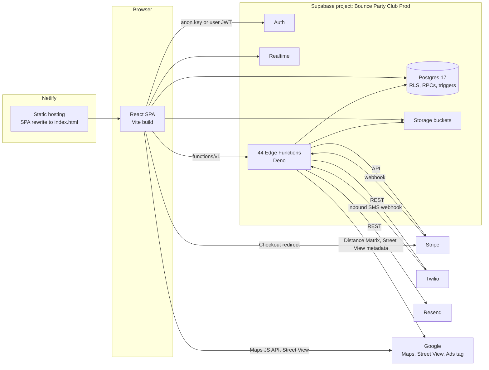
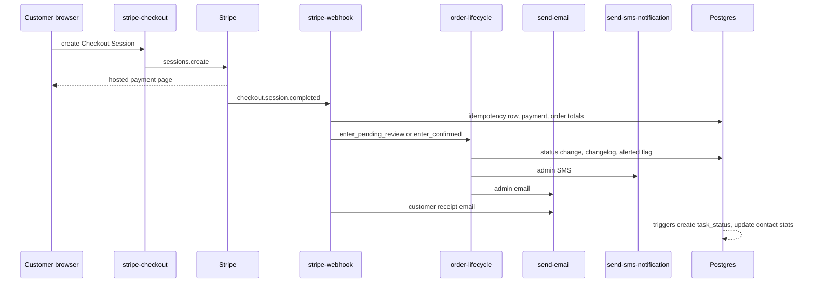
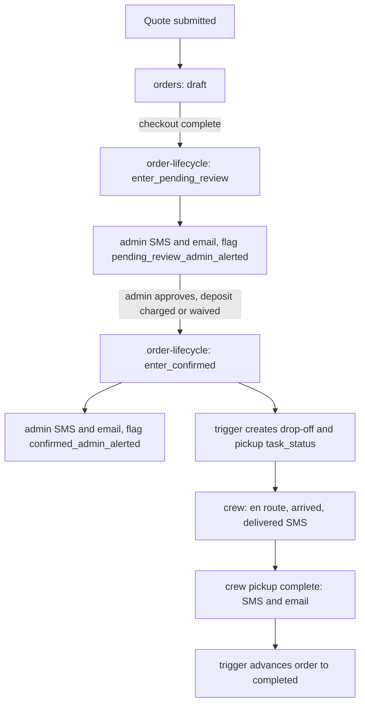

# Architecture

Scope: describes the application as deployed in Production (branch main; Supabase project qaagfafagdpgzcijnfbw).

## Overview

The application is a React single-page app backed entirely by Supabase (Postgres database + Deno edge functions). There is no separate API server. All business logic runs either in the browser or in Supabase edge functions. The frontend communicates with the database through the Supabase JS client and through edge function HTTP calls.

---

## Provider Stack

`App.tsx` wraps the entire application in a nested provider hierarchy. Order matters — inner providers can consume outer ones.

```
ErrorBoundary
  BrowserRouter
    BusinessProvider       — loads eight business-identity keys from admin_settings into context (name, address, phone, email, website, license number)
      AuthProvider         — manages user session, roles, OAuth, consent draining
        CustomerProfileProvider  — loads customer profile data for logged-in customers
          GoogleAdsTag           — injects the Google Ads tag on public routes (renders nothing)
          OAuthRedirectHandler   — follows the ?next= parameter after OAuth sign-in (renders nothing)
          Suspense (loading spinner fallback)
            Routes / Pages
```

### BusinessProvider (`src/contexts/BusinessContext.tsx`)

Loaded once on app mount. Reads eight keys from the `admin_settings` table and exposes them as a plain object with snake_case keys (read with the `useBusinessSettings()` hook):
- `business_name`, `business_name_short`, `business_legal_entity`
- `business_address`, `business_phone`, `business_email`, `business_website`
- `business_license_number`

`business_address` is not read from the table row; it is replaced by the result of `getBusinessAddressText()` (`src/lib/adminSettingsCache.ts`). Hard-coded defaults are used until the load finishes or if it fails (`Bounce Party Club`, `Bounce Party Club LLC` for the legal entity, `(313) 889-3860`, `info@bouncepartyclub.com`, `https://bouncepartyclub.com`; the short name defaults to `Bounce Party Club` and the license number and address to an empty string).

The provider reads `admin_settings` directly through the Supabase client under row-level security, and the `admin_settings` SELECT policy allows only `admin` and `master` users. For visitors and customers the table read returns no rows, so those seven keys stay at their defaults (`business_website` has no row in Production, so its default applies to everyone) and only the address (from the `get_public_business_settings` RPC) reflects the stored value. If the table read returns an error, the provider keeps the defaults including the empty address.

Logo and social media URLs (`logo_url`, `facebook_url`, `instagram_url`) are available separately through the `get_public_business_settings` RPC via `adminSettingsCache.ts`.

Used throughout for display, email templates, and dynamically generated waiver text.

### AuthProvider (`src/contexts/AuthContext.tsx`)

Manages authentication state and exposes:

```typescript
{
  user: any                  // typed `any` in the code
  role: 'master' | 'admin' | 'crew' | 'customer' | null
  roles: string[]            // a one-element array (see below)
  loading: boolean
  isAdmin: boolean
  isMaster: boolean
  signIn(email, password): Promise<void>
  signInWithGoogle(destinationPath?): Promise<void>
  signInWithApple(destinationPath?): Promise<void>
  signUp(email, password, metadata): Promise<void>
  signOut(): Promise<void>
  hasRole(role): boolean     // lowercases its argument
}
```

Roles are read with `.maybeSingle()` on `user_roles` filtered by user id, and the value is lower-cased, so the client holds one role per user. The database constraint is `UNIQUE (user_id, role)`, so it does not by itself limit a user to one row; in Production each of the 9 role rows belongs to a different user. The role is re-read on every auth state change that carries a user (not only `SIGNED_IN`).

On the initial session load and on every auth state change to `SIGNED_IN`, AuthProvider also runs the consent draining flow (see AUTH_AND_ROLES.md).

Status: partially implemented. Pending consent is captured at signup in `pending_signups_consent` and the client requests the drain on sign-in. The drain into the permanent `user_consent_log` is not yet active (see the `record-consent` entry below).

### CustomerProfileProvider (`src/contexts/CustomerProfileContext.tsx`)

Loads the logged-in customer's profile data and exposes it for prefilling the quote/checkout forms. Implements retry logic (the first query plus up to 6 retries, 800ms apart, so at most 7 queries) to handle the delay between auth signup and profile creation.

Exposes:
- `profile` — a mapped subset of the `customers` record linked to the current user (`id`, `firstName`, `lastName`, `email`, `phone`, `businessName`), with the customer's default address nested inside it as `defaultAddress` (`id`, `line1`, `line2`, `city`, `state`, `zip`)
- `sessionData` — ephemeral form data for the current quote/checkout session
- `updateSessionData(partial)` — updates session data
- `resetSessionData()`, `loading`, `refreshProfile()`

If no `customers` row is found after the retries, the provider calls the `backfill-oauth-customers` edge function (bearer = the user's access token) as a fallback; when that call succeeds it restarts the load from the first query. The default address is the address with the customer's `default_address_id`; when there is none it falls back to the address of the customer's latest order. `refreshProfile()` sets `loading`, clears the initialized flag and reloads.

---

## Routing

Routes are defined in `App.tsx` using React Router v6. Page components are lazy-loaded to minimize initial bundle size, except `Home`, which is imported eagerly. The standalone pages (`/setup`, `/login`, `/signup`, `/forgot-password`, `/reset-password`, `/invoice/view/:orderId`, `/invoice-preview`, `/menu-preview`, `/sign/:orderId`, `/i/:shortCode`, `/customer-portal`, `/receipt/...`, `/payment-complete`, `/payment-canceled`, `/checkout/:orderId`) render outside the shared `Layout`; the remaining routes (`/`, `/catalog`, `/units/:slug`, `/quote`, `/contact`, `/checkout`, `/about`, `/my-orders`, `/admin...`, `/crew/*`) are children of the `Layout` route.

### Public Routes (no auth required)

| Path | Page |
|---|---|
| `/` | Home |
| `/catalog` | Unit catalog |
| `/units/:slug` | Unit detail |
| `/quote` | Quote / booking form |
| `/checkout/:orderId` | Checkout (Stripe payment); `/checkout` without an id is also routed to the same page |
| `/payment-complete` | Post-payment confirmation |
| `/payment-canceled` | Payment canceled |
| `/invoice/view/:orderId` | Invoice page for an order id. There is no `/invoice/:token` route. |
| `/invoice-preview` | Invoice preview page (internal; excluded from Google Ads tracking) |
| `/customer-portal/:orderId` and `/customer-portal` | Customer self-service portal (no login required; both forms are routed) |
| `/i/:shortCode` | Short link redirect — the browser queries `invoice_links` directly for the `short_code` and redirects to `/customer-portal/:orderId?t=:token` |
| `/setup` | First-time setup page (`Setup.tsx`); see AUTH_AND_ROLES.md |
| `/receipt/:orderId/:paymentId` | Payment receipt |
| `/sign/:orderId` | Electronic waiver signing |
| `/menu-preview` | Unit menu (printable) |
| `/login` | Login |
| `/signup` | Sign up |
| `/forgot-password` | Password reset request |
| `/reset-password` | Password reset form |
| `/contact` | Contact page |
| `/about` | About page |

### Protected Routes

| Path | Required Role(s) |
|---|---|
| `/my-orders` | customer, admin, crew, master |
| `/admin` | admin, master |
| `/admin/inventory/new` and `/admin/inventory/edit/:id` | admin, master |
| `/crew` and `/crew/*` (one route, `crew/*`) | admin, crew, master |

`ProtectedRoute` in `src/components/common/ProtectedRoute.tsx` handles enforcement. It takes an `allowedRoles` prop with UPPERCASE values (`'ADMIN' | 'CREW' | 'MASTER' | 'CUSTOMER'`); `ADMIN` and `MASTER` both resolve to `isAdmin`, the others go through `hasRole()` (which lower-cases). Unauthenticated users are redirected to `/login`. Authenticated users without the required role see an "Access Denied" screen.

---

## Database Tables

All 55 tables live in the `public` schema, with row-level security enabled on all of them (the schema has no views):

| Table | Purpose |
|---|---|
| `address_lot_pictures` | Lot photos saved directly to a canonical address record, linking future deliveries to known setup-location photos |
| `addresses` | Canonical address records with lat/lng geocoding and a unique `address_key` for deduplication |
| `admin_settings` | Key-value store for runtime configuration (33 keys in Production). Holds business identity keys, home address keys (`home_address_*` including lat/lng), `logo_url`, `facebook_url`, `instagram_url`, `google_review_url`, `stripe_publishable_key`, `admin_*` contact keys, and the switches `apply_travel_fee_by_default`, `use_business_address_for_travel` and `carousel_show_arrows`. Integration credentials (Stripe, Twilio, Resend, Google OAuth) are also stored as keys; values are not documented here. Row-level security allows only `admin` and `master` to select, insert, update or delete. |
| `admin_settings_changelog` | Audit log of settings changes; values of keys whose name matches the redaction rule (see `redact_sensitive_changelog_values()`) are replaced by trigger |
| `auth_trigger_logs` | Debugging log for Postgres auth trigger execution steps |
| `billing_addresses` | Billing address records keyed by `order_id` / `customer_id` (`line1`, `line2`, `city`, `state`, `zip`, `source`). Status: partially implemented. The table exists in Production with RLS (anon and authenticated insert, admin read) and holds one row with source `checkout`. No code in `main` reads or writes it; the billing address collected at checkout is stored on the `orders.billing_*` columns. |
| `blackout_addresses` | Specific delivery addresses blocked from new bookings |
| `blackout_contacts` | Specific customers (by email or phone) blocked from placing orders |
| `blackout_dates` | Date ranges blocking new bookings; `block_type` is `full` or `same_day_pickup`; `recurrence` is `one_time` or `annual` (check constraint; there is no `weekly`) with optional `expires_at` |
| `consent_records` | Per-order SMS and card-on-file consent records with IP and user agent |
| `contacts` | Deduplicated phonebook — one record per unique customer across all orders; maintains lifetime stats via triggers |
| `crew_location_history` | GPS breadcrumbs from crew members during deliveries (lat/lng, accuracy, speed, heading) |
| `customer_profiles` | Extended profile linked to auth users (notification preferences, name) |
| `customers` | Customer records linked to orders and optionally to auth users (`user_id` FK, `default_address_id`, `oauth_provider`, `oauth_profile_data`) |
| `daily_mileage_logs` | Crew odometer readings for gas mileage expense tracking per shift |
| `documents` | General document storage (kind + url + optional metadata JSON) |
| `email_templates` | Admin-managed email template content by category (configurable subject, header, body, theme) |
| `google_calendar_sync` | Per-event-date record of last Google Calendar sync state and event ID |
| `google_calendar_sync_queue` | Queue of pending calendar sync operations triggered by order status changes |
| `google_reviews` | Admin-managed customer review records displayed on the homepage |
| `hero_carousel_images` | Homepage carousel media entries (images and videos) with display order |
| `invoice_links` | Secure tokenized links for customer invoice/portal access. Contains a unique 64-char hex `link_token` (default `encode(gen_random_bytes(32), 'hex')`) for direct URL access and an optional 8-char alphanumeric `short_code` (partial unique index) for compact SMS links. The `link_type` column (default `invoice`; the code also writes `portal_shortlink`) distinguishes creation context. The column default for `expires_at` is 7 days from creation; the application and the `sync_invoice_links_expires_at` trigger set it to event date plus 3 days. |
| `invoices` | Invoice records with status tracking (`draft`, `sent`, `partial`, `paid`, `cancelled`; check constraint) |
| `messages` | Notification dispatch log — records what was sent (template key, channel, payload, status). Does NOT store message body text. Distinct from `sms_conversations`. |
| `notification_failures` | Log of email/SMS send failures with recipient, error, and resolution status |
| `notification_system_status` | Real-time health status of email and SMS subsystems with consecutive failure counts |
| `order_changelog` | Full audit trail of every edit, status change, payment, and cancellation on an order |
| `order_custom_fees` | Admin-added custom fee line items on an order |
| `order_discounts` | Discount line items applied to an order (fixed amount or percentage) |
| `order_items` | Rental units included in an order with price snapshot and wet/dry mode |
| `order_lot_pictures` | Photos of the event lot submitted before/after setup; includes an `address_id` FK for linking to canonical address records |
| `order_notes` | Internal admin-only notes on an order |
| `order_pictures` | General order photos (delivery, damage) stored in `order-pictures` bucket |
| `order_refunds` | Refund records linked to Stripe refund IDs |
| `order_signatures` | ESIGN-compliant waiver signatures with full waiver text snapshot, IP, user agent, device info, signer home/event address, initials (`initials_data`), and typed name; also holds the `physical_waiver_*` columns for uploaded paper waivers |
| `order_workflow_events` | Crew workflow events (en route, arrived, setup complete, etc.) with optional GPS and ETA |
| `orders` | The central order record — all bookings live here (see Orders table section below) |
| `payments` | Payment ledger records (`type` check constraint allows only `deposit`, `balance`, `incidental`) with `ledger_sequence`, Stripe fee breakdown (`stripe_fee_amount`, `stripe_net_amount`), brand/last4, and `order_financials_applied` flag |
| `pending_signups_consent` | Staging table keyed by `user_id` (`batch_id`, `consents`, `source`, `user_agent_hint`). `SignUp.tsx` writes it directly after signup. Status: partially implemented. Pending consent is stored at signup. It is not yet drained into `user_consent_log` (see `record-consent` under Edge Functions). |
| `pricing_rules` | Single-row pricing configuration (zones, fees, multipliers, deposit settings, tax toggle) |
| `rate_limits` | Per-identifier request rate limiting with sliding window |
| `route_stops` | Delivery/pickup stop records per order (`type`, `eta`, `checkpoint`, GPS position and calculated ETA fields) |
| `saved_discount_templates` | Admin-saved discount presets for quick application |
| `saved_fee_templates` | Admin-saved custom fee presets for quick application |
| `site_events` | Analytics event log (page views, unit views, cart and checkout funnel events; see Analytics Tracking) |
| `sms_conversations` | Inbound/outbound SMS thread per order; `is_admin_internal` flag marks internal crew messages |
| `sms_message_templates` | Admin-managed SMS message templates with variable substitution |
| `stripe_webhook_events` | Idempotency log for processed Stripe webhook events |
| `task_status` | Crew task cards — one per confirmed order per task type — tracking day-of workflow with JSONB `delivery_images` and `damage_images` arrays |
| `transaction_receipts` | Immutable financial audit log with unique receipt numbers and `receipt_group_id` for grouped multi-type charges |
| `unit_media` | Images and videos for each rentable unit with `mode` (check constraint allows `dry` or `water`), `visibility_mode`, and `is_featured` flag |
| `units` | Inventory — each bounce house, water slide, or combo unit with `types` array and `active` boolean |
| `user_consent_log` | Permanent record of user consent decisions (SMS, card-on-file) with batch idempotency |
| `user_permissions_changelog` | Audit log of all role grant/revoke actions with actor email embedded at write time |
| `user_roles` | Role assignments per auth user (master, admin, crew, customer); columns `id`, `user_id`, `role`, `created_at`; `UNIQUE (user_id, role)`; no check constraint on `role`. Production holds 9 rows: 5 `master` and 4 `customer`. |

### Orders Table — Key Columns

The `orders` table is the most complex record in the system. Notable columns beyond the obvious (event_date, address_id, subtotal_cents, etc.):

| Column | Purpose |
|---|---|
| `status` | Order lifecycle status (see Order Status Model below). Allowed values (`orders_status_check`): `draft`, `pending_review`, `awaiting_customer_approval`, `confirmed`, `in_progress`, `completed`, `cancelled`, `void`. Code always supplies the value on insert. |
| `workflow_status` | Crew operational status (default `'pending'`; check constraint `orders_workflow_status_check` allows the eight values in Workflow Status below; separate from order `status`) |
| `event_end_date` | End date for multi-day rentals |
| `event_start_time` / `pickup_time` / `event_end_time` | Precise event and pickup times |
| `start_window` / `end_window` | Delivery arrival window |
| `pickup_preference` | `same_day` or `next_day` (check constraint) |
| `until_end_of_day` | Whether the equipment can stay until end of event day |
| `overnight_allowed` | Whether overnight is permitted for this order |
| `can_use_stakes` | Whether ground stakes are allowed (affects surface fee) |
| `location_type` | `residential` or `commercial` (check constraint; affects pricing multiplier) |
| `surface` | Surface type; check constraint allows only `grass` or `cement` |
| `has_pets` | Whether pets are present (displayed to crew) |
| `special_details` | Free-text field for extra setup instructions |
| `generator_selected` | Boolean — whether generator was requested |
| `generator_qty` | Number of generators requested (integer) |
| `generator_fee_cents` | Generator fee amount captured at booking |
| `tip_cents` | Tip amount (tracked separately, excluded from balance due calculations) |
| `deposit_required` | Whether a deposit is required |
| `custom_deposit_cents` | Admin-overridden deposit amount (overrides percentage-based calculation) |
| `deposit_due_cents` | Final deposit required at confirmation |
| `deposit_paid_cents` | Amount collected toward deposit (default 0). |
| `payment_lock` | Boolean (default `false`) claimed by `charge-deposit` (`update ... set payment_lock = true where payment_lock = false`) to prevent concurrent charges |
| `balance_due_cents` | Outstanding balance |
| `balance_paid_cents` | Amount collected toward balance |
| `damage_charged_cents` | Amount charged for equipment damage |
| `total_refunded_cents` | Total amount refunded |
| `travel_fee_cents` | Calculated travel fee |
| `travel_total_miles` | Total driving miles to event address |
| `travel_base_radius_miles` | Free-travel radius at booking time |
| `travel_chargeable_miles` | Miles beyond free radius |
| `travel_per_mile_cents` | Per-mile rate at booking time |
| `travel_is_flat_fee` | Whether a ZIP-code zone flat rate was applied |
| `surface_fee_cents` | Surface/sandbag fee |
| `same_day_pickup_fee_cents` | Same-day pickup surcharge |
| `same_day_weekday_delivery_fee_cents` / `same_day_weekday_delivery_fee_waived` / `same_day_weekday_delivery_fee_waive_reason` | Same-day weekday delivery surcharge and its waiver |
| `parks_acknowledgment_required` / `parks_acknowledgment_county` | Parks acknowledgment flag and county (latest applied migration `20260928120000_add_parks_acknowledgment_system`) |
| `tax_cents` | Tax amount |
| `tax_waived` / `tax_waive_reason` | Admin tax waiver with required reason |
| `travel_fee_waived` / `travel_fee_waive_reason` | Admin travel fee waiver |
| `same_day_pickup_fee_waived` / `same_day_pickup_fee_waive_reason` | Admin same-day fee waiver |
| `surface_fee_waived` / `surface_fee_waive_reason` | Admin surface fee waiver |
| `generator_fee_waived` / `generator_fee_waive_reason` | Admin generator fee waiver |
| `stripe_customer_id` | Stripe customer token |
| `stripe_payment_method_id` | Saved Stripe payment method ID for off-session charges |
| `stripe_payment_status` | Stripe-specific status (column default `'unpaid'`); set to `'paid'` even for zero-deposit approvals to signal payment obligation satisfied |
| `payment_method_brand` | Card brand (Visa, Mastercard, etc.) |
| `payment_method_last_four` | Last four digits of saved card |
| `payment_method_exp_month` / `payment_method_exp_year` | Card expiration date (used for expiring card monitoring) |
| `payment_method_validated_at` | When the payment method was last validated |
| `customer_selected_payment_cents` | What the customer indicated they would pay (reconciled after webhook) |
| `customer_selected_payment_type` | `deposit`, `balance`, or `custom` |
| `require_card_on_file` | Whether checkout must save a card even with no immediate charge |
| `clear_payment_info` | Signals saved Stripe payment method should be cleared (set when items/deposit increase) |
| `admin_message` | Admin-written message visible to customer in the portal |
| `edit_summary` | Summary of changes sent to customer when approval is requested |
| `awaiting_customer_approval` | Boolean flag set during approval-required edit flow |
| `customer_approval_requested_at` / `customer_approved_at` | Timestamps for the approval workflow |
| `refund_requested` | Whether the customer requested a refund on cancellation |
| `cancellation_reason` / `cancelled_at` / `cancelled_by` | Cancellation metadata |
| `same_day_responsibility_accepted` | Customer acceptance of same-day responsibility clause |
| `overnight_responsibility_accepted` | Customer acceptance of overnight responsibility clause |
| `sms_consent` / `sms_consent_text` / `sms_consented_at` | SMS marketing consent captured at checkout |
| `card_on_file_consent` / `card_on_file_consent_text` / `card_on_file_consented_at` | Card-on-file authorization consent |
| `e_signature_consent` | Whether electronic signature consent was accepted |
| `waiver_signed_at` | Timestamp of waiver signing |
| `signed_waiver_url` | URL to the generated signed waiver PDF |
| `signature_id` | FK to `order_signatures` |
| `waiver_signature_data` | Raw canvas signature data (stored for audit before PDF generation) |
| `lot_pictures_requested` / `lot_pictures_requested_at` | Whether and when admin requested lot photos |
| `invoice_sent_at` / `invoice_accepted_at` | Invoice distribution and acceptance timestamps |
| `booking_confirmation_sent` | Deduplication flag — prevents duplicate booking confirmation emails |
| `pending_review_admin_alerted` / `confirmed_admin_alerted` | Deduplication flags for admin SMS/email notifications |
| `current_eta` | Crew ETA timestamp updated as route progresses |
| `billing_address_line1` / `billing_address_line2` / `billing_city` / `billing_state` / `billing_zip` | Billing address collected from Stripe Checkout (separate from event address) |
| `referral_source` / `referral_source_detail` | How the customer found the business and a free sub-detail. Check constraint allows `NULL` or `social_media`, `google`, `physical_marketing`, `referral`, `returning_customer`, `other` |
| `archived_at` | Timestamp when order was archived (soft delete for completed/old orders) |

---

### Pricing Rules Table

Single-row configuration table (one row for the whole system). All pricing options:

| Column | Purpose |
|---|---|
| `base_radius_miles` | Free travel radius from home base (live value `15.00`) |
| `per_mile_after_base_cents` | Per-mile charge beyond base radius (live value `300`) |
| `included_cities` | Array of city names with free travel (newer format) |
| `included_city_list_json` | JSONB array of free cities (legacy/alternative format) |
| `zone_overrides_json` | JSONB array of `{ "zip": "<ZIP>", "flat_cents": <integer> }` objects, one per ZIP code flat fee (overrides distance-based); currently empty |
| `residential_multiplier` | Price multiplier for residential orders (e.g., `1.0`) |
| `commercial_multiplier` | Price multiplier for commercial orders (e.g., `1.0` — currently same as residential) |
| `surface_sandbag_fee_cents` | Fee charged when sandbags/stakes are needed |
| `same_day_pickup_fee_cents` | Surcharge for same-day pickup |
| `same_day_matrix_json` | JSONB array (currently empty) for same-day pricing (not currently active in the pricing engine) |
| `overnight_holiday_only` | Setting that overnight rentals are limited to holiday dates (live value `true`). It is loaded into the pricing rules object; `calculatePrice` does not read it. |
| `extra_day_pct` | Percentage of day-1 price charged for each additional day (live value `50.00` = 50% for days 2+; the code divides by 100) |
| `same_day_weekday_delivery_fee_cents` | Surcharge for same-day weekday delivery (see Pricing Calculation) |
| `generator_price_cents` | Legacy generator fee (superseded by single/multiple split) |
| `generator_fee_single_cents` | Fee for one generator |
| `generator_fee_multiple_cents` | Fee for each additional generator beyond the first |
| `deposit_per_unit_cents` | Flat deposit per unit (e.g., $50/unit) |
| `deposit_percentage` | Deposit percentage setting (live value `0.25`); not currently active in the pricing engine |
| `apply_taxes_by_default` | Whether tax is applied by default on new orders |

### Unit Media Table

Each unit can have multiple media items. Key columns:

| Column | Purpose |
|---|---|
| `mode` | Which setup mode the image shows; the check constraint allows only `dry` or `water` |
| `visibility_mode` | Controls which mode tab this image appears under |
| `is_featured` | Whether this is the primary image shown on catalog/detail pages |
| `sort` | Display order within a unit's gallery |

### Consent Records Table

Per-order consent records (collected at checkout / invoice acceptance). Distinct from `user_consent_log` (which is per-user post-signup):

| Column | Purpose |
|---|---|
| `order_id` | Which order this consent was captured for |
| `consent_type` | Type: `sms`, `card_on_file`, `electronic_signature` (the values stored in Production) |
| `consented` | Boolean |
| `consent_text` | Exact text the customer agreed to (snapshot) |
| `consent_version` | Version of the consent language shown |
| `consented_at` | When consent was given |
| `ip_address` / `user_agent` | Audit trail |

### Email Templates Table

Admin-editable email template content, managed from the admin Message Templates tab:

| Column | Purpose |
|---|---|
| `template_name` | Unique identifier |
| `subject` | Email subject line with `{variable}` placeholders |
| `description` | Human-readable description of when this template is used |
| `header_title` | Text shown in the email header banner |
| `content_template` | Email body with `{variable}` placeholders |
| `theme` | Color theme: `primary`, `success`, `warning`, `error` (check constraint) |
| `category` | Template category (check constraint: `booking`, `order`, `notification`, `admin`, `system`) |

### Contacts Table — Loyalty Fields

The `contacts` table (unique by `email`) maintains auto-updated lifetime statistics for each customer via two database triggers on `orders`. `trigger_update_contact_stats` fires after an insert or a `status` update; `update_contact_stats_trigger` fires after any update and, being later in trigger-name order, runs second, so on an order update its values for `total_bookings` and `total_spent_cents` are the last written:

| Column | Purpose |
|---|---|
| `total_bookings` | Order count for this contact's customer. `update_contact_booking_stats()` counts orders whose status is not `draft`, `void` or `cancelled`; `update_contact_stats()` (a second trigger on `orders` updates) counts all orders for the customer email |
| `total_spent_cents` | Lifetime value. `update_contact_booking_stats()` sums subtotal, travel, surface, same-day pickup and generator fees and tax, plus custom fees, minus discounts, for orders not in `draft`, `void` or `cancelled` (refunds are not subtracted). `update_contact_stats()` sums the same fee columns without custom fees or discounts for orders in `confirmed`, `approved` or `completed` |
| `completed_bookings_count` | Count of completed (not just confirmed) orders |
| `first_completed_booking_date` / `last_completed_booking_date` | Earliest and latest `event_date` among completed orders |
| `is_repeat_customer` | Set to `true` when `completed_bookings_count > 1` (that is, 2 or more) |
| `tags` | Admin-assigned text tags array for segmentation |
| `opt_in_sms` / `opt_in_email` | Marketing consent flags |

---

A centralized query layer exists in `src/lib/queries/`; components, pages and hooks may also call `supabase.from(...)` or `supabase.rpc(...)` directly.

### `executeQuery<T>()` — `src/lib/queries/base.ts`

Query-layer functions are wrapped in this function:

```typescript
executeQuery<T>(
  queryFn: () => Promise<{ data: T | null; error: any }>,
  options?: { throwOnError?: boolean; context?: string }
): Promise<{ data: T | null; error: any }>
```

It standardizes error logging, optional throwing, and returns a consistent `{ data, error }` shape.

### Query Modules

| Module | File | Purpose |
|---|---|---|
| Orders | `queries/orders.ts` | Full order CRUD, status updates, list views |
| Customers | `queries/customers.ts` | Customer lookup, upsert, linking to auth users |
| Contacts | `queries/contacts.ts` | Phonebook operations, loyalty stats |
| Units | `queries/units.ts` | Inventory queries, availability |
| Pricing | `queries/pricing.ts` | `pricing_rules` table read/write |
| Payments | `queries/payments.ts` | Payment record queries and ledger operations |
| Invoices | `queries/invoices.ts` | Invoice and invoice link queries |
| Tasks | `queries/tasks.ts` | `task_status` queries with the related order |

`queries/index.ts` re-exports `base` and all eight modules.

### Standard Select Shapes

Two reusable select strings are defined in `base.ts`:

- **`STANDARD_ORDER_SELECT`** — Full nested join: customers, addresses, order_items with units, payments, discounts, custom_fees. Used wherever a complete order object is needed.
- **`COMPACT_ORDER_SELECT`** — Minimal join: customers and addresses only. Used in list views.

The convention is `maybeSingle()` (not `single()`) when fetching zero or one row.

---

## Order Status Model

Orders move through two independent status dimensions:

### Order Status (`src/lib/constants/statuses.ts`)

```
draft → pending_review → awaiting_customer_approval → confirmed → in_progress → completed
                                                                          ↘ cancelled
                                                                          ↘ void
```

| Status | Meaning |
|---|---|
| `draft` | Created but not yet submitted |
| `pending_review` | Customer submitted; awaiting admin action |
| `awaiting_customer_approval` | Admin sent modified order back for customer review |
| `confirmed` | Admin approved; deposit charged or waived |
| `in_progress` | Crew is actively delivering/setting up |
| `completed` | Event finished, pickup done |
| `cancelled` | Cancelled by admin or customer |
| `void` | Administratively voided (no charge) |

The diagram above shows the main path only. Transitions are enforced by the `validate_order_status_transition` trigger function (trigger `validate_status_transition` on `orders`), which raises an exception for anything else. The same-status "transition" (no change) is always permitted. The graph in the live function:

| From | Allowed next statuses |
|---|---|
| `draft` | `pending_review`, `confirmed`, `cancelled`, `void` |
| `pending_review` | `awaiting_customer_approval`, `confirmed`, `cancelled`, `void` |
| `awaiting_customer_approval` | `confirmed`, `pending_review`, `cancelled` |
| `confirmed` | `awaiting_customer_approval`, `in_progress`, `cancelled`, `void` |
| `in_progress` | `completed`, `cancelled`, `void` |
| `completed`, `cancelled`, `void` | none (terminal; "Cannot change status from terminal state") |

The client-side state machine is in `src/lib/orderStateMachine.ts`.

### Workflow Status (crew operations, stored on `orders.workflow_status`)

```
pending → on_the_way → arrived → setup_in_progress → setup_completed
        → pickup_scheduled → pickup_in_progress → completed
```

Tracks the crew's physical progress on event day, independent of order lifecycle status.

### Payment Status (derived)

Computed from order amounts, not stored directly, via `getPaymentStatus(order)` in `src/lib/constants/statuses.ts`:

- `paid_in_full` — `deposit_paid_cents + balance_paid_cents >= deposit_due_cents + balance_due_cents` (checked first)
- `deposit_paid` — not paid in full and `deposit_paid_cents > 0`
- `payment_due` — otherwise

---

## All-Cents Convention

Every monetary value in the database and throughout the codebase is stored in **cents** (integer). There are no decimal dollar amounts in the data layer. Display formatting is handled at the UI layer only.

---

## Database Migrations

Migrations live in `supabase/migrations/` and are applied sequentially by timestamp prefix. Each migration begins with a multi-line comment block summarizing the change.

Production has 277 applied migrations (latest applied: version `20260928172217`, name `20260928120000_add_parks_acknowledgment_system`).

Rules:
1. Name files `YYYYMMDDHHMMSS_short_description.sql`
2. Begin with a `/* */` comment block: what changed, why, new tables/columns, security notes
3. Use `IF EXISTS` / `IF NOT EXISTS` on all DDL
4. Every new table must immediately have `ALTER TABLE ... ENABLE ROW LEVEL SECURITY`
5. Never use `DROP` on columns or tables — use nullable additions or soft-delete patterns
6. Never use `BEGIN` / `COMMIT` / `ROLLBACK` — Supabase runs migrations in auto-commit mode

---

## Edge Functions

Edge functions live in `supabase/functions/`. Each is a standalone Deno module. Shared utilities live in `supabase/functions/_shared/`.

### Shared Utilities (`_shared/`)

| File | Purpose |
|---|---|
| `cors.ts` | Standard CORS headers (`Access-Control-Allow-Origin: *`, methods `GET, POST, PUT, DELETE, OPTIONS`) and a preflight helper |
| `admin-settings.ts` | Helper to read the `admin_settings` key-value table (`getAdminSetting`, `getMultipleAdminSettings`) with a per-instance in-memory cache of 5 minutes |
| `format-order-id.ts` | Canonical order ID formatting — first 8 chars of UUID uppercased (e.g., `D2BD1A2F`) |
| `fmt.ts` | Currency and date formatting utilities for edge function templates |
| `payment-validation.ts` | Shared payment amount validation logic |
| `payment-receipt-email.ts` | Shared HTML receipt email builder used by multiple payment functions |
| `rate-limit.ts` | Per-identifier windowed rate limiting via the `check_rate_limit` RPC and the `rate_limits` table (the window starts at the first request; an identifier that reaches three times the limit within a window is blocked for 5 minutes). Used by `stripe-checkout` (5/60s per ip+order), `stripe-charge` (3/60s), `stripe-refund` (2/60s) and `charge-deposit` (10/60s). The config map also lists limits for `customer-balance-payment`, `customer-cancel-order`, `save-signature`, `send-invoice` and `send-sms-notification`, which do not call it. If the RPC errors the check allows the request. |
| `transaction-logger.ts` | Transaction receipt creation and admin notification; supports grouped receipts via `receipt_group_id` |
| `waiver-pdf.ts` | Shared waiver PDF rendering logic — used by both `generate-signed-waiver` (stores in bucket) and `generate-blank-waiver` (returns inline to browser) |
| `webhook-idempotency.ts` | Stripe webhook deduplication via `stripe_webhook_events` table |

Edge functions handle CORS preflight (`OPTIONS`) and include CORS headers on every response (see the conventions below for the two exceptions); several define their own inline CORS headers instead of importing `cors.ts`.

The JWT column below is the `supabase/config.toml` `verify_jwt` value for each function.

### Complete Edge Function Reference

| Function | JWT Required | Purpose |
|---|---|---|
| `auth-email-hook` | No | Retired. Returns HTTP 410; Supabase Auth sends auth emails with its built-in system. |
| `backfill-oauth-customers` | Yes | Per-caller only: reads the bearer token and creates a `customers` record for that one user if missing. Called as a fallback by `CustomerProfileContext`. |
| `backfill-payment-methods` | Yes | Data migration: reconciles Stripe payment method records; fills `payment_brand`/`last_four` from Stripe API. The caller's `user_roles.role` is compared to the literal upper-case values `ADMIN` and `MASTER`, and anything else gets 403; Production role rows are lower-case. |
| `calculate-route-mileage` | Yes | Reads `task_status` (with orders and addresses) for a date, calls the Google Distance Matrix API (`GOOGLE_MAPS_API_KEY`) and writes `daily_mileage_logs`. Allowed roles: master, admin, crew. Does not use `route_stops`. |
| `charge-deposit` | Yes | Charges saved payment method for deposit or balance. Race protection is the `orders.payment_lock` boolean (claimed with a conditional update, released afterwards), not a sentinel value. Called during order approval and day-of balance collection. Rate limited (10/60s). |
| `checkout-bridge` | No | Minimal HTML page served from the Supabase domain that relays payment completion from Stripe back to the checkout window via `window.opener.postMessage({ type: 'BPC_CHECKOUT_COMPLETE', orderId, session_id })` then calls `window.close()`. Exists because Stripe cannot redirect to localhost or arbitrary dev URLs. |
| `create-admin-user` | Yes | Creates the first admin account. Reads `email` and `password` (min 6 chars) from the body, returns 400 "Admin user already exists" if the `get_admin_users` RPC returns any row, otherwise creates the auth user and a `user_roles` row. The `user_roles` row is written with the role value `ADMIN`. Not currently used by the client (the `/setup` page creates the account directly). |
| `customer-balance-payment` | No | Allows customers to pay remaining balance via saved card on file or a new Stripe Checkout session |
| `customer-cancel-order` | No | Handles customer-initiated cancellation with reason and refund-request flag |
| `fix-payment-method` | No | Allows customer to update a saved card after a declined charge |
| `generate-blank-waiver` | No | Generates a blank (unsigned) waiver PDF using current `admin_settings` waiver text — returned inline for customer download; not stored in any bucket |
| `generate-signed-waiver` | No | Generates a completed signed waiver PDF; stores in `signed-waivers` bucket; uses shared `waiver-pdf.ts` renderer |
| `get-payment-method` | Yes | Takes `{ paymentMethodId }` and returns only `last4` and `brand` from Stripe |
| `get-session-metadata` | No | Takes `{ sessionId }`, retrieves the Stripe Checkout Session and returns its `metadata`, `payment_status` and `amount_total` |
| `get-stripe-publishable-key` | No | Returns Stripe publishable key (read from `admin_settings`) |
| `get-user-info` | Yes | Admin or master only (403 otherwise). Takes `{ user_ids }` (or `'all'`) and returns email, full name and created-at for those users via the auth admin API; also used by analytics to resolve crew display names |
| `get-waiver-status` | No | Takes `{ orderId, token? }`, checks if an order has a signed waiver and returns the PDF URL. Signed URLs for a physical (paper) waiver are returned only for a matching unexpired portal token or a signed-in admin, master or crew user. |
| `order-lifecycle` | No | Authoritative handler for order status transitions; sends admin SMS/email for `enter_pending_review` and `enter_confirmed` actions with idempotency guards |
| `promote-media` | Yes | Copies a photo from one source (lot, order, delivery) to the unit gallery or homepage carousel; re-verifies delivery URLs exist before promotion; requires `consent_confirmed: true` |
| `reconcile-balance-payment` | No | Verifies Stripe session on checkout return; uses `apply_balance_payment_financials` RPC with `order_financials_applied` flag for race-condition-safe idempotency |
| `record-cash-payment` | Yes | Admin, master or crew records a cash payment (atomic RPC + receipt logging) |
| `record-check-payment` | Yes | Records a check payment through the `record_check_payment` RPC. The RPC takes an optional check number; `payments` has no `notes` or `check_number` column in Production, so the check number is stored only in the `notes` of the `order_changelog` row (`change_type = 'check_payment'`). |
| `record-consent` | Yes | Records user consent (`drain-pending` moves `pending_signups_consent` rows into `user_consent_log`). Called by `AuthContext.tsx` (drain-pending) and `SignUp.tsx`. Status: partially implemented. The client calls are in place. The deployed function (version 37) has an empty `index.ts` (and the `main` source file is empty), so it is not yet active and pending consent is not drained into the permanent log; `user_consent_log` and `pending_signups_consent` both hold 0 rows. |
| `save-payment-method-from-session` | Yes | Saves Stripe payment method details after successful checkout session |
| `save-pending-consent` | No | Retired. Returns HTTP 410 (pending consent is stored at signup). |
| `save-signature` | No | Records waiver signature with full audit data; generates PDF asynchronously; sends email confirmation with PDF attachment |
| `upload-physical-waiver` | Yes | Accepts a physical (paper) waiver image upload from admin; stores in the private `physical-waivers` bucket using the service role key; multipart form. Accepts a signed-in admin, master or crew user, or a customer portal `token` (matched against `invoice_links.link_token`). Writes the `physical_waiver_*` columns on `order_signatures` and returns the storage path information |
| `save-signup-address` | No | Takes a bearer token for a valid user and saves a home address. Not currently used by the client; the signup address is written by the `auto_assign_customer_role` trigger from signup metadata. |
| `send-email` | Yes | Sends email via Resend with fallback SMS to admin on failure |
| `send-error-notification` | No | Sends admin alert for application errors |
| `send-invoice` | Yes | Generates and distributes invoice to customer via email/SMS; creates `invoice_links` record with both a 64-char token and 8-char short code; resolves origin from request header or env `SITE_URL` |
| `send-sms-notification` | Yes | Sends SMS via Twilio; `orderId` (camelCase) is used with `templateKey` for order lookup |
| `stripe-charge` | Yes | Direct Stripe charge (admin-initiated, outside checkout flow). Rate limited (3/60s). The caller's `user_roles.role` is compared to the literal upper-case values `ADMIN` and `MASTER`, and anything else gets 403; Production role rows are lower-case. |
| `stripe-checkout` | Yes | Creates a Stripe Checkout Session in `setup` or `payment` mode (not a Payment Intent); rate limited per ip+order (5/60s); performs server-side blackout check via the `check_date_blackout` RPC |
| `stripe-refund` | Yes | Issues Stripe refund and records in `order_refunds` |
| `stripe-webhook` | No | Processes Stripe webhook events with signature verification and idempotency; handles: `checkout.session.completed`, `payment_intent.succeeded`, `payment_intent.payment_failed`, `charge.refunded`, `setup_intent.succeeded`. |
| `sync-google-calendar` | Yes | Syncs confirmed orders to Google Calendar. Status: partially implemented. The sync function and queue tables exist. Calendar sync is not yet active (Google credentials are not configured and `auto_sync_google_calendar` is not attached to a trigger). |
| `twilio-status-callback` | Yes | Receives SMS delivery status updates from Twilio. Status: partially implemented. The handler is in place. Delivery-status callbacks from Twilio are not yet active. |
| `twilio-webhook` | No | Receives inbound SMS from customers and routes to conversations |

## Additional Functions Deployed in Production

Production runs 44 edge functions: the 39 above plus five that are deployed in the live project and do not have a folder in the `main` source tree (their `verify_jwt` setting is applied at deploy time and is not listed in `supabase/config.toml`). None of the five is called by the `main` frontend.

| Function | JWT Required | Purpose |
|---|---|---|
| `verify-payment` | Yes | Takes `{ sessionId, orderId }`, retrieves the Stripe Checkout Session (edge secret `STRIPE_SECRET_KEY`, API `2024-11-20.acacia`) and, if it is paid and the webhook has not yet processed the order, writes the payment fields to the order (`confirmed` for an invoice-link order, otherwise `pending_review`) and marks the matching `payments` row `succeeded`. Returns `alreadyProcessed` when the webhook got there first. |
| `backfill-card-details` | Yes | Maintenance utility: for orders with a saved payment method and a missing brand or last-four, retrieves the Stripe payment method (secret key from `admin_settings`) and fills `payment_method_brand` / `payment_method_last_four`. Returns `{ total, updated, failed }`. |
| `get-streetview-heading` | No | `GET ?lat=&lng=`: asks the Google Street View metadata API (edge secret `GOOGLE_MAPS_API_KEY`) for the nearest panorama and returns the compass heading from the panorama to the address (`heading: null` with a `reason` when there is none or it is within 2 m). |
| `create-order-short-link` | Yes | Takes `{ order_id }`, calls the `create_order_short_link` RPC with the service role and returns `{ short_code, portal_url }`. Status: partially implemented. The function is deployed; the order short link used by the app today is created by `createShortPortalLink()` in the browser. |
| `submit-contact-inquiry` | Yes | Validates a contact form payload (length limits, email, date and time formats), rate limits 3 requests per 300 s per IP, stores it in `contact_inquiries`, then emails the business address through `send-email` (`skipFallback: true`, reply-to set to the sender) and sets `email_sent`. Status: partially implemented. The function is deployed; the Contact page currently opens the visitor's mail client with a `mailto:` link, and the `contact_inquiries` table is not yet part of the Production schema. |

---

---

## Pricing Calculation

Pricing is computed in `src/lib/pricing.ts` using rules fetched from the `pricing_rules` table.

**Calculation order:**

1. Day 1 subtotal — sum of `(unit_price × qty)` for each item, multiplied by the location multiplier (`residential_multiplier` or `commercial_multiplier`) and rounded once on the sum.
2. Extra day charges — `day1Subtotal × (extra_day_pct / 100) × (numDays - 1)` (rounded)
3. Travel fee (see `travelFeeCalculator.ts`)
4. Surface fee — charged when surface is `cement` OR (`grass` AND stakes cannot be used). Amount: `surface_sandbag_fee_cents`.
5. Same-day pickup fee — charged when `location_type === 'commercial'` OR `!overnight_allowed`. Amount: `same_day_pickup_fee_cents` from `pricing_rules`.
6. Generator fee — single generator: `generator_fee_single_cents` (fallback to `generator_price_cents`, then a hard-coded 10000). Two or more: first at the single fee, each additional at `generator_fee_multiple_cents` (fallback to `generator_price_cents`, then a hard-coded 7500). Formula: `single_fee + (multiple_fee × (qty - 1))`. The quantity is `generator_qty` when greater than 0, otherwise 1 if a generator is selected.
7. Tax — 6% (hardcoded) applied to (subtotal + travel + surface + generator fees — does NOT include same-day pickup fee). Only applied if `apply_taxes_by_default` is enabled on `pricing_rules` (currently `false` in the live database — tax is OFF by default for new orders; the code treats a missing value as enabled).
7a. Same-day weekday delivery fee — `pricing_rules.same_day_weekday_delivery_fee_cents`, added to the total when the booking is a same-day weekday delivery (`is_same_day_weekday_delivery`). `isSameDayWeekdayDelivery(eventDate)` is true when the event date equals today's date in the `America/Detroit` time zone and that day is Monday through Friday. Like the same-day pickup fee, it is not part of the taxable base. It is stored on the order in `same_day_weekday_delivery_fee_cents` with its own waiver columns.
8. Deposit — `quantity_of_units × deposit_per_unit_cents` (falls back to 5000 cents when the column is empty; live value 5000, $50/unit). Admin can override per-order with `custom_deposit_cents`. The `deposit_percentage` column on `pricing_rules` is not currently active in the pricing engine.
9. Balance due — `Math.max(0, total_cents - deposit_due_cents)`

Any fee can be administratively waived with a documented reason. Waived fees are stored as boolean flags + reason text on the `orders` record.

**Note:** `same_day_matrix_json` is defined on `pricing_rules` and in the `PricingRules` interface; it is not currently active in `calculatePrice` (`pricing.ts`).

### Travel Fee Zones (`src/lib/travelFeeCalculator.ts`)

Three-tier lookup, evaluated in priority order:

1. **ZIP code zone override** — flat fee for specific ZIP codes (configured in `pricing_rules.zone_overrides_json` as `{ zip, flat_cents }` entries; exact ZIP string match). Sets `travel_is_flat_fee = true` and `zone_name = zip`.
2. **Free cities list** — zero travel fee for listed cities (case-insensitive match). The list used is `pricing_rules.included_cities || pricing_rules.included_city_list_json || []` — one or the other, not both combined. Displayed as "FREE".
3. **Distance-based** — per-mile charge beyond the base radius from home base: the `HOME_BASE` constant in `src/lib/constants.ts` (Wayne, MI 48184; lat 42.2808, lng -83.3863), not the `home_address_*` settings. Fee: `round((distance − base_radius_miles) × per_mile_after_base_cents)`. If address is within the base radius: also free, displayed as "Within Base".

### Distance Calculation (`src/lib/distanceCalculator.ts`)

Driving distance between the business home base and the event address is calculated using the Google Maps Distance Matrix API. The result (in miles) is stored on the order as `travel_total_miles`, `travel_base_radius_miles`, and `travel_chargeable_miles`. The travel fee display always shows total miles to the customer, not just chargeable miles. If Google Maps does not load within 5 seconds (or is unavailable), the calculator falls back to straight-line distance multiplied by 1.4.

---

## Availability Checking

`src/lib/availability.ts` provides:

- `checkDateBlackout(startDate, endDate)` — RPC call to `check_date_blackout` database function
- `checkUnitAvailability({ unitId, eventStartDate, eventEndDate, excludeOrderId }, precomputedBlackout?)` — checks for conflicting orders with a direct `order_items` query joined to `orders`; it does not call the `check_unit_availability` RPC
- `checkMultipleUnitsAvailability(...)` — batched version; deduplicates the blackout RPC call (only one call per unique date range, not per unit)
- `getUnavailableDatesForUnit(...)` — returns the blocked date ranges for a unit

Orders in these statuses block availability: `pending_review`, `awaiting_customer_approval`, `confirmed`, `in_progress`, `completed` (the client list also includes a legacy `approved` string that the `orders_status_check` constraint does not allow). If the blackout RPC returns an error the client treats the dates as not blocked; if the `order_items` query returns an error the unit is reported as unavailable.

Date overlap logic is inclusive on both ends. The `excludeOrderId` parameter allows checking availability for an order that is being edited without conflicting with itself.

Availability is checked at two trusted enforcement points:
1. Client-side in the quote form (prevents selection of blocked dates)
2. Server-side inside `stripe-checkout` before creating a Stripe session (cannot be bypassed). Blackout checks also distinguish between full blocks and same-day-pickup-only blocks.

---

## Database Functions and RPCs

The `public` schema has 68 functions (25 of them trigger functions); `check_unit_availability` appears twice as two overloaded signatures. Functions marked `SECURITY DEFINER` run with elevated privileges and perform their own checks internally.

### Business Logic RPCs

| Function | Security | Purpose |
|---|---|---|
| `apply_balance_payment_financials(p_pi_id, p_order_id, p_balance_cents, p_tip_cents, ...)` | DEFINER | Atomically updates `balance_paid_cents`/`deposit_paid_cents` on order using `order_financials_applied` flag for idempotency |
| `approve_order_changes(p_order_id, p_token, ...)` | DEFINER | Customer approves admin-requested order changes; optionally triggers payment |
| `archive_old_orders(threshold_days)` | DEFINER | Sets `archived_at` on `completed` and `cancelled` orders whose `event_date` is older than the threshold; returns the row count. The admin Orders screen calls it with 90 days. |
| `check_date_blackout(p_start, p_end)` | DEFINER | Returns `{ is_full_blocked, is_same_day_pickup_blocked }` for a date range, handling annual/recurring blackouts |
| `check_expiring_cards()` | DEFINER | Returns orders (not `completed`, `cancelled` or `void`) whose saved card expires, taken as the first day of the expiry month, within the next 30 days |
| `check_rate_limit(p_identifier, p_endpoint, p_max_requests, p_window_seconds)` | DEFINER | Windowed rate limiter; returns JSONB `{ allowed, requests_remaining, reset_at }` when allowed, or `{ allowed: false, reason, retry_after }` (`reason` is `rate_limit_exceeded`, `rate_limit_exceeded_blocked` or `temporarily_blocked`) |
| `check_unit_availability(p_unit_id, p_start_date, p_end_date, p_exclude_order_id?)` | DEFINER | Returns conflict count for a single unit (overloaded — also accepts array form) |
| `check_unit_availability(p_unit_ids[], p_start_date, p_end_date)` | DEFINER | Batch availability check across multiple units |
| `claim_balance_payment_financials(p_pi_id)` | DEFINER | Deprecated stub: always returns `claimed = false`. Callers use `apply_balance_payment_financials` instead. |
| `cleanup_old_rate_limits()` | DEFINER | Deletes `rate_limits` rows whose `window_start` is more than 1 hour old and that are not currently blocked; nothing schedules it |
| `generate_invoice_number()` | INVOKER | Returns next sequential invoice number from database sequence |
| `generate_receipt_group_id()` | INVOKER | Returns a new UUID for grouping related transaction receipts |
| `generate_receipt_number()` | DEFINER | Returns next sequential unique receipt number |
| `get_admin_analytics(p_start?, p_end?)` | DEFINER | Returns a JSONB object of business metrics for the admin analytics dashboard |
| `get_booking_source_analytics(p_start?, p_end?)` | DEFINER | Returns booking count and revenue grouped by referral source |
| `get_booking_sources_analytics(p_since, p_until?)` | DEFINER | Alternative booking source analytics with different time range parameters |
| `get_delivery_timing_analytics(...)` | DEFINER | Delivery timing analytics |
| `find_order_id_by_prefix(...)` | DEFINER | Resolves an order id from its short prefix |
| `increment_order_refunded_cents(...)` | DEFINER | Increments `orders.total_refunded_cents` |
| `update_pricing_rules(...)` | DEFINER | Updates the `pricing_rules` row |
| `get_order_by_token(p_token)` | DEFINER | Fetches order by invoice link token (used for tokenized customer access) |
| `get_order_with_relations_by_token(p_token)` | DEFINER | Returns full order with all relations as JSONB (used by Customer Portal) |
| `get_public_business_settings()` | DEFINER | Returns non-sensitive business settings for public display (branding, contact info) |
| `get_signature_status(order_uuid)` | DEFINER | Returns waiver signing status and PDF URL for an order |
| `get_unresolved_failures_count()` | DEFINER | Returns count of unresolved notification failures |
| `get_user_creation_logs(target_email)` | DEFINER | Intended as an admin debugging tool for sign-up traces. Status: partially implemented. The function body reads a table named `user_creation_logs`, which does not exist in the Production schema; the sign-up trace lives in `auth_trigger_logs`, which admins read directly (RLS). The function contains no caller check. |
| `get_user_order_prefill()` | DEFINER | Returns name, email, phone and address fields (with lat/lng) for the current authenticated user: the customer's default address, otherwise the address of the latest order that is not `draft` or `void` |
| `get_user_role(user_id_input)` | DEFINER | Returns a user's primary role |
| `is_admin()` | DEFINER | Returns boolean — whether the calling session user has a `user_roles` row whose role is exactly `ADMIN` or `MASTER` (upper case). Production role rows are lower-case, so it returns false for them. Used by the three `payments` admin policies (view, insert, update). |
| `order_has_valid_signature(order_uuid)` | DEFINER | Returns boolean — whether order has a valid waiver signature |
| `record_cash_payment(p_order_id, p_amount_cents, p_tip_cents, p_acting_user_id)` | DEFINER | Atomic: inserts payment row + updates order totals + logs changelog |
| `record_check_payment(p_order_id, p_amount_cents, p_tip_cents, p_acting_user_id, p_check_number?)` | DEFINER | Same as cash, but writes the check number to the `notes` of the `order_changelog` row (not to `payments`) |
| `record_notification_failure(p_type, p_recipient, p_subject, p_message_preview, p_error, p_context?)` | DEFINER | Logs a notification failure and increments consecutive failure counter |
| `record_notification_success(p_type)` | DEFINER | Resets consecutive failure counter for a notification type |
| `save_lot_picture_to_address(p_order_lot_picture_id)` | DEFINER | Copies a lot picture from an order to the canonical `address_lot_pictures` table |
| `upsert_contact_from_checkout(p_first_name, p_last_name, p_email, p_phone, ...)` | DEFINER | Creates or updates a contacts record from checkout form data |

### Role Management RPCs

| Function | Security | Purpose |
|---|---|---|
| `assign_role_by_email(p_email, p_role)` | DEFINER | Grants a role to a user identified by email. Caller must be admin or master; only master can assign `master` or `admin`. Returns `false` when no user has that email. Used by the Permissions tab. Status: partially implemented. The insert uses `ON CONFLICT (user_id)`, and `user_roles` has no unique constraint on `user_id` alone (only `(user_id, role)`), so the statement does not match a constraint and the call does not complete the insert. |
| `assign_user_role(target_user_id, target_role)` | DEFINER | Grants a role to a user identified by UUID (`ON CONFLICT (user_id, role) DO NOTHING`). Caller must be admin or master; only master can assign `master`. Not called by the client. |
| `remove_user_role(target_user_id, target_role)` | DEFINER | Revokes a specific role from a user. Caller must be admin or master; only master can remove `master`. Not called by the client. |
| `get_all_role_users()` | DEFINER | Returns `user_id, email, user_role, created_at` for users whose role is `master`, `admin` or `crew`; raises an exception unless the caller is admin or master. Feeds the Permissions tab. |
| `get_admin_users()` | DEFINER | Returns all users with `admin` or `master` role |
| `get_user_highest_role(check_user_id)` | DEFINER | Returns the highest role for a user |
| `user_has_role(check_user_id, check_role)` | DEFINER | Returns boolean — whether user has a specific role |

### Trigger Functions

Trigger functions are a mix of `SECURITY DEFINER` and `SECURITY INVOKER`. Triggers attached in Production (from `pg_trigger`):

| Trigger Function | Security | Fires On |
|---|---|---|
| `auto_assign_customer_role()` | DEFINER | Trigger `on_auth_user_created` on `auth.users`. See the status note below. |
| `auto_create_task_status()` | DEFINER | `orders` after insert or `status` update (`trigger_auto_create_task_status`) — when the status becomes `confirmed`, creates `task_status` rows of type `drop-off` (dated `event_date`, sort order 0) and `pick-up` (dated `event_end_date`, sort order 1) if they do not exist |
| `auto_sync_google_calendar()` | DEFINER | Not currently attached to a trigger (Google Calendar sync is not active). |
| `auto_update_order_status()` | DEFINER | `task_status` after insert or `status` update (`trigger_auto_update_order_status`) — sets the order to `in_progress` when a task reaches `en_route` on a `confirmed` order, and sets it to `completed` when every task of the order is `completed` and `orders.workflow_status` is `pickup_scheduled` or `pickup_in_progress`. It reads `workflow_status`; it does not write it. |
| `log_admin_settings_change()` | INVOKER | `admin_settings` after update when the value changed (`trigger_log_admin_settings_change`) — writes to `admin_settings_changelog`; redaction is applied by the changelog trigger |
| `log_permission_change()` | DEFINER | `user_roles` after insert, update or delete (`trigger_log_permission_change`) — writes to `user_permissions_changelog` (`role_added`, `role_changed` when the role differs, `role_removed`) |
| `redact_sensitive_changelog_values()` | DEFINER | Before insert on `admin_settings_changelog` (`trg_redact_settings_changelog`) — replaces old and new value with `[REDACTED]` when `setting_key` is `stripe_secret_key`, `twilio_auth_token` or `resend_api_key`, or contains `secret`, `token` or `password`, or ends with `_key` (it does not match `sid`, so `twilio_account_sid` is not redacted) |
| `sync_invoice_links_expires_at()` | DEFINER | `orders` after update of `event_date` (`trg_sync_invoice_links_expires_at`) — sets `expires_at` of related `invoice_links` rows to event date plus 3 days |
| `update_blackout_addresses_timestamp()`, `update_blackout_contacts_timestamp()`, `update_blackout_dates_timestamp()` | DEFINER | The three blackout tables — maintain `updated_at` |
| `update_contact_stats()` | INVOKER | `orders` after any update (`update_contact_stats_trigger`) — recalculates `total_bookings` and `total_spent_cents` |
| `update_contact_booking_stats()` | DEFINER | `orders` after insert or `status` update (`trigger_update_contact_stats`) — maintains `contacts` lifetime stats and loyalty flags |
| `update_updated_at_column()` | INVOKER | `contacts`, `invoices` — maintains `updated_at` |
| `update_daily_mileage_logs_updated_at()`, `update_hero_carousel_updated_at()`, `update_invoice_links_updated_at()`, `update_payment_updated_at()`, `update_payments_updated_at()`, `update_sms_template_updated_at()`, `update_transaction_receipts_updated_at()`, `update_webhook_event_timestamp()` | INVOKER | Their respective tables — maintain `updated_at` (`payments` has two such triggers) |
| `update_email_template_timestamp()`, `update_google_reviews_updated_at()` | DEFINER | `email_templates`, `google_reviews` — maintain `updated_at` |
| `validate_order_status_transition()` | DEFINER | Before update of `orders.status` (`validate_status_transition`) — rejects transitions not in the valid state graph |

Status (`auto_assign_customer_role`): partially implemented. The trigger is registered on `auth.users` and logs its steps to `auth_trigger_logs`. Its role insert uses `ON CONFLICT (user_id)`, while `user_roles` has only a `(user_id, role)` unique constraint, so the function ends in its exception handler at step `insert_user_role` (6 such `error` rows and 6 `trigger_start` rows are in `auth_trigger_logs`). Because the whole body is one exception block, the earlier statements are rolled back; only the error log row is written and the sign-up itself completes. Customer records are created by the `backfill-oauth-customers` fallback in `CustomerProfileContext`. Automatic role, contact and profile creation at signup is not yet active.

#### Caller checks inside RPCs

All `public` functions are executable by `anon` and `authenticated` (default privileges). Checks that run inside the function body:

- Check the caller's role: `assign_user_role`, `assign_role_by_email`, `remove_user_role`, `get_all_role_users` (admin or master); `get_booking_source_analytics` and `save_lot_picture_to_address` (admin or master, raise an exception otherwise); `get_booking_sources_analytics` (admin or master, returns an empty array otherwise); `get_delivery_timing_analytics` (admin, master or crew); `archive_old_orders` (calls `is_admin()`, which matches only upper-case role values, so it raises "Permission denied" for the lower-case role rows in Production).
- Token-scoped (the token or order id is the credential): `get_order_by_token`, `get_order_with_relations_by_token`, `approve_order_changes`, `get_signature_status`.
- No caller check in the function body: `update_pricing_rules`, `increment_order_refunded_cents`, `record_cash_payment`, `record_check_payment` (these four take the acting user id or no user at all as an argument), `get_admin_analytics`, `cleanup_old_rate_limits`, `check_expiring_cards`, `get_unresolved_failures_count`, `get_user_creation_logs`, `get_admin_users`, `upsert_contact_from_checkout`. The edge functions that call the cash and check RPCs check the caller's role before calling them.

---

## Storage Buckets and Realtime

Storage buckets: `unit-images`, `lot-pictures`, `signed-waivers`, `signatures`, `order-pictures`, `carousel-media` and `public-assets` are public; `physical-waivers` is private.

Tables in the `supabase_realtime` publication: `orders`, `payments`, `order_signatures`, `task_status`, `order_pictures`, `order_lot_pictures`.

No database-scheduled jobs are configured (`pg_cron` is not installed); `archive_old_orders` and `cleanup_old_rate_limits` run when called. See Scheduled and Event-Driven Automation below.

---

## Error Handling

`src/lib/errorHandling.ts` provides:

- `AppError` — custom error class with `code` and `statusCode`
- `handleError(error, context)` — logs, reports to error reporter, shows user toast notification
- `withErrorHandling(fn)` — try/catch wrapper returning `T | null`
- `queryWithErrorHandling(query, options)` — wraps Supabase queries with optional silent mode

Supabase error codes are mapped to user-friendly messages (e.g., PGRST116 → "No data found", 23505 → "Record already exists").

---

## Analytics Tracking

User interactions are logged to the `site_events` table via `src/lib/siteEvents.ts`. The event names (`SiteEventName`) are: `page_view`, `unit_view`, `cart_started`, `cart_submitted`, `checkout_started`, `checkout_completed`, `customer_portal_viewed`, `payment_link_opened`, `waiver_link_opened`, `cart_item_added`, `cart_item_removed`, `cart_address_entered`, `cart_date_selected`, `cart_price_calculated`.

Tracked funnel: `unit_view → cart_started → cart_submitted → checkout_started → checkout_completed`

Each insert carries `event_name`, `session_id`, `unit_id`, `order_id`, `page_path` and `metadata` JSON. The table also has a `referrer` column, which the client insert does not set. `trackEventOnce` suppresses an event that has already fired for the same page path in the tab session (`bpc_tracked_*` markers). Events from signed-in admin or master users are not recorded (the client reads that user's `user_roles` row), and failures are swallowed. Referral source attribution is stored on the order (`referral_source`), not in `site_events`. Analytics are surfaced in the admin Site Analytics tab, including booking source attribution reports powered by the `get_booking_source_analytics` SECURITY DEFINER database function.

---

## Admin Settings Cache

`src/lib/adminSettingsCache.ts` provides a lightweight in-memory cache with a 5-minute lifetime. It caches the result of the `get_public_business_settings` RPC (`getPublicBusinessSettings`), individual `admin_settings` values read by key (`getAdminSetting`, `getMultipleAdminSettings`), and the business address text helper. `clearAdminSettingsCache(key?)` clears it.

---

## Utility Libraries

| File | Purpose |
|---|---|
| `src/lib/utils.ts` | `centsToDollars`, `dollarsToCents`, `calculateRentalDays`, `calculateTax`, `calculateDiscountTotal`, `calculateFeeTotal`, `getFullName`, phone/email validation and formatting, `formatOrderId`, `debounce`, and `createShortPortalLink()` |
| `src/lib/validation.ts` | Email, phone, address validation utilities. Phone validation requires exactly 10 digits (no international support). |
| `src/lib/logger.ts` | Centralized logging: `createLogger('ModuleName')` returns a scoped logger with `.debug()`, `.info()`, `.warn()`, `.error()` |
| `src/lib/safeStorage.ts` | Safe wrapper around `localStorage`/`sessionStorage` that catches exceptions on restricted browsers |
| `src/lib/printUtils.ts` | Printable document types (`PrintableItem`, `PrintableCharge`, `PrintableAddress`, `PrintableContact`, ...) and print templates |
| `src/lib/printIntegration.ts` | Multi-document print system: invoice, receipt, quote, waiver, catalog — with typed print templates. Quote preview generates a mock order with ID `'QUOTE-' + Date.now()` (not persisted). |
| `src/lib/pricingCache.ts` | In-memory cache of four `pricing_rules` columns only (`deposit_percentage`, `deposit_per_unit_cents`, `generator_fee_single_cents`, `generator_fee_multiple_cents`) |
| `src/lib/calendarUtils.ts` | Date/time manipulation utilities for the calendar view |
| `src/lib/styles.ts` | Shared Tailwind class string helpers |
| `src/lib/invoiceSummaryBuilder.ts` | Transforms order data into a normalized `OrderSummaryDisplay` object used across invoice, receipt, and print views |
| `src/lib/addressService.ts` | `upsertCanonicalAddress()` — create-or-find logic for deduplicated address records |

### `GoogleAdsTag` (`src/components/common/GoogleAdsTag.tsx`)

Manages the Google Ads conversion tag for the SPA. Exports `isInternalRoute(pathname)` and `trackGoogleAdsEvent(name, params?)` for use by other modules. The tag is only injected on public routes (not under `/admin`, `/crew`, `/setup`, `/invoice-preview`, `/menu-preview`); `trackGoogleAdsEvent` is not currently invoked; `send_page_view: false` prevents any automatic tracking on SPA navigation. See INTEGRATIONS.md for full details.

### `createShortPortalLink()` (`src/lib/utils.ts`)

Generates a time-limited compact portal URL for SMS messages. It runs in the browser and inserts into `invoice_links` directly through the Supabase client (there is no `portal-link` edge function on `main`):
- Short code: 8 random chars from an unambiguous set (no `0`, `O`, `1`, `I`, `l`)
- Expiration: event date + 3 days, or 30 days from now if no event date
- Inserts into `invoice_links` with `link_type: 'portal_shortlink'`
- Falls back to full portal URL if the database insert fails

---

## System Context



The Production Supabase project is named "Bounce Party Club Prod" (ref `qaagfafagdpgzcijnfbw`, region `us-east-2`, PostgreSQL 17). Everything the business needs is in that one project: authentication, the relational data, file storage, realtime change feeds and all server-side logic. The browser never receives a service-role key; privileged work is done in edge functions, which create their own service-role client from the environment Supabase injects.

---

## Technology Stack

| Layer | Technology |
|---|---|
| Language and UI | TypeScript 5.5, React 18.3, React Router 6.30 (lazy-loaded pages), Tailwind CSS 3.4, `lucide-react` icons, `date-fns` 4 |
| Build | Vite 5 with `@vitejs/plugin-react` (`npm run build` = `vite build`; `npm run typecheck` = `tsc --noEmit -p tsconfig.app.json`; ESLint 9) |
| Backend client | `@supabase/supabase-js` 2.57.x (browser and edge functions) |
| Payments in the browser | `@stripe/stripe-js` 8 and `@stripe/react-stripe-js` 5 (publishable key only) |
| Signatures | `signature_pad` 5 (waiver signing canvas) |
| Edge runtime | Deno (Supabase Edge Functions); `supabase/functions/deno.json` pins `npm:@supabase/supabase-js@2.57.4` and `npm:stripe@20.0.0` |
| Database | PostgreSQL 17 with extensions `pgcrypto`, `uuid-ossp`, `pg_net`, `supabase_vault`, `pg_stat_statements`, `plpgsql` |
| Hosting | Netlify static hosting for the SPA (`netlify.toml`; a `vercel.json` with the same rewrite is also in the repository) |
| Node version | 20.17.0 (`.nvmrc` and Netlify build environment) |

The frontend has no server-side rendering. The page title and favicon are static in `index.html`; the Google Ads tag and the Google Maps script are injected at run time (see INTEGRATIONS.md).

---

## Request Paths

| Path | Used for | Credentials |
|---|---|---|
| Browser to PostgREST (`supabase.from`, `supabase.rpc`) | Reads and writes under row-level security; token-based reads for customers who are not logged in go through `SECURITY DEFINER` RPCs | Anon key, or the signed-in user's JWT |
| Browser to edge function | Payments, notifications, waivers, lifecycle actions, admin tools | Signed-in user's access token for admin/crew actions; anon key as bearer for customer-facing and notification calls |
| Edge function to edge function | `send-email`, `send-sms-notification`, `order-lifecycle` and the receipt logger are called by other functions | Service-role key as bearer |
| Edge function to Postgres | All privileged reads and writes | Service-role client created per request |
| Stripe / Twilio to edge function | `stripe-webhook`, `twilio-webhook`, `twilio-status-callback` | No Supabase JWT for the webhooks (`verify_jwt = false`); Stripe signature for Stripe |
| Realtime to browser | Live refresh of admin, crew and customer screens | Same JWT as the client |

Edge-function conventions that apply across the code base:

1. Every function except `checkout-bridge` (an HTML page) and `record-consent` (empty source) answers the `OPTIONS` preflight with HTTP 200 and includes the CORS headers (`Access-Control-Allow-Origin: *`, methods, and the allowed headers `Content-Type, Authorization, X-Client-Info, Apikey`) on every response.
2. Errors are returned as JSON `{ error: "..." }` with an HTTP status that matches the failure (400 validation, 403 role, 409 already-processed or locked, 429 rate limit, 500 unexpected). The Twilio webhook always answers 200 with TwiML.
3. Side effects that must not block the main result (notification email, SMS, receipt logging, changelog rows) run inside their own `try/catch` and are logged, not thrown. `send-invoice` uses `EdgeRuntime.waitUntil` to dispatch its email and SMS after responding.
4. Idempotency is database-backed: `stripe_webhook_events` (webhook events), `orders.payment_lock` (deposit charge), `payments.order_financials_applied` (balance application), and the `pending_review_admin_alerted`, `confirmed_admin_alerted` and `booking_confirmation_sent` flags (notifications).
5. Functions that act on behalf of a signed-in user read the bearer token, resolve the user with the auth API and check `user_roles` (or the `get_user_role` RPC) before using the service-role client.

---

## Environment and Configuration Layers

| Layer | Where it lives | Examples (names only) |
|---|---|---|
| Frontend build variables | Netlify build environment / local `.env` (`.env.example` lists the names) | `VITE_SUPABASE_URL`, `VITE_SUPABASE_ANON_KEY`, `VITE_GOOGLE_MAPS_API_KEY`, `VITE_STRIPE_PUBLISHABLE_KEY` |
| Edge function secrets | Supabase project secrets | `STRIPE_SECRET_KEY`, `STRIPE_WEBHOOK_SECRET`, `GOOGLE_MAPS_API_KEY`, `SITE_URL` (optional) |
| Platform-injected variables | Supabase edge runtime | `SUPABASE_URL`, `SUPABASE_ANON_KEY`, `SUPABASE_SERVICE_ROLE_KEY` |
| Runtime settings | `admin_settings` table (key/value), edited from the admin Settings, Branding, Business Address, Pricing and Calendar screens | See the setting key table in DEPLOYMENT_AND_SECURITY.md |
| Pricing and business rules | `pricing_rules` (single row), `blackout_*` tables, `email_templates`, `sms_message_templates` | Edited in admin |

The frontend reads public settings through the `get_public_business_settings` RPC (allow-list of 12 keys) and caches them for five minutes; credentials in `admin_settings` are readable only by `admin` and `master` users (RLS) and by edge functions through the service role.

---

## Client-Side State, Storage and Caches

| Item | Mechanism | Lifetime / behaviour |
|---|---|---|
| Auth session | `localStorage` key `bpc-auth` (supabase-js `storageKey`) | Persisted, auto-refreshed; also read by `errorReporter.ts` to attach the user id to error reports |
| Analytics session id | `sessionStorage` key `bpc_session_id` | Per tab session; used by `site_events` |
| Print previews | `sessionStorage` keys `invoice-preview-data`, `invoice-preview-return-to`, `menu-preview-data`, `menu-preview-return-to` | Set when opening `/invoice-preview` or `/menu-preview`, removed on return |
| Contact data for checkout | `localStorage` key `bpc_contact_data` (via `SafeStorage`) | Expires after 7 days; removed after payment completion and when a signed-out visitor clears the quote form |
| Quote and cart state | `localStorage` keys `bpc_cart`, `bpc_quote_form`, `bpc_quote_prefill`, `bpc_price_breakdown`, `bpc_address_input`, `bpc_duplicate_order`, `bpc_prefill_applied` (via `SafeStorage`) | Stored as `{ value, timestamp, expiration }`; most are written with a 7-day expiry |
| Analytics once-per-page markers | `sessionStorage` keys `bpc_tracked_<event>_<path>` | Per tab session; suppress repeated `trackEventOnce` events |
| Public business settings | In-memory (`adminSettingsCache.ts`) | 5 minutes; `clearAdminSettingsCache(key?)` |
| Individual `admin_settings` values | In-memory (`adminSettingsCache.ts`) | 5 minutes |
| Four deposit/generator pricing columns | In-memory (`pricingCache.ts`) | Session |
| Quote/checkout form data | `CustomerProfileProvider.sessionData` (React state) | Page session |
| Google Maps script | Singleton loader in `src/lib/googleMaps.ts` | One script per page load |

`src/lib/safeStorage.ts` wraps `localStorage` / `sessionStorage` so that browsers which block storage do not throw.

---

## Realtime Subscriptions

The `supabase_realtime` publication contains `orders`, `payments`, `order_signatures`, `task_status`, `order_pictures` and `order_lot_pictures`. The client opens these channels (`postgres_changes`); every handler re-fetches rather than patching state from the payload, and most are debounced.

| Channel | Component | Table(s) and filter | Events | Debounce | Effect |
|---|---|---|---|---|---|
| `orders-manager-realtime` | `OrdersManager` (admin Orders) | `orders` (all rows) | `INSERT`, `UPDATE` | 800 ms | Refetches the order list |
| `orders-changes` | `useCalendarTasks` (admin/crew calendar) | `orders`, `task_status` (all rows) | all | debounced | Reloads calendar tasks |
| `order-<orderId>` | `TaskDetailModal` (crew task card) | `orders` where `id = <orderId>` | `UPDATE` | 300 ms | Refreshes the task and the "last updated" time |
| `sms_conv_<orderId>` | `PendingOrderCard` (admin) | `sms_conversations` where `order_id = <orderId>` | all | none | Reloads the SMS thread |
| `lot-pictures-<orderId>` | `LotPicturesDisplay` (admin) | `order_lot_pictures` where `order_id = <orderId>` | `INSERT` | debounced | Reloads lot photos |
| `portal-order-<orderId>` | `CustomerPortal` | `orders` (by id), `payments`, `order_signatures`, `task_status`, `order_lot_pictures`, `order_pictures` (each by `order_id`) | `UPDATE` on orders, all on the rest | 600 ms | Reloads the portal so status, payment, waiver and photos update live |

`sms_conversations` is subscribed to by the client but is not in the `supabase_realtime` publication; the thread view also reloads after each send. Channels are removed (`removeChannel`) when the component unmounts.

---

## Scheduled and Event-Driven Automation

Production has no scheduler: `pg_cron` is not installed and no database function calls `pg_net`. Automation is event-driven, from three sources.

### Database triggers (fire on data changes)

| Event | Trigger and function | Result |
|---|---|---|
| New row in `auth.users` | `on_auth_user_created` -> `auto_assign_customer_role()` | Customer/contact/profile linking and default role (see AUTH_AND_ROLES.md) |
| `orders` insert or status change | `trigger_auto_create_task_status` -> `auto_create_task_status()` | Creates drop-off and pickup `task_status` rows for confirmed orders |
| `task_status` insert or status change | `trigger_auto_update_order_status` -> `auto_update_order_status()` | Sets the order to `in_progress` when a task reaches `en_route` on a confirmed order; sets it to `completed` when all tasks are `completed` and `orders.workflow_status` is `pickup_scheduled` or `pickup_in_progress` |
| `orders` status update | `validate_status_transition` -> `validate_order_status_transition()` | Rejects transitions outside the allowed graph |
| `orders` insert or status update; any `orders` update | `trigger_update_contact_stats` (insert, status update); `update_contact_stats_trigger` (any update) | Maintains `contacts` lifetime statistics |
| `orders.event_date` update | `trg_sync_invoice_links_expires_at` | Moves related `invoice_links.expires_at` |
| `admin_settings` value update | `trigger_log_admin_settings_change`, then `trg_redact_settings_changelog` on the changelog insert | Writes a redacted changelog row |
| `user_roles` insert/update/delete | `trigger_log_permission_change` | Writes `user_permissions_changelog` |
| `updated_at` maintenance | One trigger per table (blackout tables, contacts, invoices, payments, email/SMS templates, carousel, reviews, receipts, webhook events, mileage logs, invoice links) | Keeps `updated_at` current |

### Edge-function chains (fire on user or provider actions)



### Manually invoked maintenance

`archive_old_orders(threshold_days)`, `cleanup_old_rate_limits()`, `check_expiring_cards()`, `backfill-payment-methods`, `backfill-card-details`, `backfill-oauth-customers` and the admin Address Coordinate Backfill tool run only when someone calls them.

Status: partially implemented. The maintenance functions exist and work when called. No schedule invokes them.

### Booking-to-completion automation overview



---

## Logging, Audit and Observability

| Mechanism | What it records | Where to read it |
|---|---|---|
| `src/lib/logger.ts` (`createLogger('Module')`) | Scoped debug/info/warn/error messages. Output is enabled only in the Vite development build; in a production build the logger is silent | Browser console (development) |
| `ErrorBoundary` and global `error` / `unhandledrejection` handlers (`errorReporter.ts`) | Message, stack, URL, user agent, user id; POSTed to `send-error-notification` with `keepalive` | Admin alert email (see EMAIL_SYSTEM.md) |
| `legacyAlert.ts` | Replaces `window.alert` / `window.confirm` with toast and modal components | UI |
| Edge-function `console.log/error` | Operational logs per invocation | Supabase Edge Function logs |
| `order_changelog` | Every status change, edit, cancellation, check payment | Admin Changelog tab |
| `admin_settings_changelog` | Settings changes with secret values redacted | Admin Changelog tab |
| `user_permissions_changelog` | Role grants, changes and removals with the actor email in `notes` | Admin Permissions tab |
| `auth_trigger_logs` | Step-by-step trace of the sign-up trigger | Direct select by admin or master (RLS); the `get_user_creation_logs(email)` RPC reads a different, non-existent table |
| `notification_failures`, `notification_system_status` | Failed email/SMS sends and subsystem health | Admin Notification Failures panel |
| `stripe_webhook_events` | One row per Stripe event with status and attempts | Admin (RLS) |
| `transaction_receipts` | Immutable financial log with receipt numbers | Admin receipts, Payments tab |
| `site_events` | Anonymous funnel events | Admin Site Analytics |

---

## Error-Handling Layers

1. **Component level**: `ErrorBoundary` wraps the app, reports render errors and shows a fallback UI.
2. **Query level**: `executeQuery`, `withErrorHandling` and `queryWithErrorHandling` normalize Supabase errors and show toasts.
3. **Global level**: `window` `error` and `unhandledrejection` listeners (installed in `main.tsx`) report uncaught errors.
4. **Edge level**: structured JSON errors, status codes as listed above, and notification failure logging (`record_notification_failure`).
5. **Database level**: check constraints, the status-transition trigger and unique indexes reject invalid writes with named errors the UI maps to messages.

---

## Related Reference Documents

- `DATABASE_SCHEMA.md` - every table, column, policy and function.
- `API_REFERENCE.md` - every edge function contract.
- `FRONTEND_REFERENCE.md` - every route, page, component, hook and library module.
- `DIAGRAMS.md` - architecture charts.
- `AUTH_AND_ROLES.md`, `EMAIL_SYSTEM.md`, `INTEGRATIONS.md`, `DEPLOYMENT_AND_SECURITY.md` - the narrative companions to this document.
