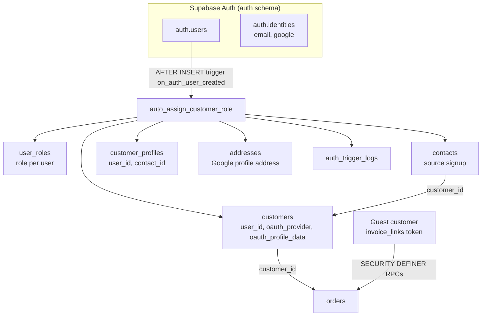
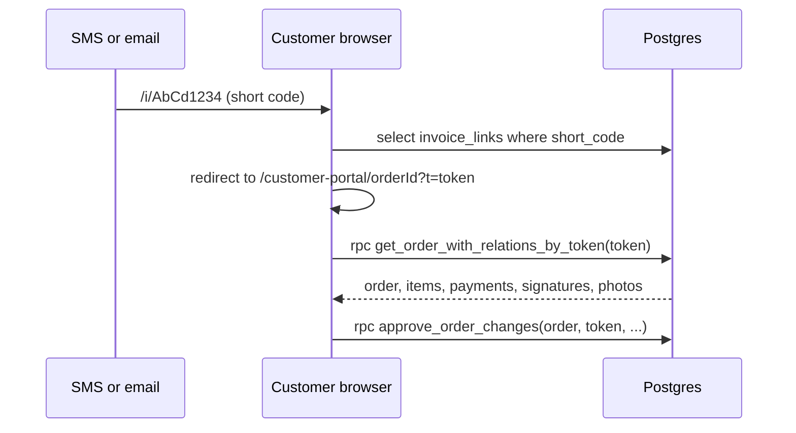

# Authentication and Roles

Scope: describes the application as deployed in Production (branch main; Supabase project qaagfafagdpgzcijnfbw).

## Overview

Authentication is handled by Supabase Auth. The app uses email/password as the primary method with Google OAuth as an optional alternative. Apple Sign-In is available in the auth context and is not currently shown in the UI. Role-based access control is implemented through a custom `user_roles` table — Supabase's built-in JWT claims are not used for role enforcement.

---

## Role Hierarchy

There are four roles, stored as lowercase strings in the `user_roles` table:

| Role | Access Level |
|---|---|
| `master` | Full access — all admin capabilities plus role management and system settings |
| `admin` | Full admin access — order management, settings, crew, analytics |
| `crew` | Crew-only access — calendar, task cards, day-of operations |
| `customer` | Customer access — order history, portal, waiver signing |

`user_roles` (columns `id`, `user_id`, `role`, `created_at`) has `UNIQUE (user_id, role)` and no check constraint on `role`. The client reads the role with `.maybeSingle()` and builds `roles` as a one-element array, lower-casing the value, so the client holds one role per user. The database constraint does not itself limit a user to one row (a second row with a different role is allowed, and `.maybeSingle()` returns an error when more than one row matches); in Production the 9 role rows (5 `master`, 4 `customer`) belong to 9 different users, and 14 auth users exist.

Role values are compared in lower case by the client, by most RLS policies (`lower(role)` or `get_user_role()`) and by most edge functions. Four places compare the stored value to upper-case literals instead: `is_admin()`, `stripe-charge`, `backfill-payment-methods` and the role value written by `/setup` and `create-admin-user` (`ADMIN`). See Role helper functions and Role checks inside edge functions below.

Helper flags available from `useAuth()`:
- `isAdmin` — true if user has `admin` or `master` role
- `isMaster` — true if user has `master` role
- `hasRole(role)` — checks for a specific role in the roles array

---

## Auth Context (`src/contexts/AuthContext.tsx`)

The `AuthProvider` wraps the entire app and exposes:

```typescript
{
  user: any                  // typed `any` in the code
  role: 'master' | 'admin' | 'crew' | 'customer' | null
  roles: string[]            // one element (see Role Hierarchy)
  loading: boolean
  isAdmin: boolean
  isMaster: boolean
  signIn(email, password): Promise<void>
  signInWithGoogle(destinationPath?): Promise<void>
  signInWithApple(destinationPath?): Promise<void>
  signUp(email, password, metadata): Promise<void>
  signOut(): Promise<void>
  hasRole(role): boolean     // lowercases its argument
}
```

On session load and on every auth state change, `AuthContext` fetches the user's role from `user_roles` using the authenticated user's ID.

**Note:** the `onAuthStateChange` callback is synchronous. It sets the user, then calls `loadUserRoles(...)` without awaiting it (fire-and-forget), so the Supabase client is not blocked. There is no async IIFE wrapper in Production.

---

## Sign Up Flow

1. Customer fills out `/signup` with first and last name, email, phone, password with confirmation, optionally a business name and a home address, and the consent checkboxes.
2. `supabase.auth.signUp()` is called with user metadata (first name, last name, phone, business name, address fields).
3. The Postgres trigger `on_auth_user_created` (function `auto_assign_customer_role()`; there is no `handle_new_user`) runs on `auth.users` insert and handles:
   - Create a `user_roles` entry with `role: 'customer'`
   - Find an existing `customers` row by email and set its `user_id` (this is how existing orders become linked to the new user), or create a new `customers` record (form-submitted name takes priority over Google's display name if both exist)
   - Create or update a `contacts` row (source `signup`)
   - Extract a Google profile address into `addresses` when present
   - Create a `customer_profiles` record
   - Store OAuth provider and profile data on `customers`
4. A signup address is written by the trigger from the signup metadata. The `save-signup-address` edge function is not currently used by the client.

Trigger execution is logged to `auth_trigger_logs` for debugging.

Status: partially implemented. Signup creates the auth user and the trigger logs to `auth_trigger_logs`. When a session is issued immediately, `SignUp.tsx` polls for the `customers` row every 500 ms for up to 8 seconds; if the row does not appear it shows a message and sends the user to `/login`. On sign-in, `CustomerProfileContext` runs its retry loop and then calls `backfill-oauth-customers` to create the `customers` row. Automatic role, contact and profile creation by the trigger is not yet active (see the status note under Sign-Up Trigger).

---

## Consent Draining System

### Overview

Status: partially implemented. Consent captured at signup is stored in `pending_signups_consent`, and the client requests the drain on sign-in. The `record-consent` edge function that moves records into `user_consent_log` is not yet active, so the permanent log is not yet populated. Per-order consent is captured separately in `consent_records` and on the `orders` consent columns.

The system bridges SMS marketing and card-on-file consent captured at sign-up into a permanent post-signup record.

### Step 1: Consent at sign-up (client write to `pending_signups_consent`)

The `save-pending-consent` edge function was removed; it returns HTTP 410 and no client calls it. There is no pre-signup (quote/checkout) staging. Instead, `SignUp.tsx`:
1. Generates a `batch_id` (UUID) on the client
2. After the account is created and classified as a genuinely new user, inserts one row directly into `pending_signups_consent` (`user_id`, `batch_id`, `consents`, `source`, `user_agent_hint`). An RLS policy on the table enforces a 60-second recency window for anon-key writes.
3. If a session exists immediately, also calls `record-consent` directly with the batch (`batch_id`, `consents`, `source: 'signup'`, `user_agent_hint`). The client deletes the pending row only when that call returns `success` and `safe_to_clear_pending`; otherwise the row is kept until it is drained.

### Step 2: Account Creation

The customer signs up via `/signup`. The Postgres trigger and the customer-profile fallback create their account records (see Sign Up Flow).

### Step 3: Consent Drain (`record-consent?action=drain-pending`)

On initial session load and on every `SIGNED_IN` event, `AuthContext` calls `drainPendingConsent()`:
1. An **in-tab guard** (a `Set<userId>`) prevents the drain from firing twice in the same browser tab
2. The client selects its own `pending_signups_consent` row; if there is none, it stops
3. If there is one, it POSTs to `record-consent?action=drain-pending` with the session access token as bearer and an empty body `{}` (the `batch_id` is not sent)
4. The function moves the records into `user_consent_log` (unique index on `(user_id, consent_batch_id, consent_type)` for idempotency) and deletes the pending row. The client logs the response.

### Consent Types

| Type | Meaning |
|---|---|
| `terms_of_service` | Acceptance of the terms of service (version recorded) |
| `privacy_policy` | Acceptance of the privacy policy (version recorded) |
| `marketing_email` | Optional consent to marketing email (version `1.0`) |
| `marketing_sms` | Optional consent to marketing SMS (version `1.0`) |

These four are the values the sign-up form submits and the `user_consent_log` check constraint accepts. Per-order consents (`sms`, `card_on_file`, `electronic_signature`) are a separate set stored in `consent_records` and on the `orders` consent columns.

### `record-consent` Edge Function Actions

The deployed function (version 37) and the `main` source file both have an empty `index.ts`, so the function does not respond with its intended behaviour. The client references two calls; `user_consent_log` and `pending_signups_consent` both hold 0 rows in Production:

| Action | Behaviour |
|---|---|
| `drain-pending` | Move pending consent from staging to the permanent log (called by `AuthContext.tsx`) |
| `record` | Directly record a consent batch (no `action` parameter; called by `SignUp.tsx`; the client expects `success`, `inserted`, `skipped`, `safe_to_clear_pending` in the response) |

No client code calls a `revoke` action.

### Permanent Consent Log (`user_consent_log`)

Table structure, with idempotency enforced by the partial unique index `uq_user_consent_log_batch_type` on `(user_id, consent_batch_id, consent_type)` where `consent_batch_id` is not null:
- `id`, `created_at`
- RLS: users read their own rows; admin and master read all; no client insert policy (writes come from the service role)
- `user_id`, `customer_id` — who gave consent
- `consent_type` — type of consent
- `consented` — whether they agreed or declined
- `policy_version` — version of the consent text shown
- `source` — where consent was given (`signup`, `checkout`, etc.)
- `consent_batch_id` — idempotency key (text)
- `ip_hint`, `user_agent_hint` — audit trail

---

## Customer Profile Context (`src/contexts/CustomerProfileContext.tsx`)

Loaded for all authenticated users. Provides customer data to the quote and checkout forms.

### Profile Loading with Retry Logic

When the signed-in user changes, the provider fetches the `customers` record linked to `user_id`. Because the customer record is created after signup (by the trigger or the fallback), a retry strategy is used:
- The first query plus up to **6 retries** (at most 7 queries)
- **800ms** between attempts
- Prevents "profile not found" errors immediately after account creation

If the customer record is still missing after the retries, the provider calls the `backfill-oauth-customers` edge function (which creates a customer record for the current user only, using the user's bearer token); when the call succeeds it restarts the load from the first query. The default address falls back to the address on the customer's latest order if there is no `default_address_id`.

### Session Data

The provider maintains ephemeral `sessionData` that persists across the quote → checkout journey:
```typescript
{
  firstName, lastName, email, phone, businessName,
  addressLine1, addressLine2, city, state, zip
}
```

`updateSessionData(partial)` merges new values into the existing session. This data is used to prefill forms and is written to the database on order submission.

### Default Address

If the customer has a `default_address_id` set on their `customers` record, that address is loaded and offered as a prefill in the quote form, speeding up repeat bookings.

---

## Google OAuth

Google OAuth is triggered via `signInWithGoogle(destinationPath?)`, which calls `supabase.auth.signInWithOAuth({ provider: 'google' })` with `redirectTo = origin/` (plus `?next=<path>` when a destination is given):

1. Supabase redirects to Google for authentication
2. On return, if the user is new, the Postgres trigger runs (creates customer record, assigns `customer` role — see the status note under Sign Up Flow)
3. Profile data is merged: form-submitted name takes priority over Google's display name
4. OAuth provider and profile data are stored on the `customers` record (`oauth_provider`, `oauth_profile_data`)
5. An optional `?next=` query parameter on the redirect URL is honored for post-login navigation, by `OAuthRedirectHandler` in `App.tsx`, only when the current path is `/` and `next` starts with a single `/` (not `//`)

The Google button uses `signInWithOAuth`; the provider credentials are configured in the Supabase Auth dashboard.

---

## Protected Routes (`src/components/common/ProtectedRoute.tsx`)

```tsx
<ProtectedRoute allowedRoles={['ADMIN']}>
  <Admin />
</ProtectedRoute>
```

The prop is `allowedRoles` and its values are UPPERCASE (`'ADMIN' | 'CREW' | 'MASTER' | 'CUSTOMER'`). `ADMIN` and `MASTER` both resolve to `isAdmin`; `CREW` and `CUSTOMER` go through `hasRole()`, which lower-cases before comparing. Routes: `/my-orders` allows CUSTOMER, ADMIN, CREW, MASTER; `/admin`, `/admin/inventory/new` and `/admin/inventory/edit/:id` allow ADMIN; `crew/*` allows ADMIN and CREW.

Behavior:
- Shows a loading spinner while auth state is resolving
- Redirects unauthenticated users to `/login` (with `location.state` for redirect-back after login)
- Shows an "Access Denied" screen for authenticated users lacking the required role
- `master` and `admin` share access via `isAdmin` — treated identically for route protection

---

## Role Management

Roles are assigned and revoked through the admin Permissions tab. The tab uses these operations:

- List: `get_all_role_users()` RPC.
- Add a role by email: `assign_role_by_email` RPC (the master sees Admin and Crew in the role list; an admin sees Crew only).
- Change a role: a direct `update` on `user_roles` filtered by `user_id` (authorised by the table's RLS policies).
- Remove: a direct `delete` on `user_roles` filtered by `user_id` (removes every role row of that user).
- Change history: a direct select on `user_permissions_changelog` (20 newest rows per user).

Seven database RPCs exist for role operations; the tab calls only the first and the fourth:

| RPC | Arguments | Purpose |
|---|---|---|
| `assign_role_by_email(p_email, p_role)` | email text, role text | Grants a role to a user identified by email address. Caller must be admin or master; only master can assign `master` or `admin`. Returns false when the email is unknown. Status: partially implemented. The insert uses `ON CONFLICT (user_id)`, and `user_roles` has only the `(user_id, role)` unique constraint, so the statement does not match a constraint and the grant does not complete. |
| `assign_user_role(target_user_id, target_role)` | uuid, text | Grants a role to a user identified by UUID (`ON CONFLICT (user_id, role) DO NOTHING`). Caller must be admin or master; only master can assign `master`. |
| `remove_user_role(target_user_id, target_role)` | uuid, text | Revokes a specific role from a user by UUID. Caller must be admin or master; only master can remove `master`. |
| `get_all_role_users()` | — | Returns `user_id, email, user_role, created_at` for users whose role is `master`, `admin` or `crew` (excludes `customer`); raises an exception unless the caller is admin or master |
| `get_admin_users()` | — | Returns `id, email, created_at` for all users with `admin` or `master` role; no caller check |
| `get_user_highest_role(check_user_id)` | uuid | Returns the highest role for a given user (master > admin > crew > customer), or NULL when the user has none |
| `user_has_role(check_user_id, check_role)` | uuid, text | Returns boolean — whether a user has a specific role |

### Permissions Audit Log

The `log_permission_change` trigger (`trigger_log_permission_change`) fires on insert, update (when the role changes) and delete in `user_roles` and writes to `user_permissions_changelog`:
- `target_user_id` — who the role was assigned to
- `changed_by_user_id` — `auth.uid()` of the caller
- `action` — `role_added`, `role_changed` or `role_removed` (the check constraint also allows `account_created` and `account_deleted`, which the trigger does not write); `old_role` and `new_role` are limited to `master`, `admin`, `crew`, `customer` or NULL
- `old_role`, `new_role`
- `notes` — `Changed by: <actor email>` (there is no dedicated actor-email column)

The actor's email is looked up when the trigger runs and stored in `notes`, so the record stays accurate even if the actor's email is later changed. The trigger swallows its own errors, so a failed log write does not block the role change. Roles inserted by a signup trigger or by the service role have no `auth.uid()` and therefore no actor.

### Role Escalation Prevention

The `user_roles` table RLS policies in Production are: users can read their own roles; admins and masters can read all roles; `master` can insert, update and delete any role row; `admin` can insert, update and delete only rows whose role is `crew`. There is no policy for customers to write, so they cannot modify their own roles.

The `assign_user_role` and `remove_user_role` RPCs (SECURITY DEFINER, so row-level security does not apply inside them) check that the caller is `master` or `admin` and that only a `master` can assign or remove `master`; they do not restrict an `admin` caller from assigning or removing `admin`. `assign_role_by_email` additionally requires a `master` caller to assign `admin`. The Permissions tab limits an `admin` user to managing `crew` roles (`canManageUser`), and the tab's role changes and removals go through the table policies above.

---

## Business Context and Admin Settings

Business-wide configuration is loaded by `BusinessProvider` (`src/contexts/BusinessContext.tsx`) from the `admin_settings` table on app mount. Only these eight keys are loaded (snake_case keys, read through `useBusinessSettings()`):

- `business_name`, `business_name_short`, `business_legal_entity`
- `business_address` (replaced by the `getBusinessAddressText()` helper result), `business_phone`, `business_email`, `business_website`
- `business_license_number`

The provider reads the table directly under row-level security, and only `admin` and `master` users can select from `admin_settings`; for visitors and customers the read returns no rows and the defaults stay in place, except `business_address`, which comes from the public RPC. The provider does not load a logo, favicon, brand colour, social media URLs or Google review/maps URLs. `logo_url`, `facebook_url`, `instagram_url` and `google_review_url` exist as `admin_settings` keys in Production; the first three (with `business_name`, `business_phone`, `business_email`, `business_address` and the five `home_address_*` text keys) are returned by the `get_public_business_settings` RPC via `adminSettingsCache.ts`, and `google_review_url` is not.

This data is used for display, email template branding, and the dynamic waiver text.

---

## Session Persistence

The Supabase client is configured with:
- `persistSession: true` — session stored in `localStorage`
- `autoRefreshToken: true` — tokens silently refreshed before expiry
- `detectSessionInUrl: true` — handles OAuth callback URL fragments
- `storageKey: 'bpc-auth'` and `storage: window.localStorage` (the session is stored under that key)

---

## First-Time Setup

The `/setup` route and `Setup.tsx` page are public (no `ProtectedRoute`). On load the page calls the `get_admin_users` RPC; if any admin or master exists it shows "setup complete" and no form. Otherwise it shows a form with a default admin email and password prefilled. Submitting requires matching passwords of at least 6 characters, calls `supabase.auth.signUp` directly from the browser (metadata `role: 'ADMIN'`), then inserts a `user_roles` row with the role value `ADMIN` for the new admin from the client (an insert error is only logged), optionally updates the `twilio_account_sid`, `twilio_auth_token` and `twilio_from_number` keys in `admin_settings`, signs out and redirects to `/login`. It does not call `create-admin-user`. Production already has master users, so the page shows the completed state.

The `create-admin-user` edge function is not currently used by the client. It refuses (400 "Admin user already exists") when the `get_admin_users` RPC returns any admin or master row; if none exists it creates the auth user and a `user_roles` row.

---

## Auth Emails (`auth-email-hook`)

Status: partially implemented. Auth emails (signup confirmation, password reset) are sent by Supabase Auth's built-in email system, with templates configured in the Supabase dashboard. Branded auth emails are not in use: the `auth-email-hook` edge function is retired (returns HTTP 410). `emailTemplateBase.ts` is used by the booking and order email builders.

---

## Password Reset Flow

1. Customer visits `/forgot-password` and submits their email; the app calls `supabase.auth.resetPasswordForEmail` with `redirectTo = origin/reset-password`
2. Supabase sends its built-in password reset email (not branded by `auth-email-hook`)
3. The reset link redirects to `/reset-password`
4. Customer enters a new password; the page calls `supabase.auth.updateUser`
5. Supabase updates the credential. Step 3 relies on the Site URL and redirect allow-list configured in Supabase Auth.

---

## Identity Architecture at a Glance



Three kinds of caller reach the system:

| Caller | How identified | What they can do |
|---|---|---|
| Visitor (no login) | Anon key only | Browse the catalog, price a quote, check out, sign a waiver and use the customer portal through a tokenized link |
| Signed-in user | Supabase JWT (`auth.uid()`) plus a row in `user_roles` | Customer dashboard (`customer`), crew screens (`crew`), admin screens (`admin`, `master`) |
| Server component | Service-role key (edge functions only) | Privileged writes; never exposed to the browser |

---

## Identity Providers and Auth Settings

| Provider | Status in Production |
|---|---|
| Email and password | In use (`auth.identities.provider = 'email'`, 9 identities; 13 of 14 auth users have a confirmed email). Sign-up requires the email to be confirmed before a session is issued when email confirmation is on; the login page recognizes the "email not confirmed" response and offers to resend the confirmation email (`supabase.auth.resend({ type: 'signup' })`). |
| Google OAuth | In use (`provider = 'google'`, 5 identities). The OAuth client is configured in the Supabase Auth dashboard. |
| Apple | Status: partially implemented. `signInWithApple()` exists in `AuthContext`; no Apple button is shown and no Apple identity exists. |

Supabase Auth configuration that the application relies on (managed in the Supabase dashboard, not in `config.toml`):

- Site URL `https://www.bouncepartyclub.com`, with the apex and `www` hosts on the redirect allow-list. OAuth return and password-recovery links resolve against this list.
- Auth emails (confirmation, recovery) come from Supabase's built-in templates (see Auth Emails below).
- The minimum password length enforced by the application forms is 6 characters (sign-up and reset forms).

---

## Sign-In Behaviour (`/login`)

1. The page calls `signIn(email, password)` (`signInWithPassword`). On success the user is sent to the page they came from (`location.state.from`), otherwise to the default landing page.
2. Errors are classified into friendly messages (invalid credentials, email not confirmed, platform rate limit, other).
3. **Local cooldown**: after 3 consecutive failed attempts the form locks for 30 seconds with a visible countdown, then resets the counter. A rate-limit response from the platform starts the same cooldown immediately.
4. **Email not confirmed**: the page shows a "resend confirmation" action.
5. "Continue with Google" calls `signInWithGoogle(destinationPath?)`.
6. Links are provided to sign up (carrying `location.state` forward) and to the password reset flow.

---

## Sign-Up Details (`/signup`)

| Step | Behaviour |
|---|---|
| Validation | First name, last name, valid email, 10-digit phone, password of at least 6 characters with a matching confirmation, and both the terms of service and privacy policy checkboxes; optional business name and optional home address chosen through Google Places Autocomplete |
| Metadata sent to `supabase.auth.signUp` | `first_name`, `last_name`, `phone`, `business_name` and `address_line1`, `address_line2`, `address_city`, `address_state`, `address_zip`, `address_lat`, `address_lng` (the consent payload is deliberately not sent in the metadata) |
| Consent checkboxes | `terms_of_service`, `privacy_policy` (versioned) and optional `marketing_email`, `marketing_sms`; a `batch_id` UUID is generated per submission |
| New vs existing account | A response is treated as an existing account when `user.identities` is empty or the user was created more than 10 seconds earlier. Existing confirmed accounts see "email already exists"; existing unconfirmed accounts see a resend prompt. No consent is written for existing accounts. |
| Consent persistence | For a new account the form inserts one row in `pending_signups_consent` (RLS allows the anonymous insert only for a freshly created user, within a 60-second window). If a session exists immediately it also calls `record-consent`; if email confirmation is required the user is sent to `/login` and the pending row waits for the drain on first `SIGNED_IN`. |
| After sign-up with a session | The page polls `customers` for the new user every 500 ms for up to 8 seconds, then calls `refreshProfile()` and navigates to the page the user came from; on timeout it shows a message and navigates to `/login`. |

---

## Sign-Up Trigger (`on_auth_user_created`)

`auto_assign_customer_role()` is a `SECURITY DEFINER` function (`search_path = public`) attached AFTER INSERT on `auth.users`. In order, it:

| # | Step | Detail |
|---|---|---|
| 1 | Resolve name and phone | `first_name` / `last_name` from sign-up metadata win; otherwise the Google `name` / `full_name` is split; `phone` from metadata |
| 2 | Log start | Row in `auth_trigger_logs` (`step = trigger_start`) |
| 3 | Assign role | Inserts `user_roles (user_id, 'customer') ON CONFLICT (user_id) DO NOTHING` (see the status note below) |
| 4 | Look up customer by email | If a `customers` row exists (for example from an earlier guest order) it receives the new `user_id`, `oauth_provider`, `oauth_profile_data`, non-empty form names and the phone; the existing orders are thereby linked to the account |
| 5 | Contact | Upserts a `contacts` row by email with `source = 'signup'` (existing customers: current order count as `total_bookings`) |
| 6 | New customer | Otherwise inserts a `customers` row (upsert by email) with the OAuth provider and profile JSON (`name`, `picture`, `email`, `locale`, `provider`), then upserts the contact with `total_bookings = 0` |
| 7 | Google address | For new customers who signed up with Google and have address data in the profile, inserts a default `addresses` row (skipped, with a log row, when the data is insufficient) |
| 8 | Customer profile | Upserts `customer_profiles (user_id, contact_id, first_name, last_name, phone)` |
| 9 | Log completion | `trigger_complete` row; any exception is caught, logged with the failing step and the sign-up itself is allowed to complete |

Status: partially implemented. The trigger is registered and writes to `auth_trigger_logs`; the role-assignment step does not complete in Production yet. The role insert names `ON CONFLICT (user_id)`, but `user_roles` has only the `(user_id, role)` unique constraint, so the function ends in its exception handler at step `insert_user_role` (6 `error` rows at that step). Because the function body is a single exception block, the work done before the error is rolled back and only the error log row is kept; the sign-up itself completes. The client-side `backfill-oauth-customers` fallback in `CustomerProfileProvider` creates the `customers` row, and new accounts do not receive the automatic `customer` role row. The 5 `master` role rows and 4 `customer` role rows in Production exist independently of this trigger run; changing or removing a role in the Permissions tab uses the table policies, and its add-by-email path uses `assign_role_by_email` (see its status under Role Management). Older log rows in `auth_trigger_logs` use earlier step names (for example `assign_customer_role`, `find_existing_customer`).

### Linking model

| From | To | Key |
|---|---|---|
| `auth.users.id` | `customers.user_id` | One customer per auth user; matched to existing guest customers by exact email match |
| `customers.id` | `contacts.customer_id` | Contact book entry (unique by email) |
| `auth.users.id` | `customer_profiles.user_id` | Unique; `contact_id` points at the contact |
| `customers.default_address_id` | `addresses.id` | Prefill address for the quote form |
| `customers.id` | `orders.customer_id` | Orders placed as a guest become visible to the user once the customer row is linked |

---

## Role Resolution and Authorization Layers

Authorization is enforced at four layers; the role names are always compared in lower case.

| Layer | Mechanism |
|---|---|
| Route | `ProtectedRoute` (`allowedRoles`) in the SPA - a convenience layer that decides which screens render |
| Row level security | Policies on every `public` table; admin checks use `get_user_role(auth.uid())` or `EXISTS (SELECT 1 FROM user_roles WHERE user_id = auth.uid() AND lower(role) IN (...))` |
| RPC | `SECURITY DEFINER` functions, some of which re-check the caller (`assign_user_role`, `assign_role_by_email`, `remove_user_role`, `get_all_role_users`, `get_booking_source_analytics`, `get_booking_sources_analytics`, `get_delivery_timing_analytics`, `save_lot_picture_to_address`, `archive_old_orders`); the list of functions without an in-function check is in ARCHITECTURE.md (Caller checks inside RPCs). All are executable by `anon` and `authenticated`. |
| Edge function | Functions with `verify_jwt = true` validate the JWT at the gateway; many then look up `user_roles` themselves |

### Role helper functions used by policies and code

| Function | Returns | Notes |
|---|---|---|
| `get_user_role(user_id_input)` | lower-cased role text, `customer` when the user has no role row | `STABLE`, `SECURITY DEFINER`, `search_path = public`; used inside RLS policies such as those on `user_roles` and by `promote-media` |
| `user_has_role(check_user_id, check_role)` | boolean | Role membership test |
| `get_user_highest_role(check_user_id)` | text | master > admin > crew > customer |
| `is_admin()` | boolean | Tests for a `user_roles` row whose role is exactly `ADMIN` or `MASTER` (upper case) for the calling session; Production role rows are lower-case, so it returns false for them. Used by `archive_old_orders` and the three `payments` admin policies (view, insert, update). |
| `get_admin_users()` | admin and master users | Also used by `/setup` and `create-admin-user` to detect an existing administrator |
| `get_all_role_users()` | users with `master`, `admin` or `crew` roles | Feeds the Permissions tab; raises an exception unless the caller is admin or master |

### Role checks inside edge functions

| Function | Roles allowed | How checked |
|---|---|---|
| `get-user-info` | admin, master | `user_roles` lookup of the bearer user, 403 otherwise |
| `stripe-refund` | admin, master | `user_roles` lookup (lower-case values), 403 otherwise |
| `stripe-charge`, `backfill-payment-methods` | `ADMIN`, `MASTER` as upper-case literals | `user_roles` lookup compared to the upper-case values, 403 otherwise; Production role rows are lower-case |
| `record-cash-payment`, `record-check-payment` | master, admin, crew | `user_roles` lookup, 403 otherwise |
| `calculate-route-mileage` | master, admin, crew | `user_roles` lookup, 403 otherwise |
| `promote-media` | admin and master | `get_user_role` RPC through a caller-scoped client; media writes use a service-role client |
| `upload-physical-waiver` | admin, master, crew, or a customer portal token | Role lookup or `invoice_links.link_token` match |
| `charge-deposit`, `send-invoice`, `send-email`, `send-sms-notification`, `sync-google-calendar` | Any valid JWT at the gateway | `verify_jwt = true` and no role lookup inside the function (verified in the `main` source; the anon key is a valid JWT; `backfill-card-details` is deployed without a source file in `main`, so its in-function checks are not verified); the admin screens call them with the user token and the notification service calls the first two with the anon key as bearer |
| `backfill-oauth-customers` | Any signed-in user, for that user only | Resolves the user from the bearer token and creates only that user's `customers` row |

---

## Guest (Token) Access for Customers

Customers do not need an account to pay, sign or follow an order. Access is by a secret link token.



- `invoice_links` rows hold a 64-character hex `link_token`, an optional 8-character `short_code`, a `link_type` (`invoice` or `portal_shortlink`) and an `expires_at` (event date plus 3 days, or 30 days from creation when there is no event date; the `sync_invoice_links_expires_at` trigger resets it to event date plus 3 days when the order's `event_date` changes; the column default is 7 days). `send-invoice` creates `invoice` links and the browser creates `portal_shortlink` links.
- RLS lets anonymous and authenticated callers read or update an `invoice_links` row only while it has not expired; admins can manage all rows.
- `get_order_by_token`, `get_order_with_relations_by_token`, `approve_order_changes` and `get_signature_status` are `SECURITY DEFINER` functions that take the token and return only that order's data.
- Tokens are used by the customer portal, invoice acceptance, waiver status and the physical-waiver upload function.

---

## Session Handling in the Browser

| Aspect | Behaviour |
|---|---|
| Initial load | `AuthProvider` calls `getSession()`, sets `user`, clears `loading`, then loads the role and attempts the consent drain |
| Auth events | `onAuthStateChange` updates the user on every event; on `SIGNED_IN` it removes any OAuth hash fragment from the URL and attempts the consent drain; on sign-out it clears role state |
| Token refresh | Automatic (`autoRefreshToken`) |
| OAuth return | `detectSessionInUrl` completes the exchange; `OAuthRedirectHandler` follows `?next=` only from `/` and only to a same-origin path starting with a single `/` |
| Edge function calls | Admin and crew actions send `session.access_token`; customer-facing and notification calls send the anon key |
| Error reports | `errorReporter` reads the user id from the stored `bpc-auth` session |
| Loading state | `ProtectedRoute` shows a spinner until `loading` is false, so a route never flashes before the role is known |

---

## Role Change Notifications and Permission Rules

The admin Permissions tab applies these rules in the UI and the database repeats them:

| Actor | May grant / remove | Enforced by |
|---|---|---|
| `master` | Any role, including `admin` and `master` | `user_roles` policies "Master can insert/update/delete"; RPC checks |
| `admin` | `crew` only | "Admin can insert/update/delete crew roles" policies (the table path used for role changes and removals); `canManageUser` in the UI; `assign_role_by_email` rejects `admin` and `master` for an admin caller. `assign_user_role` and `remove_user_role` check only that the caller is admin or master (plus the master-only rule for `master`). |
| `crew`, `customer` | None | No write policy on `user_roles` |

After a role is added, changed or removed, the tab sends an audit email to the admin address (`admin_settings.admin_email`) through `send-email`: subject "New <role> account created", "User role changed from <old> to <new>" or "<role> account removed", stating who made the change. The database trigger independently records the change in `user_permissions_changelog`.

---

## Authentication-Related Tables

| Table | Role in identity |
|---|---|
| `user_roles` | Role per user (`UNIQUE (user_id, role)`), policies as above |
| `customers`, `contacts`, `customer_profiles`, `addresses` | Identity-linked business records |
| `pending_signups_consent`, `user_consent_log`, `consent_records` | Consent capture and history |
| `invoice_links` | Guest tokens |
| `auth_trigger_logs` | Sign-up trigger trace (admin and master read by RLS policy); the `get_user_creation_logs` RPC does not read this table (see ARCHITECTURE.md) |
| `user_permissions_changelog` | Role change audit (admin read; users read their own entries) |
| `rate_limits` | Edge-function throttling (not used for sign-in; sign-in throttling is Supabase's own plus the local cooldown) |

See `DATABASE_SCHEMA.md` for columns and policies.

---

## Password Recovery Detail

1. `/forgot-password` calls `resetPasswordForEmail(email, { redirectTo: <origin>/reset-password })`.
2. Supabase emails the recovery link. The link must point at a host on the Auth redirect allow-list (Site URL `https://www.bouncepartyclub.com`; apex and `www` allowed).
3. `/reset-password` accepts the page only when the URL hash contains `type=recovery`; otherwise it shows "Invalid or expired reset link" and returns to `/forgot-password` after two seconds.
4. The form requires at least 6 characters and a matching confirmation, then calls `updateUser({ password })`, shows a success message and redirects to `/login`.

---

## Related Reference Documents

`DATABASE_SCHEMA.md` (tables, policies, functions), `API_REFERENCE.md` (edge function contracts), `FRONTEND_REFERENCE.md` (routes, pages, hooks), `DEPLOYMENT_AND_SECURITY.md` (RLS model and secrets), `EMAIL_SYSTEM.md` (auth and audit emails).
