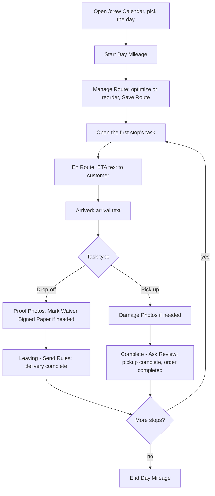

# Crew and Operations

Scope: describes the application as deployed in Production (branch main; Supabase project qaagfafagdpgzcijnfbw).

Related references: [FEATURES.md](FEATURES.md) (feature-to-screen map and roles matrix), [DATABASE_SCHEMA.md](DATABASE_SCHEMA.md), [API_REFERENCE.md](API_REFERENCE.md), [FRONTEND_REFERENCE.md](FRONTEND_REFERENCE.md), [DIAGRAMS.md](DIAGRAMS.md).

## Overview

The crew operations system handles everything that happens on the day of an event: delivery routing, task tracking, location capture, mileage logging, a read-only equipment summary, lot documentation, and customer communication. Crew members access these features through the `/crew` route. Admins reach the same calendar through the Calendar tab in the admin panel.

### The crew day at a glance



---

## Crew Access

Users with the `crew` role (or `admin`/`master`) can access `/crew`; the header shows a **Crew** link to them. Anyone else is shown "Access Denied" (signed in) or sent to `/login` (signed out). The page title is "Crew Dashboard" and it has two tabs: Calendar (the same `AdminCalendar` component used in the admin panel) and Invoice (`CrewInvoiceBuilder`). Task cards show a "$N DUE" amount (rounded to whole dollars), and the Task Detail Modal shows order management controls (record cash/check, charge card on file, mark waiver signed on paper, cancel).

---

## Task Cards (`task_status` table)

A task card is the fundamental unit of crew work. **Two** task cards are created automatically by the database trigger `trigger_auto_create_task_status` (AFTER INSERT OR UPDATE OF status on `orders`, function `auto_create_task_status`) when an order reaches `confirmed`: one drop-off and one pick-up. Drop-off `task_date` is the order's `event_date`; pick-up `task_date` is the order's `event_end_date`. `sort_order` is set to 0 for the drop-off and 1 for the pick-up. A row is only created when the order has no task row of that type yet. A unique constraint (`task_status_order_task_type_task_date_key`) covers `(order_id, task_type, task_date)`. When a task has no row, the Task Detail Modal and the Route Management Modal insert a minimal `pending` row for the date shown on the card.

### Task Card Fields

| Field | Type | Purpose |
|---|---|---|
| `order_id` | uuid | Which order this task is for |
| `task_type` | text | `drop-off` or `pick-up` |
| `task_date` | date | Event date (drop-off) or event end date (pick-up) |
| `status` | text | `pending`, `en_route`, `arrived`, `completed` (CHECK constraint) |
| `en_route_time` | timestamptz | When crew marked "on the way" |
| `arrived_time` | timestamptz | When crew marked "arrived" |
| `completed_time` | timestamptz | When crew marked "completed" |
| `eta_sent` | boolean | Set at En Route to true when the ETA text was sent and false when the text failed; used only for display, no code skips sending when it is true |
| `waiver_reminder_sent` | boolean | Set at En Route to "waiver not yet signed" |
| `payment_reminder_sent` | boolean | Set at En Route to "balance due > 0" |
| `sort_order` | integer | Position in the day's route; NULL means the task was removed from "My Route" |
| `delivery_images` | jsonb | Array of delivery photo URLs (Proof Photos button, drop-off tasks) |
| `damage_images` | jsonb | Array of damage photo URLs (Damage Photos button, pick-up tasks) |
| `notes`, `crew_notes`, `admin_notes` | text | Present on the table; no screen writes them (the notes shown on task cards come from the order's `special_details`) |
| `gps_lat`, `gps_lng` | numeric | Crew GPS coordinates captured at En Route (0 and 0 when the location lookup fails) |
| `calculated_eta_minutes` | integer | Estimated drive time at En Route (defaults to 30 when GPS/ETA lookup fails) |
| `eta_calculation_error` | text | Error message if ETA calculation failed |

### Task Workflow States

`task_status.status` moves through four values:

```
pending -> en_route -> arrived -> completed
```

The longer sequence `pending, on_the_way, arrived, setup_in_progress, setup_completed, pickup_scheduled, pickup_in_progress, completed` is the `orders.workflow_status` column (CHECK constraint). The Task Detail Modal writes both: `task_status.status` (`en_route`/`arrived`/`completed`) and `orders.workflow_status` (`on_the_way`, `arrived`, `setup_completed`, `pickup_in_progress`, ...). Each transition timestamps the event (`en_route_time`, `arrived_time`, `completed_time`). The trigger `trigger_auto_update_order_status` (function `auto_update_order_status`, on `task_status` insert or status update) moves a `confirmed` order to `in_progress` when one of its tasks goes `en_route`, and moves the order to `completed` when every task row of the order is `completed` and `orders.workflow_status` is `pickup_in_progress` or `pickup_scheduled`.

Starting mileage must be logged for the day before En Route, Arrived, Drop-off complete or Pick-up complete can be tapped. Without it En Route offers to open the mileage form ("Starting mileage required before marking tasks as En Route."), Arrived says "You must enter your starting mileage before marking tasks." and the two completion buttons say "You must enter your starting mileage before completing tasks."

### Task Detail Modal (day-of workflow)

Opened by tapping a task card; "Back to day view" returns to the list. The header shows Delivery or Pickup with the task status chip, the order number (a link that opens the order in the admin Orders tab, Single Order sub-tab), up/down route arrows with "Stop #N of M", and "Updated Ns ago" with a refresh control (the modal also refreshes, debounced 300 ms, when the order row changes). A green banner ("Delivery Complete" or "Pickup Complete", with the completion time) shows once the task is completed. On phones a sticky action bar repeats En Route, Arrived and Photos / Leaving (drop-off) or Complete Pickup (pick-up) while the task is for today and not completed. Sections: Customer Information (name, phone, address, event time, waiver state: "Waiver not signed" / "Waiver signed — digital" / "Paper waiver — photo on file" with a View link / "Paper waiver — photo missing"; the balance due; Payments Received with a Refund control), Equipment, Special Notes, Order Management, Delivery or Pickup Actions, Photos (Delivery Photos, Damage Photos) and the pick-up completion summary. The Refund control asks for an amount and reason and confirms "This action cannot be undone"; the `stripe-refund` function accepts only admin and master users, so for crew it reports a failure.

If the task is not scheduled for today, a **Future Task Warning** (with the checkbox "I need to perform delivery actions early (e.g. pre-drop before a busy day)") or **Past Task Warning** is shown. The En Route, Arrived, Leaving - Send Rules and Complete - Ask Review buttons are enabled only for today's tasks or, for a future task, after the checkbox is ticked; a past task cannot use them. The photo buttons are always enabled.

| Button | Confirmation / checks | Customer text | Records |
|---|---|---|---|
| **En Route** | "Mark this delivery as En Route for {name}? This will notify the customer with an ETA." Needs start mileage | ETA range (about +/-10 min) and distance, waiver/balance warnings with a portal link on drop-offs, pets note | `status en_route`, `en_route_time`, GPS, `calculated_eta_minutes` (30 if the lookup fails), reminder flags, `eta_sent`, `orders.workflow_status` (`on_the_way` for a drop-off, `pickup_in_progress` for a pick-up), crew location row (only when the GPS and ETA lookup succeeded) |
| **Arrived** | "Mark as Arrived at {name}'s location? This will notify the customer that the crew has arrived." Needs start mileage | Arrival message with waiver/payment reminders on drop-offs | `status arrived`, `arrived_time`, `workflow_status arrived` |
| **Proof Photos** (drop-off) / **Damage Photos** (pick-up) | Image picker, several at once | none | URLs appended to `delivery_images` / `damage_images` |
| **Leaving - Send Rules** (drop-off) | Warns if no delivery photos ("Proceed without photos?"). Needs start mileage | Equipment-delivered message with the safety rules and responsibility-until-pickup time | `status completed`, `completed_time`, `workflow_status setup_completed` |
| **Complete - Ask Review** (pick-up) | Warns about an unpaid balance ("Click OK to complete anyway"). Needs start mileage | `pickup_thanks_sms` with the review link; `pickup_complete` email (both sent before the status is saved) | `workflow_status pickup_in_progress`, then `status completed` and `completed_time`; the database trigger above advances the order to completed when every task is done; completion summary dialog |

Alerts report the outcome, for example "En Route saved and customer notified. ETA: N min (...)", "En Route saved (fallback ETA). Warning: ...", "Arrived and customer notified successfully!", "Delivery completed and customer notified!", and, when a text fails, "... Warning: SMS failed to send." (the action is still saved). If saving the order's workflow state fails, the alert adds that the customer portal status may not update.

Photo upload rules: images are compressed to JPEG (quality 0.82) with a 2048 px maximum side; HEIC files are uploaded as is if within 10 MB; files over 10 MB that cannot be compressed are skipped with a message (for iPhones: retake in "Most Compatible" mode); files go to the `public-assets` bucket and the URLs are saved on the task.

### Pickup completion summary

After Complete - Ask Review a "Pickup Complete" dialog shows the order, Order Total, Deposit Paid, Balance Paid (when above zero), Crew Tip (when above zero), Total Collected (deposit + balance + tip), Remaining Balance (when above zero), Waiver (Signed / Not Signed) and Payment method (Card, Cash, Check or Pending), with follow-up notes when a balance is outstanding or the waiver is unsigned. **Done** closes it and the modal.

### Real-Time Updates

The crew calendar subscribes to Supabase Realtime changes on `orders` and `task_status`, and the open Task Detail Modal subscribes to updates of its own order row. The customer portal subscribes to `orders`, `payments`, `order_signatures`, `task_status`, `order_lot_pictures` and `order_pictures`. The Production `supabase_realtime` publication contains `orders`, `payments`, `order_signatures`, `task_status`, `order_pictures`, `order_lot_pictures`.

---

## Crew Calendar (`/crew` and `/admin` Calendar Tab)

The calendar provides a monthly overview and a day-level detail view.

### Month view

"Event Calendar" with previous/next month arrows and a **Today** button. Each day with work shows a truck icon with the drop-off count and a package icon with the pick-up count; today is highlighted; days without tasks are not clickable. A legend explains Drop-off / Delivery and Pick-up / Retrieval. Tasks for a month are built from orders whose event date falls in the month (plus one day before, for next-day pickups) with status pending review, confirmed, in progress or completed; each order yields one drop-off on the event date and one pick-up on the same day (same-day pickup) or the next day (`pickup_preference` other than `same_day`). Draft, awaiting-approval, cancelled and void orders do not appear. The calendar refreshes by itself (Realtime on `orders` and `task_status`, debounced one second). The selected day and task are kept in the URL (`?date=yyyy-MM-dd&taskId=...`), so a day or task can be bookmarked or shared and survives a reload.

### Task card

Each card shows the "Stop #N" badge, a NOW / NEXT / PREV marker (first active stop of the section, second active stop, and the completed stop with the highest saved order), "Order #", a status chip (PENDING, EN_ROUTE, ARRIVED, COMPLETED), customer name and phone, address, the event window, the first three equipment lines and any special notes. Badges: **PENDING REVIEW** (drop-off of an order not yet confirmed; planning only, no other badges), **PROJECTED** (pick-up that is not yet actionable, including pick-ups of pending-review orders), **BLOCKED** (pick-up with an unpaid balance, "Unpaid balance: $X.XX"), **DONE**, **NO WAIVER** (waiver not signed on a drop-off that is not completed) and "$N DUE" (balance owed on a drop-off that is not completed, rounded to whole dollars). Block reasons shown on pick-up cards: "Order not yet confirmed", "Drop-off not yet started", "Drop-off in progress", "Drop-off not yet completed".

Pick-up readiness is derived as: completed when the pick-up task is completed; projected when the order is pending review or the drop-off is not completed; blocked when the drop-off is completed but a balance is due; otherwise ready.

### Day View (`DayViewModal`)

Shows task cards for the selected date. Tapping a card opens the Task Detail Modal, where crew advance the task status and upload photos. The day view opens the Mileage, Route and Equipment modals. The header shows the date and "N tasks scheduled", with the hint "Click on any task below to view details and take action".

Layout: a header with **Start Day Mileage** / **End Day Mileage** buttons and "Today's Mileage" (each crew member's start and end readings, the miles driven, and "End pending" until the end reading is logged). Crew members see only their own row (row-level security), admins see everyone's; names come from the `get-user-info` function, which accepts only admin and master users, so crew see "Crew Member" in place of a name. Below that, a "Morning Route (N active / M total)" section (drop-offs plus next-morning pick-ups) has **Equipment** and **Manage Route** buttons, and an "Afternoon Route" section (same-day pick-ups) has a **Manage Route** button only. Inside a section: active Drop-offs / Deliveries, active Pick-ups / Retrievals, then collapsed groups for completed tasks, blocked pick-ups ("These pickups are not actionable yet. See each card for the current reason."), projected pick-ups and pending-review orders ("These orders are awaiting confirmation and will not appear in the active route."). Empty day: "No tasks scheduled for this day".

---

## Route Optimization (`src/lib/routeOptimization.ts` and `routeOptimization*.ts`)

### Purpose

Given a day's stops for one route section (morning or afternoon), calculates a sequence to reduce total drive time and avoid arriving late to events. At least 2 stops are needed ("Need at least 2 stops to optimize the route"); a single stop is returned as is.

### Algorithm

**Stage 1: Geographic Sweep**
- Orders stops by `atan2(dLat, dLng)` angle from the home base. Applied only when 3 or more stops all have coordinates; otherwise input order is kept.

**Stage 2: Multi-Start Greedy**
- Runs a nearest-neighbour style greedy search starting from each of the first up to 8 stops (in sweep order) that can be scheduled first, plus one standard greedy run.
- Evaluates each candidate route by total drive time plus 100 per minute of lateness and keeps the lowest.

**Stage 3: 2-Opt Refinement**
- Tries segment reversals on the best route and accepts those that reduce the score.
- Runs up to 100 iterations (`MAX_ITERATIONS = 100`) or until no improvement.

### Scoring Function

Each stop contributes:
- Drive minutes
- Lateness: `max(0, arrival + setup minutes - event start minutes)`, multiplied by 100. Pick-ups are never counted late.
- Minus `0.1 x` the stop's drive minutes from the route origin (matrix row 0), and a `-50` bonus for high-priority stops.
- Stops with an unreachable leg are scored with a very large drive time.

High priority means: event start strictly before 09:00, any pick-up, or a stop that feeds another order (the optimizer supports a `feedsOrderIds` list, but the app does not currently fill it in). For a pick-up the event time passed to the optimizer is the event end time.

Dependency direction: a **drop-off** depends on the earlier **pick-up** of the same equipment (equipment must come back before it can go out again).

### Time Modeling

- Fixed departure: **06:20** from home base.
- Traffic model: Distance Matrix is called with a 06:20 departure time only if 06:20 on the route date is still in the future; otherwise no traffic model is used.
- Setup time per unit: **20 minutes** (delivery); pick-up time **15 minutes** per stop.
- Home base is read from `admin_settings` through `getHomeBaseAddress` (falls back to Wayne, MI). The Route Management Modal can also start the route from the last completed stop or the browser's current location instead of home.

### Google Maps Distance Matrix API

- Requests are chunked to stay within 100 elements (origins x destinations), in blocks of 10 origins by 10 destinations; addresses that cannot be resolved stop the optimization with an explanatory error.
- With a traffic departure time the BEST_GUESS traffic model is used.
- Duration is converted from seconds to minutes, distance from meters to miles.

### Route Stop Numbering

`getStopNumber` (`src/lib/calendarUtils.ts`) builds separate sequences: a morning sequence (drop-offs plus next-day pick-ups) and an afternoon sequence (same-day pick-ups). It excludes pending-review drop-offs, completed drop-offs and not-ready pick-ups. Once any task has a `sort_order`, only ordered tasks are numbered. The UI renders "Stop #N".

### Task Date Matching

`task_status` rows are looked up by `task_date`: the drop-off row by the event date and the pick-up row by the pick-up date the calendar derives (event date for same-day pickup, event date + 1 otherwise). If an order's event date changes, the task rows' `task_date` values must match the new date or the card appears on the old date. The database trigger sets the pick-up row's `task_date` to the order's `event_end_date`; when that differs from the derived pick-up date (for example a next-morning pick-up on a single-day order), the first status action on the pick-up card inserts a second pick-up row for the derived date.

### Output

The route order is saved to `task_status.sort_order` (written by `RouteManagementModal`, counting from 0 in the order shown).

---

## Route Management Modal (`RouteManagementModal`)

The admin/crew can view and adjust the day's route:
- Opens as "Manage Morning Route" (drop-offs and next-morning pick-ups) or "Manage Afternoon Route" (same-day pick-ups)
- Displays each stop in order with its number, a PICKUP or DELIVERY tag, customer, address, equipment and event times (no ETAs are shown)
- **Route Start Origin** (shown when there are 2 or more stops): Home Base, Last Completed (the most recently completed stop, by completion time) or Current Location (browser GPS). The default is Last Completed when a completed stop exists, otherwise Home Base. After optimizing, "Last optimized from: ..." names the origin used. If a chosen origin is unavailable (no completed stops, GPS denied) the optimizer falls back to Home Base or the last completed stop and says so ("Origin fallback: using ...")
- **Auto-Optimize Route** (2 or more stops) triggers the 3-stage algorithm ("Route optimized successfully" or "Route is already optimal")
- Manual reorder uses up/down chevron buttons (not drag-and-drop); a stop can be removed from ("Remove from my route") or added back to ("Add Back") the route
- **Save Route** writes `sort_order` ("Route saved successfully" / "Failed to save route"); Cancel with unsaved edits asks "Unsaved Changes"
- Blocked, projected and pending-review stops are listed separately and are not part of the active route
- Within a task, the up/down arrows in the Task Detail Modal also swap a stop with its neighbour and save at once ("Task moved up" / "Task moved down")

### Recovering Stops Removed from Route

"Remove from my route" marks the stop as excluded and **Save Route** then sets `task_status.sort_order = NULL`. The modal lists those tasks under "Removed from My Route (N)" ("These stops are excluded from your route and optimizer. Another crew member can handle them."); restoring one with Add Back and saving gives it a `sort_order` again. This is based on `task_status`, not `route_stops`.

---

## Crew Location Tracking

When crew taps En Route and the browser location and ETA lookup succeed, a row is inserted into `crew_location_history` with the crew member's `latitude` and `longitude`. The table has no column for the crew member, so rows are not attributed to a user. Insert policies exist for authenticated crew, admin and master users and also for the `anon` role (with check `true`); only users with the `admin` role may read the rows.

Status: partially implemented. Latitude and longitude are captured at En Route. The `order_id`, `stop_id`, `accuracy`, `speed`, `heading` and `checkpoint` columns are not yet populated, no other checkpoint records location, and no screen reads the table.

### ETA Calculation

At En Route the system calculates an ETA from the crew member's GPS location using the Google Maps Distance Matrix API (`calculateETA`, departure `new Date()`). The ETA is stored on `task_status.calculated_eta_minutes` and is included in the customer SMS as a range (about +/-10 minutes around now plus the ETA) with the distance text. If the location or ETA lookup fails, 30 minutes is used, `eta_calculation_error` records the message and the alert says a fallback ETA was used.

---

## SMS Notifications During Delivery

Delivery SMS messages go through the `send-sms-notification` edge function. When sent with an `orderId`, they are stored in `sms_conversations` and appear in the order's SMS thread.

### Checkpoint Messages

The messages are built inline in `TaskDetailModal.tsx`:

| Action | Template | Message Content |
|---|---|---|
| En Route | inline | Greeting, ETA range and distance; on drop-offs an optional waiver/balance warning with a short portal link, a clear-path request and, when `hasPets`, a pet-waste sentence; on pick-ups a pets-secured sentence when `hasPets` |
| Arrived (drop-off) | inline | Optional "Before we unload" waiver/payment bullets with a short portal link, then bullets (put up animals, be ready to inspect, approve the setup location) with a pets bullet when applicable |
| Arrived (pick-up) | inline | "We'll begin pickup shortly." with a pets sentence when applicable and a thank-you |
| Drop-off complete | inline | Equipment delivered, customer responsible until pickup, safety rules |
| Pickup complete | `pickup_thanks_sms` | Thank-you message with the Google Review URL |

The `send-sms-notification` function reads `pickup_thanks_sms` from `sms_message_templates` (the crew screen sends only the template key and order id).

### Post-Pickup Google Review Request

After pickup is complete, `pickup_thanks_sms` is sent with `{review_url}` taken from `admin_settings.google_review_url`.

---

## Mileage Tracking

### Daily Mileage Logs (`daily_mileage_logs`)

Each crew member can log odometer readings for a day's work:
- `date`, `user_id`, `start_mileage`, `end_mileage`, `start_time`, `end_time`, `notes`
- Unique per `(date, user_id)`

### Route Mileage Calculation

The `calculate-route-mileage` edge function requires a recorded start reading for the user and date, reads the day's `task_status` rows ordered by `sort_order` (one stop per order; only orders in status confirmed, in progress or completed with an address), builds a home -> stops -> home route and calls the Google Distance Matrix REST API one leg at a time using the edge-function secret `GOOGLE_MAPS_API_KEY`. If the date has no qualifying stops it tries the days within 3 days either side (0, -1, +1, -2, +2, -3, +3). It allows the `master`, `admin` and `crew` roles. Home base is `home_address_lat`/`home_address_lng` when set, then `home_base_address`, `business_address`, the `home_address_*` line fields, and finally Wayne, MI coordinates. It is opened from the Mileage Modal in the calendar day view.

### Mileage Modal

"Start of Day Mileage" or "End of Day Mileage": enter the odometer reading (prompts: "Enter your odometer reading before starting your route" / "... after completing all tasks") and optional notes, then **Save Mileage** ("Starting mileage recorded successfully", "Ending mileage recorded successfully"). For the end reading, **Auto-Calculate** (available once a start reading exists) computes the end reading from the start reading plus the route miles and reports "Calculated N miles for M stops" (and "(tasks found on <date>)" when tasks were found on a nearby date). Messages: "Please enter a valid mileage reading", "Start of day mileage must be recorded before auto-calculating". Each crew member logs their own row; the day view lists everyone's.

### Mileage Analytics

`useMileageAnalytics` (Analytics tab, "Fleet Mileage") flags `daily_mileage_logs` rows whose start or end mileage is missing ("Incomplete Mileage Entries": Start missing, End missing or Start & end missing). It does not compare against completed tasks. Display names are resolved through the `get-user-info` edge function. The Mileage Modal saves with an upsert on `(date, user_id)`, so saving a start or end reading updates the same row.

---

## Delivery Timing Analytics

Computed by the SQL function `get_delivery_timing_analytics(p_start_date, p_end_date)` (admin, master and crew roles) from completed `task_status` rows whose `task_date` is in the period, and shown under Delivery Performance in the Business Analytics tab:

| Metric | Calculation |
|---|---|
| **Average travel time** | `arrived_time - en_route_time`, per task (drop-offs and pick-ups) |
| **Average setup time** | `completed_time - arrived_time` on drop-off tasks (not divided by units) |
| **Average pickup time** | `completed_time - arrived_time` on pick-up tasks |
| **ETA accuracy** | Average of (actual travel minutes - `calculated_eta_minutes`), in minutes (the screen shows the absolute value) |

The function also returns the average total drop-off and pick-up time (`completed_time - en_route_time`) and the sample sizes.

---

## Equipment Checklist (`EquipmentChecklistModal`)

Opened from the Equipment button of the Morning Route section. It is a **read-only summary of the active morning-route tasks** (drop-offs and ready next-morning pick-ups, so N counts tasks) headed "Equipment needed for N deliveries": bounce house names with a Water or Dry badge, Stakes ("Grass/Dirt Surfaces", 4 per bounce house, shown when a task's surface is grass) and Sandbags ("Concrete/Indoor Surfaces", 4 per bounce house, shown when a task's surface is cement), each with the number of units on those surfaces. Generators are not listed. Close Checklist dismisses it. Nothing is ticked off or stored.

---

## Lot Pictures

### Overview

Lot pictures document the setup location. They exist in two connected tables:

- **`order_lot_pictures`**: photos linked to a specific order, with an optional `address_id`.
- **`address_lot_pictures`**: photos saved to a canonical address record, so later deliveries to the same address can reference them. Unique on `(address_id, file_path)`.

### Uploading

Customers upload lot photos from the `LotPicturesTab` in the Customer Portal (images only, up to 10 MB each and 4 pictures per order, "You can upload a maximum of 4 pictures"). When the admin has requested lot pictures, each upload sends the admin an SMS (template `lot_pictures_uploaded_admin`) and an email. The customer can delete pictures only while the order is in Pending Review or Awaiting Customer Approval. Photos go to the `lot-pictures` storage bucket. Each photo creates an `order_lot_pictures` row (`order_id`, `file_path`, `file_name`; `notes`, `uploaded_by` and `address_id` are left empty by the portal, and `address_id` is filled when an admin saves the photo to the address). The crew screens do not upload lot pictures.

### Saving to Address (`save_lot_picture_to_address` RPC)

The RPC requires the caller to have role `admin` or `master`. It fails if the order has no address. It creates the `address_lot_pictures` row (an existing row for the same address and file is reused) and updates `address_id` on the `order_lot_pictures` row. The button is in the Media Library photo detail view.

### Customer Visibility

Customers see lot pictures in the portal's "Lot Pictures" tab.

### Requesting Lot Pictures

The request button is in `PendingOrderCard` (via `LotPicturesDisplay`). It sets `lot_pictures_requested = true` and `lot_pictures_requested_at`, and sends an inline SMS with a short portal link.

---

## Task Detail Order Management

From the Task Detail Modal, `TaskDetailOrderManagement` offers day-of actions:

| Action | When Available | What It Does |
|---|---|---|
| **Record Cash Payment** | Balance due > $0 | One field, "Total Received ($)", with a breakdown; the part up to the balance is the balance payment and any excess is recorded as a tip. Confirms, then calls `record-cash-payment` (admin, master or crew); creates the payment record, updates `balance_paid_cents`, logs to the changelog and sends a receipt email |
| **Record Check Payment** | Balance due > $0 | Same "Total Received ($)" field and tip split; requires a check number; confirms, then calls `record-check-payment` (admin, master or crew) |
| **Charge $N to Card** (under a "Card on File: <brand> •••• <last four>" heading) | Balance due > $0 AND saved card | Calls `charge-deposit` with `selectedPaymentType: 'balance'`; shows card brand and last four. Status: partially implemented. The balance charge and the payment record are in place; the customer receipt email and the lifecycle changelog entry belong to the deposit path of `charge-deposit` only, so a balance charge from the task view sends no receipt email and writes no changelog entry (the confirmation and success messages on screen mention a receipt). |
| **Mark Waiver Signed (Paper)** | Waiver not yet signed | Asks for a required reason in a browser prompt, then calls `upload-physical-waiver` with `uploadSource admin_no_photo` and no file (admin, master or crew); creates/updates `order_signatures` physical fields (`waiver_version` `paper`, the override reason), sets `waiver_signed_at`, sets `e_signature_consent = false`. The card then reads "Paper waiver — photo missing". Refused with a message when a digital waiver already exists |
| **Cancel Order** | Order in status draft, pending review, awaiting approval, confirmed or in progress | Reason form (minimum 10 characters), refund-intent question ("Yes, Refund Needed" / "No Refund"; no refund is issued automatically), final confirmation, then `customer-cancel-order` with `adminOverrideRefund`; the customer is notified by SMS |

---

## Crew Invoice Builder (`CrewInvoiceBuilder`)

The Invoice tab on `/crew` is an invoice builder for the field: customer selector (existing or new customer), event dates and address, units with prices, and the invoice summary. The screen opens with "Build a custom invoice for a customer by selecting items and adjusting prices as needed." and a note: "To add discounts, custom fees, deposit overrides, or tax waivers, please ask an admin to create the invoice." Item prices cannot be edited (quantities can), a message to the customer can be added, and the card-on-file requirement is always on. The units are checked for availability first ("Cannot create invoice: ..."). `generateInvoice` creates an order and calls `send-invoice`; the button is "Send Invoice to Customer" (email and SMS) or "Generate Shareable Link" (copy and send manually). Messages: "Please add at least one item to the cart", "Please fill in event details (date and address)", "Invoice created! Copy the link below to send to your customer.", "Invoice sent to {email} and {phone}!".

---

## Settings and Content That Change Crew Behaviour

| Setting / content | Where edited | Effect on crew work |
|---|---|---|
| Home base address (`home_address_*`, `use_business_address_for_travel`) | Admin, Business Branding | Route start, mileage route and ETA origin |
| `google_review_url` | Admin, Business Branding | Link in the post-pickup thank-you text |
| `pickup_thanks_sms` SMS template, `pickup_complete` email template | Admin, Message Templates | Post-pickup messages |
| Unit active flag, quantity | Admin, Inventory | Equipment names on cards and the checklist |
| Order surface, generator quantity, pets, pickup preference | Quote form / Order Detail | Checklist, ETA text, morning or afternoon route |
| Roles | Admin, Permissions | Who can open `/crew` |

## Operating Notes and Edge Cases

- A task card appears on the date derived from the order; if an admin changes the event date the card moves with it and the stop order should be re-saved.
- Pending-review orders are visible for planning only and cannot be started.
- Pick-ups stay BLOCKED while a balance is due; the crew can record cash, check or a card-on-file charge from Order Management to release them, or complete anyway after the override confirmation.
- When a text cannot be sent the task status still saves and the alert names the failure.
- Starting mileage is required once per user per day before En Route, Arrived, Leaving - Send Rules or Complete - Ask Review (photo upload does not need it).
- Several crew members can work the same day; each has an own mileage row. The route order and the "Remove from my route" choice are stored once per task (`task_status.sort_order`), not per crew member, so removing a stop lets another crew member take it but changes the saved route for everyone.
- Admin users see the same calendar and also have the floating order header and the order editor in the admin Orders tab.

---

## Admin Floating Order Header (`AdminFloatingOrderHeader`)

Used only on `Admin.tsx`, `OrdersManager.tsx` and `SingleOrderView.tsx`; it is not shown in the Task Detail Modal. It shows the order id, customer name, event date, address and an edit button.

---

## Real-Time Subscriptions

The crew calendar subscribes to `orders` and `task_status` (see Real-Time Updates above).
