# Production Database Schema Reference

Source of truth: the live Production Supabase project `qaagfafagdpgzcijnfbw` (catalog queried read-only, 2026-10-24; every statement re-checked against the live catalog and the `main` snapshot on 2026-10-25). Application code on branch `main` was consulted only to explain purpose. Where code and catalog differ, the catalog is authoritative. Row counts, sequence values and storage object counts are exact counts taken on 2026-10-25 and change as the system is used; customer rows were not read.

Notation used in this file:

- Column lines: `name type NN =default`. `NN` means NOT NULL. Types are abbreviated (`timestamptz`, `varchar`, `float8`). `gen_random_uuid()` is the default for nearly every `id`.
- `FK col -> table(col) ON DELETE x`. `ON DELETE` is omitted by the database when it is NO ACTION; those are written as `NO ACTION`.
- `CK` is a CHECK constraint, `UQ` a unique constraint, `PK` a primary key.
- Role shorthand in policy summaries: **admin/master** means the caller's `auth.uid()` has a row in `public.user_roles` whose role is `admin` or `master` (some policies compare with `lower(role)`, some do not; differences are called out). **crew** is `user_roles.role = 'crew'`. "any caller" means the predicate is the literal `true` for the roles listed. `uid()` abbreviates `auth.uid()`.
- Every policy listed is PERMISSIVE. There are no RESTRICTIVE policies and no table uses FORCE ROW LEVEL SECURITY.

---

## 1. Overview

| Item | Count / value |
|---|---|
| Public tables | 55 (all have RLS enabled) |
| Public columns | 691 |
| Public views / materialized views | 0 / 0 |
| Public enum types | 0 (status-like columns use `text` + CHECK constraints) |
| Public sequences | 2 (`receipt_number_seq`, `payments_ledger_sequence_seq`) |
| Public functions | 68 (25 are trigger functions, 43 are callable/RPC or helper functions) |
| Public triggers | 24 (plus 1 on `auth.users`) |
| Public RLS policies | 168 |
| Public indexes | 204 (includes primary-key and unique-constraint indexes) |
| Public constraints | 180 (PK, FK, UQ, CK) |
| Storage buckets | 8 |
| Storage `storage.objects` policies | 31 (none on `storage.buckets`) |
| Migration ledger | 277 rows in `supabase_migrations.schema_migrations`; earliest `20251126190540`, latest `20260928172217` (name `20260928120000_add_parks_acknowledgment_system`) |
| Migration files in the `main` snapshot | 305 files in `supabase/migrations` (ledger count and file count are different numbers) |

### Schemas used

- `public` - all application tables, functions, triggers.
- `auth` - Supabase Auth (`auth.users`). Application tables reference `auth.users(id)` in foreign keys; one application trigger (`on_auth_user_created`) sits on `auth.users`.
- `storage` - Supabase Storage (`storage.buckets`, `storage.objects`), 8 buckets and 31 object policies.
- `realtime` - Supabase Realtime publication `supabase_realtime`.
- `supabase_migrations` - migration ledger.
- `vault` (extension `supabase_vault`) - installed; no references from application code.

### Extensions installed

`plpgsql 1.0`, `pg_stat_statements 1.11`, `uuid-ossp 1.1`, `pgcrypto 1.3` (used by `invoice_links.link_token` default `gen_random_bytes`), `supabase_vault 0.3.1`, `pg_net 0.19.5`. `pg_cron` is not installed.

### Realtime publication `supabase_realtime`

Tables: `public.orders`, `public.payments`, `public.order_signatures`, `public.task_status`, `public.order_pictures`, `public.order_lot_pictures`.

### Sequences

| Sequence | Start | Increment | Last value | Use |
|---|---|---|---|---|
| `receipt_number_seq` | 10001 | 1 | 10227 | Feeds `generate_receipt_number()` -> `transaction_receipts.receipt_number` (`RCP-YYYYMMDD-NNNNN`) |
| `payments_ledger_sequence_seq` | 1 | 1 | 189 | Default of `payments.ledger_sequence` (monotonic ledger ordering) |

### Domain groups and table counts

| # | Domain | Tables | Count |
|---|---|---|---|
| 2.1 | Customers, contacts, identity | `customers`, `contacts`, `customer_profiles`, `addresses`, `billing_addresses`, `address_lot_pictures` | 6 |
| 2.2 | Orders and items | `orders`, `order_items`, `order_custom_fees`, `order_discounts`, `order_changelog`, `order_notes`, `order_workflow_events`, `order_lot_pictures`, `order_pictures` | 9 |
| 2.3 | Payments, refunds, receipts | `payments`, `order_refunds`, `transaction_receipts`, `stripe_webhook_events` | 4 |
| 2.4 | Invoices and links | `invoices`, `invoice_links` | 2 |
| 2.5 | Waivers, signatures, consent | `order_signatures`, `consent_records`, `user_consent_log`, `pending_signups_consent`, `documents` | 5 |
| 2.6 | Tasks, crew, mileage | `task_status`, `route_stops`, `crew_location_history`, `daily_mileage_logs` | 4 |
| 2.7 | Notifications and messages | `messages`, `sms_conversations`, `notification_failures`, `notification_system_status` | 4 |
| 2.8 | Catalog, units, media | `units`, `unit_media` | 2 |
| 2.9 | Pricing, settings, blackouts | `pricing_rules`, `admin_settings`, `admin_settings_changelog`, `blackout_dates`, `blackout_addresses`, `blackout_contacts`, `saved_discount_templates`, `saved_fee_templates` | 8 |
| 2.10 | Content | `hero_carousel_images`, `google_reviews`, `email_templates`, `sms_message_templates` | 4 |
| 2.11 | Analytics and logging | `site_events`, `rate_limits`, `auth_trigger_logs` | 3 |
| 2.12 | Auth, roles, permissions | `user_roles`, `user_permissions_changelog` | 2 |
| 2.13 | Calendar sync | `google_calendar_sync`, `google_calendar_sync_queue` | 2 |
| | **Total** | | **55** |

### Role model (as stored)

Roles live in `public.user_roles(user_id, role)`. Values observed in Production (aggregate counts): `master` = 5, `customer` = 4. Values recognised by code and constraints: `master`, `admin`, `crew`, `customer` (`user_permissions_changelog` CHECKs list exactly these four; `billing_addresses` policy also names `manager`). `user_roles.role` itself has no CHECK constraint. Helper functions `get_user_role(uuid)`, `is_admin()` and direct `EXISTS (... user_roles ...)` predicates implement the checks used throughout RLS.

### Order status values observed (aggregate)

`draft` 48, `completed` 46, `in_progress` 45, `cancelled` 31, `confirmed` 3 (173 orders total). Allowed transitions are enforced by trigger `validate_status_transition` (see section 4).

### How the domains relate (overview diagram)

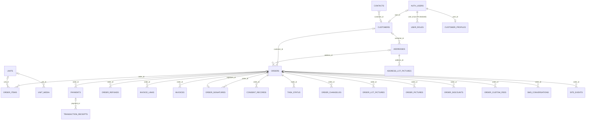

(`AUTH_USERS` is `auth.users`.) Tables with no foreign keys to other `public` tables (the `blackout_*` tables reference only `auth.users`): `admin_settings`, `pricing_rules`, `email_templates`, `sms_message_templates`, `hero_carousel_images`, `google_reviews`, `rate_limits`, `blackout_*`, `google_calendar_sync*`, `notification_*`, `stripe_webhook_events`.

---

## 2. Tables by domain

### 2.1 Customers, contacts, identity

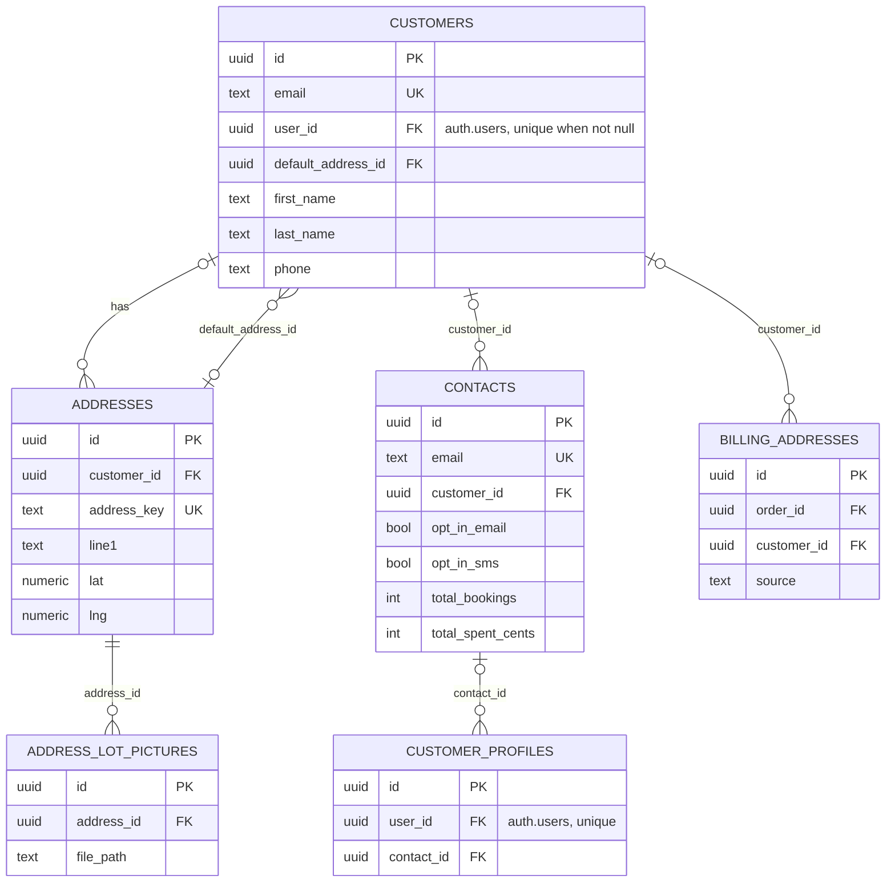

#### `customers` (124 rows)
Purpose: one row per booking customer (guest or signed-in). Matched to a `contacts` row by email; `user_id` links to `auth.users` when the customer has an account. Created by checkout code and by trigger function `auto_assign_customer_role` for new auth users.

```
id uuid NN =gen_random_uuid()
first_name text NN
last_name text NN
email text NN
phone text NN
created_at timestamptz =now()
business_name text
oauth_provider text
oauth_profile_data jsonb ='{}'
default_address_id uuid
user_id uuid
```
- PK `customers_pkey (id)`. UQ `customers_email_key (email)`.
- FK `default_address_id -> addresses(id) ON DELETE SET NULL`; FK `user_id -> auth.users(id) ON DELETE CASCADE`.
- Unique partial index `customers_user_id_idx (user_id) WHERE user_id IS NOT NULL`. Other indexes: `idx_customers_default_address_id`, `idx_customers_email`, `idx_customers_phone`.
- Triggers: none. RLS: enabled (3 policies).

| Policy | Cmd | Roles | Summary |
|---|---|---|---|
| Service role full access to customers | ALL | public | predicate `true` for USING and WITH CHECK (applies to the `public` pseudo-role, i.e. every role) |
| Users can update their own customer profile | UPDATE | authenticated | row where `uid() = user_id` (USING and WITH CHECK) |
| Users can view their own customer profile | SELECT | authenticated | row where `uid() = user_id` |

#### `contacts` (96 rows)
Purpose: marketing/CRM record keyed by unique email; holds opt-in flags and booking statistics maintained by triggers on `orders` (`update_contact_booking_stats`, `update_contact_stats`). Upserted at checkout by `upsert_contact_from_checkout(...)`.

```
id uuid NN =gen_random_uuid()
customer_id uuid
first_name text NN
last_name text NN
email text NN
phone text
opt_in_email boolean =true
opt_in_sms boolean =true
source text ='booking'
tags text[] ='{}'
last_contact_date timestamptz
total_bookings integer =0
total_spent_cents integer =0
created_at timestamptz =now()
updated_at timestamptz =now()
business_name text
completed_bookings_count integer NN =0
first_completed_booking_date date
last_completed_booking_date date
is_repeat_customer boolean NN =false
```
- PK `contacts_pkey (id)`. UQ `contacts_email_key (email)`. FK `customer_id -> customers(id) ON DELETE SET NULL`.
- Indexes: `idx_contacts_customer_id`, `idx_contacts_email`, `idx_contacts_phone`.
- Triggers: `update_contacts_updated_at` BEFORE UPDATE -> `update_updated_at_column()`.
- RLS enabled (6 policies):

| Policy | Cmd | Roles | Summary |
|---|---|---|---|
| Admins can view all contacts | SELECT | authenticated | admin/master (lower-cased role compare) |
| Admins can insert contacts | INSERT | authenticated | WITH CHECK admin/master |
| Admins can update contacts | UPDATE | authenticated | USING admin/master |
| Admins can delete contacts | DELETE | authenticated | admin/master |
| Anyone can upsert contact during checkout | INSERT | anon, authenticated | WITH CHECK `true` |
| Service role can manage contacts | ALL | service_role | `true` |

#### `customer_profiles` (6 rows)
Purpose: per-account notification preferences for signed-in customers; links `auth.users` to a `contacts` row.

```
id uuid NN =gen_random_uuid()
user_id uuid NN
contact_id uuid
phone text
email_notifications boolean =true
sms_notifications boolean =false
created_at timestamptz =now()
updated_at timestamptz =now()
first_name text
last_name text
```
- PK `customer_profiles_pkey (id)`. UQ `customer_profiles_user_id_key (user_id)`.
- FK `contact_id -> contacts(id) ON DELETE SET NULL`; FK `user_id -> auth.users(id) ON DELETE CASCADE`.
- Indexes: `idx_customer_profiles_contact_id`, `idx_customer_profiles_user_id`. Triggers: none.
- RLS enabled (3 policies):

| Policy | Cmd | Roles | Summary |
|---|---|---|---|
| Admins can view all profiles | SELECT | authenticated | admin/master |
| Users can update own profile | UPDATE | authenticated | `uid() = user_id` (USING and WITH CHECK) |
| Users can view own profile | SELECT | authenticated | `uid() = user_id` |

#### `addresses` (167 rows)
Purpose: delivery/event addresses with geocoordinates; `address_key` is a unique normalised key used to de-duplicate addresses.

```
id uuid NN =gen_random_uuid()
customer_id uuid
line1 text NN
line2 text
city text NN
state text NN
zip text NN
lat numeric(10,7)
lng numeric(10,7)
created_at timestamptz =now()
address_key text
```
- PK `addresses_pkey (id)`. UQ `addresses_address_key_unique (address_key)`. FK `customer_id -> customers(id) ON DELETE CASCADE`.
- Index: `idx_addresses_customer`. Triggers: none.
- RLS enabled (1 policy):

| Policy | Cmd | Roles | Summary |
|---|---|---|---|
| Service role full access to addresses | ALL | public | `true` for USING and WITH CHECK (applies to every role) |

#### `billing_addresses` (1 row)
Purpose: billing address captured per order (source `checkout` by default).

```
id uuid NN =gen_random_uuid()
order_id uuid NN
customer_id uuid
line1 text NN =''
line2 text
city text NN =''
state text NN =''
zip text NN =''
source text NN ='checkout'
created_at timestamptz NN =now()
```
- PK `billing_addresses_pkey (id)`. FK `order_id -> orders(id) ON DELETE CASCADE`; FK `customer_id -> customers(id) ON DELETE SET NULL`.
- Unique index `billing_addresses_order_source_uidx (order_id, source)`. Other indexes: `billing_addresses_customer_id_idx`, `billing_addresses_order_id_idx`. Triggers: none.
- No references to this table in application code (`src`, `supabase/functions`) in the `main` snapshot; `orders` carries its own `billing_*` columns.
- RLS enabled (3 policies):

| Policy | Cmd | Roles | Summary |
|---|---|---|---|
| Admins can read billing addresses | SELECT | authenticated | role in `master`, `admin`, `manager` (exact compare) |
| Anyone can insert billing address | INSERT | anon | WITH CHECK `true` |
| Authenticated can insert billing address | INSERT | authenticated | WITH CHECK `true` |

#### `address_lot_pictures` (0 rows)
Purpose: lot (yard/site) photos saved against an address for reuse on future orders; copied from `order_lot_pictures` by `save_lot_picture_to_address(uuid)`.

```
id uuid NN =gen_random_uuid()
address_id uuid NN
file_path text NN
file_name text NN
notes text
saved_from_order_id uuid
saved_from_order_lot_picture_id uuid
saved_by uuid
created_at timestamptz =now()
```
- PK `address_lot_pictures_pkey (id)`.
- FK `address_id -> addresses(id) ON DELETE CASCADE`; `saved_by -> auth.users(id) NO ACTION`; `saved_from_order_id -> orders(id) ON DELETE SET NULL`; `saved_from_order_lot_picture_id -> order_lot_pictures(id) ON DELETE SET NULL`.
- Unique index `address_lot_pictures_address_file_path_key (address_id, file_path)`. Other index: `address_lot_pictures_address_id_idx`. Triggers: none.
- RLS enabled (3 policies), all `authenticated`, all using `get_user_role(uid()) IN ('admin','master')`:

| Policy | Cmd | Summary |
|---|---|---|
| Admin and master can view address lot pictures | SELECT | admin/master |
| Admin and master can save address lot pictures | INSERT | WITH CHECK admin/master |
| Admin and master can delete address lot pictures | DELETE | admin/master |

---

### 2.2 Orders and items

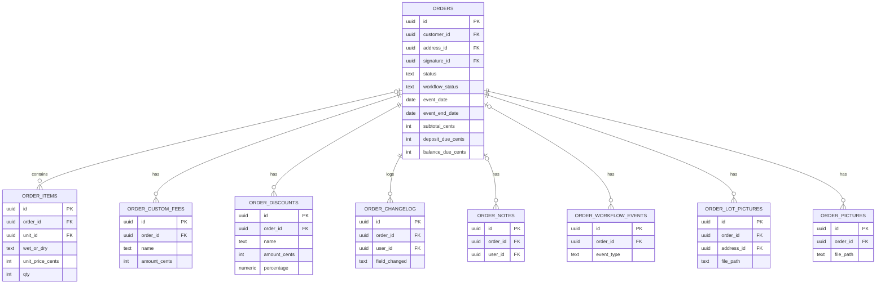

#### `orders` (173 rows)
Purpose: central booking record: customer, address, event dates/time windows, all fee components and waiver flags, payment state, customer-approval state, cancellation, and archival. Most other tables reference it. In the Realtime publication.

Columns (110):
```
id uuid NN =gen_random_uuid()
customer_id uuid
status text ='pending'
location_type text NN
surface text NN
event_date date NN
start_window time NN
end_window time NN
address_id uuid
subtotal_cents integer NN
travel_fee_cents integer =0
surface_fee_cents integer =0
same_day_pickup_fee_cents integer =0
tax_cents integer =0
deposit_due_cents integer NN
deposit_paid_cents integer =0
balance_due_cents integer NN
payment_method_id text
card_on_file_consent_text text
card_on_file_consented_at timestamptz
created_at timestamptz =now()
overnight_allowed boolean =true
can_use_stakes boolean =true
generator_selected boolean =false
special_details text
has_pets boolean =false
sms_consent_text text
sms_consented_at timestamptz
travel_total_miles numeric(8,2)
travel_base_radius_miles numeric(8,2)
travel_chargeable_miles numeric(8,2)
travel_per_mile_cents integer
travel_is_flat_fee boolean =false
stripe_customer_id text
stripe_payment_method_id text
balance_paid_cents integer =0
damage_charged_cents integer =0
total_refunded_cents integer =0
deposit_required boolean =true
stripe_payment_status text ='unpaid'
workflow_status text ='pending'
current_eta timestamptz
waiver_signed_at timestamptz
waiver_signature_data text
tip_cents integer NN =0
awaiting_customer_approval boolean =false
customer_approval_requested_at timestamptz
customer_approved_at timestamptz
edit_summary text
event_end_date date NN
pickup_preference text NN
custom_deposit_cents integer
clear_payment_info boolean =false
generator_fee_cents integer =0
admin_message text
generator_qty integer =0
signed_waiver_url text
signature_id uuid
e_signature_consent boolean =false
sms_consent boolean =false
card_on_file_consent boolean =false
invoice_sent_at timestamptz
invoice_accepted_at timestamptz
until_end_of_day boolean =false
same_day_responsibility_accepted boolean =false
overnight_responsibility_accepted boolean =false
event_start_time time
pickup_time time
event_end_time time
booking_confirmation_sent boolean =false
cancellation_reason text
cancelled_at timestamptz
cancelled_by uuid
tax_waived boolean =false
tax_waive_reason text
travel_fee_waived boolean =false
travel_fee_waive_reason text
same_day_pickup_fee_waived boolean =false
same_day_pickup_fee_waive_reason text
payment_method_validated_at timestamptz
payment_method_last_four text
payment_method_exp_month integer
payment_method_exp_year integer
surface_fee_waived boolean =false
surface_fee_waive_reason text
generator_fee_waived boolean =false
generator_fee_waive_reason text
lot_pictures_requested boolean =false
lot_pictures_requested_at timestamptz
payment_method_brand text
customer_selected_payment_cents integer
customer_selected_payment_type text
require_card_on_file boolean =true
archived_at timestamptz
pending_review_admin_alerted boolean NN =false
confirmed_admin_alerted boolean NN =false
refund_requested boolean =false
billing_address_line1 text
billing_address_line2 text
billing_city text
billing_state text
billing_zip text
referral_source text
referral_source_detail text
same_day_weekday_delivery_fee_cents integer =0
same_day_weekday_delivery_fee_waived boolean =false
same_day_weekday_delivery_fee_waive_reason text
payment_lock boolean NN =false
parks_acknowledgment_required boolean NN =false
parks_acknowledgment_county text
```
- PK `orders_pkey (id)`.
- FK: `address_id -> addresses(id) NO ACTION`; `cancelled_by -> auth.users(id) NO ACTION`; `customer_id -> customers(id) ON DELETE CASCADE`; `signature_id -> order_signatures(id) ON DELETE SET NULL`.
- CK `orders_status_check`: `status IN ('draft','pending_review','awaiting_customer_approval','confirmed','in_progress','completed','cancelled','void')`.
- CK `orders_workflow_status_check`: `workflow_status IN ('pending','on_the_way','arrived','setup_in_progress','setup_completed','pickup_scheduled','pickup_in_progress','completed')`.
- CK `orders_location_type_check`: `location_type IN ('residential','commercial')`. CK `orders_surface_check`: `surface IN ('grass','cement')`. CK `orders_pickup_preference_check`: `pickup_preference IN ('same_day','next_day')`.
- CK `orders_referral_source_check`: `referral_source IS NULL OR referral_source IN ('social_media','google','physical_marketing','referral','returning_customer','other')`.
- Note: the column default for `status` is `'pending'`, which is not a member of `orders_status_check`; inserts rely on supplying an explicit allowed status.
- Indexes: `idx_orders_address_id`, `idx_orders_archived_at` (partial `archived_at IS NOT NULL`), `idx_orders_booking_confirmation_sent` (partial `booking_confirmation_sent = false`), `idx_orders_customer`, `idx_orders_customer_id` (duplicate coverage of `customer_id`), `idx_orders_event_date`, `idx_orders_event_date_status`, `idx_orders_signature_id`, `idx_orders_status`, `idx_orders_stripe_customer`, `idx_orders_workflow_status`.
- Triggers (5):
  - `validate_status_transition` BEFORE UPDATE OF status -> `validate_order_status_transition()`
  - `trigger_auto_create_task_status` AFTER INSERT OR UPDATE OF status -> `auto_create_task_status()`
  - `trigger_update_contact_stats` AFTER INSERT OR UPDATE OF status -> `update_contact_booking_stats()`
  - `update_contact_stats_trigger` AFTER UPDATE -> `update_contact_stats()`
  - `trg_sync_invoice_links_expires_at` AFTER UPDATE OF event_date -> `sync_invoice_links_expires_at()`
- RLS enabled (3 policies):

| Policy | Cmd | Roles | Summary |
|---|---|---|---|
| Service role full access to orders | ALL | public | `true` for USING and WITH CHECK (applies to every role) |
| Customers can view own orders | SELECT | authenticated | order whose `customer_id` equals a customer reachable from the caller via `customer_profiles -> contacts.customer_id`, or via a `contacts` row whose email equals the caller's `auth.users` email |
| Anonymous users can mark booking confirmation sent | UPDATE | anon | USING `true`; WITH CHECK requires `booking_confirmation_sent` to differ from the stored value (the subquery compares the table to itself, see policy text in catalog) |

#### `order_items` (186 rows)
Purpose: line items (units) on an order with the wet/dry price chosen.

```
id uuid NN =gen_random_uuid()
order_id uuid
unit_id uuid
wet_or_dry text NN
unit_price_cents integer NN
qty integer =1
notes text
```
- PK `order_items_pkey (id)`. FK `order_id -> orders(id) ON DELETE CASCADE`; `unit_id -> units(id) NO ACTION`. CK `order_items_wet_or_dry_check`: `wet_or_dry IN ('dry','water')`.
- Indexes: `idx_order_items_order`, `idx_order_items_order_id` (duplicate coverage), `idx_order_items_unit_id`. Triggers: none.
- RLS enabled (1 policy): `Service role full access to order_items` ALL, role `public`, `true`.

#### `order_custom_fees` (4 rows)
Purpose: ad-hoc named fees added to an order by admin.

```
id uuid NN =gen_random_uuid()
order_id uuid NN
name text NN
amount_cents integer NN =0
created_at timestamptz =now()
```
- PK `order_custom_fees_pkey (id)`. FK `order_id -> orders(id) ON DELETE CASCADE`. Index `idx_order_custom_fees_order_id`. Triggers: none.
- RLS enabled (4 policies):

| Policy | Cmd | Roles | Summary |
|---|---|---|---|
| Anonymous users can view order custom fees | SELECT | anon | `true` |
| Authenticated users can view custom fees | SELECT | authenticated | `true` |
| Authenticated users can insert custom fees | INSERT | authenticated | WITH CHECK `true` |
| Authenticated users can delete custom fees | DELETE | authenticated | `true` |

#### `order_discounts` (15 rows)
Purpose: named discounts (fixed cents and/or percentage) applied to an order.

```
id uuid NN =gen_random_uuid()
order_id uuid NN
name text NN
amount_cents integer =0
percentage numeric =0
created_at timestamptz =now()
created_by uuid
```
- PK `order_discounts_pkey (id)`. FK `order_id -> orders(id) ON DELETE CASCADE`; `created_by -> auth.users(id) NO ACTION`. Indexes: `idx_order_discounts_created_by`, `idx_order_discounts_order_id`. Triggers: none.
- RLS enabled (2 policies):

| Policy | Cmd | Roles | Summary |
|---|---|---|---|
| Admins can manage discounts | ALL | authenticated | admin/master (USING and WITH CHECK) |
| Anonymous users can view order discounts | SELECT | anon | `true` |

#### `order_changelog` (381 rows)
Purpose: audit trail of field-level changes on an order (edit, status change, customer approval).

```
id uuid NN =gen_random_uuid()
order_id uuid NN
user_id uuid
field_changed text NN
old_value text
new_value text
change_type text NN ='edit'
created_at timestamptz =now()
notes text
```
- PK `order_changelog_pkey (id)`. FK `order_id -> orders(id) ON DELETE CASCADE`; `user_id -> auth.users(id) NO ACTION`. No CHECK on `change_type`. Indexes: `idx_order_changelog_created_at` (created_at DESC), `idx_order_changelog_order_id`, `idx_order_changelog_user_id`. Triggers: none.
- RLS enabled (3 policies):

| Policy | Cmd | Roles | Summary |
|---|---|---|---|
| Anonymous users can log customer actions | INSERT | anon | WITH CHECK `user_id IS NULL` and `change_type IN ('customer_approval','status_change')` |
| Authenticated users can create changelog entries | INSERT | authenticated | WITH CHECK `uid() = user_id` |
| Authenticated users can view order changelog | SELECT | authenticated | `true` |

#### `order_notes` (0 rows)
Purpose: free-text internal notes on an order (used by the order detail Notes tab).

```
id uuid NN =gen_random_uuid()
order_id uuid
user_id uuid
note text NN
created_at timestamptz =now()
```
- PK `order_notes_pkey (id)`. FK `order_id -> orders(id) ON DELETE CASCADE`; `user_id -> auth.users(id) NO ACTION`. Indexes: `idx_order_notes_order_id`, `idx_order_notes_user_id`. Triggers: none.
- RLS enabled (1 policy): `Admins can manage order notes` ALL, authenticated, admin/master.

#### `order_workflow_events` (0 rows)
Purpose: crew workflow event log (on the way, arrived, setup, pickup). No references in application code in the `main` snapshot; `task_status` and `orders.workflow_status` carry live workflow state.

```
id uuid NN =gen_random_uuid()
order_id uuid
event_type text NN
user_id uuid
eta timestamptz
notes text
latitude numeric
longitude numeric
created_at timestamptz =now()
```
- PK `order_workflow_events_pkey (id)`. FK `order_id -> orders(id) ON DELETE CASCADE`; `user_id -> auth.users(id) NO ACTION`.
- CK `order_workflow_events_event_type_check`: `event_type IN ('on_the_way','arrived','setup_started','setup_completed','pickup_started','pickup_completed')`.
- Indexes: `idx_order_workflow_events_order_id`, `idx_order_workflow_events_user_id`. Triggers: none.
- RLS enabled (1 policy): `Admins and crew can manage workflow events` ALL, authenticated, role in admin/crew/master.

#### `order_lot_pictures` (8 rows)
Purpose: photos of the event lot uploaded by the customer (or admin) for an order; files are in storage bucket `lot-pictures`. In the Realtime publication.

```
id uuid NN =gen_random_uuid()
order_id uuid NN
file_path text NN
file_name text NN
notes text
uploaded_at timestamptz =now()
uploaded_by uuid
created_at timestamptz =now()
address_id uuid
```
- PK `order_lot_pictures_pkey (id)`. FK `order_id -> orders(id) ON DELETE CASCADE`; `address_id -> addresses(id) ON DELETE SET NULL`; `uploaded_by -> auth.users(id) NO ACTION`. Indexes: `idx_order_lot_pictures_order_id`, `idx_order_lot_pictures_uploaded_at`. Triggers: none.
- RLS enabled (7 policies):

| Policy | Cmd | Roles | Summary |
|---|---|---|---|
| Admins can manage all lot pictures | ALL | authenticated | role in master/admin |
| Admins can delete any lot pictures | DELETE | authenticated | role in master/admin |
| Anon can insert lot pictures for existing orders | INSERT | anon | WITH CHECK an `orders` row with that `order_id` exists |
| Anonymous users can view lot pictures | SELECT | anon | `true` |
| Customers can view their own order lot pictures | SELECT | authenticated | the order exists and `orders.customer_id = uid()`, OR the order exists (second branch has no customer condition) |
| Customers can upload lot pictures for their orders | INSERT | authenticated | same two-branch predicate as above, as WITH CHECK |
| Customers can delete lot pictures from their orders | DELETE | authenticated | same two-branch predicate |

#### `order_pictures` (0 rows)
Purpose: delivery/damage photos attached to an order; files in bucket `order-pictures`; `promote-media` edge function copies media here. In the Realtime publication.

```
id uuid NN =gen_random_uuid()
order_id uuid NN
file_path text NN
file_name text NN
file_size integer NN
mime_type text NN
notes text
uploaded_by uuid
uploaded_at timestamptz NN =now()
created_at timestamptz NN =now()
```
- PK `order_pictures_pkey (id)`. FK `order_id -> orders(id) ON DELETE CASCADE`; `uploaded_by -> auth.users(id) ON DELETE SET NULL`. Indexes: `idx_order_pictures_order_id`, `idx_order_pictures_uploaded_at` (DESC). Triggers: none.
- RLS enabled (5 policies):

| Policy | Cmd | Roles | Summary |
|---|---|---|---|
| Admins can view all order pictures | SELECT | authenticated | role in admin/master/crew |
| Admins can delete order pictures | DELETE | authenticated | role in admin/master |
| Anon can view order pictures by order id | SELECT | anon | `true` |
| Anyone can upload order pictures | INSERT | public | WITH CHECK an `orders` row with that `order_id` exists |
| Customers can view own order pictures | SELECT | authenticated | the order's customer has a `contacts` row whose email equals `auth.email()` |

---

### 2.3 Payments, refunds, receipts

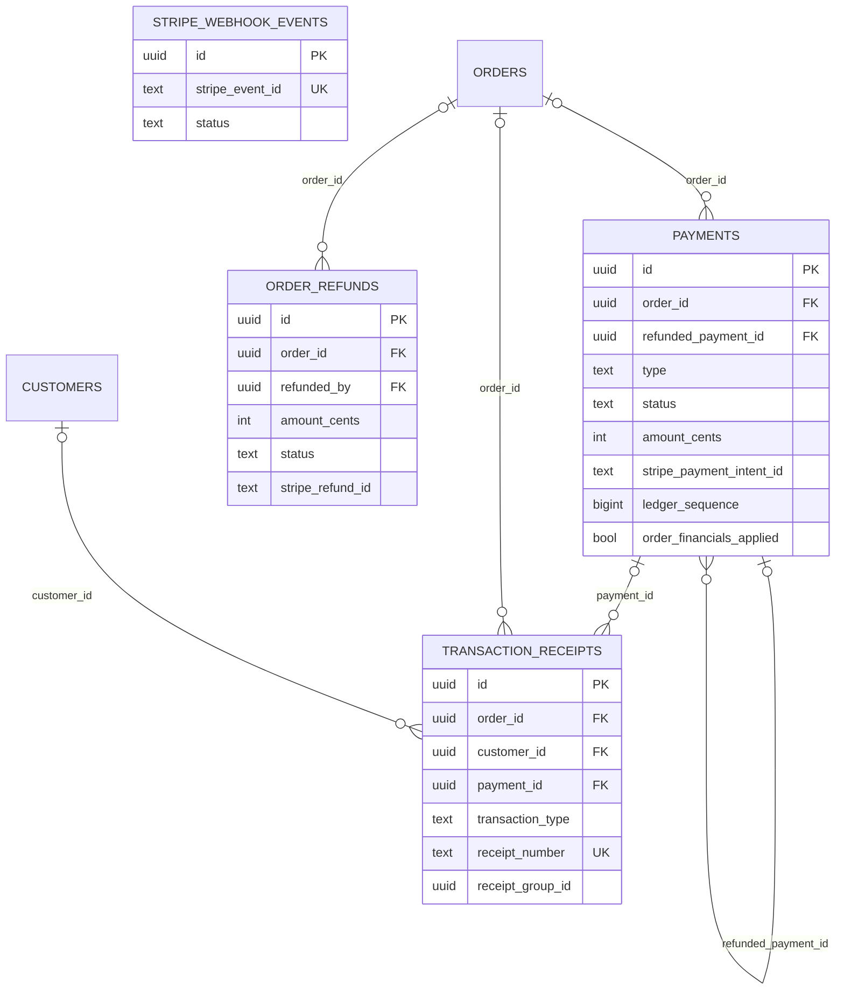

#### `payments` (189 rows)
Purpose: ledger of Stripe and manual (cash/check) payment records per order, one row per payment intent / manual entry, with fee and net amounts from Stripe. `order_financials_applied` marks whether the money has already been folded into `orders` totals (idempotency flag used by `apply_balance_payment_financials`). In the Realtime publication.

```
id uuid NN =gen_random_uuid()
order_id uuid
type text NN
amount_cents integer NN
stripe_payment_intent_id text
status text ='pending'
created_at timestamptz =now()
paid_at timestamptz
failed_at timestamptz
updated_at timestamptz =now()
payment_method text
payment_brand text
payment_last4 text
ledger_sequence bigint NN =nextval('payments_ledger_sequence_seq')
stripe_fee_amount integer
stripe_net_amount integer
currency text ='usd'
refunded_payment_id uuid
order_financials_applied boolean NN =false
```
- PK `payments_pkey (id)`. FK `order_id -> orders(id) ON DELETE CASCADE`; `refunded_payment_id -> payments(id) NO ACTION` (self-reference). CK `payments_type_check`: `type IN ('deposit','balance','incidental')`. No CHECK on `status`.
- Indexes: `idx_payments_created`, `idx_payments_ledger_sequence`, `idx_payments_order_id`, `idx_payments_refunded`, `idx_payments_stripe_payment_intent` (non-unique).
- Triggers: `payments_updated_at_trigger` BEFORE UPDATE -> `update_payments_updated_at()`; `update_payments_updated_at` BEFORE UPDATE -> `update_payment_updated_at()` (two triggers set `updated_at`).
- RLS enabled (5 policies):

| Policy | Cmd | Roles | Summary |
|---|---|---|---|
| Admins can view all payments | SELECT | authenticated | `is_admin()` |
| Admins can insert payments | INSERT | authenticated | WITH CHECK `is_admin()` |
| Admins can update payments | UPDATE | authenticated | USING and WITH CHECK `is_admin()` |
| Service role full access to payments | ALL | public | `true` (applies to every role) |
| Users can view own order payments | SELECT | authenticated | the payment's order belongs to a customer that has a `contacts` row with the caller's `auth.users` email |

#### `order_refunds` (5 rows)
Purpose: refund requests/results per order (written by the `stripe-refund` and `stripe-webhook` edge functions; read by the admin pending-order view).

```
id uuid NN =gen_random_uuid()
order_id uuid
amount_cents integer NN
reason text NN
stripe_refund_id text
refunded_by uuid
status text ='pending'
created_at timestamptz =now()
```
- PK `order_refunds_pkey (id)`. FK `order_id -> orders(id) ON DELETE CASCADE`; `refunded_by -> auth.users(id) NO ACTION`. CK `order_refunds_status_check`: `status IN ('pending','succeeded','failed')`.
- Indexes: `idx_order_refunds_order_id`, `idx_order_refunds_refunded_by`. Triggers: none.
- RLS enabled (1 policy): `Admins can manage refunds` ALL, authenticated, admin/master.

#### `transaction_receipts` (151 rows)
Purpose: receipt record per money movement with a human receipt number (`RCP-YYYYMMDD-NNNNN` from `generate_receipt_number()`); `receipt_group_id` groups receipts created in the same checkout.

```
id uuid NN =gen_random_uuid()
transaction_type text NN
order_id uuid
customer_id uuid
payment_id uuid
amount_cents integer NN
payment_method text
payment_method_brand text
stripe_charge_id text
stripe_payment_intent_id text
receipt_number text NN =generate_receipt_number()
receipt_sent_to_admin boolean =false
admin_notified_at timestamptz
transaction_date timestamptz =now()
notes text
created_at timestamptz =now()
updated_at timestamptz =now()
receipt_group_id uuid
```
- PK `transaction_receipts_pkey (id)`. UQ `transaction_receipts_receipt_number_key (receipt_number)`; UQ `unique_receipt_charge_type (stripe_charge_id, transaction_type)` NULLS NOT DISTINCT; UQ `unique_receipt_pi_type (stripe_payment_intent_id, transaction_type)` NULLS NOT DISTINCT.
- FK `customer_id -> customers(id) ON DELETE SET NULL`; `order_id -> orders(id) ON DELETE SET NULL`; `payment_id -> payments(id) ON DELETE SET NULL`.
- CK `transaction_receipts_transaction_type_check`: `transaction_type IN ('deposit','balance','refund','tip','full_payment')`.
- Indexes: `idx_receipts_group`, `idx_transaction_receipts_customer_id`, `idx_transaction_receipts_order_id`, `idx_transaction_receipts_payment_id`, `idx_transaction_receipts_receipt_number`, `idx_transaction_receipts_transaction_date` (DESC).
- Triggers: `update_transaction_receipts_timestamp` BEFORE UPDATE -> `update_transaction_receipts_updated_at()`.
- RLS enabled (4 policies):

| Policy | Cmd | Roles | Summary |
|---|---|---|---|
| Admin users can view all transaction receipts | SELECT | authenticated | role in master/admin |
| Admin users can insert transaction receipts | INSERT | authenticated | WITH CHECK role in master/admin |
| Customers can view their own transaction receipts | SELECT | authenticated | `customer_id` is one of the customers rows with `user_id = uid()` |
| System can insert transaction receipts | INSERT | anon | WITH CHECK `true` |

#### `stripe_webhook_events` (0 rows)
Purpose: idempotency log for Stripe webhook deliveries handled by the `stripe-webhook` edge function (statuses processing/succeeded/failed, retry attempts).

```
id uuid NN =gen_random_uuid()
stripe_event_id text NN
event_type text NN
processed_at timestamptz =now()
payload jsonb
created_at timestamptz =now()
status text NN ='processing'
attempts integer NN =0
last_error text
updated_at timestamptz NN =now()
```
- PK `stripe_webhook_events_pkey (id)`. UQ `stripe_webhook_events_stripe_event_id_key (stripe_event_id)`. CK `webhook_events_status_check`: `status IN ('processing','succeeded','failed')`.
- Indexes: `idx_webhook_events_status_updated (status, updated_at)`, `idx_webhook_events_stripe_id`, `idx_webhook_events_type`.
- Triggers: `update_webhook_events_updated_at` BEFORE UPDATE -> `update_webhook_event_timestamp()`.
- Table comment: "Tracks processed Stripe webhook events to ensure idempotency and prevent duplicate processing".
- RLS enabled (2 policies):

| Policy | Cmd | Roles | Summary |
|---|---|---|---|
| Admin users can view webhook events | SELECT | authenticated | role in master/admin |
| System can insert webhook events | INSERT | anon | WITH CHECK `true` |

---

### 2.4 Invoices and links

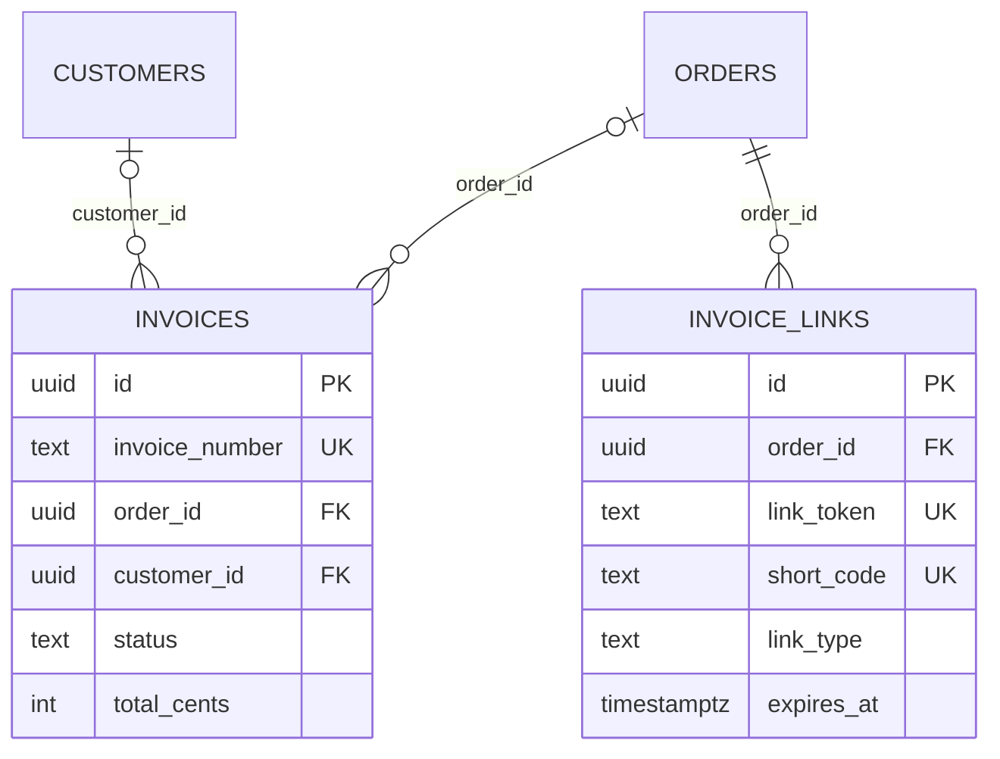

#### `invoices` (84 rows)
Purpose: invoice document records created from orders (number format `INV-YYYY-NNNN` from `generate_invoice_number()`).

```
id uuid NN =gen_random_uuid()
invoice_number text NN
order_id uuid
customer_id uuid
invoice_date date =CURRENT_DATE
due_date date
status text ='draft'
subtotal_cents integer NN
tax_cents integer =0
travel_fee_cents integer =0
surface_fee_cents integer =0
same_day_pickup_fee_cents integer =0
total_cents integer NN
paid_amount_cents integer =0
payment_method text
notes text
pdf_url text
created_at timestamptz =now()
updated_at timestamptz =now()
generator_fee_cents integer =0
same_day_weekday_delivery_fee_cents integer =0
```
- PK `invoices_pkey (id)`. UQ `invoices_invoice_number_key (invoice_number)`. FK `customer_id -> customers(id) ON DELETE SET NULL`; `order_id -> orders(id) ON DELETE SET NULL`. CK `invoices_status_check`: `status IN ('draft','sent','partial','paid','cancelled')`.
- Indexes: `idx_invoices_customer_id`, `idx_invoices_invoice_number`, `idx_invoices_order_id`.
- Triggers: `update_invoices_updated_at` BEFORE UPDATE -> `update_updated_at_column()`.
- RLS enabled (4 policies):

| Policy | Cmd | Roles | Summary |
|---|---|---|---|
| Admins can view all invoices | SELECT | authenticated | admin/master |
| Admins can insert invoices | INSERT | authenticated | WITH CHECK admin/master |
| Admins can update invoices | UPDATE | authenticated | USING admin/master |
| Service role can manage invoices | ALL | service_role | `true` |

#### `invoice_links` (291 rows)
Purpose: token links sent to customers to open the customer portal/invoice/approval page for an order. `link_token` is a 64-hex random token (default `encode(gen_random_bytes(32),'hex')`); `short_code` is an optional short URL code; `link_type` distinguishes link kinds (values written by code: `invoice`, `portal_shortlink`). `expires_at` defaults to 7 days and is moved to event_date + 3 days when `orders.event_date` changes.

```
id uuid NN =gen_random_uuid()
order_id uuid NN
link_token text NN =encode(gen_random_bytes(32), 'hex')
customer_filled boolean =false
deposit_cents integer NN =0
expires_at timestamptz =(now() + '7 days'::interval)
created_at timestamptz =now()
updated_at timestamptz =now()
short_code text
link_type text NN ='invoice'
```
- PK `invoice_links_pkey (id)`. UQ `invoice_links_link_token_key (link_token)`. FK `order_id -> orders(id) ON DELETE CASCADE`. No CHECK on `link_type`.
- Unique partial index `invoice_links_short_code_idx (short_code) WHERE short_code IS NOT NULL`. Other indexes: `invoice_links_expires_at_idx`, `invoice_links_link_token_idx`, `invoice_links_link_type_idx`, `invoice_links_order_id_idx`.
- Triggers: `update_invoice_links_timestamp` BEFORE UPDATE -> `update_invoice_links_updated_at()`.
- RLS enabled (6 policies):

| Policy | Cmd | Roles | Summary |
|---|---|---|---|
| Admins can select invoice links | SELECT | authenticated | admin/master |
| Admins can insert invoice links | INSERT | authenticated | WITH CHECK admin/master |
| Admins can update invoice links | UPDATE | authenticated | admin/master (USING and WITH CHECK) |
| Admins can delete invoice links | DELETE | authenticated | admin/master |
| Anyone can view invoice link with valid token | SELECT | anon, authenticated | rows where `expires_at > now()` (no token comparison inside the policy; the token filter is supplied by the query) |
| Anyone can update invoice link with valid token | UPDATE | anon, authenticated | rows where `expires_at > now()` (USING and WITH CHECK) |

---

### 2.5 Waivers, signatures, consent

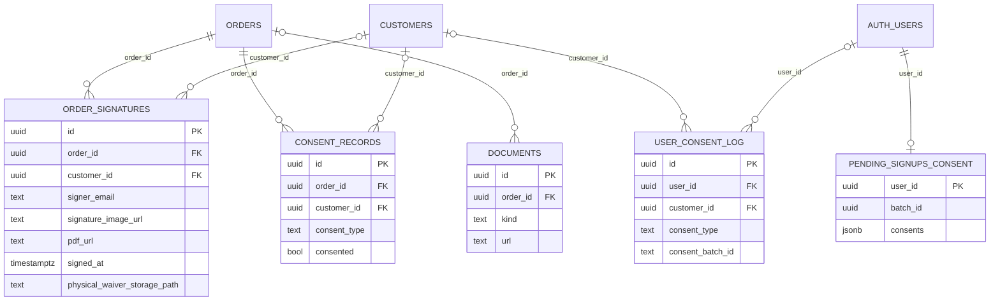

#### `order_signatures` (73 rows)
Purpose: electronic liability-waiver signature per order: signer identity, signature image URL (bucket `signatures`), generated PDF URL (bucket `signed-waivers`), device/IP evidence, a snapshot of the waiver text, event location, and optional physical (paper) waiver upload metadata (bucket `physical-waivers`). `orders.signature_id` points back here. In the Realtime publication.

```
id uuid NN =gen_random_uuid()
order_id uuid NN
customer_id uuid
signer_name text NN
signer_email text NN
signer_phone text NN
signature_image_url text NN
initials_data jsonb NN ='{}'
typed_name text NN
pdf_url text
pdf_generated_at timestamptz
signed_at timestamptz NN =now()
ip_address text NN
user_agent text NN
device_info jsonb ='{}'
waiver_version text NN ='1.0'
waiver_text_snapshot text NN
electronic_consent_given boolean NN =true
electronic_consent_text text NN
created_at timestamptz NN =now()
updated_at timestamptz NN =now()
event_date date NN
event_end_date date
event_address_line1 text NN
event_address_line2 text =''
event_city text NN
event_state text NN
event_zip text NN
home_address_line1 text =''
home_address_line2 text =''
home_city text =''
home_state text =''
home_zip text =''
physical_waiver_storage_path text
physical_waiver_uploaded_at timestamptz
physical_waiver_uploaded_by uuid
physical_waiver_uploaded_by_role text
physical_waiver_file_type text
physical_waiver_original_filename text
physical_waiver_upload_source text
physical_waiver_override_reason text
```
- PK `order_signatures_pkey (id)`. FK `order_id -> orders(id) ON DELETE CASCADE`; `customer_id -> customers(id) ON DELETE SET NULL`; `physical_waiver_uploaded_by -> auth.users(id) NO ACTION`. No CHECK constraints.
- Indexes: `idx_order_signatures_customer_id`, `idx_order_signatures_order_id`, `idx_order_signatures_signed_at` (DESC). Triggers: none.
- RLS enabled (5 policies):

| Policy | Cmd | Roles | Summary |
|---|---|---|---|
| Admins can view all signatures | SELECT | authenticated | role exactly `admin` (exact compare; `master` is not matched by this policy) |
| Admins can update signatures | UPDATE | authenticated | role exactly `admin` |
| Anonymous can create signatures | INSERT | anon | WITH CHECK `true` |
| Users can create own signatures | INSERT | authenticated | WITH CHECK `customer_id = uid()` |
| Users can view own signatures | SELECT | authenticated | `signer_email` equals the caller's `auth.email()`, or role exactly `admin` |

#### `consent_records` (340 rows)
Purpose: per-order consent evidence rows (e.g. SMS consent, card-on-file consent, electronic signature consent) with the exact text, version, IP and user agent.

```
id uuid NN =gen_random_uuid()
order_id uuid NN
customer_id uuid
consent_type text NN
consented boolean NN
consent_text text NN
consent_version text NN ='1.0'
consented_at timestamptz NN =now()
ip_address text
user_agent text
created_at timestamptz NN =now()
```
- PK `consent_records_pkey (id)`. FK `order_id -> orders(id) ON DELETE CASCADE`; `customer_id -> customers(id) ON DELETE SET NULL`. No CHECK on `consent_type`.
- Indexes: `idx_consent_records_customer_id`, `idx_consent_records_order_id`, `idx_consent_records_type`. Triggers: none.
- RLS enabled (3 policies):

| Policy | Cmd | Roles | Summary |
|---|---|---|---|
| Anonymous can create consent records | INSERT | anon | WITH CHECK `true` |
| Users can create own consent records | INSERT | authenticated | WITH CHECK `customer_id = uid()` or admin/master |
| Users can view own consent records | SELECT | authenticated | `customer_id = uid()` or role exactly `admin` |

#### `user_consent_log` (0 rows)
Purpose: account-level consent history (terms of service, privacy policy, marketing email/SMS) written at sign-up. Batches group the rows of one sign-up. No code in the `main` snapshot writes to it: comments in `AuthContext` name it as the target of the `record-consent` edge function, whose `index.ts` is empty in the snapshot, and `save-pending-consent` returns HTTP 410.

```
id uuid NN =gen_random_uuid()
user_id uuid
customer_id uuid
consent_type text NN
consented boolean NN =false
policy_version text NN ='1.0'
source text NN ='signup'
ip_hint text
user_agent_hint text
created_at timestamptz NN =now()
consent_batch_id text
```
- PK `user_consent_log_pkey (id)`. FK `customer_id -> customers(id) ON DELETE SET NULL`; `user_id -> auth.users(id) ON DELETE SET NULL`.
- CK `user_consent_log_consent_type_check`: `consent_type IN ('terms_of_service','privacy_policy','marketing_email','marketing_sms')`.
- Unique partial index `uq_user_consent_log_batch_type (user_id, consent_batch_id, consent_type) WHERE consent_batch_id IS NOT NULL`. Other indexes: `idx_user_consent_log_batch_id` (partial), `idx_user_consent_log_customer_id`, `idx_user_consent_log_type_version`, `idx_user_consent_log_user_id`. Triggers: none.
- RLS enabled (2 policies):

| Policy | Cmd | Roles | Summary |
|---|---|---|---|
| Admins can view all consent records | SELECT | authenticated | role in master/admin |
| Users can view their own consent records | SELECT | authenticated | `uid() = user_id` |

#### `pending_signups_consent` (0 rows)
Purpose: holding row for consents captured in the sign-up form before the new auth user is confirmed; inserted by the `SignUp` page, read by `AuthContext` after sign-in (which then calls the `record-consent` edge function to drain it; that function's `index.ts` is empty in the `main` snapshot) and deleted by the `SignUp` page after a successful direct consent write. Primary key is `user_id`.

```
user_id uuid NN
batch_id uuid NN
consents jsonb NN
source text NN ='signup'
user_agent_hint text
created_at timestamptz NN =now()
```
- PK `pending_signups_consent_pkey (user_id)`. FK `user_id -> auth.users(id) ON DELETE CASCADE`. No other indexes or triggers.
- RLS enabled (4 policies):

| Policy | Cmd | Roles | Summary |
|---|---|---|---|
| Anon can insert for freshly created user | INSERT | anon | WITH CHECK an `auth.users` row with that id exists and was created within the last minute |
| User can insert own pending consent | INSERT | authenticated | WITH CHECK `uid() = user_id` |
| User can select own pending consent | SELECT | authenticated | `uid() = user_id` |
| User can delete own pending consent | DELETE | authenticated | `uid() = user_id` |

#### `documents` (0 rows)
Purpose: generic per-order document pointers (invoice, waiver photo, delivery/pickup photos). No `from('documents')` calls in `src` or `supabase/functions` in the `main` snapshot (only a type listing in `src/lib/database.types.ts`).

```
id uuid NN =gen_random_uuid()
order_id uuid
kind text NN
url text NN
meta_json jsonb
created_at timestamptz =now()
```
- PK `documents_pkey (id)`. FK `order_id -> orders(id) ON DELETE CASCADE`. CK `documents_kind_check`: `kind IN ('invoice','waiver_photo','delivery_photos','pickup_photos')`. Index `idx_documents_order`. Triggers: none.
- RLS enabled (1 policy): `Service role full access to documents` ALL, role `public`, `true`.

---

### 2.6 Tasks, crew, mileage

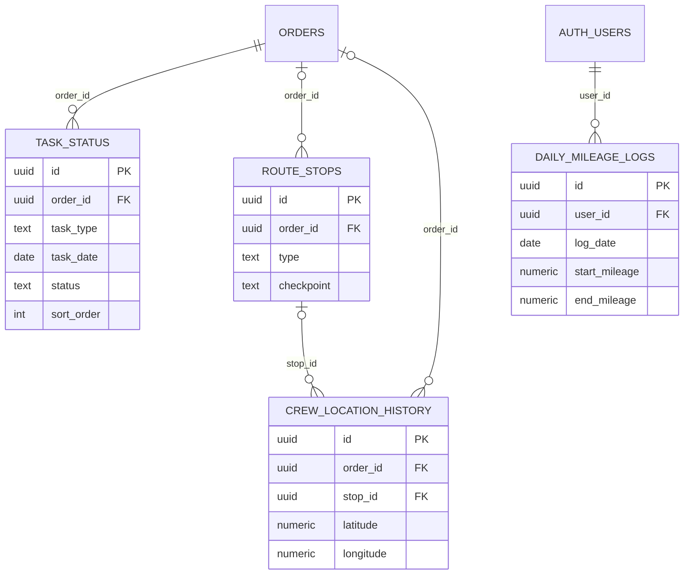
(In the last entity the column is named `date` in the database; it is drawn as `log_date` only because `date` is a reserved word in Mermaid.)

#### `task_status` (243 rows)
Purpose: primary day-of execution table: one drop-off and one pick-up task per order/date with progress timestamps, reminder flags, ETA results, notes and delivery/damage image lists. Rows are created automatically when an order becomes `confirmed` (`auto_create_task_status`). Used by the crew interface and admin calendar. In the Realtime publication. Table comment: "Primary table for day-of task execution. Tracks real-time progress of delivery and pickup tasks. Used by crew interface and admin calendar. Auto-created when order status changes to confirmed."

```
id uuid NN =gen_random_uuid()
order_id uuid NN
task_type text NN
task_date date NN
status text NN ='pending'
en_route_time timestamptz
arrived_time timestamptz
completed_time timestamptz
eta_sent boolean =false
waiver_reminder_sent boolean =false
payment_reminder_sent boolean =false
sort_order integer =0
delivery_images jsonb ='[]'
damage_images jsonb ='[]'
notes text
created_at timestamptz =now()
updated_at timestamptz =now()
calculated_eta_minutes integer
gps_lat numeric
gps_lng numeric
eta_calculation_error text
crew_notes text
admin_notes text
```
- PK `task_status_pkey (id)`. UQ `task_status_order_task_type_task_date_key (order_id, task_type, task_date)`. FK `order_id -> orders(id) ON DELETE CASCADE`.
- CK `task_status_status_check`: `status IN ('pending','en_route','arrived','completed')`. CK `task_status_task_type_check`: `task_type IN ('drop-off','pick-up')`.
- Indexes: `idx_task_status_date_type (task_date, task_type, status)`, `idx_task_status_order_id`, `idx_task_status_sort_order (task_date, sort_order)`, `idx_task_status_task_date`.
- Triggers: `trigger_auto_update_order_status` AFTER INSERT OR UPDATE OF status -> `auto_update_order_status()` (sets `orders.status` to `in_progress` or `completed` from task progress).
- RLS enabled (6 policies):

| Policy | Cmd | Roles | Summary |
|---|---|---|---|
| Admin users can view all task statuses | SELECT | authenticated | role in master/admin/crew |
| Admin users can insert task statuses | INSERT | authenticated | WITH CHECK role in master/admin |
| Admin users can update task statuses | UPDATE | authenticated | role in master/admin/crew (USING and WITH CHECK) |
| Admin users can delete task statuses | DELETE | authenticated | role in master/admin |
| Anonymous users can read task status for order delivery photos | SELECT | anon | `true` |
| Customers can view task status for their own orders | SELECT | authenticated | order's customer has `customers.user_id = uid()` |

#### `route_stops` (0 rows)
Purpose: reserved for route optimisation (planned vs actual stops, per-stop ETA). Comment on table: "Reserved for advanced route optimization features. For basic task execution, use task_status table instead. This table can be used for multi-stop routing algorithms, planned vs actual route analysis, and logistics optimization." Referenced by `crew_location_history.stop_id`.

```
id uuid NN =gen_random_uuid()
order_id uuid
type text NN
eta timestamptz
checkpoint text ='none'
checkpoint_time timestamptz
gps_lat numeric(10,7)
gps_lng numeric(10,7)
notes text
created_at timestamptz =now()
calculated_eta_minutes integer
calculated_eta_distance_miles numeric(10,2)
eta_calculated_at timestamptz
eta_calculation_error text
```
- PK `route_stops_pkey (id)`. FK `order_id -> orders(id) ON DELETE CASCADE`. CK `route_stops_checkpoint_check`: `checkpoint IN ('none','start_day','arrived','leave_dropoff','leave_pickup')`. CK `route_stops_type_check`: `type IN ('dropoff','pickup')`.
- Indexes: `idx_route_stops_eta_calculated_at` (DESC), `idx_route_stops_order`. Triggers: none.
- RLS enabled (1 policy): `Service role full access to route_stops` ALL, `public`, `true`.

#### `crew_location_history` (157 rows)
Purpose: GPS points inserted by the admin task detail modal (`TaskDetailModal`, `handleEnRoute`) when a task is marked en route; no code in the `main` snapshot reads the table.

```
id uuid NN =gen_random_uuid()
order_id uuid
stop_id uuid
latitude numeric NN
longitude numeric NN
accuracy numeric
speed numeric
heading numeric
checkpoint text
created_at timestamptz =now()
```
- PK `crew_location_history_pkey (id)`. FK `order_id -> orders(id) ON DELETE CASCADE`; `stop_id -> route_stops(id) ON DELETE CASCADE`.
- Indexes: `idx_crew_location_created_at` (DESC), `idx_crew_location_order_id`, `idx_crew_location_stop_id`. Triggers: none.
- RLS enabled (3 policies):

| Policy | Cmd | Roles | Summary |
|---|---|---|---|
| Admins can view all location history | SELECT | authenticated | role exactly `admin` |
| Authenticated crew and admins can log location | INSERT | authenticated | WITH CHECK role in master/admin/crew |
| Crew can log location | INSERT | anon | WITH CHECK `true` |

#### `daily_mileage_logs` (75 rows)
Purpose: per-user per-day odometer start/end and time for mileage tracking.

```
id uuid NN =gen_random_uuid()
date date NN
user_id uuid NN
start_mileage numeric(10,1)
end_mileage numeric(10,1)
start_time timestamptz
end_time timestamptz
notes text
created_at timestamptz =now()
updated_at timestamptz =now()
```
- PK `daily_mileage_logs_pkey (id)`. UQ `daily_mileage_logs_date_user_id_key (date, user_id)`. FK `user_id -> auth.users(id) ON DELETE CASCADE`.
- Indexes: `idx_daily_mileage_logs_date_user (date, user_id)`, `idx_daily_mileage_logs_user_date (user_id, date DESC)`.
- Triggers: `update_daily_mileage_logs_updated_at` BEFORE UPDATE -> `update_daily_mileage_logs_updated_at()`.
- RLS enabled (5 policies):

| Policy | Cmd | Roles | Summary |
|---|---|---|---|
| Admins can view all mileage logs | SELECT | authenticated | admin/master |
| Admins can update all mileage logs | UPDATE | authenticated | admin/master (USING and WITH CHECK) |
| Crew can view own mileage logs | SELECT | authenticated | `uid() = user_id` |
| Crew can insert own mileage logs | INSERT | authenticated | WITH CHECK `uid() = user_id` |
| Crew can update own mileage logs | UPDATE | authenticated | `uid() = user_id` (USING and WITH CHECK) |

---

### 2.7 Notifications and messages

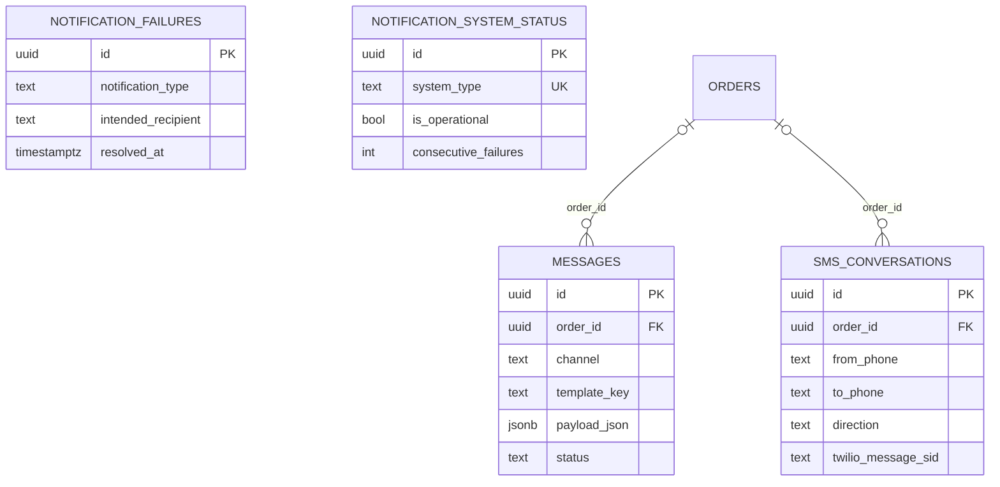

#### `messages` (0 rows)
Purpose: outbound message queue/log keyed by template (sms or email). No `from('messages')` calls in the `main` snapshot (notification logging uses `notification_failures` and `sms_conversations`).

```
id uuid NN =gen_random_uuid()
order_id uuid
to_phone text
to_email text
channel text NN
template_key text NN
payload_json jsonb NN
sent_at timestamptz
status text ='pending'
created_at timestamptz =now()
```
- PK `messages_pkey (id)`. FK `order_id -> orders(id) ON DELETE CASCADE`. CK `messages_channel_check`: `channel IN ('sms','email')`. Index `idx_messages_order`. Triggers: none.
- RLS enabled (1 policy): `Service role full access to messages` ALL, `public`, `true`.

#### `sms_conversations` (1066 rows)
Purpose: two-way SMS log (Twilio inbound webhook and outbound sends), optionally tied to an order; `is_admin_internal` flags messages that are admin-only notifications.

```
id uuid NN =gen_random_uuid()
order_id uuid
from_phone text NN
to_phone text NN
message_body text NN
direction text NN
twilio_message_sid text
status text ='received'
created_at timestamptz =now()
is_admin_internal boolean =false
```
- PK `sms_conversations_pkey (id)`. FK `order_id -> orders(id) ON DELETE SET NULL`. CK `sms_conversations_direction_check`: `direction IN ('inbound','outbound')`.
- Indexes: `idx_sms_conversations_created_at` (DESC), `idx_sms_conversations_from_phone`, `idx_sms_conversations_order_id`. Triggers: none.
- RLS enabled (3 policies):

| Policy | Cmd | Roles | Summary |
|---|---|---|---|
| Admins can view conversations | SELECT | authenticated | admin/master |
| Admins can insert conversations | INSERT | authenticated | WITH CHECK admin/master |
| Service role can insert SMS conversations | INSERT | service_role | WITH CHECK `true` |

#### `notification_failures` (2 rows)
Purpose: record of email/SMS sends that errored, with context and optional fallback info; written by `record_notification_failure(...)`; admin UI shows unresolved counts (`get_unresolved_failures_count()`).

```
id uuid NN =gen_random_uuid()
notification_type text NN
intended_recipient text NN
subject text
message_preview text
error_message text NN
context jsonb ='{}'
fallback_sent boolean =false
fallback_type text
retry_count integer =0
resolved_at timestamptz
created_at timestamptz =now()
updated_at timestamptz =now()
```
- PK `notification_failures_pkey (id)`. CK `notification_failures_notification_type_check`: `notification_type IN ('email','sms')`.
- Indexes: `idx_notification_failures_created` (DESC), `idx_notification_failures_resolved` (partial `resolved_at IS NULL`), `idx_notification_failures_type`. Triggers: none.
- RLS enabled (3 policies):

| Policy | Cmd | Roles | Summary |
|---|---|---|---|
| Admins can view notification failures | SELECT | authenticated | admin/master |
| Admins can update notification failures | UPDATE | authenticated | admin/master (USING and WITH CHECK) |
| Service role can insert failures | INSERT | public | WITH CHECK `true` |

#### `notification_system_status` (2 rows)
Purpose: one health row per channel (`email`, `sms`) with last success/failure and consecutive failure counters, updated by `record_notification_success/failure`.

```
id uuid NN =gen_random_uuid()
system_type text NN
is_operational boolean =true
last_success_at timestamptz
last_failure_at timestamptz
consecutive_failures integer =0
total_failures_24h integer =0
error_details jsonb ='{}'
admin_notified_at timestamptz
updated_at timestamptz =now()
```
- PK `notification_system_status_pkey (id)`. UQ `notification_system_status_system_type_key (system_type)`. CK `notification_system_status_system_type_check`: `system_type IN ('email','sms')`. Index `idx_system_status_type`. Triggers: none.
- RLS enabled (2 policies):

| Policy | Cmd | Roles | Summary |
|---|---|---|---|
| Admins can view system status | SELECT | authenticated | admin/master |
| Service role can update system status | UPDATE | public | WITH CHECK `true` (USING not set) |

---

### 2.8 Catalog, units, media

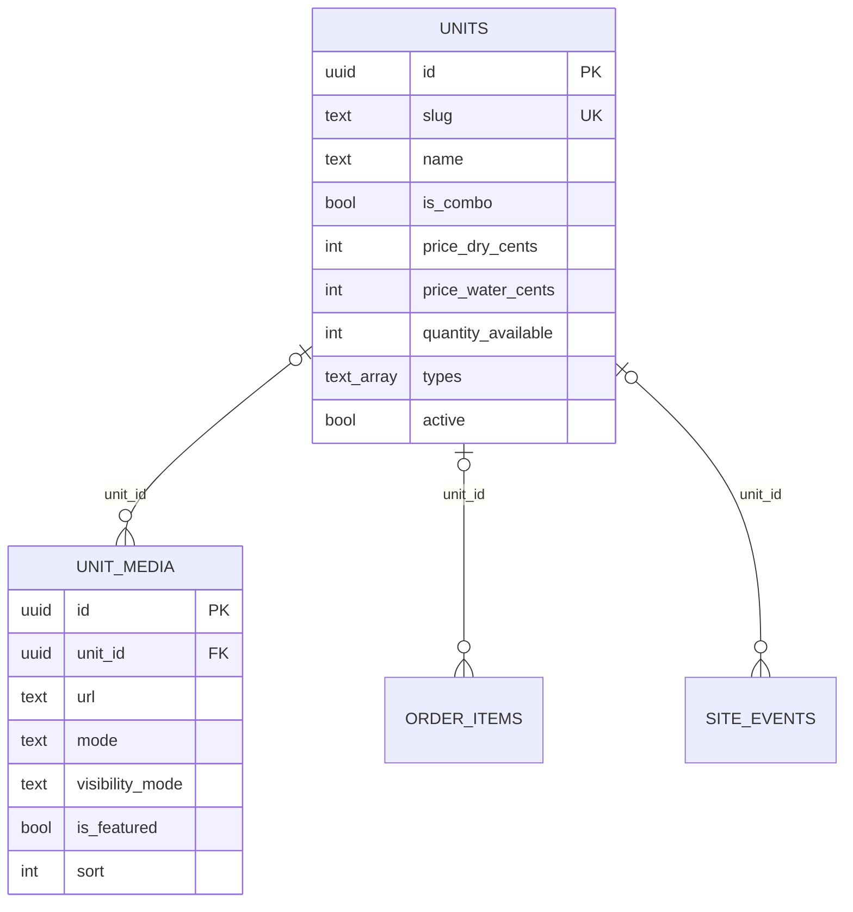

#### `units` (16 rows)
Purpose: rental catalog (bounce houses, combos, etc.): pricing for dry/water, dimensions, footprint, power, capacity, stock (`quantity_available`), and category tags (`types`).

```
id uuid NN =gen_random_uuid()
slug text NN
name text NN
is_combo boolean =false
price_dry_cents integer NN
price_water_cents integer
dimensions text NN
footprint_sqft integer NN
power_circuits numeric(4,1) =1.0
capacity integer NN
indoor_ok boolean =true
outdoor_ok boolean =true
active boolean =true
created_at timestamptz =now()
quantity_available integer NN =1
dimensions_water text
types text[] NN
```
- PK `units_pkey (id)`. UQ `units_slug_key (slug)`. CK `units_types_not_empty`: `array_length(types,1) > 0`. GIN index `idx_units_types (types)`. Triggers: none.
- RLS enabled (2 policies):

| Policy | Cmd | Roles | Summary |
|---|---|---|---|
| Public can view active units | SELECT | public | `active = true` |
| Service role full access to units | ALL | public | `true` (applies to every role) |

#### `unit_media` (43 rows)
Purpose: images/videos per unit; `mode` and `visibility_mode` select dry/water presentation; `is_featured` marks the cover image per (unit, mode). Files are in bucket `unit-images`.

```
id uuid NN =gen_random_uuid()
unit_id uuid
url text NN
alt text NN
sort integer =0
created_at timestamptz =now()
mode text ='dry'
is_featured boolean =false
visibility_mode text ='dry'
```
- PK `unit_media_pkey (id)`. FK `unit_id -> units(id) ON DELETE CASCADE`. CK `unit_media_mode_check`: `mode IN ('dry','water')`. No CHECK on `visibility_mode`.
- Indexes: `idx_unit_media_featured (unit_id, mode, is_featured) WHERE is_featured = true`, `idx_unit_media_unit`. Triggers: none.
- RLS enabled (2 policies):

| Policy | Cmd | Roles | Summary |
|---|---|---|---|
| Public can view unit media | SELECT | public | `true` |
| Service role full access to unit_media | ALL | public | `true` (applies to every role) |

---

### 2.9 Pricing, settings, blackouts

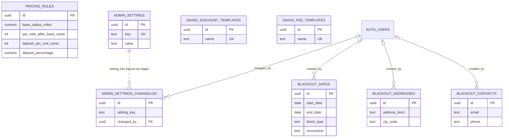

#### `pricing_rules` (1 row)
Purpose: singleton pricing configuration (travel radius and per-mile cost, surface fee, generator fees, deposit rules, same-day fees, tax default). Edited via the admin Pricing Rules tab (direct table update); the RPC `update_pricing_rules(...)` also exists. Comment on table: "Pricing rules configuration - updated to include same_day_weekday_delivery_fee_cents".

```
id uuid NN =gen_random_uuid()
base_radius_miles numeric(5,2) =20.0
included_city_list_json jsonb ='["Detroit"]'
per_mile_after_base_cents integer =200
zone_overrides_json jsonb ='[]'
surface_sandbag_fee_cents integer =2500
residential_multiplier numeric(3,2) =1.00
commercial_multiplier numeric(3,2) =1.10
same_day_matrix_json jsonb ='[]'
overnight_holiday_only boolean =false
updated_at timestamptz =now()
extra_day_pct numeric(5,2) =50.00
generator_price_cents integer =7500
deposit_per_unit_cents integer =10000
included_cities text[]
generator_fee_single_cents integer =10000
generator_fee_multiple_cents integer =7500
same_day_pickup_fee_cents integer =0
apply_taxes_by_default boolean =true
deposit_percentage numeric(3,2) =0.25
same_day_weekday_delivery_fee_cents integer =0
```
- PK `pricing_rules_pkey (id)`. No FKs, CHECKs, extra indexes or triggers.
- RLS enabled (1 policy): `Service role full access to pricing_rules` ALL, `public`, `true`.

#### `admin_settings` (33 rows)
Purpose: key/value business configuration (branding, contact info, third-party integration credentials, address, toggles). Key names are listed in section 6; values are intentionally not reproduced here. Edge functions read them with the service role, and the RPC `get_public_business_settings()` exposes only a fixed whitelist of non-credential keys to any caller.

```
id uuid NN =gen_random_uuid()
key text NN
value text NN
description text
created_at timestamptz =now()
updated_at timestamptz =now()
```
- PK `admin_settings_pkey (id)`. UQ `admin_settings_key_key (key)`. No other indexes.
- Triggers: `trigger_log_admin_settings_change` AFTER UPDATE (when `old.value IS DISTINCT FROM new.value`) -> `log_admin_settings_change()` (writes to `admin_settings_changelog`).
- RLS enabled (4 policies), all `authenticated`, all comparing `lower(role) IN ('admin','master')`:

| Policy | Cmd | Summary |
|---|---|---|
| Admins can view all settings | SELECT | admin/master |
| Admins can insert settings | INSERT | WITH CHECK admin/master |
| Admins can update settings | UPDATE | admin/master |
| Admins can delete settings | DELETE | admin/master |

#### `admin_settings_changelog` (13 rows)
Purpose: history of `admin_settings` value changes (who/when). A BEFORE INSERT trigger replaces old/new values with `[REDACTED]` for sensitive-looking keys (names matching `%secret%`, `%_key`, `%token%`, `%password%`, plus a fixed list).

```
id uuid NN =gen_random_uuid()
setting_key text NN
old_value text
new_value text
changed_by uuid
change_description text
created_at timestamptz =now()
```
- PK `admin_settings_changelog_pkey (id)`. FK `changed_by -> auth.users(id) NO ACTION`. Index `idx_admin_settings_changelog_changed_by`.
- Triggers: `trg_redact_settings_changelog` BEFORE INSERT -> `redact_sensitive_changelog_values()`.
- RLS enabled (2 policies):

| Policy | Cmd | Roles | Summary |
|---|---|---|---|
| Admins can view changelog | SELECT | authenticated | admin/master (lower-cased) |
| Admins can insert changelog | INSERT | authenticated | WITH CHECK admin/master (lower-cased) |

#### `blackout_dates` (0 rows)
Purpose: date ranges on which bookings are blocked (`full`) or same-day pickup is blocked; can recur annually. Queried by `check_date_blackout(start,end)`.

```
id uuid NN =gen_random_uuid()
start_date date NN
end_date date NN
reason text NN
notes text
created_by uuid
created_at timestamptz =now()
updated_at timestamptz =now()
block_type text NN ='full'
recurrence text NN ='one_time'
expires_at date
```
- PK `blackout_dates_pkey (id)`. FK `created_by -> auth.users(id) NO ACTION`. CK `valid_date_range`: `end_date >= start_date`. CK `blackout_dates_block_type_check`: `block_type IN ('full','same_day_pickup')`. CK `blackout_dates_recurrence_check`: `recurrence IN ('one_time','annual')`.
- Index: `idx_blackout_dates_range (start_date, end_date)`.
- Triggers: `trigger_update_blackout_dates_timestamp` BEFORE UPDATE -> `update_blackout_dates_timestamp()`.
- RLS enabled (4 policies), all `authenticated`, predicate role in admin/master (exact compare): "Admins can view all blackout dates" (SELECT), "Admins can insert blackout dates" (INSERT, WITH CHECK), "Admins can update blackout dates" (UPDATE, USING and WITH CHECK), "Admins can delete blackout dates" (DELETE).

#### `blackout_addresses` (0 rows)
Purpose: addresses that are not served.

```
id uuid NN =gen_random_uuid()
address_line1 text NN
address_line2 text
city text NN
state text NN
zip_code text NN
reason text NN
notes text
created_by uuid
created_at timestamptz =now()
updated_at timestamptz =now()
```
- PK `blackout_addresses_pkey (id)`. FK `created_by -> auth.users(id) NO ACTION`. Index `idx_blackout_addresses_city_state (city, state)`.
- Triggers: `trigger_update_blackout_addresses_timestamp` BEFORE UPDATE -> `update_blackout_addresses_timestamp()`.
- RLS enabled (4 policies), all `authenticated`, admin/master (exact compare): "Admins can view all blackout addresses" (SELECT), "Admins can insert blackout addresses" (INSERT), "Admins can update blackout addresses" (UPDATE), "Admins can delete blackout addresses" (DELETE).

#### `blackout_contacts` (0 rows)
Purpose: contacts (email and/or phone) that are not served.

```
id uuid NN =gen_random_uuid()
email text
phone text
customer_name text
reason text NN
notes text
created_by uuid
created_at timestamptz =now()
updated_at timestamptz =now()
```
- PK `blackout_contacts_pkey (id)`. FK `created_by -> auth.users(id) NO ACTION`. CK `has_email_or_phone`: `email IS NOT NULL OR phone IS NOT NULL`. Indexes: `idx_blackout_contacts_email`, `idx_blackout_contacts_phone`.
- Triggers: `trigger_update_blackout_contacts_timestamp` BEFORE UPDATE -> `update_blackout_contacts_timestamp()`.
- RLS enabled (4 policies), all `authenticated`, admin/master (exact compare): "Admins can view all blackout contacts" (SELECT), "Admins can insert blackout contacts" (INSERT), "Admins can update blackout contacts" (UPDATE), "Admins can delete blackout contacts" (DELETE).

#### `saved_discount_templates` (1 row)
Purpose: reusable named discounts the admin can apply to orders.

```
id uuid NN =gen_random_uuid()
name text NN
amount_cents integer NN =0
percentage numeric(5,2) NN =0
created_at timestamptz =now()
```
- PK `saved_discount_templates_pkey (id)`. UQ `saved_discount_templates_name_key (name)`. Index `idx_saved_discount_templates_name`. Triggers: none.
- RLS enabled (1 policy): `Admins can manage discount templates` ALL, authenticated, admin/master (lower-cased).

#### `saved_fee_templates` (0 rows)
Purpose: reusable named custom fees.

```
id uuid NN =gen_random_uuid()
name text NN
amount_cents integer NN =0
created_at timestamptz =now()
```
- PK `saved_fee_templates_pkey (id)`. UQ `saved_fee_templates_name_key (name)`. Index `idx_saved_fee_templates_name`. Triggers: none.
- RLS enabled (1 policy): `Admins can manage fee templates` ALL, authenticated, admin/master (lower-cased).

---

### 2.10 Content (carousel, reviews, templates)

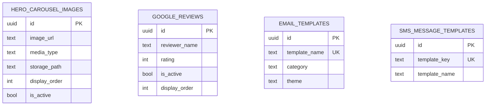
These four tables have no foreign keys; they are standalone content tables.

#### `hero_carousel_images` (3 rows)
Purpose: home-page hero carousel items (image or video). Media files live in bucket `carousel-media`; `storage_path` is the object path there.

```
id uuid NN =gen_random_uuid()
image_url text NN
title text
description text
display_order integer NN =0
is_active boolean NN =true
created_at timestamptz =now()
updated_at timestamptz =now()
media_type text NN ='image'
storage_path text
```
- PK `hero_carousel_images_pkey (id)`. CK `hero_carousel_images_media_type_check`: `media_type IN ('image','video')`. No extra indexes.
- Triggers: `hero_carousel_updated_at` BEFORE UPDATE -> `update_hero_carousel_updated_at()`.
- RLS enabled (6 policies):

| Policy | Cmd | Roles | Summary |
|---|---|---|---|
| Admins can view all carousel images | SELECT | authenticated | admin/master |
| Admins can insert carousel images | INSERT | authenticated | WITH CHECK admin/master |
| Admins can update carousel images | UPDATE | authenticated | admin/master (USING and WITH CHECK) |
| Admins can delete carousel images | DELETE | authenticated | admin/master |
| Anyone can view active carousel images | SELECT | public | `is_active = true` |
| Public can view active carousel images | SELECT | public | `is_active = true` (same predicate as the previous policy) |

#### `google_reviews` (1 row)
Purpose: manually curated Google review excerpts shown on the site.

```
id uuid NN =gen_random_uuid()
reviewer_name text NN
reviewer_initial text NN ='U'
rating integer NN
review_text text NN
review_date text NN
google_review_url text
is_active boolean =true
display_order integer =0
created_at timestamptz =now()
updated_at timestamptz =now()
```
- PK `google_reviews_pkey (id)`. CK `google_reviews_rating_check`: `rating >= 1 AND rating <= 5`. Index `idx_google_reviews_active_rating (is_active, rating, display_order)`.
- Triggers: `google_reviews_updated_at` BEFORE UPDATE -> `update_google_reviews_updated_at()`.
- RLS enabled (5 policies):

| Policy | Cmd | Roles | Summary |
|---|---|---|---|
| Admins can view all reviews | SELECT | authenticated | admin/master (exact compare) |
| Admins can insert reviews | INSERT | authenticated | WITH CHECK admin/master |
| Admins can update reviews | UPDATE | authenticated | admin/master |
| Admins can delete reviews | DELETE | authenticated | admin/master |
| Public can view high-rated active reviews | SELECT | anon, authenticated | `is_active = true AND rating >= 4` |

#### `email_templates` (6 rows)
Purpose: editable transactional email templates (subject, header title, body template, colour theme) rendered by the `send-email` edge function. Names are listed in section 6.

```
id uuid NN =gen_random_uuid()
template_name text NN
subject text NN
description text NN
header_title text NN
content_template text NN
theme text ='primary'
category text NN
created_at timestamptz =now()
updated_at timestamptz =now()
```
- PK `email_templates_pkey (id)`. UQ `email_templates_template_name_key (template_name)`. CK `email_templates_category_check`: `category IN ('booking','order','notification','admin','system')`. CK `email_templates_theme_check`: `theme IN ('primary','success','warning','error')`. Indexes: `idx_email_templates_category`, `idx_email_templates_name`.
- Triggers: `trigger_update_email_template_timestamp` BEFORE UPDATE -> `update_email_template_timestamp()`.
- RLS enabled (2 policies):

| Policy | Cmd | Roles | Summary |
|---|---|---|---|
| Admins can view all email templates | SELECT | authenticated | admin/master (lower-cased) |
| Admins can update email templates | UPDATE | authenticated | admin/master (lower-cased) |

#### `sms_message_templates` (13 rows)
Purpose: editable SMS body templates keyed by `template_key`, read by the `send-sms-notification` and `customer-cancel-order` edge functions and edited in the admin message-template tabs. Keys are listed in section 6.

```
id uuid NN =gen_random_uuid()
template_key text NN
template_name text NN
message_template text NN
description text
created_at timestamptz =now()
updated_at timestamptz =now()
```
- PK `sms_message_templates_pkey (id)`. UQ `sms_message_templates_template_key_key (template_key)`. No extra indexes.
- Triggers: `update_sms_template_updated_at_trigger` BEFORE UPDATE -> `update_sms_template_updated_at()`.
- RLS enabled (2 policies):

| Policy | Cmd | Roles | Summary |
|---|---|---|---|
| Authenticated users can view all templates | SELECT | authenticated | `true` |
| Authenticated users can update templates | UPDATE | authenticated | USING and WITH CHECK `true` (no role condition) |

---

### 2.11 Analytics and logging

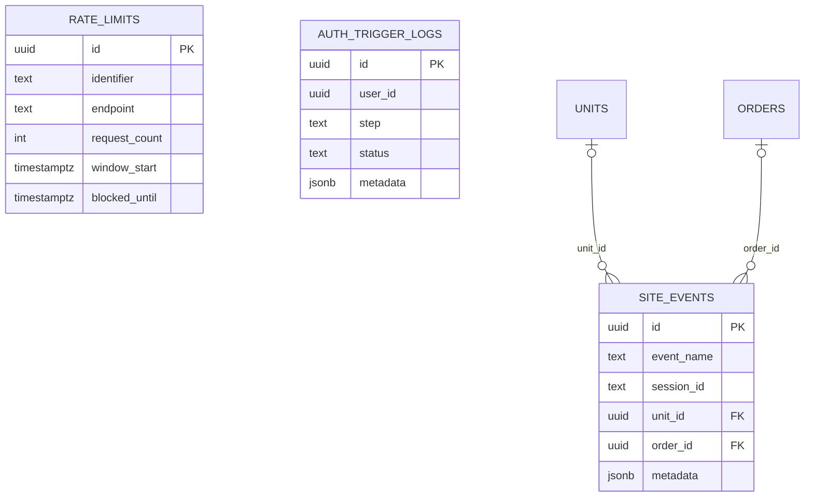

#### `site_events` (4793 rows)
Purpose: first-party page/interaction analytics (event name, anonymous session id, optional unit/order, page path, referrer) written by `src/lib/siteEvents.ts`; read by the admin Site Analytics tab.

```
id uuid NN =gen_random_uuid()
event_name text NN
session_id text
unit_id uuid
order_id uuid
page_path text
referrer text
metadata jsonb ='{}'
created_at timestamptz =now()
```
- PK `site_events_pkey (id)`. FK `order_id -> orders(id) ON DELETE SET NULL`; `unit_id -> units(id) ON DELETE SET NULL`.
- Indexes: `idx_site_events_created_at` (DESC), `idx_site_events_event_name`, `idx_site_events_session_id` (partial, not null), `idx_site_events_unit_id` (partial, not null). Triggers: none.
- RLS enabled (2 policies):

| Policy | Cmd | Roles | Summary |
|---|---|---|---|
| Admins can read site events | SELECT | authenticated | admin/master (exact compare) |
| Anyone can insert site events | INSERT | anon, authenticated | WITH CHECK `true` |

#### `rate_limits` (301 rows)
Purpose: sliding-window request counters used by `check_rate_limit(...)` (called from `supabase/functions/_shared/rate-limit.ts`); cleaned by `cleanup_old_rate_limits()` (no references to that function in application code).

```
id uuid NN =gen_random_uuid()
identifier text NN
endpoint text NN
request_count integer =1
window_start timestamptz =now()
blocked_until timestamptz
created_at timestamptz =now()
updated_at timestamptz =now()
```
- PK `rate_limits_pkey (id)`. Indexes: `idx_rate_limits_cleanup (window_start)`, `idx_rate_limits_lookup (identifier, endpoint, window_start DESC)`. No FKs, CHECKs, triggers.
- RLS enabled with **0 policies**: no direct access for `anon`/`authenticated`; the table is reached through the SECURITY DEFINER function `check_rate_limit` and through the service role.

#### `auth_trigger_logs` (52 rows)
Purpose: step-by-step diagnostics written by the `auto_assign_customer_role` trigger on `auth.users` (step, status, message, metadata) while a new user is being provisioned. No application-code reads other than the admin policy.

```
id uuid NN =gen_random_uuid()
user_id uuid
user_email text
step text NN
status text NN
message text
metadata jsonb ='{}'
created_at timestamptz =now()
```
- PK `auth_trigger_logs_pkey (id)`. CK `auth_trigger_logs_status_check`: `status IN ('started','success','error','skipped')`. No FKs. Indexes: `idx_auth_trigger_logs_created_at` (DESC), `idx_auth_trigger_logs_status`, `idx_auth_trigger_logs_user_id`. Triggers: none.
- RLS enabled (1 policy): `Admins can view auth logs` SELECT, authenticated, admin/master (lower-cased).

---

### 2.12 Auth, roles, permissions

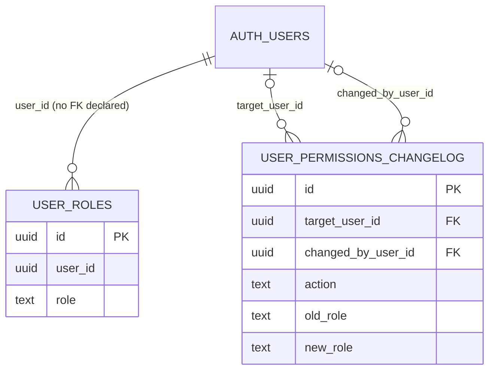

#### `user_roles` (9 rows: master 5, customer 4)
Purpose: role assignment per auth user (`master`, `admin`, `crew`, `customer`). Every RLS helper reads this table. New auth users receive a `customer` row from the `on_auth_user_created` trigger (`auto_assign_customer_role`). Writes fire `log_permission_change()`.

```
id uuid NN =gen_random_uuid()
user_id uuid NN
role text NN
created_at timestamptz =now()
```
- PK `user_roles_pkey (id)`. UQ `user_roles_user_id_role_key (user_id, role)`. Index `idx_user_roles_user_id`. **No foreign key** to `auth.users` is declared on `user_id` and **no CHECK** on `role` in the live catalog.
- Triggers: `trigger_log_permission_change` AFTER INSERT OR DELETE OR UPDATE -> `log_permission_change()`.
- RLS enabled (8 policies), all `authenticated`:

| Policy | Cmd | Summary |
|---|---|---|
| Users can read own roles | SELECT | `user_id = uid()` |
| Admins and masters can read all roles | SELECT | role in admin/master (via `get_user_role(uid())`) |
| Master can insert user roles | INSERT | WITH CHECK `get_user_role(uid()) = 'master'` |
| Master can update user roles | UPDATE | USING and WITH CHECK caller is master |
| Master can delete user roles | DELETE | caller is master |
| Admin can insert crew roles | INSERT | WITH CHECK target `role = 'crew'` and caller role is `admin` |
| Admin can update crew roles | UPDATE | USING and WITH CHECK `role = 'crew'` and caller is `admin` |
| Admin can delete crew roles | DELETE | `role = 'crew'` and caller is `admin` |

#### `user_permissions_changelog` (9 rows)
Purpose: audit trail of role changes, written by `log_permission_change()` and by admin screens.

```
id uuid NN =gen_random_uuid()
target_user_id uuid
changed_by_user_id uuid
action text NN
old_role text
new_role text
notes text
created_at timestamptz =now()
```
- PK `user_permissions_changelog_pkey (id)`. FK `target_user_id -> auth.users(id) ON DELETE CASCADE`; `changed_by_user_id -> auth.users(id) ON DELETE SET NULL`.
- CK `user_permissions_changelog_action_check`: `action IN ('role_added','role_removed','role_changed','account_created','account_deleted')`. CK `..._old_role_check` and `..._new_role_check`: role IN ('master','admin','crew','customer') or NULL.
- Indexes: `idx_permissions_changelog_changed_by (changed_by_user_id, created_at DESC)`, `idx_permissions_changelog_created_at` (DESC), `idx_permissions_changelog_target_user (target_user_id, created_at DESC)`. Triggers: none.
- RLS enabled (3 policies):

| Policy | Cmd | Roles | Summary |
|---|---|---|---|
| Admins can view all permission changes | SELECT | authenticated | admin/master (exact compare) |
| Admins can create permission changelog | INSERT | authenticated | WITH CHECK admin/master |
| Users can view own permission changes | SELECT | authenticated | `target_user_id = uid()` |

---

### 2.13 Calendar sync

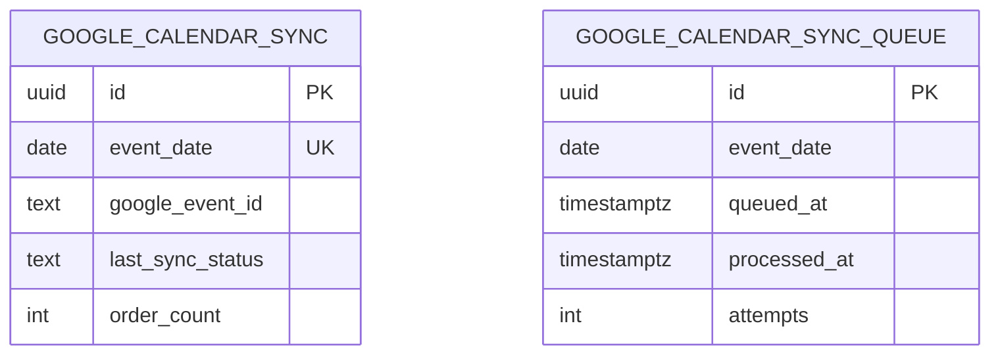
Both tables are standalone (no foreign keys). They are read and written by the `sync-google-calendar` edge function; there are no references to them in `src`. The trigger function `auto_sync_google_calendar()` exists in the catalog but no trigger currently calls it (see section 4).

#### `google_calendar_sync` (0 rows)
Purpose: one row per calendar day that has been synced to Google Calendar (event id, last status, order count).

```
id uuid NN =gen_random_uuid()
event_date date NN
google_event_id text
last_synced_at timestamptz
last_sync_status text ='pending'
last_sync_error text
order_count integer =0
created_at timestamptz =now()
```
- PK `google_calendar_sync_pkey (id)`. UQ `google_calendar_sync_event_date_key (event_date)`. Indexes: `idx_google_calendar_sync_event_date`, `idx_google_calendar_sync_status`. Triggers: none.
- RLS enabled (5 policies):

| Policy | Cmd | Roles | Summary |
|---|---|---|---|
| Admins can read google calendar sync | SELECT | authenticated | admin/master (exact compare) |
| Admins can insert google calendar sync | INSERT | authenticated | WITH CHECK admin/master |
| Admins can update google calendar sync | UPDATE | authenticated | USING and WITH CHECK admin/master |
| Admins can delete google calendar sync | DELETE | authenticated | admin/master |
| Service role can manage google calendar sync | ALL | service_role | `true` |

#### `google_calendar_sync_queue` (0 rows)
Purpose: queue of dates whose calendar entry needs re-sync; at most one unprocessed row per date.

```
id uuid NN =gen_random_uuid()
event_date date NN
queued_at timestamptz =now()
processed_at timestamptz
attempts integer =0
```
- PK `google_calendar_sync_queue_pkey (id)`. Unique partial index `idx_gcal_queue_unique_pending (event_date) WHERE processed_at IS NULL`. Index `idx_gcal_queue_unprocessed (event_date) WHERE processed_at IS NULL`. Triggers: none.
- RLS enabled (2 policies):

| Policy | Cmd | Roles | Summary |
|---|---|---|---|
| Admins can read google calendar sync queue | SELECT | authenticated | admin/master (exact compare) |
| Service role manages gcal queue | ALL | service_role | `true` |

---

### 2.14 Note on role comparison style in policies

Policies that compare roles use one of several styles. Tables whose policies use `lower(user_roles.role)`: admin_settings, admin_settings_changelog, auth_trigger_logs, consent_records (INSERT policy), contacts, crew_location_history (INSERT policy), customer_profiles, email_templates, invoices, order_discounts, order_lot_pictures (DELETE policy), order_notes, order_refunds, order_workflow_events, saved_discount_templates, saved_fee_templates, sms_conversations, stripe_webhook_events, task_status, transaction_receipts, user_consent_log. Tables whose policies compare the stored value exactly (`user_roles.role = ANY (...)`): billing_addresses, blackout_addresses, blackout_contacts, blackout_dates, daily_mileage_logs, google_calendar_sync, google_calendar_sync_queue, google_reviews, invoice_links, notification_failures, notification_system_status, order_lot_pictures (ALL policy), site_events, user_permissions_changelog. Tables with policies that compare the stored value to the single literal `'admin'`: consent_records (SELECT policy), crew_location_history (SELECT policy), order_signatures. Tables using helper functions: `get_user_role(uid())` (address_lot_pictures, hero_carousel_images, order_pictures, user_roles, storage policies, several RPCs) and `is_admin()` (payments). `is_admin()` compares `role IN ('ADMIN','MASTER')` in upper case, while `get_user_role()` returns the lower-cased role.

---

## 3. Functions (schema `public`, 68 total)

Common facts:

- **EXECUTE grants.** Every function has EXECUTE granted to `anon`, `authenticated` and `service_role`. All except `assign_role_by_email` and `get_public_business_settings` also have the default PUBLIC grant (`=X`). Those two have no PUBLIC grant, only the explicit grants to `anon`, `authenticated`, `service_role` (and owner `postgres`).
- Because EXECUTE is broad, functions that restrict who may act do so inside their body (the "Caller check" column).
- `search_path`: `public` for most SECURITY DEFINER functions; `''` (empty, schema-qualified bodies) for some; none set for a few trigger functions (all INVOKER except `update_google_reviews_updated_at`, which is SECURITY DEFINER).
- Volatility is VOLATILE except `find_order_id_by_prefix` and `get_user_role` and `is_admin`, which are STABLE.

### 3.1 Callable and helper functions (43)

| Function(args) | Returns | Lang | Security | search_path | Caller check in body | Purpose |
|---|---|---|---|---|---|---|
| `apply_balance_payment_financials(p_pi_id text, p_order_id uuid, p_balance_cents int, p_tip_cents int, p_pm_id text = NULL, p_customer_id text = NULL)` | TABLE(applied bool, payment_row_found bool) | plpgsql | DEFINER | public | none (row lock `FOR UPDATE`) | Idempotently folds a succeeded balance payment into `orders` totals (balance paid/due, tip) using `payments.order_financials_applied` as a once-only flag. Called by `stripe-webhook`, `customer-balance-payment`, `reconcile-balance-payment`. |
| `approve_order_changes(p_order_id uuid, p_token text, p_customer_selected_payment_cents int = NULL, p_customer_selected_payment_type text = NULL, p_tip_cents int = NULL, p_confirm_status bool = false)` | jsonb | plpgsql | DEFINER | public | token must exist in `invoice_links`, be unexpired and match the order; order status must be `awaiting_customer_approval` | Customer approval of an order edit from the portal link; records chosen payment amount/type and tip and, when `p_confirm_status` is true, sets `status = 'confirmed'` and `customer_approved_at`. Returns `{success: true}` or `{success: false, error}`. Called by `ApprovalModal`. |
| `archive_old_orders(threshold_days int = 90)` | integer | plpgsql | DEFINER | public | `is_admin()` | Sets `archived_at` on completed/cancelled orders whose `event_date` is older than the threshold; returns the count. Called by `OrdersManager`. |
| `assign_role_by_email(p_email text, p_role text)` | boolean | plpgsql | DEFINER | public | caller must hold admin/master (lower-cased compare); only master can grant `master` or `admin` | Looks up an auth user by email and assigns a role. Called by the Permissions tab. |
| `assign_user_role(target_user_id uuid, target_role text)` | void | plpgsql | DEFINER | `""` | caller must be master/admin; only master may assign master | Inserts a `user_roles` row. No references in application code. |
| `check_date_blackout(p_start date, p_end date)` | TABLE(is_full_blocked bool, is_same_day_pickup_blocked bool) | plpgsql | DEFINER | public | none | Evaluates `blackout_dates` (one-time and annual, honouring `expires_at`) for a date range. Called by `src/lib/availability.ts` and the `stripe-checkout` edge function. |
| `check_expiring_cards()` | TABLE(order_id, customer_email, customer_name, exp_date, days_until_expiry) | sql | DEFINER | public | none | Lists orders whose saved card (`payment_method_exp_*`) is about to expire. No references in application code. |
| `check_rate_limit(p_identifier text, p_endpoint text, p_max_requests int = 10, p_window_seconds int = 60)` | jsonb | plpgsql | DEFINER | public | none | Sliding-window limiter on `rate_limits`; returns allowed/blocked info. Called from edge functions via `_shared/rate-limit.ts`. |
| `check_unit_availability(p_unit_ids uuid[], p_start_date date, p_end_date date)` | TABLE(unit_id, unit_name, requested_qty, available_qty, available bool) | plpgsql | DEFINER | public | none | Multi-unit, multi-day availability using `order_items` + `orders` in statuses `pending_review`, `confirmed`, `in_progress` against `units.quantity_available`. Called by invoice page and unit queries. Function comment: "Check if requested units are available across a date range, properly handling multi-day rentals using event_date and event_end_date". |
| `check_unit_availability(p_unit_id uuid, p_start_date date, p_end_date date, p_exclude_order_id uuid = NULL)` | integer | plpgsql | DEFINER | `""` | none | Single-unit overload returning remaining quantity. Its body reads a column named `inventory` from `public.units`; the live `units` table has `quantity_available` and no `inventory` column. Application code calls the array overload. |
| `claim_balance_payment_financials(p_pi_id text)` | TABLE(claimed bool, payment_id uuid, amount_cents int) | plpgsql | DEFINER | public | none | Deprecated stub (body states callers moved to `apply_balance_payment_financials`); returns `claimed = false`. No references in application code. |
| `cleanup_old_rate_limits()` | void | plpgsql | DEFINER | public | none | Deletes `rate_limits` rows older than 1 hour that are not blocked. No references in application code. |
| `find_order_id_by_prefix(p_prefix text)` | uuid | sql | DEFINER | public | none | Resolves an order id from its leading characters (short id). STABLE. Called by `SingleOrderView`. |
| `generate_invoice_number()` | text | plpgsql | INVOKER | `""` | none | Next `INV-YYYY-NNNN` based on the max suffix in `invoices` for the year. Called by approval and invoices UI. |
| `generate_receipt_group_id()` | uuid | plpgsql | INVOKER | none | none | Returns `gen_random_uuid()`; no references in application code. |
| `generate_receipt_number()` | text | plpgsql | DEFINER | public | none | `RCP-YYYYMMDD-` + 5-digit `receipt_number_seq`; default of `transaction_receipts.receipt_number`. |
| `get_admin_analytics(p_start timestamptz = NULL, p_end timestamptz = NULL)` | jsonb | plpgsql | DEFINER | public | none (reads `user_roles` only to exclude orders of customers who hold admin/master) | Aggregated revenue/booking KPIs for the admin dashboard. Called by `useAdminAnalytics`. |
| `get_admin_users()` | TABLE(id uuid, email text, created_at timestamptz) | plpgsql | DEFINER | `""` | none in body | Lists auth users that hold admin or master. Called by Setup page and `create-admin-user`. |
| `get_all_role_users()` | TABLE(user_id, email, user_role, created_at) | plpgsql | DEFINER | `""` | caller must be admin/master | Lists users holding `master`, `admin` or `crew` for the Permissions tab. |
| `get_booking_source_analytics(p_start = NULL, p_end = NULL)` | TABLE(referral_source, referral_source_detail, subtotal_cents, tax_cents) | plpgsql | DEFINER | public | `get_user_role(auth.uid())` in admin/master, otherwise raises | Per-order referral data. Called by `SiteAnalytics`. |
| `get_booking_sources_analytics(p_since, p_until = NULL)` | jsonb | plpgsql | DEFINER | public | returns `[]` unless caller is admin/master | Aggregated referral-source report. No references in application code. |
| `get_delivery_timing_analytics(p_start_date date = NULL, p_end_date date = NULL)` | json | plpgsql | DEFINER | public | `get_user_role` in admin/master/crew, otherwise raises | On-time/ETA statistics from completed `task_status` rows. Called by `useAdminAnalytics`. |
| `get_order_by_token(p_token text)` | SETOF orders | plpgsql | DEFINER | public | valid unexpired `invoice_links.link_token` | Returns the order row for a portal link token. No references in application code. |
| `get_order_with_relations_by_token(p_token text)` | jsonb | plpgsql | DEFINER | public | valid unexpired token | Returns the order plus customer, address, items, fees, discounts and related rows as JSON for the customer portal. Called by `useOrderData`. |
| `get_public_business_settings()` | jsonb | plpgsql | DEFINER | public | whitelist of keys | Returns only these `admin_settings` keys: `business_name`, `business_phone`, `business_email`, `logo_url`, `instagram_url`, `facebook_url`, `business_address`, `home_address_line1`, `home_address_line2`, `home_address_city`, `home_address_state`, `home_address_zip`. Called by `adminSettingsCache`. |
| `get_signature_status(order_uuid uuid)` | jsonb | plpgsql | DEFINER | `""` | none | Waiver status flags (has_signature, has_pdf, signed_at, signer name/email, is_complete). No references in application code. |
| `get_unresolved_failures_count()` | jsonb | plpgsql | DEFINER | public | none | Counts unresolved `notification_failures` by type. Called by `notificationReliability.ts`. |
| `get_user_creation_logs(target_email text)` | TABLE(log_time, trigger_source, user_id, email, roles text[], metadata jsonb) | plpgsql | DEFINER | `""` | none | Reads relation `public.user_creation_logs`, which does not exist in the live catalog (the diagnostics table present is `auth_trigger_logs`). No references in application code. |
| `get_user_highest_role(check_user_id uuid)` | text | plpgsql | DEFINER | `""` | none | Returns master > admin > crew > customer for a user. No references in application code. |
| `get_user_order_prefill()` | TABLE(first_name, last_name, email, phone, address_line1, address_line2, city, state, zip, lat, lng) | plpgsql | DEFINER | public | uses `auth.uid()` | Checkout prefill from the signed-in user's customer and default address (without a default address, the address of the latest non-draft/void order). Called by `useCheckoutData`. |
| `get_user_role(user_id_input uuid)` | text | sql | DEFINER | public | n/a | Lower-cased first role of a user, default `'customer'`. STABLE. Used by many policies and RPCs; also called by the `get-waiver-status`, `promote-media` and `upload-physical-waiver` edge functions. |
| `increment_order_refunded_cents(p_order_id uuid, p_amount_cents int)` | void | plpgsql | DEFINER | public | none | Adds to `orders.total_refunded_cents`. Called by `stripe-refund`. |
| `is_admin()` | boolean | sql | DEFINER | public | n/a | True if caller has role `ADMIN`/`MASTER` (upper-case compare). STABLE. Used by `payments` policies and `archive_old_orders`. |
| `order_has_valid_signature(order_uuid uuid)` | boolean | plpgsql | DEFINER | `""` | none | True if the order has both a signature image and a PDF. No references in application code. |
| `record_cash_payment(p_order_id uuid, p_amount_cents int, p_tip_cents int, p_acting_user_id uuid)` | jsonb | plpgsql | DEFINER | public | none (order row lock `FOR UPDATE`; rejects `void`/`cancelled` orders) | Records a cash payment atomically: inserts a `payments` row (status `succeeded`, method `cash`), updates the order's paid/due/tip totals and status, writes `order_changelog` rows (`change_type = 'cash_payment'`) and returns a JSON summary. Called by `record-cash-payment`. |
| `record_check_payment(p_order_id uuid, p_amount_cents int, p_tip_cents int, p_acting_user_id uuid, p_check_number text = NULL)` | jsonb | plpgsql | DEFINER | public | none (order row lock `FOR UPDATE`; rejects `void`/`cancelled` orders) | Same as cash, for checks. Called by `record-check-payment`. |
| `record_notification_failure(p_type, p_recipient, p_subject, p_message_preview, p_error, p_context jsonb = '{}')` | uuid | plpgsql | DEFINER | public | none | Inserts `notification_failures` and updates `notification_system_status` counters. |
| `record_notification_success(p_type text)` | void | plpgsql | DEFINER | public | none | Marks channel healthy in `notification_system_status`. |
| `remove_user_role(target_user_id uuid, target_role text)` | void | plpgsql | DEFINER | `""` | caller must be master/admin; only master removes master | Deletes a `user_roles` row. No references in application code. |
| `save_lot_picture_to_address(p_order_lot_picture_id uuid)` | uuid | plpgsql | DEFINER | public | `get_user_role(auth.uid())` in admin/master | Copies an order lot picture into `address_lot_pictures`. Called by `PhotoDetailModal`. |
| `update_pricing_rules(p_id uuid, p_base_radius_miles int, p_per_mile_after_base_cents int, p_surface_sandbag_fee_cents int, p_deposit_per_unit_cents int, p_included_cities text[], p_generator_fee_single_cents int, p_generator_fee_multiple_cents int, p_same_day_pickup_fee_cents int, p_same_day_weekday_delivery_fee_cents int, p_apply_taxes_by_default bool)` | void | plpgsql | DEFINER | public | none | Updates the `pricing_rules` row. No references in application code (the admin tab updates the table directly). |
| `upsert_contact_from_checkout(p_first_name, p_last_name, p_email, p_phone, p_business_name = NULL, p_opt_in_sms bool = false)` | void | plpgsql | DEFINER | public | none | `INSERT ... ON CONFLICT (email) DO UPDATE` into `contacts` (source `booking`). Called by `orderCreation.ts`. |
| `user_has_role(check_user_id uuid, check_role text)` | boolean | plpgsql | DEFINER | `""` | none | Exact-match role existence test. No references in application code. |

(Count: 43 rows including both `check_unit_availability` overloads.)

### 3.2 Trigger functions (25) and the triggers that use them

| Function | Security | search_path | Used by trigger | What it does |
|---|---|---|---|---|
| `auto_assign_customer_role()` | DEFINER | public | `on_auth_user_created` on `auth.users` | On new auth user: logs steps to `auth_trigger_logs`, adds a `customer` role, links/creates `customers`, `contacts`, `addresses` rows from signup/OAuth metadata. |
| `auto_create_task_status()` | DEFINER | public | `orders.trigger_auto_create_task_status` | When status becomes `confirmed`, inserts the drop-off and pick-up `task_status` rows if absent. |
| `auto_sync_google_calendar()` | DEFINER | public | none attached | Would queue event dates in `google_calendar_sync_queue` when status/date/cancellation reason change; no trigger currently references it. |
| `auto_update_order_status()` | DEFINER | public | `task_status.trigger_auto_update_order_status` | Sets `orders.status` to `in_progress` when a task becomes `en_route` on a `confirmed` order, and to `completed` when all of the order's tasks are `completed` and `orders.workflow_status` is `pickup_in_progress` or `pickup_scheduled`. |
| `log_admin_settings_change()` | INVOKER | `""` | `admin_settings.trigger_log_admin_settings_change` | Inserts old/new value into `admin_settings_changelog` with `auth.uid()`. |
| `log_permission_change()` | DEFINER | public | `user_roles.trigger_log_permission_change` | Inserts `role_added`/`role_removed`/`role_changed` into `user_permissions_changelog` with actor email note. |
| `redact_sensitive_changelog_values()` | DEFINER | public | `admin_settings_changelog.trg_redact_settings_changelog` | Replaces old/new values with `[REDACTED]` for credential-like setting keys. |
| `sync_invoice_links_expires_at()` | DEFINER | public | `orders.trg_sync_invoice_links_expires_at` | Sets `invoice_links.expires_at = event_date + 3 days` when `event_date` changes. |
| `update_blackout_addresses_timestamp()` | DEFINER | public | `blackout_addresses.trigger_update_blackout_addresses_timestamp` | Sets `updated_at`. |
| `update_blackout_contacts_timestamp()` | DEFINER | public | `blackout_contacts.trigger_update_blackout_contacts_timestamp` | Sets `updated_at`. |
| `update_blackout_dates_timestamp()` | DEFINER | public | `blackout_dates.trigger_update_blackout_dates_timestamp` | Sets `updated_at`. |
| `update_contact_booking_stats()` | DEFINER | public | `orders.trigger_update_contact_stats` | Recomputes `contacts` booking totals, completed counts, first/last completed dates, repeat flag by customer email. |
| `update_contact_stats()` | INVOKER | `""` | `orders.update_contact_stats_trigger` | Recomputes `contacts.total_bookings` / `total_spent_cents` for the order's customer email. |
| `update_daily_mileage_logs_updated_at()` | INVOKER | none | `daily_mileage_logs.update_daily_mileage_logs_updated_at` | Sets `updated_at`. |
| `update_email_template_timestamp()` | DEFINER | public | `email_templates.trigger_update_email_template_timestamp` | Sets `updated_at`. |
| `update_google_reviews_updated_at()` | DEFINER | none | `google_reviews.google_reviews_updated_at` | Sets `updated_at`. |
| `update_hero_carousel_updated_at()` | INVOKER | `""` | `hero_carousel_images.hero_carousel_updated_at` | Sets `updated_at`. |
| `update_invoice_links_updated_at()` | INVOKER | `""` | `invoice_links.update_invoice_links_timestamp` | Sets `updated_at`. |
| `update_payment_updated_at()` | INVOKER | `""` | `payments.update_payments_updated_at` | Sets `updated_at`. |
| `update_payments_updated_at()` | INVOKER | none | `payments.payments_updated_at_trigger` | Sets `updated_at` (second trigger on the same table doing the same thing). |
| `update_sms_template_updated_at()` | INVOKER | `""` | `sms_message_templates.update_sms_template_updated_at_trigger` | Sets `updated_at`. |
| `update_transaction_receipts_updated_at()` | INVOKER | none | `transaction_receipts.update_transaction_receipts_timestamp` | Sets `updated_at`. |
| `update_updated_at_column()` | INVOKER | `""` | `contacts.update_contacts_updated_at`, `invoices.update_invoices_updated_at` | Generic `updated_at = now()`. |
| `update_webhook_event_timestamp()` | INVOKER | none | `stripe_webhook_events.update_webhook_events_updated_at` | Sets `updated_at`. |
| `validate_order_status_transition()` | DEFINER | public | `orders.validate_status_transition` | Enforces the order status state machine (below). |

#### Order status state machine (enforced by `validate_order_status_transition`)

| From | Allowed next statuses |
|---|---|
| `draft` | `pending_review`, `confirmed`, `cancelled`, `void` |
| `pending_review` | `awaiting_customer_approval`, `confirmed`, `cancelled`, `void` |
| `awaiting_customer_approval` | `confirmed`, `pending_review`, `cancelled` |
| `confirmed` | `awaiting_customer_approval`, `in_progress`, `cancelled`, `void` |
| `in_progress` | `completed`, `cancelled`, `void` |
| `completed`, `cancelled`, `void` | none (terminal; any change raises an exception) |
| any other value | no restriction applied by the function |

Same-value updates are always allowed.

---

## 4. Triggers (25 total: 24 in `public`, 1 on `auth.users`)

| Table | Trigger | Timing / event | Function |
|---|---|---|---|
| `auth.users` | `on_auth_user_created` | AFTER INSERT, per row | `auto_assign_customer_role()` |
| `admin_settings` | `trigger_log_admin_settings_change` | AFTER UPDATE, when value changed | `log_admin_settings_change()` |
| `admin_settings_changelog` | `trg_redact_settings_changelog` | BEFORE INSERT | `redact_sensitive_changelog_values()` |
| `blackout_addresses` | `trigger_update_blackout_addresses_timestamp` | BEFORE UPDATE | `update_blackout_addresses_timestamp()` |
| `blackout_contacts` | `trigger_update_blackout_contacts_timestamp` | BEFORE UPDATE | `update_blackout_contacts_timestamp()` |
| `blackout_dates` | `trigger_update_blackout_dates_timestamp` | BEFORE UPDATE | `update_blackout_dates_timestamp()` |
| `contacts` | `update_contacts_updated_at` | BEFORE UPDATE | `update_updated_at_column()` |
| `daily_mileage_logs` | `update_daily_mileage_logs_updated_at` | BEFORE UPDATE | `update_daily_mileage_logs_updated_at()` |
| `email_templates` | `trigger_update_email_template_timestamp` | BEFORE UPDATE | `update_email_template_timestamp()` |
| `google_reviews` | `google_reviews_updated_at` | BEFORE UPDATE | `update_google_reviews_updated_at()` |
| `hero_carousel_images` | `hero_carousel_updated_at` | BEFORE UPDATE | `update_hero_carousel_updated_at()` |
| `invoice_links` | `update_invoice_links_timestamp` | BEFORE UPDATE | `update_invoice_links_updated_at()` |
| `invoices` | `update_invoices_updated_at` | BEFORE UPDATE | `update_updated_at_column()` |
| `orders` | `trg_sync_invoice_links_expires_at` | AFTER UPDATE OF event_date | `sync_invoice_links_expires_at()` |
| `orders` | `trigger_auto_create_task_status` | AFTER INSERT OR UPDATE OF status | `auto_create_task_status()` |
| `orders` | `trigger_update_contact_stats` | AFTER INSERT OR UPDATE OF status | `update_contact_booking_stats()` |
| `orders` | `update_contact_stats_trigger` | AFTER UPDATE | `update_contact_stats()` |
| `orders` | `validate_status_transition` | BEFORE UPDATE OF status | `validate_order_status_transition()` |
| `payments` | `payments_updated_at_trigger` | BEFORE UPDATE | `update_payments_updated_at()` |
| `payments` | `update_payments_updated_at` | BEFORE UPDATE | `update_payment_updated_at()` |
| `sms_message_templates` | `update_sms_template_updated_at_trigger` | BEFORE UPDATE | `update_sms_template_updated_at()` |
| `stripe_webhook_events` | `update_webhook_events_updated_at` | BEFORE UPDATE | `update_webhook_event_timestamp()` |
| `task_status` | `trigger_auto_update_order_status` | AFTER INSERT OR UPDATE OF status | `auto_update_order_status()` |
| `transaction_receipts` | `update_transaction_receipts_timestamp` | BEFORE UPDATE | `update_transaction_receipts_updated_at()` |
| `user_roles` | `trigger_log_permission_change` | AFTER INSERT OR DELETE OR UPDATE | `log_permission_change()` |

All are row-level (FOR EACH ROW), enabled. System triggers owned by Supabase on `storage.buckets`, `storage.objects` and `realtime.subscription` are listed in section 5 and are not application triggers.

---

## 5. Storage

### 5.1 Buckets (8)

| Bucket | Public | Size limit | Allowed MIME types | Objects | Purpose |
|---|---|---|---|---|---|
| `unit-images` | yes | none | any | 56 | Catalog photos for `units` / `unit_media` |
| `lot-pictures` | yes | 10 MiB (10485760) | image/jpeg, image/jpg, image/png, image/webp, image/heic | 25 | Customer-uploaded lot photos (`order_lot_pictures`, `address_lot_pictures`) |
| `signed-waivers` | yes | 10 MiB | application/pdf | 82 | Generated signed-waiver PDFs (`order_signatures.pdf_url`) |
| `signatures` | yes | 2 MiB (2097152) | image/png, image/jpeg | 82 | Drawn signature images (`order_signatures.signature_image_url`) |
| `order-pictures` | yes | 10 MiB | image/png, image/jpeg, image/jpg, image/gif, image/webp, image/heic, image/heif | 3 | Delivery/damage photos (`order_pictures`) |
| `carousel-media` | yes | 500 MiB (524288000) | image/jpeg, image/png, image/gif, image/webp, video/mp4, video/webm, video/quicktime | 5 | Home-page hero carousel images/videos |
| `public-assets` | yes | 10 MiB | image/png, image/jpeg, image/jpg, image/gif, image/webp, image/heic, image/heif | 267 | Site assets (logo, branding images) |
| `physical-waivers` | **no (private)** | 20 MiB (20971520) | image/jpeg, image/png, image/webp, application/pdf | 0 | Scanned paper waivers (`order_signatures.physical_waiver_*`); no `storage.objects` policy names this bucket, so access is through the service role (edge function `upload-physical-waiver`) |

### 5.2 `storage.objects` policies (31)

All policies are on `storage.objects`. `admin/master` here means `get_user_role(auth.uid()) IN ('admin','master')`.

| Policy | Cmd | Roles | Bucket | Summary |
|---|---|---|---|---|
| Public can view unit images | SELECT | public | unit-images | any object in bucket |
| Admin can upload unit images | INSERT | authenticated | unit-images | admin/master |
| Admin can update unit images | UPDATE | authenticated | unit-images | admin/master |
| Admin can delete unit images | DELETE | authenticated | unit-images | admin/master |
| Public can view lot pictures | SELECT | public | lot-pictures | any object |
| Anyone can upload lot pictures | INSERT | public | lot-pictures | any object |
| Anyone can update lot pictures | UPDATE | public | lot-pictures | any object |
| Anyone can delete lot pictures | DELETE | public | lot-pictures | any object |
| Signed waivers are publicly readable | SELECT | public | signed-waivers | any object |
| Anonymous can view waivers | SELECT | anon | signed-waivers | any object |
| Users can view own waivers | SELECT | authenticated | signed-waivers | any object (no per-user condition) |
| Admins can upload signed waivers | INSERT | service_role | signed-waivers | any object |
| Service role can upload waivers | INSERT | authenticated | signed-waivers | any object (policy name says service role; role list is `authenticated`) |
| Service role can upload waivers anon | INSERT | anon | signed-waivers | any object |
| Anonymous can view signatures | SELECT | anon | signatures | any object |
| Users can view own signatures | SELECT | authenticated | signatures | any object (no per-user condition) |
| Anonymous users can upload signatures | INSERT | anon | signatures | any object |
| Authenticated users can upload signatures | INSERT | authenticated | signatures | any object |
| Admins can view all order pictures storage | SELECT | authenticated | order-pictures | admin/master/crew |
| Customers can view own order pictures storage | SELECT | authenticated | order-pictures | object name matches an `order_pictures.file_path` whose order's customer has a `contacts` email equal to the caller's email |
| Anyone can upload order pictures storage | INSERT | public | order-pictures | any object |
| Admins can update order pictures storage | UPDATE | authenticated | order-pictures | admin/master |
| Admins can delete order pictures storage | DELETE | authenticated | order-pictures | admin/master |
| Anyone can view carousel media | SELECT | public | carousel-media | any object |
| Admins can upload carousel media | INSERT | authenticated | carousel-media | admin/master |
| Admins can update carousel media | UPDATE | authenticated | carousel-media | admin/master |
| Admins can delete carousel media | DELETE | authenticated | carousel-media | admin/master |
| Public assets are publicly accessible | SELECT | public | public-assets | any object |
| Anyone can upload public assets | INSERT | public | public-assets | any object |
| Authenticated users can update public assets | UPDATE | authenticated | public-assets | any object |
| Authenticated users can delete public assets | DELETE | authenticated | public-assets | any object |

(31 policies.) Because the buckets other than `physical-waivers` are public, objects are also readable by direct public URL independent of these SELECT policies.

### 5.3 Supabase-owned triggers in other schemas (not application code)

`storage.buckets`: `enforce_bucket_name_length_trigger`, `protect_bucket_control_insert`, `protect_bucket_control_update`, `protect_bucket_control_update_role`, `protect_buckets_delete`. `storage.objects`: `protect_objects_delete`, `update_objects_updated_at`. `realtime.subscription`: `tr_check_filters`.

---

## 6. Settings and templates

### 6.1 `admin_settings` key names (33; values not shown)

Readers were found by searching `src/` and `supabase/functions/` on branch `main` for the key name.

| Group | Keys | Read by |
|---|---|---|
| Business identity and branding (11) | `business_name`, `business_name_short`, `business_legal_entity`, `business_license_number`, `business_address`, `business_phone`, `business_email`, `logo_url`, `facebook_url`, `instagram_url`, `google_review_url` | Admin Business Branding/Address tabs, `BusinessContext`, `adminSettingsCache` (via `get_public_business_settings`), waiver PDF functions (`generate-blank-waiver`, `generate-signed-waiver`), receipt/email/SMS functions (`charge-deposit`, `customer-balance-payment`, `reconcile-balance-payment`, `record-cash-payment`, `record-check-payment`, `stripe-webhook`, `send-email`, `order-lifecycle`), `send-email` and `send-sms-notification` (`google_review_url`) |
| Home base address and travel (9) | `home_address_line1`, `home_address_line2`, `home_address_city`, `home_address_state`, `home_address_zip`, `home_address_lat`, `home_address_lng`, `use_business_address_for_travel`, `apply_travel_fee_by_default` | `BusinessAddressTab`, `BusinessBrandingTab`, `adminSettingsCache`, `calculate-route-mileage`; `PricingRulesTab` (`apply_travel_fee_by_default`) |
| Admin notification contacts (3) | `admin_email`, `admin_phone`, `admin_notification_phone` | `notificationService`, `transactionReceiptService`, `LotPicturesTab`, `_shared/transaction-logger`, `customer-cancel-order`, `order-lifecycle`, `send-email`, `send-error-notification`, `send-sms-notification` |
| Stripe (2) | `stripe_publishable_key`, `stripe_secret_key` | `get-stripe-publishable-key`; secret key read by `backfill-payment-methods`, `charge-deposit`, `customer-balance-payment`, `fix-payment-method`, `reconcile-balance-payment`, `save-payment-method-from-session`, `stripe-charge`, `stripe-checkout`, `stripe-refund` |
| Email provider (1) | `resend_api_key` | `send-email` |
| SMS provider (3) | `twilio_account_sid`, `twilio_auth_token`, `twilio_from_number` | `send-sms-notification`, `useAdminSettings`, Setup page, `create-admin-user` |
| Google OAuth (2) | `google_oauth_client_id`, `google_oauth_client_secret` | no references to these key names in application code |
| Site UI (1) | `carousel_show_arrows` | no references to this key name in application code |
| Project (1) | `supabase_url` | no references to this key name in application code |

Total: 11 + 9 + 3 + 2 + 1 + 3 + 2 + 1 + 1 = 33.

Code also reads the key `app_url` (`customer-cancel-order`); no row with that key exists in Production `admin_settings` at query time.

Credential-type keys (`stripe_secret_key`, `twilio_auth_token`, `resend_api_key`, `google_oauth_client_secret`) are stored as plain text in `admin_settings.value`; the table is readable only by admin/master roles through RLS and by the service role. The changelog trigger redacts their values.

### 6.2 `email_templates` (6)

| template_name | category | theme |
|---|---|---|
| `booking_confirmation_admin` | admin | primary |
| `booking_confirmation_customer` | booking | success |
| `error_notification` | system | error |
| `order_rejection` | booking | warning |
| `payment_receipt` | order | success |
| `pickup_complete` | order | success |

### 6.3 `sms_message_templates` keys (13)

`arrived_sms`, `booking_received_admin`, `delivery_notification`, `dropoff_done_sms`, `eta_sms`, `lot_pictures_uploaded_admin`, `order_approved`, `order_cancelled_admin`, `order_confirmation`, `order_rejected`, `payment_reminder`, `pickup_thanks_sms`, `pictures_reminder`.

### 6.4 Other configuration holders

- `pricing_rules` (1 row): numeric pricing parameters (section 2.9).
- `notification_system_status` (2 rows: `email`, `sms`): channel health.
- `blackout_*` tables: availability rules (currently empty).

---

## 7. Views, enums, sequences, other objects

- **Views:** none in `public` (0 views, 0 materialized views).
- **Enum types:** none. Enumerations are `text` columns with CHECK constraints (full lists in each table section above).
- **Domains / composite types:** none defined in `public`.
- **Sequences:** `receipt_number_seq`, `payments_ledger_sequence_seq` (section 1).
- **Extensions:** `plpgsql`, `pg_stat_statements`, `uuid-ossp`, `pgcrypto`, `supabase_vault`, `pg_net` (section 1).
- **Realtime publication:** `supabase_realtime` with 6 tables (section 1).
- **Auth hook:** the `auth-email-hook` edge function exists in the `main` snapshot; it is an Auth email hook configured in the Supabase dashboard rather than a database object.
- **Edge functions touching the database** (from the `main` snapshot, for orientation; `record-consent` is an empty file and `save-pending-consent` a stub returning HTTP 410 in the snapshot): `charge-deposit`, `customer-balance-payment`, `customer-cancel-order`, `order-lifecycle`, `promote-media`, `reconcile-balance-payment`, `record-cash-payment`, `record-check-payment`, `record-consent`, `save-pending-consent`, `save-signature`, `save-signup-address`, `send-email`, `send-error-notification`, `send-invoice`, `send-sms-notification`, `stripe-charge`, `stripe-checkout`, `stripe-refund`, `stripe-webhook`, `sync-google-calendar`, `twilio-status-callback`, `twilio-webhook`, `upload-physical-waiver`, `generate-blank-waiver`, `generate-signed-waiver`, `get-waiver-status`, `create-admin-user`, `calculate-route-mileage`, and several payment-method helpers.

---

## 8. Foreign key map (all 55 tables)

References to `auth.users(id)`: `address_lot_pictures.saved_by`, `admin_settings_changelog.changed_by`, `blackout_addresses.created_by`, `blackout_contacts.created_by`, `blackout_dates.created_by`, `customer_profiles.user_id` (CASCADE), `customers.user_id` (CASCADE), `daily_mileage_logs.user_id` (CASCADE), `order_changelog.user_id`, `order_discounts.created_by`, `order_lot_pictures.uploaded_by`, `order_notes.user_id`, `order_pictures.uploaded_by` (SET NULL), `order_refunds.refunded_by`, `order_signatures.physical_waiver_uploaded_by`, `order_workflow_events.user_id`, `orders.cancelled_by`, `pending_signups_consent.user_id` (CASCADE), `user_consent_log.user_id` (SET NULL), `user_permissions_changelog.target_user_id` (CASCADE) and `.changed_by_user_id` (SET NULL). Deleting an auth user is blocked (NO ACTION) by the references without a stated ON DELETE action.

Cascade chain from `customers`: deleting a customer cascades to `addresses` and to `orders` (`orders.customer_id ON DELETE CASCADE`), and from `orders` to `order_items`, `order_custom_fees`, `order_discounts`, `order_changelog`, `order_notes`, `order_workflow_events`, `order_lot_pictures`, `order_pictures`, `order_refunds`, `order_signatures`, `consent_records`, `billing_addresses`, `payments`, `invoice_links`, `task_status`, `route_stops`, `crew_location_history`, `documents`, `messages`. Rows that use SET NULL on order deletion: `invoices.order_id`, `transaction_receipts.order_id`, `sms_conversations.order_id`, `site_events.order_id`, `address_lot_pictures.saved_from_order_id`.

`orders` has no `ON DELETE` protection from `addresses` (`orders.address_id` NO ACTION) and `order_items.unit_id -> units` is NO ACTION, so a unit or address referenced by an order cannot be deleted.
