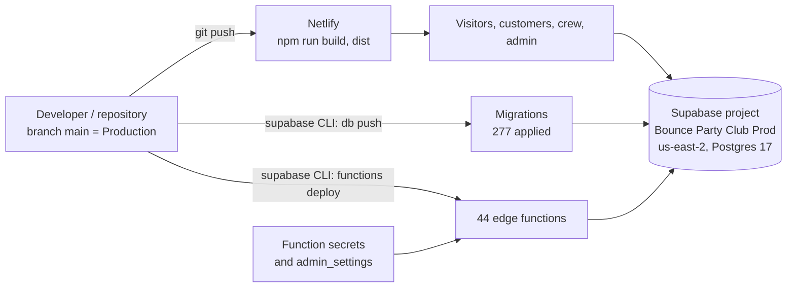

# Deployment and Security

Scope: describes the application as deployed in Production (branch main; Supabase project qaagfafagdpgzcijnfbw).

## Security model

- Authentication is Supabase Auth (email/password and Google). Roles live in `user_roles` (`customer`, `crew`, `admin`, `master`); `get_user_role()` and direct `user_roles` lookups drive admin checks.
- Row Level Security is enabled on every table in `public`.
- Edge functions declare `verify_jwt` per function in `supabase/config.toml`; the Stripe and Twilio inbound webhooks (`stripe-webhook`, `twilio-webhook`) run with `verify_jwt = false` (`twilio-status-callback` is configured with `verify_jwt = true`), and the Stripe webhook verifies the Stripe signature.
- Payment-related functions use rate limiting (`rate_limits` table) and an atomic payment lock.
- Role changes are restricted and logged: in the admin UI and `assign_role_by_email` only `master` assigns `admin` or `master`, and the table policies let an `admin` change `crew` rows only; the `assign_user_role` and `remove_user_role` functions require an `admin` or `master` caller and reserve only the `master` role to `master` (see AUTH_AND_ROLES.md).
- Integration credentials are configured through Supabase function secrets and admin settings.

---

## Hosting

The frontend build configuration is in `netlify.toml`:

```toml
[build]
  command = "npm run build"
  publish = "dist"

[build.environment]
  NODE_VERSION = "20.17.0"
  SECRETS_SCAN_SMART_DETECTION_ENABLED = "false"

[[redirects]]
  from = "/*"
  to = "/index.html"
  status = 200
```

The SPA redirect rule sends all paths to `index.html` so React Router handles navigation. `.nvmrc` is 20.17.0 and `npm run build` is `vite build`. A `vercel.json` with the same SPA rewrite is also present.

---

## Environment Variables

### Frontend `.env` (VITE_ prefix, embedded in the bundle)

| Variable | Purpose |
|---|---|
| `VITE_SUPABASE_URL` | Supabase project URL |
| `VITE_SUPABASE_ANON_KEY` | Supabase public anon key |
| `VITE_GOOGLE_MAPS_API_KEY` | Google Maps API key |
| `VITE_STRIPE_PUBLISHABLE_KEY` | Stripe publishable key (the only source `StripeCheckoutForm.tsx` uses) |

### Integration credentials and settings (`admin_settings`)

Integration credentials (Stripe, Twilio, Resend) are configured through Supabase function secrets and the admin settings screen. Edge functions read the `admin_settings` table at runtime (key column `key`, value column `value`). Non-credential settings read by code:

| Setting Key | Used for |
|---|---|
| `stripe_publishable_key` | Served by `get-stripe-publishable-key`; admin settings UI |
| `admin_email` | Admin notification email |
| `admin_phone`, `admin_notification_phone` | Admin SMS |
| `google_review_url` | Review links in SMS/email |
| `home_address_line1`, `home_address_line2`, `home_address_city`, `home_address_state`, `home_address_zip`, `home_address_lat`, `home_address_lng` | Travel/route origin |
| `apply_travel_fee_by_default` | Travel fee default |
| `use_business_address_for_travel` | Travel origin selection |
| `business_name`, `business_name_short`, `business_legal_entity`, `business_address`, `business_phone`, `business_email`, `business_license_number` | Business identity in emails, waivers, receipts |
| `logo_url` | Logo |
| `facebook_url`, `instagram_url` | Social links |

### Edge function environment secrets

These secrets are set as edge-function secrets:

- `STRIPE_SECRET_KEY` (`stripe-webhook`, `get-payment-method`, `get-session-metadata`, `verify-payment`)
- `STRIPE_WEBHOOK_SECRET` (`stripe-webhook`)
- `GOOGLE_MAPS_API_KEY` (`calculate-route-mileage`, `get-streetview-heading`)
- `SITE_URL` (`send-invoice`, `create-order-short-link`, optional) and `APP_URL` (`create-order-short-link`, optional)

Supabase injects `SUPABASE_URL`, `SUPABASE_ANON_KEY` and `SUPABASE_SERVICE_ROLE_KEY` automatically.

---

## Row Level Security (RLS)

All 55 tables in `public` have RLS enabled. Policies mix two styles for admin checks: some call `get_user_role()`, others use `EXISTS (SELECT 1 FROM user_roles ...)` directly (for example `task_status`, `notification_failures`, `user_permissions_changelog`). `auth.uid()` is used to identify the user. Production has 22 policies defined `FOR ALL`.

Policy examples:

| Table | Policies |
|---|---|
| `orders` | "Service role full access to orders" (ALL), "Anonymous users can mark booking confirmation sent" (UPDATE, anon), "Customers can view own orders" (SELECT, authenticated). Admin/master access goes through other mechanisms (RPCs, edge functions) |
| `transaction_receipts` | SELECT for the customer's own and for admins; INSERT for system and admins; no UPDATE or DELETE policy |

---

## Stripe Webhook Security

`stripe-webhook`:

1. Requires the edge environment secret `STRIPE_WEBHOOK_SECRET`; if absent it returns 500 and does not fall back to unverified mode.
2. Verifies every request with `constructEvent()`; a missing or invalid signature returns 400.
3. Uses `stripe_webhook_events` for idempotency. `status` is `processing`, `succeeded` or `failed`; the table also has `attempts`, `last_error` and `updated_at`.

---

## Rate Limiting

`checkRateLimit()` (`supabase/functions/_shared/rate-limit.ts`) is called by `stripe-checkout` (5 per 60 s), `stripe-charge` (3 per 60 s), `stripe-refund` (2 per 60 s) and `charge-deposit` (10 per 60 s). State is kept in the `rate_limits` table.

The limiter is a fixed window: 429 when the count reaches the maximum, and a 5-minute block (`blocked_until`) when the count reaches 3x the maximum.

`cleanup_old_rate_limits()` deletes rows whose window started more than 1 hour ago, except rows that are still blocked. If the `check_rate_limit` call itself fails, the request is allowed. `submit-contact-inquiry` (deployed only) also uses the limiter (3 per 300 s).

Status: partially implemented. The limiter and the cleanup function are in place. A scheduled run of the cleanup function is not yet active (the `pg_cron` extension is not installed in Production).

---

## Admin Settings Security

`admin_settings_changelog` records settings changes. The trigger `trg_redact_settings_changelog` (BEFORE INSERT, function `redact_sensitive_changelog_values`) replaces `old_value` and `new_value` with `[REDACTED]` when the key matches the stored secret keys or matches `%secret%`, `%_key` (suffix), `%token%` or `%password%`.

---

## Storage Buckets

| Bucket | Public read | Used for | Write access |
|---|---|---|---|
| `public-assets` | Yes | Public site assets | Client uploads; update/delete by authenticated users |
| `carousel-media` | Yes | Home page carousel media | Admin/master roles |
| `unit-images` | Yes | Inventory unit images | Admin/master roles |
| `signed-waivers` | Yes | Signed waiver PDFs | Client uploads (anon and authenticated) and service role |
| `signatures` | Yes | Signature images | Client uploads (anon and authenticated) |
| `physical-waivers` | No | Physical (paper) waiver uploads | Service role only (`upload-physical-waiver`) |
| `order-pictures` | Yes | Order photos | Client uploads; update/delete by admin roles |
| `lot-pictures` | Yes | Lot photos uploaded from the customer portal | Insert, update and delete policies for the `public` role (no sign-in required) |

---

## Security Audit Trail

### Order Changelog (`order_changelog`)

Columns: `order_id`, `user_id`, `field_changed`, `old_value`, `new_value`, `change_type`, `notes`, `created_at`. Used by the changelog tab and by `charge-deposit`.

### User Permissions Changelog (`user_permissions_changelog`)

Written by the `trigger_log_permission_change` trigger on `user_roles` (AFTER INSERT, UPDATE or DELETE; function `log_permission_change`), which writes `role_added`, `role_changed` (only when the role value changes) and `role_removed`. The `action` CHECK constraint also allows `account_created` and `account_deleted`. Insert failures inside the trigger are swallowed. The actor's email is embedded in `notes` as "Changed by: <email>"; there is no separate actor-email column. `target_user_id`, `changed_by_user_id`, `old_role`, `new_role` are recorded.

### Transaction Receipts (`transaction_receipts`)

Financial log with unique receipt numbers and a `receipt_group_id` for related transactions. The table has no UPDATE or DELETE RLS policy for clients; the trigger `update_transaction_receipts_timestamp` sets `updated_at`.

---

## Role Escalation Prevention

`assign_role_by_email` requires the caller to be admin or master, and the `admin` and `master` roles can be assigned only by `master`. `assign_user_role` and `remove_user_role` also exist. Role changes are logged by `trigger_log_permission_change`.

---

## Notification Failure Tracking

`notification_failures` logs failed email or SMS sends. `notification_system_status` holds per-system health: `is_operational`, `consecutive_failures`, `total_failures_24h`, `last_success_at`, `last_failure_at`, `admin_notified_at`. `record_notification_failure` sets `is_operational = false` when it runs while `consecutive_failures` already stands at 3 (the fourth consecutive failure); `record_notification_success` resets the counter and sets `is_operational = true`. The per-failure fallback is email failure -> admin SMS, SMS failure -> admin email. The admin Notification Failures panel lists and resolves failures. RLS: admins read and update `notification_failures`; the insert policy on `notification_failures` and the update policy on `notification_system_status` apply to the `public` role with a `true` condition.

Status: partially implemented. Failures are recorded, system health is tracked and per-failure fallback alerts are sent. The `admin_notified_at` timestamp is not yet populated, the `fallback_sent` and `fallback_type` columns are not written, and no separate automatic admin summary alert is active.

---

## SMS Thread Integrity

Outbound SMS pass `orderId` (camelCase) to be linked to an order's thread; messages sent without it are stored with `order_id = null`. The crew checkpoint messages pass it. The `send-invoice` SMS does not, so it is stored with `order_id = null`.

---

## Input Validation and Sanitization

- `src/lib/validation.ts`: phone numbers are stripped of non-digits and must be exactly 10 digits.
- `supabase/functions/_shared/payment-validation.ts` validates the saved card (attached to the customer, expiry, expiring-soon warning).
- Order status transitions are validated by `validate_order_status_transition`.
- `SECURITY DEFINER` functions in `public` set an explicit `search_path`, except the trigger function `update_google_reviews_updated_at`.
- `check_date_blackout` handles annual recurrence including ranges that wrap across year-end.

---

## Consent Compliance

Consent types accepted by `user_consent_log` (CHECK constraint): `terms_of_service`, `privacy_policy`, `marketing_email`, `marketing_sms`.

1. **Pre-auth staging (`pending_signups_consent`)**: primary key `user_id`, `batch_id` (uuid), `consents` (jsonb).
2. **Permanent log (`user_consent_log`)**: columns include `user_id`, `customer_id`, `consent_type`, `consented`, `policy_version`, `source`, `consent_batch_id` (text), `ip_hint`, `user_agent_hint`. A unique partial index on `(user_id, consent_batch_id, consent_type)` (where the batch id is not null) prevents duplicates.

The frontend calls the deployed `record-consent` function (`verify_jwt = true`): `SignUp.tsx` posts the consent batch, and `AuthContext.tsx` posts to `?action=drain-pending` to move staged consent into the permanent log.

Status: partially implemented. The tables, constraint, unique index and both frontend call sites are in place. The `record-consent` source is empty on main and in the deployment, so the function does not yet perform the insert or the drain; `user_consent_log` and `pending_signups_consent` hold 0 rows in Production.

---

## Auth Trigger Debugging

New-user handling is the trigger `on_auth_user_created` (AFTER INSERT on `auth.users`) calling `auto_assign_customer_role()`. It writes to `auth_trigger_logs` with columns `user_id`, `user_email`, `step`, `status` (`started`/`success`/`error`/`skipped`), `message`, `metadata`, `created_at`.

---

## Role Management Security

Role changes go through `assign_role_by_email`, `assign_user_role` and `remove_user_role`. Every change to `user_roles` fires `trigger_log_permission_change`.

---

## Payment Race-Condition Safety

### Charging (`charge-deposit`)

Uses the boolean `orders.payment_lock`: an atomic `UPDATE ... SET payment_lock = true WHERE id = ... AND payment_lock = false`. If no row is updated the function returns 409. The lock is released if the charge fails.

### Balance Payment Reconciliation (`reconcile-balance-payment` + `apply_balance_payment_financials` RPC)

The RPC locks the payment row `FOR UPDATE` and checks the `order_financials_applied` flag, so only the first caller applies the financial update.

---

## Deployment Topology



| Component | Where it runs | How it is released | Configuration |
|---|---|---|---|
| Single-page app | Netlify (static files from `dist`) | Netlify build of the repository (`npm run build`, Node 20.17.0) | `VITE_*` build variables; `netlify.toml` |
| Database schema, RLS, functions, triggers | Supabase Postgres | SQL migrations in `supabase/migrations` applied with the Supabase CLI (a dev dependency of the repository) | Migration files |
| Edge functions | Supabase Edge Functions (Deno) | Supabase CLI function deploys; `verify_jwt` is set per function (see below) | Project secrets and `admin_settings` |
| Auth settings (Site URL, redirect allow-list, providers, email templates) | Supabase Auth | Supabase dashboard | Configured in the dashboard, outside the repository |
| Storage buckets and policies | Supabase Storage | Migrations | Eight buckets (see Storage Buckets) |
| Webhooks | Receiving functions `stripe-webhook` and `twilio-webhook` | Endpoints are configured in the provider consoles | Signing secret in `STRIPE_WEBHOOK_SECRET` |

Production state at the time of writing: 277 applied migrations (latest `20260928120000_add_parks_acknowledgment_system`), 55 tables in `public`, 68 functions in `public`, 44 deployed edge functions, 8 storage buckets.

### Release components, in the order they depend on each other

1. **Migrations** first: schema and policies that new code reads. Migrations are additive (see ARCHITECTURE.md rules: `IF NOT EXISTS`, no destructive DDL, RLS enabled on every new table).
2. **Edge functions** next: each function is deployed independently and reads its settings at run time, so changing a key in `admin_settings` needs no deployment.
3. **Frontend** last: a Netlify build publishes the new bundle; the catch-all rewrite serves `index.html` for every route.

Verification commands, test suites and the scratch-database workflow are described in `docs/testing.md`.

### Backup and recovery

- The Production database is a managed Supabase Postgres instance; Supabase provides platform backups for the project according to its plan.
- The source-controlled migration history is the 305 files in `supabase/migrations/` on `main`. Production's ledger has 277 rows, so the file count and the ledger count are different numbers. Whether those files alone rebuild the live schema when applied in order has **not been verified**. Data and storage objects are not part of the migrations.
- Secrets (function secrets and the `admin_settings` credential rows) are not in the repository and must be re-entered after a restore.
- `transaction_receipts`, `order_changelog`, `admin_settings_changelog` and `user_permissions_changelog` provide an in-database audit trail that survives application changes.
- Soft archiving (`archived_at`, `archive_old_orders`) is used instead of deleting old orders.

---

## Edge Function Security Matrix

`verify_jwt = true` means the Supabase gateway rejects calls without a valid JWT (the anon key is a valid JWT, a signed-in user token is a user JWT, the service-role key is also accepted). The "Inside the function" column is the additional check the function performs.

| Function | `verify_jwt` | Inside the function | Rate limit |
|---|---|---|---|
| `auth-email-hook` | false | Retired (returns 410) | - |
| `backfill-card-details` | true | Service-role client; maintenance utility; no caller role check beyond the gateway JWT | - |
| `backfill-oauth-customers` | true | Resolves the bearer user; acts only on that user | - |
| `backfill-payment-methods` | true | Resolves the bearer user; role must equal `ADMIN` or `MASTER` (upper-case comparison; stored roles are lower case) | - |
| `calculate-route-mileage` | true | Role must be master, admin or crew | - |
| `charge-deposit` | true | Order state and `payment_lock` | 10 per 60 s |
| `checkout-bridge` | false | Static relay page | - |
| `create-admin-user` | true | Refuses when an admin or master already exists | - |
| `create-order-short-link` | true | Calls the `create_order_short_link` RPC (the RPC is not present in Production) | - |
| `customer-balance-payment` | false | Order lookup; saved-card validation (`payment-validation.ts`); Checkout fallback | - |
| `customer-cancel-order` | false | Any signed-in user session (no role check), or a valid unexpired invoice link token for the order, or a customer email matching the order; reason of at least 10 characters; signed-in sessions may also cancel `in_progress` orders | - |
| `fix-payment-method` | false | Order id lookup | - |
| `generate-blank-waiver` | false | Public document | - |
| `generate-signed-waiver` | false | Order id lookup | - |
| `get-payment-method` | true | Returns brand and last four only | - |
| `get-session-metadata` | false | Session id lookup | - |
| `get-streetview-heading` | false | Coordinate parameters only | - |
| `get-stripe-publishable-key` | false | Returns the publishable key | - |
| `get-user-info` | true | Role must be admin or master | - |
| `get-waiver-status` | false | Order id lookup; signed URLs for physical waivers are returned only with a valid portal token for the order or an admin, master or crew session | - |
| `order-lifecycle` | false | Order status and idempotency flags | - |
| `promote-media` | true | Role must be admin or master; consent flag required | - |
| `reconcile-balance-payment` | false | Verifies the Stripe session; idempotent RPC | - |
| `record-cash-payment` | true | Role must be master, admin or crew | - |
| `record-check-payment` | true | Role must be master, admin or crew | - |
| `record-consent` | true | Source is empty on main and in the deployment (see Consent Compliance) | - |
| `save-payment-method-from-session` | true | Verifies the Stripe session | - |
| `save-pending-consent` | false | Retired (returns 410) | - |
| `save-signature` | false | Order and waiver validation | - |
| `save-signup-address` | false | Bearer user validation | - |
| `send-email` | true | Resend credentials from settings; no caller check beyond the gateway JWT, recipient supplied by the caller | - |
| `send-error-notification` | false | Admin email from settings | - |
| `send-invoice` | true | Order lookup; creates the link; no caller role check, recipient email and phone supplied by the caller | - |
| `send-sms-notification` | true | Twilio credentials from settings; no caller check beyond the gateway JWT, recipient supplied by the caller | - |
| `stripe-charge` | true | Role must equal `ADMIN` or `MASTER` (upper-case comparison; stored roles are lower case) | 3 per 60 s |
| `stripe-checkout` | true | Server-side blackout check; identifier required | 5 per 60 s |
| `stripe-refund` | true | Role must be admin or master | 2 per 60 s |
| `stripe-webhook` | false | Stripe signature; idempotency table | - |
| `submit-contact-inquiry` | true | Field validation and length limits | 3 per 300 s |
| `sync-google-calendar` | true | Google credentials from settings | - |
| `twilio-status-callback` | true | Required fields (`MessageSid`, `MessageStatus`) | - |
| `twilio-webhook` | false | Required fields; HTTP 200 on all outcomes | - |
| `upload-physical-waiver` | true | Role (admin, master, crew) or portal token | - |
| `verify-payment` | true | Verifies the Stripe session is paid; then updates the order if the webhook has not; no caller role check | - |

Functions whose `verify_jwt` is false fall into three groups: provider callbacks (`stripe-webhook`, `twilio-webhook`), customer token flows (payment, cancellation, waiver and portal functions, which are called from pages visitors reach through their private link), and retired or static helpers.

---

## Complete `admin_settings` Key Reference

Keys present in Production (names only). Credential rows are readable only by `admin` and `master` users and by edge functions; the public RPC exposes just the 12 branding keys.

| Key | Controls | Read by |
|---|---|---|
| `business_name`, `business_name_short`, `business_legal_entity`, `business_license_number` | Business identity in UI, emails, waivers, receipts | `BusinessProvider`, waiver and email functions |
| `business_address` | Display address (the app also builds the address text from the `home_address_*` keys) | `BusinessProvider`, waivers |
| `business_phone`, `business_email` | Contact details; `business_email` is also the email reply-to and the contact-inquiry destination | Emails, UI |
| `logo_url` | Logo on receipts, waivers and pages | Receipt/waiver functions, UI |
| `facebook_url`, `instagram_url` | Social links | `get_public_business_settings` |
| `google_review_url` | Review link `{review_url}` | `send-email`, `send-sms-notification`, Branding screen, Home page |
| `home_address_line1`, `home_address_line2`, `home_address_city`, `home_address_state`, `home_address_zip`, `home_address_lat`, `home_address_lng` | Travel and route origin | `adminSettingsCache.ts` (travel and route origin), Business Address and Business Branding screens, public RPC (`home_address_line1` to `home_address_zip`; the lat/lng keys are not in the RPC) |
| `use_business_address_for_travel` | Whether the business address is the travel origin | Business Branding screen (saved and read there) |
| `apply_travel_fee_by_default` | Default for the travel fee on new orders | Pricing Rules tab (saved and read there) |
| `admin_email` | Admin alert email address | Lifecycle, cancellation, receipts, failure fallback |
| `admin_notification_phone` | Admin alert SMS number (lifecycle alerts, email-failure fallback) | `order-lifecycle`, `send-email`, `notificationService`, `adminSettingsCache` |
| `admin_phone` | Admin SMS number for template-routed admin SMS and cancellation SMS | `send-sms-notification`, `customer-cancel-order` |
| `stripe_secret_key` (secret) | Stripe API access for the admin-settings payment functions | See INTEGRATIONS.md |
| `stripe_publishable_key` | Publishable key served to the browser | `get-stripe-publishable-key` |
| `twilio_account_sid`, `twilio_auth_token` (secret), `twilio_from_number` | Twilio sending | `send-sms-notification` |
| `resend_api_key` (secret) | Resend sending | `send-email` |
| `carousel_show_arrows` | Reserved display option for the home carousel | Not read by the Production code |
| `google_oauth_client_id`, `google_oauth_client_secret` (secret) | Reserved Google OAuth settings | Not read by the Production code; Google sign-in is configured in Supabase Auth |
| `supabase_url` | Reserved setting | Not read by the Production code |

Optional keys read by code that are created when used: `app_url` (admin link in the cancellation notice) and the four Google Calendar keys (`google_calendar_client_id`, `google_calendar_client_secret`, `google_calendar_refresh_token`, `google_calendar_id`).

Settings changes are logged by `trigger_log_admin_settings_change`; values for keys that look like secrets are replaced with `[REDACTED]` in the changelog.

---

## Secrets Inventory (names and location)

| Secret | Stored in | Used by |
|---|---|---|
| `STRIPE_SECRET_KEY` | Edge function secrets | `stripe-webhook`, `get-payment-method`, `get-session-metadata`, `verify-payment` (the last is deployed only) |
| `STRIPE_WEBHOOK_SECRET` | Edge function secrets | `stripe-webhook` |
| `GOOGLE_MAPS_API_KEY` | Edge function secrets | `calculate-route-mileage`, `get-streetview-heading` |
| `SITE_URL`, `APP_URL` (optional) | Edge function secrets | `send-invoice`, `create-order-short-link` |
| `SUPABASE_SERVICE_ROLE_KEY`, `SUPABASE_URL`, `SUPABASE_ANON_KEY` | Injected by Supabase | All functions |
| `stripe_secret_key`, `twilio_account_sid`, `twilio_auth_token`, `resend_api_key`, `google_calendar_*`, `google_oauth_client_secret` | `admin_settings` rows | Functions listed in INTEGRATIONS.md |
| `VITE_SUPABASE_URL`, `VITE_SUPABASE_ANON_KEY`, `VITE_GOOGLE_MAPS_API_KEY`, `VITE_STRIPE_PUBLISHABLE_KEY` | Netlify build variables / local `.env` | Browser bundle (public by design) |

The service-role key never reaches the browser. The `.env.example` file lists only the four `VITE_*` names, and `.gitignore` excludes real `.env` files.

---

## Row-Level Security Model

Facts for Production: 55 tables in `public`, all with RLS enabled (none without), 168 policies in `public` plus 31 on `storage.objects`; 204 indexes; `public` contains no views. The policy vocabulary is:

| Pattern | Used for |
|---|---|
| Admin-only | `admin_settings`, `admin_settings_changelog`, `auth_trigger_logs`, `email_templates`, `notification_failures`, `notification_system_status`, `stripe_webhook_events`, consent and permission logs: SELECT/UPDATE gated by `user_roles` (role `admin` or `master`). `stripe_webhook_events` and `transaction_receipts` also have INSERT policies for the `anon` role, and `notification_failures` / `notification_system_status` have insert/update policies for the `public` role |
| Own rows | `user_roles` (own role), `user_consent_log` and `pending_signups_consent` (`auth.uid() = user_id`), `user_permissions_changelog` (own entries), customer reads of their own orders and receipts |
| Role-scoped writes | `user_roles` (master: any row; admin: crew rows only), storage buckets for units, carousel and order pictures (admin/master) |
| Public read of published content | Units and unit media, active carousel images, high-rated active reviews, branding through the RPC |
| Token-scoped guest access | `invoice_links` rows until `expires_at`, and the order-by-token RPCs |
| Guest write channels for the booking flow | Insert policies for consent records, billing address, contacts upsert, lot and order pictures, signatures, `site_events` and customer changelog entries |
| Service role | Edge functions use the service role, which bypasses RLS. Policies whose names begin "Service role" are `FOR ALL` with `USING true` and `WITH CHECK true` and apply to the `public` role (so they are not limited to the service role) on `addresses`, `customers`, `documents`, `messages`, `order_items`, `orders`, `payments`, `pricing_rules`, `route_stops`, `unit_media` and `units`; the same-named policies on `contacts`, `google_calendar_sync`, `google_calendar_sync_queue`, `invoices` and the insert policy on `sms_conversations` apply to the `service_role` role |

Admin checks in policies are written two ways: `get_user_role(auth.uid())` and `EXISTS (SELECT 1 FROM user_roles ... lower(role) IN (...))`. 22 policies are defined `FOR ALL`.

`SECURITY DEFINER` functions in `public` fix `search_path` to `public`, with two exceptions: ten functions set an empty `search_path` (`get_all_role_users`, `user_has_role`, `get_user_highest_role`, `order_has_valid_signature`, `get_signature_status`, `assign_user_role`, `remove_user_role`, `get_user_creation_logs`, `get_admin_users`, `check_unit_availability`), and the trigger function `update_google_reviews_updated_at` has no `search_path` setting. Trigger functions are covered in ARCHITECTURE.md; the role helpers in AUTH_AND_ROLES.md.

### Storage policies

| Bucket | Read | Write |
|---|---|---|
| `unit-images` | Public | Admin/master (insert, update, delete) |
| `carousel-media` | Public | Admin/master |
| `order-pictures` | Public; customers read their own through a policy; admin, master and crew read all | Uploads by the `public` role (the `order_pictures` table insert requires an existing order); update and delete by admin/master |
| `lot-pictures` | Public | Insert, update and delete for the `public` role |
| `public-assets` | Public | Uploads; update and delete by signed-in users |
| `signatures` | Anonymous and signed-in | Anonymous and signed-in uploads |
| `signed-waivers` | Public | Insert policies for `service_role`, `authenticated` and `anon` |
| `physical-waivers` | Private (no read policy) | Service role through `upload-physical-waiver` only |

---

## Security Headers, Transport and CORS

- All traffic is HTTPS (Netlify and Supabase endpoints).
- The Netlify site defines only the SPA rewrite; there is no `_headers` file or `[[headers]]` block, so responses carry the host's default headers.

  Status: partially implemented. HTTPS and the host defaults are in place. Custom response headers (content security policy, frame and referrer policies) are not yet defined.

- Edge functions return `Access-Control-Allow-Origin: *` because callers include browsers on the production domain, localhost development and provider webhooks; authorization relies on JWTs, tokens and signatures rather than origin.
- Cookies are not used for sessions; the Supabase session lives in `localStorage` (`bpc-auth`).
- The Stripe publishable key is the only payment key in the browser; card data is entered on Stripe's hosted pages and never reaches the application.

---

## Request Authenticity Per Provider

| Provider | Mechanism |
|---|---|
| Stripe webhook | Signature verified with `STRIPE_WEBHOOK_SECRET` (`constructEvent`); event id idempotency in `stripe_webhook_events` |
| Twilio inbound and status webhooks | Required-field checks; `twilio-webhook` answers TwiML with HTTP 200 for every outcome, `twilio-status-callback` answers JSON with HTTP 200, 400 or 500. Status: partially implemented. Twilio request-signature validation is not yet active |
| Google Calendar | OAuth refresh-token exchange per run |
| Customer links | 64-character random tokens with expiry |

---

## Input Validation and Output Encoding

| Area | Rule |
|---|---|
| Phone | Exactly 10 digits in forms; `+1` added by the SMS relay |
| Password | Minimum 6 characters in the sign-up and reset forms |
| Contact inquiry (`submit-contact-inquiry`) | Maximum lengths per field (message 5000, email 320, name 200, address 500), email pattern, ISO date and `HH:MM` time checks; HTML-escaped before inclusion in the notification email |
| Payments | Amounts validated server-side against the order (`payment-validation.ts`); deposits and balances re-read after the lock |
| Order status | `validate_order_status_transition` trigger |
| Uploads | Bucket size and MIME limits (see INTEGRATIONS.md); `promote-media` re-verifies source files and requires consent confirmation |
| Redirects | `?next=` accepted only for same-origin paths starting with a single `/` |
| Logging | Browser `logger` module disabled outside development (direct `console.error` calls remain); edge functions avoid logging message bodies, phone numbers and Twilio SIDs; settings-change logs redact secrets |

---

## Related Reference Documents

`DATABASE_SCHEMA.md` (every table, column, policy and function), `API_REFERENCE.md` (function contracts), `ARCHITECTURE.md`, `AUTH_AND_ROLES.md`, `EMAIL_SYSTEM.md`, `INTEGRATIONS.md`, and `docs/testing.md` (verification procedures).
