# Diagrams

Scope: describes the application as deployed in Production (branch `main`; Supabase project `qaagfafagdpgzcijnfbw`). Every diagram below was checked against the `main` source (`src/`, `supabase/functions`, `supabase/migrations`, `netlify.toml`, `supabase/config.toml`) and, for table relationships, against read-only schema metadata of the Production project. The prose companions are `ARCHITECTURE.md`, `AUTH_AND_ROLES.md`, `ORDERS_AND_WORKFLOW.md`, `PAYMENTS_AND_RECEIPTS.md`, `FEATURES.md`, `CREW_AND_OPERATIONS.md`, `EMAIL_SYSTEM.md`, `INTEGRATIONS.md` and `DEPLOYMENT_AND_SECURITY.md`.

All diagrams are Mermaid and render on GitHub and in VS Code (Markdown preview with a Mermaid extension). Dashed arrows mean optional, conditional or asynchronous steps. Money values are integer cents everywhere.

## Index

1. [System context](#1-system-context)
2. [Container and deployment topology](#2-container-and-deployment-topology)
3. [Layer diagrams](#3-layer-diagrams)
   - 3.1 [Front-end layers](#31-front-end-layers)
   - 3.2 [Provider stack and routing map](#32-provider-stack-and-routing-map)
   - 3.3 [Edge function layer and shared modules](#33-edge-function-layer-and-shared-modules)
   - 3.4 [Edge function families by caller and JWT setting](#34-edge-function-families-by-caller-and-jwt-setting)
4. [Authentication and role resolution](#4-authentication-and-role-resolution)
   - 4.1 [Sign-up and sign-in](#41-sign-up-and-sign-in)
   - 4.2 [Role resolution and route guard](#42-role-resolution-and-route-guard)
   - 4.3 [Role checks inside edge functions and the database](#43-role-checks-inside-edge-functions-and-the-database)
   - 4.4 [Role management](#44-role-management)
5. [State machines](#5-state-machines)
   - 5.1 [Order status](#51-order-status)
   - 5.2 [Workflow status](#52-workflow-status)
   - 5.3 [Task status](#53-task-status)
   - 5.4 [Payment and invoice statuses](#54-payment-and-invoice-statuses)
6. [Sequence diagrams](#6-sequence-diagrams)
   - 6.1 [Public quote to Stripe Checkout (setup) to pending review](#61-public-quote-to-stripe-checkout-setup-to-pending-review)
   - 6.2 [Admin approval and deposit charge](#62-admin-approval-and-deposit-charge)
   - 6.3 [Customer balance payment, card on file](#63-customer-balance-payment-card-on-file)
   - 6.4 [Customer balance payment, Stripe Checkout](#64-customer-balance-payment-stripe-checkout)
   - 6.5 [Cash and check recording](#65-cash-and-check-recording)
   - 6.6 [Refund](#66-refund)
   - 6.7 [Stripe webhook processing](#67-stripe-webhook-processing)
   - 6.8 [Waiver signing, digital](#68-waiver-signing-digital)
   - 6.9 [Waiver, paper](#69-waiver-paper)
   - 6.10 [Customer portal access by invoice link or short link](#610-customer-portal-access-by-invoice-link-or-short-link)
   - 6.11 [Notification sending with fallback](#611-notification-sending-with-fallback)
   - 6.12 [Crew task flow](#612-crew-task-flow)
   - 6.13 [Order edit with customer approval](#613-order-edit-with-customer-approval)
   - 6.14 [Cancellation](#614-cancellation)
   - 6.15 [Password reset](#615-password-reset)
   - 6.16 [Contact form](#616-contact-form)
   - 6.17 [Admin invoice: build, send, accept](#617-admin-invoice-build-send-accept)
   - 6.18 [Lot pictures](#618-lot-pictures)
   - 6.19 [Media promotion](#619-media-promotion)
   - 6.20 [Inbound SMS](#620-inbound-sms)
7. [Data model](#7-data-model)
   - 7.1 [Main entities](#71-main-entities)
   - 7.2 [Payments and receipts](#72-payments-and-receipts)
   - 7.3 [Tasks and crew](#73-tasks-and-crew)
   - 7.4 [Waivers, consent and links](#74-waivers-consent-and-links)
   - 7.5 [Configuration and logging tables](#75-configuration-and-logging-tables)
8. [Data flows](#8-data-flows)
   - 8.1 [Pricing](#81-pricing)
   - 8.2 [Money](#82-money)
   - 8.3 [Order totals and balance writers](#83-order-totals-and-balance-writers)
9. [Security boundaries](#9-security-boundaries)
10. [Storage buckets](#10-storage-buckets)
11. [Notification pipeline](#11-notification-pipeline)
12. [Admin panel map](#12-admin-panel-map)
13. [Additional diagrams](#13-additional-diagrams)
    - 13.1 [Realtime subscriptions](#131-realtime-subscriptions)
    - 13.2 [Order creation channels](#132-order-creation-channels)
    - 13.3 [Route optimization and Google Maps usage](#133-route-optimization-and-google-maps-usage)
    - 13.4 [Order lifecycle function decision flow](#134-order-lifecycle-function-decision-flow)
    - 13.5 [Availability and blackout enforcement](#135-availability-and-blackout-enforcement)
    - 13.6 [Consent capture paths](#136-consent-capture-paths)
    - 13.7 [Analytics and site events](#137-analytics-and-site-events)

---

## 1. System context

This diagram shows who uses the system and which outside services it talks to. The web application is a single-page app served from Netlify. Supabase provides the database, authentication, storage, realtime and the server-side code (edge functions). Stripe, Twilio, Resend and Google are called from edge functions (and, for Google Maps and the Stripe-hosted page, from the browser).

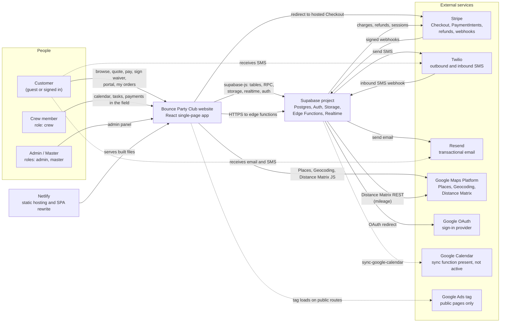

Legend and notes:

- Solid arrows are active data paths in Production. Dashed arrows are optional or passive (receiving messages, a tag, or a function that is deployed but whose credentials and trigger are not set up).
- There is no separate API server. Business logic runs in the browser or in Supabase edge functions.
- Customers do not need an account to pay, sign a waiver or use the portal: access is by order id plus an invoice link token (see 6.10).
- Supabase Auth sends sign-up confirmation and password-reset emails with its built-in sender; business emails go through Resend.

---

## 2. Container and deployment topology

The browser app is built by Vite and published by Netlify. The only environment-specific browser settings are the `VITE_*` variables that point it at one Supabase project. Inside the Supabase project, edge functions run on Deno, read secrets from environment variables and from the `admin_settings` table, and use the service-role key for database writes.

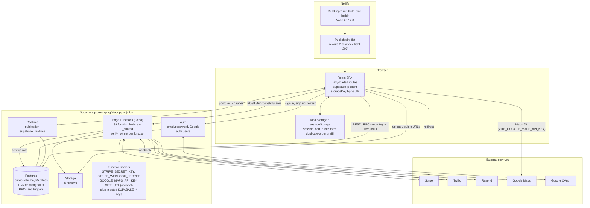

Environments (as they relate to Production):

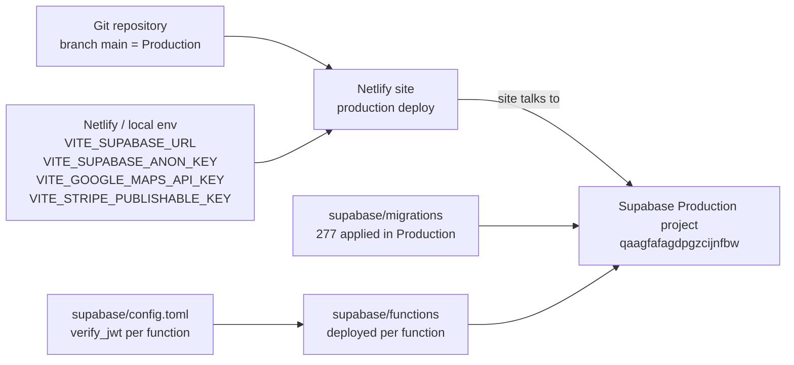

Legend and notes:

- `netlify.toml` defines the build command, publish directory, Node version and the single SPA rewrite. A `vercel.json` with the same rewrite is also in the repository.
- There are 39 function folders plus the `_shared` module folder. Retired placeholders (`auth-email-hook`, `save-pending-consent`) answer HTTP 410, and `record-consent` has no handler in the repository snapshot.
- Realtime publishes six tables: `orders`, `payments`, `order_signatures`, `task_status`, `order_pictures`, `order_lot_pictures`.
- No database-scheduled jobs are configured; maintenance RPCs (`archive_old_orders`, `cleanup_old_rate_limits`) run when called.

---

## 3. Layer diagrams

### 3.1 Front-end layers

Pages compose components. Components and pages read and write data through hooks, the shared libraries in `src/lib`, and the query modules in `src/lib/queries`. Contexts hold cross-cutting state (business identity, auth, customer profile). Everything reaches Supabase through the single client in `src/lib/supabase.ts`.

```mermaid
flowchart TB
  subgraph Pages["src/pages"]
    P1["Public: Home, Catalog, UnitDetail,<br/>Quote, Checkout, Contact, About"]
    P2["Customer: CustomerPortal, Invoice,<br/>Receipt, Sign, ShortLink,<br/>PaymentComplete, PaymentCanceled,<br/>CustomerDashboard (login)"]
    P3["Auth: Login, SignUp, ForgotPassword,<br/>ResetPassword, Setup"]
    P4["Staff: Admin, Crew, UnitForm"]
    P5["Print: InvoicePreview, MenuPreview"]
  end

  subgraph Components["src/components"]
    C1["admin / order-detail / pending-order<br/>calendar / crew"]
    C2["customer-portal / checkout / payment<br/>waiver / dashboard / invoice"]
    C3["quote / order / shared / forms / ui"]
    C4["common: Layout, ProtectedRoute,<br/>ErrorBoundary, GoogleAdsTag, modals"]
  end

  subgraph Hooks["src/hooks"]
    H1["Data: useOrderData, useOrders,<br/>usePendingOrderData, useCalendarTasks,<br/>useAdminAnalytics, useAdminPhotos,<br/>useAdminSettings, useCheckoutData"]
    H2["Pricing and forms: usePricing,<br/>useQuotePricing, useQuoteForm,<br/>useQuoteCart, useInvoicePricing"]
    H3["Flows: usePaymentCompletion,<br/>useOrderDuplication, useRouteOptimization,<br/>useSmsHandling"]
  end

  subgraph Contexts["src/contexts"]
    X1["BusinessContext"]
    X2["AuthContext"]
    X3["CustomerProfileContext"]
  end

  subgraph Lib["src/lib"]
    L1["Orders: orderCreation, orderApprovalService,<br/>orderSaveService, orderLifecycle,<br/>orderStateMachine, orderSummary, invoiceService"]
    L2["Pricing and travel: pricing, pricingCache,<br/>travelFeeCalculator, distanceCalculator,<br/>availability, addressService"]
    L3["Messaging: notificationService,<br/>orderNotificationService, emailTemplateBase,<br/>bookingEmailTemplates, orderEmailTemplates,<br/>notificationReliability, transactionReceiptService"]
    L4["Routing: routeOptimization*,<br/>googleMaps, googleMapsLoader, calendarUtils"]
    L5["Support: supabase, errorHandling, logger,<br/>safeStorage, siteEvents, adminSettingsCache,<br/>waiverContent, validation, utils, constants/"]
  end

  subgraph Queries["src/lib/queries"]
    Q1["base.ts executeQuery,<br/>STANDARD / COMPACT select shapes"]
    Q2["orders, customers, contacts, units,<br/>pricing, payments, invoices, tasks"]
  end

  SBC["supabase-js client<br/>src/lib/supabase.ts"]
  BACK["Supabase: Postgres, Auth,<br/>Storage, Realtime, Edge Functions"]

  Pages --> Components
  Pages --> Hooks
  Components --> Hooks
  Components --> Lib
  Hooks --> Lib
  Hooks --> Queries
  Pages --> Contexts
  Components --> Contexts
  Contexts --> SBC
  Lib --> SBC
  Queries --> SBC
  Components --> SBC
  SBC --> BACK
```

Legend and notes:

- The query layer (`src/lib/queries`) wraps calls in `executeQuery` for uniform `{ data, error }` handling. Components, pages and hooks also call `supabase.from(...)`, `supabase.rpc(...)` and `supabase.functions.invoke(...)` directly; the arrows from Components and Pages to the client show that.
- Pages are lazy-loaded (except Home) to keep the first bundle small.
- `src/types` holds shared TypeScript types; `src/lib/database.types.ts` holds the generated database types.

### 3.2 Provider stack and routing map

`App.tsx` nests providers in a fixed order. Routes split into those rendered inside the shared `Layout` (header and footer) and standalone pages without it. Role-restricted routes pass through `ProtectedRoute`.

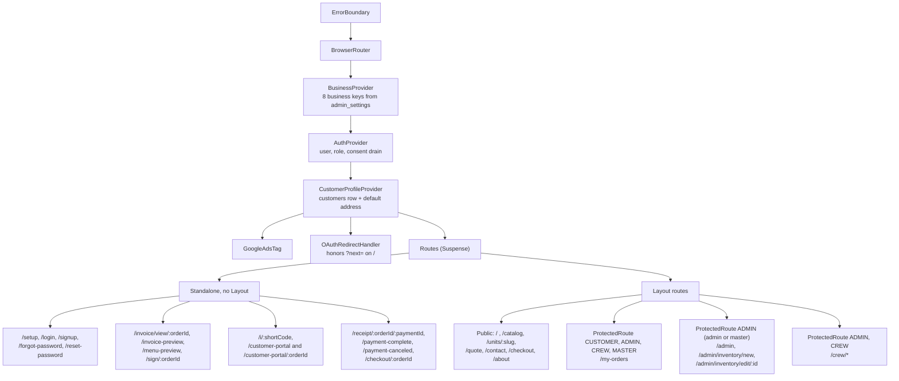

Legend and notes:

- `ADMIN` and `MASTER` in `allowedRoles` both resolve to `isAdmin` (role `admin` or `master`). `CREW` and `CUSTOMER` use `hasRole`.
- Unauthenticated visitors to a protected route are sent to `/login` with the original location in router state; signed-in users without a matching role see an "Access Denied" panel.
- `/checkout` and `/checkout/:orderId` render the same `Checkout` page; the id form is used for the admin pending-order payment link.

### 3.3 Edge function layer and shared modules

Functions are grouped by purpose. The `_shared` modules are imported by the functions shown; several functions also define their own inline CORS headers or build their own email HTML.

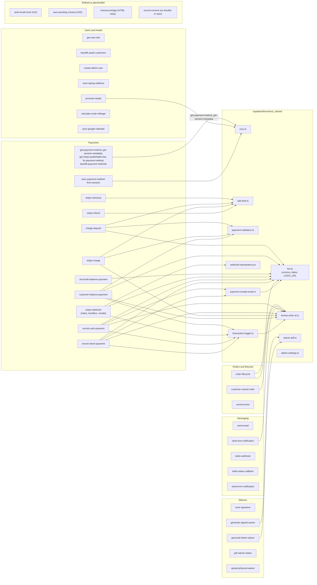

Legend and notes:

- Only the import relationships found in the code are drawn. `admin-settings.ts` is a helper for reading the `admin_settings` key-value table; most functions read that table directly.
- `checkout-bridge` is an HTML page on the Supabase domain that relays a Checkout completion back to an opener window by `postMessage`.
- `record-consent` is invoked by the client (drain at sign-in and at sign-up) but the repository file has no handler, so consent staged in `pending_signups_consent` is not yet moved into `user_consent_log`.

### 3.4 Edge function families by caller and JWT setting

This chart groups functions by who calls them and by the `verify_jwt` value in `supabase/config.toml`. Functions with `verify_jwt = false` either serve guests (token or email checks inside the function) or receive third-party callbacks.

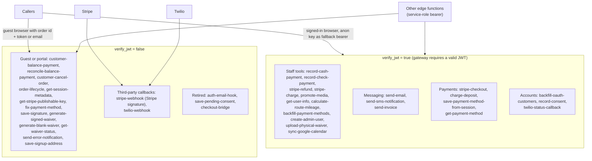

Legend and notes:

- Several `verify_jwt = true` functions are called by the browser with the public anon key as the bearer (for example `send-email`, `send-sms-notification` and `stripe-checkout`), which the gateway accepts as a valid JWT; functions that need a real user check the user and role themselves (see 4.3).
- Functions that act on behalf of guests validate the invoice link token, the matching customer email, or the Stripe session before acting.

---

## 4. Authentication and role resolution

### 4.1 Sign-up and sign-in

Sign-up creates a Supabase Auth user with the form data as metadata. A Postgres trigger on `auth.users` runs and logs its steps to `auth_trigger_logs`. The browser then loads the `customers` row (with retries and a backfill fallback) and loads the role from `user_roles`. Consent chosen at sign-up is staged in `pending_signups_consent`, and a drain request is made on session load and on `SIGNED_IN`.

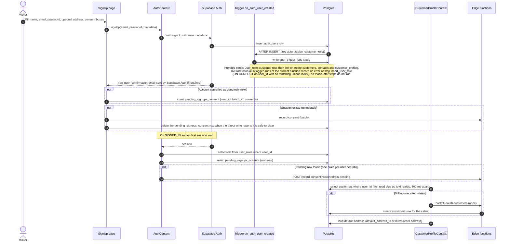

Sign-in variants:

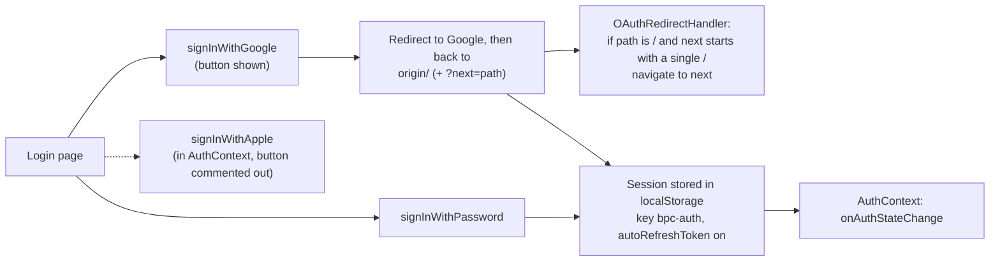

Legend and notes:

- The `onAuthStateChange` callback is synchronous: it sets the user, then starts the role load without awaiting it.
- Which trigger steps ran is recorded in `auth_trigger_logs` (see the note in the diagram for the current Production result); the browser-side retry plus `backfill-oauth-customers` ensures a `customers` row exists for the signed-in user.
- The drain (`record-consent?action=drain-pending`) is requested by the client; the repository file for `record-consent` has no handler, so the permanent `user_consent_log` is not yet filled from this path.
- `Setup.tsx` (`/setup`) is a first-run page: it calls `get_admin_users` and shows a completed state when any admin or master exists, which is the case in Production.

### 4.2 Role resolution and route guard

The role is a single lowercase string from `user_roles`. `AuthContext` exposes `isAdmin` (admin or master) and `hasRole`. `ProtectedRoute` is the only client-side gate; the real data protection is RLS and edge-function checks (section 9).

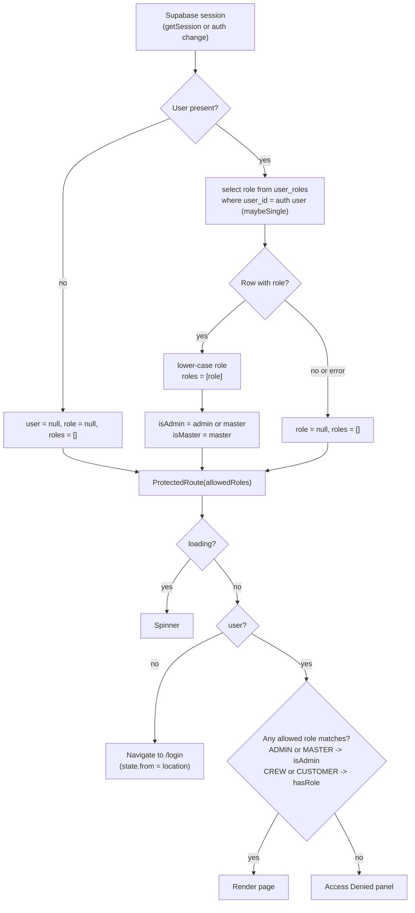

Route to role table:

| Route | Allowed `allowedRoles` | Effective roles |
|---|---|---|
| `/my-orders` | CUSTOMER, ADMIN, CREW, MASTER | customer, crew, admin, master |
| `/admin`, `/admin/inventory/new`, `/admin/inventory/edit/:id` | ADMIN | admin, master |
| `/crew/*` | ADMIN, CREW | admin, master, crew |

### 4.3 Role checks inside edge functions and the database

Different layers use different ways to resolve the caller's role. This chart shows the patterns used in Production code.

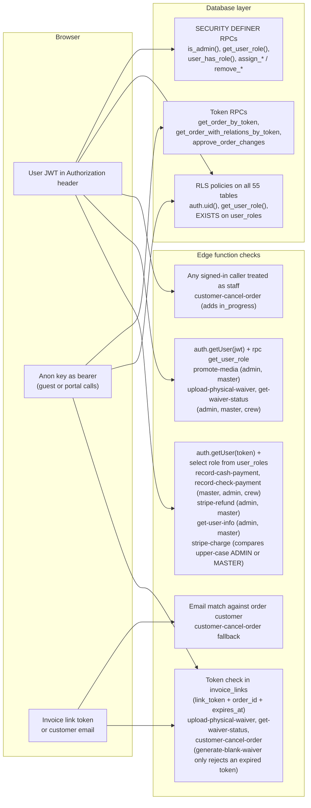

### 4.4 Role management

Roles are granted from the admin Permissions tab through an RPC and changed or removed with direct writes to `user_roles` (allowed by RLS); a trigger records each change, and the tab sends an audit email to the admin address.

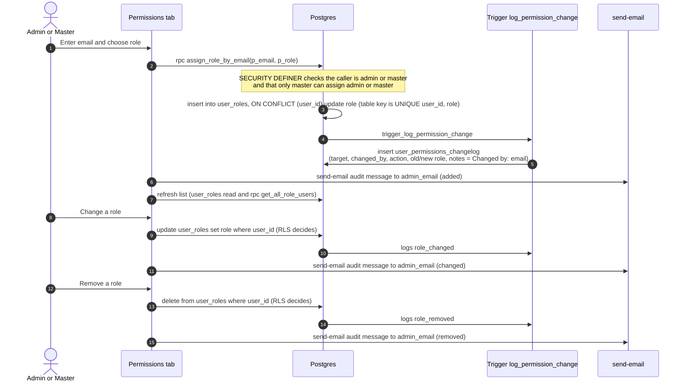

Legend and notes:

- `user_roles` RLS: users read their own rows; admin and master read all; `master` may write any role row; `admin` may write only rows whose role is `crew`; there is no customer write policy.
- The database function `remove_user_role` exists, but the Permissions tab does not call it; the tab deletes the row directly.

---

## 5. State machines

### 5.1 Order status

`orders.status` is limited by the `orders_status_check` constraint and every change is validated by the `validate_status_transition` trigger (`validate_order_status_transition()`), which allows exactly the transitions drawn and treats `completed`, `cancelled` and `void` as terminal. A same-status write is always allowed. The labels name who or what causes each transition.

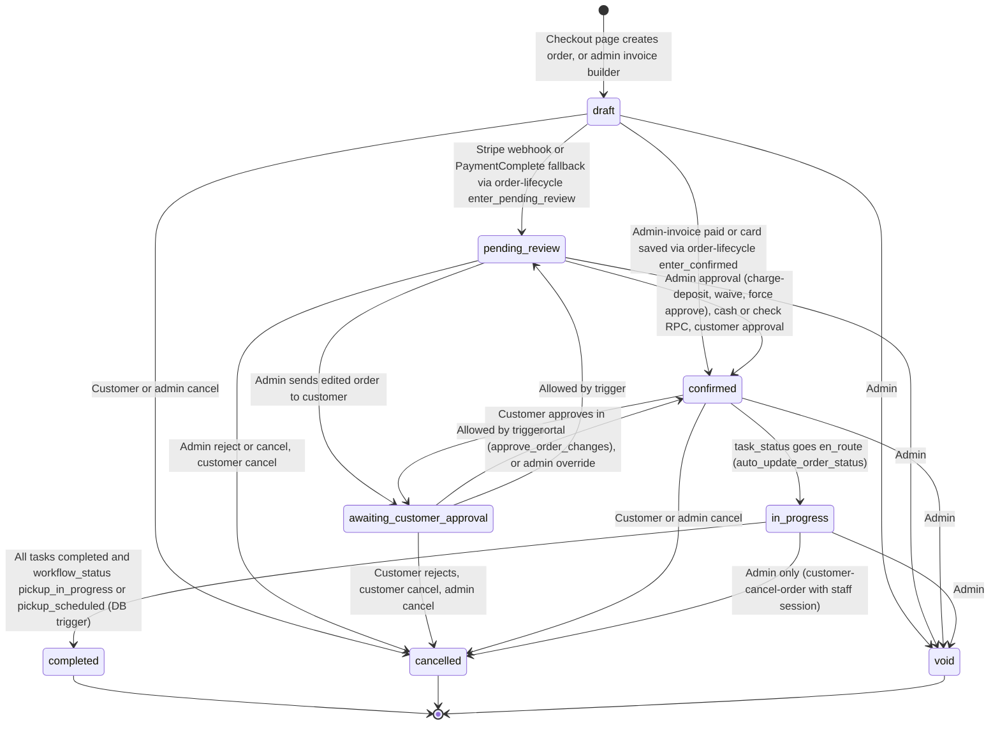

Legend and notes:

- The browser-side machine in `src/lib/orderStateMachine.ts` has the same transitions except that it does not offer `confirmed` to `awaiting_customer_approval`; the database trigger is the authority.
- `order-lifecycle` is the single writer for the two entry transitions (`enter_pending_review`, `enter_confirmed`): `enter_pending_review` is allowed from `draft` or `pending_review`; `enter_confirmed` from `draft`, `pending_review`, `awaiting_customer_approval` or `confirmed`. Some callers write the status and payment fields together first and then call `order-lifecycle` for the changelog row and the admin alert (the flag columns `pending_review_admin_alerted` and `confirmed_admin_alerted` keep alerts to one each).
- `confirmed` creates two `task_status` rows (drop-off and pick-up) through `trigger_auto_create_task_status`.
- Orders in `pending_review`, `awaiting_customer_approval`, `confirmed`, `in_progress` and `completed` count against unit availability.
- Cancellation through `customer-cancel-order` also deletes the order's `task_status` rows.
- Archiving is separate from status: `archive_old_orders` sets `archived_at` on completed or cancelled orders past a threshold (the admin UI uses 90 days).

### 5.2 Workflow status

`orders.workflow_status` (CHECK constraint) tracks the crew's physical progress. It is written by the Task Detail Modal and is independent of `orders.status`; the database trigger on `task_status` reads it when deciding whether an order is complete.

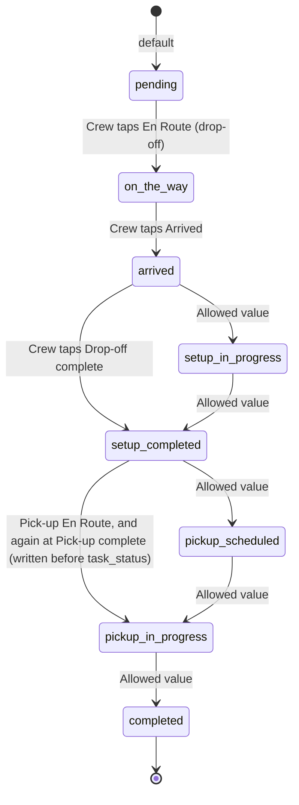

Legend and notes:

- The values are the complete set allowed by the CHECK constraint. The modal writes `on_the_way`, `arrived`, `setup_completed` and `pickup_in_progress`; other values are available to other writers.
- At pick-up completion `workflow_status` is written first so the `auto_update_order_status` trigger on `task_status` sees `pickup_in_progress` and can complete the order.
- The En Route handler writes `on_the_way` for a drop-off task and `pickup_in_progress` for a pick-up task, alongside `task_status.status = en_route`.

### 5.3 Task status

Each confirmed order has a drop-off task (date = `event_date`) and a pick-up task (date = `event_end_date`). `task_status.status` has four values. Timestamps are stored at each step.

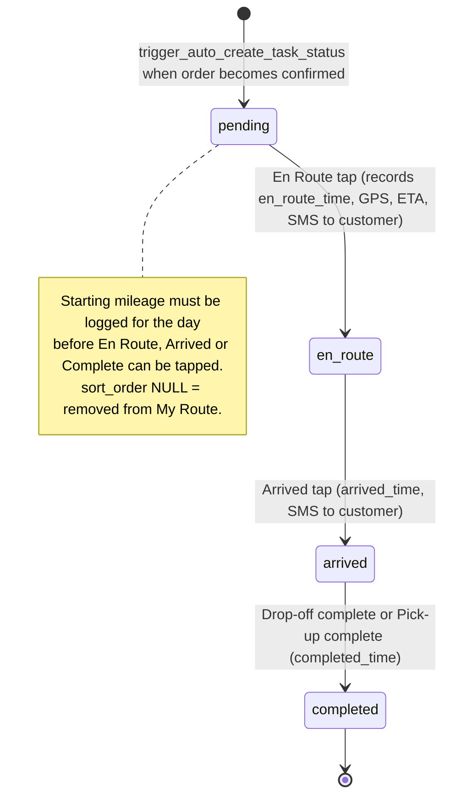

Side effects of a task reaching `en_route` (trigger `auto_update_order_status`): `orders.status` moves `confirmed` to `in_progress`; when every task of the order is `completed` and `workflow_status` is `pickup_in_progress` or `pickup_scheduled`, the order moves to `completed`.

### 5.4 Payment and invoice statuses

These are small value sets that are not workflow-driven by one function. Payment status of an order is derived, not stored.

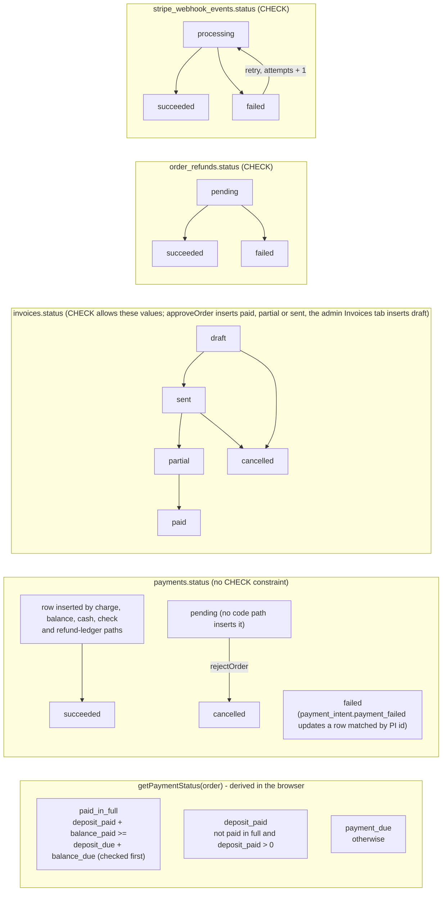

Legend and notes:

- In Production every `payments` row has status `succeeded` (189 rows at the time of checking); no code path writes the value `refunded`.
- `payments.type` allows `deposit`, `balance`, `incidental`. Refund ledger rows are `incidental` with a negative amount and `refunded_payment_id` pointing at the original payment.
- `invoices` rows are created when an admin approval charges a deposit (status `paid` or `partial`).
- A webhook event in `processing` for under 5 minutes is skipped; a stale or `failed` event is retried.

---

## 6. Sequence diagrams

### 6.1 Public quote to Stripe Checkout (setup) to pending review

The quote page validates and stores form data in the browser. Nothing is written to the database until the customer pays on the Checkout page, which creates a `draft` order and sends the customer to a Stripe Checkout Session in setup mode (card saved, no charge at booking). Stripe's webhook moves the order to `pending_review`; the return page covers the case where the webhook is slow.

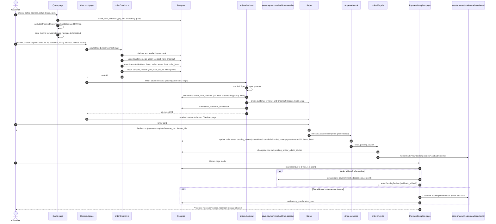

Legend and notes:

- If the order has an `invoice_links` row of type `invoice` (admin invoice), the webhook moves it to `confirmed` instead and the customer is redirected to the portal.
- A customer who submits the quote but never pays leaves no order in the database.
- Blackout dates are enforced twice: in the browser (early rejection) and in `stripe-checkout` under the service role. `blackout_addresses` and `blackout_contacts` are recorded in the admin Blackout tab but are not part of this check.
- `save-payment-method-from-session` and the lifecycle fallback are called by the browser only if the webhook has not advanced the order.
- For an admin invoice the fallback calls `enter_confirmed` instead of `enter_pending_review` and the page redirects to the portal. If the lifecycle call fails, the page shows an error asking the customer to contact the business.

### 6.2 Admin approval and deposit charge

An admin approves a `pending_review` order from the Pending Review card. The service re-checks availability and decides between the zero-deposit path and charging the saved card through `charge-deposit`. A declined card leaves the order unapproved and tells the customer how to update the card.

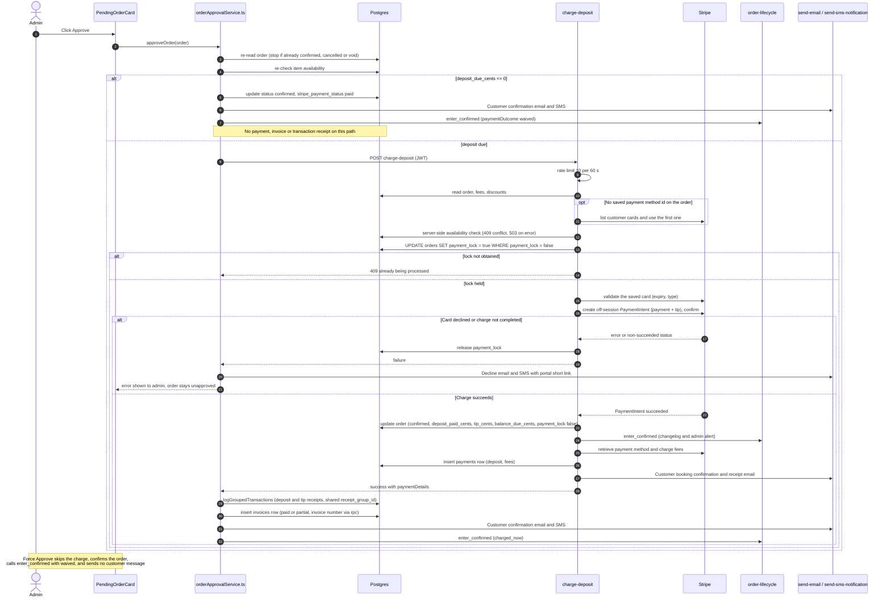

Legend and notes:

- The Stripe charge amount returned by `charge-deposit` is the source of truth for receipts and the invoice.
- `payment_lock` is a boolean column claimed with a conditional update and released on failure or on completion.
- Receipts and the invoice are written after the charge succeeds; both are best-effort and do not undo the charge.
- If the order update fails after Stripe has charged, `charge-deposit` writes an `order_changelog` row of type `payment_error` and returns `chargeSucceeded: true` with an error. The same function also serves balance charges (it then skips `order-lifecycle` and the booking email).

### 6.3 Customer balance payment, card on file

From the Payment tab of the portal, a customer pays the balance (plus optional tip). If a card is on file the function tries an off-session charge first.

```mermaid
sequenceDiagram
  autonumber
  actor C as Customer
  participant PT as Portal Payment tab
  participant BP as customer-balance-payment
  participant ST as Stripe
  participant DB as Postgres
  participant RPC as apply_balance_payment_financials
  participant TL as transaction-logger
  participant EM as send-email

  C->>PT: Choose amount and tip, press Pay
  PT->>BP: POST (orderId, amountCents, tipCents)
  BP->>DB: read Stripe key from admin_settings, load order
  alt Card on file
    BP->>ST: create off-session PaymentIntent, confirm
    alt Declined or action required
      ST-->>BP: failure
      BP->>ST: cancel intent (if open)
      Note over BP: Falls through to the Stripe Checkout path (6.4)
    else Charge succeeded
      ST-->>BP: succeeded
      BP->>ST: retrieve card details and fees
      BP->>DB: insert payments row FIRST (keyed by stripe_payment_intent_id)
      alt Insert conflict 23505 (only if a unique constraint on the PI id exists; Production has a non-unique index)
        BP->>RPC: apply_balance_payment_financials (idempotent repair)
        BP-->>PT: success
      else Row inserted
        BP->>RPC: apply_balance_payment_financials
        RPC->>DB: lock payment row FOR UPDATE, if flag false update balance_paid, balance_due, tip, mark order_financials_applied
        BP->>DB: save card brand and last4 on order
        BP->>TL: logTransaction (balance receipt)
        BP->>EM: customer receipt email
        BP-->>PT: success
      end
    end
  end
  Note over ST,DB: payment_intent.succeeded webhook also calls the same RPC for balance payments,<br/>so only the first caller applies totals
```

### 6.4 Customer balance payment, Stripe Checkout

When no usable card is on file (or the saved card cannot be charged), the function creates a Stripe Checkout Session in payment mode. Totals are applied by the webhook and by the reconcile function when the customer returns, whichever runs first.

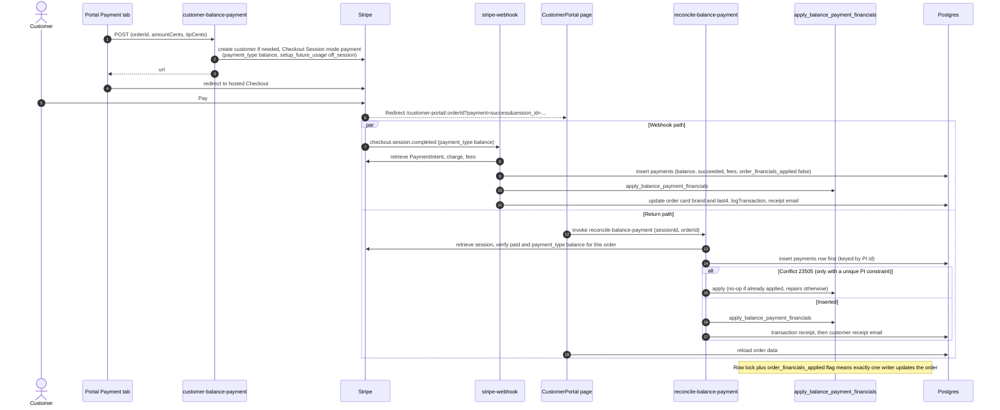

### 6.5 Cash and check recording

Staff record cash or check payments from the Task Detail Modal or the order Payments tab. The function checks the caller's role, calls a single-transaction RPC, and only afterwards logs the receipt and emails the customer (both best-effort).

```mermaid
sequenceDiagram
  autonumber
  actor S as Admin or Crew
  participant UI as Task Detail / Payments tab
  participant EF as record-cash-payment / record-check-payment
  participant DB as Postgres
  participant TL as transaction-logger
  participant EM as send-email

  S->>UI: Enter amount, tip (and check number for check)
  UI->>EF: POST with user JWT
  EF->>DB: auth.getUser(token)
  EF->>DB: select role from user_roles
  alt Role not master, admin or crew
    EF-->>UI: 401 or 403
  else Allowed
    EF->>DB: rpc record_cash_payment / record_check_payment
    Note over DB: One transaction: rejects void or cancelled orders and over-payment,<br/>classifies deposit or balance, inserts payments (amount + tip, method cash or check),<br/>updates deposit_paid, balance_paid, balance_due, tip,<br/>moves pending_review / awaiting_customer_approval to confirmed,<br/>writes order_changelog (cash_payment or check_payment, check number in notes)
    DB-->>EF: result
    EF->>TL: logTransaction (receipt number RCP-YYYYMMDD-NNNNN)
    EF->>EM: customer receipt email
    EF-->>UI: success with receipt number
  end
```

Legend and notes:

- Check payments require a non-empty check number; it is stored in the changelog notes and shown on the receipt and receipt email (the `payments` table has no check-number column).
- The receipt log and email happen only after the RPC succeeds and are not part of the database transaction.

### 6.6 Refund

Refunds are admin or master only. `stripe-refund` issues the Stripe refund and records it; the `charge.refunded` webhook later writes the negative ledger row and the refund receipt.

```mermaid
sequenceDiagram
  autonumber
  actor A as Admin or Master
  participant UI as Payments tab
  participant RF as stripe-refund
  participant ST as Stripe
  participant DB as Postgres
  participant WH as stripe-webhook

  A->>UI: Enter amount and reason
  UI->>RF: POST (orderId, amountCents, reason) with JWT
  RF->>DB: auth.getUser, select role from user_roles
  alt Not admin or master
    RF-->>UI: 403
  else Allowed
    RF->>RF: rate limit 2 per 60 s
    RF->>DB: read Stripe key (admin_settings), order, payments, existing order_refunds
    RF->>ST: retrieve PaymentIntent, list existing refunds
    RF->>ST: refunds.create (allocated across payments, newest first, capped)
    RF->>DB: insert order_refunds (one row per Stripe refund)
    alt Insert fails
      RF-->>UI: 207 partial success
    else Inserted
      RF->>DB: rpc increment_order_refunded_cents
      RF-->>UI: success
    end
  end
  ST->>WH: charge.refunded
  WH->>DB: insert payments row type incidental, negative amount, refunded_payment_id (skip if present)
  WH->>DB: logTransaction type refund
  WH->>DB: insert order_refunds if stripe_refund_id not yet stored
```

Legend and notes:

- No function emails the customer a refund confirmation.
- Refunds do not require the order to be cancelled. Customer cancellations only set `refund_requested`; an admin processes any refund from the Payments tab.

### 6.7 Stripe webhook processing

All Stripe events enter through one endpoint (`verify_jwt = false`). The function first proves the request came from Stripe, then uses the idempotency table, then dispatches by event type.

```mermaid
flowchart TB
  IN["POST /functions/v1/stripe-webhook"] --> SEC{"STRIPE_WEBHOOK_SECRET set?"}
  SEC -- "no" --> E500["500 Webhook secret not configured"]
  SEC -- "yes" --> SIG{"stripe-signature header?"}
  SIG -- "missing" --> E400A["400 Missing signature"]
  SIG -- "present" --> VER{"constructEvent valid?"}
  VER -- "no" --> E400B["400 Invalid signature"]
  VER -- "yes" --> BEG["beginWebhookProcessing<br/>(stripe_webhook_events)"]
  BEG --> ST{"State of this event id"}
  ST -- "succeeded" --> SK1["200 skipped already_processed"]
  ST -- "processing < 5 min" --> SK2["200 skipped currently_processing"]
  ST -- "new, stale processing, or failed" --> DISP{"event.type"}
  DISP --> H1["checkout.session.completed"]
  DISP --> H2["payment_intent.succeeded"]
  DISP --> H3["payment_intent.payment_failed"]
  DISP --> H4["charge.refunded"]
  DISP --> H5["setup_intent.succeeded"]
  DISP --> H6["other types: ignored"]

  H1 --> M{"session.mode and payment_type"}
  M -- "setup" --> S1["Save payment method id, brand, last4, customer id<br/>advance draft/quote/pending_review:<br/>admin invoice -> confirmed else pending_review<br/>then order-lifecycle"]
  M -- "balance" --> S2["Insert payments (balance) + apply_balance_payment_financials<br/>receipt log + customer receipt email"]
  M -- "any other payment_type (default deposit)" --> S3["Set deposit_paid_cents, tip, stripe_payment_status paid,<br/>advance status, then order-lifecycle,<br/>then mark payments row succeeded, then deposit receipt email"]
  H2 --> P2{"metadata.payment_type"}
  P2 -- "balance" --> S4["Update payments row, then apply_balance_payment_financials"]
  P2 -- "deposit" --> S5["Update payments row, then write deposit fields<br/>unless checkout handler already recorded it"]
  H3 --> S6["payments.status failed + failed_at"]
  H4 --> S7["Negative incidental payments row, refund receipt,<br/>order_refunds row (idempotent guards)"]
  H5 --> S8["Save payment method to order, advance status,<br/>then order-lifecycle (zero_due_with_card for admin invoice)"]

  S1 --> OKF["finalizeWebhookSuccess -> 200 received"]
  S2 --> OKF
  S3 --> OKF
  S4 --> OKF
  S5 --> OKF
  S6 --> OKF
  S7 --> OKF
  S8 --> OKF
  H6 --> OKF
  S1 -. "exception" .-> FAIL["finalizeWebhookFailure -> 500<br/>(attempts and last_error stored)"]
  S2 -. "exception" .-> FAIL
  S3 -. "exception" .-> FAIL
  S4 -. "exception" .-> FAIL
  S7 -. "exception" .-> FAIL
```

Legend and notes:

- The Stripe client in this function uses the environment secret `STRIPE_SECRET_KEY`. Other payment functions read the secret key from `admin_settings`.
- Status advancement only happens when the order is currently `draft`, `quote` or `pending_review`.
- `order-lifecycle` calls from the webhook are non-fatal; a failure there is logged and does not fail the event.

### 6.8 Waiver signing, digital

The `/sign/:orderId` page collects the renter details, signature, typed name and initials. `save-signature` stores the signature, marks the order as signed and replies right away; PDF generation and the confirmation email run in the background.

```mermaid
sequenceDiagram
  autonumber
  actor C as Customer
  participant SG as Sign page
  participant SS as save-signature
  participant ST as Storage
  participant DB as Postgres
  participant GW as generate-signed-waiver
  participant EM as send-email

  C->>SG: Open /sign/:orderId (from portal, email or SMS link)
  SG->>DB: read order, customer, address
  C->>SG: Fill renter info, draw signature, type name, initial each section, accept e-sign consent
  SG->>SS: POST (identity snapshot, signatureDataUrl, initials, typed name, waiver text and version)
  SS->>ST: upload PNG to signatures bucket
  SS->>DB: insert order_signatures (IP, user agent, device info, text snapshot, consent text)
  SS->>DB: update orders waiver_signed_at, signature_id, e_signature_consent true
  SS->>DB: insert consent_records (electronic_signature)
  SS-->>SG: success (signatureId)
  SG-->>C: Confirmation screen
  Note over SS,EM: Background task (EdgeRuntime.waitUntil), after the response
  SS->>GW: POST signatureId (service role)
  GW->>DB: read order_signatures and admin_settings (logo, business info)
  GW->>ST: upload PDF to signed-waivers
  GW->>DB: update order_signatures pdf_url, pdf_generated_at and orders signed_waiver_url
  GW-->>SS: pdfUrl
  opt sendEmailConfirmation (default true)
    SS->>EM: email "Your Rental Agreement Has Been Signed" (PDF attached when bytes fetched, download link included)
  end
```

Legend and notes:

- The portal subscribes to `order_signatures` over Realtime, so a signed waiver appears there without a refresh.
- The renter's county-parks acknowledgment text is appended by the signing page only when the order has `parks_acknowledgment_required` and a county.
- Blank waivers: `generate-blank-waiver` renders the same layout without signature fields and returns the PDF inline (nothing is stored). It needs the order id; a portal token is optional and is checked only to reject an expired link for that order (no staff session or token is otherwise required).

### 6.9 Waiver, paper

Crew, admin or the customer portal can record a paper waiver. The function accepts a staff JWT or a portal token. It stores either an uploaded file in the private `physical-waivers` bucket or a no-file override record with a reason.

```mermaid
sequenceDiagram
  autonumber
  actor U as Admin, Crew or Customer (portal)
  participant UI as Task Detail or Waiver tab
  participant UP as upload-physical-waiver
  participant DB as Postgres
  participant PW as Storage physical-waivers (private)
  participant GS as get-waiver-status

  U->>UI: Mark waiver signed on paper (photo/file, or override with reason)
  UI->>UP: multipart POST (orderId, file or overrideReason, uploadSource, token?)
  UP->>DB: auth.getUser(jwt) then rpc get_user_role
  alt Role admin, master or crew
    Note over UP: staff request
  else Not staff
    UP->>DB: lookup invoice_links by link_token (order match, not expired)
    UP-->>UI: 401/403 if no valid token
  end
  UP->>DB: read order and customer/address for required signature fields
  UP->>DB: read existing order_signatures (409 when a digital waiver is already signed)
  alt File supplied
    UP->>PW: upload orderId/timestamp-filename (service role)
    UP->>DB: insert or update order_signatures physical_waiver_* columns
  else Override without file (staff only, reason required)
    UP->>DB: insert or update order_signatures with override reason, no file path
  end
  UP->>DB: update orders waiver_signed_at, e_signature_consent false
  UP-->>UI: success
  U->>UI: View status
  UI->>GS: POST (orderId, token or staff JWT)
  GS->>DB: read order_signatures
  opt Caller has valid token or staff role and a file exists
    GS->>PW: createSignedUrl (1 hour)
  end
  GS-->>UI: status, file type, signed URL when allowed
```

### 6.10 Customer portal access by invoice link or short link

Guests reach their order through the tokenized portal URL. Emails carry the short URL (`/i/<code>`); the full URL contains the 64-character hex token. The portal chooses a view from the order status and subscribes to live changes.

```mermaid
sequenceDiagram
  autonumber
  actor C as Customer
  participant SL as ShortLink page /i/:shortCode
  participant IL as invoice_links
  participant CP as CustomerPortal page
  participant OD as useOrderData
  participant RPC as get_order_with_relations_by_token
  participant RT as Realtime

  C->>SL: Open /i/AbCdEfGh (SMS or email)
  SL->>IL: select order_id, link_token where short_code
  SL-->>C: redirect (replace) to /customer-portal/:orderId?t=:token
  C->>CP: Page loads (also reachable directly at /customer-portal/:orderId)
  CP->>OD: loadOrder(orderId, token, isInvoiceLink)
  alt Token present (isInvoiceLink)
    OD->>IL: read invoice link row by token (stop if missing or expired)
    OD->>RPC: get_order_with_relations_by_token (validates link, expiry)
    RPC-->>OD: order with items, fees, discounts, payments, etc.
  else No token (direct URL)
    OD->>OD: direct table reads allowed by RLS for the order
  end
  OD-->>CP: order data, changelog (when awaiting approval or pending)
  CP->>RT: subscribe orders, payments, order_signatures, task_status, order_lot_pictures, order_pictures (filtered by order)
  RT-->>CP: change events (debounced 600 ms then reload)
  alt status awaiting_customer_approval
    CP-->>C: OrderApprovalView (approve or reject)
  else status draft
    CP-->>C: InvoiceAcceptanceView (accept invoice, save card or pay)
  else pending_review, confirmed, in_progress, completed
    CP-->>C: RegularPortalView (details, waiver, payment, pictures, lot pictures, delivery tab)
  end
```

Return flags handled on load:

```mermaid
flowchart LR
  QS["Query string on /customer-portal/:orderId"] --> A{"Flag"}
  A -- "payment=success&session_id" --> A1["invoke reconcile-balance-payment, then reload"]
  A -- "invoice_card_saved=true&session_id" --> A2["save-payment-method-from-session,<br/>then charge-deposit if deposit due,<br/>else order-lifecycle enter_confirmed (zero_due_with_card)"]
  A -- "card_updated=true&session_id" --> A3["save-payment-method-from-session, restore payment form state from pa, cpa, tip, kop, spb"]
  A -- "invoice_paid=true" --> A4["show approval success view"]
  A -- "none" --> A5["plain load"]
```

Legend and notes:

- Invoice links expire 3 days after the event date, or 30 days after creation when there is no event date. The short-link page redirects without checking expiry; token-validating functions and RPCs enforce it.
- Short links created for SMS by the browser (`createShortPortalLink`) have `link_type = portal_shortlink`; `send-invoice` creates `link_type = invoice`. Only the `invoice` type marks an order as an admin invoice for webhook status handling.

### 6.11 Notification sending with fallback

The browser and other edge functions send through two functions. Each records success or failure, and on failure alerts the admin through the other channel unless the caller set `skipFallback`.

```mermaid
sequenceDiagram
  autonumber
  participant CALL as Caller (browser notificationService or edge function)
  participant SE as send-email
  participant RS as Resend
  participant SM as send-sms-notification
  participant TW as Twilio
  participant DB as Postgres

  CALL->>SE: POST (to, subject, html, templateName?, orderId?, skipFallback?)
  opt templateName and orderId
    SE->>DB: load email_templates row and order, replace placeholders, wrap in layout, to = customer email
  end
  SE->>DB: read Resend key and business name from admin_settings
  SE->>RS: POST /emails from "name <noreply@bouncepartyclub.com>"
  alt Sent
    SE->>DB: rpc record_notification_success('email')
    SE-->>CALL: ok
  else Failed
    SE->>DB: rpc record_notification_failure (notification_failures, notification_system_status)
    opt skipFallback not set
      SE->>SM: SMS to admin phone "EMAIL SYSTEM FAILURE" (skipFallback true)
    end
    SE-->>CALL: error
  end

  CALL->>SM: POST (to, message or templateKey, orderId?, mediaUrls?, skipFallback?)
  opt templateKey
    SM->>DB: load sms_message_templates row, order, replace variables
  end
  SM->>DB: read twilio_account_sid, twilio_auth_token, twilio_from_number
  SM->>TW: POST Messages.json (number normalised to +1 when no plus)
  alt Accepted
    SM->>DB: rpc record_notification_success('sms')
    SM->>DB: insert sms_conversations (order_id = orderId or null)
    SM-->>CALL: ok
  else Failed
    SM->>DB: rpc record_notification_failure
    opt skipFallback not set
      SM->>SE: email to admin_email (skipFallback true)
    end
    SM-->>CALL: error
  end
```

Legend and notes:

- Use `orderId` (camelCase) to link an SMS to an order thread; without it the message is stored with `order_id = null` (this is the case for the `send-invoice` SMS).
- `sendNotificationToCustomer` in the browser sends email, then SMS, independently; a failure in one does not block the other.
- The admin Notification Failures panel (`NotificationFailuresAlert`) reads `notification_failures` and `notification_system_status`, lets the admin mark failures resolved, and flags a channel after three consecutive failures.

### 6.12 Crew task flow

Crew work from the calendar day view. Each action updates `task_status` and `orders.workflow_status`, sends a customer SMS and, for pick-up, an email. Photos go to the `public-assets` bucket and their URLs are appended to JSON arrays on the task.

```mermaid
sequenceDiagram
  autonumber
  actor CR as Crew member
  participant TD as TaskDetailModal
  participant DB as Postgres
  participant GM as Google Maps (browser)
  participant SM as send-sms-notification
  participant EM as send-email
  participant SP as Storage public-assets
  participant TR as DB trigger auto_update_order_status

  CR->>TD: Open task card from day view
  TD->>DB: ensure task_status row exists
  Note over TD: Starting mileage for the day must exist (daily_mileage_logs)
  CR->>TD: Tap En Route
  TD->>TD: get device GPS
  TD->>GM: calculateETA from GPS to event address (30 min default on failure)
  TD->>DB: insert crew_location_history (latitude, longitude)
  TD->>SM: SMS with ETA range, waiver and balance reminders with short portal link
  TD->>DB: update task_status en_route (en_route_time, gps, calculated_eta_minutes)
  TD->>DB: update orders.workflow_status
  DB->>TR: task en_route fires trigger
  TR->>DB: orders.status confirmed -> in_progress
  CR->>TD: Tap Arrived
  TD->>SM: Arrival SMS (drop-off or pick-up wording, pets note)
  TD->>DB: task_status arrived, workflow_status arrived
  opt Photos
    CR->>TD: Take or choose pictures (delivery or damage)
    TD->>TD: compress image
    TD->>SP: upload to public-assets
    TD->>DB: append URL to task_status.delivery_images or damage_images (JSON)
  end
  alt Drop-off
    CR->>TD: Tap Drop-off complete
    TD->>SM: SMS equipment delivered and safety rules
    TD->>DB: task_status completed, workflow_status setup_completed
  else Pick-up
    CR->>TD: Tap Pick-up complete (confirm if balance unpaid)
    TD->>SM: SMS pickup_thanks_sms template with review URL
    TD->>EM: email template pickup_complete
    TD->>DB: workflow_status pickup_in_progress FIRST
    TD->>DB: task_status completed
    DB->>TR: all tasks completed and workflow pickup_in_progress
    TR->>DB: orders.status -> completed
  end
  opt Balance due
    CR->>TD: Record cash, record check, or charge card on file
    TD->>DB: via record-cash-payment, record-check-payment or charge-deposit (see 6.5, 6.2)
  end
```

Legend and notes:

- Pick-up completion asks for confirmation when a balance is still unpaid.
- Route order is stored in `task_status.sort_order`; clearing it removes the task from "My Route".
- The customer portal receives the progress over Realtime (`task_status`).

### 6.13 Order edit with customer approval

An admin edits an order; the save service writes only changed rows and changelog entries. Unless the admin overrides, the order goes to `awaiting_customer_approval` and the customer reviews the changes in the portal.

```mermaid
sequenceDiagram
  autonumber
  actor A as Admin
  participant OD as OrderDetailModal
  participant OS as orderSaveService.ts
  participant DB as Postgres
  participant NS as notificationService (email and SMS)
  actor C as Customer
  participant PO as Portal (ApprovalModal)
  participant RPC as approve_order_changes
  participant CD as charge-deposit
  participant OL as order-lifecycle

  A->>OD: Edit items, fees, discounts, date, address, waivers
  OD->>OS: saveOrderChanges(original, edited)
  OS->>DB: field-by-field diff, then insert/update/delete order_items, order_discounts, order_custom_fees, update orders, upsert address if changed
  Note over OS,DB: The single orders update carries the changed fields, the new status (unless preserved) and, when a saved card no longer covers the order, stripe_payment_method_id null with stripe_payment_status unpaid
  OS->>DB: insert order_changelog rows (edit, add, remove)
  alt Order is in_progress, completed, cancelled or void
    Note over OS,DB: status kept as is, no customer approval step
  else Admin chooses immediate confirm (override)
    OS->>OL: enter_confirmed (admin_override_approval, waived)
  else Approval required
    Note over OS,DB: status written as awaiting_customer_approval
    OS->>NS: email and SMS with portal link
  end
  C->>PO: Open portal, review changes
  alt Approve, deposit already paid or zero deposit with a card on file
    alt Invoice link token present
      PO->>RPC: approve_order_changes(order, token, selected payment, tip, confirm)
      RPC->>DB: validate token and status, write customer_selected_payment_*, tip, status confirmed, customer_approved_at
    else No token
      PO->>DB: direct update of customer_selected_payment_*, tip, status confirmed
    end
    PO->>OL: enter_confirmed (already_paid or zero_due_with_card)
  else Approve, deposit due
    PO->>CD: POST charge-deposit (user JWT or anon key as bearer)
    CD->>DB: update order status confirmed and payment fields
    PO->>OL: enter_confirmed (charged_now)
  else Reject
    PO->>DB: update orders status cancelled with reason (customer types full name)
    PO->>DB: order_changelog row
  end
```

Legend and notes:

- If the customer has no card on file, the portal first sends them to a Stripe setup Checkout Session (`stripe-checkout` with `setupMode`) and returns to the approval form with the payment choices restored (see the return flags in 6.10).
- Approval messages differ by payment state: deposit already paid ("Confirm Changes"), zero deposit with a card on file ("Confirm Booking"), zero deposit without a card (add a payment method first), or deposit due ("Confirm & Pay").
- A deposit catch-up mode (require or waive) can be chosen for confirmed or in-progress orders with a captured deposit; the balance is recalculated either way.

### 6.14 Cancellation

Customers cancel from the portal; staff cancel from the Task Detail Modal or the order status dialog. `customer-cancel-order` validates the caller, updates the order, clears the route tasks and notifies the admin and the customer.

```mermaid
sequenceDiagram
  autonumber
  actor U as Customer or Staff
  participant UI as CancelOrderModal / Task Detail
  participant CC as customer-cancel-order
  participant DB as Postgres
  participant EM as send-email
  participant SM as send-sms-notification

  U->>UI: Enter reason (10+ characters), optional refund choice
  UI->>CC: POST (orderId, reason, adminOverrideRefund?, invoiceLinkToken or customerEmail)
  CC->>CC: if Authorization carries a user, treat as staff
  alt Guest caller
    alt Invoice link token supplied
      CC->>DB: invoice_links where link_token and order_id (not expired)
    else No token
      CC->>DB: compare supplied email with order customer email
    end
  end
  CC->>CC: allowed statuses: draft, pending_review, awaiting_customer_approval, confirmed (staff also in_progress)
  CC->>DB: update orders status cancelled, cancellation_reason, cancelled_at, cancelled_by, refund_requested (true only when staff chose refund needed)
  CC->>DB: insert order_changelog (cancellation, reason in notes)
  CC->>DB: delete task_status rows for the order
  CC->>EM: admin email
  opt Admin phone setting present and template order_cancelled_admin exists
    CC->>SM: admin SMS (template order_cancelled_admin)
  end
  opt Customer has a phone number
    CC->>SM: customer confirmation SMS
  end
  CC-->>UI: success
```

Legend and notes:

- `refund_requested` is informational. No refund is issued automatically; an admin issues any refund from the Payments tab (6.6).
- The admin status dialog (order detail) sets `status = cancelled` with reason, time and actor directly; the separate `rejectOrder` function in `orderApprovalService` cancels pending payments and texts the customer.

### 6.15 Password reset

Password reset uses Supabase Auth's built-in email and the Site URL / redirect allow-list configured in the Supabase Auth settings.

```mermaid
sequenceDiagram
  autonumber
  actor U as User
  participant FP as ForgotPassword page
  participant AU as Supabase Auth
  participant ML as Email (Supabase Auth built-in sender)
  participant RP as ResetPassword page

  U->>FP: Enter email
  FP->>AU: resetPasswordForEmail(email, redirectTo origin/reset-password)
  FP-->>U: "If an account exists you will receive a link"
  AU->>ML: Recovery email with link
  U->>ML: Open link
  ML-->>RP: Browser lands on /reset-password with type=recovery in the URL hash
  RP->>RP: check URL hash contains type=recovery
  alt Hash invalid or missing
    RP-->>U: "Invalid or expired reset link" and redirect to /forgot-password
  else Valid
    U->>RP: Enter new password
    RP->>AU: updateUser(password)
    AU-->>RP: ok
    RP-->>U: success and redirect to /login
  end
```

### 6.16 Contact form

The contact page is a client-side form with phone and email links to the business. Submitting it does not make a network request: the page shows a confirmation panel for five seconds and then clears the fields.

```mermaid
sequenceDiagram
  autonumber
  actor V as Visitor
  participant CF as Contact page
  participant BC as BusinessContext

  CF->>BC: read business phone and email
  V->>CF: Fill name, email, phone, event date, guest count, message
  V->>CF: Submit
  CF->>CF: preventDefault, set submitted = true (no request sent)
  CF-->>V: "Message Received" panel
  Note over CF: After 5 seconds the panel closes and the fields reset
  opt Visitor wants to reach the business
    V->>CF: Tap tel: link or mailto: link (from business settings)
  end
```

Legend and notes:

- Customers who want a response channel use the phone and email links shown on the page, or the quote flow (6.1).

### 6.17 Admin invoice: build, send, accept

Admins and crew build invoices from the Invoices tab (or the crew Invoice tab). The builder creates a `draft` order and sends the customer a tokenized link; the customer accepts and, depending on the order, saves a card or pays.

```mermaid
sequenceDiagram
  autonumber
  actor A as Admin or Crew
  participant IB as InvoiceBuilder / CrewInvoiceBuilder
  participant IS as invoiceService.generateInvoice
  participant DB as Postgres
  participant SI as send-invoice
  participant NS as send-email and send-sms-notification
  actor C as Customer
  participant PO as Portal (InvoiceAcceptanceView)
  participant SC as stripe-checkout
  participant ST as Stripe
  participant WH as stripe-webhook
  participant OL as order-lifecycle

  A->>IB: Choose customer, units, fees, discounts, admin message
  IB->>IS: generateInvoice
  IS->>DB: insert orders (draft, waiver flags as chosen), order_items, order_discounts, order_custom_fees
  opt Send chosen
    IS->>SI: POST send-invoice (orderId, origin)
    SI->>DB: pick an unused 8-char short_code (up to 5 tries)
    SI->>DB: insert invoice_links (link_type invoice, generated link_token, short_code, expires event date + 3 days, or 30 days when no event date)
    SI->>DB: update orders invoice_sent_at
    SI-->>IS: invoiceUrl, shortInvoiceUrl, shortCode, linkToken
    Note over SI,NS: waitUntil in parallel
    SI->>NS: email "Invoice from Bounce Party Club" (short URL button)
    SI->>NS: SMS with short URL
  end
  C->>PO: Open link, status is draft
  alt No card needed, no deposit
    PO->>DB: accept invoice (invoice_accepted_at)
    PO->>OL: enter_confirmed (invoice_acceptance_no_card, waived)
  else Card required but nothing to charge
    PO->>SC: stripe-checkout setupMode + invoiceMode
  else Deposit due
    PO->>DB: save customer_selected_payment_cents and type on the order
    PO->>SC: stripe-checkout setupMode + invoiceMode
  end
  opt Card is collected
    SC->>ST: create Checkout Session mode setup
    ST->>WH: checkout.session.completed / setup_intent.succeeded
    WH->>DB: order -> confirmed because an invoice_links row of type invoice exists
    WH->>OL: enter_confirmed
  end
  opt Deposit due
    Note over PO,ST: Return path invoice_card_saved: save-payment-method-from-session, then charge-deposit (see 6.10)
  end
```

### 6.18 Lot pictures

Customers upload photos of the setup location from the portal. Admins can request photos, and can save a photo to the canonical address so later orders at the same address show it.

```mermaid
sequenceDiagram
  autonumber
  actor A as Admin
  actor C as Customer
  participant PC as PendingOrderCard
  participant DB as Postgres
  participant SM as send-sms-notification
  participant LT as Portal Lot Pictures tab
  participant LP as Storage lot-pictures
  participant EM as send-email
  participant PH as Media Library (admin)

  A->>PC: Request lot pictures
  PC->>DB: orders lot_pictures_requested true, lot_pictures_requested_at
  PC->>SM: SMS with short portal link
  C->>LT: Choose photos and notes
  LT->>LP: upload file
  LT->>DB: insert order_lot_pictures (file_path, file_name, notes, uploaded_by, address_id)
  LT->>SM: admin SMS (lot_pictures_uploaded_admin)
  LT->>EM: admin email
  DB-->>PC: Realtime order_lot_pictures change
  A->>PH: Open photo, Save to Address
  PH->>DB: rpc save_lot_picture_to_address (admin or master)
  DB->>DB: insert address_lot_pictures, set order_lot_pictures.address_id
```

### 6.19 Media promotion

Admins can promote an order photo to a unit gallery or the home page carousel. The function copies the file, re-verifying delivery photo URLs against the task record first.

```mermaid
sequenceDiagram
  autonumber
  actor A as Admin or Master
  participant PH as Media Library modals
  participant PM as promote-media
  participant DB as Postgres
  participant SRC as Source bucket
  participant UI as Storage unit-images
  participant CM as Storage carousel-media

  A->>PH: Promote photo (source lot, order or delivery) with consent confirmed
  PH->>PM: POST (source_type, source_id, action unit or carousel, consent_confirmed true) with JWT
  PM->>DB: auth.getUser, rpc get_user_role (admin or master only)
  PM->>DB: verify the source row (order_lot_pictures, order_pictures or task_status.delivery_images)
  PM->>SRC: download file bytes (service role)
  alt action unit (target unit gallery)
    PM->>DB: confirm the target unit exists
    PM->>UI: upload promoted/safeName-timestamp.ext
    PM->>DB: insert unit_media (next sort)
  else action carousel
    PM->>CM: upload promoted/safeName-timestamp.ext
    PM->>DB: insert hero_carousel_images (next display_order)
  end
  PM-->>PH: success
```

### 6.20 Inbound SMS

Customer replies arrive at the Twilio webhook, are matched to an order, stored in the SMS thread and answered with an automatic TwiML reply. Admins read and reply from the Pending Review card.

```mermaid
sequenceDiagram
  autonumber
  actor C as Customer
  participant TW as Twilio
  participant TWH as twilio-webhook
  participant DB as Postgres
  actor A as Admin
  participant PC as PendingOrderCard SMS thread
  participant SM as send-sms-notification

  C->>TW: Replies by text
  TW->>TWH: POST inbound message
  TWH->>DB: find most recent outbound sms_conversations for this number
  opt No match
    TWH->>DB: find customer by phone, latest order in pending_review, confirmed or draft
  end
  TWH->>DB: insert sms_conversations (direction inbound)
  TWH->>DB: insert auto-reply row (direction outbound)
  TWH-->>TW: TwiML auto-reply message
  TW-->>C: Auto-reply text
  A->>PC: Open order card and read thread
  PC->>DB: select sms_conversations for the order
  A->>PC: Type reply
  PC->>SM: send-sms-notification (orderId, message)
  SM->>TW: send
  SM->>DB: insert sms_conversations outbound
```

Legend and notes:

- `twilio-status-callback` can update `sms_conversations.status` by Twilio message SID; outbound messages do not currently request a status callback, so delivery-status updates are not part of the active flow.

---

## 7. Data model

All diagrams show the `public` schema in Production. Foreign keys were read from the Production catalog; relationships to `auth.users` are shown as `AUTH_USERS`. `user_roles` has no declared foreign key to `auth.users` in the catalog (it links by `user_id`), so that relationship is drawn as logical.

### 7.1 Main entities

```mermaid
erDiagram
  CUSTOMERS ||--o{ ORDERS : "places"
  ADDRESSES ||--o{ ORDERS : "event address"
  CUSTOMERS ||--o{ ADDRESSES : "owns (customer_id)"
  ADDRESSES ||--o{ CUSTOMERS : "default_address_id"
  ORDERS ||--o{ ORDER_ITEMS : "contains"
  UNITS ||--o{ ORDER_ITEMS : "rented as"
  UNITS ||--o{ UNIT_MEDIA : "has media"
  ORDERS ||--o{ ORDER_DISCOUNTS : "discounts"
  ORDERS ||--o{ ORDER_CUSTOM_FEES : "custom fees"
  ORDERS ||--o{ ORDER_CHANGELOG : "audit"
  ORDERS ||--o{ ORDER_NOTES : "internal notes"
  ORDERS ||--o{ INVOICE_LINKS : "portal links"
  ORDERS ||--o{ INVOICES : "invoice snapshot"
  CUSTOMERS ||--o{ INVOICES : "billed"
  ORDERS ||--o{ PAYMENTS : "ledger"
  ORDERS ||--o{ ORDER_REFUNDS : "refunds"
  ORDERS ||--o{ TASK_STATUS : "crew tasks"
  ORDERS ||--o{ ORDER_SIGNATURES : "waivers"
  ORDERS ||--o{ SMS_CONVERSATIONS : "sms thread"
  ORDERS ||--o{ ORDER_LOT_PICTURES : "lot photos"
  ORDERS ||--o{ ORDER_PICTURES : "order photos"
  CUSTOMERS ||--o| CONTACTS : "phonebook entry"
  AUTH_USERS ||--o| CUSTOMERS : "user_id"
  AUTH_USERS ||--o{ USER_ROLES : "logical link"

  CUSTOMERS {
    uuid id PK
    uuid user_id FK
    uuid default_address_id FK
    text first_name
    text last_name
    text email
    text phone
    text oauth_provider
  }
  ADDRESSES {
    uuid id PK
    uuid customer_id FK
    text address_key
    text line1
    text city
    text state
    text zip
    numeric lat
    numeric lng
  }
  ORDERS {
    uuid id PK
    uuid customer_id FK
    uuid address_id FK
    uuid signature_id FK
    text status
    text workflow_status
    date event_date
    date event_end_date
    int subtotal_cents
    int tax_cents
    int deposit_due_cents
    int deposit_paid_cents
    int balance_due_cents
    int balance_paid_cents
    int tip_cents
    int total_refunded_cents
    text stripe_customer_id
    text stripe_payment_method_id
    bool payment_lock
    timestamptz archived_at
  }
  ORDER_ITEMS {
    uuid id PK
    uuid order_id FK
    uuid unit_id FK
    int qty
    text wet_or_dry
    int unit_price_cents
  }
  UNITS {
    uuid id PK
    text name
    text slug
    int price_dry_cents
    int price_water_cents
    bool active
  }
  UNIT_MEDIA {
    uuid id PK
    uuid unit_id FK
    text mode
    bool is_featured
    int sort
  }
  CONTACTS {
    uuid id PK
    uuid customer_id FK
    int total_bookings
    int total_spent_cents
    bool is_repeat_customer
  }
  INVOICE_LINKS {
    uuid id PK
    uuid order_id FK
    text link_token
    text short_code
    text link_type
    timestamptz expires_at
  }
  INVOICES {
    uuid id PK
    uuid order_id FK
    uuid customer_id FK
    text status
    int total_cents
  }
  USER_ROLES {
    uuid id PK
    uuid user_id
    text role
  }
```

Legend and notes:

- `orders` also references `auth.users` through `cancelled_by`, and `order_signatures` through `signature_id` (circular relationship with `order_signatures.order_id`).
- A `billing_addresses` table (linked to `customers` and `orders`) exists in the catalog; checkout stores the billing address inline on `orders` (`billing_*` columns).
- `contacts` is a deduplicated phonebook with lifetime statistics maintained by triggers on `orders`; `customer_profiles` links `auth.users` and `contacts`.
- Only key columns are shown. See `ARCHITECTURE.md` for the full `orders` column reference.

### 7.2 Payments and receipts

```mermaid
erDiagram
  ORDERS ||--o{ PAYMENTS : "order_id"
  PAYMENTS ||--o{ PAYMENTS : "refunded_payment_id"
  ORDERS ||--o{ ORDER_REFUNDS : "order_id"
  ORDERS ||--o{ TRANSACTION_RECEIPTS : "order_id"
  CUSTOMERS ||--o{ TRANSACTION_RECEIPTS : "customer_id"
  PAYMENTS ||--o{ TRANSACTION_RECEIPTS : "payment_id"
  AUTH_USERS ||--o{ ORDER_REFUNDS : "refunded_by"
  ORDERS ||--o{ INVOICES : "snapshot"
  ORDERS ||--o{ ORDER_CHANGELOG : "cash_payment, check_payment, payment_error"
  STRIPE_WEBHOOK_EVENTS }o..o{ PAYMENTS : "events that create or update rows"
  RATE_LIMITS }o..o{ ORDERS : "keyed by ip + order id (no FK)"

  PAYMENTS {
    uuid id PK
    uuid order_id FK
    uuid refunded_payment_id FK
    text type "deposit, balance, incidental"
    int amount_cents
    text status
    text stripe_payment_intent_id
    text payment_method
    text payment_brand
    text payment_last4
    bigint ledger_sequence
    int stripe_fee_amount
    int stripe_net_amount
    bool order_financials_applied
    timestamptz paid_at
  }
  ORDER_REFUNDS {
    uuid id PK
    uuid order_id FK
    uuid refunded_by FK
    int amount_cents
    text reason
    text stripe_refund_id
    text status "pending, succeeded, failed"
  }
  TRANSACTION_RECEIPTS {
    uuid id PK
    uuid order_id FK
    uuid customer_id FK
    uuid payment_id FK
    text transaction_type "deposit, balance, refund, tip, full_payment"
    int amount_cents
    text receipt_number "RCP-YYYYMMDD-NNNNN"
    uuid receipt_group_id
    text stripe_charge_id
    text stripe_payment_intent_id
  }
  INVOICES {
    uuid id PK
    uuid order_id FK
    text status "draft, sent, partial, paid, cancelled"
    int total_cents
    int paid_amount_cents
  }
  STRIPE_WEBHOOK_EVENTS {
    text stripe_event_id
    text event_type
    text status "processing, succeeded, failed"
    int attempts
    text last_error
  }
  RATE_LIMITS {
    text identifier
    text endpoint
    int request_count
    timestamptz window_start
    timestamptz blocked_until
  }
```

Legend and notes:

- Uniqueness: `payments.stripe_payment_intent_id` has a non-unique index in Production (the code paths handle a 23505 conflict, but no unique constraint exists there, so the row lock and `order_financials_applied` flag inside `apply_balance_payment_financials` are what keep totals applied once); `transaction_receipts` has unique constraints on `(stripe_payment_intent_id, transaction_type)` and `(stripe_charge_id, transaction_type)` so a deposit and a tip from one charge can coexist.
- `transaction_receipts` has no UPDATE or DELETE policy for clients.
- A tip is part of the card charge's `payments.amount_cents` and gets its own `tip` receipt row; `orders.tip_cents` stores it separately.

### 7.3 Tasks and crew

```mermaid
erDiagram
  ORDERS ||--o{ TASK_STATUS : "two per confirmed order"
  ORDERS ||--o{ ORDER_WORKFLOW_EVENTS : "workflow events"
  ORDERS ||--o{ ROUTE_STOPS : "stops"
  ROUTE_STOPS ||--o{ CREW_LOCATION_HISTORY : "stop_id"
  ORDERS ||--o{ CREW_LOCATION_HISTORY : "order_id"
  AUTH_USERS ||--o{ DAILY_MILEAGE_LOGS : "user_id"
  AUTH_USERS ||--o{ ORDER_WORKFLOW_EVENTS : "user_id"
  ORDERS ||--o{ ORDER_LOT_PICTURES : "lot photos"
  ADDRESSES ||--o{ ORDER_LOT_PICTURES : "address_id"
  ADDRESSES ||--o{ ADDRESS_LOT_PICTURES : "address_id"
  ORDER_LOT_PICTURES ||--o{ ADDRESS_LOT_PICTURES : "saved_from_order_lot_picture_id"
  ORDERS ||--o{ ADDRESS_LOT_PICTURES : "saved_from_order_id"
  ORDERS ||--o{ ORDER_PICTURES : "customer photos"

  TASK_STATUS {
    uuid id PK
    uuid order_id FK
    text task_type "drop-off, pick-up"
    date task_date
    text status "pending, en_route, arrived, completed"
    timestamptz en_route_time
    timestamptz arrived_time
    timestamptz completed_time
    int sort_order
    jsonb delivery_images
    jsonb damage_images
    numeric gps_lat
    numeric gps_lng
    int calculated_eta_minutes
    bool waiver_reminder_sent
    bool payment_reminder_sent
  }
  ORDER_WORKFLOW_EVENTS {
    uuid id PK
    uuid order_id FK
    uuid user_id FK
    text event_type
  }
  ROUTE_STOPS {
    uuid id PK
    uuid order_id FK
  }
  CREW_LOCATION_HISTORY {
    uuid id PK
    uuid order_id FK
    uuid stop_id FK
    numeric latitude
    numeric longitude
  }
  DAILY_MILEAGE_LOGS {
    uuid id PK
    uuid user_id FK
    date date
    numeric start_mileage
    numeric end_mileage
  }
  ORDER_LOT_PICTURES {
    uuid id PK
    uuid order_id FK
    uuid address_id FK
    text file_path
  }
  ADDRESS_LOT_PICTURES {
    uuid id PK
    uuid address_id FK
    text file_path
  }
  ORDER_PICTURES {
    uuid id PK
    uuid order_id FK
  }
```

Legend and notes:

- `task_status` is unique on `(order_id, task_type, task_date)`; drop-off uses `event_date`, pick-up uses `event_end_date`. `task_status.order_id` has a foreign key to `orders`.
- `daily_mileage_logs` is unique per `(date, user_id)`.
- The calendar and Task Detail Modal use `task_status`, `daily_mileage_logs` and `crew_location_history`; the route order is held in `task_status.sort_order`, not in `route_stops`.

### 7.4 Waivers, consent and links

```mermaid
erDiagram
  ORDERS ||--o{ ORDER_SIGNATURES : "order_id"
  ORDER_SIGNATURES ||--o| ORDERS : "orders.signature_id"
  CUSTOMERS ||--o{ ORDER_SIGNATURES : "customer_id"
  AUTH_USERS ||--o{ ORDER_SIGNATURES : "physical_waiver_uploaded_by"
  ORDERS ||--o{ CONSENT_RECORDS : "per-order consent"
  CUSTOMERS ||--o{ CONSENT_RECORDS : "customer_id"
  AUTH_USERS ||--o| PENDING_SIGNUPS_CONSENT : "staged at sign-up"
  AUTH_USERS ||--o{ USER_CONSENT_LOG : "permanent log"
  CUSTOMERS ||--o{ USER_CONSENT_LOG : "customer_id"
  ORDERS ||--o{ INVOICE_LINKS : "tokenized access"
  ORDERS ||--o{ DOCUMENTS : "documents"

  ORDER_SIGNATURES {
    uuid id PK
    uuid order_id FK
    text signer_name
    text typed_name
    text signature_image_url
    jsonb initials_data
    text waiver_version
    text waiver_text_snapshot
    text ip_address
    text pdf_url
    text physical_waiver_storage_path
    text physical_waiver_upload_source
    text physical_waiver_override_reason
  }
  CONSENT_RECORDS {
    uuid id PK
    uuid order_id FK
    text consent_type "sms, card_on_file, electronic_signature"
    bool consented
    text consent_text
    text consent_version
  }
  PENDING_SIGNUPS_CONSENT {
    uuid user_id PK
    uuid batch_id
    jsonb consents
    text source
  }
  USER_CONSENT_LOG {
    uuid id PK
    uuid user_id FK
    text consent_type
    bool consented
    text consent_batch_id
  }
  INVOICE_LINKS {
    uuid id PK
    uuid order_id FK
    text link_token
    text short_code
    text link_type "invoice, portal_shortlink"
    timestamptz expires_at
  }
  DOCUMENTS {
    uuid id PK
    uuid order_id FK
    text kind
    text url
  }
```

### 7.5 Configuration and logging tables

Configuration, content and logging tables, grouped by purpose. Most have no foreign key to an order; `order_changelog` and `messages` do (they are logs) and are shown here for their role.

```mermaid
flowchart TB
  subgraph Cfg["Runtime configuration"]
    ADS["admin_settings<br/>key / value"]
    ADSC["admin_settings_changelog<br/>(values redacted by trigger)"]
    PR["pricing_rules (single row)"]
    SFT["saved_fee_templates"]
    SDT["saved_discount_templates"]
    ET["email_templates (6 rows)"]
    SMT["sms_message_templates (13 rows)"]
  end

  subgraph Block["Availability controls"]
    BD["blackout_dates<br/>(applied by check_date_blackout)"]
    BA["blackout_addresses<br/>(recorded, managed in Blackout tab)"]
    BC["blackout_contacts<br/>(recorded, managed in Blackout tab)"]
  end

  subgraph Content["Site content"]
    HC["hero_carousel_images"]
    GR["google_reviews"]
    UM["unit_media"]
  end

  subgraph Obs["Observability and audit"]
    SE["site_events"]
    NF["notification_failures"]
    NSS["notification_system_status"]
    MSG["messages (dispatch log)"]
    ATL["auth_trigger_logs"]
    UPC["user_permissions_changelog"]
    OCL["order_changelog"]
    SWE["stripe_webhook_events"]
    RL["rate_limits"]
  end

  subgraph Cal["Calendar sync (present, not active)"]
    GCS["google_calendar_sync"]
    GCQ["google_calendar_sync_queue"]
  end

  ADS --> ADSC
  AUTHU["auth.users"] --> ADSC
```

Legend and notes:

- `admin_settings` holds business identity, home address, admin contact, logo and social URLs, the Stripe publishable key and integration settings; values are not documented here and the changelog redacts keys that look like secrets.
- `pricing_rules` is one row for the whole system; `update_pricing_rules` is the RPC that changes it.
- `messages` records which template went out on which channel; message bodies live in `sms_conversations`.

---

## 8. Data flows

### 8.1 Pricing

Inputs come from the quote form (customer choices), from the cart (unit prices captured when the item was added), and from the `pricing_rules` row. `calculatePrice` is a pure function that returns the breakdown; callers then apply waivers and discounts. The same fields are copied onto the order when it is created or edited.

```mermaid
flowchart LR
  subgraph Inputs
    I1["Cart items<br/>unit_price_cents x qty<br/>(dry or water mode price)"]
    I2["Form: location_type, surface,<br/>can_use_stakes, overnight_allowed,<br/>pickup preference"]
    I3["Dates: num_days<br/>(event_date to event_end_date)"]
    I4["Address: city, zip<br/>+ driving distance<br/>(Google Distance Matrix,<br/>fallback haversine x 1.4)"]
    I5["Generator qty"]
    I6["Today is a weekday and = event date<br/>(America/Detroit)"]
    I7["pricing_rules row<br/>multipliers, extra_day_pct, radius,<br/>per-mile, city list, ZIP overrides,<br/>surface, same-day, generator fees,<br/>deposit per unit, apply_taxes_by_default"]
  end

  subgraph Calc["calculatePrice (src/lib/pricing.ts)"]
    C1["1 Day-1 subtotal =<br/>sum(items) x location multiplier"]
    C2["2 Extra days =<br/>day1 x extra_day_pct/100 x (days-1)"]
    C3["3 Travel fee<br/>ZIP override flat > free city > per-mile beyond base radius"]
    C4["4 Surface fee<br/>cement, or grass without stakes"]
    C5["5 Same-day pickup fee<br/>commercial or no overnight"]
    C6["6 Same-day weekday delivery fee"]
    C7["7 Generator fee<br/>single + multiple x (qty-1)"]
    C8["8 Tax 6% on subtotal + travel + surface + generator<br/>only if apply_taxes_by_default"]
    C9["9 Total = sum of all parts"]
    C10["10 Deposit = units x deposit_per_unit_cents"]
    C11["11 Balance = max(0, total - deposit)"]
  end

  subgraph Out["Order fields"]
    O1["subtotal_cents, travel_fee_cents,<br/>travel_total_miles, travel_base_radius_miles,<br/>travel_chargeable_miles, travel_per_mile_cents,<br/>travel_is_flat_fee"]
    O2["surface_fee_cents, same_day_pickup_fee_cents,<br/>same_day_weekday_delivery_fee_cents,<br/>generator_fee_cents, tax_cents"]
    O3["deposit_due_cents, balance_due_cents<br/>(custom_deposit_cents overrides)"]
    O4["Waiver flags and reasons per fee<br/>(admin only)"]
    O5["order_discounts, order_custom_fees<br/>(admin only)"]
  end

  I1 --> C1
  I7 --> C1
  I2 --> C1
  C1 --> C2
  I3 --> C2
  I4 --> C3
  I7 --> C3
  I2 --> C4
  I7 --> C4
  I2 --> C5
  I7 --> C5
  I6 --> C6
  I7 --> C6
  I5 --> C7
  I7 --> C7
  C2 --> C8
  C3 --> C8
  C4 --> C8
  C7 --> C8
  C2 --> C9
  C3 --> C9
  C4 --> C9
  C5 --> C9
  C6 --> C9
  C7 --> C9
  C8 --> C9
  I1 --> C10
  I7 --> C10
  C9 --> C11
  C10 --> C11
  C9 --> O1
  C9 --> O2
  C10 --> O3
  C11 --> O3
  O4 --> O3
  O5 --> O3
```

Legend and notes:

- The same-day pickup and same-day weekday delivery fees are not in the taxable base.
- Fee waivers, discounts, custom fees and `custom_deposit_cents` are applied by callers (admin order edit, invoice builder, `calculateTotalFromOrder`), not inside `calculatePrice`; `tax_waived` is likewise applied by callers.
- Travel zones are evaluated in priority order: ZIP flat-fee override, free city list, then distance beyond the base radius.
- Live rules are read from `pricing_rules`; `pricingCache.ts` caches only the deposit and generator columns.

### 8.2 Money

Money enters through four paths (card at booking, deposit charge, balance payment, and cash or check). Each path ends in the same set of records: the `payments` ledger, order totals, `transaction_receipts`, and emails.

```mermaid
flowchart TB
  subgraph Sources["Where money comes from"]
    M1["Card, saved at booking<br/>(Checkout setup mode, no charge)"]
    M2["Deposit charge on admin approval<br/>(charge-deposit, off-session)"]
    M3["Deposit through Checkout payment mode<br/>(stripe-checkout, admin pending-order link)"]
    M4["Balance: card on file<br/>(customer-balance-payment, charge-deposit, stripe-charge)"]
    M5["Balance: Stripe Checkout<br/>(customer-balance-payment path B)"]
    M6["Cash or check<br/>(record-cash/check-payment)"]
    M7["Tip<br/>(added to a card charge or recorded with cash/check)"]
  end

  subgraph Ledger["Records written"]
    L1["payments<br/>type deposit / balance / incidental<br/>amount includes tip for card + cash/check<br/>ledger_sequence, Stripe fee and net"]
    L2["orders<br/>deposit_paid_cents (tip excluded),<br/>balance_paid_cents, balance_due_cents,<br/>tip_cents, stripe_payment_status"]
    L3["transaction_receipts<br/>deposit / balance / tip / full_payment / refund<br/>receipt_group_id groups deposit + tip"]
    L4["invoices<br/>(admin approval charge: paid or partial)"]
    L5["order_changelog<br/>(cash_payment, check_payment, payment_error)"]
  end

  subgraph Outputs["Outputs"]
    E1["Customer receipt email<br/>(deposit path, webhook, balance paths, cash, check)"]
    E2["Admin receipt email<br/>(grouped notification)"]
    E3["Receipt page /receipt/:orderId/:paymentId<br/>and customer dashboard"]
    E4["Analytics RPC get_admin_analytics"]
  end

  subgraph Back["Money going back"]
    R1["stripe-refund (admin or master)"]
    R2["Stripe charge.refunded webhook"]
    R3["order_refunds + total_refunded_cents"]
    R4["Negative incidental payments row + refund receipt"]
  end

  M1 -->|"payment method id saved"| L2
  M2 --> L1
  M2 --> L2
  M3 --> L1
  M3 --> L2
  M4 --> L1
  M4 --> L2
  M5 --> L1
  M5 -->|"apply_balance_payment_financials<br/>(flag order_financials_applied)"| L2
  M6 --> L1
  M6 --> L2
  M6 --> L5
  M7 --> L1
  M7 --> L2
  L1 --> L3
  L2 --> L4
  L3 --> E2
  L1 --> E1
  L1 --> E3
  L1 --> E4

  R1 --> R3
  R1 --> R2
  R2 --> R4
  R4 --> L1
  R4 --> L3
  R3 --> L2
```

Payment-time rules in one place:

```mermaid
flowchart LR
  D["deposit_due_cents<br/>units x deposit_per_unit<br/>or custom_deposit_cents"] --> Q{"deposit > 0?"}
  Q -- "no" --> Z["Approve without charge<br/>stripe_payment_status = paid<br/>no payments row, no receipt"]
  Q -- "yes" --> CH["Charge saved card<br/>amount = deposit + tip"]
  CH --> SPLIT["deposit_paid_cents = deposit part<br/>tip_cents = tip part<br/>payments.amount_cents = deposit + tip"]
  SPLIT --> BAL["balance_due_cents =<br/>total - deposit_paid - balance_paid"]
  BAL --> LATER["Balance later: customer portal, saved card,<br/>cash, check, or admin charge"]
  LATER --> PAID["Paid in full when<br/>deposit_paid + balance_paid >= deposit_due + balance_due"]
```

### 8.3 Order totals and balance writers

`balance_due_cents` is a stored column written by several writers; the table shows which code path updates which money columns.

```mermaid
flowchart LR
  subgraph Writers
    W1["orderCreation.createOrderBeforePayment<br/>(draft order)"]
    W2["stripe-webhook<br/>(deposit_paid, tip, stripe_payment_status)"]
    W3["charge-deposit<br/>(deposit or balance)"]
    W4["apply_balance_payment_financials RPC<br/>(balance_paid, balance_due, tip)"]
    W5["record_cash_payment / record_check_payment RPCs<br/>(deposit_paid or balance_paid, balance_due, tip)"]
    W6["orderSaveService<br/>(admin edits recalc balance)"]
    W7["increment_order_refunded_cents RPC<br/>(total_refunded_cents)"]
    W8["approve_order_changes RPC<br/>(customer_selected_payment_*, tip)"]
  end

  subgraph Cols["orders money columns"]
    C1["deposit_due_cents"]
    C2["deposit_paid_cents"]
    C3["balance_due_cents"]
    C4["balance_paid_cents"]
    C5["tip_cents"]
    C6["total_refunded_cents"]
    C7["customer_selected_payment_*"]
  end

  W1 --> C1
  W1 --> C3
  W2 --> C2
  W2 --> C5
  W3 --> C2
  W3 --> C3
  W3 -->|"balance charges"| C4
  W3 --> C5
  W4 --> C4
  W4 --> C3
  W4 --> C5
  W5 --> C2
  W5 --> C4
  W5 --> C3
  W5 --> C5
  W6 --> C1
  W6 --> C3
  W7 --> C6
  W8 --> C7
  W8 --> C5
```

---

## 9. Security boundaries

This diagram shows what runs where and which checks sit at each boundary. The browser is untrusted: it holds only the anon key and the user's JWT. Anything that needs secrets, the service role, or a financial decision runs in an edge function or in a SECURITY DEFINER database function. Row Level Security is enabled on every table.

```mermaid
flowchart TB
  subgraph BrowserZone["Browser (untrusted, public anon key + user JWT)"]
    B1["UI route guard: ProtectedRoute<br/>(convenience, not the enforcement point)"]
    B2["Price preview, form validation,<br/>early blackout and availability checks"]
    B3["Reads and writes allowed by RLS<br/>via supabase-js"]
    B4["Token in URL (?t=) for guest portal"]
  end

  subgraph GW["Supabase gateway"]
    G1["verify_jwt per function<br/>(config.toml)"]
    G2["PostgREST / Auth / Storage / Realtime<br/>JWT or anon key"]
  end

  subgraph EFZone["Edge functions (trusted, service role + secrets)"]
    E1["Role checks:<br/>user_roles lookup or get_user_role"]
    E2["Token / email checks for guests:<br/>invoice_links.link_token, expiry, order match"]
    E3["Stripe webhook: signature verification<br/>+ idempotency table"]
    E4["Rate limiting:<br/>stripe-checkout 5, stripe-charge 3,<br/>stripe-refund 2, charge-deposit 10 per 60 s"]
    E5["payment_lock + availability re-check<br/>before charging"]
    E6["Server-side blackout check"]
    E7["Secrets: Stripe secret key, Twilio,<br/>Resend (admin_settings or env)"]
  end

  subgraph DBZone["Postgres (authoritative)"]
    D1["RLS on 55 tables<br/>auth.uid(), get_user_role(), user_roles"]
    D2["SECURITY DEFINER RPCs with explicit search_path<br/>token RPCs, role RPCs, payment RPCs"]
    D3["Triggers: validate_status_transition,<br/>log_permission_change, redact secrets in changelog,<br/>contact stats, task creation"]
    D4["CHECK constraints and unique indexes<br/>(status values, payment types,<br/>receipt dedupe)"]
  end

  subgraph STZone["Storage"]
    S1["Public buckets: public read,<br/>writes limited by bucket policies"]
    S2["physical-waivers: private,<br/>service-role writes, 1-hour signed URLs"]
  end

  subgraph ExtZone["Third parties"]
    X1["Stripe (hosted card entry:<br/>card numbers never touch the app)"]
    X2["Twilio, Resend, Google"]
  end

  B1 -.->|"redirect / deny UI"| B3
  B3 -->|"anon or user JWT"| G2
  B3 --> B4
  B4 -->|"token"| E2
  B3 -->|"POST /functions/v1"| G1
  G1 --> E1
  G1 --> E2
  G1 --> E3
  G2 --> D1
  G2 --> D2
  G2 --> S1
  E1 --> D1
  E3 --> D3
  E4 --> E5
  E5 --> D2
  E6 --> D2
  E7 --> X1
  E7 --> X2
  X1 -->|"signed webhooks"| E3
  X2 -->|"twilio-webhook"| E2
  D2 --> D4
  D1 --> D4
  D3 --> D4
  EFZone --> S2
```

Where each kind of check lives:

| Concern | Browser | Edge function | Database |
|---|---|---|---|
| Who may open a page | `ProtectedRoute` (role from `user_roles`) | n/a | n/a |
| Who may read or write rows | n/a | service role after its own checks | RLS policies, `auth.uid()`, `get_user_role()` |
| Admin-only actions | Hidden controls | `user_roles` lookup (`stripe-refund`, `stripe-charge`, `get-user-info`, `promote-media`, cash/check) | `is_admin()`, `assign_*` RPC checks |
| Guest access to one order | Token in URL | `invoice_links` token or email match | `get_order_by_token`, `get_order_with_relations_by_token`, `approve_order_changes` |
| Money correctness | Display only | Stripe amounts are the source of truth, rate limits, `payment_lock` | `apply_balance_payment_financials` (row lock plus applied flag), receipt unique keys |
| Status integrity | `orderStateMachine.ts` | `order-lifecycle` allowed-from lists | `validate_order_status_transition` trigger, `orders_status_check` |
| Webhook authenticity | n/a | `constructEvent` with `STRIPE_WEBHOOK_SECRET` | `stripe_webhook_events` idempotency |
| Secret redaction | n/a | n/a | `trg_redact_settings_changelog` |
| Availability | Early check | `stripe-checkout`, `charge-deposit` | `check_date_blackout`, `check_unit_availability` |

---

## 10. Storage buckets

Eight buckets exist in Production; seven are public-read and `physical-waivers` is private. The diagram shows who writes into each and who reads from it.

```mermaid
flowchart LR
  subgraph Writers
    WA["Admin: unit form (UnitForm)"]
    WB["Admin: Hero carousel editor"]
    WC["Crew: Task Detail photos"]
    WD["Customer: portal Lot Pictures tab"]
    WE["Customer: portal Pictures tab"]
    WF["save-signature (edge)"]
    WG["generate-signed-waiver (edge)"]
    WH["upload-physical-waiver (edge)"]
    WI["promote-media (edge, admin/master)"]
  end

  subgraph Buckets
    B1[("unit-images<br/>public, no size limit")]
    B2[("carousel-media<br/>public, 500 MB")]
    B3[("public-assets<br/>public, 10 MB")]
    B4[("lot-pictures<br/>public, 10 MB")]
    B5[("order-pictures<br/>public, 10 MB")]
    B6[("signatures<br/>public, 2 MB")]
    B7[("signed-waivers<br/>public, 10 MB")]
    B8[("physical-waivers<br/>PRIVATE, 20 MB")]
  end

  subgraph Readers
    RA["Catalog, unit pages, menu preview"]
    RB["Home page carousel"]
    RC["Admin Media Library"]
    RD["Customer portal and pending order card"]
    RE["Emails (logo URL) and waiver PDFs"]
    RF["get-waiver-status (signed URL)"]
  end

  WA --> B1
  WB --> B2
  WC --> B3
  WD --> B4
  WE --> B5
  WF --> B6
  WG --> B7
  WH --> B8
  WI --> B1
  WI --> B2

  B1 --> RA
  B1 --> RC
  B2 --> RB
  B2 --> RC
  B3 --> RC
  B3 --> RE
  B4 --> RD
  B4 --> RC
  B5 --> RD
  B5 --> RC
  B6 --> RE
  B7 --> RD
  B7 --> RE
  B8 --> RF
  RF -->|"1 hour link, only to a valid portal token or admin/master/crew"| RD
```

| Bucket | Public read | Written by | Notes |
|---|---|---|---|
| `unit-images` | yes | admin unit form, `promote-media` | `unit_media.url` points here |
| `carousel-media` | yes | admin carousel editor, `promote-media` | `hero_carousel_images.storage_path` |
| `public-assets` | yes | crew photo upload; the business logo file used in emails lives here | `task_status.delivery_images` / `damage_images` hold public URLs |
| `lot-pictures` | yes | customer portal | `order_lot_pictures.file_path` |
| `order-pictures` | yes | customer portal | `order_pictures` rows |
| `signatures` | yes | `save-signature` | signature PNG, `order_signatures.signature_image_url` |
| `signed-waivers` | yes | `generate-signed-waiver` | `order_signatures.pdf_url`, `orders.signed_waiver_url` |
| `physical-waivers` | no | `upload-physical-waiver` (service role) | read only through signed URLs from `get-waiver-status` |

---

## 11. Notification pipeline

Content comes from three places: code-built HTML and text, admin-editable templates in the database, and inline strings in edge functions. All messages leave through `send-email` (Resend) or `send-sms-notification` (Twilio). Health is tracked in two tables, and the dispatch of an SMS is stored in the order's thread.

```mermaid
flowchart TB
  subgraph Triggers["What triggers a message"]
    T1["Order lifecycle: pending review, confirmed<br/>(order-lifecycle admin alerts)"]
    T2["Booking confirmation (PaymentComplete, once)"]
    T3["Admin approval, decline, rejection"]
    T4["Order edit awaiting approval"]
    T5["Payments: receipts (deposit, balance, cash, check)"]
    T6["Invoice send"]
    T7["Crew checkpoints (en route, arrived, complete, pickup thanks)"]
    T8["Waiver signed"]
    T9["Cancellation"]
    T10["Lot photos requested or uploaded"]
    T11["Role change / error report"]
  end

  subgraph Content["Where content comes from"]
    C1["Browser builders:<br/>emailTemplateBase, bookingEmailTemplates,<br/>orderEmailTemplates, transactionReceiptService"]
    C2["Edge inline HTML:<br/>send-invoice, charge-deposit, customer-balance-payment,<br/>reconcile-balance-payment, stripe-webhook/emails.ts,<br/>record-cash/check, save-signature, customer-cancel-order"]
    C3["email_templates table (6 rows)<br/>used by send-email template mode:<br/>pickup_complete"]
    C4["sms_message_templates (13 rows)<br/>admin-editable, variable substitution in send-sms-notification"]
    C5["Inline SMS text in TaskDetailModal and services"]
  end

  subgraph Relays["Relays (edge functions)"]
    R1["send-email<br/>sender noreply@bouncepartyclub.com"]
    R2["send-sms-notification<br/>+1 normalisation"]
    R3["send-error-notification<br/>(app error alerts via send-email)"]
  end

  subgraph Providers["Providers"]
    P1["Resend"]
    P2["Twilio"]
  end

  subgraph Logs["Logs and thread"]
    L1["sms_conversations<br/>(body, direction, SID, status, order_id)"]
    L2["notification_failures"]
    L3["notification_system_status<br/>(per channel, consecutive failures)"]
    L4["messages (dispatch log)"]
    L5["order_changelog / transaction_receipts"]
  end

  subgraph Admin["Admin visibility"]
    A1["Order SMS thread (Pending Review card)"]
    A2["Notification Failures panel"]
    A3["Message Templates tab"]
  end

  T1 --> R1
  T1 --> R2
  T2 --> C1
  T3 --> C1
  T4 --> C1
  T5 --> C2
  T6 --> C2
  T7 --> C5
  T8 --> C2
  T9 --> C2
  T10 --> C4
  T11 --> R3
  C1 --> R1
  C2 --> R1
  C3 --> R1
  C4 --> R2
  C5 --> R2
  C1 --> R2
  R3 --> R1
  R1 --> P1
  R2 --> P2
  P2 -->|"inbound replies: twilio-webhook"| L1
  R2 -->|"after Twilio accepts"| L1
  R1 -->|"record success / failure"| L3
  R2 -->|"record success / failure"| L3
  R1 --> L2
  R2 --> L2
  R1 -.->|"on failure, unless skipFallback"| R2
  R2 -.->|"on failure, unless skipFallback"| R1
  L1 --> A1
  L2 --> A2
  L3 --> A2
  A3 --> C3
  A3 --> C4
```

Legend and notes:

- Fallback is cross-channel: a failed email sends an SMS to the admin phone, a failed SMS sends an email to the admin address. Fallback messages are sent with `skipFallback`, so they cannot loop.
- Supabase Auth's own emails (sign-up confirmation and password reset) do not pass through this pipeline; they use Supabase's built-in sender and the templates configured in the Supabase dashboard. `auth-email-hook` is retired.
- SMS template variables substituted by the function: `{customer_name}`, `{name}`, `{order_id}`, `{event_date}`, `{event_address}`, `{review_url}`, `{pet_reminder}`, `{pet_secure}`; each is replaced once per message. Email template mode replaces `{customer_first_name}`, `{customer_full_name}`, `{order_id}`, `{event_date}`, `{event_address}`, `{review_url}`.
- Twilio delivery-status callbacks (`twilio-status-callback`) are not requested by outbound messages, so `sms_conversations.status` is not updated from Twilio in the active flow.

---

## 12. Admin panel map

The admin panel (`/admin`, URL parameter `?tab=`) has 19 tabs. The default tab is Pending Review. Each box below lists the component, the tables it reads or writes, and the RPCs and edge functions it calls (taken from the source).

```mermaid
flowchart LR
  ADM["/admin<br/>TabNavigation + NotificationFailuresAlert"]

  subgraph T1["Operations"]
    OV["Overview<br/>PerformanceAnalytics"]
    PN["Pending Review<br/>PendingOrderCard"]
    CAL["Calendar<br/>AdminCalendar, DayViewModal,<br/>TaskDetailModal"]
    INV["Invoices<br/>InvoiceBuilder + InvoicesList"]
    ORD["Orders<br/>OrdersManager, OrderDetailModal"]
    CON["Contacts<br/>ContactsList"]
    PHO["Media Library<br/>PhotosTab"]
  end

  subgraph T2["Configuration"]
    CALC["Travel Calculator"]
    PRI["Pricing<br/>PricingSection / PricingRulesTab"]
    INVT["Inventory<br/>InventorySection, UnitForm"]
    BRA["Business Branding"]
    PER["Permissions"]
    TPL["Message Templates"]
    BLK["Blackout"]
    GCS["Google Calendar settings"]
    TOO["Tools<br/>AddressCoordinateBackfill"]
  end

  subgraph T3["Reporting"]
    CHG["Changelog"]
    ANA["Analytics<br/>BusinessAnalytics"]
    SIT["Site Activity<br/>SiteAnalytics"]
  end

  ADM --> T1
  ADM --> T2
  ADM --> T3

  OV -->|"table"| d1[("task_status, units, orders, pricing_rules")]
  PN -->|"tables"| d2[("orders, order_lot_pictures, contacts,<br/>order_custom_fees, order_discounts,<br/>order_refunds, payments, sms_conversations")]
  PN -->|"functions"| f2["charge-deposit (approval), order-lifecycle,<br/>send-email, send-sms-notification,<br/>stripe-refund"]
  CAL -->|"tables"| d3[("orders, order_items, task_status,<br/>daily_mileage_logs, crew_location_history")]
  CAL -->|"functions"| f3["send-sms-notification, send-email,<br/>record-cash-payment, record-check-payment,<br/>charge-deposit, stripe-refund,<br/>customer-cancel-order, upload-physical-waiver,<br/>get-waiver-status, calculate-route-mileage, get-user-info"]
  CAL -->|"storage"| s3[("public-assets")]
  INV -->|"tables, RPC"| d4[("orders, order_items, order_discounts,<br/>order_custom_fees, invoices,<br/>rpc generate_invoice_number")]
  INV -->|"function"| f4["send-invoice"]
  ORD -->|"tables, RPC"| d5[("orders, order_items, order_discounts,<br/>order_custom_fees, order_changelog,<br/>order_notes, units, admin_settings,<br/>saved_fee_templates, saved_discount_templates,<br/>rpc archive_old_orders, find_order_id_by_prefix")]
  ORD -->|"function"| f5["stripe-refund, stripe-charge"]
  CON -->|"table"| d6[("contacts")]
  PHO -->|"tables, RPC"| d7[("task_status, order_pictures, order_lot_pictures,<br/>address_lot_pictures, unit_media,<br/>hero_carousel_images,<br/>rpc save_lot_picture_to_address")]
  PHO -->|"function"| f7["promote-media"]
  PHO -->|"storage"| s7[("public-assets, lot-pictures,<br/>order-pictures, unit-images, carousel-media")]

  CALC -->|"table"| d8[("pricing_rules + Google Maps")]
  PRI -->|"tables"| d9[("pricing_rules, admin_settings")]
  INVT -->|"tables"| d10[("units, unit_media, order_items")]
  INVT -->|"storage"| s10[("unit-images")]
  BRA -->|"table"| d11[("admin_settings<br/>(URLs, business address)")]
  PER -->|"RPC, tables"| d12[("rpc assign_role_by_email, get_all_role_users,<br/>user_roles, user_permissions_changelog")]
  PER -->|"function"| f12["send-email"]
  TPL -->|"tables"| d13[("sms_message_templates, email_templates")]
  BLK -->|"tables"| d14[("blackout_dates, blackout_addresses,<br/>blackout_contacts")]
  GCS -->|"table"| d15[("admin_settings (calendar tab is switched off in code)")]
  TOO -->|"table"| d16[("addresses (geocode backfill)")]

  CHG -->|"tables"| d17[("order_changelog, admin_settings_changelog, orders")]
  CHG -->|"function"| f17["get-user-info"]
  ANA -->|"RPC, tables"| d18[("rpc get_admin_analytics,<br/>get_delivery_timing_analytics,<br/>daily_mileage_logs")]
  ANA -->|"function"| f18["get-user-info"]
  SIT -->|"RPC, table"| d19[("site_events,<br/>rpc get_booking_source_analytics")]
```

Legend and notes:

- Access: the whole page requires role `admin` or `master`. Within it, the Permissions tab limits which roles a given user may assign, and `stripe-refund` re-checks admin or master on the server.
- `AdminSettings.tsx` (Stripe keys, Twilio credentials, payment backfill tool) exists in the code but is not part of the tab navigation.
- The Calendar tab is the same `AdminCalendar` component used on `/crew` (which also offers an Invoice tab with `CrewInvoiceBuilder`).
- The Order Detail Modal has five sections: Details, Workflow, Payments, Notes and Changelog. The Pending Review card hosts the approval workflow, lot-picture requests, payment link section and SMS thread.

Tab reference:

| Tab id | Label | Main component | Mutates |
|---|---|---|---|
| `overview` | Overview | `PerformanceAnalytics` | nothing |
| `pending` | Pending Review | `PendingOrderCard` | order status, payments, messages |
| `calendar` | Calendar | `AdminCalendar` | task status, mileage, payments, photos |
| `invoices` | Invoices | `InvoiceBuilder`, `InvoicesList` | draft orders, invoice links |
| `orders` | Orders | `OrdersManager` | orders and child rows, archive |
| `calculator` | Travel Calculator | `TravelCalculator` | nothing |
| `pricing` | Pricing | `PricingSection` | `pricing_rules`, templates |
| `inventory` | Inventory | `InventorySection` | `units`, `unit_media` |
| `contacts` | Contacts | `ContactsList` | contacts (tags) |
| `branding` | Business Branding | `BusinessBrandingTab` | `admin_settings` |
| `permissions` | Permissions | `PermissionsTab` | `user_roles` |
| `photos` | Media Library | `PhotosTab` | promotions, address photos |
| `message_templates` | Message Templates | `MessageTemplatesTab` | templates |
| `blackout` | Blackout | `BlackoutTab` | blackout tables |
| `changelog` | Changelog | `ChangelogTab` | nothing |
| `analytics` | Analytics | `BusinessAnalytics` | nothing |
| `site_activity` | Site Activity | `SiteAnalytics` | nothing |
| `google_calendar` | Google Calendar | `GoogleCalendarSettings` | settings (sync is switched off) |
| `tools` | Tools | `AddressCoordinateBackfill` | `addresses` lat/lng |

---

## 13. Additional diagrams

### 13.1 Realtime subscriptions

Six tables are in the `supabase_realtime` publication. Subscribers re-read data after a debounce rather than patching state.

```mermaid
flowchart LR
  subgraph Pub["Publication supabase_realtime"]
    T1["orders"]
    T2["payments"]
    T3["order_signatures"]
    T4["task_status"]
    T5["order_pictures"]
    T6["order_lot_pictures"]
  end

  subgraph Subs["Subscribers"]
    S1["CustomerPortal<br/>channel portal-order-ID<br/>6 tables filtered by order, 600 ms debounce"]
    S2["useCalendarTasks (admin and crew calendar)<br/>orders + task_status"]
    S3["LotPicturesDisplay (pending order card)<br/>order_lot_pictures INSERT"]
    S4["OrdersManager (channel orders-manager-realtime)<br/>orders INSERT and UPDATE"]
    S5["TaskDetailModal (channel order-ID)<br/>orders UPDATE for one order"]
    S6["PendingOrderCard SMS thread (channel sms_conv-ID)<br/>sms_conversations, table not in the publication"]
  end

  T1 --> S1
  T2 --> S1
  T3 --> S1
  T4 --> S1
  T5 --> S1
  T6 --> S1
  T1 --> S2
  T4 --> S2
  T6 --> S3
  T1 --> S4
  T1 --> S5
```

### 13.2 Order creation channels

An order can start in three ways. All start as `draft` (except where noted) and are advanced by the same webhook and lifecycle function.

```mermaid
flowchart TB
  A["Customer: Quote then Checkout page<br/>createOrderBeforePayment"] --> D["orders.status = draft"]
  B["Admin or crew: Invoice builder<br/>generateInvoice"] --> D
  C["Customer repeat booking: My Orders duplicate<br/>useOrderDuplication"] -->|"prefills cart and quote form (dates blank)"| A

  D --> L{"invoice_links row of type invoice?"}
  L -- "no (standard checkout)" --> PR["Stripe webhook / PaymentComplete fallback<br/>order-lifecycle enter_pending_review<br/>status pending_review, admin alerted"]
  L -- "yes (admin invoice)" --> CF["Customer pays or saves card<br/>order-lifecycle enter_confirmed<br/>status confirmed"]
  PR --> AP["Admin approval (6.2)"]
  AP --> CF
  CF --> TS["Trigger creates 2 task_status rows"]
```

### 13.3 Route optimization and Google Maps usage

Google Maps is used in the browser for address entry, geocoding, travel fee distance, route ordering and ETA, and on the server for mileage totals.

```mermaid
flowchart TB
  subgraph Browser
    AC["AddressAutocomplete<br/>Places Autocomplete"] --> GEO["Geocoding -> addresses.lat/lng"]
    GEO --> DC["distanceCalculator.calculateDrivingDistance<br/>Distance Matrix (5 s load timeout,<br/>fallback haversine x 1.4)"]
    DC --> TF["travelFeeCalculator -> travel fee fields"]
    RM["RouteManagementModal<br/>Run optimization"] --> RO["routeOptimization*<br/>1 sweep by angle<br/>2 multi-start greedy (up to 8 starts)<br/>3 2-opt (max 100 iterations)"]
    RO --> DM["Distance Matrix, chunked to 100 elements<br/>06:20 departure traffic model if still in the future"]
    RO --> SO["task_status.sort_order"]
    ETA["TaskDetailModal En Route<br/>calculateETA from GPS"] --> TS2["task_status.calculated_eta_minutes<br/>(30 min default on failure)"]
  end

  subgraph Edge
    MM["MileageModal -> calculate-route-mileage<br/>(master, admin, crew)"] --> DMR["Distance Matrix REST<br/>GOOGLE_MAPS_API_KEY"]
    DMR --> DML["daily_mileage_logs"]
  end

  HB["Home base: admin_settings home_address_*<br/>(fallback HOME_BASE Wayne, MI)"] --> DC
  HB --> RO
  HB --> MM
  SO --> MM
```

### 13.4 Order lifecycle function decision flow

`order-lifecycle` handles only two actions. It writes the status when the caller has not, records the changelog and alerts the admin once.

```mermaid
flowchart TB
  IN["POST order-lifecycle (action, orderId, source, paymentOutcome?, oldStatusHint?)"] --> ACT{"action"}
  ACT -- "enter_pending_review" --> PS{"status in draft, pending_review?"}
  PS -- "no" --> E1["400 Cannot enter pending_review"]
  PS -- "yes" --> AL1{"pending_review_admin_alerted?"}
  AL1 -- "yes" --> R1["return alreadySent"]
  AL1 -- "no" --> W1["if draft: update status pending_review<br/>insert order_changelog status_change"]
  W1 --> N1["admin SMS 'new booking request'<br/>admin email with link ?tab=pending"]
  N1 --> F1["set pending_review_admin_alerted = true"]

  ACT -- "enter_confirmed" --> CS{"status in draft, pending_review,<br/>awaiting_customer_approval, confirmed?"}
  CS -- "no" --> E2["400 Cannot enter confirmed"]
  CS -- "yes" --> DEP{"deposit_due > 0 and deposit_paid < deposit_due?"}
  DEP -- "yes" --> PO{"paymentOutcome in<br/>waived, already_paid, cash, charged_now?"}
  PO -- "no" --> E3["rejected: deposit unpaid"]
  PO -- "yes" --> AL2
  DEP -- "no" --> AL2{"confirmed_admin_alerted?"}
  AL2 -- "yes" --> R2["return alreadySent"]
  AL2 -- "no" --> W2["if not confirmed: update status confirmed<br/>(not from cancelled, void, completed)<br/>insert order_changelog (uses oldStatusHint)"]
  W2 --> N2["admin SMS 'booking confirmed' + payment status<br/>admin email with deposit/balance, link ?tab=orders&orderId=..."]
  N2 --> F2["set confirmed_admin_alerted = true"]

  ACT -- "other" --> E4["400 Unknown action"]
```

### 13.5 Availability and blackout enforcement

Dates and units are checked early in the browser and again on the server immediately before money moves.

```mermaid
flowchart LR
  subgraph Browser
    Q1["Quote form: on date change<br/>check_date_blackout rpc"]
    Q2["Quote submit: unit availability query<br/>(order_items joined to orders)"]
    Q3["createOrderBeforePayment:<br/>blackout + availability again"]
  end
  subgraph Server
    S1["stripe-checkout:<br/>check_date_blackout under service role<br/>(skipped in setupMode)<br/>-> DATE_BLACKED_OUT or SAME_DAY_PICKUP_BLACKED_OUT"]
    S2["charge-deposit:<br/>availability re-check before charging<br/>409 conflict / 503 on error"]
    S3["orderApprovalService:<br/>availability re-check before approval"]
  end
  subgraph Rules
    R1["Blocking statuses:<br/>pending_review, awaiting_customer_approval,<br/>confirmed, in_progress, completed"]
    R2["blackout_dates: block_type full or same_day_pickup,<br/>recurrence one_time or annual (wrap-aware), expires_at"]
  end

  Q1 --> Q2 --> Q3 --> S1 --> S3 --> S2
  R1 --> Q2
  R1 --> S2
  R2 --> Q1
  R2 --> S1
```

### 13.6 Consent capture paths

Consent is captured at four points. Per-order consent is stored on the order and in `consent_records`; sign-up consent is staged for the permanent log.

```mermaid
flowchart TB
  subgraph Checkout["Checkout page"]
    A1["SMS consent and card-on-file consent"] --> A2["orders: sms_consent(+text, time),<br/>card_on_file_consent(+text, time)"]
    A1 --> A3["consent_records rows: sms, card_on_file"]
  end
  subgraph Quote["Quote form and invoice acceptance"]
    B1["Same-day and overnight responsibility checkboxes"] --> B2["orders: same_day_responsibility_accepted,<br/>overnight_responsibility_accepted"]
  end
  subgraph Sign["Waiver signing"]
    C1["Electronic signature consent"] --> C2["order_signatures.electronic_consent_*<br/>orders.e_signature_consent"]
    C1 --> C3["consent_records: electronic_signature"]
  end
  subgraph SignUp["Account sign-up"]
    D1["SMS marketing / card-on-file choices"] --> D2["pending_signups_consent<br/>(60 s recency window for anon-key writes)"]
    D2 -->|"client requests record-consent?action=drain-pending<br/>at sign-in"| D3["user_consent_log<br/>(unique user, batch, type)"]
  end
```

### 13.7 Analytics and site events

Events are recorded from the browser; admin and master sessions are not recorded. Reports come from SQL functions and direct reads in the admin tabs.

```mermaid
flowchart LR
  subgraph Browser
    EV["trackEvent(name, props)<br/>called in code: unit_view, cart_started,<br/>cart_submitted, checkout_started,<br/>checkout_completed, customer_portal_viewed,<br/>waiver_link_opened<br/>allowed by the type but never called: page_view,<br/>payment_link_opened, cart_item_added, cart_item_removed,<br/>cart_address_entered, cart_date_selected, cart_price_calculated"]
    CHK{"Signed-in admin or master?"}
    EV --> CHK
    CHK -- "yes" --> DROP["not recorded"]
    CHK -- "no" --> INS["insert site_events<br/>(session_id, page_path, unit_id, order_id, metadata)"]
  end
  subgraph Reports["Reports"]
    SA["Site Activity tab<br/>site_events, get_booking_source_analytics"]
    BA["Analytics tab<br/>get_admin_analytics (orders by admin/master excluded),<br/>get_delivery_timing_analytics"]
    PA["Overview PerformanceAnalytics<br/>task_status"]
  end
  REF["orders.referral_source / detail<br/>(set at checkout)"] --> SA
  INS --> SA
  TS["task_status timestamps"] --> BA
  PAY["payments, orders"] --> BA
  TS --> PA
```

Legend and notes:

- The funnel is `unit_view`, `cart_started`, `cart_submitted`, `checkout_started`, `checkout_completed`. `checkout_completed` fires once per order on the first visit to `/payment-complete` (guarded by a browser storage flag).
- The Google Ads tag loads only on public routes (not under `/admin`, `/crew`, `/setup`, `/invoice-preview`, `/menu-preview`) and sends no automatic page views.
