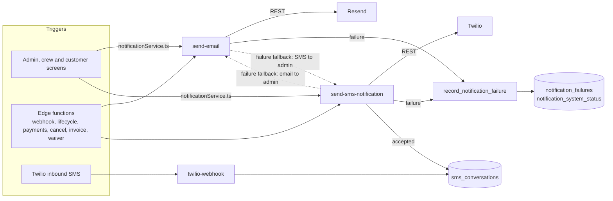

# Email and Notification System

Scope: describes the application as deployed in Production (branch main; Supabase project qaagfafagdpgzcijnfbw).

## Overview

Outbound communication (email and SMS) is dispatched through the notification service (`src/lib/notificationService.ts`). Email is sent via the `send-email` edge function (which calls Resend). SMS is sent via the `send-sms-notification` edge function (which calls Twilio). `notificationService.ts` calls these edge functions with the public anon key as the Bearer token; some screens call them with the signed-in user's access token (for example `PermissionsTab`) or through `supabase.functions.invoke`.

Both functions are deployed with `verify_jwt = true`. Other edge functions (send-invoice, charge-deposit, customer-cancel-order and others) build and send their own email or SMS, some by calling these two functions.

---

## Notification Service (`src/lib/notificationService.ts`)

| Function | Purpose |
|---|---|
| `sendEmail({ to, subject, html })` | Posts to `send-email` |
| `sendSms({ to, message, orderId })` | Posts to `send-sms-notification`; returns a failure without calling the function when the message is empty or `to` is missing |
| `sendAdminEmail(subject, html)` | Reads `admin_settings.admin_email` through the browser session, then sends to it. `admin_settings` rows are readable only by admin and master sessions, so the address resolves only in those sessions |
| `sendAdminSms(message, orderId?)` | Reads `admin_settings.admin_notification_phone` the same way, then sends to it |
| `sendNotificationToCustomer(options)` | Sends email, then SMS, sequentially and independently |

A failure of one channel does not block the other.

---

## Email Edge Function (`send-email`)

**Endpoint:** `POST /functions/v1/send-email`

Reads the Resend API key from the integration settings at call time.

**Payload:**

```typescript
{
  to: string
  from?: string           // accepted but ignored
  subject: string
  html: string
  text?: string
  attachments?: { filename: string; content: string }[]
  context?: object        // for logging/debugging
  skipFallback?: boolean  // suppress admin SMS on failure
  templateName?: string
  orderId?: string
}
```

**Sender:** always `<business_name> <noreply@bouncepartyclub.com>` (`VERIFIED_SENDER`), with reply-to set to the business email. The `from` field is ignored.

**Template mode:** when `templateName` and `orderId` are given, the function loads the `email_templates` row whose `template_name` matches, replaces `{customer_first_name}`, `{customer_full_name}`, `{order_id}`, `{event_date}`, `{event_address}` (address line 1) and `{review_url}` in the content (the subject receives the first occurrence of `{order_id}`, `{customer_first_name}` and `{customer_full_name}`), uses the order's customer email as the recipient when the customer has one (otherwise the supplied `to`), derives the plain-text part by stripping tags, and wraps the result in an inline layout. `{order_id}` is the order id padded to four characters in this mode. The crew Task Detail Modal uses this for `pickup_complete` at pick-up completion. Other placeholders that appear in stored email templates (`{total_amount}`, `{balance_amount}`, `{payment_amount}`, `{payment_type}`, `{rejection_reason}`, `{error_message}`, `{error_context}`, `{timestamp}`) are not substituted by this function.

**Fallback behavior:** if sending fails (Resend rejects the message, the Resend key is not configured, or the function throws) and `skipFallback` is not set, the function sends an SMS to the admin phone ("[EMAIL SYSTEM FAILURE]" with recipient, subject and the first 100 characters of the error). The function also calls the `record_notification_failure` / `record_notification_success` RPCs. A Resend rejection is returned to the caller with Resend's HTTP status; a missing Resend key returns 500; a missing recipient, subject or body returns 400.

---

## SMS Edge Function (`send-sms-notification`)

**Endpoint:** `POST /functions/v1/send-sms-notification`

Reads the Twilio credentials (account SID, auth token, from number) from the integration settings at call time.

**Important:** the body must use `orderId` (camelCase) to link the outbound message to an order. `order_id` is not read; the message is stored with `order_id = null`.

```typescript
{
  to: string
  message: string
  orderId?: string       // camelCase, required for thread linking
  templateKey?: string
  mediaUrls?: string[]
  skipFallback?: boolean
}
```

- A number without `+` gets `+1` plus its digits.
- The `sms_conversations` row is inserted **only after Twilio accepts the message** (failed sends are not stored), with `order_id = orderId || null`.
- Failure fallback is an **email** to `admin_settings.admin_email`, not an SMS. It applies when the Twilio settings are missing or incomplete (HTTP 400), when Twilio rejects the message (HTTP 500) and on other errors; `skipFallback: true` suppresses it.
- The three Twilio settings must all be present, otherwise the function returns HTTP 400 "Twilio not configured".
- When Twilio rejects a message and the request carried `to` and `message`, the failure is recorded in the Twilio branch and again by the function's outer error handler, so two `notification_failures` rows (and, without `skipFallback`, two fallback emails) can result for one rejected send.
- `send-invoice` sends its invoice SMS without `orderId`, so that message is stored with `order_id = null`.

---

## Email Template System (`src/lib/emailTemplateBase.ts`)

HTML emails use a shared table-based component library. The logo URL (`LOGO_URL`, a hard-coded storage URL on project `qaagfafagdpgzcijnfbw`) and company phone `(313) 889-3860` are hard-coded in this file.

### Wrapper

```typescript
createEmailWrapper({ title, headerTitle, content, theme?, companyAddress? }): string
```

### Content Components

All take an options object, not positional arguments.

| Function | Output |
|---|---|
| `createGreeting(firstName)` | Greeting heading |
| `createParagraph(...)` | Body text paragraph |
| `createInfoBox(options)` | Key-value info table |
| `createItemsTable(options)` | Line-item table |
| `createPricingSummary(options)` | Pricing breakdown |
| `createAlertBox(options)` | Coloured alert banner |
| `createBulletList(options)` | Bulleted list |
| `createButton(options)` | Call-to-action button |
| `createContactInfo(message?)` | Footer contact block |

### Themes

`EMAIL_THEMES` entries (`primary`, `success`, `warning`, `danger`) carry the fields `borderColor`, `headerColor`, `accentColor` and `bgColor`. Default is `primary`.

### Adding a New Email Template

1. Create a file in `src/lib/` and import from `emailTemplateBase.ts`.
2. Build the content with the component functions (check their option-object signatures in the source).
3. Wrap it with `createEmailWrapper({ title, headerTitle, content })`.
4. Pass the HTML to `sendEmail()`.

---

## Existing Email Templates

| Template file | Sends when |
|---|---|
| `bookingEmailTemplates.ts` | `generateCustomerBookingEmail` (customer "request received" email), plus `generateAdminBookingEmail`, `generateCustomerSMS` and `generateAdminSMS`. The admin generators are used only by `sendBookingConfirmationNotifications`, which no screen calls; admin alerts are sent by `order-lifecycle` |
| `orderEmailTemplates.ts` | `generateConfirmationReceiptEmail` (the "Booking Confirmed - Receipt" email) and the SMS text generators for confirmation, rejection, payment link and test messages |
| `orderNotificationService.ts` | Order-edit approval email and SMS (`sendOrderEditNotifications`) and the booking-request notifications; builds its email with `emailTemplateBase.ts` |
| `transactionReceiptService.ts` | Admin receipt on payment events |

The payment-declined email is built inline in `orderApprovalService.ts`. Several edge functions build their own inline HTML rather than using `emailTemplateBase.ts`: `send-invoice`, `charge-deposit`, `customer-balance-payment`, `reconcile-balance-payment`, `stripe-webhook` (`emails.ts`), `record-cash-payment`, `record-check-payment`, `save-signature`, `order-lifecycle`, `send-error-notification` and (deployed only) `submit-contact-inquiry`. `customer-cancel-order` sends a plain-text email.

The `email_templates` table in Production holds 6 rows: `booking_confirmation_admin`, `booking_confirmation_customer`, `error_notification`, `order_rejection`, `payment_receipt`, `pickup_complete`. `send-email` template mode loads `pickup_complete`; the other five rows are not requested by any code path. Admins view and edit these rows in the Message Templates tab (RLS allows admin SELECT and UPDATE only).

### Invoice Email (`send-invoice` edge function)

`send-invoice` builds its own inline HTML (subject "Invoice from Bounce Party Club") and sends it through `send-email`. The email includes the order total and deposit due and a "View & Accept Invoice" button. **Both the email and the SMS use the short URL** (`/i/<shortCode>`). Email and SMS are sent in parallel via `EdgeRuntime.waitUntil`, so one failing does not block the other or the API response.

### Waiver Confirmation Email (`save-signature` edge function)

After a waiver is signed, `save-signature` sends a confirmation email:
- Subject: "Your Rental Agreement Has Been Signed — Bounce Party Club"
- The signed PDF is attached (base64)
- A download link is included when the signed PDF URL exists; otherwise the email says the PDF will be available in the customer portal shortly
- The PDF is attached only when its bytes were available
- Sent in the background (`EdgeRuntime.waitUntil`) unless the request sets `sendEmailConfirmation` to false (default true)
- Shows signer name, event date, event address and signed timestamp
- Includes safety reminders

---

## Auth Emails

Supabase's default auth emails (signup confirmation, password reset) are sent.

Status: partially implemented. Supabase default auth emails are sent. Branded auth emails through the `auth-email-hook` function are not in use (the function is a placeholder that returns HTTP 410; its header comment records that no Send Email hook is active).

---

## SMS Message Templates

Admins manage SMS templates in the admin Message Templates tab, stored in `sms_message_templates` (columns `template_key`, `template_name`, `description`, `message_template`).

Substitution happens in `send-sms-notification` when `templateKey` is used. Each placeholder is replaced once (first occurrence only; `String.replace`).

### Templates present in Production (13 rows)

| Template Key | Template Name | Used by |
|---|---|---|
| `arrived_sms` | Crew - Arrival Notification | - |
| `booking_received_admin` | Admin - New Booking Notification | - |
| `delivery_notification` | Delivery Notification | - |
| `dropoff_done_sms` | Crew - Drop-Off Complete | - |
| `eta_sms` | Crew - ETA Notification | - |
| `lot_pictures_uploaded_admin` | Admin - Lot Pictures Uploaded Notification | `LotPicturesTab` |
| `order_approved` | Order Approved | - |
| `order_cancelled_admin` | Admin - Order Cancellation Notification | `customer-cancel-order` |
| `order_confirmation` | Order Confirmation | - |
| `order_rejected` | Order Rejected | - |
| `payment_reminder` | Payment Reminder | - |
| `pickup_thanks_sms` | Crew - Pickup Complete | crew Task Detail Modal |
| `pictures_reminder` | Pictures Reminder | - |

Templates are admin-editable; the crew checkpoint messages and most other texts are built inline. Pet text is inline in the Task Detail Modal, plus `{pet_reminder}` / `{pet_secure}` placeholders handled by the edge function.

### Template Variables

Variables use single braces. The edge function substitutes only these:

| Variable | Meaning |
|---|---|
| `{customer_name}` | Customer first + last name |
| `{name}` | Customer **first** name |
| `{order_id}` | Formatted order ID |
| `{event_date}` | Event date |
| `{event_address}` | Event address line 1 only |
| `{review_url}` | Google Review URL |
| `{pet_reminder}`, `{pet_secure}` | Pet reminder texts |

Status: partially implemented. The Message Templates tab offers insertion chips for SMS templates (`{customer_first_name}`, `{customer_last_name}`, `{customer_full_name}`, `{order_id}`, `{event_date}`, `{total_amount}`, `{balance_amount}`, `{rejection_reason}`, `{eta_time}`, `{eta_distance}`) and for email templates (the same identity and order variables plus `{event_address}`, `{payment_amount}`, `{payment_type}`, `{error_message}`, `{error_context}` and `{timestamp}`). Stored SMS templates also contain `{eta}`, `{portal_link}`, `{refund_policy}` and `{order_link}`. `send-sms-notification` does not substitute any of the placeholders in this paragraph; the `order_cancelled_admin` text is filled by `customer-cancel-order`, which substitutes `{customer_name}`, `{order_id}`, `{event_date}`, `{refund_policy}` and `{order_link}` itself.

---

## Notification Reliability (`src/lib/notificationReliability.ts`)

Failure recording happens **inside the edge functions** (via the `record_notification_failure` / `record_notification_success` RPCs). The client code in use:

- `getSystemStatus`, `getUnresolvedFailures` (limit 50), `getUnresolvedCount` (RPC `get_unresolved_failures_count`), `markFailureResolved`

The module also exports `recordNotificationFailure`, `recordNotificationSuccess` and `shouldNotifyAdmin` (true when the system is not operational and `consecutive_failures` is 3 or more); `updateAdminNotificationTime` is a no-op.

The admin Notification Failures panel is `src/components/admin/NotificationFailuresAlert.tsx`.

---

## Twilio Inbound Webhook (`twilio-webhook`)

Deployed with `verify_jwt = false`. It:

1. Matches an order via the most recent outbound conversation for the sender, else the customer's latest order in `pending_review`, `confirmed` or `draft`.
2. Inserts the inbound message into `sms_conversations` (`direction: 'inbound'`).
3. Inserts an outbound auto-reply row (null Twilio SID, status `sent`) and returns TwiML: "Thank you for your message! We've received it and will respond shortly. - Bounce Party Club".

The admin replies from the order's SMS panel, which calls `send-sms-notification`.

---

## Twilio Delivery Status Callback (`twilio-status-callback`)

The function reads `MessageSid`, `MessageStatus` and `ErrorCode` from the posted form (HTTP 400 when `MessageSid` or `MessageStatus` is missing) and runs `UPDATE sms_conversations SET status, error_code WHERE twilio_message_sid = ...`. It does not create `notification_failures` rows.

Status: partially implemented. The status-update function is deployed and `sms_conversations` stores the message status. Twilio delivery-status callbacks are not yet active: outbound messages do not request a `StatusCallback`, the function is deployed with `verify_jwt = true` (a Twilio request carries no Supabase JWT), and the `error_code` column the function writes is not yet part of `sms_conversations` in Production.

---

## SMS Architecture

| Table | Purpose | Columns |
|---|---|---|
| `sms_conversations` | SMS thread: inbound and outbound messages linked to an order | `id`, `order_id`, `from_phone`, `to_phone`, `message_body`, `direction`, `twilio_message_sid`, `status`, `created_at`, `is_admin_internal` |

`sms_conversations` drives the SMS thread UI in the admin order panel.


---

## Notification Architecture



Every outbound email passes through `send-email` and every outbound SMS through `send-sms-notification`; the two relays hold the only Resend and Twilio calls in the system. Callers decide who receives a message and what it says; the relays decide the sender, add the country code, log failures and fall back.

---

## Relay Behaviour in Detail

| Aspect | `send-email` | `send-sms-notification` |
|---|---|---|
| Provider call | Resend `POST https://api.resend.com/emails` | Twilio `POST /2010-04-01/Accounts/<sid>/Messages.json` (form encoded, Basic auth) |
| Credentials (setting keys) | `resend_api_key` | `twilio_account_sid`, `twilio_auth_token`, `twilio_from_number` |
| Sender | `<business_name> <noreply@bouncepartyclub.com>`; `reply_to` = `business_email` when set | `twilio_from_number` |
| Recipient normalization | none (caller supplies the address; in template mode the order's customer email overrides `to`) | A number without `+` becomes `+1` plus its digits |
| Attachments | `attachments[]` of `{ filename, content (base64) }` | `mediaUrls[]` sent as `MediaUrl` parameters (MMS) |
| Template mode | `templateName` + `orderId` loads `email_templates`; wraps in the blue header layout with the business name, phone and email footer | `templateKey` + `orderId` loads `sms_message_templates`; admin templates go to `admin_phone`, others to the order's customer phone |
| Success record | `record_notification_success('email')` | `record_notification_success('sms')`; row in `sms_conversations` (direction `outbound`, status from Twilio) |
| Failure record | `record_notification_failure('email', recipient, subject, preview, error, context)` | `record_notification_failure('sms', ...)` |
| Failure fallback | SMS to `admin_notification_phone`: "[EMAIL SYSTEM FAILURE]" with recipient, subject and the first 100 characters of the error (also sent when the Resend key is missing) | Email to `admin_email`: subject "[SMS SYSTEM FAILURE] Action Required" (also sent when the Twilio settings are missing or incomplete) |
| Caller checks | None beyond the gateway JWT; the recipient, subject and body are taken from the request | None beyond the gateway JWT; the recipient and text are taken from the request |
| Failure HTTP status | Resend's status on rejection, 500 when the key is missing or the function throws, 400 when `to`, `subject` or body is missing | 400 when Twilio settings are missing or `to`/`message` is missing, 500 on Twilio rejection or other errors |
| Suppressing the fallback | `skipFallback: true` (set by the fallbacks themselves and by `submit-contact-inquiry`) | `skipFallback: true` |
| Gateway JWT | `verify_jwt = true` | `verify_jwt = true` |

Admin-addressed SMS template keys recognized by the relay: `booking_received_admin`, `lot_pictures_uploaded_admin` and `order_cancellation_admin` (sent to `admin_phone`). The order-cancellation admin text is composed by `customer-cancel-order` from the `order_cancelled_admin` template row and sent with an explicit `to`.

### Failure logging and health

`record_notification_failure(type, recipient, subject, preview, error, context)` inserts into `notification_failures` and increments `notification_system_status.consecutive_failures` for `email` or `sms` and recomputes `total_failures_24h`; `is_operational` becomes false on the failure recorded when the counter already stood at 3 (the fourth consecutive failure), because the check reads the pre-update value. `record_notification_success(type)` resets the counter to 0, sets `is_operational` to true and stamps `last_success_at`. The `fallback_sent` and `fallback_type` columns of `notification_failures` exist but neither RPC writes them. The admin dashboard shows `NotificationFailuresAlert` (unresolved count, list of the latest 50 failures, resolve action) based on `get_unresolved_failures_count`, `getUnresolvedFailures` and `markFailureResolved`.

---

## Branding Variables

| Source | Used for |
|---|---|
| `admin_settings.business_name` | Email sender display name; template footers; waiver text |
| `admin_settings.business_phone`, `business_email` | Email footers, reply-to, receipts |
| `admin_settings.logo_url` | Receipt and waiver emails/PDFs |
| `admin_settings.business_address`, `business_legal_entity`, `business_name_short`, `business_license_number` | Waiver and receipt text |
| `admin_settings.google_review_url` | `{review_url}` in email and SMS templates |
| `admin_settings.app_url` | Admin link in the cancellation notice (optional key; falls back to the order id) |
| Hard-coded in `emailTemplateBase.ts` | Logo URL (project storage) and company phone `(313) 889-3860` |
| Hard-coded fallbacks | `Bounce Party Club`, `(313) 889-3860`, `noreply@bouncepartyclub.com` |

Recipient settings: `admin_email` (admin emails), `admin_notification_phone` (lifecycle alerts and email-failure fallback), `admin_phone` (template-routed admin SMS and cancellation SMS).

---

## Complete Message Catalog

### Customer emails

| Message | Subject | Sent when | Sent by |
|---|---|---|---|
| Booking request received | "Booking Request Received - Bounce Party Club" | Checkout completes and the order enters review (once, guarded by `booking_confirmation_sent`) | `usePaymentCompletion` -> `sendCustomerBookingConfirmationNotifications` |
| Booking confirmed + receipt (admin approval) | "Booking Confirmed - Receipt for Order #<id>" | Admin approves an order and the deposit is charged or waived | `orderApprovalService.sendConfirmationEmail` |
| Booking confirmed + receipt (invoice accepted, nothing to collect) | "Booking Confirmed - Receipt for Order #<id>" | Customer accepts an invoice that needs no deposit and no saved card; sent together with the confirmation SMS, within a 10-second limit, and sets `booking_confirmation_sent` when a notification went out. When a deposit or a card is required, the customer goes through Stripe and the receipt comes from `charge-deposit` or `stripe-webhook` | `InvoiceAcceptanceView` |
| Booking confirmed (changes approved, no deposit due) | "Booking Confirmed - Order #<id>" | Customer approves admin-requested changes in the portal and the new deposit is $0; when a deposit is due the receipt comes from `charge-deposit` | `ApprovalModal` |
| Deposit receipt (card on file) | "Booking Confirmed - Receipt for Order #<id>" | `charge-deposit` succeeds on the deposit path | `charge-deposit` |
| Deposit received | "Deposit Received - Order #<id>" | Stripe `checkout.session.completed` for a deposit | `stripe-webhook` (`emails.ts`) |
| Payment received | "Payment Received - Order #<id>" | Balance paid by Checkout (webhook or reconcile), by saved card (`customer-balance-payment`), or recorded as cash or check by staff | `stripe-webhook`, `reconcile-balance-payment`, `customer-balance-payment`, `record-cash-payment`, `record-check-payment` |
| Order updated, approval needed | "Order Updated - Approval Needed - Order #<id>" | Admin saves edits that need the customer's approval | `sendOrderEditNotifications` |
| Payment declined | "Action Required: Payment Declined for Order #<id>" | `charge-deposit` fails during admin approval | `orderApprovalService` |
| Invoice | "Invoice from Bounce Party Club" | Admin sends an invoice | `send-invoice` |
| Waiver signed | "Your Rental Agreement Has Been Signed — Bounce Party Club" (signed PDF attached when available) | Customer signs the waiver | `save-signature` |
| Pickup complete | Subject from the `pickup_complete` template | Crew marks a pickup complete | `TaskDetailModal` -> `send-email` template mode |

### Admin emails (to `admin_email` unless noted)

| Message | Subject | Sent when | Sent by |
|---|---|---|---|
| New booking request | "New Booking Request - #<id>" | Order enters `pending_review` (once, flag `pending_review_admin_alerted`) | `order-lifecycle` |
| Booking confirmed | "Booking Confirmed - #<id>" | Order enters `confirmed` (once, flag `confirmed_admin_alerted`) | `order-lifecycle` |
| Order cancelled | "Order Cancelled: <id>" (plain text; recipient `admin_email`, or `admin@bouncepartyclub.com` when unset) | Customer or admin cancels (includes customer, event date, hours until event, who cancelled, reason, refund choice and an order link) | `customer-cancel-order` |
| Transaction receipt | "Transaction Receipt <number> - <type>" (the browser path writes the type in upper case) and "Grouped Transaction Receipt - <n> Items - <amount>" | A payment, refund or charge is logged | `transaction-logger.ts` (edge) and `transactionReceiptService.ts` (browser) |
| Lot pictures uploaded | "Lot Pictures Uploaded - Order <id>" | Customer uploads event-location photos in the portal | `LotPicturesTab` |
| Role change audit | "New <role> account created", "User role changed from <old> to <new>", "<role> account removed" (recipient `admin_email`, or `admin@bouncepartyclub.com` when unset) | Admin changes a role in the Permissions tab | `PermissionsTab` |
| Application error | "🚨 Error in Bounce Party Club: <first 50 characters of the message>..." | An uncaught client error is reported | `send-error-notification` |
| SMS failure | "[SMS SYSTEM FAILURE] Action Required" | An SMS could not be sent | `send-sms-notification` fallback |
| Website inquiry | "New Website Inquiry from <name>" (to `business_email`, else `admin_email`) | Contact form submission through the inquiry function | `submit-contact-inquiry` |

### Customer SMS

| Message (start of text) | Sent when | Sent by |
|---|---|---|
| "Hi <name>, we received your Bounce Party Club booking request for <date>..." | Order enters review | `sendCustomerBookingConfirmationNotifications` |
| "Hi <name>, your booking for <date> is confirmed! Order #<id>. Track your order: <link>..." | Admin approves; also invoice acceptance | `orderApprovalService`, `InvoiceAcceptanceView` |
| "Hi <name>, unfortunately we cannot accommodate your booking for <date>. Reason: ..." | Admin rejects a booking | `orderApprovalService` |
| "Bounce Party Club: Hi <name>, your card was declined for Order #<id>..." with portal link | Deposit charge declined | `orderApprovalService` |
| "Hi <name>, we've updated your Bounce Party Club booking... Please review and approve: <link>" | Admin sends changes for approval | `sendOrderEditNotifications` |
| "Hi <name>, your invoice is ready! Please complete payment..." | Admin sends the payment link by SMS | `PendingOrderCard` |
| "Your Bounce Party Club invoice is ready! View and accept: <short link>" | Invoice sent | `send-invoice` |
| "Bounce Party Club - Hi! We're reviewing your order #<id>. Could you please upload pictures of the event location..." | Admin requests lot pictures | `PendingOrderCard` |
| "Hello <name>! We're on our way to deliver / pick up your rental. ETA: <window>..." (adds waiver and balance reminders, pet text) | Crew taps En Route | `TaskDetailModal` |
| "We have arrived at your location!..." | Crew taps Arrived | `TaskDetailModal` |
| "Equipment has been delivered! You are now responsible for the equipment until <pickup time>..." with the equipment rules | Crew completes drop-off | `TaskDetailModal` |
| `pickup_thanks_sms` template | Crew completes pickup | `TaskDetailModal` via `templateKey` |
| "Hi <name>, your order #<id> for <date> has been cancelled..." | Cancellation | `customer-cancel-order` |
| Free-text reply | Admin replies in the order SMS panel | `useSmsHandling` |
| Auto-reply "Thank you for your message! We've received it and will respond shortly." | Customer texts the Twilio number | `twilio-webhook` |

### Admin SMS (to `admin_notification_phone`, or `admin_phone` as noted)

| Message | Sent when | Sent by |
|---|---|---|
| "NEW BOOKING REQUEST! <customer> for <date>. Review in admin panel. Order #<id>" | Order enters review (once) | `order-lifecycle` |
| "BOOKING CONFIRMED! <customer> for <date>. Payment: <outcome>. Order #<id>" | Order confirmed (once) | `order-lifecycle` |
| `order_cancelled_admin` template text (customer, order, date, refund choice, link) to `admin_phone` | Cancellation | `customer-cancel-order` |
| `lot_pictures_uploaded_admin` template to `admin_phone` | Customer uploads lot pictures | `LotPicturesTab` |
| "[EMAIL SYSTEM FAILURE]..." | An email could not be sent | `send-email` fallback |

### Authentication emails

Confirmation and password-recovery emails are sent by Supabase Auth from its own templates (see AUTH_AND_ROLES.md); they are not routed through Resend or `send-email`.

### Status notes for the catalog

- Application error email. Status: partially implemented. The client reports errors and `send-error-notification` builds the alert from `admin_settings.admin_email`; the alert is handed to a mail function named `resend`, which is not one of the deployed functions, so alert delivery is not yet active. Error text is still written to the browser console and the function logs.
- Lot pictures email. Status: partially implemented. The admin SMS goes through the `lot_pictures_uploaded_admin` template. The email reads `admin_email` in the browser, and `admin_settings` rows are readable only by admin and master sessions, so with a customer session no address resolves and the email is skipped.
- Website inquiry email. Status: partially implemented. `submit-contact-inquiry` is deployed (not in the repository on main); it validates the form, rate-limits to 3 per 300 s per IP, inserts into a `contact_inquiries` table and emails `business_email` (else `admin_email`) through `send-email` with `skipFallback`. The `contact_inquiries` table is not present in Production, and the Contact page form on main does not call the function: it shows a confirmation message only. The `replyTo` value the function passes is not read by `send-email`, which always uses `business_email` as reply-to. See ARCHITECTURE.md (Additional Functions Deployed in Production).
- Admin lifecycle SMS pass `orderId`, so `order-lifecycle` and `customer-cancel-order` admin texts are linked to the order's SMS thread.
- Admin notification of reviews and confirmations uses `admin_notification_phone` for SMS and `admin_email` for email; both keys are present in Production.

---

## Lifecycle Notification Map

```mermaid
sequenceDiagram
  participant Cu as Customer
  participant Ad as Admin
  participant Cr as Crew
  participant Sys as System
  Cu->>Sys: Checkout complete
  Sys-->>Cu: Email + SMS: request received
  Sys-->>Ad: SMS + email: new booking request
  Ad->>Sys: Approve (deposit charged or waived)
  Sys-->>Cu: SMS: confirmed; Email: receipt
  Sys-->>Ad: SMS + email: booking confirmed
  Sys-->>Ad: Email: transaction receipt
  Ad->>Cu: Optional: invoice, lot-picture request, change approval
  Cr->>Sys: En route / Arrived / Drop-off done
  Sys-->>Cu: SMS at each step
  Cr->>Sys: Pickup complete
  Sys-->>Cu: SMS (pickup_thanks_sms) + email (pickup_complete)
```

### Duplicate protection

| Guard | Prevents |
|---|---|
| `orders.booking_confirmation_sent` | A second "request received" or "confirmed + receipt" customer message (checked before sending and set after the notifications go out, so it is not an atomic claim) |
| `orders.pending_review_admin_alerted` | A second "new booking request" admin alert (set after the alert is sent) |
| `orders.confirmed_admin_alerted` | A second "booking confirmed" admin alert |
| `stripe_webhook_events` | Re-processing a Stripe event (and so repeating its emails) |
| `orders.payment_lock` | Two simultaneous deposit charges (and receipts) |
| `transaction_receipts.receipt_sent_to_admin` | Marks a receipt as emailed |

---

## Inbound SMS Handling (`twilio-webhook`) in Detail

1. Twilio posts form data (`MessageSid`, `From`, `To`, `Body`, `SmsStatus`) to the function URL configured on the Twilio number. A `GET` returns TwiML "Webhook is active".
2. If any of `MessageSid`, `From`, `To` or `Body` is missing, the function returns an empty `<Response/>`.
3. Phone numbers are reduced to their last 10 digits for matching.
4. The order is chosen from the most recent outbound `sms_conversations` row between the same two numbers (phone columns compared with `ILIKE` on the 10 digits) when that row has an order id; otherwise from the most recent `pending_review`, `confirmed` or `draft` order of a customer whose phone matches.
5. The inbound message is stored (`direction = inbound`, `status` from Twilio's `SmsStatus`, default `received`); an outbound auto-reply row is stored with a null Twilio SID and status `sent`, and the same text is returned as TwiML. The row is stored with a null `order_id` when no order matches.
6. Any exception results in an empty `<Response/>` with HTTP 200 so Twilio does not retry.

The admin sees the thread update live in the order card (channel `sms_conv_<orderId>`).

Message storage: `sms_conversations` holds SMS bodies, directions, Twilio SIDs and statuses; `messages` is a dispatch log (template key, channel, payload, status) that does not store body text.
