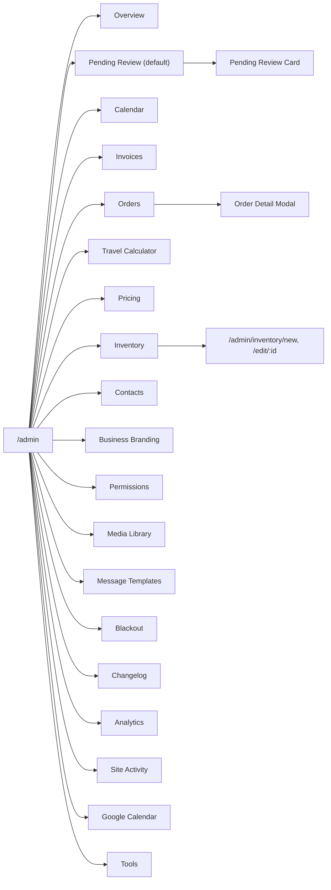

# Features

Scope: describes the application as deployed in Production (branch main; Supabase project qaagfafagdpgzcijnfbw).

Related references: [DATABASE_SCHEMA.md](DATABASE_SCHEMA.md) (tables and columns), [API_REFERENCE.md](API_REFERENCE.md) (edge functions and RPCs), [FRONTEND_REFERENCE.md](FRONTEND_REFERENCE.md) (components and hooks), [DIAGRAMS.md](DIAGRAMS.md) (full diagram set), [CREW_AND_OPERATIONS.md](CREW_AND_OPERATIONS.md) (day-of operations), [ORDERS_AND_WORKFLOW.md](ORDERS_AND_WORKFLOW.md), [PAYMENTS_AND_RECEIPTS.md](PAYMENTS_AND_RECEIPTS.md), [AUTH_AND_ROLES.md](AUTH_AND_ROLES.md).

## Feature-to-Screen Map

| Feature | Who uses it | Screen / route | Section below |
|---|---|---|---|
| Landing page, availability search, reviews | Visitor | `/` | Public Site Pages |
| Browse inflatables, date availability, save menu | Visitor | `/catalog`, `/menu-preview` | Public Site Pages, Menu Preview |
| Unit detail, wet/dry mode, add to cart | Visitor | `/units/:slug` | Public Site Pages |
| Quote form and cart | Visitor, customer | `/quote` | Quote / Booking Form, Quote form details |
| Checkout and card on file | Visitor, customer | `/checkout`, `/checkout/:orderId`, `/payment-complete`, `/payment-canceled` | Checkout Page, Checkout page details |
| Contact inquiry, About | Visitor | `/contact`, `/about` | Public Site Pages |
| Sign up, sign in, password reset | Visitor | `/signup`, `/login`, `/forgot-password`, `/reset-password` | Account Pages |
| Order tracking, waiver, pictures, payment | Customer (token link or signed in) | `/customer-portal/:orderId`, `/i/:shortCode` | Customer Portal |
| Waiver signing | Customer | `/sign/:orderId` | Electronic Waiver System |
| My orders, receipts, duplicate, cancel | Customer | `/my-orders`, `/receipt/:orderId/:paymentId` | Customer Dashboard |
| Invoice view and payment | Customer (invoice link) | `/invoice/view/:orderId`, `/invoice-preview` | Invoices and Invoice Links |
| Review and approve bookings | Admin | `/admin?tab=pending` | Pending Review Card |
| All orders, edit, status, refunds | Admin | `/admin?tab=orders` | Orders Tab, Order Detail Modal |
| Invoices, invoice builder | Admin | `/admin?tab=invoices` | Invoices and Invoice Links, Invoice Builder details |
| Contacts (phonebook) | Admin | `/admin?tab=contacts` | Contacts |
| Inventory and unit editor | Admin | `/admin?tab=inventory`, `/admin/inventory/new`, `/admin/inventory/edit/:id` | Admin Inventory |
| Pricing, branding, blackout | Admin | `/admin?tab=pricing`, `branding`, `blackout` | Pricing Tab, Pricing Engine, Business Branding, Blackout System: Blackout Tab |
| Message templates | Admin | `/admin?tab=message_templates` | Message Templates |
| Permissions | Admin (master for admin/master roles) | `/admin?tab=permissions` | Permissions Tab (Role Management Screen) |
| Media Library | Admin | `/admin?tab=photos` | Media Library |
| Analytics, Site Activity | Admin | `/admin?tab=analytics`, `site_activity`, `overview` | Admin Analytics |
| Changelog, notification alerts | Admin | `/admin?tab=changelog`, banner on every tab | System Changelog Tab, Notification Reliability Panel |
| Google Calendar settings | Admin | `/admin?tab=google_calendar` | Google Calendar Sync |
| Travel calculator, coordinate backfill | Admin | `/admin?tab=calculator`, `tools` | Travel Calculator, Tools Tab |
| Homepage carousel editing | Admin | `/` (Edit Carousel button) | Hero Carousel |
| Crew calendar, tasks, route, mileage | Crew, admin | `/crew`, admin Calendar tab | [CREW_AND_OPERATIONS.md](CREW_AND_OPERATIONS.md) |
| Field invoice | Crew, admin | `/crew` Invoice tab | Crew Invoice Tab |
| First admin account | First operator | `/setup` | First-Time Setup Page |

### Admin tab map



## Roles and Capabilities

Routes are guarded by `ProtectedRoute` (`ADMIN` and `MASTER` both resolve to the admin check; `CREW` is a separate role). An unauthenticated visitor to a guarded route is sent to `/login` and returned afterwards; a signed-in user without the role sees "Access Denied" with a Go Back button. The header shows My Orders for any signed-in user, Admin for admin/master, and Crew for crew, admin and master.

| Capability | Visitor | Customer | Crew | Admin | Master |
|---|---|---|---|---|---|
| Browse catalog, quote, checkout | yes | yes | yes | yes | yes |
| Customer portal / waiver / invoice via link | yes (token) | yes | yes | yes | yes |
| `/my-orders` | no | yes | yes | yes | yes |
| `/crew` (calendar, task actions, mileage, route, field invoice) | no | no | yes | yes | yes |
| Log own mileage; see own mileage logs | no | no | yes | yes | yes |
| See all mileage logs, edit others' logs | no | no | no | yes | yes |
| `/admin` and all tabs; inventory editor | no | no | no | yes | yes |
| Record cash or check payment from the task view (`record-cash-payment`, `record-check-payment`) | no | no | yes | yes | yes |
| Mark a waiver signed on paper from the task view (`upload-physical-waiver`) | no | no | yes | yes | yes |
| See crew names on mileage lists (`get-user-info` accepts admin or master only) | no | no | no | yes | yes |
| Issue Stripe refunds (`stripe-refund` requires admin or master) | no | no | no | yes | yes |
| Promote photos to catalog/carousel (`promote-media`) | no | no | no | yes | yes |
| Edit homepage carousel | no | no | no | yes | yes |
| Save lot photo to address | no | no | no | yes | yes |
| Assign / change / remove `crew` role | no | no | no | yes | yes |
| Assign / change / remove `admin` or `master` role (admin UI and `assign_role_by_email`; the `assign_user_role` / `remove_user_role` functions accept an `admin` caller for every role except `master`) | no | no | no | no | yes |
| View permission history | no | own entries only | no | all users | all users |
| Read analytics, site events, settings, changelog | no | no | no | yes | yes |

Row-level security backs these rules with role-specific policies, for example: `user_roles` (admin writes `crew` rows only; master writes any), `daily_mileage_logs` (crew insert/update/select own rows; admin and master see and update all), `task_status` (admin, master and crew read and update; admin and master insert and delete), `contacts`, `invoices`, `order_notes`, `blackout_*`, `google_reviews`, `hero_carousel_images`, `address_lot_pictures`, `admin_settings`, `site_events` reads (admin and master), `email_templates` (admin and master read and update), `user_permissions_changelog` (target user sees own rows; admin and master see all).

## Public Site Pages

### Layout (header, footer, cart badge)

`Layout` wraps the public pages. The sticky header has the logo, links Browse Inflatables (`/catalog`), Get Quote (`/contact`), About Us, My Orders (signed in), Admin (admin/master) and Crew (crew/admin/master), the business phone number (from `admin_settings.business_phone`, default (313) 889-3860), the signed-in email with Sign Out (or Login), a cart button with an item-count badge linking to `/quote`, and a hamburger menu on phones. The count is read from the `bpc_cart` browser-storage entry and updates on the `bpc-cart-updated` event. The footer shows the logo, business address, Quick Links, phone, email, "Follow Us" Instagram and Facebook icons (from `instagram_url` and `facebook_url`, with default profile links when blank) and the copyright line. Sign Out failures show "Failed to sign out. Please try again."

### Home (`/`)

Top to bottom: hero carousel (see Hero Carousel), an animated amber ribbon ("We Specialize in ALL DAY Rentals · Delivered in the morning, picked up the next morning"), the Browse Inflatables strip, a blue hero with the **Check Availability** form, a "Get a Quote" button (to `/contact`), four "Why Choose Bounce Party Club?" cards, and "What Our Customers Say" with the star average and review cards.

Check Availability form: choose Event Type (Residential: home, backyard; Commercial: school, park, church), an Event Date (today or later) and an Event Address (Google Places autocomplete; prefilled for signed-in customers from their saved address). "Find Available Units" validates in order and shows "Please select an event type (Residential or Commercial)", "Please select an event date", "Please enter an event address"; on success it stores `bpc_quote_prefill` (7-day expiry) and opens `/catalog`, which then checks availability for that date automatically.

### Catalog (`/catalog`)

Lists active units (name order) with the featured image first, WET/DRY or WET badge, type list, capacity, dimensions, footprint and "Starting at $N" (the lower of dry and water price). Filters: All Inflatables, Bounce Houses, Wet or Dry Units, Water Slides, Obstacle Courses. "Check Availability for a Date" (date picker; from the prefill or earlier quote form) calls the availability check for every unit and hides units already booked, with a green "N available on <date>" badge, a red "N already booked — hidden" badge and Show All to undo. "Save / Download Menu" opens the Menu Preview with the current filter and date. Empty states: "No inflatables found matching your criteria." or "No inflatables are available on <date> in this category." Footer card "Need help choosing?" with the phone number and a Get a Quote button. Errors: "Failed to load units. Please refresh the page.", "Failed to check availability. Please try again."

### Unit detail (`/units/:slug`)

Shows gallery (large image, up to four thumbnails, full-screen viewer), name, types, price block ("$X dry / $Y water" for combos; "Starting at" otherwise, with the note that the final total varies by delivery distance, surface type and event duration), capacity, dimensions, space needed (sq ft), power (outlets), indoor/outdoor flags, and a "What's Included" list (delivery, setup and pickup; trained crew; stakes or sandbags; blower and extension cord; safety inspection and cleaning). Combos show a Dry / Water mode selector that switches images (images marked for both modes appear in either); water slides are always wet. **Add to Cart** stores the item in `bpc_cart` (7-day expiry) and opens `/quote`; if the cart already holds the available quantity the warning is "Sorry, we only have N of this item available. You already have M in your cart." An unknown or inactive slug redirects to `/catalog`. A `unit_view` site event is recorded.

### About (`/about`) and Contact (`/contact`)

About is static content (mission, quality/service/delivery cards, story, service area listing Wayne, Westland, Canton, Garden City, Dearborn Heights, Inkster and Romulus, contact block from business settings, Browse Inflatables button).

Contact ("Get in Touch") has a form: Your Name, Email Address and Phone Number (required), Event Date, Expected Guest Count, "Tell Us What You're Looking For" (required). Submitting shows "Message Received! … We'll get back to you within 24 hours" for five seconds and then clears the form. A side panel shows phone, email, location, "Response Time: Within 24 hours" and a Common Requests list.

Status: partially implemented. The form validates and confirms on screen. The inquiry is not yet stored or sent to the business.

### Account pages

- `/login`: email and password with show/hide toggle, Google sign-in, a 30-second cooldown after repeated failures, and messages "Incorrect email or password. Please try again.", "Too many sign-in attempts. Please wait a few minutes and try again." and "Sign-in failed. Please check your credentials and try again."; unconfirmed accounts get a "Resend confirmation email" action ("Confirmation email resent. Check your inbox."). Links to Sign Up and Forgot Password. After login the user returns to the page they came from.
- `/signup`: first name, last name, email, phone (10 digits), optional business name, optional address (autocomplete), password and confirmation (minimum 6 characters), required Terms of Service and Privacy Policy boxes, optional marketing email and SMS boxes (booking and service notices are separate and unaffected). Messages include "Phone number must be 10 digits", "Passwords do not match", "Account created! Check your email for a confirmation link, then sign in." and "Account created! Welcome to Bounce Party Club." An email that already has an account is detected and the form offers Sign In or Reset Password. Consent handling is described in [AUTH_AND_ROLES.md](AUTH_AND_ROLES.md).
- `/forgot-password`: sends the reset email (link returns to `/reset-password`). `/reset-password`: new password and confirmation (minimum 6 characters, "Passwords do not match"); an invalid or expired link shows "Invalid or expired reset link. Please request a new one." and redirects to Forgot Password; success shows "Password updated successfully!" and returns to Login.

The Terms of Service and Privacy Policy links on sign-up point to `/terms` and `/privacy` and open in a new tab. The application defines no routes for those two paths, so they do not show a page today.

### First-Time Setup Page (`/setup`)

Used once to create the first admin. It checks for existing admins (`get_admin_users`); if one exists it shows the completed state. Otherwise the operator enters an email, password and confirmation (minimum 6 characters), optionally Twilio Account SID, Auth Token and phone number, and submits; the page creates the account, then inserts a `user_roles` row with role `ADMIN` and any Twilio values into `admin_settings` (an error on the role insert is logged and not shown), signs out and redirects to `/login` after "Setup Complete!". Those inserts are subject to the `user_roles` and `admin_settings` row-level security policies, which accept writes only from existing master or admin users. The route is public and excluded from the Google Ads tag.

### Page metadata and SEO

`index.html` sets the document title "Bounce Party Club | Bounce House Rentals", the logo as the tab icon, the mobile viewport and `lang="en"`. The site is a single-page app; Netlify rewrites every path to `index.html` (`netlify.toml`). There are no per-page titles, meta descriptions, Open Graph tags, sitemap or robots file. The Google Ads tag is described under Google Ads Tag.

### Shared UI behaviours

Loading spinners and an application-wide `ErrorBoundary`; toast notifications and confirmation dialogs (`CustomModal`, `SimpleConfirmModal`); date and time pickers (`DatePickerInput`, `TimePickerInput`); address autocomplete (`AddressAutocomplete`); `PrintModal` (zoom, Download, Print) used for invoices and receipts, with `PrintableInvoice` as the printable layout; `usePrint` reports Preparing, Printing and Print successful. Receipts open from the dashboard as a dialog and from `/receipt/:orderId/:paymentId` as a page with "Print / Save PDF".

## Admin Inventory

The Inventory tab lists all units (active and inactive) in a table: unit name and dimensions, Type (COMBO tag), Price (Dry), Price (Water), Capacity and an Active/Inactive status, with Edit and Delete buttons and an **Add Unit** button. Add and Edit open the unit editor (`/admin/inventory/new`, `/admin/inventory/edit/:id`, admin only).

Unit editor fields: Unit Name (the slug is generated from the name), Types (Bounce House, Water Slide, Combo, Obstacle Course, Interactive, Games, Tent, Table & Chairs, Concession; at least one must stay selected, "At least one type must be selected"), Quantity Available (minimum 1), Rental Price (dollars, two decimals), Water Mode Price (optional; only for Combo or Water Slide), Dimensions (dry), Dimensions (wet; with a "Same as dry" option), Footprint (sq ft, optional), Blower HP (minimum 0.5, steps of 0.5; stored in `power_circuits`), Capacity (kids), indoor and outdoor flags, and Active. Images are uploaded separately for dry mode and wet mode (PNG, JPG, GIF up to 10 MB each, stored in the `unit-images` bucket); one image per unit is marked featured, and for wet-capable units an image can be shown in both modes. Saving requires at least one dry image ("Please add at least one image for dry mode") and, for wet-capable units without "Same as dry", one wet image. Messages: "Unit created successfully!", "Unit updated successfully!", "Failed to save unit: …".

Safeguards: before deactivating or deleting a unit, the app looks for future bookings and warns with the order numbers and dates ("WARNING: … has N future booking(s)! … Are you sure you want to continue?"). Deleting removes the unit row ("Unit deleted successfully"). Unchecking Combo and Water Slide clears the water-mode price, dimensions and images.

## Pending Review Card

Each pending order (and drafts and awaiting-approval orders in the Orders tab) is shown as a card with, in order: order info (status badge, order id, event date and time, location, generator, surface, pickup, pets, special details, Edit button that opens the Order Detail Modal); a **Damage Fee History** warning when the customer has earlier declined or successful damage charges; Street View images of the address (front view plus North/East/South/West, tap to enlarge) for lot assessment; **Lot Pictures** (customer uploads, previously saved address photos, and a "Request Lot Pictures from Customer" button that marks the order and texts a portal link); the complete order summary; the **SMS Conversation** thread with "Reply via SMS" (updates live); and **Payment Management** (Total Paid, Total Refunded, Balance Due, card-on-file status, Issue Refund with amount and a reason from Order Cancellation, Customer Request, Duplicate Charge, Fraudulent Charge or Other, Payment History and Refund History).

Actions depend on status:

| Status | Buttons | Result |
|---|---|---|
| Pending review | **Accept** | Confirmation dialog lists what will happen (charge the deposit, or confirm with the card kept on file when no deposit is due; send confirmation SMS and email; generate the invoice; mark confirmed). Warns if lot pictures were requested but not received. Without a saved payment method: "No payment method on file. Ask the customer to complete checkout first, or use "Force Approve" for cash payments." |
| Pending review | **Reject** | Reason dialog (preset or custom); the customer is notified by SMS ("Booking rejected and customer notified via SMS.") |
| Draft (needs deposit) | Payment Link: **Copy Link**, **Send Payment Link via SMS**; **Cancel Order** | The link is `/checkout/:orderId` |
| Awaiting customer approval | **Force Approve (Admin Override)** | Confirms the order without waiting for the customer; with no payment method on file it is treated as a cash payment |

## Blackout System: Blackout Tab

The Blackout tab shows a three-month calendar preview (red = full block, amber = same-day pickup block, repeat icon = annual) with previous/next month buttons, the "Add Blackout Date" form (start date, end date on or after start, reason, optional notes, Full Block or Same-Day Pickup Block, One-Time or Annual, and an optional "Expires After" date for annual blackouts), and the "Active Blackouts" list with counts and a Remove button ("Are you sure you want to remove this blackout? This action cannot be undone."). Messages: "Please fill in all required fields", "End date must be on or after the start date", "Blackout date added successfully", "Blackout removed successfully". The same screen holds the Blackout Addresses and Blackout Contacts forms and lists (reason and notes). In the quote form, a full block disables the date; a same-day pickup block removes the Same Day pickup option ("Not available this date") and the Commercial option ("Same-day pickups are not available for this date. Commercial bookings are unavailable.").

## Message Templates

The Message Templates tab ("Edit automated SMS and email messages sent to customers and admins. Changes take effect immediately.") lists the SMS templates (13 rows in Production) and email templates (6 rows). Edit opens the template in place: SMS templates edit the message text; email templates edit Subject, Header and Content. Each template lists its available variables; clicking a variable copies it ("Copied {variable}"). Save shows "SMS template saved successfully" or "Email template saved successfully". Template keys and variables are listed in [EMAIL_SYSTEM.md](EMAIL_SYSTEM.md).

Status: partially implemented. Email template editing (Subject, Header, Content) is in place. The SMS edit form reads and saves a field named `message_body`, while the Production `sms_message_templates` table stores the text in `message_template`; the SMS text is therefore not shown in the list or form, and saving an SMS edit is not accepted by the table. SMS wording is currently changed in the database.

## Permissions Tab (Role Management Screen)

"Permissions Management" lists users who have a role (email and role badge Master, Admin or Crew) with a search box (email or role). **Add User** assigns a role to an existing account by email (`assign_role_by_email`); the person must already have signed up ("User not found. They must sign up before being assigned a role."). The role chooser offers Crew, plus Admin when the signed-in user is a master. Row actions: change role, remove role (confirmation: "Remove all roles for … They will lose admin/crew access."), and view permission history (last 20 entries: Role Added, Role Changed, Role Removed with actor and time). An admin can manage crew users only; a master can manage everyone. Each change sends an audit email to the admin address.

## System Changelog Tab

"System Changelog — Audit trail of changes across orders and settings." Filter buttons All, Orders, Settings, selector Last 25/50/100/250, and Refresh. Order entries are grouped per order (order id chip copies the id, "View changes" expands field, old value, new value, who and when); settings entries show the key and old/new values (secrets are redacted). Actor names come from the `get-user-info` function.

## Notification Reliability Panel

The "Notification System Issues Detected" banner on the admin page appears when the email or SMS channel is not operational or unresolved failures exist. It shows Email System and SMS System status, unresolved failure count, View Details / Hide Details, Refresh, a Recent Failures list (type, recipient, subject, preview) with a "Mark as resolved" button ("Failure marked as resolved"), and System Status Details (Operational / Down, Last Success, Consecutive Failures).

## Google Calendar Settings Tab

The tab shows a SETUP REQUIRED badge, the notice "Auto-sync is currently disabled", an OAuth Credentials form (Client ID, Client Secret, Refresh Token, optional Calendar ID; "Save Credentials" / "Saved. Auto-sync is still disabled until you complete re-enable steps."), step-by-step Google Cloud and OAuth Playground setup instructions, the reminder schedule (evening before at 6:00 PM, morning before at 9:00 AM) and a disabled Manual Sync Controls panel. See Google Calendar Sync for status.

## Travel Calculator

The tab shows the current rules (base radius, per-mile rate, free cities) and an address field; **Calculate Travel Fee** geocodes the address and returns the travel fee with the full driving distance and chargeable miles. Errors: "Please select a valid address", "Selected address does not have coordinates". It reads `pricing_rules` and the configured home base.

## Pricing Tab

"Pricing Configuration" with Edit Pricing, Save Changes and Cancel. Editable: Base Radius (miles), Per Mile After Base, Apply Travel Fee by Default (saved to `admin_settings.apply_travel_fee_by_default`), Sandbag Fee, Deposit Per Unit, First Generator Fee, Additional Generator Fee, Same Day Pickup Fee, Same Day Weekday Delivery Fee, Apply Taxes by Default, and Free Travel Cities (type a city and press Enter; each city is a removable chip). Saving writes `pricing_rules` and shows "Pricing settings updated successfully", then reloads the page. Blank generator fees fall back to $100 (first) and $75 (additional) and a blank deposit to $50 on save. The multi-day percentage, ZIP zone overrides and residential/commercial multipliers are columns on `pricing_rules` that this screen does not edit.

## Tools Tab

Contains the Address Coordinate Backfill: it finds `addresses` rows missing latitude or longitude, geocodes them in batches of 25 (250 ms between requests) and writes the coordinates, listing a result per address.

## Quote form details

Additional behaviour of `/quote` (sections: Your Cart, Event Details, Event Address, Setup Details, Special Details, Quote Summary):

- Cart: each line shows the unit, mode and a "Not Available" marker with "This inflatable is already booked for the selected dates. Please choose different dates or remove this item."; mode can be changed only by removing and re-adding the item; the empty cart shows "Browse Inflatables →".
- Event Type: Residential or Commercial. Residential asks "When do you need pickup?": Next Morning (pickup 6 AM – 1:30 PM) or Same Day (additional fees apply). Commercial events require same-day pickup by 7:00 PM. Same-day events cannot span multiple days; the latest end time for same-day pickup is 7:00 PM; an "Until end of day" option exists for other events.
- Responsibility acknowledgements (required): overnight (next-morning pickup), same-day, or commercial.
- "We have pets at this location" checkbox (crew is told to look for pet waste or loose animals).
- Event Address: street (autocomplete), line 2, city, state, ZIP; "Note: We cannot deliver to apartments".
- Setup Details: "Can we anchor the inflatable with stakes?" (grass surface available, or sandbags required) and "I need a generator (no power outlet available)" (no standard outlet within 50 feet; each generator can power up to 2 blowers; additional fees apply).
- Special Details: free text saved on the order and shown to the crew.
- Quote Summary: items subtotal, travel, sandbag fee, same-day pickup, same-day delivery, generator, Tax (6%), Estimated Total ("Estimate based on your address and event details. Final total confirmed at checkout."), and **Continue to Checkout →**.
- Validation order and messages (`validateQuote`): cart not empty ("Please add at least one inflatable to your quote."), all units available, street, city, state and ZIP present, event type chosen, pickup preference (residential), stake question answered, start and end dates, start and end times, then the responsibility acknowledgements. The first failure scrolls to the field and shows a banner.

## Checkout page details

Checkout shows the event/delivery address, contact information form (first and last name, email, phone, optional business name), billing address ("same as event address" or separate), the payment amount selector, tip, Payment Authorization with the required card-on-file authorization and SMS consent boxes, "One Quick Question" (how the customer heard about us, required), and the Order Summary with **View as Invoice** and **Complete Booking**. Messages: "Please consent to card-on-file authorization", "Please consent to SMS notifications", "Please tell us how you heard about us.", "Minimum payment is $X" (the deposit), "Failed to initialize payment". `/payment-canceled` shows "Payment Canceled — You canceled the payment process. Your order has not been completed." with Back to Cart and Try Again. `/payment-complete` finalizes the order and shows the request-received screen.

## Crew Invoice Tab

See the Crew Page section later in this document and [CREW_AND_OPERATIONS.md](CREW_AND_OPERATIONS.md). The crew Invoice tab is a reduced Invoice Builder: customer selector, items, pricing and "Send Invoice to Customer" / "Generate Shareable Link"; discounts, custom fees, deposit overrides and tax waivers are left to an admin ("please ask an admin to create the invoice").

## Invoice Builder details

Fields: customer selector or new customer form, event date range and address, items with price adjustment, availability check ("Availability Conflicts" blocks sending), fee waivers (a reason is required to waive the same-day weekday delivery fee), and the **Card on File Requirement** switch: "Require Card" (customer is sent to Stripe to save a card, no charge today) or "No Card Needed" (customer accepts without payment info; full balance due on event day). The button reads "Send Invoice to Customer" (email and SMS) or "Generate Shareable Link" (copy the link manually, "Copied!"). Messages: "Please add at least one item to the cart", "Please fill in event details (date and address)", "Invoice created! Copy the link below to send to your customer.", "Invoice sent to {email} and {phone}!".


## Unit Catalog and Inventory

Rentable units (bounce houses, water slides, combos) are stored in the `units` table. Each unit has:

- `name`, `slug` — display name and URL-friendly identifier
- `types` — array of unit types (e.g., `['bounce_house', 'slide']`) for filtering
- `price_dry_cents`, `price_water_cents` — separate pricing for dry and wet mode
- `dimensions`, `dimensions_water` — physical size in dry and wet mode
- `footprint_sqft` — square footage for lot assessment
- `power_circuits` — decimal value edited as "Blower HP" in the unit editor and shown as "N outlet(s)" on the unit page
- `capacity` — max number of riders
- `indoor_ok`, `outdoor_ok` — suitability flags
- `quantity_available` — how many of this unit exist in inventory
- `is_combo` — whether the unit is a combo inflatable
- `active` — whether the unit is visible and bookable. Inactive units are excluded from cart duplication.

Unit media (`unit_media` table) supports multiple images and videos per unit, with:
- `mode` — `dry` or `water` (database CHECK constraint `unit_media_mode_check`)
- `visibility_mode` — controls which mode tab the image appears under (`dry`, `water`, or both)
- `is_featured` — marks the primary hero image for a unit

Unit images are uploaded to the `unit-images` Supabase storage bucket (public read, admin-only write access).

---

## Quote / Booking Form (`/quote`)

The quote form is a multi-section page where customers configure their rental:

1. **Event Details** — date range (start and end dates for multi-day events), event start/end time, pickup preference (same-day vs. next-day)
2. **Address** — Google Places autocomplete; geocoded for travel fee calculation
3. **Setup Details** — location type (residential/commercial), surface type (grass/concrete/indoor), generator need and quantity, special details, pets on premises
4. **Cart** — unit selection with real-time availability checking
5. **Summary** — full pricing breakdown with all fees before submission

Blackout dates are checked against the `check_date_blackout` RPC when the date changes in the form (`src/lib/availability.ts`), not at submit.

On submission (`src/pages/Quote.tsx`):
1. The form is validated and unit availability is re-checked (`check_unit_availability`)
2. The form data is saved to browser storage (SafeStorage)
3. Customer is navigated to `/checkout`

No order is created and no invoice email/SMS is sent at quote time. The `draft` order is created later, by the Checkout page when the customer pays (`createOrderBeforePayment`, `src/lib/orderCreation.ts`), and the customer is upserted at that point. `send-invoice` is only called from the admin invoice flow (`src/lib/invoiceService.ts`). A customer who submits the quote and never pays leaves no order in the database.

If the customer is logged in, their previous address and contact details are prefilled from `CustomerProfileContext`. Customers with a `default_address_id` saved get their home address pre-populated in the form.

### Quote Pricing Debounce

Live price calculations in the quote summary (`useQuotePricing.ts`) are debounced 500ms via `debounceTimerRef`. The timer is reset on every form input change so rapid typing or address selection does not trigger excessive recalculations. The pricing output is cleared (and `sessionStorage` is purged) whenever required inputs are incomplete.

### Quote Prefill from Duplication

When an admin duplicates an existing order, the quote form is prepopulated via `SafeStorage` entries (`bpc_cart`, `bpc_quote_prefill`, `bpc_duplicate_order`, `bpc_contact_data`) set by `useOrderDuplication`. Event dates are intentionally left blank so the user must consciously choose new dates. Time windows, address, setup details, cart items, and contact info are all preserved.

---

## Checkout Page (`/checkout` and `/checkout/:orderId`)

Both `/checkout` and `/checkout/:orderId` render the same `Checkout` page. The page builds everything from the quote data saved in browser storage by the quote form (and redirects to `/quote` if none is present). The draft order is created by this page when the customer pays (`createOrderBeforePayment`). The page handles Stripe payment collection. Flow:

1. Customer reviews the order summary
2. Selects a payment amount (deposit, full, or custom via `PaymentAmountSelector`)
3. Adds an optional tip
4. Confirms card-on-file and SMS consent (if not already given)
5. Enters billing address (stored in Stripe and on the order record)
6. Selects referral source (how they heard about the business)
7. The draft order is created, then a Stripe Checkout Session is created via the `stripe-checkout` edge function (called with `bookingMode: true`; the server also re-checks blackout dates via `check_date_blackout`)
8. Customer is redirected to Stripe's hosted checkout page
9. On success, redirects to `/payment-complete` which finalizes the order

### Payment Amount Options

| Option | Description |
|---|---|
| Deposit only | Pay the configured deposit amount now; balance due later |
| Full payment | Pay the entire order total now |
| Custom amount | Pay any amount between deposit and full total |

The customer's selection is recorded in `customer_selected_payment_cents` and `customer_selected_payment_type` on the order.

### Billing Address

The checkout form collects a billing address for Stripe. This is stored inline on the `orders` record (`billing_address_line1`, `billing_address_line2`, `billing_city`, `billing_state`, `billing_zip`) — separate from the event delivery address.

### Card-on-File (Setup Mode)

The `stripe-checkout` edge function supports a setup mode (`setupMode` / `mode: "setup"`) that saves a card without charging. The Checkout page itself always uses payment mode with `bookingMode: true`. Setup mode is used from the customer portal (card update, card-on-file acceptance, approval modal) — see the Invoice Acceptance Flow.

### Referral Source Tracking

The checkout form captures how the customer heard about the business via a `referral_source` dropdown (e.g., Google, Facebook, referred by friend). Free-text detail is captured in `referral_source_detail`. Both fields are stored on the order for analytics.

---

## Contacts (Phonebook)

The `contacts` table is a deduplicated phonebook of every person who has ever placed an order. It is separate from `customers` — `customers` is per-order, `contacts` is per-person across all orders.

A contact record is upserted automatically whenever a new order is submitted (matched by email address). Contact statistics are maintained by two database triggers on `orders`: `trigger_update_contact_stats` (after insert or update of `status`, function `update_contact_booking_stats()`), which recomputes every statistic below from the contact's orders (`total_bookings` excludes draft, void and cancelled orders; `total_spent_cents` adds custom fees and subtracts discounts), and `update_contact_stats_trigger` (after any update, function `update_contact_stats()`), which recomputes only `total_bookings` (all orders) and `total_spent_cents` (confirmed, approved and completed orders, without custom fees or discounts). On an order update both run, the second one last, so after an update `total_bookings` and `total_spent_cents` follow the second function's rules; after an insert they follow the first:

- `total_bookings` — total order count
- `total_spent_cents` — lifetime spend (see the two rules above)
- `completed_bookings_count`, `first_completed_booking_date`, `last_completed_booking_date`
- `is_repeat_customer` — true if 2+ completed bookings
- `opt_in_sms`, `opt_in_email` — communication preferences
- `tags` — admin-assigned labels (array)
- `business_name` — for commercial customers
- `source` — how the contact was first acquired
- `last_contact_date` — last time the contact was interacted with

The admin Contacts tab lists every contact, newest first. Each row shows the business name (if any), the contact name with a "Repeat" badge for repeat customers, email, phone, a Loyalty column (completed bookings, lifetime spend, date of the last completed booking) and the date added. Admins can edit a contact's first name, last name, email and phone ("Contact updated successfully!") or delete a contact (confirmation dialog, "Contact deleted."). The tab has no search box; `tags`, `opt_in_*` and `source` are stored on the record but are not shown or edited in this tab. SMS threads exist per order (see SMS Conversations).

---

## Invoices and Invoice Links

The `invoices` table tracks the financial state of an order from the admin perspective.

Invoice statuses (database CHECK `invoices_status_check`): `draft`, `sent`, `partial`, `paid`, `cancelled`. (`void` is an order status, not an invoice status.)

When an admin approves an order, an invoice is created automatically with the appropriate status based on what was collected.

**Invoice Links** (`invoice_links` table) provide secure tokenized public URLs for customers to view their invoice and access their customer portal without logging in. Each link has two access paths:

- **Full token URL** (`/customer-portal/:orderId?t=:token`) — 64-character hex token; used for email links where length is not a concern.
- **Short URL** (`/i/:shortCode`) — 8-character alphanumeric code using an unambiguous character set (excludes `0`, `O`, `1`, `I`, `l`, `i`, `o`); used in SMS messages to stay within character limits.

The `link_type` column on `invoice_links` distinguishes between:
- `invoice` — created by the `send-invoice` edge function during admin invoice distribution
- `portal_shortlink` — created by `createShortPortalLink()` for crew ETA SMS messages and other compact-URL use cases

Both types resolve via the `/i/:shortCode` route (`ShortLink.tsx`) which looks up the short code and redirects to the appropriate customer portal URL.

Links expire via the `expires_at` field: 3 days after the event date (or 30 days from creation if no event date).

**Admin Invoice Sending** (`send-invoice` edge function) dispatches a formatted invoice email (full token URL) and an SMS (short URL) in parallel. A failure of one does not block the other.

Admins can also use the **Invoice Builder** to manually construct invoices with custom line items, fees, and discounts, then send them directly to a customer by email/SMS. The Invoices tab combines the Invoice Builder with an invoice list (filters All / Draft / Unpaid / Paid; columns Invoice #, Customer, Date, Total, Paid, Balance, Status). Each row has View (a text summary of the charges, paid amount and balance) and Edit Order. "+ Generate Invoice" asks for an Order ID and creates an invoice row for that order with a generated invoice number (`generate_invoice_number`).

**Short Portal Link in Order View** — In the `SingleOrderView` (the Single Order sub-tab of the admin Orders tab; admin and master only), a "Copy Link" button generates or fetches the 8-character short portal link for the order, copies it to the clipboard and shows it beside the button ("Copied!"). If no short link exists, `createShortPortalLink()` is called to create one on demand. A "Customer Portal" button opens the full portal link in a new tab.

---

## Electronic Waiver System

Every order requires a signed waiver before the rental takes place. The waiver is ESIGN/UETA compliant.

### Blank Waiver PDF Download

Customers with an unsigned waiver can download a blank copy of the waiver PDF from the Customer Portal. The `generate-blank-waiver` edge function renders the waiver text (from `waiverContent.ts`, populated with current `admin_settings` values) as a PDF — identical in layout to the signed waiver PDF but without signature fields filled in. The PDF is returned inline (not stored) and downloaded directly by the browser.

### Waiver PDF Shared Utility (`supabase/functions/_shared/waiver-pdf.ts`)

The waiver PDF rendering logic is shared between two edge functions via `_shared/waiver-pdf.ts`:
- `generate-signed-waiver` — uses it to render completed, signed waiver PDFs stored in the `signed-waivers` bucket
- `generate-blank-waiver` — uses it to render unsigned blank waivers returned directly to the browser

---

### Waiver Content (`src/lib/waiverContent.ts`)

The waiver text is generated dynamically using business settings from `admin_settings`. The waiver includes:

1. Acknowledgment and Assumption of Risk
2. Waiver and Release of Liability
3. Indemnification
4. Renter's Responsibility
5. Equipment Condition
6. Cancellations and Refunds (refundable only if cancelled 72 hours or more before the event; weather/safety and operational cancellation rules; no refunds once delivery or setup has begun)
7. Photo and Video Release (Optional)
8. Damage Responsibility and Fee
9. Rules and Safety Compliance
10. Governing Law
11. Severability
12. Entire Agreement
13. Minors
14. Insurance Disclaimer
15. County Parks Acknowledgment — appended by the signing page only when the order has `parks_acknowledgment_required` and a `parks_acknowledgment_county`

The waiver is versioned (`WAIVER_VERSION = '1.0'`) so future updates are tracked per signature.

### Signing Flow (`/sign/:orderId`)

The `/sign/:orderId` page collects:
- Renter name, phone, email
- Event date and full event address
- Optional home address
- Canvas-based signature (using `signature_pad` library)
- Typed name (required) and initials of at least 2 characters for every initialed section (required; signing cannot be submitted without them)
- Electronic consent acknowledgment checkbox

On submission, the `save-signature` edge function:
1. Stores the signature record in `order_signatures` with the full waiver text snapshot, IP address, user agent, device info, signer home/event address, initials, and typed name
2. Stores a `consent_records` row with `consent_type: 'electronic_signature'`
3. Uploads the signature PNG to the `signatures` bucket
4. Generates the signed PDF (`generate-signed-waiver` function) — awaited in-line, not fire-and-forget — and stores it in the `signed-waivers` bucket, saving its URL.
5. Sets `waiver_signed_at` and `signed_waiver_url` on the order
6. Sends a confirmation email to the customer with the PDF as an attachment (falls back to download link if PDF is not available)
7. Returns the PDF URL for immediate display

The `order_signatures` record stores everything needed for a legally defensible audit: signer identity, consent text, waiver version, IP, user agent, device info, and a complete snapshot of the waiver text as it existed at signing time.

### Overnight and Same-Day Responsibility Agreements

Separate responsibility acknowledgments are tracked on the order:
- `same_day_responsibility_accepted` — customer acknowledged same-day pickup responsibility
- `overnight_responsibility_accepted` — customer acknowledged overnight equipment responsibility

These are separate from the main waiver. They are shown as consent checkboxes in the quote form (`EventDetailsSection`) and in the customer portal invoice acceptance view (`InvoiceAcceptanceView`), not on the Checkout page.

---

## Media Library (Admin Photos Tab)

The admin tab labelled "Media Library" (tab id `photos`) provides a unified view of all photos across the entire system — delivery proof, damage photos, customer-submitted order photos, lot pictures, unit catalog images, and carousel media.

### Sources and Filters

Photos are aggregated from multiple tables and storage buckets:

| Source | Table | Description |
|---|---|---|
| `delivery` | `task_status.delivery_images` | Crew delivery proof photos |
| `damage` | `task_status.damage_images` | Crew damage documentation photos |
| `order` | `order_pictures` | Customer-submitted photos via portal |
| `lot` | `order_lot_pictures` | Pre-event lot assessment photos |
| `unit` | `unit_media` | Unit catalog images |
| `carousel` | `hero_carousel_images` | Homepage carousel media |

### Advanced Filtering

The filter bar supports:
- **Source filter** — show photos from one specific source or all
- **Search** — filter by customer name, address, unit name, or order ID
- **Sort** — newest first, oldest first, alphabetical by source/customer/unit
- **Date range** — last 7 days, 30 days, 90 days, or all time
- **Evidence filter** — show only protected evidence (damage photos), non-protected, or all
- **Saved to address filter** — show only lot photos saved to a canonical address
- **Display status filter** — filter by visibility mode (unit catalog images)
- **Group by** — flat list, or grouped by source, order, unit, or address

### Pagination

Photos load 24 at a time with a "Load more" button. Count is displayed as "Showing X of Y photos."

### Photo Detail Modal

Clicking any photo opens a detail view with:
- Full-resolution image
- Source metadata (order ID, customer name, unit, address)
- Status badges (saved to address, protected evidence, in unit gallery, in carousel)
- Admin actions: Promote to unit gallery, promote to carousel, save lot photo to address, download. Promotion is offered only for `lot`, `order` and `delivery` sources.

### Promote to Unit Gallery / Carousel (`promote-media` edge function)

Admins can promote photos taken during events to the unit catalog or homepage carousel. The `promote-media` edge function:
- Requires `consent_confirmed: true` in the request body
- Requires `admin` or `master` role (verified via `get_user_role()` RPC)
- Re-verifies that delivery photo URLs actually exist in `task_status.delivery_images` before allowing promotion (prevents arbitrary file promotion)
- Copies the file to the appropriate storage bucket with a path like `promoted/{safeBaseName}-{timestamp}.{ext}`
- Creates the necessary `unit_media` or `hero_carousel_images` record with appended sort/display order

### Media Health Panel

A collapsible panel at the top of the Photos tab surfaces warnings:
- Unit images without a storage path
- Damage photo counts
- Notes about evidence restrictions (damage photos are protected)
- Notes about video exclusion (videos are not shown in the photo grid)

---

## Google Maps Integration

Google Maps is used for three purposes:

### Address Autocomplete

The `AddressAutocomplete` component uses the Google Places Autocomplete API to help customers enter their event address. On selection, the address is geocoded and coordinates (lat/lng) are stored on the `addresses` record for travel fee calculation.

### Travel Fee Calculation

The `distanceCalculator.ts` library computes driving distance from the home base to the event address using the Distance Matrix API. The home base is hard-coded as `HOME_BASE` in `src/lib/constants.ts` (lat 42.2808, lng -83.3863, Wayne, MI 48184). If the Distance Matrix call fails, distance falls back to straight-line distance multiplied by 1.4. Chargeable miles (miles beyond the free radius) are stored on the order. The fee display always shows the full driving distance, not just chargeable miles.

### Route Optimization

See the Crew and Operations documentation.

The Google Maps SDK is loaded lazily using a singleton loader (`src/lib/googleMapsLoader.ts`) to prevent duplicate loads across components.

---

## Google Reviews

Customer reviews displayed on the homepage are stored in the `google_reviews` table. There is no admin screen for reviews; rows are managed directly in the database (RLS lets admins and masters write them). The homepage header shows the average rating of the displayed reviews (5.0 when there are none) and "Read more reviews on Google". The homepage shows only rows with `is_active` true and `rating >= 4`. Columns:

- `reviewer_name`, `reviewer_initial` — display name
- `rating` — 1-5 stars
- `review_text` — the review content
- `review_date` — human-readable date string (e.g., "3 months ago")
- `is_active` — toggle visibility without deleting
- `display_order` — controls sequence

Only real reviews from actual customers should be entered here. The "Read more reviews on Google" button uses a hard-coded link (`https://g.page/r/CcALHMmxBHPSEBM/review`) in `Home.tsx`.

Status: partially implemented. The `google_review_url` admin setting is editable in the Business Branding tab and is used in the post-pickup review SMS. The homepage button does not yet use it.

---

## Admin Panel (`/admin`)

The admin panel opens on the Pending Review tab by default (`/admin?tab=pending`); the active tab is kept in the `?tab=` query parameter, so a tab can be bookmarked or shared. On phones the tab strip becomes a "Navigate to" drop-down. A Notification System Issues banner (see Notification Reliability) appears above the tab content when email or SMS delivery has problems. The admin panel is a flat tabbed interface (there is no "Settings" parent tab). The tabs, in order, are: Overview, Pending Review, Calendar, Invoices, Orders, Travel Calculator, Pricing, Inventory, Contacts, Business Branding, Permissions, Media Library, Message Templates (SMS and email templates together), Blackout, Changelog, Analytics, Site Activity, Google Calendar, Tools. Access to `/admin` and the inventory editor routes (`/admin/inventory/new`, `/admin/inventory/edit/:id`) is limited to the `ADMIN` route role.

Status: partially implemented. `src/components/admin/AdminSettings.tsx` (Stripe keys, Twilio credentials and the Payment Backfill tool) exists in code but is not currently exposed in the admin navigation. The Tools tab contains `AddressCoordinateBackfill`.

### Overview and Pending Review Tabs
- Overview shows two counters, "Active Units" (units loaded) and "Recent Orders" (the 50 most recent draft, pending-review and confirmed orders), followed by the Performance Analytics panel (see Admin Analytics).
- Pending Review (the default tab) lists orders in `pending_review` status as `PendingOrderCard` cards (tab badge shows the count) with a Refresh button. While scrolling, a floating header (`AdminFloatingOrderHeader`) shows the order id, customer, date, address and an Edit button for the card in view. See "Pending Review Card" below. Empty state: "No pending bookings".

### Orders Tab
- Sub-tabs with live counts: Single Order, Draft (Needs Deposit), Pending Review, Awaiting Customer Approval, Current (Today), Upcoming, All Orders, Past, Cancelled. The sub-tab is kept in the URL (`subtab`). With no sub-tab chosen, the first non-empty one of Pending Review, Awaiting Customer Approval, Current, Upcoming is selected, otherwise All Orders.
- Search box: customer name, email, phone, event date (yyyy-MM-dd) or order id.
- Single Order: enter an order id (full UUID or the short 8-character id such as `CDF04DF2`, resolved with `find_order_id_by_prefix`) to open one order with its UUID, a Customer Portal link and a "Copy Link" button for the short portal link.
- Table columns: Order ID, Created, Customer, Event Date, Location, Status, Workflow, with an "Archived" marker.
- Archive Old Orders (confirmation, then `archive_old_orders` with a 90-day threshold) hides completed and cancelled orders older than 90 days from the Past and Cancelled sub-tabs; "Show Archived" / "Hide Archived" toggles them and the badge counts follow.
- The list refreshes automatically when orders are inserted or updated (Realtime, debounced).
- Click any order to open the Order Detail Modal, where an admin edits the order, changes its status (with a reason), records payments and refunds, and adds custom fees, discounts and internal notes.

### Contacts Tab
- Phonebook list with edit and delete (see Contacts).

### Invoices Tab
- Invoice Builder (top) and invoice list (below); see Invoices and Invoice Links.

### Analytics Tab
- Business performance charts (revenue, bookings, lead time)
- Date range filtering: **today** / last 1d / 7d / 30d / 90d / this month / last month / two months ago / all time
- The **Today** period spans from midnight to the current moment in the viewer's browser time zone
- Booking source analytics (how customers found the business) appear in the Site Activity tab
- Site analytics (event funnel) live in the separate Site Activity tab

### Media Library Tab
- Unified media library across all photo sources
- Advanced filtering, grouping, and pagination
- Promote photos to unit gallery or carousel
- Media health panel with warnings

### Calendar Tab
- Monthly calendar view with orders in status pending review, confirmed, in progress or completed (pending-review orders are for planning only)
- Day view showing all deliveries and pickups
- Route optimization controls (Manage Route)
- Task cards and the Task Detail Modal
- Mileage logging (Start Day Mileage, End Day Mileage, Auto-Calculate)
- Task equipment lists include generators: if `generator_qty > 0` on an order, the generator (with quantity if more than one) is appended to the equipment list shown in crew task cards and calendar views (e.g., "Generator (2x)")

### Configuration tabs
- **Business Branding** — business name, short name, legal entity, address, phone, email, Instagram and Facebook URLs, Google Review URL, license number and the travel-calculation (home base) address; see Business Branding
- **Pricing** — base radius, per-mile rate, travel-fee default, sandbag fee, deposit per unit, generator fees, same-day pickup and same-day weekday delivery fees, tax default, free-travel cities. Saved fee and discount templates are created and deleted from the order Details tab (Custom Fees / Discounts), not from this tab
- **Blackout** — dates, addresses, and contacts
- **Message Templates** — SMS and email template management in one tab
- **Google Calendar** — Google Calendar sync configuration
- **Changelog** — audit log of settings changes
- **Permissions** — role management
- **Inventory** — unit management (also reachable via the `/admin/inventory/*` routes)
- **Site Activity** — site event analytics
- **Travel Calculator** and **Tools** — see below

---

## Order Detail Modal

The Order Detail Modal is the primary admin interface for managing a single order. It has five sections: Details, Workflow, Payments, Notes and Changelog (a drop-down on phones). The header shows the order id, customer and event date. As soon as anything is edited, "Skip Customer Approval" (checkbox) and "Save Changes" appear; closing with unsaved edits asks "You have unsaved changes. Are you sure you want to close without saving?". Saving edits sets the order to Awaiting Customer Approval unless Skip Customer Approval is ticked. (The waiver tab component is used in the customer portal; the SMS thread is shown in the Pending Review order card.)

### Details Tab
- Full order information (event details, customer info, items, pricing)
- Edit event details, address, setup details
- Add/remove units from cart
- Manage custom fees and discounts (with saved template support)
- Override deposit amount
- Waive fees (tax, travel, surface, generator, same-day pickup) with reason
- View/edit admin message (displayed to customer in portal)

### Payments Tab
- Full payment history with ledger sequence
- Record cash or check payments
- Initiate Stripe refund (admin/master only)
- Send customer balance payment link
- View Stripe fee and net amounts

### Workflow Tab
- A read-only "Workflow Events" list (event type, description, time). Status buttons are in the Details tab (below); lot-picture requests are made from the Pending Review card.

### Details tab: other controls
- Edit Mode banner, unit availability check ("All units are available for the selected dates" or an Availability Conflict list), and the notices "Payment Information Will Be Cleared" and "Deposit Increase — Customer Already Paid".
- Message to Customer (included in the change email and text).
- Parks Acknowledgment toggle: resolves the event address county (reverse then forward geocoding) and adds the county section to the waiver (waiver item 15). If the county cannot be resolved the toggle stays off with an explanatory message.
- Order Status buttons: Pending, Awaiting Customer Approval, Confirmed, In Progress, Completed, Cancelled, Void. Each opens a Confirm Status Change dialog that requires a reason, validates the transition, warns about an uncollected balance when completing, and re-checks unit availability when confirming. Cancelling records `cancelled_at`, `cancelled_by` and the reason.

### Notes Tab
- Internal admin notes (not visible to customer)

### Changelog Tab
- Complete audit trail of all changes to the order

---

## Fee Waivers

Any fee on an order can be waived by an admin with a documented reason:

| Fee | Waiver Flag | Reason Field |
|---|---|---|
| Tax | `tax_waived` | `tax_waive_reason` |
| Travel fee | `travel_fee_waived` | `travel_fee_waive_reason` |
| Surface fee | `surface_fee_waived` | `surface_fee_waive_reason` |
| Same-day pickup fee | `same_day_pickup_fee_waived` | `same_day_pickup_fee_waive_reason` |
| Same-day weekday delivery fee | `same_day_weekday_delivery_fee_waived` | `same_day_weekday_delivery_fee_waive_reason` |
| Generator fee | `generator_fee_waived` | `generator_fee_waive_reason` |

The "sandbag" fee is the surface fee (`surface_sandbag_fee_cents`, waived via `surface_fee_waived`).

Waiver reasons are logged in the order changelog for audit purposes. `tax_waived` was set on historical orders to honour the original no-tax policy.

---

## Custom Fees and Discounts

### Custom Fees (`order_custom_fees`)

Admins can add arbitrary fee line items to any order (e.g., "Extra cleaning fee", "Late cancellation fee"). Each fee has a name and a fixed amount in cents.

### Discounts (`order_discounts`)

Admins can add discounts as either a fixed dollar amount or a percentage. Discounts affect the order total and thus the deposit calculation.

### Saved Templates

Frequently-used fees and discounts can be saved as templates (`saved_fee_templates`, `saved_discount_templates`) for quick application without retyping. In the order Details tab, tick "Save this discount for future use" (or the equivalent option on a custom fee) when adding; choose "Load Saved Discount" or a saved fee to reuse one; "Delete Template" removes it. Duplicate template names are refused with a message. Fee names must be non-blank and amounts above zero; a discount takes either an amount or a percentage, not both.

---

## Address Deduplication and Lot Photo Persistence

Addresses are stored as canonical records in the `addresses` table with a unique `address_key` for deduplication. When the same address is submitted twice, the existing record is returned rather than creating a duplicate. Coordinates (lat/lng) are stored for travel fee and distance calculations.

### Save to Address (Lot Pictures)

When a customer has uploaded lot pictures for an order, an admin or master can "Save to Address" from the Photo Detail view in the Media Library. This calls the `save_lot_picture_to_address` RPC atomically — it creates a record in `address_lot_pictures` and updates the `address_id` on the `order_lot_pictures` record. Future orders at the same address surface these reference photos in the Pending Review card for admins, providing institutional memory about the setup location.

---

## Customer Portal (`/customer-portal`)

The customer portal is a public-facing, tokenized view that does not require login. Customers access it via a unique link sent in their confirmation email/SMS.

### Short Link Access (`/i/:shortCode`)

The portal can also be reached via a compact short URL (`/i/:shortCode`). The `ShortLink` page resolves the 8-character code by querying the `invoice_links` table and redirects to `/customer-portal/:orderId?t=:token`. This URL form is used in SMS messages to stay within character limits.

### Regular Portal View

Shows the customer:
- Order status and event details
- Invoice and pricing breakdown
- Payment options (if balance is due)
- Lot pictures (uploaded by the customer; see Lot Pictures Tab)
- Delivery tracking (crew ETA and status updates via Supabase Realtime)
- Link to sign the waiver
- Order cancellation option
- Admin message (if admin has posted a note for the customer)

### Order Approval View

When the admin modifies a confirmed order and sends it for customer review, the portal displays:
- What changed (item additions/removals, price changes, date changes)
- New pricing breakdown
- Approve or Reject buttons

Approval calls the `approve_order_changes` RPC. It validates the invoice-link token (unexpired, matching the order), requires the order status to be `awaiting_customer_approval`, writes `customer_selected_payment_cents`, `customer_selected_payment_type` and `tip_cents`, and, when asked to confirm, sets `status = 'confirmed'` and `customer_approved_at`. Rejection (`RejectionModal`) inserts a row into `order_changelog`; the UI warns that rejecting cancels the order. Both happen without login.

### Payment Tab

Customers with an outstanding balance can pay via their saved card on file. If the saved card is declined, the customer is offered a card update, which uses `stripe-checkout` in setup mode.

### Lot Pictures Tab

The customer uploads photos of the event location here (maximum 4 pictures; "You can upload a maximum of 4 pictures"). Each upload emails the admin address. A customer can delete a picture only before the order is approved ("Pictures can only be deleted before order approval"). Admins see these in the Pending Review card and the Media Library.

### Portal layout

The portal header offers a "Complete These Steps" checklist (Lot Pictures, Sign Waiver, Payment with the amount due, and Pictures, which is optional and opens after delivery) and tabs: Details, Lot Pics, Waiver, Payment, Pictures, Delivery. A status banner follows the crew workflow: Crew is on the way, Crew has arrived, Setup in progress, Equipment delivered, Pickup scheduled, Crew picking up equipment. The Pictures tab lets the customer upload photos (10 MB each) with a note after delivery. The Delivery tab shows the crew's Proof of Delivery photos. The Waiver tab shows waiver status, the Sign Waiver Now button, Download Blank Waiver, and "Upload Signed Waiver Photo" for a paper copy (JPEG, PNG, WebP or PDF); once signed it shows signer, waiver version, section initials and a Download Signed Waiver PDF button. Orders in other states show an Order Status page ("Invoice Pending", "Order Under Review", "Order Cancelled", "Order Voided"). An unknown order shows "Order Not Found".

### Customer Cancellation

Customers can cancel their own order from the portal. They select a cancellation reason from a list or choose "other" and type free text (the server requires a reason of at least 10 characters) and can optionally flag that they want a refund. The `customer-cancel-order` edge function records:
- `cancellation_reason` — the reason text
- `status`, `cancelled_at`, `cancelled_by`
- `refund_requested` — customer's refund intent flag (admin must still process manually)

---

## Customer Dashboard (`/my-orders`)

Logged-in customers see their orders (up to 50, matched by customer id and email) in three tabs: Active (event window includes today, or status In Progress), Upcoming (future events not completed, cancelled or void) and Past; the tab is kept in `?tab=`. The first tab with orders opens by default. Each order card shows status and workflow badges, payment status (Awaiting Order Approval, Payment Due, Deposit Paid, Paid in Full), rental items with Wet/Dry, the total, "View Deposit/Balance Receipt" links (receipt dialog with Print / Save PDF), a Waiver Signed marker, View Details (customer portal), Waiver (signed PDF), Duplicate Order (rebuilds the cart; see Quote Prefill from Duplication; units that are no longer active are listed and dropped after confirmation) and Cancel Order (for cancellable statuses; reason dialog, see Customer Cancellation). Empty state: "No Orders Yet" with a Browse Catalog button.

---

## Travel Calculator (Admin Tool)

The admin Travel Calculator tab allows admins to calculate travel fees for any arbitrary address without creating an order. Useful for quoting travel costs to potential customers or auditing pricing. Calls the same distance calculation logic used during order creation.

---

## Address Coordinate Backfill (Admin Tool)

The `AddressCoordinateBackfill` admin component allows admins to retroactively geocode historical addresses that are missing lat/lng coordinates. This ensures all addresses can be used for travel fee calculations and route optimization.

---

## Payment Backfill Section (Admin Tool)

The `PaymentBackfillSection` admin component allows admins to retroactively fix orders where payment method details were not saved. It calls the `backfill-payment-methods` edge function. 

Status: partially implemented. The component and edge function are in place; the component is rendered inside `AdminSettings.tsx`, which is not currently exposed in the admin navigation.

---

## SMS Conversations

Each customer phone number has a dedicated SMS thread stored in the `sms_conversations` table. Each record stores the actual message body, direction (inbound/outbound), Twilio message SID, and the linked `order_id`.

Admins view and reply to SMS threads from the Pending Review order card (`PendingOrderCard`). The `twilio-webhook` edge function handles inbound messages and links each inbound message to the order of the most recent outbound message to that number.

A message appears in an order's SMS thread when the outgoing send includes `orderId` (camelCase) in the `send-sms-notification` edge function request body; messages sent without `orderId` are stored with `order_id = null`.

Note: The separate `messages` table is a notification dispatch log (template key, channel, payload, status) — it does NOT store message body text. See the "SMS Architecture: Two Distinct Tables" section below.

---

## Hero Carousel

The homepage features a media carousel that admins manage in place on the home page (there is no carousel admin tab). When signed in as admin or master, an "Edit Carousel" button appears over the carousel; in edit mode "Add Media" opens a form (Upload File or Use URL, media type image or video, optional title and description), and each item has Edit, Delete and up/down order buttons. The carousel advances every 5 seconds (paused while the browser tab is hidden), has previous/next arrows and dots, and supports swipe on touch screens (50 px threshold). Media can also be promoted into the carousel from the Media Library. The `hero_carousel_images` table stores image and video entries with:
- `media_type` — `image` or `video`
- `storage_path` — path in `carousel-media` Supabase storage bucket
- `display_order` — controls sequence
- `is_active` — toggles visibility without deleting
- `title`, `description` — optional overlay text

### Browse Inflatables CTA

Immediately below the hero carousel ribbon, the homepage shows a slim blue strip ("View Our Full Inflatable Catalog") with a "Browse" button that navigates to `/catalog`. This strip is always visible on the home page and provides a direct entry point to the unit catalog for customers who want to browse inventory before filling out the quote form.

---

## Blackout System

Admins can block orders from the Blackout tab using three types of restrictions:

### Blackout Dates

Prevent new orders on specified date ranges. Supports:
- `block_type`: `full` (no orders) or `same_day_pickup` (blocks same-day pickups but allows next-day) — database CHECK constraint
- `recurrence`: `one_time` or `annual` — database CHECK constraint (there is no `weekly`)
- `expires_at`: optional expiration date for temporary blocks

The `check_date_blackout` database function returns `is_full_blocked` and `is_same_day_pickup_blocked`. It is called by both the client-side quote form (on date change) and the server-side `stripe-checkout` edge function. The function handles wrap-aware annual recurrence (dates that span year boundaries).

### Blackout Addresses

Records of delivery locations (`blackout_addresses`) with `reason` and optional `notes`, managed in the Blackout tab.

### Blackout Contacts

Records of customers by email or phone (`blackout_contacts`) with `reason` and optional `notes`, managed in the Blackout tab.

Status: partially implemented. Blackout dates are applied to bookings by `check_date_blackout`. Blackout address and contact lists are recorded and managed in the Blackout tab but are not yet applied to bookings.

---

## Business Branding

The admin Business Branding tab ("White-Label Configuration") manages these `admin_settings` values; changes take effect after saving and refreshing the page:
- Business Name (used in SMS, emails and display), Legal Entity Name (contracts and waivers), Business Address, Business Phone, Business Email (all required)
- Instagram URL, Facebook URL (shown as footer icons; the footer falls back to the business's default profile links when blank), Google Review URL, optional Business License Number
- Travel Calculation Address: Google Places search plus Address Line 1/2, City, State, ZIP and read-only coordinates, or "Use business address for travel calculations". Saving requires every address field and a selection from the autocomplete list ("Please select an address from the autocomplete dropdown to ensure accurate coordinates")

The logo (`logo_url`) is read from `admin_settings` by `BusinessContext` and used in emails; it is not edited in this tab. Branding is loaded by `BusinessContext` and used throughout the app for display and in email templates (`emailTemplateBase.ts`).

---

## Admin Analytics

### Business Analytics Tab

Revenue and booking performance panels with configurable date ranges (**today** / last 1d / 7d / 30d / 90d / this month / last month / two months ago / all time):
- Total revenue, revenue this month with trend vs. last month
- Average order value
- Total tips and tip rate
- Deposits collected, balance owed, total refunds
- Cash vs. card payment split
- Total orders, orders this month with trend
- Average lead time (days between booking and event)
- Cancelled orders count and cancellation rate
- Repeat customer count and rate (customers with 2 or more orders in status confirmed, in progress or completed)
- Top 8 units by revenue (name, booking count, revenue; the database function returns the top 10)
- Top 8 cities by order count (the function returns the top 10)
- Fleet Mileage: days with mileage, miles by crew member and "Incomplete Mileage Entries" listing mileage logs whose start or end reading is missing (display names via the `get-user-info` edge function; it does not compare against the tasks a crew member worked)
- Cancellation reason breakdown
- Delivery Performance (from `get_delivery_timing_analytics`, completed tasks in the period): average travel time per task, average setup time per drop-off task, average pickup time per pick-up task, ETA accuracy (the RPC returns `avg_eta_accuracy_minutes`, the average of actual travel minutes minus calculated ETA minutes; the UI shows the absolute value rounded to minutes)

Orders placed by admin or master users are excluded from all analytics aggregations to prevent test-order distortion.

### Performance Analytics

Shown on the Overview tab ("Last 90 days of operational metrics"), computed from `task_status` rows: Task Completion Rate, Total Completed, Avg Total Service Time (task creation to completion), Tasks Completed Today, Tasks Last 30 Days, Avg Tasks Per Day, plus advisory Performance Insights text (for example completion rate below 90%).

Status: partially implemented. The Avg Delivery Time, Avg Setup Time, Avg Teardown Time and Avg Pickup Time tiles are in place and show "N/A"; the timing averages are available in Business Analytics under Delivery Performance.

### Site Analytics

Shown in the separate Site Activity admin tab. Tracks user behavior via the `site_events` table:
- Period selector: Today, Last 24 Hours, Last 7 / 30 / 90 Days, This Month, Last Month, 2 Months Ago; Refresh button
- Sessions Today and Events Today
- Conversion funnel: `unit_view → cart_started → cart_submitted → checkout_started → checkout_completed` (the tab notes that page views are not instrumented). Further events are labelled in "Events by Type": Cart Address Entered, Cart Date Selected, Cart Price Calculated, Portal Views, Waiver Links Opened, and the legacy `quote_*` names
- Most Viewed Units
- Booking Sources (with sub-source detail; "N/A — Not Captured" for historical orders)
- Recent Activity feed

### Booking Source Analytics

Tracks referral sources via `referral_source` and `referral_source_detail` fields on orders. Groups by source with order count and revenue. The `get_booking_source_analytics` SECURITY DEFINER database RPC provides the aggregated data. Sources include: social_media (with sub-source breakdown), google, physical_marketing, referral, returning_customer, other.

---

## Admin Settings / Configuration

All runtime configuration is stored in the `admin_settings` key-value table and managed through the admin tabs (Business Branding, Google Calendar, etc.). Key groups the code reads or writes (rows present in Production are listed below the table):

| Key Prefix | What It Stores |
|---|---|
| `business_*` | Business name, address, phone, email, website, legal entity, license |
| `home_address_*` | Home base address components and coordinates |
| `logo_url` | Branding asset |
| `instagram_url`, `facebook_url` | Social media URLs |
| `stripe_*` | Stripe secret key, publishable key, webhook secret |
| `twilio_*` | Twilio Account SID, Auth Token, From Number |
| `resend_*` | Resend API key for email |
| `google_*` | Review URL (`google_review_url`); the Google Calendar tab reads and writes `google_calendar_client_id`, `google_calendar_client_secret`, `google_calendar_refresh_token` and `google_calendar_id`. Production also holds `google_oauth_client_id` and `google_oauth_client_secret`, which no current code reads |
| `admin_*` | Admin email, admin phone number |
| `apply_travel_fee_by_default` | Whether to apply travel fee on new orders |
| `use_business_address_for_travel` | Whether to use business address as travel origin |

Keys present in Production `admin_settings` (33 rows; names only): `admin_email`, `admin_notification_phone`, `admin_phone`, `apply_travel_fee_by_default`, `business_address`, `business_email`, `business_legal_entity`, `business_license_number`, `business_name`, `business_name_short`, `business_phone`, `carousel_show_arrows`, `facebook_url`, `google_oauth_client_id`, `google_oauth_client_secret`, `google_review_url`, `home_address_city/lat/line1/line2/lng/state/zip`, `instagram_url`, `logo_url`, `resend_api_key`, `stripe_publishable_key`, `stripe_secret_key`, `supabase_url`, `twilio_account_sid`, `twilio_auth_token`, `twilio_from_number`, `use_business_address_for_travel`.

Status: partially implemented. The Stripe and Twilio key rows exist and are edited by `AdminSettings.tsx`, which is not currently exposed in the admin navigation. The four `google_calendar_*` rows are not present in Production.

Secret values are redacted in the `admin_settings_changelog` by the database trigger `trg_redact_settings_changelog` (function `redact_sensitive_changelog_values()`), which substitutes `[REDACTED]` for keys whose name matches `%secret%`, `%token%`, `%password%`, or ends in `_key`.

---

## Google Calendar Sync

Orders in status `confirmed`, `in_progress` or `pending_review` can be synced to a Google Calendar by the `sync-google-calendar` edge function:

1. The edge function builds the calendar event for each event date with order summaries (queue table `google_calendar_sync_queue` exists)
2. A calendar event is created or updated
3. Sync status is tracked in `google_calendar_sync` per event date

**Calendar Event Format:**
- Summary: `BPC: {activeCount} Active / {orderCount} Total Orders`
- Description: order date, active/total counts, and customer name list (up to 15)
- Reminders: email + popup at 9am and 6pm the previous day

Configuration (Google OAuth credentials) is managed in the admin Google Calendar Settings tab.

Status: partially implemented. The `sync-google-calendar` edge function, the queue table, the per-date sync status table, the database function `auto_sync_google_calendar` and the settings tab are in place. Google Calendar sync is not active: the trigger that queues orders for sync is not installed on `orders`, and no Google Calendar credentials are configured.

---

## Notification Reliability

The `notification_failures` and `notification_system_status` tables track email and SMS delivery health. When failures accumulate (3+ consecutive failures for a notification type), the admin is alerted. The admin Notification Failures panel shows unresolved failures and allows marking them resolved.

The `notification_system_status` table maintains real-time health status per system type (`email`, `sms`) with:
- `is_operational` flag
- `consecutive_failures` count
- `total_failures_24h`
- `last_success_at`, `last_failure_at`
- `admin_notified_at` — prevents duplicate alerts

---

## Crew Page (`/crew`)

The crew page (`/crew/*`, allowed roles `ADMIN` and `CREW`) has two tabs: Calendar and Invoice (a `CrewInvoiceBuilder` for building invoices in the field). The Calendar tab is a dedicated calendar view for crew members showing:
- Monthly calendar with event counts per day
- Day view with all task cards for the selected date
- Route management and optimization controls
- Equipment checklist for the morning route (read-only summary)
- Mileage logging modal
- Real-time task status updates via Supabase Realtime subscriptions

Admin users also have access to the crew page. The crew page is operational: task cards show the balance due and the task view lets crew record cash or check payments, charge a saved card, mark a waiver signed on paper and cancel an order, but it has no revenue reports or settings.

---

## Menu Preview (`/menu-preview`)

A printable catalog page showing all active units with photos, dimensions, pricing, and capacity. Used for in-person sales or as a PDF handout. Accessible without login.

The page preloads all unit images before triggering the browser print dialog, preventing missing images in the printed output. Data is passed via `sessionStorage` (keys `menu-preview-data` and `menu-preview-return-to`) to support print-optimized rendering without a separate network request.

### Save as Image

The menu preview includes a "Save Menu" button that renders the full catalog to an HTML Canvas (pure Canvas 2D — no DOM capture libraries) and triggers a native save/share sheet. Implementation details:

- Draws all unit cards onto a `1200px × auto` canvas at 2× retina resolution
- Loads unit images with CORS-anonymous fallback to prevent canvas tainting
- On touch devices (`navigator.maxTouchPoints > 0`), uses the Web Share API (`navigator.share({ files: [file] })`) to trigger the native share/save sheet on iOS 15+ / Android Chrome
- On desktop (no touch points), falls back directly to an anchor `<a download>` element for a direct file download — avoids the OS-level share dialog that Chrome on Windows would otherwise show

### Availability-Aware Menu Export

The event-date filter lives on the public Catalog page (not admin-gated), which then opens the menu preview. When a date is provided:
- Units that are fully unavailable for that date are excluded from the export
- The header of the generated image/PDF includes the selected date

This is useful for generating a custom menu to share with customers that only shows units available for their specific event date.

### PDF Layout

The print layout groups units into pages of 6 (2 rows × 3 columns per page) using explicit `page-break-after` on container elements — not on grid items — for reliable cross-browser page breaks. The screen layout uses 2 columns. The header shows the business logo, title, and generation date; the footer shows the website and a pricing disclaimer.

---

## Pricing Engine

Pricing is calculated in `src/lib/pricing.ts` using the `PricingRules` record from the `pricing_rules` table. The engine is used both client-side (live quote updates) and server-side (order validation at checkout).

### Unit Price

There is no order-level `water_slide` flag. Each cart item carries its own `unit_price_cents` and a per-item mode (`dry` or `water`) chosen when the item is added; the engine uses those. The subtotal is first multiplied by `residential_multiplier` or `commercial_multiplier` (from `pricing_rules`, by location type).

### Multi-Day Pricing

Multi-day orders use the `extra_day_pct` field on `pricing_rules`, stored as a percentage (column default and live value 50.00; the code divides by 100). Each day beyond the first costs `price × extra_day_pct / 100`. The number of days (`num_days`) is derived from `event_date` to `event_end_date`.

### Travel Fee (Three-Tier Logic)

1. **ZIP Zone Override** — if the event address ZIP code appears in `zone_overrides_json` (array of `{zip, flat_cents}` on `pricing_rules`), that fixed fee applies.
2. **Included Cities** — if the city is in `included_cities` / `included_city_list_json`, the travel fee is $0.
3. **Distance-Based** — miles beyond `base_radius_miles` from the home base are charged at `per_mile_after_base_cents` per mile. Distance is calculated via Google Maps Distance Matrix (see fallback under Travel Fee Calculation).

The stored `travel_fee_cents` on the order reflects which tier was used. Admins can waive the travel fee per-order with a reason.

### Generator Fee Tiering

- First generator: charged at `generator_fee_single_cents`
- Each additional generator: charged at `generator_fee_multiple_cents`
- Total: `generator_fee_single_cents + (count - 1) × generator_fee_multiple_cents`
- Can be waived with `generator_fee_waived` flag.

### Surface Fee

A flat `surface_sandbag_fee_cents` applies when the surface type is `cement`, OR when the surface is `grass` AND `can_use_stakes` is false. Can be waived with `surface_fee_waived` flag.

### Same-Day Pickup Fee

Applied when `location_type === 'commercial'` OR `overnight_allowed === false`. Rate is `same_day_pickup_fee_cents` from `pricing_rules`. Can be waived with `same_day_pickup_fee_waived` flag.
### Same-Day Weekday Delivery Fee

A separate fee applied when the event date is today **and** today is a weekday (Monday–Friday). Determined by `isSameDayWeekdayDelivery(eventDateYMD)` in `src/lib/pricing.ts`, which checks both date equality (in the `America/Detroit` timezone) and day-of-week (dow 1–5).

- Rate is `same_day_weekday_delivery_fee_cents` from `pricing_rules` (the column default is 0; the live Production value is 5000 cents, i.e. $50)
- Stored as `same_day_weekday_delivery_fee_cents` on the `orders` and `invoices` tables
- Excluded from the tax base
- Can be waived with `same_day_weekday_delivery_fee_waived` flag
- Displayed in `OrderSummary` with a "WAIVED" badge when waived
- The `isSameDayWeekdayDelivery` check is made at quote time in the quote form and at invoice build time in `InvoiceBuilder`

### Tax

Applied at exactly 6% (hardcoded in the engine) on (subtotal + travel fee + surface fee + generator fee). The same-day pickup fee is **excluded** from the tax base. Controlled by:
- `apply_taxes_by_default` on `pricing_rules` — currently `false` in the live database (tax is OFF by default for new orders). If the value is undefined the engine treats it as ON (`?? true`).
- Per-order `tax_waived` flag — admin can waive per order with reason. `calculatePrice` itself does not use `tax_waived`; it is applied by the callers (`usePricing`, `OrderDetailModal`, customer `PaymentTab`).
- Historical orders had `tax_waived` set to honour the original no-tax policy.

### Deposit

Deposit amount is calculated as `quantity_of_units × deposit_per_unit_cents` (default $50/unit from `pricing_rules.deposit_per_unit_cents`). Admin can override per-order with `custom_deposit_cents`.
---

## Site Analytics and Admin Bypass

User behavior is tracked via `src/lib/siteEvents.ts` and stored in the `site_events` table. Tracked events follow a conversion funnel:

| Event | When |
|---|---|
| `unit_view` | Customer views a unit detail page |
| `cart_started` | Customer adds first item to cart |
| `cart_submitted` | Customer submits the quote form |
| `checkout_started` | Customer reaches the checkout page |
| `checkout_completed` | Payment successfully completed |

Each event record includes: `event_name`, `session_id` (text per browser session), `page_path`, `unit_id` (FK if applicable), `order_id` (FK if applicable), `metadata` (JSONB), `created_at`.

**Admin bypass:** The `siteEvents.ts` module checks the user's role before recording any event. Admin and master users are excluded from tracking entirely to prevent internal navigation from polluting funnel conversion data. Orders placed by admin or master users are also excluded from analytics aggregations (e.g., `get_admin_analytics`) to prevent test orders from distorting revenue and booking metrics.

**`checkout_completed` deduplication:** The `checkout_completed` event fires only on the first visit: `usePaymentCompletion` marks the order processed in SafeStorage (key `payment_processed_${orderId}`) and `PaymentComplete` skips the event when the order was already processed. This prevents duplicate `checkout_completed` events when customers revisit the `/payment-complete` page after a successful payment.

---

## Customer Portal Realtime Subscriptions

The Customer Portal subscribes to live Supabase Realtime changes on 6 tables simultaneously to show real-time updates without requiring page refreshes:

| Table | Purpose |
|---|---|
| `orders` | Order status changes |
| `payments` | Payment updates |
| `task_status` | Crew workflow status (en route, arrived, etc.) |
| `order_pictures` | New customer-uploaded photos |
| `order_lot_pictures` | New lot photos uploaded by the customer |
| `order_signatures` | Waiver signing completion |

The Production `supabase_realtime` publication contains exactly these six tables.

All 6 subscriptions are debounced (600ms) before refreshing data to prevent excessive re-renders when multiple changes fire in rapid succession. Subscriptions are scoped to the specific `order_id` and cleaned up on unmount.

**Note:** The `orders` table is explicitly added to the `supabase_realtime` publication via migration (`ALTER PUBLICATION supabase_realtime ADD TABLE orders`) to enable filtered row-level change events.

---

## Invoice Acceptance Flow (Three Paths)

When a customer opens their Customer Portal via the invoice link, the system determines which payment flow to present based on order configuration:

### Path 1: No Card Required
If `require_card_on_file` is false and `deposit_due_cents` is 0, the customer just accepts the invoice. No payment UI is shown. `invoice_accepted_at` is recorded.

### Path 2: Card Setup Only
If `require_card_on_file` is true but no charge is needed (deposit waived or already paid), the customer is prompted to save a card on file. A Stripe Setup Session is created (not a Payment Session). The card is saved for future use (e.g., deposit charge on approval, balance charge on completion).

### Path 3: Normal Charge
If `deposit_due_cents > 0`, the customer selects a payment amount (deposit, full, or custom), optionally adds a tip, and proceeds through Stripe checkout.

All three paths are handled by the `InvoiceAcceptanceView` component which reads `require_card_on_file` and `deposit_due_cents` from the order to route to the correct flow.

---

## Order Approval with Change Detection

When an admin modifies a confirmed order and sends it for customer review, the Customer Portal's `OrderApprovalView` component performs change detection by:

1. `useOrderData` loads all `order_changelog` rows for the order when its status is awaiting customer approval or pending (no `change_type` filter)
2. `OrderApprovalView` uses the changelog to flag newly added `order_items`
3. Showing the updated pricing breakdown

The customer can then select how much they want to pay (deposit, full, or custom amount) before approving. On approval, the `approve_order_changes` RPC (token-validated, requires status `awaiting_customer_approval`):
- Writes `customer_selected_payment_cents`, `customer_selected_payment_type` and `tip_cents`
- Optionally sets `status = 'confirmed'` and `customer_approved_at`

---

## Waiver PDF Generation

The `generate-signed-waiver` edge function creates a PDF of the completed waiver:

1. Fetches the `order_signatures` record for the order
2. Retrieves the business logo URL from `admin_settings`
3. Renders a structured PDF document including:
   - Business logo and name
   - Full waiver text (stored verbatim in the signature record)
   - Signer identity (name, phone, email)
   - Signature date and IP address
   - Device information and user agent
   - UETA compliance statement: "This electronic signature is legally binding under the Electronic Signatures in Global and National Commerce Act (ESIGN) and the Uniform Electronic Transactions Act (UETA)"
   - Canvas signature image (PNG data URI from the signature record)
4. Stores the PDF in the `signed-waivers` storage bucket (10 MB limit) and saves its URL
5. Updates `signed_waiver_url` on the order

The PDF is attached to the waiver confirmation email sent to the customer; if the PDF is not available, a download link is provided instead.

### Storage Buckets (Production)

| Bucket | Public | Size limit |
|---|---|---|
| `unit-images` | yes | none |
| `lot-pictures` | yes | 10 MB |
| `signed-waivers` | yes | 10 MB |
| `signatures` | yes | 2 MB |
| `order-pictures` | yes | 10 MB |
| `carousel-media` | yes | 500 MB |
| `public-assets` | yes | 10 MB |
| `physical-waivers` | no | 20 MB |

`physical-waivers` is used by the `upload-physical-waiver` edge function.

---

## Repeat Customer Form Prefill

In the checkout flow (`useCheckoutData`), for a logged-in customer, the `get_user_order_prefill` SECURITY DEFINER RPC is called (not from the quote page). It finds the `customers` row whose `user_id` is the caller and returns one row with:
- Contact information (`first_name`, `last_name`, `email`, `phone`)
- Address fields (`address_line1`, `address_line2`, `city`, `state`, `zip`, `lat`, `lng`): the customer's default address when one is set, otherwise the address of the customer's most recent order whose status is not `draft` or `void` (not only confirmed orders)

It does not return surface type, location type, special details or generator preference. Checkout reads only the contact fields from the result (when `first_name` and `email` are present).

The contact fields prefill the checkout contact form so repeat customers don't need to re-enter them. Quote-form address prefill for logged-in customers is described under the quote form (`CustomerProfileContext`).

---

## Backfill and Maintenance Tools (Admin-Only)

### Address Coordinate Backfill

The `AddressCoordinateBackfill` admin tool retroactively geocodes historical `addresses` records that are missing `lat` and `lng` coordinates. Uses the Google Maps Geocoding API. Essential for enabling travel fee calculations and route optimization on old orders.

### Payment Method Backfill

The `PaymentBackfillSection` admin tool retroactively populates payment method details on orders that were processed before these fields existed. Calls the `backfill-payment-methods` edge function which queries Stripe for each order's payment intent and updates the record. Status: partially implemented; the component is not currently exposed in the admin navigation (see Admin Panel).

### OAuth Customer Backfill

The `backfill-oauth-customers` edge function links existing customer records to auth users who signed up via Google OAuth after their orders were placed. Matches on email address and sets `user_id` on the `customers` record.

---

## Transaction Receipt System

Every payment event generates an immutable `transaction_receipts` record. Receipts:
- Have no UPDATE or DELETE RLS policies (policies are: customers SELECT own, admins SELECT all, admins INSERT, and an INSERT policy for `anon`)
- Have a unique human-readable `receipt_number` generated by `generate_receipt_number()` in the format `RCP-YYYYMMDD-NNNNN` (5-digit sequence starting at 10001)
- Group related transactions via `receipt_group_id` (e.g., deposit + tip from the same Stripe charge share a group)
- Track `transaction_type` (`deposit`, `balance`, `refund`, `tip`, `full_payment` — CHECK constraint), `amount_cents`, `payment_method`, `payment_method_brand`, `transaction_date`, `notes`, `receipt_sent_to_admin`, `admin_notified_at`. Stripe fee and net amounts are stored on `payments` (`stripe_fee_amount`, `stripe_net_amount`)
- Reference `order_id`, `customer_id`, `payment_id`, `stripe_charge_id` and `stripe_payment_intent_id`

Receipts are viewable by customers from their Customer Dashboard and by admins from the Order Detail Payments tab.

---

## Rate Limiting

Some edge function endpoints are protected by a rate limiter using the `rate_limits` database table (unique on identifier + endpoint). `checkRateLimit()` (in `_shared/rate-limit.ts`) is a wrapper over the `check_rate_limit(p_identifier, p_endpoint, p_max_requests, p_window_seconds)` RPC. It is called by:

| Endpoint | Limit (from `RATE_LIMIT_CONFIGS`) |
|---|---|
| `stripe-checkout` | 5 per 60s |
| `stripe-charge` | 3 per 60s |
| `stripe-refund` | 2 per 60s |
| `charge-deposit` | 10 per 60s |
---

## Stripe Webhook Event Tracking

All incoming Stripe webhook events are recorded in the `stripe_webhook_events` table for operational visibility and idempotency:

| Column | Purpose |
|---|---|
| `stripe_event_id` | Stripe event ID (unique) |
| `event_type` | e.g., `checkout.session.completed` |
| `status` | `processing`, `succeeded`, or `failed` (CHECK constraint) |
| `attempts` | Number of processing attempts |
| `last_error` | Error message if processing failed |
| `processed_at` | Timestamp |

Duplicate webhook deliveries are not reprocessed: the function answers `{received: true, skipped: true, reason: "already_processed" | "currently_processing"}`. `skipped` is only a response flag, not a stored status. Failed events remain in the table for admin diagnosis without digging through edge function logs.

---

## Permissions and Role Management

The admin Permissions tab allows master and admin users to grant and revoke roles for other users. Role operations are backed by SECURITY DEFINER RPCs that enforce the role hierarchy:

- Only `master` users can assign `admin` or `master` roles
- The Permissions UI lets `admin` users assign `crew` or remove a role; the `assign_role_by_email` RPC enforces master-only for `admin`/`master`
- No user can assign a role higher than their own

All role changes are logged to `user_permissions_changelog` with the actor's email embedded at write time — the audit trail remains accurate even if the actor's email later changes.

The `get_all_role_users()` RPC returns all users with non-customer roles (admin, master, crew) with their email and assigned roles, used to populate the Permissions tab user list.

---

## SMS Architecture: Two Distinct Tables

The application uses two distinct tables for different SMS concerns:

### `sms_conversations` — The SMS Thread

Stores the actual content of every SMS message exchanged with a customer:
- `message_body` — the text of the message
- `direction` — `inbound` (from customer) or `outbound` (to customer)
- `from_phone`, `to_phone` — parties
- `twilio_message_sid` — Twilio's unique message identifier
- `is_admin_internal` — flags messages meant only for admin eyes
- `order_id` — links to the relevant order for display in the Pending Review order card thread
- `status` — delivery status from Twilio

### `messages` — The Notification Dispatch Log

Records what notifications were dispatched — not the message body:
- `template_key` — which notification template was used (e.g., `booking_confirmed`)
- `channel` — `email` or `sms`
- `payload_json` — the data passed to the template
- `status` — defaults to `pending`
- `to_phone`, `to_email`, `sent_at`, `order_id` — recipient and context

This table is intended for operational monitoring (did the notification go out? did it fail?) — not for reading message content. Message content is only in `sms_conversations`.

Status: partially implemented. The `messages` table exists. No application code or edge function writes to it, and it has no rows in Production; delivery health is tracked by `notification_failures` and `notification_system_status` (see Notification Reliability).

---

## Loyalty and Repeat Customer Tracking

The `contacts` table tracks loyalty metrics automatically via database triggers:

- `completed_bookings_count` — recomputed by `update_contact_booking_stats()` as the number of this contact's `completed` orders
- `is_repeat_customer` — set to `true` when `completed_bookings_count >= 2`
- `first_completed_booking_date` — date of first completed order
- `last_completed_booking_date` — date of most recent completed order
- `total_spent_cents` — cumulative spend, updated by the triggers described under Contacts (Phonebook)

Only `completed` orders count toward the loyalty fields. The triggers on `orders` recompute these values from the contact's orders.

The Business Analytics tab surfaces aggregate repeat customer count and rate across all contacts.

---

## Waiver Reminder and Payment Reminder SMS

The task status system tracks a boolean flag to prevent duplicate reminder messages:

- `waiver_reminder_sent` — set at En Route (from `TaskDetailModal`) to true when the order's waiver is not yet signed.
- `payment_reminder_sent` — set at En Route to true when a balance is due.
- `eta_sent` — set at En Route to true when the ETA text was sent without error.

These flags are stored on the `task_status` record for display and reporting. No code reads them to skip a message: the En Route and Arrived texts include the waiver and balance warnings each time the buttons are used.

---

## Google Ads Tag (`src/components/common/GoogleAdsTag.tsx`)

The `GoogleAdsTag` component manages the Google Ads conversion tracking tag (`AW-18153233398`) as a React component rendered in the app's root layout.

### Route Protection

The tag is **never injected** when the initial page load (or the first SPA navigation) is to an admin or internal route. Protected route prefixes:

```
/admin, /crew, /setup, /invoice-preview, /menu-preview
```

This protection is implemented by `isInternalRoute(pathname)`, which is exported for reuse elsewhere in the codebase.

Once the tag is injected (on a public route visit), it persists in the DOM for the rest of the session. This is intentional and safe: gtag does NOT automatically fire page views on SPA navigation. All page view and conversion events must be fired explicitly via `trackGoogleAdsEvent()`. The tag configuration uses `send_page_view: false` to make this explicit and prevent any automatic tracking.

### Safe Event Helper (`trackGoogleAdsEvent`)

```typescript
trackGoogleAdsEvent(eventName: string, params?: Record<string, unknown>): void
```

Checks `window.location.pathname` at call time before invoking `window.gtag`. If the current route matches any protected prefix, the call is silently dropped. This is a call-time guard — not just a mount-time guard — which means components rendered on both public and internal routes cannot accidentally fire events when navigated to an admin context.

Status: partially implemented. The tag and the `trackGoogleAdsEvent` helper are in place. No conversion events are currently sent.

---

## Code present but not mounted

Status: partially implemented. These components exist in the code but no screen currently renders them: `AdminSettings` (with `StripeSettingsSection`, `TwilioSettingsSection`, `PaymentBackfillSection`), `AdminSMSTemplates` (SMS templates are edited in the Message Templates tab instead) and `BusinessAddressTab` (the Business Branding tab holds the address fields). The `createTestBooking` helper behind the former "Create Test Booking" home-page button is disabled in Production.

## Browser storage keys used by the public flow

`bpc_cart` (cart items), `bpc_quote_form` and `bpc_quote_prefill` (quote data from Home, Catalog or duplication; 7-day expiry), `bpc_price_breakdown`, `bpc_address_input`, `bpc_prefill_applied`, `bpc_duplicate_order`, `bpc_contact_data`, `bpc_session_id` (site-event session), `menu-preview-data` and `menu-preview-return-to`, `invoice-preview-data` and `invoice-preview-return-to` (session storage for printable previews), and `payment_processed_<orderId>` (prevents repeated completion events). They hold no payment card data.

## Additional routes and functions

Public routes not described above: `/setup`, `/login`, `/signup`, `/forgot-password`, `/reset-password`, `/invoice/view/:orderId`, `/invoice-preview`, `/receipt/:orderId/:paymentId`, `/payment-canceled`, `/contact`, `/about`, `/catalog`, `/units/:slug`. `/my-orders` requires login (customer, admin, crew or master). `/setup` is excluded from the Google Ads tag.

Edge functions in Production code that are not described elsewhere in this document: `order-lifecycle`, `charge-deposit`, `stripe-charge`, `stripe-refund`, `stripe-webhook`, `customer-balance-payment`, `reconcile-balance-payment`, `checkout-bridge`, `auth-email-hook`, `create-admin-user`, `get-payment-method`, `get-session-metadata`, `get-stripe-publishable-key`, `get-waiver-status`, `record-consent`, `save-payment-method-from-session`, `save-pending-consent`, `save-signup-address`, `send-error-notification`, `upload-physical-waiver`, `calculate-route-mileage`, `twilio-status-callback`, `send-email`, `record-cash-payment`, `record-check-payment`, `fix-payment-method`.

Production database: 55 tables in `public`; Realtime publication `supabase_realtime` contains `orders`, `payments`, `order_signatures`, `task_status`, `order_pictures`, `order_lot_pictures`.
