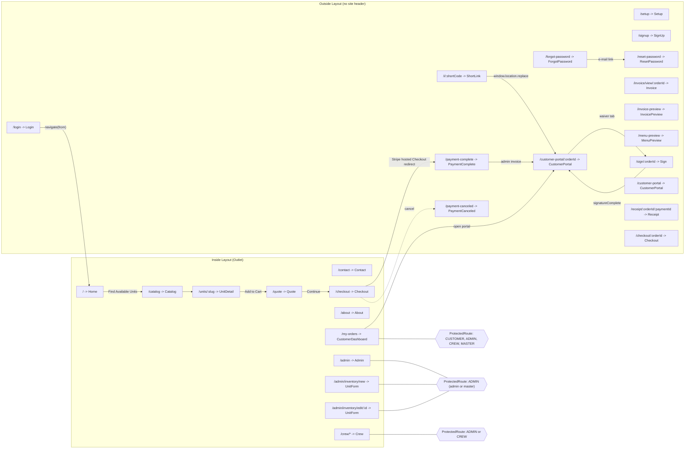
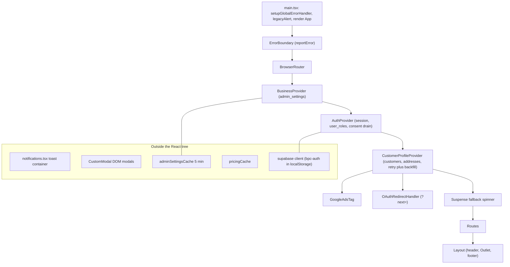
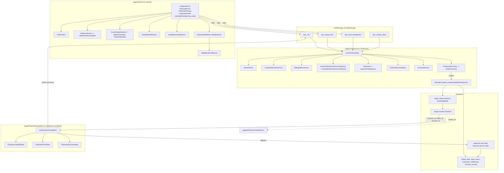
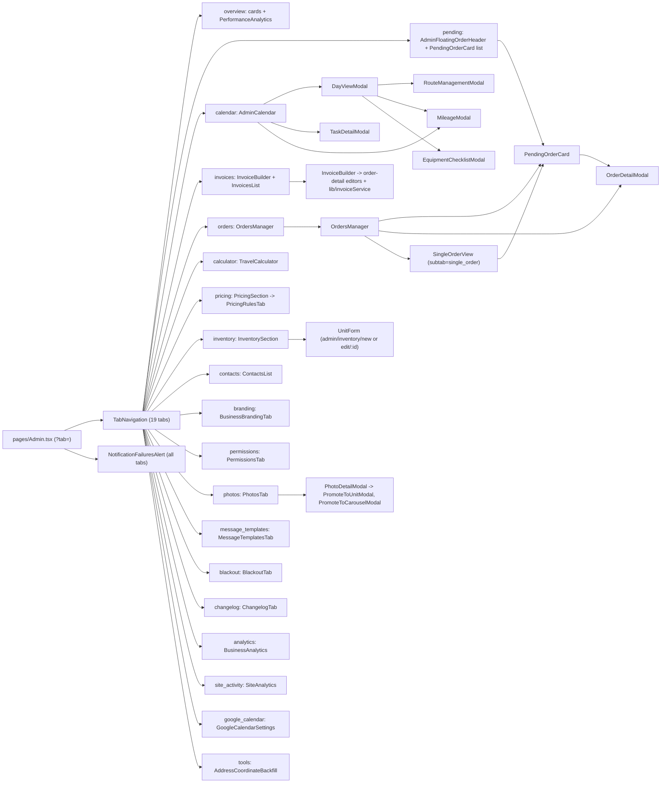
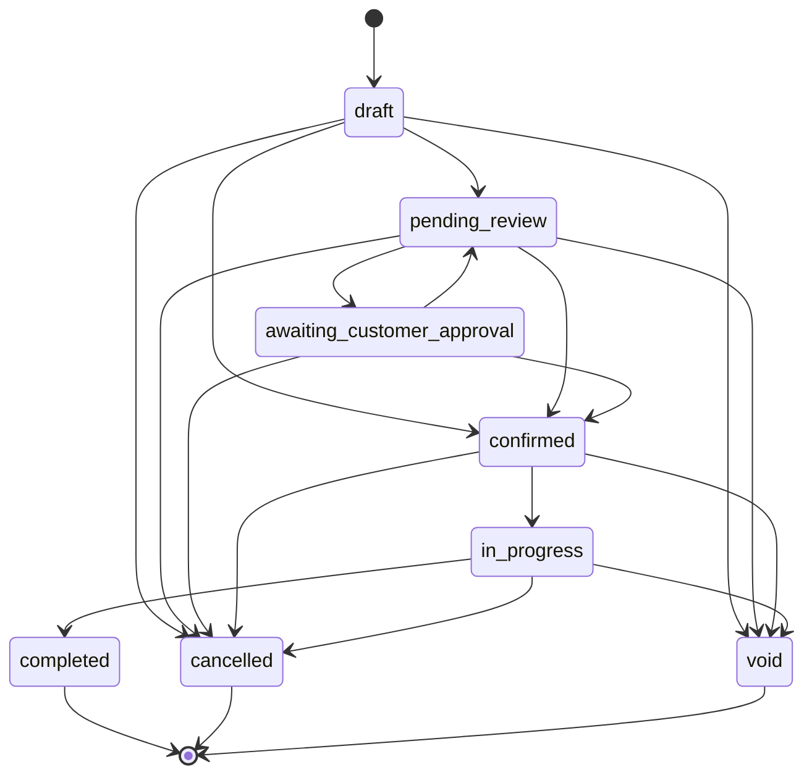

# Frontend Reference (Production snapshot)

> **Scope.** This document describes the front end of the **Production** branch (`main`) of the Bounce Party Club site: everything under `src/`, plus `index.html`, `vite.config.ts`, `package.json`, `netlify.toml`, `vercel.json`, `public/` and the build/lint/TypeScript/Tailwind/PostCSS configuration files. It was produced by reading a snapshot of branch `main`; nothing in this file was derived from the `Dev` working tree.
>
> **Audience.** Another engineer or AI agent that needs to *find* any piece of front-end behaviour quickly and *change it safely*.
>
> **Conventions.** Paths are relative to the repo root (`src/...`). "Edge function" means a Supabase Edge Function called from the browser at `${VITE_SUPABASE_URL}/functions/v1/<name>` (or through `supabase.functions.invoke`). "Table" means a Supabase Postgres table accessed through `supabase.from(...)` with the anon key plus the signed-in user's JWT (row-level security decides what is visible). All money is stored and passed around as integer **cents** unless a label says otherwise. Statements such as "not referenced by any route or import" are neutral observations about the module graph (computed from `src/main.tsx` following static and dynamic imports, ignoring commented-out lines); they are not judgements.
>
> **How to use.** Section 0 gives the big picture. Sections 1-4 cover configuration, routing, providers and pages. Section 5 is the per-file component catalogue. Sections 6-7 cover hooks and `src/lib`. Section 8 is the cross-cutting data-access catalogue (tables, RPCs, edge functions, realtime channels, storage keys). Sections 9-10 cover styling and types. Section 11 holds Mermaid diagrams. Section 12 lists change-safety notes and the files that are not part of the runtime graph. The appendix is a full file inventory.

---

## 0. Big picture

* **Single-page React 18 app** (TypeScript, Vite 5, Tailwind 3, React Router 6 `BrowserRouter`). All routes are declared in `src/App.tsx`; every page except `Home` is lazy-loaded with `React.lazy` + one shared `<Suspense>` spinner.
* **No custom backend in the repo's front end.** All persistence goes to **Supabase** (Postgres via PostgREST, Auth, Storage, Realtime, Edge Functions). Stripe is reached only through edge functions (plus Stripe.js for one embedded-Elements page). Twilio SMS and e-mail (Resend) are reached only through edge functions (`send-sms-notification`, `send-email`, ...).
* **Roles** come from the `user_roles` table (one row per user; values `master`, `admin`, `crew`, `customer`). `ADMIN` and `MASTER` both count as "admin" in the UI.
* **Public customer journey:** `Home` -> `Catalog` -> `UnitDetail` -> (cart in local storage) `Quote` -> `Checkout` -> Stripe hosted checkout -> `PaymentComplete` -> `CustomerPortal`.
* **Admin-initiated journey:** Admin `InvoiceBuilder` (or the crew `CrewInvoiceBuilder`) creates a draft order and calls `send-invoice`; the customer opens `/i/:shortCode` -> `/customer-portal/:orderId?t=<token>` -> `InvoiceAcceptanceView`.
* **Operations:** `/admin` (19 tabs, URL query `?tab=`) and `/crew` (calendar + invoice builder) drive approvals, edits, payments, routing and delivery workflow.
* **Order status model** (`src/lib/constants/statuses.ts`): `draft`, `pending_review`, `awaiting_customer_approval`, `confirmed`, `in_progress`, `completed`, `cancelled`, `void`. Status transitions that matter commercially are applied through the `order-lifecycle` edge function (`src/lib/orderLifecycle.ts`) or by direct `orders` updates guarded by status predicates.

---

## 1. Stack, scripts, build and deploy configuration

### 1.1 `package.json` (name `vite-react-typescript-starter`, version `2.1.0`, `"type": "module"`)

| Script | Command | Notes |
|---|---|---|
| `dev` | `vite` | Dev server |
| `build` | `vite build` | Output `dist/` |
| `lint` | `eslint .` | Flat config in `eslint.config.js` |
| `preview` | `vite preview` | Serves the built output |
| `typecheck` | `tsc --noEmit -p tsconfig.app.json` | Strict TS check of `src/` |

**Runtime dependencies:** `react` / `react-dom` ^18.3.1, `react-router-dom` ^6.30.1, `@supabase/supabase-js` ^2.57.4, `@stripe/stripe-js` ^8.0.0, `@stripe/react-stripe-js` ^5.0.0, `stripe` ^20.0.0 (server SDK; no `src/` file imports it), `date-fns` ^4.1.0, `lucide-react` ^0.344.0 (icons), `signature_pad` ^5.1.2 (signature canvas), `dotenv` ^17.2.3 (no `src/` file imports it).

**Dev dependencies:** `vite` ^5.4.2, `@vitejs/plugin-react` ^4.3.1, `typescript` ^5.5.3, `typescript-eslint` ^8.3.0, `eslint` ^9.9.1 (+ `@eslint/js`, `eslint-plugin-react-hooks`, `eslint-plugin-react-refresh`, `globals`), `tailwindcss` ^3.4.1, `postcss`, `autoprefixer`, `@types/react`, `@types/react-dom`, `@types/google.maps` ^3.58.1, `supabase` CLI ^2.58.5.

There is **no test runner** and **no test file** under `src/` in the Production snapshot (0 files matching `*.test.*` / `*.spec.*`).

### 1.2 Vite (`vite.config.ts`)

```ts
defineConfig({ plugins: [react()], optimizeDeps: { exclude: ['lucide-react'] } })
```
No aliases, no `base`, no proxy, no manual chunking. Code splitting comes only from `React.lazy` in `App.tsx` and 15 dynamic `import()` call sites (`lib/supabase` in `BusinessAnalytics`; `lib/addressService` in `OrderDetailModal`; `lib/notifications` in `useDataFetch`; `lib/orderLifecycle` in `usePaymentCompletion`, `orderCreation` and `orderSaveService`; `lib/googleMaps` in `distanceCalculator`; `lib/bookingEmailTemplates` and `lib/notificationService` in `orderNotificationService`; `lib/adminSettingsCache` in `routeOptimization`). A stray file `vite.config.ts.timestamp-*.mjs` exists at the repo root (a Vite temp artifact; not referenced).

### 1.3 TypeScript

* `tsconfig.json` -> references `tsconfig.app.json` and `tsconfig.node.json`.
* `tsconfig.app.json`: target ES2020, `lib` ES2020 + DOM + DOM.Iterable, `types: ["google.maps"]`, `module ESNext`, `moduleResolution bundler`, `jsx react-jsx`, `strict`, `noUnusedLocals`, `noUnusedParameters`, `noFallthroughCasesInSwitch`, `isolatedModules`, `noEmit`; `include: ["src"]`. (Because of `noUnusedParameters`, unused parameters in the code base are prefixed `_`, e.g. `_paymentIntentId`.)
* `tsconfig.node.json`: ES2022 for `vite.config.ts`.
* Ambient types: `src/vite-env.d.ts` declares `ImportMetaEnv` (4 vars, see 1.6); `src/types/google-maps.d.ts` declares `window.google`; `src/components/common/GoogleAdsTag.tsx` augments `Window` with `gtag` and `dataLayer`.

### 1.4 Tailwind / PostCSS / ESLint

* `tailwind.config.js`: `content: ['./index.html', './src/**/*.{js,ts,jsx,tsx}']`, `theme.extend = {}`, no plugins. **There are no custom design tokens**; the design system is Tailwind's default palette (slate / blue / green / red / amber) plus a few shared class-string helpers (section 9).
* `postcss.config.js`: `tailwindcss` + `autoprefixer`.
* `eslint.config.js`: `@eslint/js` recommended + `typescript-eslint` recommended on `**/*.{ts,tsx}`; `react-hooks` recommended rules; `react-refresh/only-export-components` as `warn` (constant exports allowed); `dist` ignored.

### 1.5 Hosting / deploy configuration

* **`netlify.toml`**: build command `npm run build`, publish `dist`, `NODE_VERSION = 20.17.0`, `SECRETS_SCAN_SMART_DETECTION_ENABLED = "false"` (comment: `VITE_` variables are meant to be bundled), and one SPA rewrite `/* -> /index.html` with status 200.
* **`vercel.json`**: one rewrite `/(.*) -> /index.html`.
* **`.nvmrc`**: `20.17.0`. `.env.example` lists the four `VITE_*` variables.
* Because the host rewrites every path to `index.html`, an unknown URL reaches React Router, which has **no catch-all (`*`) route**; unmatched paths render nothing inside the provider tree (links to `/terms` and `/privacy` in `SignUp.tsx` have no matching route in `App.tsx`).
* A file `sign-map.json` at the repo root is a 509-byte HTML document (a built `index.html` copy that references `/assets/index-*.js` and `.css`); it is not referenced by `src/`. A `.bolt/` folder (`config.json` with `template: bolt-vite-react-ts`, plus a `prompt` text file) is a leftover of the scaffolding tool and is not read by the build.

### 1.6 Environment variables read by the browser (`import.meta.env`)

| Variable | Read in | Purpose |
|---|---|---|
| `VITE_SUPABASE_URL` | `src/lib/supabase.ts` and many other files (edge function URLs) | Supabase project URL |
| `VITE_SUPABASE_ANON_KEY` | `src/lib/supabase.ts`, many `fetch` calls (as `Authorization: Bearer <anon>` for public flows) | Supabase anon (publishable) key |
| `VITE_STRIPE_PUBLISHABLE_KEY` | `src/components/payment/StripeCheckoutForm.tsx` | `loadStripe(...)` for the embedded Elements page |
| `VITE_GOOGLE_MAPS_API_KEY` | `src/lib/googleMaps.ts`, `src/components/order/AddressAutocomplete.tsx`, `src/components/pending-order/StreetViewImages.tsx` | Maps JS API + Street View static images |
| `import.meta.env.PROD` / `.DEV` | `src/lib/logger.ts`, `src/pages/Quote.tsx` | Log level; Quote debug panel |

`src/lib/supabase.ts` falls back to the literal URL `https://placeholder.supabase.co` and key `placeholder-key` (after `console.error`) when the variables are missing, so the bundle loads without them; `src/lib/orderLifecycle.ts` captures `VITE_SUPABASE_URL` / `VITE_SUPABASE_ANON_KEY` once at module load. Backend secrets (Stripe secret key, Twilio credentials, Resend key) are *not* env variables; the admin UI writes some of them to the `admin_settings` table (see `useAdminSettings`, `GoogleCalendarSettings`).

### 1.7 Third-party scripts and services loaded in the browser

| Service | How it is loaded | Where |
|---|---|---|
| **Google Maps JavaScript API** | Script tag injected on demand from **two** places. (1) `https://maps.googleapis.com/maps/api/js?key=<key>&v=weekly&loading=async` by `loadGoogleMapsAPI()` (reuses an existing `maps.googleapis.com/maps/api/js` script tag if present; after `load` it polls every 50 ms, 10 s deadline, for `google.maps.importLibrary`; the in-flight promise is reset on failure). (2) `https://maps.googleapis.com/maps/api/js?key=<key>&libraries=places&v=weekly&loading=async` by `AddressAutocomplete` itself when no `maps.googleapis.com` script exists (it polls every 100 ms, at most 50 times, for `importLibrary`, then `importLibrary("places")`). It does not call `loadGoogleMapsAPI`. | `src/lib/googleMaps.ts` `loadGoogleMapsAPI()`; callers: `distanceCalculator` (Distance Matrix, via dynamic import), `routeOptimizationDistanceMatrix`, `calculateETA`, `TravelCalculator` (preload), `googleMapsLoader.ensureGoogleMapsLoaded()` (adds `importLibrary('geocoding')`; used by `AddressCoordinateBackfill`). `AddressAutocomplete` (Places) loads its own script. Code that uses `google.maps.Geocoder` without loading it (`addressService`, `usePricing`, `useQuoteForm`) relies on the API already being on the page (`addressService` logs a warning and saves without coordinates when it is missing). The Street View static and metadata URLs (`maps.googleapis.com/maps/api/streetview`) are plain image/fetch calls in `StreetViewImages`. |
| **Google Ads gtag** | `GoogleAdsTag` (mounted in `App.tsx`) injects `https://www.googletagmanager.com/gtag/js?id=AW-18153233398` once, plus an inline `gtag('config', 'AW-18153233398', { send_page_view: false })`. Never injected on internal routes (`/admin`, `/crew`, `/setup`, `/invoice-preview`, `/menu-preview`). `trackGoogleAdsEvent()` is exported but has no callers. | `src/components/common/GoogleAdsTag.tsx` |
| **Stripe.js** | `loadStripe(VITE_STRIPE_PUBLISHABLE_KEY)` (injects `js.stripe.com/v3`) | Only `StripeCheckoutForm` (rendered by `/invoice/view/:orderId`). The main booking checkout uses **Stripe-hosted Checkout** via redirect to a URL returned by the `stripe-checkout` edge function; no Stripe.js is needed there. |
| **Supabase Realtime** (websocket) | `supabase.channel(...)` | see section 8.5 |
| **Browser APIs** | `navigator.geolocation` (crew ETA via `getCurrentLocation`; route start mode `current_location` in `RouteManagementModal`), `navigator.share` / `canShare` (menu image save), `navigator.clipboard`, `window.print`, Canvas 2D (menu PNG; photo compression), `crypto.randomUUID` / `getRandomValues` | various |

No analytics SDK other than the Google Ads tag and the first-party `site_events` table (section 7, `siteEvents.ts`).

### 1.8 `index.html` metadata

* `<html lang="en">`, charset UTF-8, viewport `width=device-width, initial-scale=1.0`.
* Favicon: `<link rel="icon" type="image/png" href="/bounce party club logo.png" />` (file name contains spaces).
* `<title>Bounce Party Club | Bounce House Rentals</title>`. No meta description, Open Graph or other tags. Root element `<div id="root">`; entry `<script type="module" src="/src/main.tsx">`.

### 1.9 `public/` assets

| File | Use |
|---|---|
| `public/bounce party club logo.png` | Logo used by `Layout`, payment result pages, `MenuPreview` (canvas + print), favicon |
| `public/favicon.png` | Present as a 20-byte placeholder file (text `[DUMMY FILE CONTENT]`); `index.html` points to the logo file instead |
| `public/payment-success.html` | Standalone static page ("Payment Successful!") that reads the query params `orderId` and `canceled`, `postMessage`s `{ type: 'PAYMENT_SUCCESS' \| 'PAYMENT_CANCELED', orderId }` (target origin `'*'`) to `window.opener` when it exists, and calls `window.close()` immediately and then every 100 ms for 3 s (afterwards shows "Payment received. You can close this window manually."). No file in `src/` links to it. |

### 1.10 Entry point (`src/main.tsx`)

```tsx
setupGlobalErrorHandler();          // window 'error' + 'unhandledrejection' -> reportError()
import './lib/legacyAlert';          // side effect: replaces window.alert / window.confirm
createRoot(document.getElementById('root')!).render(<App />);
```
(`import './index.css'` is also executed.) There is no `<StrictMode>` wrapper.

---

## 2. Routing (`src/App.tsx`)

### 2.1 Provider/layout wrapper order

`ErrorBoundary` -> `BrowserRouter` -> `BusinessProvider` -> `AuthProvider` -> `CustomerProfileProvider` -> (`GoogleAdsTag`, `OAuthRedirectHandler`, `Suspense` -> `Routes`). The `Suspense` fallback is a full-screen centred blue spinner with "Loading...".

`OAuthRedirectHandler` (defined in `App.tsx`): when a user is signed in and the current path is exactly `/`, it reads `?next=` and, if it starts with `/` and not `//` (open-redirect guard), `navigate(next, { replace: true })`. This pairs with `AuthContext.signInWithGoogle/Apple(destinationPath)`, which sets `redirectTo = <origin>/?next=<encoded path>`.

### 2.2 Route table

Routes **outside** the `Layout` shell (no site header/footer):

| Path | Component (file) | Protection | Notes |
|---|---|---|---|
| `/setup` | `Setup` (`pages/Setup.tsx`) | none | First-run admin bootstrap; calls RPC `get_admin_users` to decide whether setup is already done |
| `/login` | `Login` | none | Reads `location.state.from` / `prefillEmail` |
| `/signup` | `SignUp` | none | Reads `location.state.from` |
| `/forgot-password` | `ForgotPassword` | none | `resetPasswordForEmail` with `redirectTo=<origin>/reset-password` |
| `/reset-password` | `ResetPassword` | none | Requires `#...type=recovery` in the URL hash |
| `/invoice/view/:orderId` | `Invoice` | none | Order-id based invoice page with embedded Stripe Elements |
| `/invoice-preview` | `InvoicePreview` | none | Reads `sessionStorage` `invoice-preview-data` |
| `/menu-preview` | `MenuPreview` | none | Reads `sessionStorage` `menu-preview-data` |
| `/sign/:orderId` | `Sign` (default export) | none | E-signature waiver |
| `/i/:shortCode` | `ShortLink` | none | Resolves `invoice_links.short_code`, then `window.location.replace('/customer-portal/<order_id>?t=<link_token>')` |
| `/customer-portal/:orderId` | `CustomerPortal` | none (token or order id) | |
| `/customer-portal` | `CustomerPortal` | none | Same component without an order id param (relies on `?t=` token) |
| `/receipt/:orderId/:paymentId` | `Receipt` | none | Direct table reads |
| `/payment-complete` | `PaymentComplete` | none | Query `order_id`, `session_id` |
| `/payment-canceled` | `PaymentCanceled` | none | Query `order_id` |
| `/checkout/:orderId` | `Checkout` | none | Same component as `/checkout`; `Checkout` does not read the `:orderId` param (data comes from local storage) |

Routes **inside** `<Route path="/" element={<Layout />}>` (render in `Layout`'s `<Outlet/>`):

| Path | Component | Protection |
|---|---|---|
| `/` (index) | `Home` (eager import) | none |
| `catalog` | `Catalog` | none |
| `units/:slug` | `UnitDetail` | none |
| `quote` | `Quote` | none |
| `contact` | `Contact` | none |
| `checkout` | `Checkout` | none |
| `about` | `About` | none |
| `my-orders` | `CustomerDashboard` | `ProtectedRoute allowedRoles={['CUSTOMER','ADMIN','CREW','MASTER']}` |
| `admin` | `Admin` | `ProtectedRoute allowedRoles={['ADMIN']}` |
| `admin/inventory/new` | `UnitForm` | `ProtectedRoute ['ADMIN']` |
| `admin/inventory/edit/:id` | `UnitForm` | `ProtectedRoute ['ADMIN']` |
| `crew/*` | `Crew` | `ProtectedRoute ['ADMIN','CREW']` |

### 2.3 `ProtectedRoute` semantics (`components/common/ProtectedRoute.tsx`)

* While `AuthContext.loading` is true: centred spinner.
* No `user`: `<Navigate to="/login" state={{ from: location }} replace />` (Login later navigates back to `from.pathname`; note only the pathname is kept, not query string).
* Access check: for each allowed role, `'ADMIN'` or `'MASTER'` -> `isAdmin` (role admin **or** master); otherwise `hasRole(role)` (lower-cases the argument and checks the `roles` array). If none match, an in-place "Access Denied" card with a "Go Back" button (`window.history.back()`) is rendered.
* The check is purely client-side; the real enforcement is Supabase RLS / edge-function authorisation.

### 2.4 Redirects, lazy loading, 404

* No `<Navigate>` redirects are declared in `App.tsx` other than inside `ProtectedRoute`.
* Hard redirects: `ShortLink` (`window.location.replace`), `Checkout` (`window.location.href = <Stripe URL>`), `ApprovalModal`/`InvoiceAcceptanceView`/`PaymentTab` (`window.location.href = data.url`), `ApprovalSuccessView` (full reload to `/customer-portal/<id>`).
* All pages except `Home` use `lazy(() => import('./pages/X').then(m => ({ default: m.X })))` (`Sign` uses the module default export directly).
* There is no 404 page.

### 2.5 Layout shell (`components/common/Layout.tsx`)

Sticky white header (logo + "Bounce Party Club", links: "Browse Inflatables" `/catalog`, "Get Quote" `/contact`, "About Us" `/about`, "My Orders" `/my-orders` when signed in, "Admin" `/admin` when `isAdmin`, "Crew" `/crew` when admin or `hasRole('CREW')`), cart icon linking `/quote` with an item-count badge, phone link (desktop `lg` and up; also in the mobile menu), the signed-in e-mail with "Sign Out" (calls `signOut()` then `navigate('/')`; failure shows an error toast) or a "Login" link (`/login`), a mobile slide-down menu (`md:hidden`, same links), `<Outlet/>`, and a dark footer (logo, address text, Quick Links to `/catalog`, `/contact`, `/about`, phone and e-mail links, Instagram and Facebook icon links, "(c) <current year> Bounce Party Club LLC"). Business phone/e-mail/address/social URLs come from RPC `get_public_business_settings` through `getPublicBusinessSettings()` (5-minute in-memory cache); local defaults in `Layout` are phone `(313) 889-3860` and e-mail `admin@bouncepartyclub.com`, and the social icons fall back to `https://instagram.com/bouncepartyclub` and `https://www.facebook.com/bouncepartyclub` when the settings hold no URL. The cart count is derived from `SafeStorage` key `bpc_cart` (sum of `qty`) and refreshed on window events `storage` and the custom event `bpc-cart-updated`.

---

## 3. Providers / contexts (`src/contexts`)

### 3.1 `BusinessContext.tsx` (`BusinessProvider`, `useBusinessSettings`)

* **State:** `BusinessSettings` object (`business_name`, `business_name_short`, `business_legal_entity`, `business_address`, `business_phone`, `business_email`, `business_website`, `business_license_number`) with hard-coded defaults (`Bounce Party Club`, `Bounce Party Club LLC`, phone `(313) 889-3860`, `info@bouncepartyclub.com`, `https://bouncepartyclub.com`, empty address/licence).
* **Data source:** one `admin_settings` select of `key, value` (`key in (...)` the 8 setting keys above), then `getBusinessAddressText()` (`adminSettingsCache`), whose result always overwrites `business_address`. Stored values are applied as `value || ''` (a stored empty value blanks the default). Runs once on mount; cancellation flag on unmount. Errors only log; defaults remain. The context value is the `BusinessSettings` object itself (no setter); `useBusinessSettings()` never throws in practice because the context has a default value.
* **Consumers:** `ConsentSection`, `ApprovalSuccessView`, `OrderApprovalView`, `OrderStatusView`, `RejectionModal` (customer portal), `About`, `Contact`, `Sign`, and `lib/waiverContent.ts` (type import). Because this provider is the outermost, it is usable before authentication.
* **Retry behaviour:** none.

### 3.2 `AuthContext.tsx` (`AuthProvider`, `useAuth`)

* **State:** `user` (Supabase user object, typed `any`), `role` (`'master' | 'admin' | 'crew' | 'customer' | null`), `roles` (`string[]`, at most one element), `loading`.
* **Methods:** `signIn(email, password)` (`signInWithPassword`), `signInWithGoogle(dest?)`, `signInWithApple(dest?)` (OAuth; `redirectTo=<origin>/` or `<origin>/?next=<dest>`), `signUp(email, password, metadata)`, `signOut()`, `hasRole(role)` (case-insensitive membership in `roles`), derived booleans `isAdmin` (role `admin` or `master`) and `isMaster`.
* **Data sources:** `supabase.auth.getSession()` + `onAuthStateChange`; `user_roles` (`select role where user_id = ... maybeSingle`, role lower-cased); `pending_signups_consent` (select by `user_id`); edge function `record-consent?action=drain-pending` (POST with the user's access token).
* **Behaviour details:**
  * On initial session and on every `SIGNED_IN` with an access token, `drainPendingConsent(session)` runs. A module-level `Set` (`drainingUserIds`) prevents a second concurrent drain in the same tab. The unique index on `(user_id, consent_batch_id, consent_type)` (table `user_consent_log`, per the in-code comment) is the real idempotency guarantee; the edge function removes the pending row after draining (no client-side delete). The drain `fetch` uses the session access token directly (not `functions.invoke`) with body `{}`; failures are only logged (`log.warn`). The select is `batch_id, consents, source, user_agent_hint` with `maybeSingle`.
  * On `SIGNED_IN` with a non-empty URL hash, the URL is rewritten with `history.replaceState(null, '', window.location.pathname)`: this drops the hash (OAuth fragments) and also the query string from the address bar (React Router's own `location` object is not updated by `replaceState`).
  * `loadUserRoles` runs on the initial session and on **every** auth event that carries a user (including `TOKEN_REFRESHED`), so `user_roles` is re-queried each time; with no user, `role` becomes `null` and `roles` becomes `[]`. A role query error or an empty result also yields `null` / `[]`.
  * `signIn`, `signInWithGoogle`, `signInWithApple`, `signUp` and `signOut` throw the Supabase error when there is one (callers catch); `signUp` passes `metadata` as `options.data`. `useAuth` throws outside `AuthProvider`.
  * `loading` becomes false after the first `getSession` or the first auth event, **before** roles finish loading (`loadUserRoles` is fired without awaiting). Consequently `ProtectedRoute` can briefly evaluate with `roles = []` for a signed-in user.
  * Supabase client is created with `storageKey: 'bpc-auth'`, `storage: window.localStorage`, `persistSession`, `autoRefreshToken`, `detectSessionInUrl` (all in `lib/supabase.ts`).
* **Retry behaviour:** none (roles are loaded once per auth event).

### 3.3 `CustomerProfileContext.tsx` (`CustomerProfileProvider`, `useCustomerProfile`)

* **State:** `profile` (`id`, `firstName`, `lastName`, `email`, `phone`, `businessName`, `defaultAddress`), `sessionData` (editable copy used to prefill forms: names, e-mail, phone, business, address lines, city, state, zip), `loading`, internal `initialized`.
* **Methods:** `updateSessionData(partial)`, `resetSessionData()` (back to profile values), `refreshProfile()` (sets loading, clears `initialized`, reloads).
* **Data sources:** `customers` (by `user_id`), `addresses` (by `customers.default_address_id`) and the most recent `orders` row joined to `addresses!orders_address_id_fkey` (fallback address), both fetched in parallel; edge function `backfill-oauth-customers` (POST with access token).
* **Retry behaviour:** if no `customers` row exists for the user yet (the row is created server-side after sign-up/OAuth), the loader re-tries up to `MAX_RETRIES = 6` times at `RETRY_DELAY_MS = 800` ms via `setTimeout` (timer cleared on user change/unmount). After the retries are exhausted it calls `backfill-oauth-customers` once (POST, user access token); if that returns OK it reloads from attempt 0 (so a further 6 retries and another backfill are possible); otherwise it stops. A `customers` query error stops immediately with no retry. `loading` is set to `false` in the `finally` of every attempt, including an attempt that has just scheduled a retry. With no signed-in user the provider clears `profile`, `sessionData` and `initialized`. The `customers` select is `id, first_name, last_name, email, phone, business_name, default_address_id`; the default address is `addresses` by `default_address_id`, else the address of the customer's newest order (`orders.created_at` desc, limit 1).
* **First-load vs later loads:** the first successful load fills the whole `sessionData`; later loads only fill the address fields if `addressLine1` is still empty (does not overwrite user edits).
* **Consumers:** `Home` (address autofill), `Quote` (via `useQuotePrefill`), `useCheckoutData` (contact + billing autofill), `SignUp` (`refreshProfile`).

### 3.4 Non-context singletons that behave like providers

* `lib/notifications.tsx` mounts a fixed `#notification-container` div on `document.body` and renders toasts with a separate `createRoot` (outside the React tree).
* `components/common/CustomModal.tsx` (`showModal/showAlert/showConfirm/showWarning/showSuccess`) builds imperative modal DOM outside React.
* `lib/legacyAlert.ts` replaces `window.alert` and `window.confirm` (section 7).
* `lib/adminSettingsCache.ts`, `lib/pricingCache.ts` keep module-level caches (section 7).


---

## 4. Pages (`src/pages`, 25 files)

Notation: **Loads** = tables / RPCs / edge functions read on mount; **Writes** = mutations; **Children** = main components rendered; **Storage** = browser storage keys touched (see 8.6 for the full key catalogue).

### 4.1 `Home.tsx` -> route `/`
* **Purpose:** landing page: hero media carousel, scrolling "All Day Rentals" ribbon, "Check Availability" form, value-proposition cards, Google reviews, call-to-action blocks.
* **Loads:** `google_reviews` (`select *`, `is_active = true`, `rating >= 4`, ordered by `display_order` ascending; average rating computed client-side, rounded to one decimal, default 5.0 when there are no rows; a load error is only logged). Carousel data via `HeroCarousel` -> `hero_carousel_images`.
* **Children:** `HeroCarousel` (from `components/admin/`, also used on the public page; `Home` passes no props, the component itself shows edit controls when the signed-in user is an admin), `AddressAutocomplete` (Google Places).
* **Layout of the page (top to bottom):** `HeroCarousel`; an amber scrolling ribbon ("We Specialize in ALL DAY Rentals - Delivered in the morning, picked up the next morning", 6 repeats, CSS animation `ribbon-scroll` 28 s, pauses on hover); a blue strip "View Our Full Inflatable Catalog" with a "Browse" button (`/catalog`); the hero section with the "Check Availability" form (Event Type buttons Residential "Home, backyard" / Commercial "School, park, church", a native `<input type="date">` with `min` = today (UTC date string), `AddressAutocomplete`, and the submit button); a "Get a Quote" button (`/contact`); four "Why Choose Bounce Party Club?" cards (Premium Quality, Safety First, On-Time Delivery, Best Prices); the Google reviews block (two-column grid of review cards, star average and "on Google" text, and a "Read more reviews on Google" link to `https://g.page/r/CcALHMmxBHPSEBM/review`).
* **Behaviour:** when signed in, the address is autofilled once from `CustomerProfileContext.sessionData` (`addressLine1` required; the stored address object then has `line1/line2/city/state/zip` and no coordinates). "Find Available Units" validates in this order: location type (Residential/Commercial), event date, address (error toasts via `notifyError`); it stores `{ event_date, address: <AddressResult or autofill object>, location_type }` in `SafeStorage` key `bpc_quote_prefill` (7 days) and navigates to `/catalog`. The admin-only "Create Test Booking" button, the `createTestBooking` import and the `Zap` icon import are commented out in the source.

### 4.2 `Catalog.tsx` -> `/catalog`
* **Purpose:** inventory list with category filter and a per-date availability filter.
* **Loads:** `units` (`active = true`, ordered by name) joined to `unit_media (id, url, alt, sort, is_featured)`; media sorted featured first then `sort`. Availability: `checkUnitAvailability` per unit (RPC `check_date_blackout` + `order_items`/`orders` overlap query).
* **Behaviour:** filter buttons `all | bounce | combo | slide | obstacle` (labels "All Inflatables", "Bounce Houses", "Wet or Dry Units", "Water Slides", "Obstacle Courses") derived from `units.types[]` (`'Combo'`, `'Bounce House'`, anything containing `'Slide'`, `'Obstacle Course'`; falls back to a legacy single `type` field). Reads `bpc_quote_prefill.event_date` (sets the date and triggers one automatic availability check once units are loaded) or else `bpc_quote_form.event_date` (no automatic check); changing the date clears the availability result and rewrites those two keys only when they already exist (`bpc_quote_prefill.event_date`; `bpc_quote_form.event_date` and `event_end_date`, 7 days). "Check Availability" (shown once a date is set) runs `checkUnitAvailability({ unitId, eventStartDate: date, eventEndDate: date })` for every unit in parallel; booked units are **hidden** (not greyed), with a green "N available on <date>" chip, a red "N already booked - hidden" chip and a "Show All" button to clear. The date input is `DatePickerInput` with `min` = today. "Save / Download Menu" (label "Save Menu" on small screens) refuses with a toast when the filtered list is empty; otherwise it writes `sessionStorage` `menu-preview-data` (`{ generatedAtIso, title, units: <filtered units>, availabilityChecked, availabilityDateFormatted, activeFilter }`; title "Bounce Party Club Menu" or "Available Inflatables - <date>") and `menu-preview-return-to` (current path+search+hash) and navigates to `/menu-preview`. Unit cards (image, name, WET/DRY or WET badge, types, capacity "N kids", dimensions, footprint sq ft, "Wet/Dry" or "Wet Only", "Starting at $X", "View Details") link to `/units/<slug>`. A "Need help choosing?" block shows the literal phone `(313) 889-3860` and a "Get a Quote" link to `/quote`. A `visibilitychange` listener is registered but its handler body is empty.
* **Starting price:** minimum of dry and water price when the water price is greater than zero; otherwise the dry price; whole dollars (`$1,234` style).

### 4.3 `UnitDetail.tsx` -> `/units/:slug`
* **Loads:** `units` (`slug`, `active = true`, `maybeSingle`; redirects to `/catalog` if absent) and `unit_media` for the unit (featured first, then `sort`). Fires `trackEvent('unit_view', { unitId, metadata: { name, slug } })`.
* **Behaviour:** image gallery (main image opens a full-screen modal with all thumbnails; the inline strip shows the first 4). For units whose `types` include `Combo` a dry/water "Select Mode" toggle (water-slide-only units, i.e. `Water Slide` without `Combo`, default to water and show an "always used in wet mode" notice). For `Combo` / `Water Slide` units the images are filtered to `mode === current mode` or `visibility_mode === 'both'`, with a fallback to the dry images when the water list is empty. Price block: "<dry> dry / <water> water" for combo units with a water price, otherwise "Starting at" (water price for water-only units, else dry price), plus fixed text that the final total varies by distance, surface and duration. Spec cards: capacity "N kids", dimensions, "Space Needed" sq ft, Power "N outlet(s)", Indoor/Outdoor Yes/No, and a static "What's Included" list. "Add to Cart" reads `bpc_cart` with `SafeStorage`, refuses when the number of identical (unit + mode) lines already equals `quantity_available` (warning toast), otherwise pushes `{ unit_id, unit_name, wet_or_dry, unit_price_cents (water price in water mode when set, else dry), price_dry_cents, price_water_cents (falls back to the dry price when null), qty: 1, is_combo }` (`is_combo` is true for `Combo` **or** `Water Slide` types), writes back (7 days), dispatches the window event `bpc-cart-updated`, and navigates to `/quote`. A load error is only logged and the page renders nothing.

### 4.4 `Quote.tsx` -> `/quote` (cart + quote form)
* **Purpose:** single-page cart, address, event details, setup details and live price summary.
* **Hooks:** `useQuoteCart` (cart in local storage + availability flags), `useQuoteForm` (form state persisted to local storage, prefill, auto-rules), `useQuotePricing` (debounced price calculation), `useQuotePrefill` (profile address), `useDataFetch` (pricing rules), `useAuth`, `useCustomerProfile`.
* **Loads:** `pricing_rules` (`select *`, `limit 1`, mapped field-by-field into `PricingRules` with numeric coercion and defaults, e.g. deposit per unit 5000, generator single 10000 / multiple 7500, taxes default true); `check_date_blackout` RPC (via `checkDateBlackout(event_date, event_end_date)`) for the chosen dates: when `is_same_day_pickup_blocked` it sets `sameDayPickupBlocked` for `EventDetailsSection` and resets `location_type` commercial -> `residential`, `pickup_preference` `same_day` -> `next_day` and `same_day_responsibility_accepted` -> `false`. If no `pricing_rules` row exists the fetch throws ("No pricing rules found") and no error toast is shown (`showErrorNotification: false`), so `priceBreakdown` stays empty. Cart availability is re-checked (`checkCartAvailability`) 300 ms after the dates or the cart length change.
* **Events tracked:** `cart_started` (mount), `cart_address_entered`, `cart_date_selected`, `cart_price_calculated` (each once per path per session through `trackEventOnce`), `cart_submitted` (on valid submit, via `trackEvent`). The address and date events ignore the value present when the form finished initialising (saved or prefilled data does not fire them); `cart_address_entered` additionally requires lat, lng and `address_line1`, and is skipped when only the coordinates of the initial address were filled in afterwards; `cart_price_calculated` fires whenever `priceBreakdown` becomes non-null.
* **Submit flow:** `validateQuote(cart, formData)` returns the first failing section/field (cart, address, event, setup). On failure the page `flushSync`s the error banner (`ValidationErrorBanner`) + a fixed red bottom toast (iPhone fallback) and scrolls to the field id (offset 100 px, focuses it after 500 ms) or section; no auto-dismiss (the user dismisses it). If valid it re-runs `checkCartAvailability`, blocks with the message "Sorry, the following inflatables were just booked: <names>. Please choose different dates or remove these items." if any item became unavailable (scrolls to the cart section), then `saveFormData()`, `savePriceBreakdown()` (writes `bpc_quote_form`, `bpc_price_breakdown`) and `navigate('/checkout')`.
* **Other:** page title "Your Cart & Quote"; the form is `noValidate` (validation is `validateQuote`). The "Clear All" button (shown when the cart has items or an address line exists) opens a `SimpleConfirmModal` ("Clear Cart & Form", variant `danger`) that clears cart and form and, for signed-out users, removes `bpc_contact_data` with plain `localStorage.removeItem`; yellow debug panel (shows `APP_VERSION` 2.1.0 and scroll diagnostics) when `?debug=1` or `import.meta.env.DEV`; a duplicate-order prefill (`wasDuplicate`) scrolls to the event section after 400 ms. Layout: sections `section-cart`, `section-address`, `section-event`, `section-setup` (ids used for scrolling) in a 2/3 column plus `QuoteSummarySection` in the 1/3 column.
* **Children:** `CartSection`, `AddressSection`, `EventDetailsSection`, `SetupDetailsSection`, `QuoteSummarySection`, `ValidationErrorBanner`, `SimpleConfirmModal`.

### 4.5 `Checkout.tsx` -> `/checkout` and `/checkout/:orderId`
* **Purpose:** customer details, billing address, payment amount, tip, referral source, consent, then payment.
* **Data in:** `useCheckoutData(user?.id)` reads `bpc_quote_form`, `bpc_price_breakdown`, `bpc_cart`, `bpc_contact_data`, `test_booking_tip` from `SafeStorage`; if any of the first three is missing, `quoteData`/`priceBreakdown` stay `null` and the page `navigate('/quote')`. Contact prefill order: (1) `bpc_contact_data` when present (also ticks both consent boxes); (2) otherwise, for a signed-in user, RPC `get_user_order_prefill` (first row, only if it has first name and e-mail); (3) a separate effect then fills still-empty contact fields and an empty billing line1 once from `CustomerProfileContext.sessionData`. The billing address starts as the quote's event address. Cart lines without a string `unit_id` are dropped (and the cleaned cart is written back).
* **Submit (`handleSubmit`):** requires, in this order, card-on-file consent, SMS consent (toast errors) and a referral source (inline error + toast); a custom payment must be >= `priceBreakdown.deposit_due_cents` (toast "Minimum payment is $X"); re-checks availability (`checkMultipleUnitsAvailability` for every cart line over the quote dates; toast naming the units); calls `createOrderBeforePayment({ contactData, quoteData, priceBreakdown, cart, billingAddress, billingSameAsEvent, smsConsent, cardOnFileConsent, customerSelectedPaymentCents, customerSelectedPaymentType, tipCents, referralSource, referralSourceDetail })` (customer upsert, contact RPC, address upsert, `orders` insert with status `draft`, `order_items`, `consent_records`); then POSTs `stripe-checkout` with `{ orderId, depositCents, tipCents, customerEmail, customerName, origin, bookingMode: true }` (anon key) and does `window.location.href = data.url` (Stripe-hosted Checkout). A response that is not OK or has no `url` shows a toast and re-enables the button (the draft order stays). Defaults: `paymentAmount` `'deposit'`, `billingSameAsEvent` `true`. Payment cents come from `getPaymentAmountCents`, tip from `getTipAmountCents`.
* **Events:** `checkout_started`.
* **Children:** `RentalTerms`, `ContactInformationForm`, `BillingAddressForm`, `checkout/PaymentAmountSelector`, `TipSection`, `ReferralSourceSelect`, `ConsentSection`, `CheckoutSummary` (with "View as Invoice" -> `sessionStorage` `invoice-preview-data` = `{ quoteData, priceBreakdown, cart, contactData }` + `window.open('/invoice-preview', '_blank')`; no `invoice-preview-return-to` is written). The page title is "Complete Your Booking"; the referral block is headed "One Quick Question".
* **Note:** the event address shown is read-only (comes from the quote); the form text says changes must be made on `/quote` (a plain `<a href="/quote">`, i.e. a full page load). While loading, or when there is no quote data or price breakdown, the page renders nothing (and navigates to `/quote` when loading has finished without them).

### 4.6 `PaymentComplete.tsx` -> `/payment-complete?order_id=&session_id=`
* Uses `usePaymentCompletion(orderId, sessionId)`; renders `PaymentLoadingState` / `PaymentErrorState` / `PaymentSuccessState`. Fires `checkout_completed` once on first visit. If the order is an admin invoice (`invoice_links.link_type='invoice'`), it redirects to `/customer-portal/<id>?invoice_paid=true`.
* The hook retries `orders` reads up to 3 times (1 s apart) waiting for the server-side webhook to advance the order out of `draft`. If still `draft` and a `session_id` exists it calls `save-payment-method-from-session` and then the `order-lifecycle` edge function (`enter_confirmed` for admin invoices, otherwise `enter_pending_review`) as a fallback (lifecycle sources `webhook_fallback_admin_invoice` with outcome `charged_now`, and `webhook_fallback_standard`; if the order is still `draft` and there is no `session_id`, no fallback runs); on lifecycle failure it shows the error "Your card was saved but we could not complete the booking request. Please contact us to confirm your booking." and clears the local data. A missing `order_id` gives "No order ID provided"; an unreadable order gives "Unable to load order details". The tip shown comes from `get-session-metadata` (`metadata.tip_cents`). For standard orders it sends the customer booking-request notifications (`sendCustomerBookingConfirmationNotifications`) once (`booking_confirmation_sent` flag + `SafeStorage` key `payment_processed_<orderId>`), and finally clears `bpc_cart`, `bpc_quote_form`, `bpc_price_breakdown`, `bpc_contact_data`, `test_booking_tip` (and dispatches `bpc-cart-updated`).

### 4.7 `PaymentCanceled.tsx` -> `/payment-canceled?order_id=`
Static message with "Back to Cart" (`/quote`) and "Try Again" (`/checkout`); shows `formatOrderId(order_id)`.

### 4.8 `CustomerPortal.tsx` -> `/customer-portal/:orderId` and `/customer-portal` (token via `?t=`)
* **Purpose:** the customer's per-order hub; chooses a view by order status.
* **Data:** `useOrderData().loadOrder(orderId, token, isInvoiceLink)`: if `?t=` present, reads `invoice_links` by `link_token` (rejects missing/expired), then loads the order through RPC `get_order_with_relations_by_token`; otherwise `getOrderById` (PostgREST with `STANDARD_ORDER_SELECT`). Also loads `order_changelog` (only for `awaiting_customer_approval`/`pending_review`), and `loadOrderSummary` (items, discounts, custom fees, computed `OrderSummaryDisplay`).
* **View selection:** `awaiting_customer_approval` -> `OrderApprovalView`; `draft` -> `InvoiceAcceptanceView`; `pending_review | confirmed | in_progress | completed` -> `RegularPortalView`; other statuses (`cancelled`, `void`) -> `OrderStatusView`; `approvalSuccess` -> `ApprovalSuccessView`. Missing order -> "Order Not Found" card.
* **Return-from-Stripe handling (query params):** `payment=success&session_id=` -> edge function `reconcile-balance-payment`, then reload; `invoice_card_saved=true&session_id=` -> `save-payment-method-from-session`, reload, then (if status not confirmed/cancelled/void) `charge-deposit` when `deposit_due_cents > deposit_paid_cents` else `order-lifecycle` `enter_confirmed` (`zero_due_with_card`), then success view; `card_updated=true&session_id=` -> `save-payment-method-from-session`, reload, and restores `pa`, `cpa`, `tip`, `kop`, `spb` params as `restoredPaymentState` for the approval modal; `invoice_paid=true` starts in success state.
* **Realtime:** channel `portal-order-<id>` on `orders` (UPDATE), `payments`, `order_signatures`, `task_status`, `order_lot_pictures`, `order_pictures` (filtered by order id); changes trigger a 600 ms-debounced reload that is skipped while an approval is processing and serialised via refs.
* **Events:** `customer_portal_viewed` (with `orderId` from the route param).
* **Loading states:** while `loading`, `invoiceProcessing` (invoice card-saved flow) or `approvalProcessing` is true a full-screen `LoadingSpinner` replaces the view; failures in the Stripe-return flows show toasts ("Failed to save payment method. Please try again.", "Payment could not be processed. Please try again or contact us.", "Something went wrong. Please contact us.") and reload the order; the reconcile / save-card calls for `payment=success`, `invoice_card_saved` and `card_updated` only run when an `:orderId` route param exists. Props passed down: `OrderApprovalView` gets `invoiceLinkToken`, `autoOpenApprovalModal={card_updated}`, `restoredPaymentState` and the processing/success/rejection callbacks; `RegularPortalView` gets `orderId`, `orderItems`, `orderSummary`, `invoiceLinkToken`, `onReload`; `InvoiceAcceptanceView` gets `orderItems`, `discounts`, `customFees`, `invoiceLink`, `orderSummary`, `onReload`, `onApprovalSuccess`.
* The code also checks `location.pathname.startsWith('/invoice/')` and a `:token` route param, but no declared route supplies a `token` param (only `?t=` is used in practice).

### 4.9 `CustomerDashboard.tsx` -> `/my-orders` (protected)
* Tabs `active | upcoming | past` via `?tab=` (an invalid or missing value shows `active`; when `?tab=` is absent the page sets it to the first non-empty tab in the order active, upcoming, past; `setSearchParams({ tab })` replaces other query params). Data: `useOrders(user.id, user.email)`. Header "My Orders"; a spinner while auth or orders load; with no orders at all an empty state "No Orders Yet" with a "Browse Catalog" button (`/catalog`). A cancel success shows the toast "Your order has been cancelled" and reloads the orders; `CancelOrderModal` gets `customerEmail={user.email}`. If there is no user after loading the page calls `navigate('/login')` (in addition to the route guard).
* Order cards: view receipt (loads `loadOrderSummary` for `ReceiptModal`), open portal (`/customer-portal/<id>`), view signed waiver URL, duplicate order (`useOrderDuplication`), cancel (`CancelOrderModal`). Empty state links to `/catalog`.

### 4.10 `Invoice.tsx` -> `/invoice/view/:orderId`
* Loads the order with `getOrderById`, reads any `invoice_links` row for the order with `maybeSingle` (admin-sent flag `isAdminSent`; any `link_type` counts), shows "This invoice has been cancelled." in an "Invoice Not Available" card for `cancelled`, and shows the success screen when (`deposit_required` ? `deposit_paid_cents >= deposit_due_cents` : true) and status is not `draft`. Success screen: "Booking Confirmed!" / status CONFIRMED when admin-sent, otherwise "Payment Received!" / PENDING REVIEW, with event date, deposit paid and balance due (`calculateTotalFromOrder` minus paid). The main view shows the total (`calculateTotalFromOrder`), deposit due, balance due at the event (total minus `deposit_due_cents`), `RentalTerms`, a "View Invoice" button (opens `PrintModal` with `invoice/PrintableInvoice`, `isPaid={false}`), and, only when `deposit_required` and `deposit_paid_cents === 0`, a responsibility checkbox (overnight text when `pickup_preference === 'next_day'`, otherwise same-day text, "by 7:00 PM" for commercial) that must be ticked before "Pay Now" is enabled; when `deposit_required` is false it shows "This is a manual invoice. No deposit payment required." "Pay Now" runs RPC `check_unit_availability` (`p_unit_ids`, `p_start_date`, `p_end_date`); if any unit is unavailable it **updates the order to `cancelled`** (`cancelled_at`, reason "Auto-cancelled: units no longer available (<names>)") and shows an alert with the business phone. Otherwise it opens a modal with `StripeCheckoutForm` (embedded Stripe Elements; `stripe-checkout` returns a `clientSecret`). On success it sets `overnight_responsibility_accepted` (next-day pickup) or `same_day_responsibility_accepted` to `true` on the order and calls `completeOrderAfterPayment(orderId, 'payment_intent_id')` (`enterConfirmed` for admin invoices else `enterPendingReview`); a failure there alerts "Payment succeeded but failed to finalize booking ...".
* Children: `RentalTerms`, `invoice/PrintableInvoice` inside `PrintModal`, `StripeCheckoutForm`.

### 4.11 `InvoicePreview.tsx` -> `/invoice-preview`
Reads and then removes `sessionStorage` `invoice-preview-data` (accepts a "checkout format" `{quoteData, priceBreakdown, cart, contactData}` or a "portal format" `{orderData, orderItems, orderSummary, contactData}`); return target from `invoice-preview-return-to` (default `/checkout`; the "Back" button does `navigate(returnTo)`). Both keys are removed on unmount. Error cards: "No invoice data found. Please try again from the checkout page.", "Incomplete invoice data. Please try again." (needs `quoteData`+`priceBreakdown`+`cart` or `orderData`+`orderItems`+`orderSummary`), "Missing contact information. Please try again.", "Failed to load invoice data. Please try again.". In checkout format it builds the summary with `buildOrderSummary(priceBreakdown, cart, quoteData, 0)` (tip 0), defaults `location_type` to `residential`, derives `pickup_preference` from the location type when absent, and `generator_qty` is 0 unless `generator_fee_cents > 0`. Renders `SimpleInvoiceDisplay` inside `#print-content-wrapper`. The mobile layout shows Back, "Download PDF" and "Print"; the desktop layout shows Back and "Print / Save PDF". Every print path (the two handlers behave the same, including on iOS) adds `body.print-invoice-preview`, calls `window.print()` and removes the class after 250 ms (CSS in `index.css`).

### 4.12 `MenuPreview.tsx` -> `/menu-preview`
Reads `menu-preview-data` (`{ generatedAtIso, title, units, availabilityChecked, availabilityDateFormatted, activeFilter }`) and `menu-preview-return-to` from `sessionStorage` (removed on unmount). Missing/empty data shows "Unable to Load Menu" ("No menu data found. Please go back and try again." / "Menu data is incomplete. Please go back and try again." / "Failed to load menu preview data."); "Back" navigates to `menu-preview-return-to` or else `navigate(-1)`. Renders a printable menu (CSS classes `.menu-preview-route ...`, `body.print-menu-preview`): on screen rows of 2 unit cards, grouped in pages of 6 units (`PAGE_SIZE = 6`, 2 rows x 3 columns in print, page break between groups). Each card shows image (featured, else first dry/mode-less image, else first image), name with a `COMBO` badge (`is_combo === true` or type `Combo`), types, Dimensions, Footprint, Capacity, "Qty Available", and `Dry` / `Water` prices formatted `$X.XX` (two decimals, unlike the catalog's whole dollars). The header shows the title (default "Inflatable Price List"), "bouncepartyclub.com - Generated <date>" and optional "Available: <date>" / "Filter: <label>" badges; the footer says prices are base rental rates and subject to change. "Save as Image" (label "Saving..." while busy) draws the whole menu on a Canvas 2D context (`drawMenuToCanvas`: 1200 px wide, scale 2, 3 columns, gradient header, rounded rectangles, wrapped text (name limited to 2 lines), no "Qty Available" row; unit images loaded with `crossOrigin='anonymous'` and retried without it), converts it to a PNG `File` and uses `navigator.share({ files, title })` when `navigator.maxTouchPoints > 0` and `canShare` allows it, otherwise an anchor download `bounce-party-club-menu.png`; an `AbortError` (share cancelled) is silent, other errors toast "Could not save image. Please try Print / Save PDF instead.". "Print / Save PDF" adds `body.print-menu-preview`, preloads the logo and unit images, then calls `window.print()` after 50 ms and removes the class after 750 ms.

### 4.13 `Receipt.tsx` -> `/receipt/:orderId/:paymentId`
Loads `orders` (+ `customers`, `addresses`), the `payments` row (must match the order), `order_items` (+ `units`), `order_discounts`, `order_custom_fees`; builds the summary with `buildOrderSummaryDisplay` and renders `OrderSummary`; "Print / Save PDF" calls `window.print()`. The total is recomputed inline from stored scalar fees honouring waiver flags (subtotal + non-waived travel, surface, same-day pickup, generator + tax unless `tax_waived` + custom fees - discounts, where percentage discounts apply to the subtotal; `same_day_weekday_delivery_fee_cents` is not part of this inline sum). The page shows the logo, "Payment Receipt" with the literal phone `(313) 889-3860`, payment time (`paid_at` else `created_at`), a payment type label (`deposit` -> "Deposit Payment"; a `balance` payment not larger than the tip with `balance_due_cents === 0` -> "Crew Tip Payment"; otherwise "Final Balance Payment"), an order amount / crew tip split for deposit payments that include a tip, a payment-method label (card brand + last four, Apple Pay, Google Pay, Link, Bank Account, Cash, Check), customer and event blocks, `OrderSummary` (`showDeposit={false}`, `showTip`), a Payment Status block (deposit paid, balance paid, remaining balance) and a footer. Any load failure shows a "Receipt Not Found" card.

### 4.14 `Sign.tsx` -> `/sign/:orderId` (default export)
* **Purpose:** electronic liability waiver.
* **Loads:** `orders` (`.single()`) selecting `id, customer_id, event_date, event_end_date, waiver_signed_at, signed_waiver_url, parks_acknowledgment_required, parks_acknowledgment_county, customer:customers(*), address:addresses(*)`. Fires `waiver_link_opened` (`orderId`). Shows an "Already Signed" card (with the signed date and a "Return to Portal" button) when `waiver_signed_at` is set; a load failure with no order shows "Unable to Load Waiver" with "Return to Portal". The form is prefilled from the order: typed name and renter name from the customer, phone, e-mail, event dates and event address lines.
* **Waiver text:** the static constant `WAIVER_TEXT` (`generateWaiverText` called once at module load with hard-coded defaults: empty address, phone `(313) 889-3860`, e-mail `BouncePartyClub@gmail.com`; it is **not** built from `BusinessContext`), or, when `parks_acknowledgment_required` and `parks_acknowledgment_county` are both set, `generateWaiverTextWithParksAcknowledgment(businessSettings from BusinessContext, county)` (the 14 base sections plus section 15 for the county). The text actually shown is posted as `waiverText`.
* **Form:** numbered sections "1. Review Liability Waiver" (scroll-to-bottom gate in `WaiverViewer`, three required initials (`INITIALS_REQUIRED`), each at least 2 characters), "2. Renter Information" (full name, phone, e-mail, rental date, optional end date, event street / optional line 2 / city / state (2 chars) / ZIP; optional home address with a "Same as event address" checkbox that clears the home fields), "3. Enter Your Full Legal Name" (typed name), "4. Draw Your Signature" (`SignaturePad`), the electronic-consent checkbox (`ELECTRONIC_CONSENT_TEXT`) and an optional "Send me a copy of the signed waiver" checkbox. The form is valid only when all required fields, the scroll gate, all initials, the signature and the consent are present; otherwise submit shows "Please complete the missing initials:" plus the section names (scrolling inside the viewer first) or "Please complete all required fields", and `scrollToFirstIncomplete` scrolls to and focuses the first missing control (ids such as `renter-name`, `event-date`, `typed-name`, `signature-pad`, `electronic-consent`). "Cancel" does `navigate(-1)`.
* **Submit:** POST edge function `save-signature` (anon key) with order/customer ids, snapshot, `signatureDataUrl`, `initialsData`, `typedName`, `waiverVersion` (`'1.0'`), `waiverText`, `electronicConsentText`, `sendEmailConfirmation`; success -> `/customer-portal/<id>?signatureComplete=true`.

### 4.15 `Login.tsx` -> `/login`
Email/password plus Google (Apple handler is commented out). Client-side classification of auth error messages (`invalid_credentials`, `email_not_confirmed`, `rate_limited`, `generic`); after `FAILED_ATTEMPT_THRESHOLD = 3` consecutive failures a `COOLDOWN_SECONDS = 30` UX cooldown (not a security control, per the in-code comment; the counter resets when the cooldown ends or on success; a `rate_limited` result always starts the cooldown, an `email_not_confirmed` result counts as a failure but never starts it; the button reads "Wait <n>s"); messages: "Incorrect email or password. Please try again.", "Too many sign-in attempts. Please wait a few minutes and try again.", "Sign-in failed. Please check your credentials and try again.", and a dedicated block with "Resend confirmation email" for unconfirmed e-mail via `supabase.auth.resend({ type: 'signup', email })` (toast "Confirmation email resent. Check your inbox."); success navigates (`replace`) to `location.state.from.pathname` (default `/`); the Google button calls `signInWithGoogle(from)` when `from` is not `/`. `location.state.prefillEmail` prefills the e-mail. The close "X" does `navigate(-1)`. Links: "Don't have an account? Sign up" (`/signup`, forwarding `location.state`), "Forgot password?" (`/forgot-password`), "Back to Home".

### 4.16 `SignUp.tsx` -> `/signup`
* Collects first/last name, e-mail, phone (auto-formatted `(xxx) xxx-xxxx`, must be 10 digits), optional business and default address (`AddressAutocomplete`; the stored address has `line1` = street, `line2` empty, city, state, zip, lat, lng), password (>= 6 characters) with confirmation (live mismatch check), and four consents (`terms_of_service` and `privacy_policy` required; `marketing_email` and `marketing_sms` optional, recorded with `consented: false` when unticked), all with versions `1.0` (`TERMS_VERSION`, `PRIVACY_VERSION`). The Terms / Privacy links are plain `href="/terms"` and `href="/privacy"`.
* `supabase.auth.signUp` with user metadata `first_name`, `last_name`, `phone`, `business_name`, `address_line1`, `address_line2`, `address_city`, `address_state`, `address_zip`, `address_lat`, `address_lng` (null when empty; consent is **not** put in metadata, per an in-code comment about not overwriting an existing unconfirmed account). It classifies the response as existing user if `identities` is empty or the user is older than 10 s; existing users get an inline "already exists" (confirmed account: links to sign in / forgot password with `prefillEmail`) or "unconfirmed" block (with "resend" via `auth.resend({ type: 'signup' })`) and never get consent written. A rate-limit error shows "Too many signup attempts. Please wait a few minutes and try again."
* For genuinely new users it inserts a `pending_signups_consent` row (`user_id`, `batch_id`, `consents`, `source: 'signup'`, `user_agent_hint` = first 200 characters of the user agent) in every case, then: with an immediate session it calls `record-consent` (`batch_id`, `consents`, `source`, `user_agent_hint`; user token) and deletes the pending row when the response says `safe_to_clear_pending`; without a session (e-mail confirmation required) it leaves the row for `AuthContext.drainPendingConsent` on first `SIGNED_IN`, shows "Account created! Check your email for a confirmation link, then sign in." and navigates to `/login` (state `from`). With a session it polls `customers` by `user_id` every 500 ms (`PROFILE_POLL_INTERVAL_MS`) for up to 8 s (`MAX_PROFILE_WAIT_MS`, `waitForCustomerProfile`); on timeout it shows an error toast and goes to `/login`; otherwise it calls `refreshProfile()`, shows "Account created! Welcome to Bounce Party Club." and navigates (replace) to `from`.

### 4.17 `ForgotPassword.tsx` -> `/forgot-password`
`resetPasswordForEmail(email, { redirectTo: <origin>/reset-password })`; on success always shows a neutral "Check Your Email / If an account exists for <email>, you will receive a password reset link shortly." confirmation; an error from Supabase shows an error toast instead. `location.state.prefillEmail` (passed by `SignUp`) prefills the e-mail.

### 4.18 `ResetPassword.tsx` -> `/reset-password`
Valid only when `window.location.hash` contains `type=recovery`; otherwise toast + redirect to `/forgot-password` after 2 s. Validates length >= 6 ("Password must be at least 6 characters") and match ("Passwords do not match"), calls `supabase.auth.updateUser({ password })`, shows "Password Reset!" plus a success toast, then redirects to `/login` after 2 s. While the hash is not yet validated it shows "Validating reset link...". Both password fields have show/hide toggles.

### 4.19 `Setup.tsx` -> `/setup`
First-run page. Checks RPC `get_admin_users` (an RPC error is swallowed and the form is shown); if the result is a non-empty array it shows "Setup Complete!" ("Your admin account is already configured. You can now sign in."). Otherwise a form (admin e-mail and password/confirm fields prefilled with default strings held in component state; optional Twilio account SID / auth token / from number) validates match and length >= 6, then calls `supabase.auth.signUp` with metadata `role: 'ADMIN'`, inserts a `user_roles` row `{ user_id, role: 'ADMIN' }` (an insert error is only logged), when all three Twilio fields are filled **updates** (not upserts) the `admin_settings` rows with keys `twilio_account_sid`, `twilio_auth_token`, `twilio_from_number`, calls `supabase.auth.signOut()`, shows the completion card (which prints the entered e-mail and password) and redirects to `/login` after 3 s ("Go to Login" button also available).

### 4.20 `ShortLink.tsx` -> `/i/:shortCode`
Looks up `invoice_links` (`short_code`, `maybeSingle`; no expiry check here) for `order_id, link_token`, then `window.location.replace('/customer-portal/<order_id>?t=<link_token>')`; otherwise "Link Not Found" with the business phone. Short links are created by `createShortPortalLink` (`lib/utils.ts`) with `link_type: 'portal_shortlink'`.

### 4.21 `Contact.tsx` -> `/contact`
Inquiry form "Get in Touch / Tell Us About Your Event" (name, e-mail, phone and message required; event date via `DatePickerInput`, expected guest count) with a "Quick Contact" card (phone, e-mail, address, a literal "Within 24 hours" response note, all from `BusinessContext`) and a "Common Requests" list. Submitting only sets local state to show a "Message Received!" panel for 5 s and clears the fields; this file performs **no network call or storage write**.

### 4.22 `About.tsx` -> `/about`
Static marketing copy (mission, three feature cards, "Our Story", "Service Area" listing Wayne, Westland, Canton, Garden City, Dearborn Heights, Inkster, Romulus) plus business address/phone/e-mail from `BusinessContext`; a plain `<a href="/catalog">` (full page load) "Browse Inflatables" button.

### 4.23 `Admin.tsx` -> `/admin` (protected `ADMIN`)
* Reads/writes `?tab=` (default `pending`; when the param is absent on first render it is set to `pending`; `changeTab` calls `setSearchParams({ tab })`, replacing other params) and renders one of 19 tabs (full map in 5.1 and diagram 11.4). Page title "Admin Dashboard"; while the initial fetch runs the whole dashboard is replaced by a `LoadingSpinner`.
* **Loads (one `useDataFetch`, error message "Failed to load admin data", errors routed to `handleError('Admin.loadData')`):** `units` (all rows, no `active` filter) with `unit_media(url, mode, sort)` ordered by name (adds `image_url`: the first `unit_media` with `is_featured`, else the first dry image by `sort`; `is_featured` is not part of the select list, so in practice the first dry image is used), `orders` (`select *` with `customers(first_name, last_name, email, phone)` and `addresses(line1, city, state, zip, lat, lng)`; status in `pending_review | draft | confirmed`, newest 50 by `created_at`) and `pricing_rules` (`limit 1`, `maybeSingle`) in parallel.
* **Pending tab:** heading "Pending Review", list of `PendingOrderCard`s (only orders whose status is `pending_review`; `onUpdate` = refetch) plus a floating header (`AdminFloatingOrderHeader`) driven by a `requestAnimationFrame`-throttled passive scroll listener that finds, among the cards, the one whose top is above 64 px while its action buttons (or the card) are still below 64 px, picking the closest; it is recomputed when the set of pending ids changes; its "Edit" calls the card's `openEdit`. `Refresh` button refetches; empty state "No pending bookings". Tab badge counts `pending_review` orders. `NotificationFailuresAlert` renders above every tab. The `overview` cards are labelled "Active Units" (count of all `units` rows loaded) and "Recent Orders" (count of the loaded orders). The `pricing` tab renders only once `pricing_rules` returned a row; the `tools` tab shows "Admin Tools" with `AddressCoordinateBackfill`; the `invoices` tab stacks `InvoiceBuilder` and `InvoicesList`.

### 4.24 `Crew.tsx` -> `/crew/*` (protected `ADMIN` or `CREW`)
Page title "Crew Dashboard" with two internal tabs held in local state (default `calendar`): "Calendar" (`AdminCalendar`) and "Invoice" (`CrewInvoiceBuilder`). No URL sub-routes are declared although the route is `crew/*`, and the tab is not stored in the URL.

### 4.25 `UnitForm.tsx` -> `/admin/inventory/new`, `/admin/inventory/edit/:id` (protected `ADMIN`)
Create/edit an inventory unit. Fields: name (the slug is regenerated from the name on every keystroke: lower-case, non-alphanumerics -> `-`, trimmed), `types[]` checkboxes (Bounce House, Water Slide, Combo, Obstacle Course, Interactive, Games, Tent, Table & Chairs, Concession; at least one must stay selected, default `['Bounce House']`; unchecking the last of Combo / Water Slide clears the water price, water dimensions, wet images and resets "same as dry"), quantity available (min 1), rental price (dollars text, two decimals -> `price_dry_cents`), for Combo / Water Slide an optional water-mode price (empty -> 0) and, when "same as dry" is unticked, wet dimensions (`dimensions_water`; stored as `null` when "same as dry"), dry dimensions (required), footprint sq ft (optional), "Blower HP (Horsepower)" (required, min 0.5, step 0.5; stored in the `power_circuits` column), capacity (kids, required), indoor / outdoor flags, active flag. `is_combo` is carried from the loaded row and is not editable. Dry and wet image galleries: multi-file `image/*` picker, a star sets the single "featured" image across both galleries (the first new image becomes featured when none is), a Dry/Wet / Both toggle sets `visibility_mode` (`both` is offered only when separate wet images are used), removal tracked in `deletedImageIds` (blob URLs revoked). Validation on submit: at least one dry image, and wet images when the unit has a wet mode and "same as dry" is unticked (error toasts). Save: `units` update (edit) or insert (new), then `unit_media` rows deleted for removed ids, new files uploaded to bucket `unit-images` at `<unitId>/<timestamp>-<random>.<ext>` (public URL stored), new `unit_media` rows inserted (`sort` = number of existing image rows + index), then `is_featured` and `visibility_mode` updated per existing image row; success toast and navigate to `/admin?tab=inventory` ("Back to Admin" does the same). Reads `units` and `unit_media` (`order('sort')`) on edit, and `order_items` joined `orders!inner(id, order_number, event_date, event_end_date, status, customer_name)` in `checkFutureBookings` (excludes statuses `"voided"` and `"canceled"` and keeps orders whose `event_date` or `event_end_date` is today or later); when an active unit is unticked and such bookings exist, a `showConfirm` warning lists up to 5 orders ("and N more") before the change is accepted.

### 4.26 Page-file summary table

| File | Route(s) | Lazy | Layout |
|---|---|---|---|
| About | `/about` | yes | Layout |
| Admin | `/admin` | yes | Layout |
| Catalog | `/catalog` | yes | Layout |
| Checkout | `/checkout`, `/checkout/:orderId` | yes | Layout / none |
| Contact | `/contact` | yes | Layout |
| Crew | `/crew/*` | yes | Layout |
| CustomerDashboard | `/my-orders` | yes | Layout |
| CustomerPortal | `/customer-portal[/:orderId]` | yes | none |
| ForgotPassword | `/forgot-password` | yes | none |
| Home | `/` | no | Layout |
| Invoice | `/invoice/view/:orderId` | yes | none |
| InvoicePreview | `/invoice-preview` | yes | none |
| Login | `/login` | yes | none |
| MenuPreview | `/menu-preview` | yes | none |
| PaymentCanceled | `/payment-canceled` | yes | none |
| PaymentComplete | `/payment-complete` | yes | none |
| Quote | `/quote` | yes | Layout |
| Receipt | `/receipt/:orderId/:paymentId` | yes | none |
| ResetPassword | `/reset-password` | yes | none |
| Setup | `/setup` | yes | none |
| ShortLink | `/i/:shortCode` | yes | none |
| Sign | `/sign/:orderId` | yes | none |
| SignUp | `/signup` | yes | none |
| UnitDetail | `/units/:slug` | yes | Layout |
| UnitForm | `/admin/inventory/new`, `/admin/inventory/edit/:id` | yes | Layout |


---

## 5. Components (`src/components`, 165 files: 1 in the root plus 164 in 20 sub-folders)

For every file: **purpose**, **props that matter**, **data access** (tables / RPCs / edge functions / storage), **notable behaviours**. "Used by" is given where it clarifies reach. Files marked *(not referenced by any route or import)* are not reachable from `src/main.tsx`.

### 5.1 Admin dashboard: tab map (`pages/Admin.tsx` + `components/admin/TabNavigation.tsx`)

`TabNavigation` defines `AdminTab` and renders a `<select>` on mobile (`md:hidden`) and a button row on desktop. The URL parameter is `?tab=<id>`; clicking a tab calls `setSearchParams({ tab })` (this replaces all other query params).

| Order | Tab id (`?tab=`) | Label | Component(s) rendered | Main reads | Main writes |
|---|---|---|---|---|---|
| 1 | `overview` | Overview | inline cards (unit count, loaded-order count) + `PerformanceAnalytics` | `task_status` | none |
| 2 | `pending` | Pending Review (badge = pending_review count) | `AdminFloatingOrderHeader` + `PendingOrderCard` list | orders (via Admin fetch) + per-card queries | approve/reject/force-approve, SMS |
| 3 | `calendar` | Calendar | `AdminCalendar` | `orders`, `task_status`, `order_items`, `daily_mileage_logs` | `task_status`, `orders.workflow_status`, mileage |
| 4 | `invoices` | Invoices | `InvoiceBuilder` + `InvoicesList` | `customers`, `units`, `pricing_rules`, `invoices` | `orders`/`order_items`/`order_discounts`/`order_custom_fees` (draft order), `invoices` |
| 5 | `orders` | Orders | `OrdersManager` | `orders` (+contacts), realtime `orders` | `orders` archive RPC, edits via modals |
| 6 | `calculator` | Travel Calculator | `TravelCalculator` | `pricing_rules` | none |
| 7 | `pricing` | Pricing | `PricingSection` -> `PricingRulesTab` (only when `pricing_rules` loaded) | `pricing_rules`, `admin_settings` | `pricing_rules` update, `admin_settings` upsert |
| 8 | `inventory` | Inventory | `InventorySection` | `units` (from Admin), `order_items` | `units` delete; navigates to `UnitForm` |
| 9 | `contacts` | Contacts | `ContactsList` | `contacts` | `contacts` update/delete |
| 10 | `branding` | Business Branding | `BusinessBrandingTab` | `admin_settings` | `admin_settings` upsert |
| 11 | `permissions` | Permissions | `PermissionsTab` | `user_roles`, RPC `get_all_role_users`, `user_permissions_changelog` | `user_roles`, RPC `assign_role_by_email`, edge `send-email` |
| 12 | `photos` | Media Library | `PhotosTab` | `useAdminPhotos` (6 sources) | RPC `save_lot_picture_to_address`, edge `promote-media` |
| 13 | `message_templates` | Message Templates | `MessageTemplatesTab` | `sms_message_templates`, `email_templates` | same tables (update) |
| 14 | `blackout` | Blackout | `BlackoutTab` | `blackout_dates` | `blackout_dates` insert/delete |
| 15 | `changelog` | Changelog | `ChangelogTab` | `order_changelog`, `admin_settings_changelog`, `orders`, edge `get-user-info` | none |
| 16 | `analytics` | Analytics | `BusinessAnalytics` | RPC `get_admin_analytics`, `get_delivery_timing_analytics`, `daily_mileage_logs`, edge `get-user-info` | none |
| 17 | `site_activity` | Site Activity | `SiteAnalytics` | `site_events`, RPC `get_booking_source_analytics` | none |
| 18 | `google_calendar` | Google Calendar | `GoogleCalendarSettings` | `admin_settings` | `admin_settings` update/insert (guarded by constant) |
| 19 | `tools` | Tools | `AddressCoordinateBackfill` | `addresses` | `addresses` update |

Not in the tab list (components exist but are not rendered by any tab): `BusinessAddressTab`, `AdminSettings` (+ `StripeSettingsSection`, `TwilioSettingsSection`, `PaymentBackfillSection`), `AdminSMSTemplates`, `BlackoutAddress*`, `BlackoutContact*`.

### 5.2 `components/AdminCalendar.tsx`
* **Purpose:** crew/admin month calendar used by the Admin "Calendar" tab and the Crew "Calendar" tab.
* **Data:** `useCalendarTasks(currentMonth)`, `useRouteOptimization()`, `daily_mileage_logs` (the dates with logs are loaded into `mileageDates` and passed to `CalendarGrid`, which does not use them).
* **State & URL:** keeps `selectedDate`, `showDayModal`, `selectedTask`, `showMileageModal`; syncs `?date=yyyy-MM-dd` and `?taskId=` via `history.replaceState`, keeping other query params such as `tab` (reads them on mount to restore the day or task view; with only `date` the day modal opens, with `taskId` the task opens once tasks have loaded, falling back to the day view when the task is not found). The month's mileage dates come from `daily_mileage_logs` (`date` between the first and last day of the month, UTC date strings; failures ignored).
* **Composition:** `CalendarHeader` + `CalendarGrid`; `DayViewModal` for the selected day (only rendered once tasks have loaded; a loading overlay shows otherwise); `TaskDetailModal` for one task (live-synced with reloaded tasks via `liveTask`; props `allTasks` = tasks of that date, `onBack` returns to the day view); a `MileageModal` of type `start` opened from the task modal's `onOpenMileageModal`. Closing or updating a task clears the selection and reloads the month.

### 5.3 `components/calendar/*` (7 files)
| File | Purpose / props / data / behaviour |
|---|---|
| `CalendarHeader.tsx` | Title "Event Calendar", previous/next month and "Today" buttons. Props `currentMonth`, `onMonthChange`. |
| `CalendarGrid.tsx` | Month grid (date-fns; Sunday-first, leading blank cells). Props `currentMonth`, `tasks`, `onDateClick`, `mileageDates` (declared as a `Set` of `yyyy-MM-dd` and passed by `AdminCalendar`, but the component does not destructure or render it). Uses `getTasksForDate`; each day with tasks is clickable and shows a green drop-off count and an orange pick-up count (today highlighted); a legend ("Drop-off / Delivery", "Pick-up / Retrieval") sits below. |
| `DayViewModal.tsx` | Day agenda. Props `selectedDate`, `tasks`, `optimizing`, `onClose`, `onTaskClick`, `onOptimizeRoute(tasks, origin?)`, `onRefresh`. Shows morning (drop-offs + next-day pickups) vs afternoon (same-day pickups) groups with `TaskCard`s and stop numbers (`getStopNumber`), "Start Day Mileage"/"End Day Mileage" (opens `MileageModal`), equipment checklist (morning tab only: `EquipmentChecklistModal` gets the active morning tasks), "Manage Route" buttons opening `RouteManagementModal` (`type` `drop-off` for the morning route, `pick-up` for the afternoon route; it receives `tasks`, `date`, `onOptimizeRoute`, `onUpdate`). Each route is split into sections: active stops (drop-offs, then ready pickups; `taskPosition` `current` / `next` / `previous` is derived from the order of active and completed lists), "Completed", "Blocked Pickups" (balance due), "Projected Pickups - Planning Only" and "Pending Review - Planning Only" (drop-offs of `pending_review` orders); route headings read "Morning Route (n active / m total)" and "Afternoon Route (...)". Reads `daily_mileage_logs` (`user_id, start_mileage, end_mileage, notes` for the date, all users) shown under "Today's Mileage" (start, end, miles, "End pending") and edge `get-user-info` (POST `{ user_ids }`, user token; names fall back to "Crew Member"). Type-imports `RouteOriginOptions` from `lib/routeOptimization`; the optimiser itself is the `onOptimizeRoute` prop. |
| `TaskCard.tsx` | One task row/card (customer, address, items, times, status badge, payment/waiver hints, pickup readiness reason). Props `task`, `stopNumber`, `taskPosition`, `onClick`. Uses `ORDER_STATUS` labels. Exports type `TaskPosition`. |
| `EquipmentChecklistModal.tsx` | Computes equipment needed from the day's tasks: bounce houses parsed from each task's item strings of the form `<name> (Water\|Dry)`, "stakes" when any task surface is `grass` and "sandbags" when any is `cement`. Props `isOpen`, `tasks`, `onClose`. No data access. The summary object also has `hasGenerators` / `generatorCount` fields that are never set. |
| `MileageModal.tsx` | Enter odometer for start / end of day. Props `isOpen`, `date`, `type: 'start'\|'end'`, `onClose`, `onSuccess`. Loads the signed-in user's existing `daily_mileage_logs` row for the date (prefills the reading and notes), validates a positive number, and upserts `{ date, user_id, notes, start_mileage + start_time \| end_mileage + end_time }` with `onConflict: 'date,user_id'`. For `type = 'end'` with a recorded start reading an "Auto-Calculate" button calls edge `calculate-route-mileage` (POST `{ date }`, user token) and fills the reading from `calculatedEndMileage` (toast with miles and stop count). Dates are formatted with `toISOString().split('T')[0]`. |
| `RouteManagementModal.tsx` | Props `isOpen`, `tasks`, `type` (`drop-off` = morning pool of drop-offs + next-day pickups; `pick-up` = same-day pickups), `date`, `onClose`, `onUpdate`, `onOptimizeRoute`, `optimizing?`. Reorder (up / down) / remove / add-back stops (only active route stops are listed; previously excluded stops, i.e. `sort_order` null with a task row, start in the excluded list), choose start mode (`home_base` / `last_completed` / `current_location`; exported type `RouteStartMode`; default `last_completed` when a completed stop exists, else `home_base`; `current_location` uses `navigator.geolocation` with an 8 s timeout and passes `"lat,lng"` as the origin address, falling back to the last completed stop and then home base with an info toast), run the optimizer (`onOptimizeRoute(tasks, origin)`; first ensures a `task_status` row for each stop by select-then-insert, handling unique-violation races, in a local copy) and save (`task_status.sort_order` = zero-based index for listed stops and `null` for excluded stops). Shows projected, blocked and planning-only items for reference. Newly arriving tasks (from a reload) are merged into the local list without clobbering local edits while no changes are pending; closing with unsaved order changes asks via `SimpleConfirmModal`. Type-imports `RouteOriginOptions` from `lib/routeOptimization`. |

### 5.4 `components/admin/*` (top level, 39 files)

**Order handling**
| File | Description |
|---|---|
| `PendingOrderCard.tsx` | Card for one order in review (also used by `SingleOrderView` and `OrdersManager`). `memo(forwardRef(...))` with props `order`, `onUpdate`, `openEditMode` (opens the edit modal on mount), exposing `{ card, actionButtons, openEdit }` (type `PendingOrderCardRef`). Loads, via `usePendingOrderData`: `sms_conversations`, `contacts` (business name), `payments`, `order_refunds`, `order_custom_fees`, `order_discounts`, damage history (`payments` with `type='damage'` for the customer's other orders), plus `order_lot_pictures` count; subscribes to realtime `sms_conv_<orderId>` (all events on `sms_conversations` for the order). The bottom action area depends on the status: `draft` -> `PaymentLinkSection` (copy link / send link by SMS) plus "Cancel Order" (opens the rejection modal); `awaiting_customer_approval` -> an "Awaiting Customer Approval" notice plus "Force Approve (Admin Override)"; `pending_review` -> "Accept" (opens the pending-order `ApprovalModal`, then **Approve**: `approveOrder`, requires `stripe_customer_id` + `stripe_payment_method_id`, otherwise an alert suggesting "Force Approve" for cash payments) and "Reject" (rejection modal, `rejectOrder` with reason); other statuses show no buttons. **Force approve** (`forceApproveOrder`; a `confirm()` that warns the order will be treated as a cash payment when no payment method is on file). Other actions: edit (opens `OrderDetailModal`), payment link `<origin>/checkout/<orderId>` (copy via clipboard, or SMS using `generatePaymentLinkSmsMessage` + `useSmsHandling`), request lot pictures (writes `orders.lot_pictures_requested` = true and `lot_pictures_requested_at`, then SMSes a short portal link), SMS conversation. A "Damage Fee History" banner appears when the customer's other orders have `damage` payments (failed -> unpaid total; succeeded -> previously charged total). Child sections: `OrderInfoSection`, `SmsConversation`, `PaymentManagementSection`, `StreetViewImages`, `LotPicturesDisplay`, `pending-order/ApprovalModal`, `pending-order/RejectionModal`, `PaymentLinkSection`, `OrderSummary`. Uses `window.alert/confirm` (replaced by `legacyAlert`). |
| `OrderDetailModal.tsx` | Large admin editor/viewer for one order (934 lines). Props `order`, `onClose`, `onUpdate`. Sections in tab order: `details`, `workflow`, `payments`, `notes`, `changelog` (select on mobile, buttons on desktop). While there are unsaved edits (`hasChanges`) the header shows a "Skip Customer Approval" checkbox (`adminOverrideApproval`) and "Save Changes"; closing with edits opens a `SimpleConfirmModal` "Unsaved Changes". Keeps `editedOrder`, `stagedItems`, `discounts`, `customFees`, waiver toggles (tax, travel, same-day pickup, surface, generator, same-day weekday delivery), custom deposit override, deposit catch-up mode (`require`/`waive`), admin override approval flag, Parks Acknowledgment (county resolved with `reverseGeocodeCounty`/`forwardGeocodeCounty` from `addressService`, or from Google Places `county`). Calls `usePricing().calculatePricing` (300 ms debounce; needs the pricing rules and the loaded `admin_settings`) whenever discounts, custom fees, deposit override, staged items, location, surface, generators, address, pickup preference, dates or any waiver toggle change, and `checkMultipleUnitsAvailability` for the staged (non-deleted) items 500 ms after dates or items change (excluding this order). Editing rules: multi-day dates force `next_day` pickup; `can_stake` and `surface` are kept in sync (grass / cement); the original-order summary (`currentOrderSummary`) is built from the stored columns and back-fills `orders.travel_total_miles` from the address coordinates when a travel fee exists without miles. Saves through `saveOrderChanges` (`lib/orderSaveService`) with `logChange` (inserts `order_changelog`) and `sendOrderEditNotifications` (customer e-mail + SMS to approve changes). Reads `order_items` (+ `units(name, price_dry_cents, price_water_cents)`), `order_changelog` (newest first), `units` (`active`, by name), `order_discounts`, `order_custom_fees` and `admin_settings` (`select *`, kept in state and used as the readiness gate for price recalculation). `logChange` writes `order_changelog` rows `{ order_id, user_id, field_changed, old_value, new_value, change_type }` (`edit`, `add` or `remove`). Staging: new items get `is_new`, removals mark existing items `is_deleted` (new unsaved items are simply dropped). Uses `useOrderDetails` (pricing rules + payments), `StatusChangeDialog`, `SimpleConfirmModal` (unsaved-changes confirm). `notes` and `workflowEvents` lists are initialised empty in this file. |
| `OrdersManager.tsx` | Orders tab. Loads up to 200 orders via `getAllOrdersWithContacts(200)`; realtime channel `orders-manager-realtime` (orders UPDATE/INSERT) with 800 ms debounce and in-flight guard. Sub-tabs via `?subtab=` (labels, in order: "Single Order" `single_order`, "Draft (Needs Deposit)" `draft`, "Pending Review" `pending_review`, "Awaiting Customer Approval" `awaiting_customer_approval`, "Current (Today)" `current`, "Upcoming" `upcoming`, "All Orders" `all`, "Past" `past`, "Cancelled" `cancelled`, each with a count badge); when `subtab` and `orderId` are absent the first tab with orders is chosen in the order pending_review, awaiting_customer_approval, current, upcoming, else `all`. Status tabs filter by status; `current` / `upcoming` / `past` split the orders that are **not** draft / pending_review / awaiting_customer_approval / cancelled by event date (today / after today / before today); `cancelled` is sorted newest event first. Text search (name, e-mail, phone, event date `yyyy-MM-dd`, 8-char order id). "Past" and "Cancelled" hide orders with `archived_at` unless "Show Archived" is toggled (the memoised list does not list `showArchived` among its dependencies; the badge counts do); "Archive Old Orders" (on Past) confirms then calls RPC `archive_old_orders({ threshold_days: 90 })`. Deep link params: `subtab`, `orderId` (opens `SingleOrderView`; `edit=true` opens it in edit mode), `order` (opens `OrderDetailModal` for that loaded order, then removes the param). The `pending_review` and `awaiting_customer_approval` tabs render a `PendingOrderCard` list with the floating header (same 64 px scroll rule as `Admin`); all other tabs render a table (order id link to `single_order`, created, customer + business name from `contacts`, event date and window, city / state / location type, `OrderStatusBadge` + "Archived" chip, workflow status chip). `single_order` without an id shows an order-id search box. Renders `OrderStatusBadge`, `PendingOrderCard`/`OrderDetailModal`/`SingleOrderView`, `AdminFloatingOrderHeader`. |
| `SingleOrderView.tsx` | One-order lookup by full id or an id of up to 8 characters (RPC `find_order_id_by_prefix({ p_prefix })`, then a full `orders` select with customers, addresses, items + units, custom fees, discounts); wraps `PendingOrderCard`; shows the order UUID with a copy button; "Customer Portal" link (new tab) to `/customer-portal/<id>`, with `?t=<link_token>` when the order is `draft` and an unexpired `invoice_links` row exists (newest first); "Copy Link" reuses the newest unexpired `invoice_links` row with `link_type = 'portal_shortlink'` (`<origin>/i/<short_code>`) or creates one with `createShortPortalLink`, then copies it (textarea fallback). Floating header uses the same 64 px scroll rule. Props `orderId`, `openEditMode`, `onBack`, `onUpdate`; "Back to Orders" calls `onBack`. |
| `AdminFloatingOrderHeader.tsx` | Fixed header below the site bar (`top-16`, `z-40`) showing the 8-char order id, customer name, event date, city / state and a status chip, with an "Edit Order" button when `onEditClick` is passed; renders nothing unless `isVisible` and `order`. Props `order`, `isVisible`, `onEditClick`. Used by `Admin`, `OrdersManager`, `SingleOrderView`. |
| `TaskDetailModal.tsx` | Crew/admin task (delivery or pickup) detail, 999 lines; props `task`, `allTasks`, `onClose`, `onUpdate`, `onRefresh?`, `onBack?` ("Back to day view"), `onOpenMileageModal?`. Header: "Delivery" / "Pickup" with a status chip (`pending`, `en_route`, `arrived`, `completed`), a link to `/admin?tab=orders&subtab=single_order&orderId=<id>`, move up / down arrows, "Stop #n of m" (from `getStopNumber`), a refresh button; a future-date task shows a warning with an override checkbox ("I need to perform delivery actions early"), a past task a notice, and the action buttons are enabled only for today's tasks or with the override. Actions (SMS calls are plain `fetch` to `send-sms-notification` with the **anon key**): **En Route** (confirm; gets GPS via `getCurrentLocation`, ETA via `calculateETA` (fallback 30 min when GPS or ETA fails, error stored in `eta_calculation_error`), inserts `crew_location_history { latitude, longitude }`, SMS "on our way ... ETA <t-10> - <t+10 min>" with a portal link when the waiver is unsigned or a balance is due, `task_status` -> `en_route` (`en_route_time`, `eta_sent`, `waiver_reminder_sent`, `payment_reminder_sent`, `calculated_eta_minutes`, `gps_lat`, `gps_lng`), `orders.workflow_status` = `on_the_way` for drop-offs or `pickup_in_progress` for pickups), **Arrived** (SMS; `task_status` -> `arrived` + `arrived_time`; workflow `arrived`), upload delivery/damage photos (HEIC/HEIF uploaded as-is when <= 10 MB; other images compressed through a canvas to JPEG, longest side 2048 px, quality 0.82; bucket `public-assets`, file name `<orderId>-<type>-<timestamp>-<sanitised name>`; public URLs appended to `task_status.delivery_images` / `damage_images`; oversize files are skipped with a message), **Complete drop-off** ("Leaving - Send Rules"; the confirm warns when there are no delivery photos; SMS with the equipment rules and the pickup time text; `task_status.status='completed'` + `completed_time`, workflow `setup_completed`), **Leaving / Complete pickup** (SMS via `send-sms-notification` with `{ templateKey: 'pickup_thanks_sms', orderId }` and e-mail via `send-email` with `{ templateName: 'pickup_complete', orderId }`, i.e. the templates are resolved server-side; writes `orders.workflow_status` *before* `task_status` so a DB trigger sees `pickup_in_progress`; warns with a confirm if a balance is outstanding; the SMS/e-mail are non-blocking, then a `PickupCompletionSummary` is shown). **En Route, Arrived, Complete drop-off and Complete pickup all require a start-of-day mileage log** (`daily_mileage_logs` for the signed-in user and the task date; En Route offers to open `MileageModal` through `onOpenMileageModal`, the others show an alert). Other operations: reorder stops (swaps `task_status.sort_order` with the neighbouring active stop), refund (`stripe-refund` `{ orderId, amountCents, reason }`, user token), record cash (`record-cash-payment` `{ orderId, amountCents, tipCents }`) / check (`record-check-payment` plus `checkNumber`), charge card (`charge-deposit` `{ orderId, paymentAmountCents, tipCents: 0, selectedPaymentType: 'balance' }`), paper waiver (`upload-physical-waiver` multipart: `uploadSource` `admin_no_photo` with a prompted `overrideReason`, or `admin_upload` with a JPEG / PNG / WebP / PDF file; HEIC rejected), cancel order (`customer-cancel-order` `{ orderId, cancellationReason (>= 10 characters), adminOverrideRefund }`; asks whether a refund is needed but never issues one). All of these use the user's access token. Ensures a `task_status` row exists (select-then-insert, 23505 race handled). Realtime `order-<orderId>` on `orders` UPDATE (300 ms debounce, calls `onRefresh || onUpdate`). Sub-components in `task-detail/`. |
| `InvoiceBuilder.tsx` | Admin invoice creation form. Uses `useInvoiceData`, `useCartManagement`, `useCustomerManagement`, `useEventDetails`, `usePricing`; children `CustomerSelector`, `NewCustomerForm`, `ItemsEditor`, `EventDetailsEditor`, `DiscountsManager`, `CustomFeesManager`, `DepositOverride`, `TaxWaiver`, `FeeWaiver` (per fee), `AdminMessage`, `OrderSummary`, `InvoiceSuccessMessage`. Checks availability for items/dates (shows "Availability Conflicts"), "Card on File Requirement" toggle (`require_card_on_file`, default on), then `generateInvoice(...)` (`lib/invoiceService`). Pricing is recalculated through `usePricing().calculatePricing` (no debounce) when the cart is non-empty, rules are loaded and the zip, start date and end date are set; the availability check runs whenever the cart or dates change and a non-empty "Availability Conflicts" list disables the submit button. Submit button: "Send Invoice to Customer" when a customer is selected, otherwise "Generate Shareable Link"; it is disabled while saving, with an empty cart or with conflicts. `handleGenerateInvoice` requires at least one item and a date + address, re-checks availability, waits for `calculatedPricing`, requires a reason when the same-day weekday delivery fee is waived, then calls `generateInvoice` and, on success, shows `InvoiceSuccessMessage` (copyable link; toast says the invoice was sent to the customer's e-mail and phone, or to copy the link when no customer is selected) and resets the cart, discounts, fees, deposit override, waivers, message, customer and event details. Closes the customer dropdown on outside `mousedown`. |
| `InvoicesList.tsx` | Table of `invoices` rows (+customers, orders.event_date) with filters `all|draft|unpaid|paid`; "+ Generate Invoice" for an order id via `prompt()` (loads the order, RPC `generate_invoice_number` else `INV-<timestamp>`, inserts an `invoices` row with status `draft`, the order's stored fee columns, `total_cents` = the order's `total_cents` column when present, and `paid_amount_cents` 0); filter semantics: `draft` = status draft, `unpaid` = not paid and not cancelled, `paid` = status paid; columns invoice #, customer, date, total, paid, balance, status chip, actions; view invoice text in an `alert()` (customer, event date, charges, total, paid, balance, status, payment method); order and "Edit Order" buttons navigate to `/admin?tab=orders&subtab=single_order&orderId=<id>[&edit=true]`. Uses `useSupabaseQuery`, `useMutation`. |
| `ContactsList.tsx` | "Contacts & Phonebook": table of all `contacts` rows (newest first; no search box) with columns Contact (business name, name, "Repeat" chip when `is_repeat_customer`), Email, Phone, Loyalty (completed bookings, lifetime spend, last completed date; hidden below `md`), Added (hidden below `lg`) and Edit / Delete actions. The edit modal updates `first_name`, `last_name`, `business_name`, `email`, `phone`; delete asks for confirmation. `useSupabaseQuery`/`useMutation` with success toasts. |
| `NotificationFailuresAlert.tsx` | Shown above every admin tab: loads `getSystemStatus`, `getUnresolvedCount` and `getUnresolvedFailures` on mount and every 60 s (the interval stops while the document is hidden and reloads on return), and renders nothing unless the e-mail or SMS system is not operational or there are unresolved failures. Banner "Notification System Issues Detected" with per-system consecutive-failure counts, unresolved e-mail / SMS counts, "View Details" / "Hide Details", "Refresh", and a "Resolve" button per failure (`markFailureResolved`, toast). |
| `PerformanceAnalytics.tsx` | Overview tab: reads `task_status` rows created in the last 90 days (joined `orders!inner(status)`); computes the completion rate (tasks with status `completed` and a `completed_time` over all tasks), total completed, "Avg Total Service Time" (task creation to completion), tasks created in the last 30 days (with a per-day average) and tasks completed today. The four cards "Avg Delivery Time", "Avg Setup Time", "Avg Teardown Time" and "Avg Pickup Time" are always `N/A` because their values are set to `null` in this component. |
| `BusinessAnalytics.tsx` | Analytics tab: period selector (`AnalyticsPeriod`), revenue / payments / orders / customers / top units / top cities / mileage (per crew) / delivery performance / cancellation reasons; uses `useAdminAnalytics`, `useMileageAnalytics`, `useDeliveryTimingAnalytics`; resolves crew user names with edge `get-user-info` (POST `{ user_ids }` with the user token; reads `userInfo[id].full_name` or `email`); links incomplete mileage rows ("Go to date") to `/admin?tab=calendar&date=...`. Default period `all_time`; the period selector lists All Time, Today, Last 24 Hours, Last 7 / 30 / 90 Days, This Month, Last Month, 2 Months Ago; "Refresh" reloads the main analytics; "revenue this month" and "orders this month" show a trend vs last month. Sections: Revenue, Payments & Balances (cash / card split), Orders, Customers, Top Units by Revenue, Top Cities by Orders, Fleet Mileage (+ Incomplete Mileage Entries), Delivery Performance, Cancellation Reasons. |
| `SiteAnalytics.tsx` | Site Activity tab: period selector (`today`, `1d`, `7d`, `30d` (default), `90d`, `this_month`, `last_month`, `2mo_ago`; no all-time) over `site_events`: counts per `event_name` (funnel `FUNNEL_EVENTS` = `unit_view`, `cart_started`, `cart_submitted`, `checkout_started`, `checkout_completed`; all event counts with labels, including legacy `quote_*` names), most viewed units (`unit_view` rows joined to `units(name)`, top 8), the 20 most recent events (name, path, time, metadata), today's unique `session_id` count and event count, and booking sources from RPC `get_booking_source_analytics({ p_start, p_end })` (rows with `referral_source`, `referral_source_detail`, `subtotal_cents`, `tax_cents`; grouped client-side in the order social_media, google, physical_marketing, referral, returning_customer, other, then N/A; revenue = subtotal + tax; detail counts); uses `REFERRAL_SOURCE_LABELS` / `REFERRAL_DETAIL_LABELS`. |
| `ChangelogTab.tsx` | Combined feed: `order_changelog` grouped per order (customer names fetched in one batch from `orders`) and `admin_settings_changelog`; filter `all|order|setting`; names of editors via edge `get-user-info` (POST `{ user_ids }`, user token; unresolved users show "Unknown User", rows without a user show "System"). Each source is read with `limit(N)` newest first (selector "Last 25 / 50 (default) / 100 / 250", re-fetching on change); per-order groups are expandable and the order id can be copied (toast says to search for it on the Orders tab); settings entries show `setting_key`, `change_description`, old and new values. "Refresh" re-fetches. |

**Settings and content**
| File | Description |
|---|---|
| `PricingSection.tsx` | Thin wrapper passing `pricingRules` to `PricingRulesTab`. |
| `PricingRulesTab.tsx` | "Pricing Configuration": edit/view `pricing_rules`: base radius, per-mile rate, surface/sandbag fee, deposit per unit, included cities (tag input; written to the `included_cities` column), generator single/multiple fees, same-day pickup fee, same-day weekday delivery fee, `apply_taxes_by_default`, plus the setting `admin_settings` key `apply_travel_fee_by_default` (read on mount, written by `upsert` on `key`; no other module reads this key). Dollar fields are edited as text and stored as cents; on save, zero / empty values for deposit, generator single and multiple fall back to 5000, 10000 and 7500 cents. Saves with `update(...).eq('id', ...)` (these columns only; multipliers, `extra_day_pct`, zone overrides and the matrix are not editable here) then `window.location.reload()`. Other modules read the cities from `included_cities` or `included_city_list_json` (see 7.2 and `Quote`). |
| `BusinessBrandingTab.tsx` | "Business Branding": reads (one `in (...)` select) and upserts (one `upsert` per key on `key`, with a `description`) `admin_settings` keys `business_name`, `business_name_short`, `business_legal_entity`, `business_address`, `business_phone`, `business_email`, `instagram_url`, `facebook_url`, `google_review_url`, `business_license_number`, and the travel-calculation (home base) address: `home_address_line1/2/city/state/zip/lat/lng`, `use_business_address_for_travel` (default true). Save requires the travel address fields and non-zero lat / lng (the address must be chosen from the `AddressAutocomplete` dropdown; with "Use business address for travel calculations" ticked the travel address used is the one held in state), then reloads the page. |
| `BusinessAddressTab.tsx` | Earlier/alternative business-address editor over the `admin_settings` keys `home_address_line1/2/city/state/zip/lat/lng` (select / upsert; optional prop `onAddressUpdate`; uses `AddressAutocomplete`). *(not referenced by any route or import)* |
| `MessageTemplatesTab.tsx` | Two sub-tabs: SMS (`sms_message_templates`, ordered by `template_name`) and e-mail (`email_templates`, ordered by category/name); edit with variable chips (click to copy: SMS list of 10 `{...}` placeholders such as `{customer_first_name}`, `{order_id}`, `{eta_time}`; e-mail list of 14 such as `{event_address}`, `{payment_amount}`, `{error_message}`), `TextInput`/`TextareaInput`. Only the SMS `message_body` and the e-mail `subject`, `header_title` and `content_template` are updatable (updates by `id`); template names, descriptions, themes and categories are read-only. |
| `AdminSMSTemplates.tsx` | Simple SMS-template editor over `sms_message_templates` (props `templates`, `onRefetch`; updates `message_body` by `id`; 8 variable chips). *(not referenced by any route or import)* |
| `BlackoutTab.tsx` | Lists `blackout_dates` (newest start first, with `BlackoutDatesList`), a month-by-month mini calendar preview (red = a `full` blackout covers the day; amber = only `same_day_pickup` blackouts cover it; annual rules repeat every year, may wrap the year end and stop after `expires_at`), add via `BlackoutDateForm`, delete after a `showConfirm`. |
| `BlackoutDateForm.tsx` / `BlackoutDatesList.tsx` | Form (start / end date, reason (required), notes, `block_type: full\|same_day_pickup`, `recurrence: one_time\|annual`, optional `expires_at` kept only for annual rules; end date must not precede the start date) inserting into `blackout_dates`; list shows an "Annual" marker with "Expires: <date>" and a delete callback. |
| `BlackoutAddressForm.tsx` / `BlackoutAddressesList.tsx` / `BlackoutContactForm.tsx` / `BlackoutContactsList.tsx` | Forms/lists for `blackout_addresses` and `blackout_contacts`. *(not referenced by any route or import)* |
| `PermissionsTab.tsx` | Role administration: lists role users (RPC `get_all_role_users`, `user_roles`), change role (`master|admin|crew`), remove role, add by e-mail (RPC `assign_role_by_email`, then e-mail notification through edge `send-email`), per-user history from `user_permissions_changelog` (latest 20 for `target_user_id`: Role Added / Changed / Removed). The current user's role comes from `user_roles`; a `master` can set `master`, `admin` or `crew` and remove any role, an `admin` can manage only `crew` users or users with no role, and only master / admin see the "Assign Role to Existing User" form (an `admin` can assign only `crew`; the RPC returning `false` / `null` shows "User not found"); the user list has a search box (e-mail or role). Each add / change / remove sends an audit e-mail with `fetch` to `send-email` (user token) to `admin_settings` `admin_email` (default `admin@bouncepartyclub.com`, via `getAdminSetting`). It does not clear any settings cache. |
| `GoogleCalendarSettings.tsx` | Credential form (`google_calendar_client_id`, `_client_secret`, `_refresh_token`, `_id`) saved to `admin_settings` (only changed values, each by select-then-update or insert on `key`; the keys are `google_calendar_client_id`, `google_calendar_client_secret`, `google_calendar_refresh_token`, `google_calendar_id`); the page header shows "Google Calendar Sync" with a "SETUP REQUIRED" badge, and a constant `GCAL_INTEGRATION_DISABLED = true` marks live sync as disabled and documents the steps to re-enable (database trigger `trg_auto_sync_google_calendar`). |
| `TravelCalculator.tsx` | Admin calculator: address autocomplete -> driving distance (`calculateTravelFee` from `travelFeeCalculator`, `googleMaps`) using `pricing_rules` (`select *`, `limit 1`; included cities from `included_cities` else `included_city_list_json`; zone overrides from `zone_overrides_json`); the distance origin is the constant `HOME_BASE` (not the settings-backed home address); it preloads Google Maps and needs an address picked from the autocomplete with coordinates; shows `TravelFeeBreakdown`. |
| `AddressCoordinateBackfill.tsx` | Tools tab ("Backfill Address Coordinates"): each run selects up to `BATCH_SIZE` = 25 `addresses` with null `lat` or `lng` (rows missing line1 / city / state / zip are skipped), geocodes each sequentially with the browser Geocoder (US-restricted, 250 ms between calls; via `googleMapsLoader.ensureGoogleMapsLoaded`), updates `lat` / `lng` per row, and shows progress plus per-address success / error lines; it must be re-run to process more than 25 rows. |
| `InventorySection.tsx` | "Inventory Management" table (props `units`, `onRefetch`; columns Unit (with combo marker), Type, Price (Dry), Price (Water), Capacity, Status Active / Inactive, actions): "Add Unit" navigates to `/admin/inventory/new`, Edit to `/admin/inventory/edit/<id>`; Delete runs the same future-booking query as `UnitForm` (`order_items` joined `orders!inner`, excluding statuses `"voided"` and `"canceled"`, event or end date today or later), shows a `showConfirm` listing up to 5 orders when any exist, then deletes the `units` row (toasts; `onRefetch`). |
| `HeroCarousel.tsx` | Homepage carousel (auto-advance 5 s, paused while the document is hidden, swipe threshold 50 px). Uses `useCarouselData`; admins see edit mode, add form, edit form. Optional `adminControls` slot. |
| `PhotosTab.tsx` | Media Library: filter bar (source chips; search; sort `newest`, `oldest`, `source-az`, `customer-az`, `unit-az`; date range `all`, `7d`, `30d`, `90d`; evidence `all` / `protected` / `non-evidence`; saved-to-address `all` / `saved` / `not-saved`; display status `all` / `unit-gallery` / `carousel`; group by `flat`, `source`, `order`, `unit`, `address`), stats bar, `PhotoGrid` (`PAGE_SIZE` = 24 with "Load more"; reset to one page whenever a filter changes) or grouped view, `PhotoDetailModal`, media-health panel, a Refresh button and an error banner. Uses `useAdminPhotos`; all filtering and sorting is client-side. |
| `AdminSettings.tsx` | Container for Twilio/Stripe settings sections using `useAdminSettings` (props `initialTwilioSettings`, `initialStripeSettings`, `initialAdminEmail`; renders `StripeSettingsSection`, `PaymentBackfillSection`, `TwilioSettingsSection`). *(not referenced by any route or import)* |
| `StripeSettingsSection.tsx` / `TwilioSettingsSection.tsx` / `PaymentBackfillSection.tsx` | Presentational sections of `AdminSettings` (secret/publishable key fields, Twilio SID/token/from/admin e-mail, "backfill payment methods" button). *(not referenced by any route or import)* |

### 5.5 `components/admin/carousel/*` (6 files)
`carouselTypes.ts` (`CarouselMedia` = `id, image_url, media_type 'image'|'video', storage_path, title, description, display_order, is_active`; `NewMediaState` = `file, url, title, description, mediaType`), `useCarouselData.ts` (hook, see 6), `CarouselDisplay.tsx` (props `media`, `currentIndex`, `onPrevious`, `onNext`, `onGoToSlide`, touch handlers; 16:9 viewport capped at 600 px, cross-fading slides, videos autoplay / loop / muted / inline, images lazy-loaded, gradient overlay with title and description, arrows and dots), `CarouselEditMode.tsx` (props `media`, `onEdit`, `onDelete(id, storage_path)`, `onMove(id, 'up'|'down')`; rows with description or "No description"), `CarouselAddForm.tsx` (modal; file (`image/*,video/*`) or URL source, image / video type, title, description, `onSubmit`), `CarouselEditForm.tsx` (modal to edit title / description and optionally replace the file or URL, `onSave`). `HeroCarousel` owns the state (current slide, edit mode, add / edit modals, 50 px swipe threshold, 5 s auto-advance paused while the document is hidden) and passes `adminControls` through. Storage bucket `carousel-media`; table `hero_carousel_images` (columns `image_url, title, description, media_type, storage_path, display_order, is_active`).

### 5.6 `components/admin/photos/*` (9 files)
`PhotoFilterBar.tsx` (exports `SortOrder`, `DateRangeFilter`, `EvidenceFilter`, `SavedAddressFilter`, `DisplayStatusFilter`, `GroupByMode`; source chips + advanced filters), `PhotoStatsBar.tsx` (counts per source), `PhotoGrid.tsx` (exports `PAGE_SIZE`, "Load more"), `PhotoGroupView.tsx` (grouped sections, collapsible), `PhotoCard.tsx` (thumbnail with source badge, evidence shield, and "Saved" / "Carousel" status badges), `PhotoDetailModal.tsx` (props `photo`, `photos`, `onClose`, `onNavigate`, `onPhotoSaved`; full-screen viewer with Escape / arrow keys, +/-50 px swipe, body scroll lock, an "n / total" counter, metadata with links to `/admin?tab=contacts` and `/admin?tab=orders&orderId=<id>`, evidence notices, "Copy Link" (clipboard with a textarea fallback), "Download" (fetch as blob, falls back to opening the URL), "Save to Address" for lot photos with an order and address (confirmation panel, then RPC `save_lot_picture_to_address({ p_order_lot_picture_id })`; an "already" / `23505` error shows "already saved"), and "Promote to Unit Gallery" / "Promote to Carousel" buttons for sources `lot`, `order` and `delivery` only), `PhotoMediaHealthPanel.tsx` (collapsible notes: evidence photos are read-only; carousel videos are not shown; unit images that lack a storage path (count); damage photos present (count; marketing-restricted)), `PromoteToUnitModal.tsx` (choose a unit (the order's units listed first, then all active units, read from `units` and `order_items`) and, for combo units, `dry` / `water` mode; requires a consent checkbox; calls edge `promote-media` by `fetch` with the user token plus `Apikey` header and body `{ source_type, source_id, action: 'unit', target_unit_id, target_mode, consent_confirmed: true }`), `PromoteToCarouselModal.tsx` (optional title / description; extra confirmation text for delivery photos; calls `promote-media` with `{ source_type, source_id, action: 'carousel', carousel_title, carousel_description, consent_confirmed: true }`).

### 5.7 `components/admin/task-detail/*` (4 files)
`TaskDetailCustomerInfo.tsx` (props `task`, `onRefund(amountCents, reason)`, `refunding`; customer name / phone / address / event time; waiver badge derived from `task.waiverSigned` and `task.waiverType` ("Waiver not signed", "Waiver signed - digital", "Paper waiver - photo on file" with a "View" link, "Paper waiver - photo missing"); for paper waivers with a photo it POSTs edge `get-waiver-status` `{ orderId }` (user token) and reads `data.physical_waiver.signed_url`; a "Refund" form (amount in dollars + reason) appears when the task has `succeeded` payments and calls `onRefund`), `TaskDetailOrderManagement.tsx` (props are the callbacks `onCashPayment`, `onCheckPayment`, `onPaperWaiver`, `onCancelOrder`, `onChargeCard` plus busy flags; when a balance is due: "Record Cash Payment" and "Record Check Payment" forms where the amount entered is the total received, the balance payment is `min(total, balance)` and any excess becomes the tip, the check form also needs a check number; when a balance is due and a card is on file, "Charge <balance> to Card"; when the waiver is unsigned, "Mark Waiver Signed (Paper)"; "Cancel Order" form requiring a reason of at least 10 characters), `TaskDetailActions.tsx` (props `isDropOff`, `isToday`, `currentStatus`, `processing`, `uploadingImages` and callbacks; "Delivery Actions" for drop-offs: En Route, Arrived, "Proof Photos", "Leaving - Send Rules"; "Pickup Actions" for pickups: En Route, Arrived, "Complete - Ask Review", "Damage Photos"; En Route, Arrived and the completion buttons are disabled when `isToday` is false; an "Upload Paper Waiver" button exists in the source but is wrapped in `{false && ...}` and is never rendered), `PickupCompletionSummary.tsx` (exports `CompletionSummaryData`; "Pickup Complete" summary with totals, deposit / balance / tip paid, remaining balance, payment methods, waiver state and completion time; "Done" calls `onClose`).

### 5.8 `components/order-detail/*` (13 files; used by `OrderDetailModal` and `InvoiceBuilder`)
| File | Description |
|---|---|
| `OrderDetailsTab.tsx` | The Details section, purely presentational (all state lives in `OrderDetailModal`). Top to bottom: "Edit Mode Active" note (saving sets status to Awaiting Customer Approval); availability states (checking / conflict list with count of conflicting orders / all-available); "Payment Information Will Be Cleared" notice when items were added or removed, or when `stripe_payment_intent_id` exists and the new deposit exceeds `deposit_paid_cents` (or a fully paid order's total grew); deposit catch-up panel (only for `confirmed`/`in_progress` orders with `deposit_paid_cents > 0`, pending changes and a positive deposit difference) with `require` / `waive` choice (`depositCatchupMode`); `EventDetailsEditor`; `ItemsEditor` (title "Order Items", `removeByIndex={false}`); two `OrderSummary` cards ("Current Pricing" from the stored order, "Updated Pricing" with a "Changes Pending" chip, highlighting new items and comparing with the current total); `DiscountsManager`; `CustomFeesManager`; `DepositOverride`; `TaxWaiver`; `TravelFeeManager`; `FeeWaiver` blocks for Same Day Pickup, Surface (Sandbags), Generator and Same-Day Weekday Delivery fees (each shown only when that fee is > 0 on the calculation or stored order, or already waived); `AdminMessage`; the Parks Acknowledgment toggle (shows the resolved county and "Section 15: <COUNTY> COUNTY PARKS ACKNOWLEDGMENT"; checkbox disabled while the county resolves; shows `parksAcknowledgmentError`); and the Order Status buttons (`pending`, `awaiting_customer_approval`, `confirmed`, `in_progress`, `completed`, `cancelled`, `void`) which call `onStatusChange`. |
| `EventDetailsEditor.tsx` | Event start / end dates (changing the start moves the end date forward if needed; end date is disabled for same-day pickup or commercial), start / end time (end time disabled when `showUntilEndOfDay` and `until_end_of_day`), optional "Event runs until end of day" checkbox, location type buttons (Residential switches `same_day` to `next_day`; Commercial forces `pickup_preference same_day` and end date = start date), pickup preference for residential (Next Day (Free) / Same Day (+fee from `pricingRules.same_day_pickup_fee_cents`, default 10500); in `compact` mode both are disabled for multi-day events), address (`AddressAutocomplete` + line 2), setup surface (Grass sets `can_stake true, surface 'grass'`; Sandbags sets `can_stake false, surface 'cement'` and shows the sandbag fee, default 3000), and generator quantity with a fee preview (`generator_fee_single_cents` for the first, `generator_fee_multiple_cents` for each additional). There are no responsibility checkboxes. Non-compact layout adds section headings ("Event Address", "Setup Details") and a note that address changes recalculate travel fees on save. Props `editedOrder`, `pricingRules`, `onOrderChange`, `onAddressSelect`, `compact`, `showUntilEndOfDay`. |
| `DiscountsManager.tsx` | Add / inline-edit / remove discounts (amount OR percentage, never both; entering one zeroes the other; blank name or both zero rejected). New rows get a temporary id `temp_<timestamp>` with `is_new: true`; every change calls `onDiscountChange` and `onMarkChanges` (nothing is saved to the order until the modal saves). Saved templates: "Save this discount for future use" checks `saved_discount_templates` for the same name and inserts `{name, amount_cents, percentage}`; a template list (from `useDiscountTemplates`, which reads `discount_type` / `discount_value`) pre-fills the form, and a delete button removes the selected template after `confirm()`. |
| `CustomFeesManager.tsx` | Add / inline-edit / remove custom fees (amount must be > 0; temporary id `temp_<timestamp>`, `is_new: true`; each change calls `onFeeChange` + `onMarkChanges`). Saved templates in `saved_fee_templates` (duplicate-name check, insert `{name, amount_cents}`, delete after `confirm()`); the template list comes from `useFeeTemplates` and reads `fee_type` / `fee_value`. |
| `DepositOverride.tsx` | Apply/clear a custom deposit: dollar input converted with `dollarsToCents`; an empty input applies 0 (waives the deposit); negative or NaN rejected with a toast. Shows the calculated deposit and the active override; `compact` and `showZeroHint` variants (hint "Customer will only need to accept (no payment required)"). |
| `TaxWaiver.tsx` | Tax override toggle with a confirmation dialog; a reason is required when turning the override on (`alert` otherwise), the dialog states the change is logged in the order changelog. Wording depends on `applyTaxesByDefault` (waive / restore vs apply / remove). Full layout shows an "Apply Sales Tax (6%)" checkbox only when the stored order has no tax, otherwise a Waive / Restore button; `compact` layout always shows the button. |
| `TravelFeeManager.tsx` | Travel-fee waive/restore with a confirmation dialog (reason required when waiving). Checkbox "Apply Travel Fee" only when the stored order has no travel fee, otherwise Waive / Restore button; shows the reason while waived. |
| `AdminMessage.tsx` | "Message to Customer" textarea (variants `order-edit` (blue, adds "sent when you save changes" note) and `invoice`; `compact` option); text is included in the customer e-mail and SMS. |
| `OrderChangelogTab.tsx` | Renders `ChangelogEntry[]` ("Change History"): type label (status_change, field_update, customer_approval, payment_error, cash_payment, check_payment, else raw), date, field, old / new value, notes, `users.email`. |
| `OrderNotesTab.tsx` | Add/list notes (table `order_notes`, insert `{order_id, user_id (current auth user), note}`); props `orderId`, `notes`, `onNotesChanged`. |
| `OrderWorkflowTab.tsx` | Lists `WorkflowEvent[]`. |
| `PaymentsTab.tsx` | Payment history from the ledger (`payments` rows passed in): total captured, deposit (ledger `type 'deposit'` minus the stored tip) / balance (`type 'balance'`) / tip split (falls back to `deposit_paid_cents` / `balance_paid_cents` when no ledger rows), remaining = stored total + custom fees - discounts - captured, a `payment_lock` notice, per-payment status chip, method (brand and last four, cash, check), payment intent id and paid/created time. "Issue Refund" (only when a succeeded payment has a payment intent): amount + reason required, `confirm()` then `fetch` POST `stripe-refund` with the user JWT, `{orderId, amountCents, reason}`, then `onPaymentsUpdate`. |
| `StatusChangeDialog.tsx` | Confirms a manual status change; a reason is required (toast otherwise). Re-reads `stripe_payment_method_id, balance_due_cents, balance_paid_cents`; validates with `validateStatusTransition` (`lib/orderStateMachine`); warns (`showConfirm`) about an uncollected balance when moving to `completed`; runs `checkMultipleUnitsAvailability` (unit, wet/dry, quantity, dates, excluding this order) over non-deleted staged items when moving to `confirmed` (blocks on conflict); writes `orders.status` (plus `cancelled_at`, `cancelled_by`, `cancellation_reason` when cancelling) and inserts an `order_changelog` row whose `new_value` is `<status> (Reason: <reason>)`. Props `isOpen`, `onClose`, `orderId`, `currentStatus`, `pendingStatus`, `stagedItems`, `eventDate`, `eventEndDate`, `onStatusChanged`. |

### 5.9 `components/pending-order/*` (8 files; used by `PendingOrderCard`)
`OrderInfoSection.tsx` (customer name, status chip from a local colour map and `ORDER_STATUS_LABELS`, order id, created time, event date/time, address, location type + surface, generators, pickup (shown as "Same Day" when `same_day_pickup_fee_cents > 0`, otherwise "Not Specified"), special details, Edit button), `SmsConversation.tsx` (message list labelled Customer / You, "Reply via SMS" box; `onSendMessage(message)` returns boolean and the component shows an `alert` on success), `PaymentManagementSection.tsx` (read-mostly payment summary: captured, deposit / balance / tip split from the ledger, remaining or refunded; card-on-file status text; payments and refunds lists; the refund form (amount with Max button, reasons `cancellation`, `requested_by_customer`, `duplicate`, `fraudulent`, `other`) appears only for `cancelled` orders that have a Stripe payment and a positive refundable amount; max refundable = succeeded payments minus succeeded and pending refunds; `fetch` POST `stripe-refund` with the user session token and anon `Apikey`; no charge form), `PaymentLinkSection.tsx` (shows the payment URL, Copy Link, "Send Payment Link via SMS"; handlers supplied by the parent), `StreetViewImages.tsx` (four Google Street View Static API tiles (N/E/S/W); calls the Street View metadata endpoint with the address lat/lng and computes a bearing from the panorama position to the address to mark the nearest tile "Front View" and use the exact heading for it; no Maps JS library; uses `VITE_GOOGLE_MAPS_API_KEY`; full-screen lightbox via `selectedImage`), `LotPicturesDisplay.tsx` (order lot photos from `order_lot_pictures` plus saved photos for the address from `address_lot_pictures` (de-duplicated by `file_path`); realtime channel `lot-pictures-<orderId>` on `order_lot_pictures` INSERT with a 300 ms debounced reload; public URLs from bucket `lot-pictures`; lightbox; empty state offers "Request Lot Pictures from Customer" via `onPromptCustomer` unless already requested), `ApprovalModal.tsx` (admin confirm: lists what approval does (charge deposit or keep card on file, SMS + e-mail, generate invoice, mark confirmed); warns if lot pictures were requested but not received; props `onConfirm` / `onCancel`), `RejectionModal.tsx` (six preset reasons that reject immediately when clicked, or a custom reason; `onReject(reason)`).

### 5.10 `components/customer-portal/*` (14 files)
| File | Description |
|---|---|
| `OrderApprovalView.tsx` | For `awaiting_customer_approval`: event date/address, items (a green "New" chip for items whose `order_changelog` row has field `order_items` and an empty old value, matched on lower-cased `name\|mode`), updated pricing (fees from `orderSummary` or raw columns, custom fees with an "ADDED" chip, discounts, tax, total, minimum deposit), payment amount and tip, optional `admin_message` box, and buttons: Approve (opens `ApprovalModal`), "Call to Discuss" (`tel:` of `business_phone`), Reject (opens `RejectionModal`). The payment block is replaced by an "already paid" note when `stripe_payment_status = 'paid'` or `deposit_paid_cents > 0`. "Keep original payment amount" checkbox (default on only if `customer_selected_payment_cents > 0`) reuses `customer_selected_payment_cents` + stored `tip_cents`; Approve is disabled when the kept amount is below the new `deposit_due_cents` or a custom amount is below it. With the box unchecked: Minimum Deposit / Full Payment / Custom radios and `TipSelector`; the base amount is deposit, total or custom. Props include `restoredPaymentState` (re-applies amount, custom amount, keep flag and tip as a custom tip), `autoOpenApprovalModal` (opens the modal on mount; used after returning from the card-update Stripe flow), `invoiceLinkToken`, `onApprovalProcessingStart/Cancel`, `onApprovalSuccess`, `onRejectionSuccess`. |
| `ApprovalModal.tsx` | Executes approval (`handleConfirm`). First re-checks availability of every `order_items.unit_id` (`checkMultipleUnitsAvailability`, excluding this order) and aborts with a toast if a unit is taken. Resolved payment type = the order's `customer_selected_payment_type` (default `deposit`) when keeping the original payment, otherwise the chosen type. Branches: (1) already paid (`stripe_payment_status = 'paid'` or `deposit_paid_cents > 0`): with `invoiceLinkToken` calls RPC `approve_order_changes` (`p_order_id, p_token, p_customer_selected_payment_cents, p_customer_selected_payment_type, p_tip_cents` (only for a new positive tip), `p_confirm_status: true`), otherwise updates `orders` directly (`customer_selected_payment_*`, `status = confirmed`, `tip_cents` only for a new positive tip), then `enterConfirmed(..., 'customer_approval_already_paid', 'already_paid', order.status)`; (2) base amount <= 0 (no deposit today): requires a saved card (`stripe_customer_id` and `stripe_payment_method_id`, otherwise toast and stop), same RPC / direct update with payment cents 0, then a hand-built "Booking Confirmed!" e-mail through `functions.invoke('send-email')` (non-fatal), then `enterConfirmed(..., 'customer_approval_zero_deposit', 'zero_due_with_card', order.status)`; (3) otherwise `fetch` POST `charge-deposit` (Bearer = user access token if a session exists, else anon key; body `orderId, paymentAmountCents (base), tipCents, selectedPaymentType`). A response with neither `success` nor `chargeSucceeded` shows the red "Payment Declined" box (message from the function) with "Update Payment Method"; `chargeSucceeded` without `success` shows a "charged, status may lag" toast; then `enterConfirmed(..., 'customer_approval_charge_deposit', 'charged_now')` (no previous status passed). `enterConfirmed` failures are logged and ignored. The "Update" / "Add Payment Method" / "Update Payment Method" buttons call `functions.invoke('stripe-checkout', { orderId, setupMode: true, paymentState })` and redirect with `window.location.href` (the only hard redirects in this modal). After success: `onClose()` then `onSuccess()`. Shows card brand / last four from the order or its `payments`. |
| `RejectionModal.tsx` | Customer rejects changes. Requires typing the customer's full name (case-insensitive match to `customers.first_name last_name`); optional free-text reason (no presets). Updates `orders` (`status = cancelled`, `cancellation_reason`) directly, then inserts an `order_changelog` row (`change_type 'status_change'`, `field_changed 'status'`, new value `cancelled - <reason>` or `cancelled`, null user), toasts, closes, and calls `onSuccess` after 100 ms. Uses `BusinessContext` for the phone link. |
| `ApprovalSuccessView.tsx` | Success page ("Approval Received!", what happens next, business phone from `BusinessContext`); "Return Home" navigates to `/`, "View Order Details" sets `window.location.href = /customer-portal/<orderId>` (full reload). |
| `InvoiceAcceptanceView.tsx` | For admin-created invoices in `draft`. Shows `SimpleInvoiceDisplay` then the acceptance panel. `needsCustomerInfo` = no `customer_id` or invoice link not `customer_filled` -> `CustomerInfoForm`; saving looks up `customers` by e-mail (update name/phone/business, else insert), then updates `orders` (`customer_id`, `card_on_file_consent` (false when no card required), `sms_consent`, `invoice_accepted_at`) and marks `invoice_links.customer_filled`. Required before the button enables: SMS consent, card-on-file consent (unless no card required), overnight responsibility for `pickup_preference = next_day`, referral source (unless `orders.referral_source` is already set, then read-only), all customer fields when requested, and a custom amount when selected (custom amount must be >= `deposit_due_cents`). Flags: `isNoCardRequired` = `require_card_on_file === false` and `deposit_due_cents === 0`; `isCardSetupOnly` = not that, deposit 0, card required. Then: save referral source, availability re-check, write `tip_cents` if > 0. Branches: no-card-required -> update `orders` (`status confirmed`, `overnight_responsibility_accepted` or `same_day_responsibility_accepted`), confirmation e-mail + SMS through `sendNotificationToCustomer` (10 s timeout, sets `booking_confirmation_sent`), `enterConfirmed(..., 'invoice_acceptance_no_card', 'waived', order.status)`, then `onApprovalSuccess` or `onReload`; card-setup-only -> `fetch` POST `stripe-checkout` (anon key) with `setupMode + invoiceMode + invoiceLinkToken + customerEmail/Name + origin + paymentState {deposit, newTipCents}` and redirect; otherwise (a payment is due) save `customer_selected_payment_cents/type` on the order, then call the same `stripe-checkout` in `setupMode + invoiceMode` and redirect (the charge is taken after the return by the `invoice_card_saved` path in `CustomerPortal`, see 4.8). The payment amount selector (deposit/full/custom) and `TipSelector` are shown only when a payment is due. "View as invoice" stores `invoice-preview-data` / `invoice-preview-return-to` in `sessionStorage` and opens `/invoice-preview` in a new tab. "Cancel This Order" uses `CancelOrderModal` (customer e-mail, no token). Uses `SimpleInvoiceDisplay`, `TipSelector`, `CustomerInfoForm`, `PaymentAmountSelector`, `CancelOrderModal`, `ReferralSourceSelect`. |
| `RegularPortalView.tsx` | Main portal for orders whose status is `pending_review`, `confirmed`, `in_progress` or `completed` (`CustomerPortal`'s `isActive`; other statuses go to `OrderStatusView`). Tabs `details \| lot-pictures \| waiver \| payment \| pictures \| delivery` (state `activeTab`, default `details`). "Complete These Steps" cards: Lot Pictures (only when `lot_pictures_requested`; "Required"/"Complete" from whether any `order_lot_pictures` row exists), Sign Waiver (`!waiver_signed_at`), Payment (`balance_due_cents > 0`), Pictures ("Optional", enabled only after delivery). Waiver and Payment (cards and tabs) are locked until `deposit_paid_cents + balance_paid_cents > 0` or the status is `confirmed`, `in_progress` or `completed`; the Pictures tab needs the drop-off task to be `completed`, or the order to be `completed` (or `in_progress` with workflow `setup_completed`/`pickup_scheduled`/`pickup_in_progress`); the Delivery tab is enabled only when the drop-off `task_status.delivery_images` is non-empty; Details and Lot Pics are always available. The header shows `OrderStatusBadge` plus a live workflow label for `in_progress` orders (`on_the_way`, `arrived`, `setup_in_progress`, `setup_completed`, `pickup_scheduled`, `pickup_in_progress`) and the details tab shows banners for four of those. Loads `payments` (newest first), `order_lot_pictures` (existence), `task_status` (`task_type 'drop-off'`, newest row), `order_pictures` (public URLs from bucket `order-pictures`); `handleSubmitPictures` uploads each file to `order-pictures/<orderId>/<ts>-<rand>.<ext>` and inserts `order_pictures` (`uploaded_by` null). Handles `?tab=payment&tip=` and `?card_updated=true` (open the Payment tab, restore the tip as `restoredTipCents`) and `?payment=success\|canceled` (toast), then cleans the URL with `history.replaceState`; cancel button via `CancelOrderModal` (with `invoiceLinkToken`) if the status is in `CANCELLABLE_STATUSES`; "Payment Receipts" list of `succeeded` payments opening `/receipt/<orderId>/<paymentId>` in a new tab; the details tab prefers `orderSummary` for items, fees and total. |
| `PaymentTab.tsx` | Balance payment: tip selector (basis = `orderSummary.total`, else raw columns honouring the waived flags), payment summary (total, already paid = `deposit_paid_cents + balance_paid_cents`, balance), card brand / last four from the order or the latest succeeded payment. With a saved card (`stripe_customer_id` and `stripe_payment_method_id`) the pay button opens a confirm modal ("Charge $x"); without one it calls the function directly. `fetch` POST `customer-balance-payment` (anon key, `{orderId, amountCents: balanceDue, tipCents}`): `success` -> toast and `onPaymentComplete`; a returned `url` -> `window.location.href` redirect to Stripe Checkout. "Update Card" -> `fetch` POST `stripe-checkout` with `setupMode: true` and `paymentState.newTipCents`, then redirect (return lands on `?card_updated=true`). With balance 0 only a tip can be added ("Add Tip of $x"); `restoredTipCents` is applied as a custom tip. |
| `PaymentAmountSelector.tsx` | Adapter over `shared/PaymentAmountSelector` using deposit/balance props (`totalCents = deposit + balance`; `showCard=false`, `showApprovalNote=false`, credit-card icon). |
| `CustomerInfoForm.tsx` | Controlled form (`customerInfo`, `onChange`): first name, last name, e-mail, phone (placeholder `(313) 555-0123`) required; business name optional. |
| `CancelOrderModal.tsx` | Seven preset reasons plus "Other (please specify)" (custom text needs >= 10 chars, with counter) -> `fetch` POST `customer-cancel-order` (anon key) with `{orderId, cancellationReason}` plus `invoiceLinkToken` (preferred) or `customerEmail`; the success view shows `result.refundMessage` and a generic "our team will review" note, `Close` calls `onSuccess` then `onClose`. Used by `RegularPortalView`, `InvoiceAcceptanceView` and `CustomerDashboard`. |
| `LotPicturesTab.tsx` | Upload up to 4 lot photos in total (type `image/*`, 10 MB each; the whole selection is refused if it would exceed 4) to bucket `lot-pictures` (`<orderId>/<ts>-<rand>.<ext>`), insert `order_lot_pictures` (the storage object is removed again if the insert fails), thumbnails with full-size preview, delete (storage first, then row; only while the status is `pending_review` or `awaiting_customer_approval`, via `SimpleConfirmModal`). After an upload it notifies the admin, only when `orders.lot_pictures_requested` is true: `fetch` POST `send-sms-notification` (`templateKey 'lot_pictures_uploaded_admin'`) and `fetch` POST `send-email` to `admin_settings.admin_email` (anon key; link `<origin>/admin?tab=pending`), failures only logged; then `onUploadComplete`. |
| `PicturesTab.tsx` | File picker (images, multiple, 10 MB each, oversize reported with `alert`) + optional notes; previews with remove; `Submit Pictures` calls `onSubmit(files, notes)` and clears the form; lists existing pictures with notes. The parent supplies the upload. |
| `DeliveryTab.tsx` | Delivery photo gallery from `task_status.delivery_images` (newest `drop-off` row for the order), lightbox, delivered timestamp (`completed_time`, else `updated_at`; shown when the row is `completed` or has images); empty-state text before photos exist. |
| `OrderStatusView.tsx` | Read-only status card. Title/message map for `draft` ("Invoice Pending"), `pending_review` ("Order Under Review"), `cancelled`, `void`; any other status gets the generic "Order Status" text. Shows customer name, event date, total (`deposit_due_cents + balance_due_cents`), a `tel:` link from `BusinessContext`, and a logo button home. |

### 5.11 `components/checkout/*` (7 files)
`ContactInformationForm.tsx` (business name (optional), first/last name, e-mail, phone; per-field validation on blur and on change after first blur using `validateRequired` / `validateEmail` / `validatePhone` from `lib/validation`; phone is reformatted with `formatPhone` as typed), `BillingAddressForm.tsx` ("same as event" checkbox copies the quote address into the billing address; otherwise street, apt, city, state, ZIP inputs; when same, prints the event address), `PaymentAmountSelector.tsx` (adapter: deposit/full/custom from `PriceBreakdown.deposit_due_cents` / `total_cents` using `shared/PaymentAmountSelector` with `showCard`, `showApprovalNote` and the dollar icon), `TipSection.tsx` (heading + wraps `payment/TipSelector`), `ConsentSection.tsx` (Stripe notice plus two required checkboxes, card-on-file authorization and SMS consent; text uses `business_legal_entity` from `BusinessContext`), `CheckoutSummary.tsx` (event date/time/address/location type, `OrderSummary` with `customDepositCents = paymentAmountCents`, "View as Invoice" button, and the "Complete Booking" submit button, disabled while processing or until card-on-file consent, SMS consent and a referral source are set), `InvoicePreviewModal.tsx` (modal invoice preview with print; *not referenced by any route or import*).

### 5.12 `components/quote/*` (6 files)
`CartSection.tsx` (cart lines with a red "Not Available" state when `isAvailable === false`; for combo units whose dry and water prices are both present a Dry / Water toggle that swaps `wet_or_dry` and `unit_price_cents` (otherwise a "remove and re-add" hint); non-combo units show a Dry / Water Mode label; remove; empty state and "+ Add More Inflatables" link to `/catalog`), `AddressSection.tsx` (`AddressAutocomplete` -> `onFormDataChange` with street, city, state, zip, lat, lng, plus the formatted address into the input; Suite/Unit field; editable city / state / ZIP inputs), `EventDetailsSection.tsx` (location type Residential / Commercial (Commercial disabled when `sameDayPickupBlocked`); for residential: Next Morning / Same Day pickup buttons and a pets checkbox (`has_pets`); responsibility checkboxes (overnight for next-day, same-day for same-day, commercial for commercial, all writing `overnight_responsibility_accepted` / `same_day_responsibility_accepted`) with ids `overnight-responsibility-checkbox`, `same-day-responsibility-checkbox`, `commercial-responsibility-checkbox` that `validationErrorFieldId` highlights; start date change shifts the end date by the same day offset; end date disabled and end time capped at 19:00 for commercial or residential same-day; "until end of day" sets the end time to `23:59`; dates via `DatePickerInput` (min today), times via `TimePickerInput`), `SetupDetailsSection.tsx` (stakes yes/no (`can_stake`), a generator checkbox (`has_generator`) with a "Power Source Required!" notice (one generator per two blowers), special details textarea; there is no generator quantity input here), `QuoteSummarySection.tsx` (item lines, fee lines from `PriceBreakdown` (travel, surface, same-day pickup, same-day weekday delivery, generator (units = ceil(total qty / 2)), tax), estimated total, unavailable-items warning, "Continue to Checkout" submit button; whole-dollar formatting), `ValidationErrorBanner.tsx` (`role="alert"` banner with dismiss).

### 5.13 `components/order/*` (3 files)
`AddressAutocomplete.tsx` (Google Places widget; props `value`, `onSelect(AddressResult)`, `onChange`, `placeholder`, `required`, `id`; does not use `lib/googleMapsLoader`: it uses `google.maps.importLibrary('places')` when present, otherwise waits (polling 100 ms, up to 5 s) for an existing `maps.googleapis.com` script, or appends its own script tag (`libraries=places&v=weekly&loading=async`) using `VITE_GOOGLE_MAPS_API_KEY`; classic `Autocomplete` restricted to country `us`, fields `address_components, formatted_address, geometry`; result contains `formatted_address, street, city, state, zip, lat, lng, county?` (county = `administrative_area_level_2` without " County"); a place without geometry shows "Please select a valid address from the dropdown"; `onChange` is suppressed while a selection is being processed; scrolls into view on focus after 300 ms for mobile; 16px font; shows an error line when no API key is configured), `OrderSummary.tsx` (renders an `OrderSummaryDisplay`: ITEMS ("new" marker from `item.isNew` or a matching `order_items` changelog entry), subtotal, fees (waived markers matched by fee name for travel, surface, generator, same-day pickup and "Same-Day Delivery Fee"; changelog old values shown struck through), custom fees, discounts, tax row (shown when tax > 0 or waived), total (with comparison to `comparisonTotal`), crew tip, and when `showDeposit`: deposit due (or "Amount Paying Now (min ...)" / "Deposit Due Now (Waived):" when `customDepositCents` is set), deposit paid, balance due, multi-day pickup note; props `compactMode` and `highlightNewItems` are accepted but not used), `AvailableUnitsSelector.tsx` (unit add buttons dry/water; *not referenced by any route or import*).

### 5.14 `components/payment/*` (7 files)
`StripeCheckoutForm.tsx` (embedded Stripe Elements: `fetch` POST `stripe-checkout` (anon key, body `orderId, depositCents, customerEmail, customerName, origin`) to get `clientSecret`; caches the `loadStripe(VITE_STRIPE_PUBLISHABLE_KEY)` promise at module level; `<Elements key=clientSecret>` with a `PaymentElement` (tabs layout, Apple Pay / Google Pay `auto`); `confirmPayment` with `redirect:'if_required'`, `return_url=<origin>/checkout`; "Pay Now" enabled once the element is ready; a load error calls `onError`; init failure shows a reload button; props `orderId`, `depositCents`, `customerEmail`, `customerName`, `onSuccess`, `onError`), `PaymentLoadingState.tsx` ("Finalizing your booking..." message), `PaymentErrorState.tsx` (heading "Payment Declined" when the error text contains declin / card / payment, otherwise "Payment Error"; "Try a Different Card" calls `history.back()` when `order_id` is in the URL; link to `/customer-portal/<orderId>`), `PaymentSuccessState.tsx` ("Request Received!" - card saved but not charged until admin approval; order id, event date, amounts, tip; links), `TipSelector.tsx` (exports `calculateTipCents(tipAmount, customTip, totalCents)` and `TipSelector`; radio presets none / 10 / 15 / 20 % (percent of the supplied total, rounded) and custom dollars via `dollarsToCents`; thank-you line when a tip is chosen), `CardOnFileAuthorization.tsx` (consent checkboxes; *not referenced by any route or import*), `PaymentManagement.tsx` (admin payment history + "charge" form (balance or damage/cleaning) posting to `stripe-charge` with the user JWT; the request body in this file is an empty placeholder object; *not referenced by any route or import*).

### 5.15 `components/waiver/*` (5 files)
`WaiverTab.tsx` (default export; portal "Waiver" tab: status from edge `get-waiver-status` (`fetch` POST, anon key, optional `token`); digital / `paper_with_photo` / `paper_no_photo` status badge with a "View Physical Waiver" signed URL; "Sign Waiver Now" -> `/sign/<orderId>` when unsigned; "Download PDF" of the blank waiver (`generate-blank-waiver`, always visible); for a digital waiver: initials, signature image and "Download Signed Waiver PDF" (or a "being generated" note). The paper-waiver upload block (`upload-physical-waiver` multipart, HEIC/HEIF rejected, accepts JPEG/PNG/WebP/PDF) has its handler in the file but its JSX is wrapped in `{false && ...}`, so it is not rendered), `WaiverViewer.tsx` (scrollable waiver text with inline initials inputs; exports `sectionInitialId` and `WaiverViewerHandle { scrollToNextIncompleteInitial }`), `SignaturePad.tsx` (default export; wraps `signature_pad` on a canvas rescaled by devicePixelRatio (white background, black pen); `onSignatureChange(dataUrl|null)` after each stroke, Clear button, `disabled` turns the pad off), `RentalTerms.tsx` (deposit/setup/waiver/damage terms; reads the deposit amount and the single-generator fee via `pricingCache` (defaults $50 and $95 until loaded); delivery before noon, pickup windows, 7 PM same-day pickup for commercial), `OvernightResponsibilityAgreement.tsx` (checkbox card for next-day residential pickup; *not referenced by any route or import*).

### 5.16 `components/dashboard/*` (5 files)
`DashboardTabs.tsx` (active/upcoming/past with counts), `OrderCard.tsx` (event dates (range for multi-day), city/state/zip, time window, items with Wet/Dry, total from `calculateTotalFromOrder`, payment status chip, "View Deposit/Balance Receipt" per succeeded payment, "Waiver Signed" tag, buttons: open portal (`/customer-portal/<id>`), signed waiver URL, Duplicate Order, Cancel Order only when `isOrderCancellable(status)`), `OrderStatusBadge.tsx` (status pill from `ORDER_STATUS_LABELS`; for `in_progress` orders the workflow status overrides the label for `on_the_way`, `arrived`, `setup_completed` ("Delivered") and `pickup_in_progress`; also used in admin `OrdersManager` and the portal), `OrderPaymentStatus.tsx` (payment-state chip via `getPaymentStatus`), `ReceiptModal.tsx` (receipt in a `PrintModal` titled "Payment Receipt": payment time, order id, type (Deposit Payment / Final Balance Payment), tip split for deposit payments, formatted payment method (brand and last four, Apple Pay, Google Pay, Link, bank, cash, check), customer, event dates/times/address, pickup, `OrderSummary` (`showDeposit={false}`), remaining balance).

### 5.17 `components/common/*` (10 files)
| File | Description |
|---|---|
| `Layout.tsx` | Site shell (see 2.5). |
| `ProtectedRoute.tsx` | See 2.3. |
| `ErrorBoundary.tsx` | Class component; `componentDidCatch` calls `reportError(error, { componentStack })`; fallback "Something went wrong" with the error message in a `<details>` block, "Try Again" (clears the error state) and "Refresh Page" (`window.location.reload()`). |
| `GoogleAdsTag.tsx` | See 1.7. Exports `isInternalRoute`, `trackGoogleAdsEvent`, `GoogleAdsTag`. |
| `LoadingSpinner.tsx` | Exports `LoadingSpinner` (sizes sm/md/lg, optional text, `fullScreen`), `LoadingButton`, `LoadingOverlay`. |
| `CustomModal.tsx` | Imperative DOM modals: `showModal`, `showAlert`, `showConfirm` (returns Promise<boolean>; resolves true on the confirm button, false on cancel; alert / warning / success have only an OK button and resolve true), `showWarning`, `showSuccess`; renders a React root into a new `<div>` appended to `body`; injects the `fadeIn` / `scaleIn` animation styles into `<head>` at module load; a new call unmounts any modal still open (the promise of the replaced modal is never resolved). Shows the logo by default. |
| `SimpleConfirmModal.tsx` | React confirm dialog (`isOpen`, `onClose`, `onConfirm`, `title`, `message`, `confirmText`, `cancelText`, `variant: danger|warning|info`). |
| `PrintModal.tsx` | Print preview modal (`role="dialog"`, wrapper id `print-content-wrapper`): zoom steps 50/75/100/125/150 % (Ctrl/Cmd +/-/0), Ctrl/Cmd+P, Escape, focus on the print button and a polite screen-reader announcement, `PRINT_TEMPLATES` by `documentType` (shows orientation / size / quality), optional `onBeforePrint` / `onAfterPrint` / `onPrintError`, `printState` indicator, optional Download button (also just prints); default button text "Print / Save PDF"; calls `window.print()` after 100 ms. Used by `Invoice` and `ReceiptModal`. |
| `PrintDocument.tsx` | Template-aware printable wrapper (header/footer, orientation, size, margins from `PRINT_TEMPLATES[documentType]`; injects an `@media print` style block). *(not referenced by any route or import)* |
| `PrintableInvoice.tsx` | Printable invoice built from `PrintableDocument` (`Bill To`, `Event Location`, `Payment Information`, `Notes`). *(not referenced by any route or import)* |

### 5.18 `components/forms/*` (5 files)
`TextInput.tsx` (label, value/onChange(string), `type` text/email/password/tel/url/number, required/disabled/error/helpText/className), `TextareaInput.tsx` (+`rows`, default 4), `SelectInput.tsx` (options array + optional placeholder option; *not referenced by any route or import* except through `index.ts`), `CheckboxInput.tsx` (*not referenced by any route or import* except through `index.ts`), `index.ts` (barrel re-exporting the four; *not referenced by any route or import*). `TextInput` is used by `MessageTemplatesTab`, `StripeSettingsSection`, `TwilioSettingsSection`, `AddressFormFields`, `CustomerFormFields`; `TextareaInput` by `MessageTemplatesTab`, `AdminSMSTemplates`.

### 5.19 `components/invoice/*` (5 files)
`CustomerSelector.tsx` (controlled search box filtering the passed customers by name, e-mail, phone or business; dropdown; selected-customer chip with clear; "New Customer" toggle; hint that leaving it blank produces a link the customer fills in), `NewCustomerForm.tsx` (first / last name, e-mail, phone, optional business; Create Customer / Cancel; the parent performs the insert), `InvoiceSuccessMessage.tsx` (invoice URL with copy button; text says the invoice was sent by e-mail and SMS when a customer was selected, otherwise to copy the link), `AdminMessageSection.tsx` (message box used by the crew builder), `PrintableInvoice.tsx` (customer-facing printable invoice/receipt used by `pages/Invoice.tsx`; props quote data, price breakdown, cart, contact, `invoiceNumber`, flags `isPaid` (heading RECEIPT + PAID stamp + payment method text, hides deposit / balance rows), `taxWaived`, `travelFeeWaived`, custom fees/discounts (percentage discounts computed on `subtotal_cents`); loads business phone / e-mail via `getPublicBusinessSettings` (`adminSettingsCache`) with built-in defaults; includes "Rental Terms & Policies", waiver, damage and SMS notice sections; the generator fee sentence in that text is fixed text, not read from pricing; fee rows cover travel, surface, same-day pickup and generator only).

### 5.20 `components/shared/*` (8 files)
`ItemsEditor.tsx` (list of non-deleted items with a NEW chip, remove (by item or by index), optional quantity stepper (`allowQuantityEdit`, only for items with `inventory_qty > 1`; both invoice builders enable it) and optional price input (`allowPriceEdit`; no caller enables it), an "Add Item" list of units not already in the list (units with `quantity_available > 1` can be added again; "Dry" button hidden for water-slide-only units, "Water" button when `price_water_cents > 0`); used by `InvoiceBuilder`, `CrewInvoiceBuilder` and `OrderDetailsTab`), `FeeWaiver.tsx` (generic fee waive/restore with a confirmation dialog; reason required when waiving (`alert` otherwise); colour variants red/orange/blue; compact mode; used by `InvoiceBuilder` and `OrderDetailsTab`), `PaymentAmountSelector.tsx` (deposit / full / custom radios; custom amount validated with `validateCustomAmount` between deposit and total; breakdown text "Pay $x now, $y at event"; props `showCard` (wraps in a card), `showApprovalNote` (admin-approval / no-charge-until-approved note), `icon`; base for the checkout and portal adapters), `ReferralSourceSelect.tsx` (exports `ReferralSourceValue`, `REFERRAL_SOURCE_LABELS`, `REFERRAL_DETAIL_LABELS`, `ReferralSourceSelect`; main options social_media, google, physical_marketing ("Flyer / Sign / Card"), referral, returning_customer, other; detail dropdown for social_media (facebook, instagram, tiktok, whatsapp, other) and google (google_search, google_business, not_sure); free text for referral ("Enter their name", max 100) and other (max 200); changing the main option clears the detail; `readOnly` mode prints the stored labels; used by `Checkout`, `InvoiceAcceptanceView` and `SiteAnalytics`), `SimpleInvoiceDisplay.tsx` (invoice view used by `InvoicePreview`, `InvoiceAcceptanceView`, `InvoicePreviewModal`; screen-only `RentalTerms` at the top, contact block, event details (date, time, location, pickup, sandbags when `canUseStakes === false`, generators), screen-only item list, `OrderSummary` ("Complete Price Breakdown", waived flags for tax, travel, surface, generator and same-day pickup only) and a dated pricing notice unless `showPricingNotice` is false; "Print / Save PDF" calls `onPrint`; separate print header), `TravelFeeBreakdown.tsx` (simple or detailed travel-fee explanation; flat-fee zone and included-city variants; only `TravelCalculator` imports it), `AddressFormFields.tsx` and `CustomerFormFields.tsx` (generic field groups; *not referenced by any route or import*).

### 5.21 `components/ui/*` (2 files)
`DatePickerInput.tsx`, `TimePickerInput.tsx`: styled native `<input type=date|time>` wrappers (props `id`, `value` string `YYYY-MM-DD`/`HH:mm`, `onChange(value)`, `min`, `max`, `disabled`, `required`, `placeholder`, `className`, `showIcon` (default true for the date picker, false for the time picker)). The native input has transparent text over an `aria-hidden` display layer that shows the value as "Mon D, YYYY" or "h:mm AM/PM"; 16px font and 48px minimum height. `DatePickerInput` is used by `Catalog`, `Contact`, `EventDetailsSection`; `TimePickerInput` only by `EventDetailsSection`.

### 5.22 `components/crew/*` (1 file)
`CrewInvoiceBuilder.tsx`: crew-facing variant of the invoice builder; uses `useInvoicePricing` (a memo/effect pricing hook without waivers/discount UI) and `buildInvoiceSummary` (`lib/invoiceSummaryBuilder`), `CustomerSelector`, `NewCustomerForm`, `ItemsEditor`, `EventDetailsEditor`, `AdminMessageSection`, `InvoiceSuccessMessage`, availability check before `generateInvoice`. The page shows a note that discounts, custom fees, deposit overrides and tax waivers must be done by an admin; `generateInvoice` is called with empty discounts / fees, `customDepositCents: null`, `depositRequired: pricing.defaultDeposit` (units x deposit per unit), tax / total from `useInvoicePricing`, only the tax / travel / same-day-pickup waiver flags set to `false`, and no `requireCardOnFile` (so the service default `true` applies). Submit validation matches `InvoiceBuilder` (item + date + address, then availability); it does not wait for or require pricing and does not check the same-day weekday waiver. After success it clears the cart, message, customer and event details.


---

## 6. Hooks (`src/hooks`, 28 files; plus `components/admin/carousel/useCarouselData.ts`)

Format: **inputs -> outputs**; data sources; notable behaviour; callers.

### 6.1 Quote / checkout flow
| Hook | Description |
|---|---|
| `useQuoteCart()` | -> `{ cart, updateCartItem, removeFromCart, clearCart, checkCartAvailability(start, end) }`. Persists `bpc_cart` through `SafeStorage` (7-day expiry, validated shape), hydrates combo lines missing dry/water prices from `units`, dispatches `bpc-cart-updated` after each change, and stamps `isAvailable` on lines using `checkMultipleUnitsAvailability`. Used by `Quote`. |
| `useQuoteForm()` | -> `{ formData, setFormData, updateFormData, addressInput, setAddressInput, saveFormData, clearForm, isInitialized, wasDuplicate }` with `QuoteFormData` (dates, times, address, lat/lng, `location_type`, `pickup_preference`, responsibility flags, `can_stake`, generators, pets, special details). Loads `bpc_quote_prefill` (from Home/duplicate order) else `bpc_quote_form`; auto-saves 500 ms after changes when there is a date or address; the prefill path (consumed and removed) skips `loadSavedForm`, sets `bpc_prefill_applied`, applies `event_date` (also as end date), the address (`street`, `line2`, city/state default Detroit / MI, zip, lat/lng, display text `formatted_address`) and `location_type`, and for `bpc_duplicate_order === 'true'` also `pickup_preference`, `can_stake`, `has_generator`, `has_pets`, `special_details`, start/end window (then removes the duplicate flag and sets `wasDuplicate`); saved-form load restores `bpc_address_input` or rebuilds the display text; defaults: city `Detroit`, state `MI`, window 09:00-17:00, lat/lng 0; business rules in effects: end date is filled from the start date only while the end date is empty; commercial forces `pickup_preference='same_day'`; same-day/commercial forces single day, `until_end_of_day=false`, end time capped at 19:00; geocodes city/state/zip when coordinates are missing. Stored responsibility flags, location type, pickup preference and stake answer are intentionally **not** restored from the saved form. Used by `Quote` and the quote components. |
| `useQuotePricing(cart, formData, pricingRules)` | -> `{ priceBreakdown, savePriceBreakdown }`. Debounced (500 ms) call to `calculateDrivingDistance(HOME_BASE -> event)` then `calculatePrice`; requires cart, rules, zip, lat/lng, both dates, pickup preference and stake answer else clears the breakdown and the `bpc_price_breakdown` key. The `calculatePrice` input uses `surface: 'grass'` when `can_stake === true` else `'cement'`, `overnight_allowed = (pickup_preference === 'next_day')`, `num_days = max(1, ceil((end - start) / 1 day) + 1)`, `has_generator` = flag or quantity > 0, `location_type` default `residential`, and `is_same_day_weekday_delivery` from `isSameDayWeekdayDelivery(event_date)`. `savePriceBreakdown()` persists it for Checkout (7 days). |
| `useQuotePrefill(user, formData, { setAddressInput, updateFormData }, sessionAddress)` | One-shot effect (`useRef` guard; runs when `user` or `sessionAddress.addressLine1` change): for a signed-in user with a profile address it always overwrites the form address with the profile default (even over a stored form address), sets the display text (parts joined with `, `) and `address_line1/2`, city (default `Detroit`), state (default `MI`), zip; it supplies no lat/lng (the form geocodes city/state/zip afterwards). Returns `{}`. |
| `useCheckoutData(userId)` | -> quote data, price breakdown, cart, contact/billing state, consents, tip state, referral state, `loading`. Reads the `SafeStorage` keys listed in 4.5; auto-ticks both consents when `bpc_contact_data` existed (duplicate-order flow); consumes `test_booking_tip`. |
| `usePaymentCompletion(orderId, sessionId)` | See 4.6. -> `{ status, error, orderDetails, isAdminInvoice, sessionTipCents, shouldRedirectToPortal, isFirstVisit }`. Edge functions: `get-session-metadata`, `save-payment-method-from-session`, `order-lifecycle` (via `lib/orderLifecycle`). |
| `useOrderDuplication()` | -> `{ duplicateOrder(orderId) }`. Loads the order (`orders` + `addresses(*)` + `customers(first_name, last_name, email, phone, business_name)`) and its `order_items` (+ `units(id, name, active, types, is_combo, price_dry_cents, price_water_cents)`); copies the items whose unit is still active (inactive or missing units are listed: error toast when none remain, `showConfirm` "Continue?" when some remain; an empty order gives a warning toast) into `bpc_cart` (`is_combo` = Combo / Water Slide type or `is_combo`; dispatches `bpc-cart-updated`), writes `bpc_quote_prefill` (address, `location_type`, `pickup_preference` default `next_day`, `can_stake` from `can_use_stakes`, `has_generator`, `has_pets`, `special_details`, windows; **empty** `event_date`/`event_end_date`), `bpc_duplicate_order='true'`, `bpc_contact_data` (all 7 days), then `navigate('/quote')`. |

### 6.2 Orders, pricing and admin editing
| Hook | Description |
|---|---|
| `usePricing()` | -> `{ orderSummary, calculatedPricing, calculatePricing(params) }`. The admin pricing engine wrapper: handles edits to existing orders (reuses saved travel fee/miles when the address is unchanged, saved same-day pickup and weekday-delivery fees when their drivers did not change), geocodes missing coordinates (only when `window.google.maps` is already present; the saved coordinates are the fallback on a geocoder error), calls `calculatePrice` (`can_use_stakes` = surface is grass, `num_days` = ceil(abs(end - start) / 1 day) + 1, items with `is_deleted` skipped), applies six independent waiver flags (`taxWaived`, `travelFeeWaived`, `sameDayPickupFeeWaived`, `surfaceFeeWaived`, `generatorFeeWaived`, `sameDayWeekdayDeliveryFeeWaived`), computes tax = 6 % of (subtotal + travel + surface + generator + custom fees - discounts) with `apply_taxes_by_default` and the `taxWaived` override semantics (toggle means "apply" when the default is "do not apply"), clamps deposit to total, and returns both an `OrderSummaryDisplay` and a `CalculatedPricing` record (what `saveOrderChanges` persists). Used by `OrderDetailModal`, `InvoiceBuilder`. |
| `useInvoicePricing(cartItems, eventDetails, pricingRules, discounts, customFees, taxWaived)` | -> `{ priceBreakdown, subtotal, discountTotal, customFeesTotal, automaticFees, actualSubtotal, taxableAmount, taxCents, totalCents, defaultDeposit }` for the crew invoice builder (no per-fee waivers). It recalculates `calculatePrice` (HOME_BASE driving distance, `isSameDayWeekdayDelivery`) when the cart, rules, event fields, discounts or custom fees change and all of zip, lat, lng and both dates are present. Its own tax base is `actualSubtotal + automaticFees (travel + surface + same-day pickup + weekday delivery + generator) - discounts + custom fees` (so, unlike `usePricing`, the same-day fees are inside the taxable amount), 6 % with the same `apply_taxes_by_default` / `taxWaived` semantics; percentage discounts apply to the cart subtotal; `defaultDeposit` = sum of qty x `deposit_per_unit_cents` (default 5000). Used by `CrewInvoiceBuilder`. |
| `useInvoiceData()` | -> `{ customers, units, pricingRules, loading, addCustomer }` via `lib/queries` (`getAllCustomers`, `getActiveUnits`, `getPricingRules`), normalising `pricing_rules` into `PricingRules` (the normalised object has no `included_cities` alias). Used by `InvoiceBuilder` and `CrewInvoiceBuilder`. |
| `useCartManagement()` | -> in-memory invoice cart (`cartItems`, `addItemToCart(unit, mode)`, `removeItemFromCart(i)`, `updateItemQuantity` (minimum 1), `updateItemPrice`, `clearCart`); lines have `id` (`crypto.randomUUID`), `unit_id`, `unit_name`, `mode` and `wet_or_dry` (same value), `price_cents` (water price in water mode when set, else dry), `adjusted_price_cents`, `qty` 1, `inventory_qty` (`unit.inventory_qty || 1`). Used by `InvoiceBuilder` and `CrewInvoiceBuilder`. |
| `useCustomerManagement()` | -> customer picker state (`selectedCustomer`, search query, dropdown / new-customer form flags, `newCustomer`, `saving`) + `createNewCustomer(onSuccess)`, `clearCustomer`, `toggleNewCustomerForm`, `resetCustomerForm`. `createNewCustomer` requires first name, last name, e-mail and phone (toast otherwise), selects `customers` where e-mail **and** phone both equal the new values and refuses with a toast if one exists (different toast text when the name is identical), otherwise inserts into `customers` and selects the new row. |
| `useEventDetails()` | -> `{ eventDetails, setEventDetails, updateEventDetails, resetEventDetails }` for invoice builders (defaults: window 09:00-17:00, `location_type` residential, `surface` grass, `can_stake` true, `pickup_preference` `next_day`, state `MI`, city empty, lat/lng 0), with the same commercial / same-day rules as `useQuoteForm` (commercial forces same-day pickup and clears `until_end_of_day` and both responsibility flags; same-day or commercial sets the end date to the start date and caps `end_window` at 19:00). No persistence and no geocoding. Used by `InvoiceBuilder` and `CrewInvoiceBuilder`. |
| `useDepositOverride(defaultDeposit)` | -> `{ customDepositCents, customDepositInput, setCustomDepositInput, depositRequired, applyDepositOverride, clearDepositOverride, resetDeposit }` (`depositRequired` = override or default; apply rounds the dollar input to cents). *(not referenced by any route or import)* |
| `useDiscountTemplates()` / `useFeeTemplates()` | -> `{ templates, loading, reload }` from `saved_discount_templates` / `saved_fee_templates` ordered by name. |
| `useOrderDetails(orderId)` | -> `{ order, payments, pricingRules, loading, reload, setOrder, setPayments }` using `getOrderById`, `getOrderPayments` and `pricing_rules`; stale-response guard via `currentOrderIdRef` and a coalescing "pending refresh" flag. Used by `OrderDetailModal`. |
| `useOrderData()` | -> `{ data, loading, loadOrder(orderId, token, isInvoiceLink), setData }`. Core loader of the customer portal (see 4.8). With `?t=` it reads `invoice_links` by `link_token` (missing or expired link returns `null`), then RPC `get_order_with_relations_by_token({ p_token })`; otherwise `getOrderById`. Changelog is loaded only for `awaiting_customer_approval` / `pending_review`; the summary comes from `loadOrderSummary` + `formatOrderSummary`; `orders.tax_cents` is zeroed in the returned object when `tax_waived`. Returns `{ order, changelog, orderItems, discounts, customFees, invoiceLink, orderSummary }` (and sets it as `data`); any failure returns `null` and leaves the previous `data` in place. Also back-fills `orders.travel_total_miles` in the background (driving distance from `HOME_BASE`) when a travel fee exists but miles are missing and the address has lat/lng. |
| `useOrders(userId, userEmail)` | -> `{ upcomingOrders, activeOrders, pastOrders, loading, reloadOrders }`. Resolves customer ids from `customer_profiles -> contacts.customer_id` and `customers` by e-mail, loads up to 50 `orders` with customers, addresses, payments, items(+unit name), discounts, custom fees; ordered by `event_date` desc; buckets: active = event range includes today or status `in_progress`; upcoming = event after today and status not completed/cancelled/void; else past (sorted ascending for active/upcoming, descending for past). If no customer ids are found the lists stay empty. Serialises concurrent loads (`isLoadingRef` + `pendingRefreshRef`) and ignores results for a previous user. |
| `usePendingOrderData(orderId)` | -> loader functions + state for admin order cards (SMS conversations, contact, payments, refunds, custom fees, discounts, damage history, formatted order summary). |
| `useSmsHandling(orderId, customerPhone)` | -> `{ sendingSms, sendSms(message) }` over `lib/notificationService.sendSms`, with friendly toasts for "Twilio not configured" / "Incomplete Twilio configuration" (both point to the Settings tab), a generic failure toast and "SMS sent successfully"; an empty message returns `false`. |

### 6.3 Calendar / crew
| Hook | Description |
|---|---|
| `useCalendarTasks(currentMonth)` | -> `{ tasks, loading, reload }`. Loads `orders` (status in confirmed / in_progress / completed / pending_review) with `event_date` from month start minus 1 day to month end, with customers, addresses, payments and `order_signatures` (to derive `waiverType`: digital / paper_with_photo / paper_no_photo), then `order_items(+units)` and `task_status` rows, and expands each order into a **drop-off** task (`<orderId>-dropoff`, dated the event date) and a **pick-up** task (`<orderId>-pickup`, dated the event date for `same_day` pickup, otherwise event date + 1) (`Task` interface; `orderNumber` = `formatOrderId`, totals from `total_cents`, `balanceDue` = max(0, `balance_due_cents`), `waiverType` is derived only when `waiver_signed_at` is set: any signature with `electronic_consent_given` -> `digital`, else any `physical_waiver_storage_path` -> `paper_with_photo`, else `physical_waiver_upload_source = 'admin_no_photo'` -> `paper_no_photo`; items list includes "Generator (Nx)" when `generator_qty > 0`; `task_status` rows are matched by order, `task_type` and `task_date`). Computes `pickupReadiness` (`projected | blocked | ready | completed`) and `pickupBlockReason` (exported helpers `derivePickupReadiness`, `derivePickupBlockReason`): `completed` when the pick-up task status is `completed`; otherwise *projected* until the drop-off task is completed or when the order is pending review (reasons "Order not yet confirmed", "Drop-off not yet started", "Drop-off in progress", "Drop-off not yet completed"); *blocked* while a balance is due ("Unpaid balance: $X.XX"); *ready* otherwise. Realtime channel `orders-changes` (all events on `orders` and `task_status`) with a 1 s debounce and a single-flight guard. Used by `AdminCalendar` and most calendar components. |
| `useRouteOptimization()` | -> `{ optimizing, optimizeRoute(tasks, originOverride?) }`; maps tasks to `MorningRouteStop`s (`eventStartTime` = start time for drop-offs and end time for pick-ups, `routeDateISO`, lat/lng, `equipmentIds`, `numInflatables`) and calls `optimizeMorningRoute`; throws "Need at least 2 stops to optimize the route" with fewer than two tasks; returns the tasks re-ordered. Used by `AdminCalendar` only. |
| `usePrint(options)` | -> `{ isPrintModalOpen, openPrintModal, closePrintModal, print, printImmediately, printState, isPrinting, resetPrintState }`: `print()` runs `onBeforePrint`, sets state `preparing` / `printing`, calls `window.print()` after 100 ms and reports `success` / `error` through the `PrintEventCallbacks`; also registers `beforeprint` / `afterprint` window listeners. *(not referenced by any route or import)* |

### 6.4 Admin data
| Hook | Description |
|---|---|
| `useDataFetch(fetchFn, options)` | Generic fetch hook -> `{ data, loading, error, refetch }`; options `onSuccess`, `onError`, `errorMessage`, `autoFetch`, `showErrorNotification` (toast via `notifyError`). Also exports `useMutation(mutateFn, options)` -> `{ mutate, loading, error, data }` (optional success toast; `mutate` resolves to `null` on failure and shows the error toast "Operation failed" by default) and `useSupabaseQuery(queryFn, options)` (wraps `useDataFetch`; throws on `{ error }` and also throws "No data returned" when `data` is null; default message "Database query failed"; its `onError` is called with `(error, data)` inside the wrapped fetch just before the error is thrown, and is not passed on to `useDataFetch`). `useDataFetch` defaults: `errorMessage` "Failed to load data", `autoFetch` true, `showErrorNotification` true; it ignores results after unmount for the automatic fetch and `refetch` re-runs the fetch function. Callers: `Admin`, `Quote`, `OrdersManager`, `InvoicesList`, `ContactsList`. |
| `useAdminAnalytics(period)` | -> `{ analytics, loading, error, reload }` from RPC `get_admin_analytics({ p_start, p_end })` (ISO timestamps; `today`/`this_month` end now, `last_month` / `2mo_ago` end at the next month start; `all_time` passes none) (type `AdminAnalytics`: revenue, tips, deposits, balances, cash/card, refunds, order counts, lead time, repeat customers, cancellation reasons, top cities, top units). Also exports `useMileageAnalytics(period)` -> `{ mileage, loading }` (reads `daily_mileage_logs` `user_id, start_mileage, end_mileage, date` within the period dates; rows missing start and/or end become `missing_entries` (`MissingMileageEntry`, newest first); miles = end - start, rows with miles <= 0 are skipped; per-user `crew_breakdown`; `total_days` counts distinct dates of complete logs; values rounded to 0.1) and `useDeliveryTimingAnalytics(period)` -> `{ data, loading }` (RPC `get_delivery_timing_analytics({ p_start_date, p_end_date })`, date part only). Period set: `all_time, today, 1d, 7d, 30d, 90d, this_month, last_month, 2mo_ago`. |
| `useAdminPhotos()` | -> `{ photos, loading, error, refetch, counts }`: unified media list `AdminPhoto[]` (newest first) with six `PhotoSource` values (`lot`, `order`, `delivery`, `damage`, `unit`, `carousel`) built from six parallel queries: `task_status` (rows whose `delivery_images` or `damage_images` is not `[]`, joined `orders -> customers, addresses`), `order_lot_pictures`, `order_pictures`, `unit_media` (+ `units(name)`), `hero_carousel_images` (all rows; `media_type = 'video'` skipped) and `address_lot_pictures` (lookup only: marks a lot photo `is_saved_to_address` by `address_id\|file_path`). Public URLs: `supabase.storage.from('lot-pictures'\|'order-pictures').getPublicUrl(file_path)` for lot and order photos; the stored URL for unit and carousel images; delivery / damage URLs are the stored URLs and `file_path` is parsed out of `.../public/public-assets/<path>`. Flags: delivery and damage photos are `is_protected_evidence`, damage photos are also `is_marketing_restricted`; all other sources have both `false`. `PhotoCounts` = total plus one count per source. |
| `useAdminSettings()` | -> Twilio/Stripe/admin-email settings state (`twilioSettings`, `stripeSettings`, `adminEmail`, saving flags, `initializeSettings`) with `saveTwilioSettings` (updates `admin_settings` keys `twilio_account_sid`, `twilio_auth_token`, `twilio_from_number`, `admin_email` one by one), `saveStripeSettings` (updates `stripe_secret_key`, `stripe_publishable_key`, then probes `stripe-checkout` with an OPTIONS `fetch` and toasts success or a warning), and `backfillPaymentMethods` (after `showConfirm`, a `fetch` to edge `backfill-payment-methods` with the user token; reports `updated` / `failed` counts). *(not referenced by any route or import)* |
| `useCarouselData()` (`components/admin/carousel/useCarouselData.ts`) | -> `{ media, loading, error, loadMedia, handleFileUpload, addMediaToDatabase, updateMedia, deleteMedia, moveMedia, EMPTY_NEW_MEDIA }`: `loadMedia` (columns `id, image_url, title, description, media_type, storage_path, display_order, is_active`; `is_active = true` rows ordered by `display_order`; resolves `storage_path` to a public URL in bucket `carousel-media`), `handleFileUpload` (random name `<rand>-<timestamp>.<ext>`), `addMediaToDatabase` (`display_order` = current max + 1, `is_active` true), `updateMedia` (a new file replaces the storage object; the old stored object is removed after a successful update), `deleteMedia` (after `showConfirm`, removes the storage object then the row), `moveMedia` (swaps `display_order` with the neighbouring row); cleans up uploaded objects when the DB write fails. |

---

## 7. `src/lib` modules (55 top-level files + `queries/` (10) + `constants/` (1) = 66 files incl. `database.types.ts`)

### 7.1 Core clients and storage
| Module | Exports that matter | Notes / callers |
|---|---|---|
| `supabase.ts` | `supabase` (typed `createClient<Database>`) | Auth options: `persistSession`, `autoRefreshToken`, `detectSessionInUrl`, `storageKey 'bpc-auth'`, `storage: window.localStorage`. Reads `VITE_SUPABASE_URL` / `VITE_SUPABASE_ANON_KEY`, logs `console.error` when either is missing and falls back to `https://placeholder.supabase.co` / `placeholder-key`. Imported (statically) by 104 files. |
| `database.types.ts` | `Json`, `Database` | Hand-maintained type map (Insert/Update types derive from Row with `Omit`/`Partial`); covers a subset of tables and functions. Several call sites use `as any` for tables/columns missing from it (e.g. `invoice_links`, `consent_records`, `blackout_dates`, `email_templates`, `order_pictures`). |
| `safeStorage.ts` | `SafeStorage.getItem<T>(key, { expirationDays?, validate? })`, `setItem`, `removeItem` | Wraps `localStorage` values as JSON `{ value, timestamp, expiration? }`; returns null on parse error/expiry/validation failure (and deletes the entry); on `QuotaExceededError` removes the 3 oldest timestamped entries (any `localStorage` entry whose JSON has a `timestamp`) and retries once, and the retry stores the value **without** an expiration. Each call first probes that `localStorage` is usable (returns `null` / `false` otherwise). Used for the `bpc_*` keys (see 8.7). |
| `constants.ts` | `HOME_BASE` | `{ lat: 42.2808, lng: -83.3863, city: 'Wayne', state: 'MI', zip: '48184' }` used as the travel-distance origin by pricing hooks (`getHomeBaseAddress()` in `adminSettingsCache` provides a settings-backed variant used by route optimisation). |
| `constants/statuses.ts` | `ORDER_STATUS`, `OrderStatus`, `ORDER_STATUS_LABELS`, `WORKFLOW_STATUS(_LABELS)`, `CANCELLABLE_STATUSES`, `PAYMENT_STATUS`, `getPaymentStatus(order)`, `isOrderCancellable(status)` | Cancellable: draft, pending_review, awaiting_customer_approval, confirmed. Workflow statuses: pending, on_the_way, arrived, setup_in_progress, setup_completed, pickup_scheduled, pickup_in_progress, completed. Payment status values `payment_due`, `deposit_paid`, `paid_in_full`: paid-in-full when deposit paid + balance paid >= deposit due + balance due, `deposit_paid` when only the deposit part is paid. Order statuses and labels: draft "Draft", pending_review "Pending Review", confirmed "Confirmed", awaiting_customer_approval "Awaiting Approval", in_progress "In Progress", completed "Completed", cancelled "Cancelled", void "Void" (the constant for `pending_review` is named `ORDER_STATUS.PENDING`). Imported by 30 files. |
| `adminSettingsCache.ts` | `getPublicBusinessSettings(useCache)`, `getAdminSetting(key)`, `getMultipleAdminSettings(keys)`, `clearAdminSettingsCache(key?)`, `ADMIN_SETTING_KEYS` (15 key-name constants, e.g. `stripe_secret_key`, `admin_notification_phone`, `admin_email`, `tax_rate`), `getHomeBaseAddress()`, `getBusinessAddressText()`, types `PublicBusinessSettings`, `AdminSettingKey` | 5-minute (`CACHE_DURATION_MS`) in-memory caches. Public settings come from RPC `get_public_business_settings` (anon-safe); other keys from `admin_settings` (`maybeSingle`; an empty value is cached as `null`). Defaults hard-coded: name "Bounce Party Club", phone `(313) 889-3860`, e-mail `admin@bouncepartyclub.com`, address `4426 Woodward St, Wayne, MI 48184` (returned uncached on RPC error). `getHomeBaseAddress()` reads `home_address_line1/2/city/state/zip/lat/lng` (defaults Wayne, MI 48184, 42.2808 / -83.3863); `getBusinessAddressText()` returns the fixed fallback address when `home_address_line1` is empty. Callers: `Layout`, `BusinessContext`, `PaymentSuccessState`, `PrintableInvoice`, `orderApprovalService`, `routeOptimization`, `PermissionsTab`. |
| `pricingCache.ts` | `getDepositPercentage()`, `getDepositAmount()`, `getGeneratorFeeSingle()`, `clearPricingCache()` | Module-level cache + in-flight promise de-dup for `pricing_rules` (`select deposit_percentage, deposit_per_unit_cents, generator_fee_single_cents, generator_fee_multiple_cents`, `maybeSingle`, no TTL; fallbacks 0.25, 5000, 9500 when the value is null / 0 or the fetch fails). Used only by `RentalTerms`. |
| `logger.ts` | `createLogger(context, config?)`, `logger` (`{ create, isProduction, isDevelopment }`, also the default export) | Levels debug/info/warn/error; **enabled only in development**; min level `warn` in production builds (so effectively silent in production). Used by contexts, `Login`, `SignUp`, `Checkout`. |
| `errorReporter.ts` | `reportError(error, info?)`, `setupGlobalErrorHandler()` | POSTs to edge `send-error-notification` (anon key, `keepalive`) with message, stack, URL, user agent, timestamp, the user id read from `localStorage['bpc-auth']` (`parsed.user.id`) and `additionalInfo` (e.g. `{ type: 'uncaughtException', filename, lineno, colno }` or `{ type: 'unhandledRejection' }` from the global handlers, `componentStack` from `ErrorBoundary`, `context` / `supabaseCode` from `handleError`); failures are only logged. Installed in `main.tsx`; also used by `ErrorBoundary` and `errorHandling`. |
| `errorHandling.ts` | `AppError`, `isSupabaseError`, `formatSupabaseError`, `handleError(error, context, silent)`, `withErrorHandling`, `queryWithErrorHandling`, `createErrorBoundary` | Maps RLS / `PGRST116` / `23505` / `23503` to friendly messages; `handleError` reports and toasts. Used by `queries/base`, `Admin`, `OrdersManager`. |
| `notifications.tsx` | `notify`, `notifySuccess`, `notifyError`, `notifyWarning`, `showToast(message, type, options)`, `showAlert`, `showConfirm(message, options)` | Imperative toast system rendered via `createRoot` into a fixed container (z-index 9999, top-right), default duration 5000 ms (0 = stays until closed), types success / error / warning / info; `showAlert(message)` is an info toast with `duration: 0`; `showConfirm` returns a Promise<boolean> (buttons default "Confirm" / "Cancel", `type` warning or info) and renders a modal (z-index 10000) in its own root. Imported statically by 56 files (also lazily by `useMutation`). |
| `legacyAlert.ts` | side-effect module | Overwrites `window.alert` (keyword-based routing to success/error/warning toasts or `CustomModal.showAlert`) and `window.confirm` (shows an async custom confirm but returns the **original synchronous `confirm` result**). Imported by `main.tsx`. |
| `siteEvents.ts` | `SiteEventName`, `trackEvent`, `trackEventOnce` | Inserts into `site_events` with a per-tab `session_id` (`sessionStorage['bpc_session_id']`), skips admins/masters (queries `user_roles`), swallows failures; `trackEventOnce` dedupes per event+path with `sessionStorage['bpc_tracked_<event>_<path>']`. Events: `page_view`, `unit_view`, `cart_started`, `cart_submitted`, `checkout_started`, `checkout_completed`, `customer_portal_viewed`, `payment_link_opened`, `waiver_link_opened`, `cart_item_added`, `cart_item_removed`, `cart_address_entered`, `cart_date_selected`, `cart_price_calculated` (the current pages emit all except `page_view`, `payment_link_opened`, `cart_item_added` and `cart_item_removed`). Inserted columns: `event_name`, `session_id`, `unit_id`, `order_id`, `page_path` (`window.location.pathname`), `metadata`; the admin / master check uses `supabase.auth.getUser()` then `user_roles` (`role in ('admin','master')`). |
| `styles.ts` | `INPUT_CLASSES`, `SELECT_CLASSES`, `TEXTAREA_CLASSES`, `BUTTON_VARIANTS`, `CARD_CLASSES`, `CARD_PADDING`, `BADGE_VARIANTS`, `LABEL_CLASSES`, `ERROR_TEXT_CLASSES`, `HELPER_TEXT_CLASSES` | Shared Tailwind class strings. *(not referenced by any route or import)* |
| `testBooking.ts` | `createTestBooking()` | Stub that logs a warning and returns `{ success: false, error: 'Test booking is disabled in production.' }`; the original body is commented out. *(not referenced by any route or import; the import in `Home.tsx` is commented out)* |

### 7.2 Pricing and money
| Module | Exports | Notes |
|---|---|---|
| `pricing.ts` | `PricingRules`, `CartItem`, `PriceCalculationInput`, `PriceBreakdown`, `calculatePrice(input)`, `isSameDayWeekdayDelivery(ymd)`, `formatCurrency(cents)`, re-exports `calculateDistance`/`calculateDrivingDistance` | **The quote pricing engine** (details below). Imported by about 55 files. |
| `travelFeeCalculator.ts` | `calculateTravelFeeFromDistance`, `calculateTravelFee` (async, driving distance from `HOME_BASE`) | Priority: flat-rate ZIP override -> included (free) city (case-insensitive) -> per-mile beyond base radius (`round((distance - radius) * perMileCents)`) -> within base (free). Display names: "Travel Fee (12.3 mi) - Flat Rate Zone", "... - FREE" (included city), "Travel Fee (12.3 mi)" (per-mile) and "... - Within Base". The ZIP override match is an exact string compare against `zone_overrides_json[].zip` (`flat_cents`). `calculateTravelFee({ city, zip, lat, lng, baseRadiusMiles, perMileAfterBaseCents, includedCities, zoneOverrides })` is called only by `TravelCalculator`; `calculatePrice` uses `calculateTravelFeeFromDistance`. |
| `distanceCalculator.ts` | `calculateDistance` (haversine, R = 3959 mi), `calculateDrivingDistance(oLat, oLng, dLat, dLng)` | Waits up to 5 s for Maps (dynamic import of `loadGoogleMapsAPI`); uses `DistanceMatrixService` (driving, imperial, no traffic; meters / 1609.34 -> miles); on any failure falls back to straight-line x 1.4. Imported only by `pricing.ts` (re-exported as `calculateDistance` / `calculateDrivingDistance`) and `travelFeeCalculator.ts`. |
| `orderUtils.ts` | `calculateStoredOrderTotal`, `calculateOrderTotal`, `formatTime` | Sums stored scalar fee columns (subtotal, travel, surface, same-day pickup, same-day weekday delivery, generator, tax; tip excluded; the "legacy" `calculateOrderTotal` adds tip). `formatTime("HH:mm")` -> `h:mm AM/PM`. Callers: `OrderCard`, `ReceiptModal`, `OrderDetailsTab`, `PaymentsTab`, `PaymentManagementSection`, `Receipt`. |
| `utils.ts` | `centsToDollars`, `dollarsToCents`, `calculateRentalDays`, `calculateTax(cents, 0.06)`, `getFullName`, `validateCustomerName`, `calculateDiscountTotal`, `calculateFeeTotal`, `truncateText`, `formatPhoneNumber`, `isValidEmail`, `isValidPhone`, `debounce`, `formatOrderId` (first 8 UUID chars upper-cased), `createShortPortalLink(orderId, client, eventDate)` | `createShortPortalLink` inserts an `invoice_links` row (`link_type 'portal_shortlink'`, 8-char code from a 55-character alphabet without `I`, `O`, `l`, `0`, `1`, using `crypto.getRandomValues`; other columns `deposit_cents: 0`, `customer_filled: true`; expiry = `new Date(eventDate)` + 3 days, or now + 30 days when no event date) and returns `<origin>/i/<code>`, falling back to `<origin>/customer-portal/<id>` on any failure. |
| `checkoutUtils.ts` | `getPaymentAmountCents`, `getTipAmountCents`, `buildOrderSummary` | Deposit/full/custom selection (custom clamped between deposit and total); tip percent (10 / 15 / 20) of `total_cents`, or custom dollars; `buildOrderSummary(priceBreakdown, cart, quoteData, tipCents)` returns an `OrderSummaryDisplay` via `buildOrderSummaryDisplay` (each cart line shown with qty 1 at `unit_price_cents`, no discounts or custom fees, `deposit_paid_cents` 0, pickup preference default `next_day`) or `null`; used by `Checkout`, `InvoicePreview`, `InvoicePreviewModal`. |
| `validation.ts` | `emailRegex`, `phoneRegex`, `zipRegex`, `validateEmail/Phone/ZipCode/Required/MinMax/DateRange/CustomAmount`, `formatPhone` | Each `validateX` returns `{ isValid, error? }` (phone must have 10 digits; ZIP `^\d{5}(-\d{4})?$`; date range rejects a start date in the past); also exports type `ValidationResult`. Used by `ContactInformationForm`, `shared/PaymentAmountSelector` and `shared/CustomerFormFields` (not referenced by any route or import). |
| `quoteValidation.ts` | `validateQuote(cart, formData)` | Ordered rule list returning `{ isValid, errorMessage, errorSection, errorFieldId }` (in this order: cart non-empty and no `isAvailable === false` line; street, city, state, ZIP (field ids `address-input`, `city-input`, `state-input`, `zip-input`); event type; pickup preference (residential only); stake answer; start date, end date, start time, end time (ids `event-start-date`, `event-end-date`, `start-time`, `end-time`); then the responsibility agreement: overnight (residential + next-day; id `overnight-responsibility-checkbox`), same-day pickup (`same-day-responsibility-checkbox`), commercial (`commercial-responsibility-checkbox`, uses `same_day_responsibility_accepted`)). Used only by `Quote`. |

**`calculatePrice` rules (`lib/pricing.ts`).** `subtotal` = sum(unit price x qty) x location multiplier (`residential_multiplier` or `commercial_multiplier`), then extra days add `round(day1 x extra_day_pct/100 x (days-1))`. Travel fee from `calculateTravelFeeFromDistance`. Surface/sandbag fee applies when surface is cement or (grass and stakes not allowed). Same-day pickup fee applies when location is commercial or overnight is not allowed and `same_day_pickup_fee_cents` is set. Same-day weekday delivery fee applies when `is_same_day_weekday_delivery` and the rule is set (`isSameDayWeekdayDelivery` compares the event date to today in `America/Detroit` and requires Monday-Friday). Generator fee: first unit at `generator_fee_single_cents || generator_price_cents || 10000`, additional units at `generator_fee_multiple_cents || generator_price_cents || 7500`. Tax = 6 % of (subtotal + travel + surface + generator) when `apply_taxes_by_default` (default true) - same-day fees are outside the taxable base. Total = subtotal + travel + surface + same-day pickup + weekday delivery + generator + tax. Deposit = units x `deposit_per_unit_cents` (default 5000). Balance = max(0, total - deposit). Returns the full `PriceBreakdown` including travel metadata (`travel_total_miles` = the input distance, `travel_base_radius_miles`, `travel_chargeable_miles`, `travel_per_mile_cents`, `travel_is_flat_fee`, `travel_fee_display_name` = "Travel Fee (<miles> mi)" only when the fee is above zero, else "Travel Fee"). The included-city list comes from `rules.included_cities` else `rules.included_city_list_json`; `same_day_matrix_json` and `overnight_holiday_only` are part of `PricingRules` but are not used by `calculatePrice`. `formatCurrency(cents)` returns `$X.XX`.

### 7.3 Availability, addresses and maps
| Module | Exports | Notes |
|---|---|---|
| `availability.ts` | `checkDateBlackout(start, end)`, `checkUnitAvailability`, `checkMultipleUnitsAvailability`, `getUnavailableDatesForUnit` and types | Blackout via RPC `check_date_blackout` (returns `is_full_blocked`, `is_same_day_pickup_blocked`; fails open). Unit conflicts are computed client-side from `order_items` joined to `orders` with statuses `pending_review, awaiting_customer_approval, approved, confirmed, in_progress, completed` and overlapping date ranges (optionally excluding an order id). The overlap test compares `new Date(event_date)` / `new Date(event_end_date)` with the checked range (inclusive); a full blackout returns unavailable with no conflicts listed. A query error returns "unavailable". RPC arguments `p_start`, `p_end` (first 10 characters of each date). `checkMultipleUnitsAvailability` makes one blackout call per unique date range. `getUnavailableDatesForUnit` has no callers. Callers (12 files): `Catalog`, `Quote` (`checkDateBlackout`), `Checkout`, `useQuoteCart`, `orderCreation`, `orderApprovalService`, `StatusChangeDialog`, `InvoiceBuilder`, `CrewInvoiceBuilder`, `OrderDetailModal`, `InvoiceAcceptanceView`, `ApprovalModal`. |
| `addressService.ts` | `normalizeZip`, `findExistingAddressId`, `upsertCanonicalAddress`, `reverseGeocodeCounty`, `forwardGeocodeCounty` | Canonical `addresses` rows keyed by `address_key = lower(line1)|lower(city)|UPPER(state)|zip-without-spaces` (upsert on conflict). `upsertCanonicalAddress({ customer_id, line1, line2, city, state, zip, lat, lng })` geocodes through the browser Geocoder (`window.google.maps`, US-restricted) if coordinates are missing (the geocoding itself never throws and the address is saved without coordinates on failure; the upsert error is thrown), writes `customer_id`, trimmed fields, space-free zip and `address_key`, and returns `{ id }`. County helpers strip a trailing " County" (used by Parks Acknowledgment). `findExistingAddressId` and `normalizeZip` have no callers outside this module. Callers: `OrderDetailModal`, `invoiceService`, `orderCreation`, `orderSaveService`. |
| `googleMaps.ts` | `loadGoogleMapsAPI`, `isGoogleMapsLoaded`, `getCurrentLocation`, `calculateETA`, types `CrewLocation`, `ETAResult` | Script loader (see 1.7). `getCurrentLocation` uses `navigator.geolocation` (high accuracy, 10 s timeout, no cached position; friendly error messages for denied / unavailable / timeout). `calculateETA(origin, destinationAddress)` uses Distance Matrix with traffic (`BEST_GUESS`, departure now) and returns `{ durationMinutes (ceil), durationText, distanceText, location }`. `getCurrentLocation` / `calculateETA` are called only by `TaskDetailModal`; `isGoogleMapsLoaded` has no callers. |
| `googleMapsLoader.ts` | `ensureGoogleMapsLoaded()` | Loads the API and the `geocoding` library. Used by `AddressCoordinateBackfill`. |
| `routeOptimization*.ts` (9 files) | see 7.7 | Route planning. |
| `calendarUtils.ts` | `getTasksForDate`, `sortTasksByOrder`, `isDropOffPlanningOnly`, `isTaskActiveRouteStop`, `getStopNumber` | Single source of stop ordering: tasks with `sortOrder` first (ties: drop-offs before pickups, then start time for drop-offs / end time for pickups), then drop-offs before pickups, then by time; stop numbers computed separately for the morning pool (active drop-offs + active next-day pickups) and the afternoon pool (active same-day pickups); once any task in a pool has a saved `sortOrder`, only tasks with a sort order get a number. A drop-off is an active route stop unless its order is `pending_review` or the task is completed; a pick-up is active only when `pickupReadiness === 'ready'`; `isDropOffPlanningOnly` = drop-off of a `pending_review` order. Used by `AdminCalendar`, `CalendarGrid`, `DayViewModal`, `RouteManagementModal` and `TaskDetailModal`. |

### 7.4 Order creation, approval, editing
| Module | Exports | Notes |
|---|---|---|
| `orderCreation.ts` | `createOrderBeforePayment(data)`, `completeOrderAfterPayment(orderId, _paymentIntentId)` | **Checkout order creation** (called from `Checkout`): reads `pricing_rules.apply_taxes_by_default` (default true; when false `tax_cents` is stored as 0 and the balance excludes tax); early-rejects a fully blacked-out date, a blocked same-day pickup (same-day or commercial orders) and unavailable units (client-side only; the comment states the trusted gate is in `stripe-checkout`); looks up `customers` by e-mail (existing row: updates first name, last name and phone only; otherwise inserts, including `business_name`), calls RPC `upsert_contact_from_checkout` (`p_first_name`, `p_last_name`, `p_email`, `p_phone`, `p_business_name`, `p_opt_in_sms`; an error is only logged), upserts the event address from the quote (never the billing address), inserts the `orders` row with status `draft` (`surface` = grass when `can_stake === true` else cement; billing columns only when billing differs from the event address; `deposit_due_cents` and `customer_selected_payment_cents` = the chosen payment; `tip_cents`; `sms_consent_text`; referral fields; waiver flags `false`) and all price columns, inserts `order_items` one by one (an insert error aborts with the error), inserts `consent_records` for SMS and card-on-file (`consent_version` `1.0`; an insert error is only logged) and returns the new order id. `completeOrderAfterPayment` (used by the `Invoice` page): if an `invoice_links` row exists it stamps `invoice_accepted_at` and `enterConfirmed(... 'invoice_page_payment','charged_now')`, else `enterPendingReview(... 'standard_checkout')`. |
| `orderLifecycle.ts` | `enterPendingReview(orderId, source)`, `enterConfirmed(orderId, source, paymentOutcome, oldStatusHint?)`, type `PaymentOutcome` (`waived`, `already_paid`, `charged_now`, `zero_due_with_card`, `full_paid`, `custom_paid`, `cash`) | Thin client for edge function `order-lifecycle` (anon key). POSTs `{ action: 'enter_pending_review' \| 'enter_confirmed', orderId, source, paymentOutcome?, oldStatusHint? }`. The URL and anon key are captured at module load. Resolves to `{ success, error?, alreadySent? }` (the exported function types only expose `success` / `error`); a network error or non-JSON response resolves to `{ success: false, error }` and never throws. Callers wrap it in try/catch and treat failures as non-fatal. Callers: `ApprovalModal`, `InvoiceAcceptanceView`, `usePaymentCompletion`, `orderApprovalService`, `orderCreation`, `orderSaveService`. |
| `orderApprovalService.ts` | `approveOrder(orderId, sendSms)`, `forceApproveOrder(orderId)`, `rejectOrder(order, reason, sendSms)` | Admin approval. `approveOrder`: loads order + items/fees/discounts; refuses if already confirmed/cancelled/void; re-checks availability excluding itself; **zero deposit** path sets `status='confirmed'` and `stripe_payment_status='paid'` with a status predicate (`not in (confirmed,cancelled,void)`), sends confirmation SMS/e-mail, `enterConfirmed(orderId, 'admin_approve_zero_deposit', 'waived', previousStatus)` (the zero-deposit branch is taken when `deposit_due_cents <= 0`); **charge path** (requires a signed-in session) POSTs `charge-deposit` `{ orderId }` with the admin's access token; on failure it e-mails ("Action Required: Payment Declined for Order #...", inline HTML `generateCardDeclinedEmail`, business phone from `admin_settings` `business_phone`) and SMSes a "card declined" message with a short portal link, then reports the error; on success it takes the Stripe amount as the source of truth (deposit = charged amount minus `tip_cents`), logs transaction receipts (`logGroupedTransactions`: deposit + optional tip), inserts an `invoices` row (number from RPC `generate_invoice_number`, else `INV-<timestamp>`; status `paid` / `partial` / `sent` by paid amount vs `calculateTotalFromOrder`; an insert error is only logged), sends the confirmation SMS and the e-mail "Booking Confirmed - Receipt for Order #..." (`generateConfirmationReceiptEmail`), and `enterConfirmed(orderId, 'admin_approve_charge_deposit', 'charged_now', previousStatus)`. Lifecycle failures are non-fatal. `forceApproveOrder` confirms without charging (availability re-check, status predicate, `enterConfirmed 'admin_force_approve' 'waived'`). `rejectOrder` sets `cancelled` (+ `cancelled_at`, reason default "Rejected by admin"), cancels pending `payments`, sends the rejection SMS (an SMS failure returns an error telling the admin to contact the customer manually, although the order is already cancelled). All three return `{ success, error? }` and never throw. Called only by `PendingOrderCard`. |
| `orderSaveService.ts` | `saveOrderChanges(params)` | Persists admin edits from `OrderDetailModal` (592 lines). Steps: block (toast + thrown error) on availability issues and on a missing reason for the same-day weekday delivery waiver (the only waiver reason this function enforces); require a signed-in user (`supabase.auth.getUser`); diff `editedOrder` vs `order` for location, surface, generators, windows, dates (normalised to `YYYY-MM-DD`), pickup preference (also sets `overnight_allowed`), address (via `upsertCanonicalAddress`); write only changed pricing columns from `calculatedPricing`; compute `balance_due_cents` from the effective total (`calculateTotalFromOrder`) minus payments already collected, preserving the stored balance for refunded orders, with deposit catch-up modes (`require`/`waive`, stored as `deposit_catchup_cents`); persist six waiver flag/reason pairs and Parks Acknowledgment fields; clear the saved payment method (`stripe_payment_method_id` null) and set `stripe_payment_status='unpaid'` when items were added or removed, or (only when the order has a `stripe_payment_intent_id`) the required deposit exceeds the captured deposit, or the order was paid in full and the new total is higher; insert / delete `order_items` (items are never updated in place), and insert / delete / update `order_discounts` and `order_custom_fees` (these relational writes happen **before** the `orders` update, one statement at a time, each followed by `logChangeFn`); store `admin_message` (a non-empty message always counts as a field change); if anything changed and the status is not `in_progress/completed/cancelled/void` set status to `awaiting_customer_approval` (or `confirmed` with `enterConfirmed(..., 'admin_override_approval', 'waived', oldStatus)` when the admin override is on); call `logChangeFn` for each log row and `sendNotificationsFn` only when tracked changes exist, the override is off and the status is not preserved; toasts success (different texts for preserved status, override and customer-approval cases). Called only by `OrderDetailModal`. |
| `orderStateMachine.ts` | `validateStatusTransition(current, next, order?)`, `getAvailableStatuses(current)`, `formatStatusName` | Allowed: draft -> pending_review / confirmed / cancelled / void; pending_review -> awaiting_customer_approval / confirmed / cancelled / void; awaiting_customer_approval -> confirmed / pending_review / cancelled; confirmed -> in_progress / cancelled / void; in_progress -> completed / cancelled / void; completed, cancelled, void -> none; a transition to the same status is valid; an unknown current status is rejected with "Unknown status: ...". The optional `requiredChecks` hook is defined but no transition uses it. `getAvailableStatuses` and `formatStatusName` have no callers; `validateStatusTransition` is used only by `StatusChangeDialog`. |
| `orderSummary.ts` | `OrderItem`, `OrderDiscount`, `OrderCustomFee`, `OrderSummaryData`, `OrderSummaryDisplay`, `loadOrderSummary(orderId)`, `calculateTotalFromOrder(order, discounts, customFees)`, `formatOrderSummary(data)` | **Canonical order total**: `subtotal + (travel + surface + same-day pickup + weekday delivery + generator) + custom fees - discounts + tax` (percentage discounts apply to the subtotal; tip excluded). `loadOrderSummary` fetches order + items + discounts + fees in parallel, reconstructs missing travel miles (stored per-mile cents -> coordinates + driving distance (and saves it) -> estimate from `pricing_rules`), and, for waived fees stored as 0, back-computes the "original" fee amounts (internal helper `calculateOriginalFees`, not exported) from `pricing_rules` (travel from stored miles; surface only when `order.surface === 'concrete'`, fallback 3500; same-day pickup for `same_day` pickups, fallback 10500; generator `generator_price_cents` (fallback 9500) x quantity; weekday delivery; tax at 6 % of subtotal + travel + surface + generator + custom fees - discounts) so the UI can show a strike-through; its `total_cents` still comes from `calculateTotalFromOrder` over the stored values. `calculateTotalFromOrder` treats a discount with a `percentage` as percent-of-subtotal first, otherwise `amount_cents`. `loadOrderSummary` does not pass the per-fee waived flags (other than weekday delivery) into `OrderSummaryData`. |
| `orderSummaryHelpers.ts` | `buildFeesList`, `calculateDiscountAmounts`, `buildOrderSummaryDisplay` | Shared builder for `OrderSummaryDisplay` (items with line totals, fee rows, discount amounts, taxable amount, totals). `buildFeesList` lists a fee when its amount is above zero **or** its waived flag is set, with labels "Travel Fee (<miles> mi)", "Surface Fee (Sandbags)", "Same-Day Pickup Fee", "Same-Day Delivery Fee", "Generator" / "Generators (Nx)"; `calculateDiscountAmounts` converts percentages against the subtotal; the display `taxableAmount` = subtotal + all listed fees + custom fees - discounts (display only; `tax` is passed in); `isMultiDay` = end date differs from start date. Used by `orderSummary`, `checkoutUtils`, `invoiceSummaryBuilder`, `Receipt`. |
| `invoiceService.ts` | `generateInvoice(invoiceData, customer)` | Admin/crew invoice creation: upsert address, insert `orders` (status `draft`, waiver flags, `require_card_on_file`, `deposit_required`), `order_items`, `order_discounts`, `order_custom_fees`, then POST edge `send-invoice` `{ orderId, depositCents, customerEmail, customerPhone, customerName }` (anon key, 20 s abort timer that is cleared once the response headers arrive) to notify the customer; returns `{ order, invoiceUrl: shortInvoiceUrl || invoiceUrl }`. The address is upserted with `customer_id: null`; the order row carries the computed price columns (even for waived fees, with the `*_waived` flags and `*_waive_reason` stored separately), `deposit_required = depositRequired > 0`, `balance_due_cents = max(0, total - deposit)`, `tip_cents` 0, `card_on_file_consent` and `sms_consent` false and `require_card_on_file` (default true). Used by `InvoiceBuilder` and `CrewInvoiceBuilder`. |
| `invoiceSummaryBuilder.ts` | `buildInvoiceSummary(...)` | Builds an `OrderSummaryDisplay` from crew-invoice inputs (returns `null` for an empty cart; passes only the travel, same-day pickup and weekday-delivery waived flags). Used by `CrewInvoiceBuilder`. |
| `transactionReceiptService.ts` | `logTransaction`, `sendAdminTransactionReceipt`, `logGroupedTransactions`, `logAndNotifyTransaction` | Writes `transaction_receipts` (de-duplicating by `(stripe_payment_intent_id, transaction_type)` then `(stripe_charge_id, transaction_type)`), optionally groups multi-line receipts (`receiptGroupId`), and e-mails the admin (`admin_settings` key `admin_email`, `supabase.functions.invoke('send-email')`) with a receipt number (assigned by the database on insert), then marks the receipts `receipt_sent_to_admin`. Receipt types: deposit, balance, refund, tip, full_payment. Only `logGroupedTransactions` is called from outside this module (by `orderApprovalService`, for the deposit and optional tip); `logTransaction`, `sendAdminTransactionReceipt` and `logAndNotifyTransaction` have no outside callers. |

### 7.5 Notifications and templates
| Module | Exports | Notes |
|---|---|---|
| `notificationService.ts` | `sendEmail({to, subject, html})`, `sendSms({to, message, orderId?})`, `getAdminPhone/Email` (from `admin_settings` `admin_notification_phone` / `admin_email`), `sendAdminSms`, `sendAdminEmail`, `sendNotificationToCustomer` | `fetch` to `send-email` / `send-sms-notification` with the **anon key** (`send-email` body `{ to, subject, html }`; `send-sms-notification` body `{ to, message, orderId }`); returns `{ success, error? }` and never throws (`sendSms` first rejects an empty message or missing phone without a request; `sendAdminSms` / `sendAdminEmail` return "not configured" errors when the admin setting is empty; `sendNotificationToCustomer` sends whichever of e-mail / SMS has all its inputs). Callers: `InvoiceAcceptanceView` (`sendNotificationToCustomer`), `useSmsHandling` (`sendSms`), `orderApprovalService` (`sendEmail`), `orderNotificationService` (`sendEmail`, `sendSms`, `sendAdminSms`, `sendAdminEmail`). |
| `notificationReliability.ts` | `recordNotificationFailure/Success`, `getUnresolvedFailures`, `getSystemStatus`, `markFailureResolved`, `getUnresolvedCount`, `shouldNotifyAdmin`, `updateAdminNotificationTime` | RPCs `record_notification_failure`, `record_notification_success`, `get_unresolved_failures_count`; tables `notification_failures` (unresolved = `resolved_at is null`, newest 50), `notification_system_status` (rows `system_type` `email` / `sms`). Only `NotificationFailuresAlert` imports this module, and it uses `getUnresolvedFailures`, `getSystemStatus`, `getUnresolvedCount` (RPC `get_unresolved_failures_count`) and `markFailureResolved`; `recordNotificationFailure`, `recordNotificationSuccess`, `shouldNotifyAdmin` (true when not operational and >= 3 consecutive failures) and `updateAdminNotificationTime` (no-op) have no callers. |
| `emailTemplateBase.ts` | `LOGO_URL`, `COMPANY_PHONE`, `THEME_COLORS`, `EmailTheme`, `EMAIL_THEMES`, `createEmailWrapper`, `createGreeting`, `createParagraph`, `createInfoBox`, `createItemsTable`, `createPricingSummary`, `createAlertBox`, `createButton`, `createContactInfo`, `createBulletList` | Inline-styled HTML e-mail builders (600 px table layout, bordered card, logo header). `LOGO_URL` is a hard-coded absolute URL (`https://qaagfafagdpgzcijnfbw.supabase.co/storage/v1/object/public/public-assets/bounce-party-club-logo.png`) to the logo in the project's public storage bucket; `COMPANY_PHONE` is `(313) 889-3860`. `THEME_COLORS` has primary / success / warning / danger / info colours; `EMAIL_THEMES` has only `primary`, `success`, `warning`, `danger` (each with border, header, accent and background colours). Imported by `ApprovalModal` (customer portal), `orderEmailTemplates`, `bookingEmailTemplates`, `orderNotificationService`. |
| `orderEmailTemplates.ts` | `generateConfirmationReceiptEmail`, `generateConfirmationSmsMessage`, `generateRejectionSmsMessage`, `generatePaymentLinkSmsMessage`, `generateTestSmsMessage` | Used by approval service, `PendingOrderCard`, `InvoiceAcceptanceView`. The confirmation e-mail uses the success theme ("Booking Confirmed!"); the SMS texts are single fixed sentences (confirmation SMS falls back to `<origin>/customer-portal/<id>` when no portal URL is passed). |
| `bookingEmailTemplates.ts` | `generateCustomerBookingEmail`, `generateAdminBookingEmail`, `generateCustomerSMS`, `generateAdminSMS` | Booking-request notifications; used by `orderNotificationService`. The customer SMS says the request will be confirmed within 24 hours and that the deposit is charged only after approval; the admin e-mail uses the danger theme ("New Booking Request!"). |
| `orderNotificationService.ts` | `sendOrderEditNotifications`, `sendBookingConfirmationNotifications`, `sendCustomerBookingConfirmationNotifications` | Edit-approval notice (e-mail "Order Updated - Approval Needed - Order #..." + SMS with short portal link and optional admin message); `sendCustomerBookingConfirmationNotifications` (customer e-mail "Booking Request Received - Bounce Party Club" + SMS) is used by `usePaymentCompletion`; `sendOrderEditNotifications` is used by `OrderDetailModal`; `sendBookingConfirmationNotifications` (customer + admin SMS and e-mail) has no callers. Every send is wrapped in try/catch and failures are only logged. |

### 7.6 Documents, printing, waiver content
| Module | Exports | Notes |
|---|---|---|
| `waiverContent.ts` | `WAIVER_VERSION ('1.0')`, `generateWaiverText(business)`, `WAIVER_TEXT`, `buildParksAcknowledgmentSection(county)`, `generateWaiverTextWithParksAcknowledgment`, `INITIALS_REQUIRED`, `ELECTRONIC_CONSENT_TEXT` | Waiver legal text templated with business short name / legal entity / address / phone / e-mail (14 numbered sections; `buildParksAcknowledgmentSection(county)` adds an optional section 15, "<COUNTY> COUNTY PARKS ACKNOWLEDGMENT"). `WAIVER_TEXT` is `generateWaiverText` evaluated once at module load with hard-coded defaults (empty address, phone `(313) 889-3860`, e-mail `BouncePartyClub@gmail.com`). `INITIALS_REQUIRED = ['Cancellations and Refunds', 'Damage Responsibility and Fee', 'Rules and Safety Compliance']`. |
| `printUtils.ts` | printable types (`PrintableItem`, `PrintableCharge`, `PrintableAddress`, `PrintableContact`, `PrintablePayment`, `PrintableDocument`), `PRINT_TEMPLATES`, `PrintState` (`idle`, `preparing`, `printing`, `success`, `error`, `cancelled`), `PrintStateInfo`, `PrintEventCallbacks`, `transformOrderToPrintableDocument`, `transformPaymentToPrintableReceipt`, `formatDocumentNumber`, `getPrintStyles`, `formatPrintableAddress` / `Contact` / `PaymentMethod`, `calculatePrintableSubtotal` / `Total` | `PRINT_TEMPLATES` per `PrintDocumentType`: invoice (portrait, letter, 0.5in margins, quality high), receipt (letter, 0.25in, normal), quote (letter, 0.5in, high), waiver (portrait, **legal**, 0.75in, high), catalog (letter, 0.5in, no header / footer, normal), report (**landscape**, letter, 1in, high). Used by `PrintModal`, `PrintDocument`, `common/PrintableInvoice`, `usePrint`, `printIntegration`. |
| `printIntegration.ts` | `prepareInvoicePreview`, `preparePaymentReceipt`, `prepareQuotePreview`, `prepareCatalogPrint`, `prepareWaiverPrint` | Convenience wrappers around `printUtils`. *(not referenced by any route or import)* |

### 7.7 Route optimisation (`routeOptimization*.ts`)
`optimizeMorningRoute(stops, originOverride?)` (in `routeOptimization.ts`) orchestrates: returns `[]` for no stops and a single stop unchanged (`sortOrder` 1, setup minutes, lateness 0); otherwise validates addresses (`preValidateStops`: empty or placeholder addresses such as `tbd`, `unknown`, `n/a`, `none`, `test` are errors, duplicate addresses are warnings) and equipment data (`validateEquipmentData`: the same equipment id in several pickups, or a drop-off with inflatables but no equipment ids, are errors; other cases are warnings) and throws on errors; resolves origin (override `{ address, label }` or `getHomeBaseAddress()`, dynamically imported); builds a Google Distance Matrix for origin + all stops (`routeOptimizationDistanceMatrix`: one request when origins x destinations <= `MAX_MATRIX_ELEMENTS` = 100, otherwise 10 x 10 batches; unreachable cells become `Infinity`; a row with no reachable cell throws), using traffic (`BEST_GUESS`) only when the departure `DEFAULT_DEPARTURE_TIME` `06:20` on the route date is still in the future; builds a dependency graph (`routeOptimizationDependencies`: a drop-off needs the pickup stops that hold the same equipment ids scheduled first); orders stops by sweep angle (`sortStopsByAngle` around the home base, only when there are at least 3 stops and all have coordinates); constructs several greedy routes (`routeOptimizationGreedy`: `generateMultipleGreedyRoutes` = one route per each of the first 8 startable stops plus the standard greedy route, best by `evaluateRoute`; candidate score = drive minutes + 100 x lateness minutes - 0.1 x drive minutes from the origin - 50 if high priority (early event, pick-up, or a stop that feeds other orders); `SETUP_MINUTES_PER_UNIT` 20 per unit (minimum 1), `PICKUP_MINUTES` 15; lateness only for drop-offs = setup finish minus event start; early event = start before 09:00); improves with 2-opt (`routeOptimizationLocalSearch.twoOptOptimizeRoute`, at most 100 passes, segment reversals that keep dependencies valid and lower `evaluateRoute` = total drive seconds + 100 x lateness minutes); verifies dependencies after each stage (`routeOptimizationValidation.validateRouteRespectsDependencies` throws); returns `OptimizedMorningStop[]` with `sortOrder`, drive distance/duration, arrival time, lateness. Also exports `formatDistance(meters)` and `formatDuration(seconds)`. Types live in `routeOptimizationTypes.ts`; constants and debug helpers in `routeOptimizationUtils.ts`; scoring (`calculateLateness`, `calculateScore`, `evaluateRoute`) in `routeOptimizationScoring.ts`. Callers: `useRouteOptimization` (calls `optimizeMorningRoute`); `DayViewModal` and `RouteManagementModal` import only the `RouteOriginOptions` type.

### 7.8 Query layer (`src/lib/queries/*`)
Thin wrappers around `supabase.from(...)` returning `{ data, error }` and routing errors through `executeQuery` (`base.ts` -> `handleError`, optional `throwOnError`; `handleError` also reports the error and shows an error toast, so a failing query notifies the user even when the caller ignores `error`). `base.ts` also exports types `QueryOptions` (`throwOnError`, `context`) and `QueryResult` and the shared select strings `STANDARD_ORDER_SELECT` (order + customers + addresses + order_items(+units) + payments + order_discounts + order_custom_fees) and `COMPACT_ORDER_SELECT` (order + customers + addresses). Modules:
`orders.ts` (`getOrderById`, `getOrdersByCustomerId`, `getOrdersByEmail`, `getAllOrders`, `getOrdersByDateRange`, `getOrdersByStatus`, `updateOrderStatus`, `getOrderPayments`, `getOrderWithRelations`, `checkOrderExists`, `getOrdersWithPendingPayments`, `getAllOrdersWithContacts`), `customers.ts` (CRUD + `getOrCreateCustomer`), `contacts.ts`, `invoices.ts`, `payments.ts`, `pricing.ts` (`getPricingRules`, `updatePricingRules`), `tasks.ts` (CRUD on a table named `tasks`), `units.ts` (CRUD, `checkUnitAvailability` / `checkMultipleUnitsAvailability` via RPC `check_unit_availability` with `p_unit_ids`, `p_start_date`, `p_end_date`, `p_exclude_order_id`), `index.ts` (barrel re-exporting all of them). `getOrderById` uses `STANDARD_ORDER_SELECT` with `maybeSingle`; `getAllOrdersWithContacts(limit?)` returns `{ orders, contactsMap }` (contacts by e-mail with `business_name`, `total_bookings`); `getPricingRules` is `select *` + `maybeSingle`. **Actual external callers:** `orders.ts` functions are used by `OrdersManager`, `useOrderData`, `useOrderDetails`, `Invoice`; `index.ts` is imported only by `useInvoiceData` (customers, units, pricing). Most other modules in the folder are not called by the UI.

### 7.9 Misc
`legacyAlert.ts` and `notifications.tsx` (7.1); `distanceCalculator.ts` (7.2); `styles.ts` (7.1).


---

## 8. Data-access patterns

### 8.1 The four ways the browser talks to the backend

1. **PostgREST via `supabase.from(table)`** (typed client in `src/lib/supabase.ts`). The Supabase client automatically sends `apikey: <anon key>` and `Authorization: Bearer <signed-in user's JWT>` (or the anon key when signed out). Row visibility and write permission are decided by RLS in the database, not by the UI route guards.
2. **RPC via `supabase.rpc(name, args)`** for security-definer helpers (availability, analytics, role management, token-based order read, invoice numbers, etc.).
3. **Edge functions**, called either with `supabase.functions.invoke(name, { body })` (the client adds the session token or anon key) or with a hand-written `fetch(`${VITE_SUPABASE_URL}/functions/v1/<name>`)`. For hand-written calls the `Authorization` header is chosen per call site (8.4).
4. **Storage and Realtime** through the same client (`supabase.storage`, `supabase.channel`).

There is no GraphQL, no Axios, no server-side rendering and no Next.js-style API route in this repository's front end. Stripe is never called from the browser with a secret; the Stripe publishable key is only used by `StripeCheckoutForm`.

### 8.2 Who uses which style (by area)

| Area | Direct `supabase.from` | RPC | Edge function | Notes |
|---|---|---|---|---|
| Public catalog / unit detail | `units`, `unit_media` | `check_date_blackout` (via availability lib) | - | anon-readable data |
| Quote / checkout | `pricing_rules`, `customers`, `orders` (insert), `order_items`, `consent_records`, `addresses` | `upsert_contact_from_checkout`, `get_user_order_prefill`, `check_date_blackout` | `stripe-checkout` | Order is created **before** payment with status `draft` |
| Payment completion | `orders` (read/update `booking_confirmation_sent`), `invoice_links` | - | `get-session-metadata`, `save-payment-method-from-session`, `order-lifecycle` | |
| Customer portal | `orders`, `order_items`, `order_discounts`, `order_custom_fees`, `order_changelog`, `payments`, `task_status`, `order_lot_pictures`, `order_pictures`, `customers`, `invoice_links` | `get_order_with_relations_by_token`, `approve_order_changes` | `charge-deposit`, `stripe-checkout`, `customer-balance-payment`, `reconcile-balance-payment`, `customer-cancel-order`, `save-payment-method-from-session`, `order-lifecycle`, `get-waiver-status`, `generate-blank-waiver`, `upload-physical-waiver`, `send-email`, `send-sms-notification` | Realtime channel `portal-order-<id>` |
| Waiver signing | `orders` | - | `save-signature` | |
| Auth / profile | `user_roles`, `customers`, `addresses`, `orders`, `pending_signups_consent` | `get_admin_users` (Setup) | `record-consent`, `backfill-oauth-customers` | |
| Admin orders | `orders`, `order_items`, `order_changelog`, `order_discounts`, `order_custom_fees`, `order_notes`, `payments`, `order_refunds`, `sms_conversations`, `contacts`, `invoice_links`, `invoices` | `archive_old_orders`, `find_order_id_by_prefix`, `generate_invoice_number` | `charge-deposit`, `stripe-refund`, `send-email`, `send-sms-notification` | Realtime: `orders-manager-realtime`, `sms_conv_<id>`, `lot-pictures-<id>` |
| Admin invoicing / crew invoicing | `customers`, `units`, `pricing_rules`, `addresses`, `orders`, `order_items`, `order_discounts`, `order_custom_fees` (writes) | - | `send-invoice` | |
| Calendar / crew | `orders`, `order_items`, `task_status`, `order_signatures` (embedded), `daily_mileage_logs`, `crew_location_history` | - | `send-sms-notification`, `send-email`, `get-user-info`, `calculate-route-mileage`, `record-cash-payment`, `record-check-payment`, `upload-physical-waiver`, `charge-deposit`, `stripe-refund`, `customer-cancel-order` | Realtime `orders-changes`, `order-<id>`; Google Maps client-side |
| Admin settings / content | `admin_settings`, `admin_settings_changelog`, `pricing_rules`, `sms_message_templates`, `email_templates`, `blackout_dates`, `blackout_addresses`, `blackout_contacts`, `hero_carousel_images`, `unit_media`, `units`, `google_reviews` (public read), `user_roles`, `user_permissions_changelog`, `addresses`, `saved_fee_templates`, `saved_discount_templates` | `get_all_role_users`, `assign_role_by_email`, `save_lot_picture_to_address` | `send-email`, `promote-media`, `backfill-payment-methods` | |
| Analytics | `site_events`, `task_status`, `daily_mileage_logs`, `notification_failures`, `notification_system_status` | `get_admin_analytics`, `get_delivery_timing_analytics`, `get_booking_source_analytics`, `get_unresolved_failures_count` | `get-user-info` | |
| Receipts (admin accounting) | `transaction_receipts`, `invoices` | - | `send-email` | Written from `orderApprovalService` only |
| Telemetry | `site_events` (insert) | - | `send-error-notification` | Failures swallowed |

### 8.3 Complete RPC list (browser callers)
`approve_order_changes` (customer `ApprovalModal`), `archive_old_orders` (`OrdersManager`), `assign_role_by_email` (`PermissionsTab`), `check_date_blackout` (`lib/availability`), `check_unit_availability` (`Invoice`, `lib/queries/units`), `find_order_id_by_prefix` (`SingleOrderView`), `generate_invoice_number` (`InvoicesList`, `orderApprovalService`), `get_admin_analytics` and `get_delivery_timing_analytics` (`useAdminAnalytics`), `get_admin_users` (`Setup`), `get_all_role_users` (`PermissionsTab`), `get_booking_source_analytics` (`SiteAnalytics`), `get_order_with_relations_by_token` (`useOrderData`), `get_public_business_settings` (`adminSettingsCache`), `get_unresolved_failures_count` (`notificationReliability.getUnresolvedCount`, called by `NotificationFailuresAlert`), `record_notification_failure` and `record_notification_success` (called inside `notificationReliability.recordNotificationFailure/Success`, which no other module imports), `get_user_order_prefill` (`useCheckoutData`), `save_lot_picture_to_address` (`PhotoDetailModal`), `upsert_contact_from_checkout` (`orderCreation`).

### 8.4 Edge functions called from the browser (with auth style)

`Anon` = `Authorization: Bearer <VITE_SUPABASE_ANON_KEY>`; `User` = `Authorization: Bearer <session.access_token>`; `invoke` = `supabase.functions.invoke` (token chosen by the client library: session JWT when signed in, else anon key).

| Edge function | Auth from browser | Called from | Purpose (as used by the UI) |
|---|---|---|---|
| `stripe-checkout` | Anon (fetch; `PaymentTab` also sends `Apikey`) / invoke in `ApprovalModal` | `Checkout`, `StripeCheckoutForm`, `InvoiceAcceptanceView` (two call sites), `PaymentTab`, `ApprovalModal`, `useAdminSettings` (OPTIONS probe) | Create Stripe Checkout session (`bookingMode`, `setupMode`, `invoiceMode`, `invoiceLinkToken`, `paymentState`) or a payment-intent `clientSecret` |
| `charge-deposit` | User (`orderApprovalService`, `TaskDetailModal`), `accessToken || anon` + `Apikey` (customer `ApprovalModal`), invoke (`CustomerPortal`, body `{orderId}` after an invoice card-save return) | approvals and balance/damage charges | Charge saved card (deposit, tip, extra amounts) |
| `customer-balance-payment` | Anon + `Apikey` | `PaymentTab` | Pay balance with saved card |
| `reconcile-balance-payment` | invoke | `CustomerPortal` | Reconcile a returned balance-payment session |
| `save-payment-method-from-session` | Anon (`usePaymentCompletion`), invoke (`CustomerPortal`) | return from Stripe setup/checkout | Persist the saved card on the order |
| `get-session-metadata` | Anon | `usePaymentCompletion` | Read tip metadata of a checkout session |
| `order-lifecycle` | Anon (`lib/orderLifecycle`), invoke (`CustomerPortal` fallback) | status transitions | `enter_pending_review`, `enter_confirmed` with `source` and `paymentOutcome` |
| `stripe-refund` | User | `PaymentsTab`, `PaymentManagementSection`, `TaskDetailModal` | Refund a payment |
| `stripe-charge` | User | `PaymentManagement` (unreferenced component) | Admin card charge |
| `record-cash-payment`, `record-check-payment` | User | `TaskDetailModal` | Record manual payments |
| `customer-cancel-order` | Anon (`CancelOrderModal`), User (`TaskDetailModal`) | cancellations | Cancel with policy/refund logic |
| `send-invoice` | Anon (20 s abort) | `lib/invoiceService` | Send invoice link by e-mail/SMS; returns `invoiceUrl`/`shortInvoiceUrl` |
| `send-email` | Anon (`notificationService`, `LotPicturesTab`, `TaskDetailModal`), User (`PermissionsTab`), invoke (`ApprovalModal`, `transactionReceiptService`) | e-mail sending: raw `{to, subject, html}` or `{templateName, orderId}` | |
| `send-sms-notification` | Anon | `notificationService`, `LotPicturesTab`, `TaskDetailModal` | SMS (raw message or `templateKey` + `orderId`) |
| `send-error-notification` | Anon (`keepalive`) | `errorReporter` | Client error reports |
| `save-signature` | Anon | `Sign` | Store e-signature and generate PDF |
| `get-waiver-status` | Anon (`WaiverTab`), User (`TaskDetailCustomerInfo`) | waiver state | |
| `generate-blank-waiver` | Anon | `WaiverTab` | Blank waiver PDF |
| `upload-physical-waiver` | Anon (`WaiverTab`, with `token`), User (`TaskDetailModal`) | paper waiver upload | multipart/JSON |
| `record-consent` | User | `SignUp`, `AuthContext` (`?action=drain-pending`) | Persist account consents |
| `backfill-oauth-customers` | User | `CustomerProfileContext` | Create `customers` row for OAuth users lacking one |
| `backfill-payment-methods` | User | `useAdminSettings` (unreferenced) | Maintenance |
| `get-user-info` | User | `BusinessAnalytics`, `ChangelogTab`, `DayViewModal` | Resolve user ids to display names |
| `calculate-route-mileage` | User | `MileageModal` | Compute day mileage from route |
| `promote-media` | User | `PromoteToUnitModal`, `PromoteToCarouselModal` | Copy a photo into unit gallery/carousel storage |

Edge functions present in `supabase/functions` of the snapshot but **not called from `src/`**: `auth-email-hook`, `checkout-bridge`, `create-admin-user`, `fix-payment-method`, `generate-signed-waiver`, `get-payment-method`, `get-stripe-publishable-key`, `save-pending-consent`, `save-signup-address`, `stripe-webhook`, `sync-google-calendar`, `twilio-status-callback`, `twilio-webhook` (server-to-server, webhooks or other callers).

### 8.5 Realtime channels (Supabase `postgres_changes`)

| Channel name | Subscriber | Tables / filter | Reaction |
|---|---|---|---|
| `portal-order-<orderId>` | `CustomerPortal` | `orders` UPDATE (id), `payments`, `order_signatures`, `task_status`, `order_lot_pictures`, `order_pictures` (by order id) | 600 ms debounced reload (suppressed during approval) |
| `orders-manager-realtime` | `OrdersManager` | `orders` UPDATE and INSERT (all rows) | 800 ms debounced refetch, single-flight |
| `orders-changes` | `useCalendarTasks` | `orders` and `task_status` (all events, all rows) | 1 s debounced month reload |
| `order-<orderId>` | `TaskDetailModal` | `orders` UPDATE (id) | debounced task refresh |
| `sms_conv_<orderId>` | `PendingOrderCard` | `sms_conversations` (order id) | reload conversation |
| `lot-pictures-<orderId>` | `LotPicturesDisplay` | `order_lot_pictures` INSERT (order id) | debounced reload |

All channels are removed with `supabase.removeChannel` on unmount.

### 8.6 Storage buckets (Supabase Storage)

| Bucket | Used by | Content |
|---|---|---|
| `public-assets` | `TaskDetailModal` (upload), `useAdminPhotos` (URL parsing); e-mail logo URL in `emailTemplateBase` | Delivery/damage photos, logo |
| `carousel-media` | `useCarouselData`, `useAdminPhotos` | Homepage carousel images/videos |
| `unit-images` | `UnitForm` (upload / URL), `useAdminPhotos` (bucket label for unit media) | Unit gallery images |
| `lot-pictures` | `LotPicturesTab`, `LotPicturesDisplay`, `useAdminPhotos` | Customer lot photos |
| `order-pictures` | `RegularPortalView`, `useAdminPhotos` | Customer event pictures |
| (waiver PDFs/photos) | via edge functions (`save-signature`, `upload-physical-waiver`, `get-waiver-status`) | Not accessed directly by the browser |

Public URLs come from `getPublicUrl(path)`; the UI treats all these buckets as public-read.

### 8.7 Browser storage keys and window events

`SafeStorage` values are JSON objects `{ value, timestamp, expiration? }` in **`localStorage`** under the key given; "7d" = `expirationDays: 7`.

| Key | Store | Written by | Read / removed by | Content |
|---|---|---|---|---|
| `bpc-auth` | localStorage | Supabase client (`storageKey`) | `errorReporter` (reads user id) | Auth session |
| `bpc_cart` | SafeStorage 7d | `UnitDetail`, `useQuoteCart`, `useOrderDuplication`, `useCheckoutData` | `Layout` (count), `useCheckoutData`, `usePaymentCompletion` (clears), `Quote` clear | Cart lines `{unit_id, unit_name, wet_or_dry, unit_price_cents, price_dry_cents, price_water_cents, qty, is_combo, isAvailable?}` |
| `bpc_quote_form` | SafeStorage 7d | `useQuoteForm` (auto-save 500 ms and `saveFormData`), `Catalog` (date edit) | `Catalog`, `useCheckoutData`, `usePaymentCompletion` (clears), `Quote` clear | Quote form (`QuoteFormData`) |
| `bpc_price_breakdown` | SafeStorage 7d | `useQuotePricing.savePriceBreakdown` | `useCheckoutData`, cleared after payment | `PriceBreakdown` |
| `bpc_address_input` | SafeStorage 7d | `useQuoteForm` | `useQuoteForm` | Display text of the address input |
| `bpc_quote_prefill` | SafeStorage 7d | `Home`, `Catalog` (date edit), `useOrderDuplication` | `useQuoteForm` (consumes and removes), `Catalog` | `{ event_date, address, location_type, ... }` |
| `bpc_prefill_applied` | SafeStorage | `useQuoteForm` | `useQuoteForm.clearForm` | Flag |
| `bpc_duplicate_order` | SafeStorage 7d | `useOrderDuplication` | `useQuoteForm` | `'true'` |
| `bpc_contact_data` | SafeStorage 7d | `useOrderDuplication` | `useCheckoutData`; removed by `Quote` clear (signed-out) and `usePaymentCompletion` | Contact fields |
| `test_booking_tip` | SafeStorage / localStorage | (no writer in the current source) | `useCheckoutData`, `usePaymentCompletion` | Tip cents |
| `payment_processed_<orderId>` | SafeStorage (no expiry) | `usePaymentCompletion` | same | `'true'` after notifications were sent |
| `bpc_session_id` | sessionStorage | `siteEvents` | `siteEvents` | Random UUID per tab |
| `bpc_tracked_<event>_<path>` | sessionStorage | `siteEvents.trackEventOnce` | same | `'1'` |
| `invoice-preview-data`, `invoice-preview-return-to` | sessionStorage | `Checkout` (`handleViewInvoice`), `InvoiceAcceptanceView` | `InvoicePreview` (removes on unmount) | Invoice snapshot / return path |
| `menu-preview-data`, `menu-preview-return-to` | sessionStorage | `Catalog.handleExportMenu` | `MenuPreview` (removes on unmount) | Menu snapshot / return path |

Custom window event: **`bpc-cart-updated`** (dispatched by `UnitDetail`, `useQuoteCart`, `useOrderDuplication`, `usePaymentCompletion`; consumed by `Layout`). `Layout` also listens to the browser `storage` event.

### 8.8 In-memory caches and de-duplication
* `adminSettingsCache` (5 min, per key) and public-settings cache (5 min); `clearAdminSettingsCache` is exported but has no callers in `src/`, so entries expire only by TTL (or a page reload).
* `pricingCache` (until `clearPricingCache()`, which has no callers; no TTL; only `RentalTerms` uses it).
* `StripeCheckoutForm`'s module-level `stripePromise`.
* `googleMaps.loadGoogleMapsAPI`'s module-level `loaderPromise`.
* `AuthContext.drainingUserIds` (Set), `useOrders`/`useOrderDetails`/`useCalendarTasks`/`CustomerPortal` use `isLoadingRef` + `pendingRefreshRef`, and `OrdersManager` uses the equivalent `isRefetchingRef` + `pendingRefetchRef`, to coalesce overlapping reloads.

### 8.9 Retry / polling behaviours (summary)
| Where | Behaviour |
|---|---|
| `CustomerProfileProvider` | 6 retries x 800 ms for the `customers` row, then `backfill-oauth-customers` once |
| `SignUp.waitForCustomerProfile` | poll every 500 ms up to 8 s |
| `usePaymentCompletion` | up to 3 order reads, 1 s apart, then webhook-fallback path |
| `NotificationFailuresAlert` | poll every 60 s (paused while hidden) |
| `HeroCarousel` | auto-advance 5 s (paused while hidden) |
| `loadGoogleMapsAPI` | poll 50 ms up to 10 s for `importLibrary` |
| `AddressAutocomplete` | when a Maps script tag exists but `importLibrary` is missing, poll 100 ms up to 5 s |
| `calculateDrivingDistance` | 5 s load timeout then straight-line x 1.4 fallback |
| Realtime consumers | debounced refetch (600 ms - 1 s) |
| `invoiceService.sendInvoiceToCustomer` | 20 s abort timeout |
| `InvoiceAcceptanceView` notifications | 10 s race timeout (`notificationTimeout(10000)`) |


### 8.10 Payment and receipt flow variants (who triggers what)

| # | Flow | Trigger (UI) | Browser steps | Return / completion |
|---|---|---|---|---|
| 1 | **Standard booking** | `Checkout` submit | `createOrderBeforePayment` -> `stripe-checkout` (`bookingMode: true`, `depositCents` = chosen payment, `tipCents`) -> redirect to Stripe-hosted page | Stripe returns to `/payment-complete?order_id&session_id`; `usePaymentCompletion` waits for the server to move the order out of `draft`, otherwise runs the fallback (`save-payment-method-from-session` + `order-lifecycle enter_pending_review`). Card is saved, **not charged**; admin approval charges later. |
| 2 | **Admin approval charge** | `PendingOrderCard` Approve | `approveOrder` -> `charge-deposit` (admin JWT) -> receipts (`transaction_receipts`), `invoices` row, confirmation e-mail/SMS, `enterConfirmed 'charged_now'` | Order `confirmed` |
| 3 | **Force approve / zero deposit** | `PendingOrderCard` Force approve, or deposit = 0 | status predicate update + `enterConfirmed 'waived'` | Order `confirmed` without a card charge |
| 4 | **Admin-created invoice** | `InvoiceBuilder` / `CrewInvoiceBuilder` | `generateInvoice` (draft order + items + fees) -> `send-invoice` | Customer opens `/i/<code>` -> portal `InvoiceAcceptanceView`: (a) no card needed and $0 -> direct `confirmed`; (b) card-setup-only -> `stripe-checkout` `setupMode + invoiceMode` -> return `?invoice_card_saved=true&session_id` -> `save-payment-method-from-session` + (`charge-deposit` or `order-lifecycle zero_due_with_card`); (c) a payment is due -> saves `customer_selected_payment_cents/type`, then the same `stripe-checkout` `setupMode + invoiceMode` call -> return `?invoice_card_saved=true&session_id` -> `save-payment-method-from-session`, then `charge-deposit` (body `{orderId}`) when `deposit_due_cents > deposit_paid_cents`, otherwise `order-lifecycle` `enter_confirmed` (`zero_due_with_card`) -> success view. (`usePaymentCompletion` still redirects admin-invoice orders from `/payment-complete` to `/customer-portal/<id>?invoice_paid=true`.) |
| 5 | **Order-id invoice page** | `/invoice/view/:orderId` "Pay Deposit" | `check_unit_availability` RPC (auto-cancels the order if a unit is no longer available), `StripeCheckoutForm` (Stripe Elements, `stripe-checkout` returns `clientSecret`) | `completeOrderAfterPayment` -> `enterConfirmed` (admin-sent) or `enterPendingReview` |
| 6 | **Customer approves edited order** | `OrderApprovalView` -> `ApprovalModal` | availability re-check; already paid -> RPC `approve_order_changes` (with an invoice link token) or direct `orders` update; $0 deposit -> requires a saved card, confirm, e-mail; else `charge-deposit` (token `session || anon`, plus `Apikey`); the "Update / Add Payment Method" buttons -> `stripe-checkout` `setupMode` (redirect, returns with `?card_updated=true&session_id&pa&cpa&tip&kop&spb`, modal auto-opens) | `enterConfirmed` |
| 7 | **Balance payment** | `PaymentTab` | saved card: `customer-balance-payment`; update card: `stripe-checkout` `setupMode` with `paymentState.newTipCents` | `?payment=success&session_id` -> `reconcile-balance-payment`; `?card_updated=true` -> `save-payment-method-from-session` |
| 8 | **Day-of collections** | `TaskDetailModal` -> `TaskDetailOrderManagement` | cash (`record-cash-payment`), check (`record-check-payment` with check number), card (`charge-deposit` with amount), refund (`stripe-refund`), cancel (`customer-cancel-order`) | Reload via realtime/`onUpdate` |
| 9 | **Refunds (office)** | `PaymentsTab`, `PaymentManagementSection` | `stripe-refund` (admin JWT) with amount and reason; max refundable counts succeeded and pending refunds | `order_refunds` visible in `PendingOrderCard` |

**Receipt artefacts:** customer-visible receipt page `/receipt/:orderId/:paymentId` (`Receipt.tsx`); dashboard `ReceiptModal` (+ `PrintModal`); printable invoice/receipt `components/invoice/PrintableInvoice.tsx` (used by `Invoice`) and `SimpleInvoiceDisplay` (invoice preview); e-mail receipts produced by `orderEmailTemplates.generateConfirmationReceiptEmail` (customer) and `transactionReceiptService` (admin); accounting rows in `transaction_receipts` and `invoices`.


---

## 9. Styling and design system

* **Framework:** Tailwind CSS 3 with default theme (no `theme.extend`). Utility classes are written inline in components; `src/index.css` contains the three `@tailwind` directives plus hand-written CSS.
* **Palette conventions:** slate for text/borders/backgrounds (`bg-slate-50`, `text-slate-900/600`), blue for primary actions (`bg-blue-600 hover:bg-blue-700`, gradients `from-blue-600 to-blue-700`), green for success/consent, red for errors/destructive, amber/yellow for warnings and the "All Day Rentals" ribbon (inline gradients `#f59e0b -> #b45309`), purple/pink accents on marketing pages.
* **Shared class helpers:** `src/lib/styles.ts` (`INPUT_CLASSES`, `SELECT_CLASSES`, `TEXTAREA_CLASSES`, `BUTTON_VARIANTS` (primary/secondary/success/danger/warning/ghost), `CARD_CLASSES = 'bg-white rounded-xl shadow-md'`, `CARD_PADDING`, `BADGE_VARIANTS`, `LABEL_CLASSES`, `ERROR_TEXT_CLASSES`, `HELPER_TEXT_CLASSES`) - not imported by any module, so most screens inline the same strings. Generic form controls: `components/forms/TextInput|TextareaInput` (used) and `SelectInput|CheckboxInput` (unreferenced).
* **Layout conventions:** page containers `max-w-7xl mx-auto px-4 sm:px-6 lg:px-8 py-10..16`; cards `bg-white rounded-xl|2xl shadow-md|xl border border-slate-100|200`; hero titles `text-4xl sm:text-5xl lg:text-6xl font-bold tracking-tight`.
* **Responsive conventions:** mobile-first; `md:` toggles desktop nav vs hamburger (`Layout`), `md:hidden` `<select>` vs button row (`TabNavigation`, `OrderDetailModal` sections), `lg:grid-cols-3` for form + sticky summary (`Checkout`, `Quote`), `sm:`/`lg:` typography steps. Touch targets use `min-h-[44px]` in places. `index.css` forces `font-size: 16px !important` on `input, select, textarea` to prevent iOS zoom on focus.
* **Custom CSS in `src/index.css` (726 lines):** keyframes `scale-in`, `shake`, `slide-up`, `slide-down` with utility classes `.animate-shake`, `.animate-slide-up`, `.animate-slide-down`; `.print-only` / `.sr-only`; **menu preview** styles scoped under `.menu-preview-route` (header, 2-column grid, unit cards, footer); `@media print` rules (`@page` Letter with 0.45/0.35/0.55 in margins; exact colour printing; invoice print scoped to `body.print-invoice-preview` which hides `#root` and shows `#print-content-wrapper` at zoom 0.65, `.no-print`, `.print-section`, `.print-page-header`, etc.; menu print scoped to `body.print-menu-preview`).
* **Icons:** `lucide-react` everywhere (excluded from Vite pre-bundling via `optimizeDeps.exclude`).
* **Branding source:** logo file `public/bounce party club logo.png`; business name/phone/e-mail/address/social links are data-driven from `admin_settings` (via `BusinessContext`, RPC `get_public_business_settings`) with hard-coded defaults duplicated in several modules (`BusinessContext`, `adminSettingsCache`, `Layout`, `Sign`, `waiverContent`, `emailTemplateBase.COMPANY_PHONE`, `ShortLink`). E-mail HTML uses its own inline palette in `emailTemplateBase` (`THEME_COLORS`: primary `#3b82f6`, success `#10b981`, warning `#f59e0b`, danger `#ef4444`, info `#06b6d4`; `EMAIL_THEMES` defines primary / success / warning / danger only).
* **Imperative UI outside React's tree:** the toast container is created lazily on the first toast (`notifications.tsx` `getNotificationContainer`, appended to `document.body`), and confirm dialogs / `CustomModal` wrappers are appended to `body` when opened; only the animation `<style>` elements are injected into `document.head` at module load (`notifications.tsx` adds `slideIn`, `slideOut`, `scaleIn` keyframes and `.animate-scale-in`; `CustomModal.tsx` adds its own).

---

## 10. Types

* **`src/types/index.ts`** - hand-written interfaces: `User`, `Order` (status union of the 8 statuses, pricing columns), `OrderItem`, `Unit` (singular `type` field), `Address`, `Contact`, `CartItem`, `PricingRules` (zone overrides with `cities/zips/flat_fee_cents` shape), `BlackoutDate`, `FormErrors`, `ApiResponse<T>`. Used by `Admin.tsx`, `BlackoutTab`, `BlackoutDatesList`, `checkoutUtils` (`PricingRules` here has the older `generator_price_cents` shape; most code uses the loose rows or hook-local types).
* **`src/types/orders.ts`** - customer-dashboard shapes: `Payment`, `OrderItem`, `Order` (with joined `customers`, `addresses`, `payments`, `order_items`). Used by `useOrders`, `OrderCard`, `OrderStatusBadge`, `OrderPaymentStatus`, `ReceiptModal`, `lib/orderUtils`.
* **`src/types/google-maps.d.ts`** - `declare global { interface Window { google: typeof google } }`.
* **`src/vite-env.d.ts`** - `ImportMetaEnv` with the four `VITE_*` strings.
* **`src/lib/database.types.ts`** - `Database` interface for `createClient<Database>`; tables include `addresses`, `admin_settings`, `admin_settings_changelog`, `consent_records`, `contacts`, `contact_stats`, `crew_location_history`, `customer_profiles`, `customers`, `daily_mileage_logs`, `documents`, `hero_carousel_images`, `hero_carousel_slides`, `invoices`, `notification_failures`, `notification_system_status`, `orders`, `order_changelog`, `order_custom_fees`, `order_discounts`, `order_items`, `order_lot_pictures`, `order_pictures`, `order_signatures`, `payments`, `pricing_rules`, `route_stops`, `sms_conversations`, `sms_message_templates`, `tasks`, `task_status`, `units`, `unit_media`, `user_roles`, `user_permissions_changelog`, `auth_trigger_logs`, `blackout_dates`, `blackout_addresses`, `blackout_contacts`, `discount_templates`, `fee_templates`, `saved_fee_templates`, `site_events`, `saved_discount_templates`, `pending_signups_consent`, `google_reviews`, `invoice_links`, `transaction_receipts`; functions include `is_admin`, `generate_invoice_number`, `get_admin_users`, `check_unit_availability`, `get_user_order_prefill`, notification RPCs, `get_all_role_users`, `assign_role_by_email`, `archive_old_orders`, `get_admin_analytics`, `check_date_blackout`, `upsert_contact_from_checkout`, `approve_order`. The file is hand-maintained (derived Insert/Update types) rather than generated, and is a subset of what the UI touches; many call sites cast with `as any` or `as unknown as ...`, e.g. for `order_notes`, `email_templates`, `order_refunds`, `address_lot_pictures`, RPC argument names that differ from the typed ones (`check_unit_availability` is called with `p_unit_ids/p_start_date/p_end_date`, typed as `unit_id/start_date/end_date`). Only `lib/supabase.ts` and `lib/siteEvents.ts` import it.
* Local interfaces are defined next to their use (e.g. `QuoteFormData` in `useQuoteForm`, `Task` in `useCalendarTasks`, `OrderSummaryDisplay` in `orderSummary`, `AdminPhoto` in `useAdminPhotos`), and many portal/admin components accept `order: any`.


---

## 11. Diagrams (Mermaid)

### 11.1 Route map



### 11.2 Provider stack and global singletons



### 11.3 Quote -> Checkout -> Payment complete (component and data hierarchy)



### 11.4 Admin tab map (`/admin?tab=...`)



### 11.5 Customer portal structure

```mermaid
flowchart TB
  CP["pages/CustomerPortal.tsx"]
  UOD["hooks/useOrderData.loadOrder"]
  RT["Realtime portal-order-id"]
  CP --> UOD
  CP --> RT
  UOD -- "?t= token" --> RPC["rpc get_order_with_relations_by_token"]
  UOD -- "order id" --> Q["lib/queries/orders.getOrderById"]
  UOD --> SUM["lib/orderSummary.loadOrderSummary"]
  CP -- "status = draft" --> IAV["InvoiceAcceptanceView"]
  CP -- "status = awaiting_customer_approval" --> OAV["OrderApprovalView"]
  CP -- "pending_review, confirmed, in_progress, completed" --> RPV["RegularPortalView"]
  CP -- "cancelled, void, other" --> OSV["OrderStatusView"]
  CP -- "approval or invoice success" --> ASV["ApprovalSuccessView"]
  OAV --> AM["ApprovalModal (charge-deposit / stripe-checkout setup)"]
  OAV --> RM["RejectionModal"]
  OAV --> TS1["payment/TipSelector, PaymentAmountSelector"]
  IAV --> CIF["CustomerInfoForm"]
  IAV --> SID["shared/SimpleInvoiceDisplay"]
  IAV --> CAN["CancelOrderModal"]
  IAV -- "setupMode + invoiceMode" --> EFsetup["edge stripe-checkout (redirect to Stripe)"]
  IAV --> TS2["payment/TipSelector, ReferralSourceSelect"]
  RPV --> TD["tab: details (order summary, receipts)"]
  RPV --> TL["tab: lot-pictures -> LotPicturesTab"]
  RPV --> TW["tab: waiver -> waiver/WaiverTab -> /sign/:orderId"]
  RPV --> TP["tab: payment -> PaymentTab"]
  RPV --> TPi["tab: pictures -> PicturesTab"]
  RPV --> TDel["tab: delivery -> DeliveryTab"]
  RPV --> CAN2["CancelOrderModal"]
  TP --> EFbal["edge customer-balance-payment / stripe-checkout setupMode"]
  CP -. "return params: payment=success, invoice_card_saved, card_updated, invoice_paid" .-> EFret["reconcile-balance-payment, save-payment-method-from-session, charge-deposit, order-lifecycle"]
```



### 11.6 Order status transitions allowed by `orderStateMachine` (manual changes)




---

## 12. Change-safety notes

### 12.1 "Where do I change...?" index

| Task | Start here | Also check |
|---|---|---|
| Add/rename a route | `src/App.tsx` | `Layout.tsx` links, `GoogleAdsTag.BLOCKED_PREFIXES`, `OAuthRedirectHandler` (`next=`), e-mail/SMS templates that embed URLs (`utils.createShortPortalLink`, `orderEmailTemplates`, edge functions that build `success_url`/`return` URLs) |
| Change who can open a page | `ProtectedRoute allowedRoles` in `App.tsx`; role loading in `AuthContext.loadUserRoles` | RLS in the database (UI checks are advisory) |
| Change quote price rules | `lib/pricing.ts` `calculatePrice`; admin values in `PricingRulesTab` (`pricing_rules`) | `hooks/usePricing.ts`, `hooks/useInvoicePricing.ts`, `lib/orderSummary.ts` (`calculateTotalFromOrder`, `calculateOriginalFees`), `lib/orderUtils.ts`, `pages/Receipt.tsx` inline total, `RentalTerms`/`pricingCache`, and the `stripe-checkout` / `charge-deposit` edge functions (server totals) |
| Change tax | `pricing.ts` (0.06 literal), `usePricing.ts` (0.06), `useInvoicePricing.ts` (0.06), `orderSummary.calculateOriginalFees` (0.06), `utils.calculateTax(…, 0.06)`, and the "Apply Sales Tax (6%)" label in `TaxWaiver`; `apply_taxes_by_default` flag in `PricingRulesTab` | `OrderDetailModal` initial `taxWaived` logic, `TaxWaiver`, `orderCreation` |
| Change deposit rules | `pricing.ts` (`deposit_per_unit_cents || 5000`), `PricingRulesTab`, `pricingCache` (RentalTerms text), `DepositOverride`, `orderSaveService` (catch-up) | Customer selected amounts: `checkoutUtils.getPaymentAmountCents`, `shared/PaymentAmountSelector` |
| Change checkout fields/consents | `pages/Checkout.tsx`, `components/checkout/*`, `lib/orderCreation.ts` (consent text constants are inline strings) | `useCheckoutData`, `consent_records` table |
| Change what happens after payment | `hooks/usePaymentCompletion.ts`, `lib/orderLifecycle.ts`, `PaymentSuccessState` | Server webhook / `order-lifecycle` behaviour (idempotency flag `booking_confirmation_sent`) |
| Change order statuses or allowed transitions | `lib/constants/statuses.ts`, `lib/orderStateMachine.ts` | `OrderStatusBadge`, `OrdersManager` bucketing, `useCalendarTasks` status filter, `availability.BLOCKED_STATUSES`, `CustomerPortal` view selection, `ApprovalModal`, DB triggers |
| Change availability logic | `lib/availability.ts` | RPC `check_date_blackout`, `check_unit_availability`; `stripe-checkout` server check; `BLOCKED_STATUSES` includes the string `'approved'` |
| Change cart structure | `useQuoteCart.ts`, `UnitDetail.tsx` (writes cart items directly), `useOrderDuplication.ts`, `useCheckoutData.ts` (validity filter), `Layout.tsx` (count) | All writers must keep `unit_id`, `wet_or_dry`, `qty` valid (`validateCart` removes the entire stored cart if any line is invalid) |
| Change e-mail look/content | `lib/emailTemplateBase.ts`, `orderEmailTemplates.ts`, `bookingEmailTemplates.ts`, inline HTML in `orderApprovalService.generateCardDeclinedEmail` | Server-resolved templates (`templateName`, `templateKey`) live in edge functions / `email_templates`, `sms_message_templates` tables edited in `MessageTemplatesTab` |
| Change waiver text | `lib/waiverContent.ts` (`WAIVER_VERSION`, sections, `INITIALS_REQUIRED`) | `Sign.tsx`, `WaiverViewer`, `save-signature` edge function stores the submitted text |
| Change admin tab list | `TabNavigation.tsx` (`AdminTab`, tab array) and `Admin.tsx` (render branch) | Deep links such as `/admin?tab=calendar&date=...` in analytics and photo components |
| Change branding/contact defaults | `admin_settings` (UI: `BusinessBrandingTab`), defaults in `BusinessContext`, `adminSettingsCache`, `Layout`, `Sign`, `waiverContent`, `emailTemplateBase`, `ShortLink` | Several literals are duplicated; there is no single constants file for them |
| Change image/media handling | `useAdminPhotos`, `UnitForm`, `useCarouselData`, `LotPicturesTab`, `RegularPortalView`, `TaskDetailModal.compressImage` | Bucket names (8.6), `promote-media` edge function |

### 12.2 Invariants and coupling to keep in mind

* **Cents everywhere.** Prices, deposits, balances and tips are integers in cents; UI inputs convert with `dollarsToCents` / `Math.round(x * 100)`.
* **Several independent total calculations exist** (they should agree): `pricing.calculatePrice` (quote), `usePricing` (admin edit), `useInvoicePricing` (crew), `orderSummary.calculateTotalFromOrder` (stored order + relational fees/discounts), `orderUtils.calculateStoredOrderTotal`, the inline sum in `pages/Receipt.tsx`, and server-side totals in edge functions. `calculateTotalFromOrder` is the one used for balances (`orderSaveService`, `orderApprovalService`, portal summary). Tip is excluded from totals and tracked separately (`tip_cents`).
* **Fee waivers** are stored as flag + reason columns on `orders` (`tax_waived`, `travel_fee_waived`, `same_day_pickup_fee_waived`, `surface_fee_waived`, `generator_fee_waived`, `same_day_weekday_delivery_fee_waived`). When a fee is waived its stored amount may be 0; display code (`orderSummary.calculateOriginalFees`) reconstructs the original amount from `pricing_rules`.
* **Tax semantics.** `taxWaived` is a per-order *override toggle*: with `apply_taxes_by_default = true` it removes tax; with `false` it adds tax. Orders created by checkout copy the default into `tax_cents`.
* **Status writes with predicates.** Approval paths use `.not('status','in','("confirmed","cancelled","void")')` plus `.select('id')` to detect lost races; keep that pattern when adding transitions.
* **Lifecycle edge function is the authority** for entering `pending_review` / `confirmed` after payment; client calls are wrapped as non-fatal and the server returns `alreadySent` for idempotency.
* **Order creation before payment.** Checkout inserts the order (status `draft`) before redirecting to Stripe; a cancelled payment leaves a draft order. The page-level availability check is advisory; the `stripe-checkout` server check is the trusted gate (comment in `orderCreation.ts`).
* **Workflow ordering.** `TaskDetailModal` writes `orders.workflow_status` before `task_status` on pickup completion so a DB trigger can advance the order to `completed`; reversing the order changes behaviour.
* **Realtime + debounce.** Reload callbacks are deliberately debounced and single-flight; adding another table to a channel increases reload frequency.
* **Edge-function payloads are a contract.** Names such as `bookingMode`, `setupMode`, `invoiceMode`, `invoiceLinkToken`, `paymentState`, `paymentAmountCents`, `tipCents`, `selectedPaymentType`, `templateKey`, `templateName` are interpreted server-side; renaming them requires coordinated edge-function changes.
* **Return-URL parameters are a contract** between edge functions (which build the Stripe `success_url`/`cancel_url`) and the client: `order_id`, `session_id`, `payment=success|canceled`, `invoice_card_saved`, `invoice_paid`, `card_updated`, `pa`, `cpa`, `tip`, `kop`, `spb`, `tab=payment`, `signatureComplete`.
* **Local-storage shape.** `SafeStorage` wraps values; reading with `localStorage.getItem` directly yields the wrapper object (`errorReporter` is the only direct reader, of the Supabase key). `Quote.handleClearAll` and `useCheckoutData` use plain `localStorage.removeItem` for keys that were written through `SafeStorage` (same key names, so this works).
* **`window.alert/confirm` replacement.** Because `legacyAlert` is loaded at start-up, any `alert()` in components is routed to toasts/modals; `confirm()` remains synchronous via the native dialog while also showing the custom confirm.
* **Typed client gaps.** `database.types.ts` is a subset; new tables/columns usually require `as any` or an update to that file.
* **No automated tests** exist in the Production snapshot, so behaviour is verified manually or by the deployment's own checks.

### 12.3 Files not part of the runtime graph (neutral list)

Computed by following imports (static and dynamic, comments ignored) from `src/main.tsx`. These files exist in `src/` but are not referenced by any route or import chain that reaches `main.tsx`:

* **Admin settings family:** `components/admin/AdminSettings.tsx` (and its children `StripeSettingsSection.tsx`, `TwilioSettingsSection.tsx`, `PaymentBackfillSection.tsx`, plus `hooks/useAdminSettings.ts`), `components/admin/AdminSMSTemplates.tsx`, `components/admin/BusinessAddressTab.tsx`.
* **Blackout address/contact UI:** `BlackoutAddressForm.tsx`, `BlackoutAddressesList.tsx`, `BlackoutContactForm.tsx`, `BlackoutContactsList.tsx`.
* **Print system extras:** `components/common/PrintDocument.tsx`, `components/common/PrintableInvoice.tsx`, `lib/printIntegration.ts`, `hooks/usePrint.ts`, `components/checkout/InvoicePreviewModal.tsx`. (The print features actually in use are `PrintModal`, `invoice/PrintableInvoice`, `SimpleInvoiceDisplay`, and the CSS-driven `body.print-*` classes.)
* **Forms / shared:** `components/forms/SelectInput.tsx`, `components/forms/CheckboxInput.tsx`, `components/forms/index.ts`, `components/shared/AddressFormFields.tsx`, `components/shared/CustomerFormFields.tsx`, `lib/styles.ts`.
* **Order/payment/waiver extras:** `components/order/AvailableUnitsSelector.tsx`, `components/payment/CardOnFileAuthorization.tsx`, `components/payment/PaymentManagement.tsx`, `components/waiver/OvernightResponsibilityAgreement.tsx`, `hooks/useDepositOverride.ts`.
* **Disabled stub:** `lib/testBooking.ts` (returns a "disabled in production" result; its only import is commented out in `Home.tsx`).
* **Ambient declaration files** (picked up by `tsconfig.app.json include: ["src"]`, not imported): `vite-env.d.ts`, `types/google-maps.d.ts`.
* Other observations: of `lib/queries/*`, the UI calls only `orders.ts` (`getAllOrdersWithContacts`, `getOrderById`, `getOrderPayments`) and, through `useInvoiceData`, `getAllCustomers`, `getActiveUnits`, `getPricingRules`; the other exports (contacts, invoices, payments, tasks, ...) have no callers; the `tasks` table queried by `queries/tasks.ts` is a different table from the `task_status` table used by the calendar. `public/payment-success.html` and `public/favicon.png` are not referenced from `src/` or `index.html`. `trackGoogleAdsEvent` has no callers. Packages `stripe` and `dotenv` are listed in `package.json` but not imported by `src/`.

### 12.4 Known duplicated literals (for search-and-update jobs)

* Business phone `(313) 889-3860`: `BusinessContext`, `adminSettingsCache`, `Layout`, `Sign`, `waiverContent`, `emailTemplateBase`, `orderApprovalService`, `ShortLink`, `PaymentSuccessState`, `invoice/PrintableInvoice`, `ReceiptModal`, `pages/Catalog`, `pages/Invoice`, `pages/Receipt` (14 files contain the literal).
* Business e-mail defaults differ by module (`info@bouncepartyclub.com` in `BusinessContext`, `admin@bouncepartyclub.com` in `adminSettingsCache`/`Layout`/`PermissionsTab`/`invoice/PrintableInvoice`/`Setup` (and as a placeholder in `BusinessBrandingTab`), `BouncePartyClub@gmail.com` in `waiverContent`/`Sign`).
* Home base: `lib/constants.HOME_BASE` (42.2808, -83.3863, Wayne, MI 48184) and the default address string `4426 Woodward St, Wayne, MI 48184` in `adminSettingsCache`.
* Consent text strings (SMS and card-on-file) are inline in `orderCreation.ts` and presented in `ConsentSection` / `InvoiceAcceptanceView`.
* Status-string literals: most code uses `ORDER_STATUS`; raw literals appear in the `OrderTab` union in `OrdersManager.tsx`, in `types/index.ts`, in the SQL-style predicate strings `'("confirmed","cancelled","void")'` used by `orderApprovalService`, and in `availability.BLOCKED_STATUSES` (which also lists `'approved'`).

---

## Appendix A. Complete `src/` file inventory

Columns: **Lines** = physical lines; **Imported by** = number of other `src` files importing it (comments ignored); **In runtime graph** = reachable from `src/main.tsx`; **Exports** = first six top-level exported names. Test files: none present (0). Totals: 294 files under `src/` (non-test): 25 pages, 165 component-folder files, 3 contexts, 28 hooks, 66 `lib` files, 3 type files, plus `App.tsx`, `main.tsx`, `index.css`, `vite-env.d.ts`, and `components/AdminCalendar.tsx` counted within components.


#### `src/` (4 files)

| File | Lines | Imported by | In runtime graph | Exports (first 6) |
|---|---:|---:|---|---|
| `App.tsx` | 151 | 1 | yes | `default` |
| `index.css` | 726 | - | imported by main.tsx |  |
| `main.tsx` | 11 | 0 | yes |  |
| `vite-env.d.ts` | 12 | 0 | ambient types |  |

#### `src/components/` (1 file)

| File | Lines | Imported by | In runtime graph | Exports (first 6) |
|---|---:|---:|---|---|
| `AdminCalendar.tsx` | 190 | 2 | yes | `AdminCalendar` |

#### `src/components/admin/` (39 files)

| File | Lines | Imported by | In runtime graph | Exports (first 6) |
|---|---:|---:|---|---|
| `AddressCoordinateBackfill.tsx` | 213 | 1 | yes | `AddressCoordinateBackfill` |
| `AdminFloatingOrderHeader.tsx` | 87 | 3 | yes | `AdminFloatingOrderHeader` |
| `AdminSMSTemplates.tsx` | 149 | 0 | not referenced by any route or import | `AdminSMSTemplates` |
| `AdminSettings.tsx` | 67 | 0 | not referenced by any route or import | `AdminSettings` |
| `BlackoutAddressForm.tsx` | 135 | 0 | not referenced by any route or import | `BlackoutAddressForm` |
| `BlackoutAddressesList.tsx` | 55 | 0 | not referenced by any route or import | `BlackoutAddressesList` |
| `BlackoutContactForm.tsx` | 105 | 0 | not referenced by any route or import | `BlackoutContactForm` |
| `BlackoutContactsList.tsx` | 51 | 0 | not referenced by any route or import | `BlackoutContactsList` |
| `BlackoutDateForm.tsx` | 210 | 1 | yes | `BlackoutDateForm` |
| `BlackoutDatesList.tsx` | 84 | 1 | yes | `BlackoutDatesList` |
| `BlackoutTab.tsx` | 342 | 1 | yes | `BlackoutTab` |
| `BusinessAddressTab.tsx` | 323 | 0 | not referenced by any route or import | `BusinessAddressTab` |
| `BusinessAnalytics.tsx` | 583 | 1 | yes | `BusinessAnalytics` |
| `BusinessBrandingTab.tsx` | 583 | 1 | yes | `BusinessBrandingTab` |
| `ChangelogTab.tsx` | 524 | 1 | yes | `ChangelogTab` |
| `ContactsList.tsx` | 402 | 1 | yes | `ContactsList` |
| `GoogleCalendarSettings.tsx` | 216 | 1 | yes | `GoogleCalendarSettings` |
| `HeroCarousel.tsx` | 269 | 1 | yes | `HeroCarousel` |
| `InventorySection.tsx` | 188 | 1 | yes | `InventorySection` |
| `InvoiceBuilder.tsx` | 640 | 1 | yes | `InvoiceBuilder` |
| `InvoicesList.tsx` | 329 | 1 | yes | `InvoicesList` |
| `MessageTemplatesTab.tsx` | 396 | 1 | yes | `MessageTemplatesTab` |
| `NotificationFailuresAlert.tsx` | 294 | 1 | yes | `NotificationFailuresAlert` |
| `OrderDetailModal.tsx` | 934 | 2 | yes | `OrderDetailModal` |
| `OrdersManager.tsx` | 646 | 1 | yes | `OrdersManager` |
| `PaymentBackfillSection.tsx` | 34 | 1 | only via files that are not referenced | `PaymentBackfillSection` |
| `PendingOrderCard.tsx` | 408 | 3 | yes | `PendingOrderCardRef`, `PendingOrderCard` |
| `PerformanceAnalytics.tsx` | 270 | 1 | yes | `PerformanceAnalytics` |
| `PermissionsTab.tsx` | 451 | 1 | yes | `PermissionsTab` |
| `PhotosTab.tsx` | 210 | 1 | yes | `PhotosTab` |
| `PricingRulesTab.tsx` | 444 | 1 | yes | `PricingRulesTab` |
| `PricingSection.tsx` | 22 | 1 | yes | `PricingSection` |
| `SingleOrderView.tsx` | 359 | 1 | yes | `SingleOrderView` |
| `SiteAnalytics.tsx` | 535 | 1 | yes | `SiteAnalytics` |
| `StripeSettingsSection.tsx` | 67 | 1 | only via files that are not referenced | `StripeSettingsSection` |
| `TabNavigation.tsx` | 107 | 1 | yes | `AdminTab`, `TabNavigation` |
| `TaskDetailModal.tsx` | 999 | 1 | yes | `TaskDetailModal` |
| `TravelCalculator.tsx` | 218 | 1 | yes | `TravelCalculator` |
| `TwilioSettingsSection.tsx` | 90 | 1 | only via files that are not referenced | `TwilioSettingsSection` |

#### `src/components/admin/carousel/` (6 files)

| File | Lines | Imported by | In runtime graph | Exports (first 6) |
|---|---:|---:|---|---|
| `CarouselAddForm.tsx` | 163 | 1 | yes | `CarouselAddForm` |
| `CarouselDisplay.tsx` | 108 | 1 | yes | `CarouselDisplay` |
| `CarouselEditForm.tsx` | 187 | 1 | yes | `CarouselEditForm` |
| `CarouselEditMode.tsx` | 114 | 1 | yes | `CarouselEditMode` |
| `carouselTypes.ts` | 18 | 6 | yes | `CarouselMedia`, `NewMediaState` |
| `useCarouselData.ts` | 234 | 1 | yes | `useCarouselData` |

#### `src/components/admin/photos/` (9 files)

| File | Lines | Imported by | In runtime graph | Exports (first 6) |
|---|---:|---:|---|---|
| `PhotoCard.tsx` | 126 | 2 | yes | `PhotoCard` |
| `PhotoDetailModal.tsx` | 565 | 1 | yes | `PhotoDetailModal` |
| `PhotoFilterBar.tsx` | 289 | 2 | yes | `SortOrder`, `DateRangeFilter`, `EvidenceFilter`, `SavedAddressFilter`, `DisplayStatusFilter`, `GroupByMode`, ... |
| `PhotoGrid.tsx` | 98 | 1 | yes | `PAGE_SIZE`, `PhotoGrid` |
| `PhotoGroupView.tsx` | 151 | 1 | yes | `PhotoGroupView` |
| `PhotoMediaHealthPanel.tsx` | 101 | 1 | yes | `PhotoMediaHealthPanel` |
| `PhotoStatsBar.tsx` | 61 | 1 | yes | `PhotoStatsBar` |
| `PromoteToCarouselModal.tsx` | 228 | 1 | yes | `PromoteToCarouselModal` |
| `PromoteToUnitModal.tsx` | 373 | 1 | yes | `PromoteToUnitModal` |

#### `src/components/admin/task-detail/` (4 files)

| File | Lines | Imported by | In runtime graph | Exports (first 6) |
|---|---:|---:|---|---|
| `PickupCompletionSummary.tsx` | 142 | 1 | yes | `CompletionSummaryData`, `PickupCompletionSummary` |
| `TaskDetailActions.tsx` | 102 | 1 | yes | `TaskDetailActions` |
| `TaskDetailCustomerInfo.tsx` | 172 | 1 | yes | `TaskDetailCustomerInfo` |
| `TaskDetailOrderManagement.tsx` | 278 | 1 | yes | `TaskDetailOrderManagement` |

#### `src/components/calendar/` (7 files)

| File | Lines | Imported by | In runtime graph | Exports (first 6) |
|---|---:|---:|---|---|
| `CalendarGrid.tsx` | 90 | 1 | yes | `CalendarGrid` |
| `CalendarHeader.tsx` | 38 | 1 | yes | `CalendarHeader` |
| `DayViewModal.tsx` | 538 | 1 | yes | `DayViewModal` |
| `EquipmentChecklistModal.tsx` | 151 | 1 | yes | `EquipmentChecklistModal` |
| `MileageModal.tsx` | 266 | 2 | yes | `MileageModal` |
| `RouteManagementModal.tsx` | 773 | 1 | yes | `RouteStartMode`, `RouteManagementModal` |
| `TaskCard.tsx` | 179 | 1 | yes | `TaskPosition`, `TaskCard` |

#### `src/components/checkout/` (7 files)

| File | Lines | Imported by | In runtime graph | Exports (first 6) |
|---|---:|---:|---|---|
| `BillingAddressForm.tsx` | 150 | 1 | yes | `BillingAddressForm` |
| `CheckoutSummary.tsx` | 91 | 1 | yes | `CheckoutSummary` |
| `ConsentSection.tsx` | 84 | 1 | yes | `ConsentSection` |
| `ContactInformationForm.tsx` | 190 | 1 | yes | `ContactInformationForm` |
| `InvoicePreviewModal.tsx` | 69 | 0 | not referenced by any route or import | `InvoicePreviewModal` |
| `PaymentAmountSelector.tsx` | 32 | 1 | yes | `PaymentAmountSelector` |
| `TipSection.tsx` | 40 | 1 | yes | `TipSection` |

#### `src/components/common/` (10 files)

| File | Lines | Imported by | In runtime graph | Exports (first 6) |
|---|---:|---:|---|---|
| `CustomModal.tsx` | 224 | 4 | yes | `showModal`, `showAlert`, `showConfirm`, `showWarning`, `showSuccess` |
| `ErrorBoundary.tsx` | 79 | 1 | yes | `ErrorBoundary` |
| `GoogleAdsTag.tsx` | 68 | 1 | yes | `isInternalRoute`, `trackGoogleAdsEvent`, `GoogleAdsTag` |
| `Layout.tsx` | 398 | 1 | yes | `Layout` |
| `LoadingSpinner.tsx` | 71 | 11 | yes | `LoadingSpinner`, `LoadingButton`, `LoadingOverlay` |
| `PrintDocument.tsx` | 117 | 0 | not referenced by any route or import | `PrintDocument` |
| `PrintModal.tsx` | 308 | 2 | yes | `PrintModal` |
| `PrintableInvoice.tsx` | 232 | 0 | not referenced by any route or import | `PrintableInvoice` |
| `ProtectedRoute.tsx` | 58 | 1 | yes | `ProtectedRoute` |
| `SimpleConfirmModal.tsx` | 90 | 4 | yes | `SimpleConfirmModal` |

#### `src/components/crew/` (1 file)

| File | Lines | Imported by | In runtime graph | Exports (first 6) |
|---|---:|---:|---|---|
| `CrewInvoiceBuilder.tsx` | 262 | 1 | yes | `CrewInvoiceBuilder` |

#### `src/components/customer-portal/` (14 files)

| File | Lines | Imported by | In runtime graph | Exports (first 6) |
|---|---:|---:|---|---|
| `ApprovalModal.tsx` | 621 | 1 | yes | `ApprovalModal` |
| `ApprovalSuccessView.tsx` | 90 | 1 | yes | `ApprovalSuccessView` |
| `CancelOrderModal.tsx` | 263 | 3 | yes | `CancelOrderModal` |
| `CustomerInfoForm.tsx` | 92 | 1 | yes | `CustomerInfoForm` |
| `DeliveryTab.tsx` | 158 | 1 | yes | `DeliveryTab` |
| `InvoiceAcceptanceView.tsx` | 887 | 1 | yes | `InvoiceAcceptanceView` |
| `LotPicturesTab.tsx` | 463 | 1 | yes | `LotPicturesTab` |
| `OrderApprovalView.tsx` | 548 | 1 | yes | `OrderApprovalView` |
| `OrderStatusView.tsx` | 106 | 1 | yes | `OrderStatusView` |
| `PaymentAmountSelector.tsx` | 33 | 1 | yes | `PaymentAmountSelector` |
| `PaymentTab.tsx` | 394 | 1 | yes | `PaymentTab` |
| `PicturesTab.tsx` | 158 | 1 | yes | `PicturesTab` |
| `RegularPortalView.tsx` | 789 | 1 | yes | `RegularPortalView` |
| `RejectionModal.tsx` | 155 | 1 | yes | `RejectionModal` |

#### `src/components/dashboard/` (5 files)

| File | Lines | Imported by | In runtime graph | Exports (first 6) |
|---|---:|---:|---|---|
| `DashboardTabs.tsx` | 92 | 1 | yes | `DashboardTabs` |
| `OrderCard.tsx` | 176 | 1 | yes | `OrderCard` |
| `OrderPaymentStatus.tsx` | 25 | 1 | yes | `OrderPaymentStatus` |
| `OrderStatusBadge.tsx` | 46 | 3 | yes | `OrderStatusBadge` |
| `ReceiptModal.tsx` | 225 | 1 | yes | `ReceiptModal` |

#### `src/components/forms/` (5 files)

| File | Lines | Imported by | In runtime graph | Exports (first 6) |
|---|---:|---:|---|---|
| `CheckboxInput.tsx` | 40 | 1 | only via files that are not referenced | `CheckboxInput` |
| `SelectInput.tsx` | 63 | 1 | only via files that are not referenced | `SelectInput` |
| `TextInput.tsx` | 53 | 6 | yes | `TextInput` |
| `TextareaInput.tsx` | 53 | 3 | yes | `TextareaInput` |
| `index.ts` | 4 | 0 | not referenced by any route or import | `TextInput`, `SelectInput`, `TextareaInput`, `CheckboxInput` |

#### `src/components/invoice/` (5 files)

| File | Lines | Imported by | In runtime graph | Exports (first 6) |
|---|---:|---:|---|---|
| `AdminMessageSection.tsx` | 25 | 1 | yes | `AdminMessageSection` |
| `CustomerSelector.tsx` | 124 | 2 | yes | `CustomerSelector` |
| `InvoiceSuccessMessage.tsx` | 55 | 2 | yes | `InvoiceSuccessMessage` |
| `NewCustomerForm.tsx` | 71 | 2 | yes | `NewCustomerForm` |
| `PrintableInvoice.tsx` | 410 | 1 | yes | `PrintableInvoice` |

#### `src/components/order/` (3 files)

| File | Lines | Imported by | In runtime graph | Exports (first 6) |
|---|---:|---:|---|---|
| `AddressAutocomplete.tsx` | 267 | 7 | yes | `AddressAutocomplete` |
| `AvailableUnitsSelector.tsx` | 92 | 0 | not referenced by any route or import | `AvailableUnitsSelector` |
| `OrderSummary.tsx` | 280 | 8 | yes | `OrderSummary` |

#### `src/components/order-detail/` (13 files)

| File | Lines | Imported by | In runtime graph | Exports (first 6) |
|---|---:|---:|---|---|
| `AdminMessage.tsx` | 50 | 2 | yes | `AdminMessage` |
| `CustomFeesManager.tsx` | 315 | 2 | yes | `CustomFeesManager` |
| `DepositOverride.tsx` | 163 | 2 | yes | `DepositOverride` |
| `DiscountsManager.tsx` | 408 | 2 | yes | `DiscountsManager` |
| `EventDetailsEditor.tsx` | 345 | 3 | yes | `EventDetailsEditor` |
| `OrderChangelogTab.tsx` | 80 | 1 | yes | `OrderChangelogTab` |
| `OrderDetailsTab.tsx` | 468 | 1 | yes | `OrderDetailsTab` |
| `OrderNotesTab.tsx` | 88 | 1 | yes | `OrderNotesTab` |
| `OrderWorkflowTab.tsx` | 41 | 1 | yes | `OrderWorkflowTab` |
| `PaymentsTab.tsx` | 299 | 1 | yes | `PaymentsTab` |
| `StatusChangeDialog.tsx` | 199 | 1 | yes | `StatusChangeDialog` |
| `TaxWaiver.tsx` | 320 | 2 | yes | `TaxWaiver` |
| `TravelFeeManager.tsx` | 231 | 1 | yes | `TravelFeeManager` |

#### `src/components/payment/` (7 files)

| File | Lines | Imported by | In runtime graph | Exports (first 6) |
|---|---:|---:|---|---|
| `CardOnFileAuthorization.tsx` | 66 | 0 | not referenced by any route or import | `CardOnFileAuthorization` |
| `PaymentErrorState.tsx` | 60 | 1 | yes | `PaymentErrorState` |
| `PaymentLoadingState.tsx` | 15 | 1 | yes | `PaymentLoadingState` |
| `PaymentManagement.tsx` | 322 | 0 | not referenced by any route or import | `PaymentManagement` |
| `PaymentSuccessState.tsx` | 183 | 1 | yes | `PaymentSuccessState` |
| `StripeCheckoutForm.tsx` | 422 | 1 | yes | `StripeCheckoutForm` |
| `TipSelector.tsx` | 153 | 4 | yes | `calculateTipCents`, `TipSelector` |

#### `src/components/pending-order/` (8 files)

| File | Lines | Imported by | In runtime graph | Exports (first 6) |
|---|---:|---:|---|---|
| `ApprovalModal.tsx` | 96 | 1 | yes | `ApprovalModal` |
| `LotPicturesDisplay.tsx` | 280 | 1 | yes | `LotPicturesDisplay` |
| `OrderInfoSection.tsx` | 129 | 1 | yes | `OrderInfoSection` |
| `PaymentLinkSection.tsx` | 43 | 1 | yes | `PaymentLinkSection` |
| `PaymentManagementSection.tsx` | 383 | 1 | yes | `PaymentManagementSection` |
| `RejectionModal.tsx` | 61 | 1 | yes | `RejectionModal` |
| `SmsConversation.tsx` | 96 | 1 | yes | `SmsConversation` |
| `StreetViewImages.tsx` | 237 | 1 | yes | `StreetViewImages` |

#### `src/components/quote/` (6 files)

| File | Lines | Imported by | In runtime graph | Exports (first 6) |
|---|---:|---:|---|---|
| `AddressSection.tsx` | 100 | 1 | yes | `AddressSection` |
| `CartSection.tsx` | 189 | 1 | yes | `CartSection` |
| `EventDetailsSection.tsx` | 439 | 1 | yes | `EventDetailsSection` |
| `QuoteSummarySection.tsx` | 170 | 1 | yes | `QuoteSummarySection` |
| `SetupDetailsSection.tsx` | 125 | 1 | yes | `SetupDetailsSection` |
| `ValidationErrorBanner.tsx` | 32 | 1 | yes | `ValidationErrorBanner` |

#### `src/components/shared/` (8 files)

| File | Lines | Imported by | In runtime graph | Exports (first 6) |
|---|---:|---:|---|---|
| `AddressFormFields.tsx` | 67 | 0 | not referenced by any route or import | `AddressFormFields` |
| `CustomerFormFields.tsx` | 131 | 0 | not referenced by any route or import | `CustomerFormFields` |
| `FeeWaiver.tsx` | 291 | 2 | yes | `FeeWaiver` |
| `ItemsEditor.tsx` | 208 | 3 | yes | `ItemsEditor` |
| `PaymentAmountSelector.tsx` | 183 | 2 | yes | `PaymentAmountSelector` |
| `ReferralSourceSelect.tsx` | 182 | 3 | yes | `ReferralSourceValue`, `REFERRAL_SOURCE_LABELS`, `REFERRAL_DETAIL_LABELS`, `ReferralSourceSelect` |
| `SimpleInvoiceDisplay.tsx` | 228 | 3 | yes | `SimpleInvoiceDisplay` |
| `TravelFeeBreakdown.tsx` | 118 | 1 | yes | `TravelFeeBreakdown` |

#### `src/components/ui/` (2 files)

| File | Lines | Imported by | In runtime graph | Exports (first 6) |
|---|---:|---:|---|---|
| `DatePickerInput.tsx` | 95 | 3 | yes | `DatePickerInput` |
| `TimePickerInput.tsx` | 95 | 1 | yes | `TimePickerInput` |

#### `src/components/waiver/` (5 files)

| File | Lines | Imported by | In runtime graph | Exports (first 6) |
|---|---:|---:|---|---|
| `OvernightResponsibilityAgreement.tsx` | 50 | 0 | not referenced by any route or import | `OvernightResponsibilityAgreement` |
| `RentalTerms.tsx` | 76 | 3 | yes | `RentalTerms` |
| `SignaturePad.tsx` | 92 | 1 | yes | `default` |
| `WaiverTab.tsx` | 353 | 1 | yes | `default` |
| `WaiverViewer.tsx` | 323 | 1 | yes | `sectionInitialId`, `WaiverViewerHandle`, `default` |

#### `src/contexts/` (3 files)

| File | Lines | Imported by | In runtime graph | Exports (first 6) |
|---|---:|---:|---|---|
| `AuthContext.tsx` | 236 | 11 | yes | `AuthProvider`, `useAuth` |
| `BusinessContext.tsx` | 101 | 10 | yes | `BusinessSettings`, `BusinessProvider`, `useBusinessSettings` |
| `CustomerProfileContext.tsx` | 288 | 5 | yes | `CustomerProfileProvider`, `useCustomerProfile` |

#### `src/hooks/` (28 files)

| File | Lines | Imported by | In runtime graph | Exports (first 6) |
|---|---:|---:|---|---|
| `useAdminAnalytics.ts` | 239 | 1 | yes | `AnalyticsPeriod`, `AdminAnalytics`, `MissingMileageEntry`, `MileageAnalytics`, `useMileageAnalytics`, `DeliveryTimingAnalytics`, ... |
| `useAdminPhotos.ts` | 445 | 10 | yes | `PhotoSource`, `AdminPhoto`, `PhotoCounts`, `useAdminPhotos` |
| `useAdminSettings.ts` | 196 | 1 | only via files that are not referenced | `TwilioSettings`, `StripeSettings`, `useAdminSettings` |
| `useCalendarTasks.ts` | 395 | 11 | yes | `PickupReadiness`, `Task`, `derivePickupReadiness`, `derivePickupBlockReason`, `useCalendarTasks` |
| `useCartManagement.ts` | 69 | 2 | yes | `useCartManagement` |
| `useCheckoutData.ts` | 185 | 1 | yes | `useCheckoutData` |
| `useCustomerManagement.ts` | 120 | 2 | yes | `useCustomerManagement` |
| `useDataFetch.ts` | 206 | 5 | yes | `useDataFetch`, `useMutation`, `useSupabaseQuery` |
| `useDepositOverride.ts` | 36 | 0 | not referenced by any route or import | `useDepositOverride` |
| `useDiscountTemplates.ts` | 37 | 1 | yes | `useDiscountTemplates` |
| `useEventDetails.ts` | 111 | 2 | yes | `useEventDetails` |
| `useFeeTemplates.ts` | 38 | 1 | yes | `useFeeTemplates` |
| `useInvoiceData.ts` | 68 | 2 | yes | `useInvoiceData` |
| `useInvoicePricing.ts` | 202 | 1 | yes | `useInvoicePricing` |
| `useOrderData.ts` | 149 | 1 | yes | `OrderData`, `useOrderData` |
| `useOrderDetails.ts` | 147 | 1 | yes | `useOrderDetails` |
| `useOrderDuplication.ts` | 169 | 1 | yes | `useOrderDuplication` |
| `useOrders.ts` | 161 | 1 | yes | `useOrders` |
| `usePaymentCompletion.ts` | 361 | 1 | yes | `usePaymentCompletion` |
| `usePendingOrderData.ts` | 139 | 1 | yes | `DamageRecord`, `usePendingOrderData` |
| `usePricing.ts` | 359 | 2 | yes | `usePricing` |
| `usePrint.ts` | 126 | 0 | not referenced by any route or import | `usePrint` |
| `useQuoteCart.ts` | 142 | 1 | yes | `useQuoteCart` |
| `useQuoteForm.ts` | 266 | 7 | yes | `QuoteFormData`, `useQuoteForm` |
| `useQuotePrefill.ts` | 52 | 1 | yes | `useQuotePrefill` |
| `useQuotePricing.ts` | 99 | 1 | yes | `useQuotePricing` |
| `useRouteOptimization.ts` | 65 | 1 | yes | `useRouteOptimization` |
| `useSmsHandling.ts` | 50 | 1 | yes | `useSmsHandling` |

#### `src/lib/` (55 files)

| File | Lines | Imported by | In runtime graph | Exports (first 6) |
|---|---:|---:|---|---|
| `addressService.ts` | 216 | 4 | yes | `normalizeZip`, `findExistingAddressId`, `reverseGeocodeCounty`, `forwardGeocodeCounty`, `upsertCanonicalAddress` |
| `adminSettingsCache.ts` | 261 | 7 | yes | `PublicBusinessSettings`, `getPublicBusinessSettings`, `getAdminSetting`, `getMultipleAdminSettings`, `clearAdminSettingsCache`, `ADMIN_SETTING_KEYS`, ... |
| `availability.ts` | 185 | 12 | yes | `BlackoutCheckResult`, `checkDateBlackout`, `AvailabilityCheck`, `UnitAvailability`, `checkUnitAvailability`, `checkMultipleUnitsAvailability`, ... |
| `bookingEmailTemplates.ts` | 332 | 1 | yes | `generateCustomerBookingEmail`, `generateAdminBookingEmail`, `generateCustomerSMS`, `generateAdminSMS` |
| `calendarUtils.ts` | 92 | 5 | yes | `getTasksForDate`, `sortTasksByOrder`, `isDropOffPlanningOnly`, `isTaskActiveRouteStop`, `getStopNumber` |
| `checkoutUtils.ts` | 75 | 3 | yes | `getPaymentAmountCents`, `getTipAmountCents`, `buildOrderSummary` |
| `constants.ts` | 7 | 7 | yes | `HOME_BASE` |
| `database.types.ts` | 958 | 2 | yes | `Json`, `Database` |
| `distanceCalculator.ts` | 97 | 2 | yes | `calculateDistance`, `calculateDrivingDistance` |
| `emailTemplateBase.ts` | 270 | 4 | yes | `LOGO_URL`, `COMPANY_PHONE`, `THEME_COLORS`, `EmailTheme`, `EMAIL_THEMES`, `createEmailWrapper`, ... |
| `errorHandling.ts` | 118 | 3 | yes | `AppError`, `isSupabaseError`, `formatSupabaseError`, `handleError`, `withErrorHandling`, `queryWithErrorHandling`, ... |
| `errorReporter.ts` | 87 | 3 | yes | `reportError`, `setupGlobalErrorHandler` |
| `googleMaps.ts` | 175 | 5 | yes | `loadGoogleMapsAPI`, `isGoogleMapsLoaded`, `CrewLocation`, `ETAResult`, `getCurrentLocation`, `calculateETA` |
| `googleMapsLoader.ts` | 15 | 1 | yes | `ensureGoogleMapsLoaded` |
| `invoiceService.ts` | 302 | 2 | yes | `generateInvoice` |
| `invoiceSummaryBuilder.ts` | 83 | 1 | yes | `buildInvoiceSummary` |
| `legacyAlert.ts` | 38 | 1 | yes |  |
| `logger.ts` | 146 | 5 | yes | `createLogger`, `logger`, `default` |
| `notificationReliability.ts` | 149 | 1 | yes | `NotificationFailure`, `SystemStatus`, `recordNotificationFailure`, `recordNotificationSuccess`, `getUnresolvedFailures`, `getSystemStatus`, ... |
| `notificationService.ts` | 193 | 4 | yes | `sendEmail`, `sendSms`, `getAdminPhone`, `getAdminEmail`, `sendAdminSms`, `sendAdminEmail`, ... |
| `notifications.tsx` | 243 | 56 | yes | `notify`, `notifySuccess`, `notifyError`, `notifyWarning`, `showToast`, `showAlert`, ... |
| `orderApprovalService.ts` | 497 | 1 | yes | `approveOrder`, `forceApproveOrder`, `rejectOrder` |
| `orderCreation.ts` | 349 | 2 | yes | `createOrderBeforePayment`, `completeOrderAfterPayment` |
| `orderEmailTemplates.ts` | 226 | 3 | yes | `generateConfirmationReceiptEmail`, `generateConfirmationSmsMessage`, `generateRejectionSmsMessage`, `generatePaymentLinkSmsMessage`, `generateTestSmsMessage` |
| `orderLifecycle.ts` | 62 | 6 | yes | `PaymentOutcome`, `enterPendingReview`, `enterConfirmed` |
| `orderNotificationService.ts` | 206 | 2 | yes | `sendOrderEditNotifications`, `sendBookingConfirmationNotifications`, `sendCustomerBookingConfirmationNotifications` |
| `orderSaveService.ts` | 592 | 1 | yes | `saveOrderChanges` |
| `orderStateMachine.ts` | 89 | 1 | yes | `validateStatusTransition`, `getAvailableStatuses`, `formatStatusName` |
| `orderSummary.ts` | 397 | 18 | yes | `OrderItem`, `OrderDiscount`, `OrderCustomFee`, `OrderSummaryData`, `OrderSummaryDisplay`, `loadOrderSummary`, ... |
| `orderSummaryHelpers.ts` | 154 | 4 | yes | `buildFeesList`, `calculateDiscountAmounts`, `buildOrderSummaryDisplay` |
| `orderUtils.ts` | 43 | 6 | yes | `calculateStoredOrderTotal`, `calculateOrderTotal`, `formatTime` |
| `pricing.ts` | 215 | 55 | yes | `calculateDistance`, `calculateDrivingDistance`, `PricingRules`, `CartItem`, `PriceCalculationInput`, `PriceBreakdown`, ... |
| `pricingCache.ts` | 94 | 1 | yes | `getDepositPercentage`, `getDepositAmount`, `getGeneratorFeeSingle`, `clearPricingCache` |
| `printIntegration.ts` | 103 | 0 | not referenced by any route or import | `prepareInvoicePreview`, `preparePaymentReceipt`, `prepareQuotePreview`, `prepareCatalogPrint`, `prepareWaiverPrint` |
| `printUtils.ts` | 404 | 5 | yes | `PrintableItem`, `PrintableCharge`, `PrintableAddress`, `PrintableContact`, `PrintablePayment`, `PrintDocumentType`, ... |
| `quoteValidation.ts` | 176 | 1 | yes | `validateQuote` |
| `routeOptimization.ts` | 140 | 3 | yes | `optimizeMorningRoute`, `formatDistance`, `formatDuration` |
| `routeOptimizationDependencies.ts` | 61 | 3 | yes | `buildDependencyGraph`, `canSchedule`, `isRouteValid` |
| `routeOptimizationDistanceMatrix.ts` | 143 | 1 | yes | `getSingleDistanceMatrixChunk`, `getDistanceMatrix`, `auditDistanceMatrix` |
| `routeOptimizationGreedy.ts` | 252 | 1 | yes | `greedyRouteConstruction`, `greedyRouteConstructionWithStart`, `generateMultipleGreedyRoutes` |
| `routeOptimizationLocalSearch.ts` | 85 | 1 | yes | `sortStopsByAngle`, `twoOptOptimizeRoute` |
| `routeOptimizationScoring.ts` | 77 | 3 | yes | `calculateLateness`, `calculateScore`, `evaluateRoute` |
| `routeOptimizationTypes.ts` | 41 | 8 | yes | `MorningRouteStop`, `OptimizedMorningStop`, `DistanceMatrixResult`, `Candidate`, `RouteOriginOptions` |
| `routeOptimizationUtils.ts` | 67 | 3 | yes | `DEFAULT_DEPARTURE_TIME`, `SETUP_MINUTES_PER_UNIT`, `PICKUP_MINUTES`, `UNREACHABLE_SCORE_SENTINEL`, `parseTimeToMinutes`, `formatTime`, ... |
| `routeOptimizationValidation.ts` | 133 | 1 | yes | `validateEquipmentData`, `validateRouteRespectsDependencies`, `preValidateStops` |
| `safeStorage.ts` | 121 | 10 | yes | `SafeStorage` |
| `siteEvents.ts` | 89 | 6 | yes | `SiteEventName`, `trackEventOnce`, `trackEvent` |
| `styles.ts` | 46 | 0 | not referenced by any route or import | `INPUT_CLASSES`, `SELECT_CLASSES`, `TEXTAREA_CLASSES`, `BUTTON_VARIANTS`, `CARD_CLASSES`, `CARD_PADDING`, ... |
| `supabase.ts` | 29 | 104 | yes | `supabase` |
| `testBooking.ts` | 68 | 0 | not referenced by any route or import | `createTestBooking` |
| `transactionReceiptService.ts` | 596 | 1 | yes | `logTransaction`, `sendAdminTransactionReceipt`, `logGroupedTransactions`, `logAndNotifyTransaction` |
| `travelFeeCalculator.ts` | 141 | 2 | yes | `TravelFeeCalculationInput`, `TravelFeeCalculationResult`, `TravelFeeFromDistanceInput`, `calculateTravelFeeFromDistance`, `calculateTravelFee` |
| `utils.ts` | 150 | 34 | yes | `centsToDollars`, `dollarsToCents`, `calculateRentalDays`, `calculateTax`, `getFullName`, `validateCustomerName`, ... |
| `validation.ts` | 114 | 3 | yes | `ValidationResult`, `emailRegex`, `phoneRegex`, `zipRegex`, `validateEmail`, `validatePhone`, ... |
| `waiverContent.ts` | 157 | 1 | yes | `WAIVER_VERSION`, `generateWaiverText`, `WAIVER_TEXT`, `buildParksAcknowledgmentSection`, `generateWaiverTextWithParksAcknowledgment`, `INITIALS_REQUIRED`, ... |

#### `src/lib/constants/` (1 file)

| File | Lines | Imported by | In runtime graph | Exports (first 6) |
|---|---:|---:|---|---|
| `statuses.ts` | 83 | 30 | yes | `ORDER_STATUS`, `OrderStatus`, `ORDER_STATUS_LABELS`, `WORKFLOW_STATUS`, `WorkflowStatus`, `WORKFLOW_STATUS_LABELS`, ... |

#### `src/lib/queries/` (10 files)

| File | Lines | Imported by | In runtime graph | Exports (first 6) |
|---|---:|---:|---|---|
| `base.ts` | 111 | 9 | yes | `QueryOptions`, `QueryResult`, `executeQuery`, `STANDARD_ORDER_SELECT`, `COMPACT_ORDER_SELECT` |
| `contacts.ts` | 50 | 1 | yes | `getContactByEmail`, `getAllContacts`, `createContact`, `updateContact` |
| `customers.ts` | 101 | 1 | yes | `getCustomerById`, `getCustomerByEmail`, `getCustomerByPhone`, `createCustomer`, `updateCustomer`, `getOrCreateCustomer`, ... |
| `index.ts` | 9 | 1 | yes |  |
| `invoices.ts` | 98 | 1 | yes | `getInvoiceById`, `getInvoiceByToken`, `getAllInvoices`, `createInvoice`, `updateInvoice`, `deleteInvoice` |
| `orders.ts` | 194 | 5 | yes | `getOrderById`, `getOrdersByCustomerId`, `getOrdersByEmail`, `getAllOrders`, `getOrdersByDateRange`, `getOrdersByStatus`, ... |
| `payments.ts` | 76 | 1 | yes | `getPaymentsByOrderId`, `getPaymentById`, `createPayment`, `updatePayment`, `getAllPayments` |
| `pricing.ts` | 25 | 1 | yes | `getPricingRules`, `updatePricingRules` |
| `tasks.ts` | 115 | 1 | yes | `getAllTasks`, `getTaskById`, `getTasksByDateRange`, `getTasksByOrderId`, `createTask`, `updateTask`, ... |
| `units.ts` | 137 | 1 | yes | `getAllUnits`, `getActiveUnits`, `getUnitById`, `getUnitsByType`, `getUnitsByCategory`, `createUnit`, ... |

#### `src/pages/` (25 files)

| File | Lines | Imported by | In runtime graph | Exports (first 6) |
|---|---:|---:|---|---|
| `About.tsx` | 150 | 1 | yes | `About` |
| `Admin.tsx` | 434 | 1 | yes | `Admin` |
| `Catalog.tsx` | 484 | 1 | yes | `Catalog` |
| `Checkout.tsx` | 317 | 1 | yes | `Checkout` |
| `Contact.tsx` | 295 | 1 | yes | `Contact` |
| `Crew.tsx` | 50 | 1 | yes | `Crew` |
| `CustomerDashboard.tsx` | 182 | 1 | yes | `CustomerDashboard` |
| `CustomerPortal.tsx` | 303 | 1 | yes | `CustomerPortal` |
| `ForgotPassword.tsx` | 124 | 1 | yes | `ForgotPassword` |
| `Home.tsx` | 470 | 1 | yes | `Home` |
| `Invoice.tsx` | 514 | 1 | yes | `Invoice` |
| `InvoicePreview.tsx` | 249 | 1 | yes | `InvoicePreview` |
| `Login.tsx` | 420 | 1 | yes | `Login` |
| `MenuPreview.tsx` | 730 | 1 | yes | `MenuPreview` |
| `PaymentCanceled.tsx` | 59 | 1 | yes | `PaymentCanceled` |
| `PaymentComplete.tsx` | 38 | 1 | yes | `PaymentComplete` |
| `Quote.tsx` | 539 | 1 | yes | `Quote` |
| `Receipt.tsx` | 354 | 1 | yes | `Receipt` |
| `ResetPassword.tsx` | 190 | 1 | yes | `ResetPassword` |
| `Setup.tsx` | 323 | 1 | yes | `Setup` |
| `ShortLink.tsx` | 55 | 1 | yes | `ShortLink` |
| `Sign.tsx` | 754 | 1 | yes | `default` |
| `SignUp.tsx` | 824 | 1 | yes | `SignUp` |
| `UnitDetail.tsx` | 472 | 1 | yes | `UnitDetail` |
| `UnitForm.tsx` | 894 | 1 | yes | `UnitForm` |

#### `src/types/` (3 files)

| File | Lines | Imported by | In runtime graph | Exports (first 6) |
|---|---:|---:|---|---|
| `google-maps.d.ts` | 7 | 0 | ambient types |  |
| `index.ts` | 138 | 4 | yes | `User`, `Order`, `OrderItem`, `Unit`, `Address`, `Contact`, ... |
| `orders.ts` | 78 | 7 | yes | `Payment`, `OrderItem`, `Order` |
