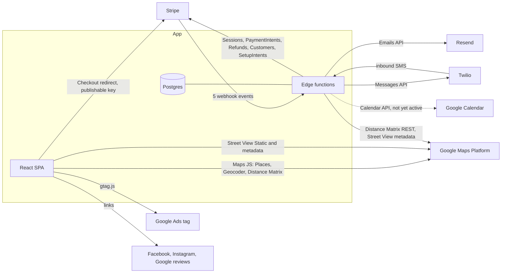

# External Integrations

Scope: describes the application as deployed in Production (branch main; Supabase project qaagfafagdpgzcijnfbw).

## Overview

The application integrates with four external services: Stripe (payments), Twilio (SMS), Resend (email), and Google (Maps, Calendar). Integration credentials are configured through Supabase function secrets and admin settings, and read by edge functions at runtime. Edge-function environment secrets: `STRIPE_SECRET_KEY` and `STRIPE_WEBHOOK_SECRET` (read by `stripe-webhook`; `STRIPE_SECRET_KEY` is also read by `get-payment-method`, `get-session-metadata` and `verify-payment`), `GOOGLE_MAPS_API_KEY` (`calculate-route-mileage` and `get-streetview-heading`) and optional `SITE_URL` (`send-invoice`, `create-order-short-link`) and `APP_URL` (`create-order-short-link`). The frontend uses `VITE_*` variables.

---

## Stripe

### Overview

Stripe handles card payments. Customer-facing payments use Stripe Checkout Sessions (hosted page); admin-initiated charges use the Stripe API directly with a saved payment method.

### Configuration

- Stripe secret key (admin settings): read by `stripe-checkout`, `stripe-charge`, `stripe-refund`, `charge-deposit`, `customer-balance-payment`, `reconcile-balance-payment`, `save-payment-method-from-session`, `fix-payment-method`, `backfill-payment-methods` and `backfill-card-details`.
- `admin_settings.stripe_publishable_key`: served by the `get-stripe-publishable-key` edge function. `StripeCheckoutForm.tsx` uses `VITE_STRIPE_PUBLISHABLE_KEY`.
- Edge environment `STRIPE_SECRET_KEY` and `STRIPE_WEBHOOK_SECRET`: used by `stripe-webhook`.
- Stripe SDK 20.0.0, API version `2024-10-28.acacia` (`2024-11-20.acacia` in `get-payment-method`, `get-session-metadata` and `verify-payment`).

### Payment Flows

#### Customer Checkout (Stripe Checkout Session)

1. Frontend calls `stripe-checkout` with the order ID and payment details.
2. The function rate-limits (5 requests per 60 s, keyed by IP plus order; an identifier is required) and performs server-side blackout checks.
3. It creates or reuses a Stripe customer (email and name) and saves `stripe_customer_id`. It does not set `customer_email` on the session.
4. Session metadata includes `order_id` and `payment_type`, which is `deposit`, `booking_request` (booking mode) or `card_update` (setup mode). Payment methods are `["card"]`.
5. `success_url` is `/payment-complete?session_id={CHECKOUT_SESSION_ID}&order_id=<id>` for booking/default flows, or portal URLs with query state for card update/invoice. `cancel_url` is `/payment-canceled?order_id=<id>` or the portal with `?card_update_canceled=true`.
6. The frontend redirects to Stripe's hosted page; Stripe notifies `stripe-webhook`.

**Blackout error codes:** `DATE_BLACKED_OUT`, `SAME_DAY_PICKUP_BLACKED_OUT`.

#### Setup Mode (Card-on-File)

Setup sessions are created when the request carries `bookingMode` or `setupMode` (`stripe-checkout`). `require_card_on_file` is a column on `orders` used by lifecycle/invoice code. `save-payment-method-from-session` is called by the **frontend** (`CustomerPortal.tsx`, `usePaymentCompletion.ts`), not by the webhook. The webhook itself also writes `stripe_payment_method_id`, customer id, brand and last four.

#### Deposit Charge (`charge-deposit` edge function)

Called from `orderApprovalService`, `ApprovalModal`, the Customer Portal (card-saved invoice path), `InvoiceAcceptanceView`, and the Task Detail Modal "Charge Card on File" button (`selectedPaymentType: 'balance'`, `tipCents: 0`).

Flow:
1. Reads `stripe_customer_id` and `stripe_payment_method_id` from the order.
2. Claims the charge with the boolean `orders.payment_lock`: `UPDATE ... SET payment_lock = true WHERE id = ... AND payment_lock = false`. If no row updates, it returns 409 "already being processed". The lock is released on any failure.
3. Balance charges re-read the balance after the lock and return 409 if the amount exceeds it.
4. Creates and confirms an off-session PaymentIntent.
5. On success, logs the payment, records a transaction receipt, and updates `status` (confirmed), `deposit_paid_cents`, `tip_cents` and `balance_due_cents`. The customer receipt email is sent on the **deposit path only**.
6. On failure the function returns an error and releases the lock. The decline email and SMS are sent by the **client** (`orderApprovalService.ts`) with a portal short link.

The function has `verify_jwt = true` and is rate-limited at 10 requests per 60 s.

#### Customer Balance Payment (`customer-balance-payment` edge function)

`verify_jwt = false`. Two paths: if a card is on file it creates an off-session PaymentIntent, writes a `payments` row, logs the transaction and emails a receipt; otherwise it creates a Checkout session and returns `{ url }`, and the webhook owns the database writes.

#### Other Stripe functions

`stripe-charge` (admin charges; `verify_jwt = true`, rate-limited 3 per 60 s; the code compares the caller's `user_roles.role` with the upper-case strings `ADMIN` and `MASTER`, while Production role values are stored in lower case), `get-payment-method`, `get-session-metadata`, `order-lifecycle` (status transitions called by the webhook) are also in `main`. `verify-payment` (deployed only) retrieves a Checkout Session and, if the webhook has not yet processed a paid session, updates the order and payment row itself.

### Webhook Processing (`stripe-webhook`)

Deployed with `verify_jwt = false`; authenticity is checked by Stripe signature.

**Signature Verification:** `stripe.webhooks.constructEvent()` with the edge environment secret `STRIPE_WEBHOOK_SECRET`. A missing secret returns 500; a missing or invalid signature returns 400.

**Idempotency:** `_shared/webhook-idempotency.ts` uses the `stripe_webhook_events` table (statuses `processing`, `succeeded`, `failed`; the event payload is stored). A `succeeded` event or a `processing` row younger than 5 minutes returns HTTP 200 `{ received: true, skipped: true }`; a `failed` event or a `processing` row older than 5 minutes is retried with `attempts` incremented. A processing error marks the event `failed` (error text limited to 1000 characters) and returns HTTP 500 so Stripe retries. If the idempotency lookup itself errors, processing continues.

**Handled Events:**

| Event | Action |
|---|---|
| `checkout.session.completed` | Saves payment method details; handles deposit or balance payment; status changes are delegated to the `order-lifecycle` edge function |
| `payment_intent.succeeded` | Calls `apply_balance_payment_financials()` |
| `payment_intent.payment_failed` | Marks the payment failed |
| `charge.refunded` | Records the refund and logs a transaction receipt |
| `setup_intent.succeeded` | Saves payment method to the order |


### Race-Condition Safety

**Deposits and balance charges (`charge-deposit`):** the `orders.payment_lock` boolean described above.

**Balance payments (`reconcile-balance-payment`):** `apply_balance_payment_financials()` locks the payment row `FOR UPDATE` and checks `order_financials_applied`, so only the first caller applies the totals; a second caller gets `alreadyReconciled`.

### Payment Method Storage

`save-payment-method-from-session` stores `stripe_payment_method_id`, `stripe_customer_id`, `payment_method_brand` and `payment_method_last_four`. `payment_method_exp_month`, `payment_method_exp_year` and `payment_method_validated_at` are written by the card validation inside `charge-deposit`.

### `fix-payment-method` edge function

A repair utility, not a customer flow. It lists the customer's last 20 Checkout Sessions, finds the one for the order, extracts its payment method and writes `orders.stripe_payment_method_id`. It creates no session, sends no notification, and is deployed with `verify_jwt = false`.

### Refunds (`stripe-refund` edge function)

Admin/master only (role check in the function), rate-limited 2 per 60 s:
1. Admin specifies amount and reason in the Payments tab.
2. The function calls `stripe.refunds.create()`.
3. It inserts `order_refunds` rows and calls the `increment_order_refunded_cents` RPC.
4. Receipt logging happens in the `charge.refunded` webhook handler. No function emails the customer a refund confirmation.

---

## Twilio (SMS)

### Overview

Twilio handles outbound SMS to customers and admin, and inbound customer replies.

### Configuration

Twilio credentials (account SID, auth token, from number) are configured in the admin settings and read at runtime by the edge functions that send SMS.

### Outbound SMS (`send-sms-notification` edge function)

- Reads Twilio credentials from `admin_settings` and calls the Twilio REST API.
- If `orderId` (camelCase) is provided, the message is logged to `sms_conversations` after Twilio accepts it. `order_id` (snake_case) is ignored.
- `verify_jwt = true` (see Email and Notification System).

### Inbound SMS (`twilio-webhook` edge function)

Deployed with `verify_jwt = false`. It matches the sender to an order (most recent outbound conversation, else the customer's latest `pending_review`/`confirmed`/`draft` order), stores the inbound message in `sms_conversations`, stores an auto-reply row and returns a TwiML auto-reply.

### Short URLs in SMS (`invoice_links` table)

- **Route:** `/i/:shortCode` -> `ShortLink` page, which does a `replace` to `/customer-portal/<orderId>?t=<token>` (no expiry check in the page).
- **`link_type`:** `invoice` (created by `send-invoice`) or `portal_shortlink` (created by `createShortPortalLink()`).
- **`short_code`** is 8 characters from an unambiguous set (excludes `0`, `O`, `1`, `I`, `l`, and also `i`, `o`); `send-invoice` retries up to 5 times for an unused code, and the column has a unique index where it is not null.
- **Expiration:** 3 days after the event date, or 30 days from creation when there is no event date. RLS lets anonymous and signed-in clients read and update `invoice_links` rows whose `expires_at` is in the future.
- **`create-order-short-link`** (deployed only, `verify_jwt = true`) calls an RPC `create_order_short_link` and returns `<SITE_URL or APP_URL, default https://bouncyhousehub.com>/portal/<short_code>`. The RPC is not present in Production, and the application route for short codes is `/i/:shortCode`.
- **Base URL in `send-invoice`:** the request `Origin` header, else `SITE_URL`, else `https://bouncepartyclub.com`.

`createShortPortalLink(orderId, supabaseClient, eventDate?)` lives in `src/lib/utils.ts`, returns `window.location.origin + /i/<code>`, and falls back to `/customer-portal/<orderId>` without a token if code generation fails.

### Delivery Status Callback (`twilio-status-callback` edge function)

Updates `sms_conversations.status` and `error_code` by `twilio_message_sid`. It does not write `notification_failures`.

Status: partially implemented. The status-update function is deployed with `verify_jwt = true`. Twilio delivery-status callbacks are not yet active: outbound messages do not request a `StatusCallback` and `sms_conversations` has no `error_code` column in Production (see Email and Notification System).

### SMS Message Templates

Templates are stored in `sms_message_templates` (13 rows in Production) and managed from the admin Message Templates tab. The list, which of them code reads, and the supported variables are in the Email and Notification System document. The crew checkpoint texts are built inline, not from templates.

---

## Resend (Email)

### Configuration

The Resend API key is configured in the admin settings and read by `send-email` at call time. The sender domain `noreply@bouncepartyclub.com` must be verified in Resend.

### `send-email` Edge Function

See Email and Notification System for the payload. The `from` field is ignored; the sender is always `<business_name> <noreply@bouncepartyclub.com>`. If sending fails and `skipFallback` is not set, an SMS goes to the admin phone.

### Auth Emails

Supabase's default auth emails are sent.

Status: partially implemented. Supabase default auth emails are sent. Branded auth emails through the `auth-email-hook` function are not in use (the function is a placeholder that returns HTTP 410).

### Email Template System

See Email and Notification System (`emailTemplateBase.ts`; functions take option objects; logo URL and phone are hard-coded).

---

## Google Maps

### Configuration

- Frontend: `VITE_GOOGLE_MAPS_API_KEY`.
- Edge functions: `calculate-route-mileage` uses the edge secret `GOOGLE_MAPS_API_KEY`.

### APIs Used

| API | Purpose |
|---|---|
| Places Autocomplete | Address input |
| Geocoding | Converting address to lat/lng |
| Distance Matrix (JS) | Travel fee, route optimization, ETA |
| Distance Matrix (REST, server-side) | `calculate-route-mileage` |

### SDK Loading

The singleton loader is `loadGoogleMapsAPI` in `src/lib/googleMaps.ts` (script URL with `v=weekly&loading=async`, 10 s poll). `src/lib/googleMapsLoader.ts` only exports `ensureGoogleMapsLoaded()` (geocoder import).

### Distance Matrix Usage

- Route optimization: 06:20 departure only when that time on the route date is still in the future; chunked to 100 elements.
- Travel fee (`calculateDrivingDistance` in `src/lib/distanceCalculator.ts`): no departure time, 5 s load timeout, falls back to straight-line distance x 1.4.
- Crew ETA (`calculateETA` in `src/lib/googleMaps.ts`): departure `new Date()`.

### Distance Calculator and Travel Fee

`distanceCalculator.ts` exports `calculateDistance` (haversine) and `calculateDrivingDistance`. Chargeable miles and zone overrides are in `src/lib/travelFeeCalculator.ts` (`calculateTravelFee`). The `HOME_BASE` constant (Wayne, MI; lat `42.2808`, lng `-83.3863`) is in `src/lib/constants.ts`; the home address in `admin_settings` (`home_address_*`) is used where configured. Results are stored on the order as `travel_total_miles`, `travel_base_radius_miles`, `travel_chargeable_miles`.

---

## Google Calendar

### Overview

The `sync-google-calendar` edge function writes one Google Calendar event per event date.

Status: partially implemented. The sync function, event format and `google_calendar_sync` tracking table are in place. Calendar sync is not yet active: Google Calendar credentials are not configured, the database trigger that queued syncs (`trg_auto_sync_google_calendar`) is not installed, and the admin Google Calendar tab is turned off in code (`GCAL_INTEGRATION_DISABLED = true`).

### Configuration (read by the function)

Google OAuth client credentials, a refresh token and the calendar id (default `primary`).

### Sync Flow (as coded)

The function accepts `{ dates, reconcile }`. With `dates` it syncs those dates; with `reconcile: true` it syncs every date from today to 90 days ahead that has a qualifying order or an existing sync row; otherwise it drains unprocessed rows of `google_calendar_sync_queue`. For each date it fetches `confirmed`, `in_progress` and `pending_review` orders, creates or updates the event (deleting it when no qualifying order remains) and records the result in `google_calendar_sync` (`last_sync_status` is written as `ok` or `error`). When the Google credentials are absent it returns early after draining the queue.

### Calendar Event Format

- **Summary:** `BPC: {activeCount} Active / {orderCount} Total Orders`
- **Description:** date, counts, customer names (up to 15, then "...and X more"); `activeCount` counts `confirmed` and `in_progress` orders and `orderCount` counts all qualifying orders
- **Reminders:** email and popup at 9am and 6pm the previous day; `useDefault: false`

---

## Rate Limiting

Shared utility `supabase/functions/_shared/rate-limit.ts`, backed by the `rate_limits` table and the `check_rate_limit` SQL function.

### How It Works

- Fixed window per `(identifier, endpoint)`, stored as `window_start` and `request_count`.
- Returns 429 when the count reaches the maximum (counting continues for rejected requests); blocks (`blocked_until`) for 5 minutes only when the count reaches 3x the maximum.
- Identifier is `prefix|ip:<ip>|id:<id>`, where `<id>` is the order id (`stripe-checkout`, `charge-deposit`) or the caller's user id (`stripe-charge`, `stripe-refund`); `submit-contact-inquiry` uses `contact-inquiry|ip:<ip>`.
- If the `check_rate_limit` call itself fails, the request is allowed. `stripe-checkout` and `charge-deposit` additionally refuse (HTTP 400) when neither an IP nor an order id is available.
- `cleanup_old_rate_limits()` deletes rows whose window started more than 1 hour ago, except rows that are still blocked.
- `RATE_LIMIT_CONFIGS` in `rate-limit.ts` also lists limits for `customer-balance-payment`, `customer-cancel-order`, `save-signature`, `send-invoice` and `send-sms-notification`; those functions do not call the limiter.

Status: partially implemented. The limiter and the cleanup function are in place. A scheduled run of the cleanup function is not yet active.

### Endpoints that call it

| Function | Limit |
|---|---|
| `stripe-checkout` | 5 per 60 s |
| `stripe-charge` | 3 per 60 s |
| `stripe-refund` | 2 per 60 s |
| `charge-deposit` | 10 per 60 s |
| `submit-contact-inquiry` (deployed only) | 3 per 300 s |

---

## Google Ads

The `GoogleAdsTag` component (`src/components/common/GoogleAdsTag.tsx`) manages client-side Google Ads tracking and is rendered at the app root.

### Tag ID

`AW-18153233398`

### Route Protection

The tag is not injected on these prefixes (exact match or prefix followed by `/`):

```
/admin, /crew, /setup, /invoice-preview, /menu-preview
```

Once injected the tag persists for the session; `send_page_view: false` means no events fire automatically on SPA navigation.

### `isInternalRoute(pathname)` and `trackGoogleAdsEvent(eventName, params?)`

`isInternalRoute` returns true for blocked prefixes. `trackGoogleAdsEvent` wraps `window.gtag('event', ...)`, returns immediately on internal routes and when `window.gtag` is not defined.

Status: partially implemented. The tag loads on public routes and the `trackGoogleAdsEvent` helper is in place. Conversion events are not yet wired to user actions.

---

## Integration Map



| Integration | Direction | Credential location (names only) | Used for |
|---|---|---|---|
| Stripe | Both | `stripe_secret_key` and `stripe_publishable_key` (admin settings), `STRIPE_SECRET_KEY`, `STRIPE_WEBHOOK_SECRET` (edge secrets), `VITE_STRIPE_PUBLISHABLE_KEY` (build) | Card payments, saved cards, refunds |
| Twilio | Both | `twilio_account_sid`, `twilio_auth_token`, `twilio_from_number` (admin settings) | SMS to customers and admin, inbound replies |
| Resend | Outbound | `resend_api_key` (admin settings) | All transactional email |
| Google Maps Platform | Outbound | `VITE_GOOGLE_MAPS_API_KEY` (build), `GOOGLE_MAPS_API_KEY` (edge secret) | Address entry, geocoding, travel distance, route optimization, Street View |
| Google Calendar | Outbound | `google_calendar_client_id`, `google_calendar_client_secret`, `google_calendar_refresh_token`, `google_calendar_id` (admin settings) | Daily schedule events (not yet active) |
| Google Ads | Outbound (browser) | Tag id compiled into `GoogleAdsTag.tsx` | Ad-conversion tag |
| Google sign-in | Browser redirect | Configured in the Supabase Auth dashboard | Customer login |
| Social and reviews | Links | `facebook_url`, `instagram_url`, `google_review_url` (admin settings) | Footer links, review requests |
| Supabase | Both | `VITE_SUPABASE_URL`, `VITE_SUPABASE_ANON_KEY`; platform-injected variables in edge functions | Database, auth, storage, realtime, functions |
| Netlify | Build/host | `netlify.toml`; build variables in the Netlify site settings | Hosting |

---

## Stripe in Depth

### API surface used by the edge functions

| Stripe API | Called by | Purpose |
|---|---|---|
| `customers.create` | `stripe-checkout`, `customer-balance-payment` | Create a customer for an order; id stored in `orders.stripe_customer_id` |
| `checkout.sessions.create` (modes `payment` and `setup`) | `stripe-checkout`, `customer-balance-payment` | Hosted payment page, or card capture without a charge; `payment_method_types: ["card"]` |
| `checkout.sessions.retrieve` / `list` (`list` only in `fix-payment-method`) | `get-session-metadata`, `save-payment-method-from-session`, `reconcile-balance-payment`, `fix-payment-method`, `verify-payment` | Read the outcome and metadata of a session |
| `paymentIntents.create` | `charge-deposit`, `customer-balance-payment`, `stripe-charge` | Off-session charge of the saved card |
| `paymentIntents.retrieve` / `cancel` | webhook handlers, `customer-balance-payment`, `stripe-refund`, `backfill-payment-methods` (`cancel` only in `customer-balance-payment`) | Confirm status; cancel an unfinished intent |
| `charges.retrieve` | `charge-deposit`, `customer-balance-payment`, `reconcile-balance-payment`, webhook handlers | Fee and net amounts for the `payments` ledger |
| `setupIntents.retrieve` | `stripe-webhook` handlers, `save-payment-method-from-session` | Saved payment method after card capture |
| `paymentMethods.retrieve` / `list` (`list` only in `charge-deposit`) | `get-payment-method`, `charge-deposit`, `payment-validation.ts` (shared validation), `stripe-charge`, `save-payment-method-from-session`, webhook handlers, `backfill-card-details` | Brand, last four, expiry validation |
| `refunds.create` / `list` | `stripe-refund` | Admin refunds and refund reconciliation |
| `webhooks.constructEvent` | `stripe-webhook` | Signature verification |

API versions: `2024-10-28.acacia` (most functions) and `2024-11-20.acacia` (`get-payment-method`, `get-session-metadata`, `verify-payment`); SDK `stripe@20.0.0` in Deno. The browser loads only `@stripe/stripe-js` with the publishable key.

### Webhook endpoint

`stripe-webhook` (`verify_jwt = false`) is the single endpoint. It handles `checkout.session.completed`, `payment_intent.succeeded`, `payment_intent.payment_failed`, `charge.refunded` and `setup_intent.succeeded`; other event types are acknowledged and ignored. Each event is recorded in `stripe_webhook_events` before processing and marked `succeeded` or `failed`.

### Stripe settings and where each is read

| Key / secret | Read by |
|---|---|
| `stripe_secret_key` (admin setting) | `stripe-checkout`, `stripe-charge`, `stripe-refund`, `charge-deposit`, `customer-balance-payment`, `reconcile-balance-payment`, `save-payment-method-from-session`, `fix-payment-method`, `backfill-payment-methods`, `backfill-card-details` |
| `STRIPE_SECRET_KEY` (edge secret) | `stripe-webhook`, `get-payment-method`, `get-session-metadata`, `verify-payment` |
| `STRIPE_WEBHOOK_SECRET` (edge secret) | `stripe-webhook` |
| `stripe_publishable_key` (admin setting) | `get-stripe-publishable-key` |
| `VITE_STRIPE_PUBLISHABLE_KEY` (build) | `StripeCheckoutForm.tsx` |

The admin Settings screen saves the Stripe keys and then performs an `OPTIONS` request against `stripe-checkout` as a reachability check.

### Checkout return path

Stripe returns to `/payment-complete?session_id=...&order_id=...`, `/payment-canceled?order_id=...` or the customer portal URL with query state. `checkout-bridge` (a minimal HTML page on the Supabase domain) relays completion to the opener window with `postMessage` for pop-up checkouts. `public/payment-success.html` is a static confirmation page shipped with the site.

---

## Twilio in Depth

| Capability | Implementation |
|---|---|
| Outbound SMS and MMS | `send-sms-notification` calls the Messages API with `To`, `From`, `Body` and optional `MediaUrl` values |
| Number handling | `+1` is added to numbers that lack a `+` |
| Inbound SMS | Twilio posts to `twilio-webhook`; the function files the message under the matching order and returns a TwiML auto-reply |
| Delivery status | `twilio-status-callback` updates `sms_conversations.status` and `error_code` by message SID; Status: partially implemented. The function is deployed with `verify_jwt = true`; outbound messages do not yet request a status callback URL, so statuses stay at the value recorded at send time, and `sms_conversations` has no `error_code` column in Production |
| Credentials | Read from `admin_settings` at call time, so rotating a key needs no redeploy |
| Setup UI | The admin Settings screen saves the three Twilio keys; the first-time `/setup` page can set them too |
| Failure handling | Twilio error code and message are recorded with `record_notification_failure`; the admin receives a fallback email |

Webhook configuration on the Twilio number (inbound message URL) points at the `twilio-webhook` function URL; the function validates required fields and answers every request with HTTP 200.

---

## Resend in Depth

- One verified sender address, `noreply@bouncepartyclub.com`; display name from `business_name`; reply-to from `business_email`.
- API key in `admin_settings.resend_api_key`, read on each send.
- Supports HTML, plain text and base64 attachments (used for the signed waiver PDF).
- Responses: success returns the Resend message id; Resend errors are surfaced to the caller and recorded as notification failures.
- Rate limiting is Resend's own; the application does not throttle `send-email`.

---

## Google Maps Platform in Depth

| API / product | Where | Detail |
|---|---|---|
| Maps JavaScript API loader | `src/lib/googleMaps.ts` (`loadGoogleMapsAPI`) | One script tag with the browser key, `v=weekly`, `loading=async`; polls up to 10 seconds; shared by most components. `AddressAutocomplete` adds its own script tag (`libraries=places&v=weekly&loading=async`) when no Maps script is on the page |
| Places Autocomplete (`importLibrary("places")`) | `AddressAutocomplete` (quote form, sign-up, admin Business Address, Branding, Travel Calculator) | Restricted to the US (`componentRestrictions: { country: 'us' }`); requests `address_components`, `formatted_address`, `geometry`; returns street, city, state, ZIP, lat and lng |
| Geocoder | `addressService.ts` (saving canonical addresses), `AddressCoordinateBackfill` (admin tool), quote pricing hooks | Fills latitude/longitude; addresses are saved without coordinates when Maps is unavailable |
| Distance Matrix (JS `DistanceMatrixService`) | `distanceCalculator.ts` (travel fee), `routeOptimizationDistanceMatrix.ts` (crew route planning), `calculateETA` in `googleMaps.ts` (crew ETA) | Driving distance and duration; see ARCHITECTURE.md for the fallback to straight-line distance x 1.4 |
| Distance Matrix (REST) | `calculate-route-mileage` | Daily route mileage for the crew mileage log |
| Street View Static API | `StreetViewImages` (admin order card) | Four 600x400 images (N/E/S/W) per address, with the view that faces the building highlighted |
| Street View metadata | `StreetViewImages` (browser) and `get-streetview-heading` (edge, deployed only, `verify_jwt = false`) | Locates the nearest panorama and computes the facing heading. No screen in `main` calls `get-streetview-heading`; `StreetViewImages` queries the metadata endpoint directly with the browser key |

Requests use the browser key (`VITE_GOOGLE_MAPS_API_KEY`) in the browser and the secret `GOOGLE_MAPS_API_KEY` on the server. The `HOME_BASE` default and `home_address_*` settings define the route origin.

---

## Google Calendar (key names and flow)

Settings keys read by `sync-google-calendar`: `google_calendar_client_id`, `google_calendar_client_secret`, `google_calendar_refresh_token`, `google_calendar_id` (default `primary`). The function exchanges the refresh token for an access token, lists the day's `confirmed`, `in_progress` and `pending_review` orders, creates, updates or deletes one event per date and stores the event id in `google_calendar_sync`. Dates to sync are also read from `google_calendar_sync_queue`. The admin Google Calendar settings panel is switched off in code (`GCAL_INTEGRATION_DISABLED = true`) and the queueing trigger function `auto_sync_google_calendar()` is not attached to a table. The `google_oauth_client_id` and `google_oauth_client_secret` keys also exist in `admin_settings` but are not read by application code.

Status: partially implemented. Function, queue table, tracking table and event format are in place. The credentials, the queueing trigger and the admin panel are not yet active.

---

## Google Ads Tag, Reviews and Social Links

| Item | Behaviour |
|---|---|
| Ads tag | `GoogleAdsTag` injects `gtag.js` for tag id `AW-18153233398` on public routes only (never `/admin`, `/crew`, `/setup`, `/invoice-preview`, `/menu-preview`), once per session, with `send_page_view: false`. `trackGoogleAdsEvent()` is available; no conversion event is wired yet |
| Google reviews on the site | The Home page lists rows of the `google_reviews` table that are active (`is_active`), rated 4 or higher, ordered by `display_order`; reviews are curated in the admin Reviews screen, not fetched from Google |
| Review link | `google_review_url` (admin Branding screen) is substituted as `{review_url}` in templates and used for review requests |
| Social links | The footer links to the business Instagram and Facebook pages; `facebook_url` and `instagram_url` settings (exposed by `get_public_business_settings`) hold the configured addresses |

---

## Storage Buckets (limits)

| Bucket | Public | Max object size | Allowed types |
|---|---|---|---|
| `unit-images` | Yes | not limited | any |
| `carousel-media` | Yes | 500 MB | JPEG, PNG, GIF, WebP, MP4, WebM, QuickTime |
| `lot-pictures` | Yes | 10 MB | JPEG, PNG, WebP, HEIC |
| `order-pictures` | Yes | 10 MB | PNG, JPEG, GIF, WebP, HEIC, HEIF |
| `public-assets` | Yes | 10 MB | PNG, JPEG, GIF, WebP, HEIC, HEIF |
| `signatures` | Yes | 2 MB | PNG, JPEG |
| `signed-waivers` | Yes | 10 MB | PDF |
| `physical-waivers` | No | 20 MB | JPEG, PNG, WebP, PDF |

Access policies per bucket are in DEPLOYMENT_AND_SECURITY.md.

---

## Build, Hosting and Platform Configuration

| Item | Detail |
|---|---|
| Vite | `vite.config.ts`: React plugin; `lucide-react` excluded from dependency pre-bundling; no custom proxy or aliases |
| Netlify | `netlify.toml`: build `npm run build`, publish `dist`, Node 20.17.0, secrets scanning smart detection disabled (frontend variables are public by design), single catch-all rewrite to `/index.html` with status 200 |
| Vercel | `vercel.json` carries the same catch-all rewrite |
| Supabase `config.toml` | Lists a `verify_jwt` value for each of the 39 functions in the repository (see ARCHITECTURE.md); the five additional deployed functions (`backfill-card-details`, `create-order-short-link`, `get-streetview-heading`, `submit-contact-inquiry`, `verify-payment`) carry their setting in the deployment. The `record-consent` file on main is empty and the deployed `record-consent` has an empty source as well |
| Edge dependency pins | `supabase/functions/deno.json` maps `npm:@supabase/supabase-js` and `npm:stripe` to fixed versions |
| Dependencies | `package.json` runtime dependencies: React, React DOM, React Router, Supabase JS, Stripe JS and React Stripe, date-fns, lucide-react, signature_pad, dotenv, stripe |

---

## Related Reference Documents

`API_REFERENCE.md` (function contracts), `DATABASE_SCHEMA.md` (tables), `PAYMENTS_AND_RECEIPTS.md` (payment ledger behaviour), `EMAIL_SYSTEM.md` (messages), `DEPLOYMENT_AND_SECURITY.md` (secrets and RLS).
