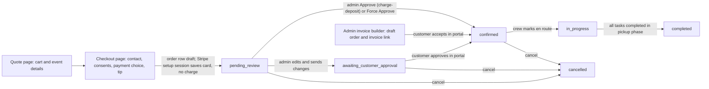
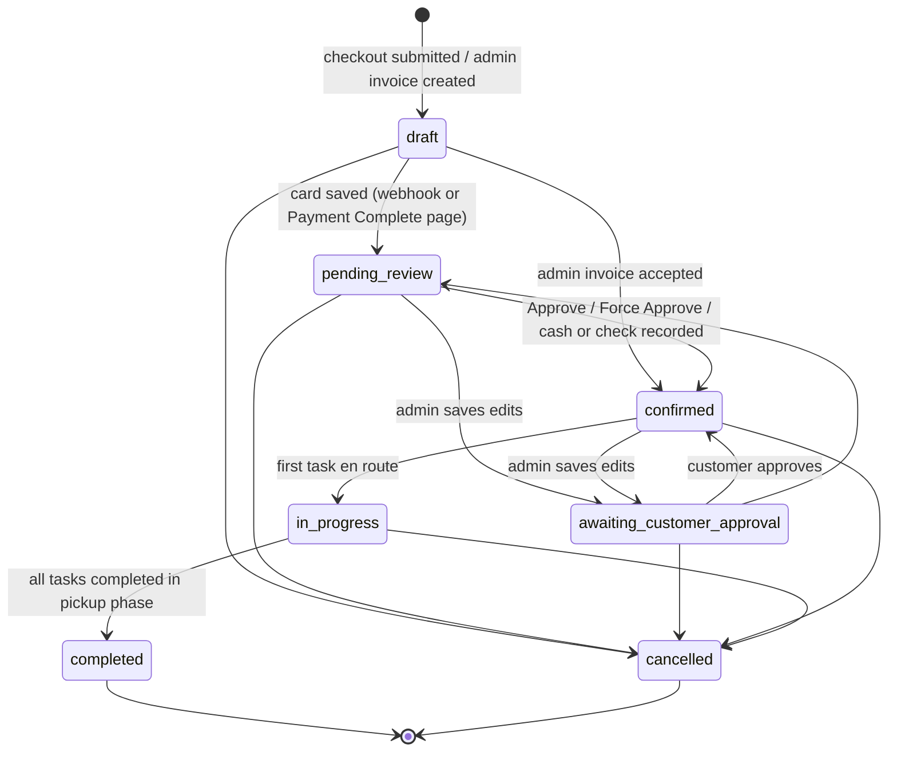

# Orders and Workflow

Scope: describes the application as deployed in Production (branch main; Supabase project qaagfafagdpgzcijnfbw).

## Overview

An order is the central record of the application. It is created when a customer submits the quote/checkout form (or when an admin builds an invoice), moves through a defined status lifecycle, and is eventually completed or cancelled. This document covers the full lifecycle of an order from creation through completion.

Related references: column-level detail is in [DATABASE_SCHEMA.md](DATABASE_SCHEMA.md), endpoint request/response detail in [API_REFERENCE.md](API_REFERENCE.md), screens and components in [FRONTEND_REFERENCE.md](FRONTEND_REFERENCE.md), full diagrams in [DIAGRAMS.md](DIAGRAMS.md). Money movement, receipts and refunds are in [PAYMENTS_AND_RECEIPTS.md](PAYMENTS_AND_RECEIPTS.md); crew-side workflow in [CREW_AND_OPERATIONS.md](CREW_AND_OPERATIONS.md); emails and SMS in [EMAIL_SYSTEM.md](EMAIL_SYSTEM.md).

### The whole journey at a glance



Who does what:

| Actor | Screens | What they can do to an order |
|---|---|---|
| Visitor / customer | `/quote`, `/checkout`, `/payment-complete`, `/customer-portal/:orderId`, `/i/:shortCode` | Build a quote, submit a booking request, accept an admin invoice, approve or reject admin edits, pay the balance and tip, update the saved card, sign the waiver, upload lot pictures, cancel (while the order is draft, pending review, awaiting approval or confirmed), view receipts |
| Signed-in customer | `/my-orders` (`CustomerDashboard`) | See own orders, open the portal, cancel, duplicate an order into a new quote |
| Admin / master | Admin Orders, Invoices, Calendar tabs | Everything in this document: approve, force approve, reject, edit, override fees, deposit and tax, change status, cancel, record cash and check, refund, archive, build invoices |
| Crew | Crew page (Calendar and Invoice tabs) and Calendar task screens | Record cash and check payments, progress tasks (which moves the order to in progress and completed) and build simplified invoices in the Crew Invoice tab (customer, units with editable quantity, event details and an admin message; no discounts, custom fees, waivers or deposit override); see [CREW_AND_OPERATIONS.md](CREW_AND_OPERATIONS.md) |

---

## Quote and Cart (`/quote`)

The Quote page (`src/pages/Quote.tsx`, hooks `useQuoteCart`, `useQuoteForm`, `useQuotePricing`, `useQuotePrefill`) builds the cart and event details that Checkout later turns into an order. Nothing is written to the database on this page; it only reads `pricing_rules` and checks availability.

### Browser storage

| Key | Content | Notes |
|---|---|---|
| `bpc_cart` | Array of cart items (`unit_id`, `unit_name`, `wet_or_dry`, `unit_price_cents`, optional `price_dry_cents`, `price_water_cents`, `is_combo`, `qty`, `isAvailable`) | 7-day expiry (SafeStorage). Loaded only if every item has a real `unit_id`, a numeric `qty` and `wet_or_dry` of `dry` or `water`. Legacy combo items missing a price variant are re-priced from `units` on load |
| `bpc_quote_form` | The form fields below | 7-day expiry; autosaved 500 ms after each change once a date or address exists. On reload the saved form does NOT restore residential/commercial, pickup preference, stakes answer or either responsibility checkbox: the customer must choose them again |
| `bpc_address_input` | Text shown in the address box | |
| `bpc_price_breakdown` | Last computed price breakdown | Written when the form is submitted; read by Checkout |
| `bpc_contact_data` | Contact info for Checkout prefill | Cleared by "Clear All" only when the visitor is signed out |
| `bpc_quote_prefill`, `bpc_prefill_applied`, `bpc_duplicate_order` | One-shot prefill from order duplication or the home-page date box | Removed after being applied |

Changes to the cart dispatch the browser event `bpc-cart-updated` so the header cart badge refreshes. "Clear All" (with confirmation "Are you sure you want to clear your cart and all form information?") empties cart and form.

### Cart items

- A unit is added from the catalog or unit page with the mode the visitor chose. Price snapshot = `units.price_dry_cents` or `units.price_water_cents` for that mode.
- A **combo** unit (both dry and water prices) shows a Dry/Water toggle in the cart; toggling replaces `wet_or_dry` and `unit_price_cents` with the matching stored price. A combo whose two prices could not be loaded shows an amber notice and cannot be toggled.
- Quantity is displayed (not editable on the quote page; each add is one line, qty 1).
- Each line shows a red **Not Available** badge and message when the availability check (below) fails for the chosen dates.

### Event details and rules

| Field | Default | Rule |
|---|---|---|
| Event type | none (must choose) | `residential` or `commercial` |
| Pickup (residential only) | none | `next_day` ("Next Morning") or `same_day` ("Same Day", "Additional fees apply") |
| Commercial | | Forces `pickup_preference = same_day`. Banner: "Commercial events require same-day pickup by 7:00 PM." |
| Event start date | empty | The date picker's minimum is the current date in UTC (`new Date().toISOString()`), which can be one day ahead of Detroit time in the evening. Changing the start date moves the end date by the same number of days |
| Event end date | = start date when first set | Locked to the start date for commercial or residential same-day (single-day rental) |
| Start / end time | 09:00 / 17:00 | For same-day pickup (commercial or residential same-day) the end time cannot be later than 19:00 and "until end of day" is cleared |
| Address | city Detroit, state MI | Google Places autocomplete fills line1, city, state, zip, lat, lng. If only city/state/zip are present the form geocodes them |
| Stakes | none (must choose) | "Yes, we can stake" means grass surface; "No" means sandbags required (`surface = cement`) |
| Generator | off | Checkbox "I need a generator (no power outlet available)". One generator is priced (`generator_qty` 0 on the form, `has_generator` true). The Quote Summary line reads "Generator Rental (N unit(s))" with N = total units / 2 rounded up; that label does not change the fee, which stays the single-generator fee |
| Pets | off | Checkbox "We have pets at this location" (residential only). Kept in the quote form and used for duplication prefill; checkout does not write it to the order |
| Special details | empty | Free text, stored on the order |
| Responsibility agreement | unchecked | Overnight checkbox for residential next-morning pickup ("...legally responsible for its safety and security until pickup the next morning."); "I understand I am legally responsible for the inflatable until Bounce Party Club picks it up this evening." for residential same-day; "...until Bounce Party Club picks it up by 7:00 PM." for commercial (commercial and same-day both store `same_day_responsibility_accepted`) |
**Same-day pickup blackout:** after a start date is chosen the page calls `check_date_blackout`. If same-day pickups are blocked for that date range the Commercial and Same Day buttons are disabled ("Not available this date" / "Same-day pickups are not available for this date. Commercial bookings are unavailable."), and any existing commercial or same-day selection is switched back to residential / next morning with the same-day acknowledgement cleared.

### Live pricing

`useQuotePricing` recalculates 500 ms after any change, but only when the cart is not empty, pricing rules loaded, and zip, lat/lng, both dates, pickup preference and the stakes answer are all present. Otherwise the summary reads "Enter your address and event date to see delivery fees and full pricing estimate." The calculation is described in [Pricing and Totals](#pricing-and-totals). The Quote Summary card lists items, then Travel Fee (with miles), Sandbag Fee, Same-Day Pickup, Same-Day Delivery, Generator Rental, Tax (6%) when present, and "Estimated Total" with the note "Estimate based on your address and event details. Final total confirmed at checkout."

### Submit validation

"Continue" runs `validateQuote` and stops at the first failure with a red banner (and a bottom toast on phones) that stays until dismissed, scrolling to the field. Order of checks and messages:

| # | Check | Message |
|---|---|---|
| 1 | Cart empty | Please add at least one inflatable to your quote. |
| 2 | Any item flagged unavailable | The following inflatables are not available for your selected dates: <names>. Please choose different dates or remove these items. |
| 3 | Street / city / state / ZIP blank | Please enter a street address / city / state / ZIP code for the event location. |
| 4 | Event type missing | Please select an event type (Residential or Commercial). |
| 5 | Residential without pickup choice | Please select when you need pickup (Next Morning or Same Day). |
| 6 | Stakes answer missing | Please indicate whether we can anchor the inflatable with stakes. |
| 7 | Start date / end date / start time / end time missing | Please select an event start date / end date / start time / end time. |
| 8 | Overnight agreement unchecked (residential next-day) | Please accept the overnight responsibility agreement. |
| 9 | Same-day agreement unchecked | Please accept the responsibility agreement for same-day pickup. |
| 10 | Commercial agreement unchecked | Please accept the responsibility agreement for commercial events. |

Check 3 tests street, city, state and ZIP in that order and names the first blank field. Because choosing Commercial sets the pickup preference to `same_day`, an unchecked commercial agreement is caught by check 9 first and shows the same-day message; the commercial message (check 10) is reached only if the pickup preference is empty.

If validation passes the page re-runs the availability check; if something was booked in the meantime the banner reads "Sorry, the following inflatables were just booked: <names>. Please choose different dates or remove these items." Otherwise the form and price breakdown are saved and the visitor is sent to `/checkout`.

---

## Availability and Blackout Dates

**Unit availability (`src/lib/availability.ts`).** A unit is unavailable for a date range when any `order_items` row for that unit belongs to an order in one of these statuses whose date range overlaps the requested range (start and end dates are inclusive on both sides): `pending_review`, `awaiting_customer_approval`, `approved` (legacy), `confirmed`, `in_progress`, `completed`. `draft`, `cancelled` and `void` orders never block. The check is "is anyone holding this unit", not a stock count: `inventory_qty` is not compared with overlapping quantities. When an existing order is being edited or approved its own id is excluded. A blackout (below) that fully blocks the range makes every unit unavailable. A database error is treated as unavailable (fail closed).

**Blackout dates (`blackout_dates` table, `check_date_blackout(p_start, p_end)` function).**

| Setting | Values | Meaning |
|---|---|---|
| `block_type` | `full` | No bookings for the range |
| | `same_day_pickup` | Only same-day pickups and commercial events are refused |
| `recurrence` | `one_time` | Plain overlap of `start_date`..`end_date` with the requested range |
| | `annual` | The month/day range repeats every year (ranges that wrap New Year, for example Dec 24 to Jan 2, are handled for both cycles) |
| `expires_at` | optional date (the admin form stores it only for annual rules) | The rule is ignored when the requested start is after this date (the database function applies this test to every rule that has the column set) |
| `reason` | required | Shown to admins only |

The function returns `is_full_blocked` and `is_same_day_pickup_blocked`; a full block also sets the same-day flag. The browser helper `checkDateBlackout` treats an RPC error as "not blocked" (the server gate repeats the check).

**Where availability and blackouts are enforced**

| Point | Check | Failure behaviour |
|---|---|---|
| Quote page | units + same-day blackout | Badge on cart line; same-day options disabled |
| Quote submit | units | Banner "Sorry, the following inflatables were just booked: ..." |
| Checkout submit | units | Toast "Sorry, the following units are no longer available for your selected dates: <names>. Please return to the quote page and select different units or dates." |
| `createOrderBeforePayment` | full blackout, same-day blackout (for same-day or commercial orders), units | Errors "This date is not available for booking. Please contact us or choose a different date.", "Same-day pickups are not available for this date. Please choose next-day pickup or select a different date.", "Cannot create order: The following units are not available for the selected dates: ..." |
| `stripe-checkout` (server, not in `setupMode`) | blackout RPC | 400 with code `DATE_BLACKED_OUT` or `SAME_DAY_PICKUP_BLACKED_OUT`; 503 "Unable to verify date availability. Please try again." if the RPC errors |
| Admin Approve / Force Approve | units, excluding the order | "Cannot approve order: The following units are no longer available for the selected dates: ... Please check the calendar for conflicts." / "Cannot force approve order: ..." |
| Admin status dialog to Confirmed | units | "Cannot confirm order: The following equipment is not available for the selected dates: ..." |
| Order edit (admin) | units for the staged items | Save blocked: "Cannot save: The following units are not available for the selected dates: ... Please adjust the dates or remove the conflicting items." |
| Invoice builder | units | "Cannot create invoice: The following units are not available ..." |
| Customer approval of changes | units | "Sorry, one or more items in your order are no longer available for your event date. Please contact us to reschedule." |
| `charge-deposit` (server) | units vs the blocking statuses | 409 "One or more items in this order are no longer available for the event date. Please contact support to reschedule."; 503 "Unable to verify item availability. Please try again or contact support." |

**Admin management.** The Blackout tab (`BlackoutTab`) adds, lists and deletes blackout dates (start, end and reason required; block type; one-time or annual; optional expiry for annual rules; there is no edit step). The tab also shows a calendar overview of the configured dates. The tables `blackout_addresses` and `blackout_contacts` exist in Production.

Status: partially implemented. The tables and the form and list components for blackout addresses and contacts (`BlackoutAddressForm`, `BlackoutAddressesList`, `BlackoutContactForm`, `BlackoutContactsList`) are in the code base. They are not mounted in the Blackout tab, and no booking or checkout step checks a customer's address or contact against the tables.

---

## Pricing and Totals

All money is integer cents. The engine is `calculatePrice` in `src/lib/pricing.ts`; the same function runs for the Quote page, the admin invoice builder and the admin order editor. The rules are one row in `pricing_rules`, edited in the admin Pricing tab (Settings). Values current at the time of writing are shown for the examples; they are admin-editable.

| Rule (column) | Meaning | Value at time of writing |
|---|---|---|
| `base_radius_miles` | Driving miles from the home base with no travel fee | 15 |
| `per_mile_after_base_cents` | Travel fee per mile beyond the base radius | 300 |
| `included_city_list_json` / `included_cities` | Cities with free travel | Detroit |
| `zone_overrides_json` | Flat travel fee by ZIP (`{zip, flat_cents}`) | none |
| `surface_sandbag_fee_cents` | Sandbag fee | 3500 |
| `residential_multiplier`, `commercial_multiplier` | Multiplies the day-1 items total | 1.00 / 1.00 |
| `extra_day_pct` | Percent of day-1 items total added per extra day | 50 |
| `same_day_pickup_fee_cents` | Same-day pickup fee | 10000 |
| `same_day_weekday_delivery_fee_cents` | Fee when the event is today (a weekday) | 5000 |
| `generator_fee_single_cents`, `generator_fee_multiple_cents` | First generator / each additional generator | 9500 / 7500 |
| `deposit_per_unit_cents` | Default deposit per unit quantity | 5000 |
| `apply_taxes_by_default` | Whether 6% tax is added | false |

### Calculation steps (`calculatePrice`)

1. **Day-1 items** = sum of `unit_price_cents x qty`, multiplied by the residential or commercial multiplier and rounded.
2. **Subtotal** = day-1 items + `round(day-1 items x extra_day_pct / 100 x extra days)`, where days = end date minus start date plus 1.
3. **Travel fee.** Distance = Google driving distance (Distance Matrix, converted from meters at 1609.34 per mile) from the home base (Wayne, MI, latitude 42.2808 and longitude -83.3863, a fixed point in code) to the event address, or straight-line miles x 1.4 when Google Maps does not load within 5 seconds, is not available, or the Distance Matrix call does not return a usable result. Then, in this order: a ZIP in `zone_overrides_json` gives its flat fee; else a city in the free-city list (case-insensitive) is 0; else miles beyond `base_radius_miles` x `per_mile_after_base_cents`, rounded; else 0.
4. **Surface fee** = sandbag fee when the surface is cement, or grass with no stakes allowed; otherwise 0.
5. **Same-day pickup fee** = rule fee when the location is commercial or the pickup preference is not next morning (the engine input `overnight_allowed` is true only for `next_day`). A rule fee of 0 gives no fee.
6. **Same-day weekday delivery fee** = rule fee when the event date equals today in `America/Detroit` and today is Monday to Friday; otherwise 0.
7. **Generator fee** = 0 for none; one generator = the single fee; N generators = single fee + (N - 1) x additional fee. The quote form prices one generator; admins can set a quantity on invoices and edits. The `same_day_matrix_json` and `deposit_percentage` columns of `pricing_rules` (values present in Production) are not read by `calculatePrice`.
8. **Tax** (6%, rounded) = `(subtotal + travel + surface + generator) x 0.06` when `apply_taxes_by_default` is true, else 0 (a missing value is treated as true). Same-day pickup and same-day delivery fees are never taxed in the quote path.
9. **Total** = subtotal + travel + surface + same-day pickup + same-day delivery + generator + tax.
10. **Default deposit** = total unit quantity x `deposit_per_unit_cents`. **Balance** = total minus deposit (never below 0).

### Worked examples (rules above)

| Case | Calculation | Result |
|---|---|---|
| A. One $200 dry unit, 1 day, residential next-morning, 22.5 driving miles to a non-free city, cement/no stakes, one generator, taxes off | items 20000; travel (22.5 - 15) x 300 = 2250; sandbags 3500; generator 9500; tax 0 | Total 35250; deposit 5000; balance 30250 |
| B. Same as A with taxes on | tax round((20000 + 2250 + 3500 + 9500) x 0.06) = 2115 | Total 37365; deposit 5000; balance 32365 |
| C. Commercial, units $150 + $200, in Detroit, grass, taxes on | items 35000; travel 0 (free city); same-day pickup 10000 (untaxed); tax round(35000 x 0.06) = 2100 | Total 47100; deposit 2 x 5000 = 10000; balance 37100 |
| D. One $200 unit for 3 days | day 1 20000; extra days 2 x 50% x 20000 = 20000 | Subtotal 40000 |
| E. Item subtotal 40000, a 10% discount and a $25 custom fee (taxes off) | discount round(40000 x 0.10) = 4000; fee 2500 | Total 40000 + 2500 - 4000 = 38500 |

### Admin overrides and waivers

- **Fee waivers.** Travel, surface, same-day pickup, generator and same-day weekday delivery fees and tax each have a `*_waived` flag and a `*_waive_reason`. Waiving stores the fee column as 0 and sets the flag; order summaries rebuild the original amount so the line shows with a WAIVED badge. The waiver dialog asks for a reason when a fee is waived ("Please provide a reason for waiving this fee." / "Please provide a reason for waiving tax."); the same-day weekday delivery fee has an extra check at generate/save time (invoice builder: "A reason is required to waive the Same-Day Weekday Delivery Fee"; order save: the same text with a toast and the save is stopped).

  Status: partially implemented. The rebuild of waived amounts in `loadOrderSummary` works for travel (stored miles and current rules, base radius and per-mile fallback), tax (6% of the rebuilt base) and the weekday delivery fee (current rule fee). For the surface fee it only runs when `surface` equals `concrete`, a value the `surface` column does not allow (`grass` or `cement`), so a waived sandbag fee is not rebuilt there; same-day pickup is rebuilt only when `pickup_preference` is `same_day` and uses the current rule fee; the generator amount is rebuilt as `generator_price_cents x generator_qty` (7500 each) rather than the single/additional fee pair.
- **Tax toggle.** The admin tax control reads `apply_taxes_by_default`. When taxes are on by default the button is "Waive Tax" / "Restore Tax" (reason required when waiving, logged). When off by default the same flag acts as an opt-in: "Apply Tax" / "Remove Tax" and the checkbox "Apply Sales Tax (6%)". In the order editor and the admin invoice builder (`usePricing`) the tax base is subtotal + (non-waived) travel + surface + generator + custom fees - discounts; same-day pickup and weekday delivery fees are outside the base, as in the customer quote (step 8, which has no custom fees or discounts). The Crew Invoice tab (`useInvoicePricing`) is the exception: its base also includes the same-day pickup and weekday delivery fees.
- **Discounts** (`order_discounts`): a name plus either a fixed amount or a percentage of the items subtotal (never both; "Please enter either an amount or percentage", "Please enter either amount OR percentage, not both", "Values cannot be negative"). A percentage discount is `round(subtotal x pct / 100)` and does not reduce fees. Admins can pick or save templates (`saved_discount_templates`; saving a duplicate name shows "A discount template with the name ... already exists. Please choose a different name."). Where both columns could be set, the code paths disagree on precedence (`calculateTotalFromOrder`, `charge-deposit` and `send-invoice` use the percentage first; the editor and invoice pricing hooks use `amount_cents` first), but the UI never saves both. The database functions `record_cash_payment` and `record_check_payment` sum only `amount_cents` of discounts, so a percentage discount (stored with `amount_cents` 0) counts as 0 there.
- **Custom fees** (`order_custom_fees`): a name plus a positive amount ("Please enter a valid fee amount greater than zero"), with templates in `saved_fee_templates` (duplicate name message: "A fee template with the name ... already exists. Please choose a different name.").
- **Deposit override.** `custom_deposit_cents` replaces the default deposit; in the Deposit Override box, applying a blank value sets 0 ("waive deposit": the customer only has to accept and keep a card on file). The deposit is clamped to the order total in the editor and invoice builder (`usePricing`).
- **Item quantity and price.** The order editor adds and removes units only: existing lines show quantity as text and price is not editable (a newly added unit is priced from the unit's current dry or water price). The admin invoice builder lets the admin change quantity (plus and minus buttons for units with `inventory_qty` above 1, capped at `inventory_qty`) but not the unit price; the Crew Invoice tab behaves the same. The hook function `updateItemPrice` exists but no screen enables it.
- **Pickup rules in the editor.** Choosing Same Day or Commercial sets the end date to the event date and locks the end-date field (single-day rental); switching Commercial back to Residential changes a same-day pickup to next morning. The stakes toggle sets `surface` (Yes = grass, No = cement).

### Which total is shown where

| Total | Components | Used for |
|---|---|---|
| `calculateTotalFromOrder` | subtotal + travel + surface + same-day pickup + same-day weekday delivery + generator + custom fees - discounts + tax (stored columns; waived fees are already 0) | Customer portal and admin summaries, approval, invoices rows |
| `calculateStoredOrderTotal` | the scalar columns only, including weekday delivery (no custom fees or discounts); callers add fees and subtract discounts | Admin Payments tab, order detail edit view, pending-order card |
| Database `record_cash_payment` / `record_check_payment` | scalar columns (without same-day weekday delivery) + sum of `order_custom_fees.amount_cents` - sum of `order_discounts.amount_cents` (percentage discounts count as 0) | Balance recalculation after cash or check; the overpayment guard compares the amount with `balance_due_cents - balance_paid_cents` (not this total) and applies only while that value is above 0 |
| `charge-deposit` | scalar columns incl. weekday delivery + custom fees - discounts (percentage first) | Balance after a deposit charge |
| Manual invoice (`InvoicesList` "Generate Manual Invoice") | subtotal + tax + travel + surface + same-day pickup + generator (the code reads `orders.total_cents`, a column the table does not have, so the sum is used) | `invoices.total_cents` for manual rows |
| Emails: `charge-deposit` receipt, `order-lifecycle` admin alerts, `send-invoice` | components without same-day weekday delivery; custom fees and discounts included (`charge-deposit` and `send-invoice` apply a percentage discount first; `order-lifecycle` sums `amount_cents` only) | Totals printed in those emails |

Tip is never part of the order total; see [PAYMENTS_AND_RECEIPTS.md](PAYMENTS_AND_RECEIPTS.md#tip-handling).

---

## Customer Checkout (`/checkout`)

`Checkout.tsx` reads the saved quote, price breakdown, cart and contact data (redirecting to `/quote` when any are missing) and shows, top to bottom: the rental terms, contact information, the event address (read-only, "Need to change this? Go back to your cart / quote"), the billing address (default "same as event"), payment amount, tip, "One Quick Question" (referral source), consents and a sticky order summary with a "View invoice" preview (`/invoice-preview`).

- **Contact info** is prefilled from the saved contact data, the signed-in profile, or the `get_user_order_prefill` RPC (default address, else most recent non-draft/non-void order).
- **Payment amount choice** (`deposit` | `full` | `custom`): deposit = `deposit_due_cents` from the breakdown; full = total; custom = any amount between the deposit and the total (field errors "Amount is required" / "Minimum amount is $X" / "Maximum amount is $X"). At submit the custom amount is clamped into that range by `getPaymentAmountCents`, so the submit-time toast "Minimum payment is $X" is not normally reached. The choice is recorded as `customer_selected_payment_cents` and `customer_selected_payment_type`. A note states that all bookings need admin approval and nothing is charged until the order is reviewed (typically within 24 hours).
- **Tip** options: none, 10%, 15%, 20% of the quoted total (`Math.round(total x pct / 100)`, tip excluded from the total), or a custom dollar amount. The tip is stored with the order; it is collected with the approval charge (see [PAYMENTS_AND_RECEIPTS.md](PAYMENTS_AND_RECEIPTS.md)).
- **Referral source** is required (`social_media`, `google`, `physical_marketing`, `referral`, `returning_customer`, `other`, plus optional detail).
- **Consents** (both required): card-on-file authorization (store the payment method and charge it for incidentals such as damage, excess cleaning or late fees, itemized in a receipt, with photo evidence) and SMS consent (transactional messages, STOP to opt out). The Submit button stays disabled until both are checked and a referral source is chosen.
- **Toasts:** "Please consent to card-on-file authorization", "Please consent to SMS notifications", "Please tell us how you heard about us." (these three are guarded by the disabled Submit button and appear only if it is bypassed), and "Failed to initialize payment" (the fallback when the checkout-session call returns no message).

Submit sequence: validate consents and referral; re-check availability; `createOrderBeforePayment` (draft order, below); call `stripe-checkout` with `bookingMode: true`; redirect the browser to the Stripe-hosted page where the customer enters a card (setup mode, no charge); Stripe returns to `/payment-complete?session_id=...&order_id=...`.

```mermaid
sequenceDiagram
  participant C as Customer
  participant W as Web app
  participant DB as Database
  participant SC as stripe-checkout
  participant S as Stripe
  participant H as stripe-webhook
  participant L as order-lifecycle
  C->>W: Submit checkout
  W->>DB: availability + blackout check, create customer, contact, address, draft order, items, consents
  W->>SC: bookingMode (orderId, selected amount, tip)
  SC->>S: Checkout Session mode=setup
  S-->>C: Hosted card page
  C->>S: Card saved
  S->>H: checkout.session.completed
  H->>DB: save card, tip; draft to pending_review
  H->>L: enter_pending_review
  L-->>DB: changelog row; admin SMS + email (once)
  S-->>C: redirect /payment-complete
  W->>C: "Request Received!" + confirmation email/SMS (once)
```

### Payment Complete page (`/payment-complete`)

`usePaymentCompletion` runs on return: it reads the session's tip from `get-session-metadata`, then loads the order up to three times, 1 second apart, waiting for the webhook to move it out of `draft`. If it is still `draft` it calls `save-payment-method-from-session`, then calls `order-lifecycle` itself (`enter_pending_review` for a normal order, `enter_confirmed` with `charged_now` when an admin invoice link exists). If that fails the page shows: "Your card was saved but we could not complete the booking request. Please contact us to confirm your booking." For a normal checkout, once per browser (`payment_processed_<orderId>` flag) and only if `booking_confirmation_sent` is false, the customer gets the "Booking Request Received - Bounce Party Club" email and an SMS ("we received your Bounce Party Club booking request for <date>. We'll review it and confirm within 24 hours. Your deposit will only be charged once your booking is approved."), and `booking_confirmation_sent` is set. Admin-invoice orders are redirected to `/customer-portal/<id>?invoice_paid=true`. The browser cart, quote form, price breakdown and contact data are then cleared and the `checkout_completed` analytics event is recorded. `/payment-canceled` offers "Back to Cart" (`/quote`) or "Try Again" (`/checkout`).

---

## Order Creation

There are two separate creation flows in Production.

### Customer checkout (`src/lib/orderCreation.ts`, `createOrderBeforePayment`)

Used by the public Checkout page. The process:

1. **Early Rejection Gates** — client-side blackout date check (`check_date_blackout` RPC) and unit availability check (`availability.ts`). These are pre-validation only; the authoritative enforcement gates are server-side at Stripe checkout.

2. **Pricing rule** — reads `pricing_rules.apply_taxes_by_default`.

3. **Customer Handling** — looks up the customer by email. If found, updates; if new, creates. The customer record is linked to the order. It also calls the `upsert_contact_from_checkout` RPC (from the browser) to upsert a `contacts` row.

4. **Address Handling** — calls `upsertCanonicalAddress()` to create or find a deduplicated address record. The address is geocoded (lat/lng stored for travel fee calculation).

5. **Order Record Creation** — inserts the `orders` record with:
   - `status = 'draft'`
   - All pricing fields (subtotal, fees, tax, deposit, balance)
   - `tax_waived`, `travel_fee_waived` and `same_day_pickup_fee_waived` hard-coded to `false`. Fee waivers are never set by this flow; they are only set by the admin invoice builder (`invoiceService.ts`) or by admin edits.
   - Consent flags (SMS, card-on-file) from the form
   - Referral source and detail fields
   - Billing address fields from checkout
   - `surface` derived from the cart (grass or cement, based on `can_stake`)

6. **Order Items** — creates `order_items` records for each unit in the cart with a snapshot of the price at time of booking. For combo units (those with both `price_dry_cents` and `price_water_cents`), the cart stores both price variants and updates `unit_price_cents` when the customer toggles dry/wet mode, ensuring the correct price is snapshotted at order creation time.

7. **Consent records** — writes `consent_records` rows for `sms` and `card_on_file` consent when given.

8. **Return** — returns the new order ID to the Checkout page. The Checkout page then calls `stripe-checkout` with `bookingMode` and sets `window.location.href` to the returned Stripe URL (setup mode: card saved, no charge at booking). It does not redirect to `/checkout/:orderId`. This flow creates no `order_discounts` or `order_custom_fees` rows and does not call `send-invoice`.

After Stripe returns, the `stripe-webhook` and the Payment Complete page fallback move the order on: `enter_pending_review` for a standard checkout, or `enter_confirmed` when the order has an admin `invoice` link. `completeOrderAfterPayment` (same file) holds the same branching (an admin-invoice order gets `invoice_accepted_at` and `enterConfirmed` with `charged_now`; any other order gets `enterPendingReview`), but the only caller is the older `/invoice/view/:orderId` page.

Details of the checkout order row:

- **Money columns.** `subtotal_cents`, `travel_*`, `surface_fee_cents`, `same_day_pickup_fee_cents`, `same_day_weekday_delivery_fee_cents`, `generator_fee_cents` come from the saved price breakdown. `tax_cents` is the breakdown tax when `pricing_rules.apply_taxes_by_default` is true, otherwise 0. `deposit_due_cents` = the amount the customer chose at checkout (deposit, full or custom), falling back to the default deposit; `customer_selected_payment_cents/_type` repeat it. `balance_due_cents` = total minus that amount (never below 0; when taxes are off by default the tax is also removed from the total used). `deposit_paid_cents` starts at 0 and `tip_cents` holds the tip chosen. `custom_deposit_cents` is null (only admins set it).
- **Event columns.** `location_type`, `surface` (grass when the customer said stakes are possible, otherwise cement), `event_date`, `event_end_date` (defaults to the start), `pickup_preference` (commercial defaults to same_day, otherwise next_day), `start_window`/`end_window`, `until_end_of_day`, both responsibility flags, `generator_qty` (`generator_qty`, or 1 when the generator box was ticked), `special_details`.
- **Consent columns.** `sms_consent`, `sms_consent_text`, `sms_consented_at`, `card_on_file_consent`. The pets answer is not copied to the order by this flow.
- **Customer lookup** is by exact email: an existing customer is updated (first name, last name, phone), a new one is inserted with the business name. `upsert_contact_from_checkout` creates or updates the marketing contact (`source = booking`, email opt-in true, SMS opt-in = the SMS checkbox) and a failure there is logged but does not stop checkout.
- **Order of operations.** (1) read the tax rule; (2) blackout + same-day blackout check; (3) unit availability check; (4) customer upsert; (5) contact upsert; (6) address upsert (event address always from the quote, never from the billing form); (7) order insert as `draft`; (8) one `order_items` insert per cart line (a failure aborts); (9) `consent_records` rows (failure logged only). Any thrown error shows the toast "There was an error processing your order: <message>. Please try again or contact us for assistance."
- **Task rows** for the crew are not created here; the database trigger `auto_create_task_status` creates a `drop-off` task (dated `event_date`) and a `pick-up` task (dated `event_end_date`) the first time the order becomes `confirmed`.
- **Contact statistics** are recalculated by two AFTER triggers on `orders`. `trigger_update_contact_stats` (`update_contact_booking_stats`, insert and update) sets, for all orders of the customer's email: `total_bookings` = orders not `draft`, `void` or `cancelled`; `total_spent_cents` = subtotal + travel + surface + same-day pickup + generator + tax + custom fees - discounts (percentage discounts rounded) of those orders, without the weekday delivery fee; `completed_bookings_count`, `first_completed_booking_date`, `last_completed_booking_date` from `completed` orders; `is_repeat_customer` = completed count above 1. `update_contact_stats_trigger` (`update_contact_stats`, update only, fires after the first) overwrites `total_bookings` with the count of all the customer's orders and `total_spent_cents` with the scalar columns of `confirmed`, `approved` and `completed` orders, so after an order update those two columns hold the second trigger's values.
- **Task rows (insert path).** `trigger_auto_create_task_status` is registered for both INSERT and UPDATE on `orders`; it creates tasks when the new status is `confirmed` and the old status was null or not `confirmed`.

### Admin invoice builder (`src/lib/invoiceService.ts`, `generateInvoice`)

Used by the admin Invoices tab (`InvoiceBuilder`). The admin picks or creates a customer (`CustomerSelector`, `NewCustomerForm`), adds units (per-line quantity editable; unit price is not), enters event details, optionally chooses Card Required / No Card Needed, a deposit override, discounts, custom fees, fee/tax waivers (with reasons) and an admin message. Pricing is computed live with the same engine as the quote (`calculatePrice` through the `usePricing` hook; the Crew Invoice tab uses `useInvoicePricing`). On "Generate" it validates in this order: items present ("Please add at least one item to the cart"); "Please fill in event details (date and address)"; units available ("Cannot create invoice: The following units are not available for the selected dates: ... Please check the calendar for conflicts."); pricing finished ("Pricing calculation in progress. Please wait..."); weekday-delivery waiver reason. It then creates a `draft` order (with its `order_items`, `order_discounts` and `order_custom_fees`, the waiver flags and reasons, `deposit_due_cents`, `deposit_required = deposit > 0`, `require_card_on_file`, `custom_deposit_cents`, `admin_message`, `tip_cents` 0, consents false, `balance_due_cents` = total - deposit), then calls the `send-invoice` edge function (with the anon key as bearer token and a 20 second abort). When a customer was selected the toast is "Invoice sent to <email> and <phone>!" (whichever contact fields the customer has; the send-invoice function sends only to the fields it receives); with no customer selected it is "Invoice created! Copy the link below to send to your customer." and the short link is shown. The `/checkout/:orderId` route renders the same Checkout page as `/checkout` (it reads the browser's saved quote); it is the URL the pending-order card copies as its "payment link".

**How a customer completes an admin invoice** (portal `InvoiceAcceptanceView`, shown whenever the order is `draft` and reached through the invoice link):

1. The page shows the items, fees, discounts, totals, the admin message, a print view, and asks for the customer details (first name, last name, email and phone required, business name optional) when the order has no customer or the invoice link is not marked `customer_filled`, the SMS consent box, the card-on-file consent box (unless no card is needed), the overnight responsibility agreement (required only when `pickup_preference` is `next_day`; for same-day pickup the no-card path records `same_day_responsibility_accepted`), and "how did you hear about us" (required unless the order already has a referral source).
2. Payment choice: deposit, full, or custom (not less than the deposit: "Payment amount must be at least $X") plus an optional tip (10/15/20% of the total, which is `deposit_due_cents + balance_due_cents`, or custom). "Please select a payment amount" is shown if a non-deposit choice resolves to 0. SMS consent is checked first ("Please accept the SMS consent terms"), then card-on-file consent, customer details, overnight agreement and referral source.
3. Accepting writes consents and `invoice_accepted_at` on the order (existing customers are matched by exact email and updated; `customer_id` is set and the link is marked `customer_filled` when details were collected), saves the referral source and the tip (only when above 0), re-checks availability, and then follows one of three paths:

| Path | When | What happens |
|---|---|---|
| No card needed | `require_card_on_file = false` and deposit 0 | The order is set to `confirmed` directly, confirmation email/SMS are sent (10 s timeout each), `booking_confirmation_sent` is set and `order-lifecycle` `enter_confirmed` runs with `waived` |
| Card setup only | deposit 0 but a card is required | Stripe setup-mode Checkout (`invoiceMode`, with the tip in `paymentState`); the card is saved, no charge. On return the webhook confirms the order (lifecycle outcome `charged_now` from the checkout-session event, `zero_due_with_card` from the setup-intent event) or, when the order is still not confirmed, the portal fallback confirms it with `zero_due_with_card` |
| Card and deposit | deposit above 0 | The chosen amount is stored in `customer_selected_payment_cents/_type`, then Stripe setup-mode Checkout; on return (`?invoice_card_saved=true`) the portal calls `save-payment-method-from-session`, reloads the order and, only if the order is not yet `confirmed`, `cancelled` or `void`, calls `charge-deposit` with just the order id (so the charge is the stored selected amount plus the stored tip) when `deposit_paid_cents` is below `deposit_due_cents`, or `enter_confirmed` with `zero_due_with_card` when the deposit due is 0; it then shows `ApprovalSuccessView`. The webhook moves an order with an `invoice` link to `confirmed` as soon as the card is saved, so when it runs before the portal reload the portal does not call `charge-deposit` |

If saving the card fails the toast is "Failed to save payment method. Please try again."; if the charge fails "Payment could not be processed. Please try again or contact us."; any other error "Something went wrong. Please contact us."

---

## Notable Order Fields

The `orders` table has many fields. Key ones beyond basic customer and pricing data:

| Field | Purpose |
|---|---|
| `status` | Lifecycle state (see below). The column default is `pending`, which the `orders_status_check` constraint does not allow, so every insert supplies a status |
| `workflow_status` | Crew operations state (separate from lifecycle). Allowed values: `pending`, `on_the_way`, `arrived`, `setup_in_progress`, `setup_completed`, `pickup_scheduled`, `pickup_in_progress`, `completed` |
| `admin_message` | Admin note displayed to customer in their portal |
| `require_card_on_file` | Column default true. On an admin invoice, `false` together with a zero deposit lets the customer accept without saving a card; with `true` and a zero deposit the customer goes through card setup (setup-mode Checkout) |
| `customer_approved_at` | Timestamp of customer approval |
| `booking_confirmation_sent` | Whether the confirmation email/SMS has been sent |
| `invoice_sent_at` | When invoice was dispatched |
| `invoice_accepted_at` | When customer accepted invoice via portal |
| `pending_review_admin_alerted` | Prevents duplicate admin alerts on new orders |
| `confirmed_admin_alerted` | Prevents duplicate admin alerts on confirmation |
| `lot_pictures_requested` | Admin has requested lot photos |
| `lot_pictures_requested_at` | When lot photos were requested |
| `waiver_signed_at` | When the waiver was signed |
| `signed_waiver_url` | URL to signed waiver PDF in storage |
| `same_day_responsibility_accepted` | Customer accepted same-day pickup terms |
| `overnight_responsibility_accepted` | Customer accepted overnight rental terms |
| `cancellation_reason` | Why the order was cancelled |
| `cancelled_at`, `cancelled_by` | Cancellation timestamp and actor |
| `refund_requested` | Set to true only by `customer-cancel-order` when an admin cancels with "refund needed"; customer cancellations leave it false (informational only) |
| `archived_at` | Set when order is archived |
| `referral_source` | How customer heard about the business |
| `referral_source_detail` | Free-text detail for referral source |
| `billing_address_line1`, `billing_address_line2`, `billing_city`, `billing_state`, `billing_zip` | Billing address entered at checkout (separate from the event address); null when "same as event" was chosen. Stored on the order only; `stripe-checkout` does not receive it |
| `generator_qty` | Number of generators requested (integer; separate from `generator_selected` boolean) |
| `stripe_payment_status` | Payment state text, column default `unpaid`; set to `'paid'` by `charge-deposit` (deposit path), the webhook deposit handlers, and the zero-deposit approval path (where it signals the obligation is satisfied without an actual charge); reset to `unpaid` when an admin edit clears the saved card |
| `current_eta` | Current crew ETA timestamp |
| `e_signature_consent` | Whether the signer accepted the electronic consent checkbox |
| `damage_charged_cents` | Amount charged for equipment damage |
| `payment_lock` | Boolean, default false; claim flag used by `charge-deposit` against double-charging. When it is still true the admin Payments tab shows "Payment processing error detected" and points to the changelog entry `PARTIAL_CHARGE_FAILURE` |
| `location_type`, `surface`, `pickup_preference`, `overnight_allowed`, `can_use_stakes`, `until_end_of_day` | Event setup choices (see Quote and Cart). `surface` is `grass` or `cement`; `pickup_preference` is `same_day` or `next_day`. `overnight_allowed` (default true) is written only by the admin editor (true for `next_day`); `can_use_stakes` (default true) is not written by checkout or the editor (the editor's stakes toggle sets `surface`), although order duplication reads it |
| `event_date`, `event_end_date`, `start_window`, `end_window` | Rental dates and customer time window; `event_start_time`, `event_end_time`, `pickup_time` are optional crew-side times |
| `subtotal_cents`, `travel_fee_cents`, `surface_fee_cents`, `same_day_pickup_fee_cents`, `same_day_weekday_delivery_fee_cents`, `generator_fee_cents`, `tax_cents` | Stored price components (see Pricing and Totals). Waived fees are stored as 0 |
| `travel_total_miles`, `travel_base_radius_miles`, `travel_chargeable_miles`, `travel_per_mile_cents`, `travel_is_flat_fee` | Snapshot of how the travel fee was computed |
| `tax_waived`, `travel_fee_waived`, `surface_fee_waived`, `same_day_pickup_fee_waived`, `generator_fee_waived`, `same_day_weekday_delivery_fee_waived` and the matching `*_waive_reason` | Admin overrides (tax flag doubles as an "apply tax" opt-in when taxes are off by default) |
| `deposit_due_cents`, `deposit_paid_cents`, `deposit_required`, `custom_deposit_cents`, `balance_due_cents`, `balance_paid_cents`, `tip_cents`, `total_refunded_cents`, `customer_selected_payment_cents`, `customer_selected_payment_type` | Payment progress; see [PAYMENTS_AND_RECEIPTS.md](PAYMENTS_AND_RECEIPTS.md) |
| `stripe_customer_id`, `stripe_payment_method_id`, `payment_method_brand`, `payment_method_last_four`, `payment_method_exp_month`, `payment_method_exp_year`, `payment_method_validated_at` | Saved card on file and its last validation |
| `card_on_file_consent`, `sms_consent`, `sms_consent_text`, `sms_consented_at` | Consents given at checkout or invoice acceptance |
| `special_details`, `has_pets` | Customer notes for the crew. `special_details` is written by checkout; `has_pets` is shown on the pending-order card, calendar tasks and emails, but the checkout flow does not write it (the quote form's pets answer is used for duplication prefill) |
| `parks_acknowledgment_required`, `parks_acknowledgment_county` | Admin switch that adds a parks acknowledgement to the waiver; the county is resolved from the event address and re-resolved when the address changes (the switch cannot be saved while the county is unknown: "Unable to determine the county from the new event address. Parks Acknowledgment cannot be saved until the county is resolved.") |
| `edit_summary`, `awaiting_customer_approval` (boolean), `customer_approval_requested_at` | Present on the table; none of the flows in this document write them. The `status` column is authoritative for approval state |
| `payment_method_id`, `card_on_file_consent_text`, `card_on_file_consented_at`, `clear_payment_info`, `signature_id`, `waiver_signature_data`, `generator_selected` | Also present on the table. The flows in this document do not write them (`generator_qty` carries the generator count) |

Order totals are recomputed from components by `calculateTotalFromOrder` rather than stored.

---

## Order Lifecycle States

### Status Transitions

Valid transitions are enforced server-side by the `validate_order_status_transition()` trigger function, attached as a BEFORE UPDATE trigger on `orders` (`validate_status_transition`). Invalid transitions raise an error before the write is applied. The same-status "transition" (no change) is always permitted. The `orders_status_check` constraint allows exactly: `draft`, `pending_review`, `awaiting_customer_approval`, `confirmed`, `in_progress`, `completed`, `cancelled`, `void`.

```
draft
  → pending_review       (customer submits checkout / payment initiated)
  → confirmed            (admin-invoice payment path)
  → cancelled
  → void

pending_review
  → confirmed            (admin approves; deposit charged or waived)
  → awaiting_customer_approval  (admin sends edited order for review)
  → cancelled            (admin rejects)
  → void                 (admin voids)

awaiting_customer_approval
  → confirmed            (customer approves changes via portal)
  → pending_review
  → cancelled            (customer rejects, or admin cancels)

confirmed
  → in_progress          (crew marks en-route on event day)
  → awaiting_customer_approval
  → cancelled            (admin cancels)
  → void                 (admin voids)

in_progress
  → completed            (event done, pickup complete)
  → cancelled            (rare edge case)
  → void                 (rare edge case)

completed / cancelled / void
  → terminal: any change raises "Cannot change status from terminal state"
```

Cancellable statuses (client constant): `draft`, `pending_review`, `awaiting_customer_approval`, `confirmed`. `customer-cancel-order` additionally lets an admin caller cancel `in_progress` orders.

The database also changes status automatically: the `auto_update_order_status()` trigger function (AFTER INSERT or UPDATE on `task_status`) sets `confirmed → in_progress` when a task row is `en_route` (any task of the order), and sets `completed` when the order has at least one task, every task is `completed`, and `workflow_status` is `pickup_in_progress` or `pickup_scheduled`.

The diagram below omits `void` for readability: `draft`, `pending_review`, `confirmed` and `in_progress` can all move to `void` (the status dialog offers it; `awaiting_customer_approval` cannot).



What moves the status (all in addition to the manual status dialog):

| Event | Moves | Done by |
|---|---|---|
| Card saved after checkout | `draft` -> `pending_review` | `stripe-webhook` (setup session / setup intent) or the Payment Complete page fallback, via `order-lifecycle` |
| Card saved for an order that has an admin `invoice` link | `draft` -> `confirmed` | same two paths (see Admin invoice builder) |
| Admin Approve / Force Approve | `pending_review` or `awaiting_customer_approval` -> `confirmed` | `orderApprovalService` |
| Admin saves edits | to `awaiting_customer_approval` (or `confirmed` with "admin override approval") unless the order is `in_progress`, `completed`, `cancelled` or `void` | `orderSaveService` |
| Customer approves changes | `awaiting_customer_approval` -> `confirmed` | portal `ApprovalModal` / `approve_order_changes` RPC |
| Cash or check recorded | `pending_review` or `awaiting_customer_approval` -> `confirmed` | `record_cash_payment` / `record_check_payment` |
| `charge-deposit` deposit charge | -> `confirmed` | edge function |
| Crew marks first task en route | `confirmed` -> `in_progress` | `auto_update_order_status` trigger on `task_status` |
| Every task completed while `workflow_status` is `pickup_in_progress` or `pickup_scheduled` | -> `completed` | same trigger |
| Customer or admin cancels | -> `cancelled` | `customer-cancel-order`, status dialog, `rejectOrder` |

`workflow_status` (crew progress: pending, on the way, arrived, setup in progress, setup completed, pickup scheduled, pickup in progress, completed) is a separate column updated by the crew screens; the customer portal shows it as a banner while the order is `in_progress` ("Crew is on the way!", "Crew has arrived", setup completed with proof-of-delivery photos, pickup in progress). Task creation: when an order first becomes `confirmed`, `auto_create_task_status` inserts a `drop-off` task for `event_date` and a `pick-up` task for `event_end_date` if they do not already exist; cancelling through `customer-cancel-order` deletes them.

### Order Lifecycle Edge Function (`order-lifecycle`)

`order-lifecycle` (verify_jwt false; callers pass the anon key) handles exactly two actions, `enter_pending_review` and `enter_confirmed`. Any other action returns 400. It is not a generic transition handler. `enter_pending_review` is allowed from `draft` or `pending_review`; `enter_confirmed` is allowed from `draft`, `pending_review`, `awaiting_customer_approval` or `confirmed`.

Request body: `{ action, orderId, source, paymentOutcome, oldStatusHint }`; a missing `orderId` or `action` returns 400 "Missing required fields: orderId, action". Any `success: false` result is returned with HTTP 400.

**`enter_pending_review` action:**
- When `pending_review_admin_alerted` is false: moves a `draft` order to `pending_review` itself (conditional on status `draft`), writes the changelog row (`status_change`, field `status`, note "Booking request submitted via <source>", `user_id` null), sends the admin SMS "NEW BOOKING REQUEST! <customer> for <date>. Review in admin panel. Order #X" and the admin email "New Booking Request - #X" (customer, event details, total, button to `https://bouncepartyclub.com/admin?tab=pending`)
- Sets `pending_review_admin_alerted = true` (idempotency guard to prevent duplicate alerts). When the flag is already true the function returns `success: true, alreadySent: true` and writes neither a changelog row nor an alert
- A status other than `draft` or `pending_review` returns "Cannot enter pending_review from status: <status>"

**`enter_confirmed` action:**
- If `deposit_due_cents > 0` and `deposit_paid_cents < deposit_due_cents`, rejects ("Cannot confirm: deposit of $X has not been collected (paid: $Y)") unless `paymentOutcome` is one of `waived`, `already_paid`, `cash`, `charged_now`. `full_paid` and `custom_paid` do NOT bypass the check; `zero_due_with_card` passes only because the deposit due is 0. A missing outcome defaults to `already_paid`
- When `confirmed_admin_alerted` is already true the function returns `alreadySent: true` and does nothing else
- A status outside `draft`, `pending_review`, `awaiting_customer_approval` and `confirmed` returns "Cannot enter confirmed from status: <status>". Otherwise it sets `status = confirmed` when the order is not yet confirmed, writes the changelog row (`status_change`, old status = `oldStatusHint` when the caller already confirmed the order, note "Order confirmed via <source> (payment: <outcome>)", `user_id` null), then sends the admin SMS "BOOKING CONFIRMED! <customer> for <date>. Payment: <label>. Order #X" and the admin email "Booking Confirmed - #X" with deposit paid and balance due (button to `https://bouncepartyclub.com/admin?tab=orders&orderId=<id>`)
- Sets `confirmed_admin_alerted = true` (idempotency guard)
- The Total line in both admin emails is the sum of the scalar fee columns plus custom fees minus discounts (`amount_cents` only), without the weekday delivery fee
- Admin alerts use `admin_settings` keys `admin_notification_phone` (SMS) and `admin_email`

Called from (source string and `paymentOutcome` in brackets):
- Frontend after checkout: `usePaymentCompletion` (`webhook_fallback_standard` for `enter_pending_review`; `webhook_fallback_admin_invoice` with `charged_now`), the `CustomerPortal` invoice-return fallback (`invoice_card_saved_fallback`, `zero_due_with_card`), and `orderCreation.ts` `completeOrderAfterPayment` (`standard_checkout`; `invoice_page_payment`, `charged_now`; used by the older `/invoice/view/:orderId` page only)
- Admin approval (`admin_approve_charge_deposit`, `charged_now`; `admin_approve_zero_deposit`, `waived`; `admin_force_approve`, `waived`) and admin save with "Skip Customer Approval" (`admin_override_approval`, `waived`)
- Customer approval in the portal: `ApprovalModal` (`customer_approval_already_paid`, `already_paid`; `customer_approval_zero_deposit`, `zero_due_with_card`; `customer_approval_charge_deposit`, `charged_now`) and `InvoiceAcceptanceView` (`invoice_acceptance_no_card`, `waived`)
- Server side: `stripe-webhook` (sources listed under Webhook details in the payments document) and `charge-deposit` (`charge_deposit`, `charged_now`; `charge_deposit_already_paid`, `already_paid`)
- Customer rejection never calls it (rejection cancels the order directly). The record-cash and record-check functions do not call it either; they confirm through their database functions.

---

## Order Approval Service (`src/lib/orderApprovalService.ts`)

The most complex order workflow. Triggered by the "Accept" button on a pending-review order card (which opens a confirmation modal first); this document calls the action "Approve". `approveOrder` itself accepts any order that is not `confirmed`, `cancelled` or `void`.

### Standard Approval Flow

1. **Idempotency Guard** — aborts if order is already `confirmed`, `cancelled`, or `void`.

2. **Availability Revalidation** — re-checks all order items are still available. Prevents overbooking if another order was confirmed concurrently.

3. **Deposit Decision:**
   - If `deposit_due_cents <= 0`: sets `status = 'confirmed'` and `stripe_payment_status = 'paid'` directly on the order, sends customer SMS and email, calls `enterConfirmed` with `waived`, and returns. This path creates NO invoice row and logs NO transaction receipt.
   - If `deposit_due_cents > 0`: calls the `charge-deposit` edge function to charge the saved card.

4. **Charge failure handling** — if `charge-deposit` returns any non-success response (a card decline, but also an availability conflict, a missing payment method, a lock conflict or a rate limit):
   - Customer receives the decline email and SMS with a link to update payment method (the same wording is used whatever the failure reason)
   - Order remains unapproved
   - The error message from `charge-deposit` (or "Failed to charge card. Customer has been notified via email and SMS.") is thrown to the admin UI

5. **Transaction Receipt Logging** — runs when the order has a customer record: calls `logGroupedTransactions()` to log the deposit (Stripe gross charge minus the order's stored tip) and, if `tip_cents` is above 0, a tip, as separate receipt rows sharing a `receipt_group_id`. This happens before the invoice is created.

6. **Invoice Creation** — creates an `invoices` record with status `paid` if the amount charged excluding the tip is at least the order total, `partial` if it is above 0 (otherwise `sent`); `due_date` is the event date and `paid_amount_cents` is the charge excluding tip. Only subtotal, tax, travel, surface, same-day pickup and generator fee cents, total and paid amount are stored (no line items, custom fees or discounts, and no weekday-delivery fee). Invoice number from the `generate_invoice_number` RPC (format `INV-YYYY-0001`) or fallback `INV-${Date.now()}`. A failed insert is logged and does not stop the approval.

7. **Customer Notifications** — sends the confirmation SMS with the short portal link, then the confirmation email.

8. **Status Transition** — calls `order-lifecycle` (`enter_confirmed`) with `paymentOutcome: 'charged_now'`.

### Force Approve (Admin Override)

Admin can bypass deposit collection entirely by using "Force Approve." It runs the availability check, sets the order to confirmed directly, then calls `enterConfirmed()` with `paymentOutcome: 'waived'`. No charge, no customer notification, no invoice. Useful for cash-pay customers or manual override situations.

### Zero-Deposit Case

See step 3 above: `stripe_payment_status = 'paid'`, order confirmed, no Stripe involvement, no invoice, no receipt.

### Payment Outcome Values

| Value | Meaning |
|---|---|
| `waived` | Admin waived the deposit |
| `already_paid` | Payment was collected earlier |
| `charged_now` | Deposit just charged successfully |
| `zero_due_with_card` | Zero deposit, card saved for future use |
| `full_paid` | Full amount collected |
| `custom_paid` | Custom amount collected |
| `cash` | Cash payment outside Stripe |

Only `waived`, `already_paid`, `cash` and `charged_now` bypass the deposit check in `enter_confirmed`.

### Approval details from the admin screen

The **Pending Order card** (`PendingOrderCard`, rendered for every order in the Pending Review and Awaiting Customer Approval tabs; the other tabs list orders as table rows with Order ID, Created, Customer, Event Date, Location, Status and Workflow columns that open the detail modal) contains: order info, lot-picture request and photos, street-view images, the full order summary, the SMS conversation with the customer, Payment Management (totals, saved-card status, refund form for cancelled orders) and the action buttons.

| Status | Buttons | Behaviour |
|---|---|---|
| `draft` (supported by the card component) | Payment Link (Copy Link, "Send Payment Link via SMS"), Cancel Order | SMS text: "Hi <first name>, your invoice is ready! Please complete payment to secure your booking: <link>". Success alert "SMS sent successfully!" |
| `pending_review` | Accept (opens a confirmation modal that lists what will happen: charge the customer's card for the deposit, showing `deposit_due_cents` (the actual charge is the selected payment amount plus the stored tip), or confirm with no charge when the deposit is 0; send confirmation SMS and email; generate an invoice; mark confirmed; plus a warning "Lot Pictures Not Yet Received" when lot pictures were requested but not received), Reject | Accept is refused with "No payment method on file. Ask the customer to complete checkout first, or use "Force Approve" for cash payments." when `stripe_customer_id` or `stripe_payment_method_id` is missing (the Force Approve button is shown on this card only for `awaiting_customer_approval`; a `pending_review` order without a card can also be moved to Confirmed with the order detail status dialog). Success alert "Booking approved, card charged, and customer notified via SMS and email!" |
| `awaiting_customer_approval` | Force Approve (Admin Override) only | Text: "Customer needs to review and approve the changes you made to this order." |

- **What Approve charges.** The card on file is charged off-session by `charge-deposit` for `customer_selected_payment_cents` (falling back to `deposit_due_cents`) **plus the order's stored tip**. Example: customer chose a custom $150.00 payment and a 15% tip on a $352.50 order (tip $52.88): the charge is $202.88; `deposit_paid_cents` becomes 15000, `tip_cents` 5288 and `balance_due_cents` is recomputed as total minus $150.00. The charge response amount is the source of truth for the receipt rows and the invoice row.
- **Approval notifications.** After a successful charge: a receipt/booking-confirmed email ("Booking Confirmed - Receipt for Order #XXXXXXXX", sent by `charge-deposit` and again by the browser flow using the `generateConfirmationReceiptEmail` template) and the SMS "Hi <first name>, your booking for <Month d, yyyy> is confirmed! Order #XXXXXXXX. Track your order: <short portal link>. We'll contact you closer to your event date." The zero-deposit and force paths follow the rules described above (force approve sends nothing to the customer).
- **Card declined (or any failed charge).** The admin sees the error ("Error approving order: <message>") and the order stays `pending_review`. The customer gets the email "Action Required: Payment Declined for Order #XXXXXXXX" with an "Update Payment Method" button to the portal, and the SMS "Bounce Party Club: Hi <first name>, your card was declined for Order #XXXXXXXX. Your booking could not be confirmed. Please update your payment method at: <link>". The portal's Update Card flow is described in [PAYMENTS_AND_RECEIPTS.md](PAYMENTS_AND_RECEIPTS.md#saved-card-lifecycle).
- **Force Approve** asks for confirmation. With no card on file the dialog warns: "This will be treated as a CASH PAYMENT. The order will be confirmed without charging a card." With a card it says the payment method on file is kept ("...mark the order as confirmed (keeping the same payment method on file). Continue?"). It re-checks availability ("Cannot force approve order: The following units are not available: ... There are conflicting bookings for these dates."), sets `confirmed` only if the order is still not confirmed/cancelled/void, and calls `enter_confirmed` with `waived`. Success alert "Order has been force approved and marked as confirmed!"; failure "Failed to force approve order: <message>". Collect cash or checks afterwards from the calendar task (see [PAYMENTS_AND_RECEIPTS.md](PAYMENTS_AND_RECEIPTS.md#cash-and-check-payments)).
- **Cancel Order (draft) / Reject (pending review)** opens the rejection modal for a reason and calls `rejectOrder`: sets `cancelled` with `cancelled_at` and the reason (default "Rejected by admin"), marks any `pending` payment rows `cancelled`, and sends the customer the SMS "Hi <first name>, unfortunately we cannot accommodate your booking for <Month d, yyyy>. Reason: <reason>. Please contact us if you have questions." If the SMS cannot be sent the admin sees "Booking rejected (SMS notification failed - please contact customer manually)." Alert on success: "Booking rejected and customer notified via SMS."
- **Request lot pictures.** From the card an admin sends the customer an SMS ("Bounce Party Club - Hi! We're reviewing your order #XXXXXXXX. Could you please upload pictures of the event location through your customer portal? ...") and sets `lot_pictures_requested` and `lot_pictures_requested_at`.

---

## Short Order ID Lookup

Admins and crew can look up orders by entering a short prefix of the order UUID (up to 8 characters) in the `SingleOrderView` component. When the entered string is 8 characters or fewer, the `find_order_id_by_prefix` SECURITY DEFINER RPC is called instead of a direct lookup. The RPC (STABLE, SECURITY DEFINER; EXECUTE is granted to `anon`, `authenticated` and `service_role`) does a case-insensitive prefix match (`id::text ILIKE lower(prefix) || '%'`, so `%` and `_` in the input act as wildcards) with `LIMIT 1` and returns the full UUID, which is then used for the standard order detail load. The input is matched as typed, without the dashes of the UUID (an 8-character order number matches the first 8 characters of the UUID).

The RPC returns null when nothing matches; the screen then shows "Order not found".

---

## Order Edit and Modification (`src/lib/orderSaveService.ts`, `saveOrderChanges`)

Admins can modify confirmed orders. Changes can be sent to the customer for approval before taking effect, or applied immediately (admin override).

### Edit screen (Order Detail modal, `OrderDetailModal`)

Opened from an order row (Orders tab, pending-order card Edit, Invoices list, `?order=<id>`, `?orderId=<id>&edit=true`). Tabs: **Details** (read view and editor), **Workflow** (crew events, `order_workflow_events`), **Payments** (ledger, totals, refund form), **Notes** (internal notes) and **Changelog**. Status can be changed from the header (opens the status dialog below).

In edit mode the Details tab shows "Edit Mode Active: Make changes to order details and items below. Click "Save Changes" to apply all changes at once. The order status will be set to "Awaiting Customer Approval" when saved." and lets the admin change: event type, surface/stakes, generator quantity, event dates and time window, pickup preference, the event address (Google Places; geocoding supplies lat/lng and, for the parks switch, the county), units (added with the dry or water mode and the unit's current price, or removed; items are staged and only written on save; quantity and price of an existing line are not editable), discounts, custom fees, the deposit override, each fee waiver, the tax toggle, the Parks Acknowledgment switch and a message to the customer. Prices recompute live after each change (`usePricing`): the saved travel fee and miles are reused while the address is unchanged and the saved travel fee is above 0, the saved same-day fee is reused while event type and pickup preference are unchanged, and the saved weekday-delivery fee is reused while the event date is unchanged; otherwise they are recalculated.

Panels shown while editing:

- **Availability** ("Checking unit availability...", "All units are available for the selected dates", or "Availability Conflict: The following units are not available for the selected dates ... (conflicts with N other orders) Please adjust the dates or remove the conflicting items before saving.").
- **Payment Information Will Be Cleared** (see Payment Method Clearing): "Since you're adding or removing units, the saved payment method will be cleared." / "The new deposit (...) is higher than the amount already paid (...), so the payment method will be cleared." / "The customer paid the full amount (...), but the new total (...) exceeds this, so the payment method will be cleared." followed by "The customer will be asked to provide payment information again when they approve the changes."
- **Deposit catch-up** (confirmed or in-progress orders with a captured deposit when the new deposit is higher): "The new minimum deposit (...) exceeds the amount already captured (...)" with the choice **Require difference now** ("Customer will be asked to pay $X now. Remaining balance adjusted accordingly.") or **Waive difference (roll into balance)** ("No additional deposit required now. The full difference rolls into the remaining balance due.").
- **Skip Customer Approval** checkbox: confirms the order immediately and skips the customer email and SMS (toast "Changes saved and order confirmed! Customer approval was skipped - order is ready to go."). Without it the toast is "Changes saved successfully! Customer will be notified to review and approve the changes."

**Balance recalculation on save** (the calculation `saveOrderChanges` stores): new total = `calculateTotalFromOrder` of the recomputed components, custom fees and discounts; `balance_due_cents` = new total - `deposit_paid_cents` - `balance_paid_cents` (never below 0), except when the order has refunds, in which case the stored balance is kept. Example: confirmed order, total $352.50, deposit $50.00 and no balance paid (balance $302.50); the admin adds a $25.00 custom fee: total $377.50, balance $327.50.

**Customer notification of edits** (`sendOrderEditNotifications`, unless approval is skipped or the order is in progress/completed/cancelled/void): email "Order Updated - Approval Needed - Order #XXXXXXXX" with the admin message (if any), an "Action Required: Please review the updated details and approve or request changes." box and a "Review Order Changes" button, plus the SMS "Hi <first name>, we've updated your Bounce Party Club booking (Order #XXXXXXXX). Note: <admin message> Please review and approve: <short portal link>".

### Status dialog (`StatusChangeDialog`)

Changing status from the modal always asks for a reason ("Please provide a reason for the status change"). Rules enforced by the client state machine before writing: the transition must be allowed (message "Cannot transition from "X" to "Y". Valid transitions: ..."); moving to Completed with an unpaid balance asks "Outstanding balance of $X has not been collected. Are you sure you want to mark this order as completed without full payment?" (title "Unpaid Balance Warning"); moving to Confirmed re-checks unit availability. Cancelling stamps `cancelled_at`, `cancelled_by` and the reason. For cancellations the reason is stored in `cancellation_reason`. See Admin Cancellation and Order Changelog for the status-change changelog entry.

### Change Detection

The service compares the edited order against the original field by field. Only fields that differ are written to the `orders` row. Tracked fields:
- `location_type`, `surface`, `generator_qty`, `start_window`, `end_window`, `event_date`, `event_end_date`, `pickup_preference` (a change also writes `overnight_allowed` = pickup preference is `next_day`)
- Address (compared on line1, city, state and ZIP; line 2 alone does not count as a change), written as a new canonical address id
- Recomputed pricing fields (subtotal, generator, travel with its mileage snapshot, surface, same-day pickup, weekday delivery, tax), `deposit_due_cents` and `balance_due_cents`
- Each fee waiver flag and reason, the parks acknowledgment switch and county, and a non-blank `admin_message`
- Order items (additions and removals), custom fees and discounts (additions, removals and name/amount updates)
- Not compared: `until_end_of_day`, special details, pets, the responsibility flags

### Deposit Catch-Up Logic

Applies only when the order status is `confirmed` or `in_progress` and a deposit has already been captured (`deposit_paid_cents > 0`) and the new deposit is above it, and it is skipped if the order has refunds (`total_refunded_cents > 0`). The admin chooses `depositCatchupMode`, `'require'` or `'waive'`. In both modes `balance_due_cents` is computed the same way: total minus deposit paid minus balance paid. The save adds `deposit_catchup_cents` to the `orders` update (the difference for `require`, 0 for `waive`) and, for `require`, a `deposit_catchup` changelog line.

Status: partially implemented. The catch-up mode is chosen on edit and the balance is recalculated. Storing the catch-up amount on the order is not yet active: the `orders` table in Production has no `deposit_catchup_cents` column, and nothing in the application reads one.

### Payment Method Clearing

The saved Stripe payment method (`stripe_payment_method_id`) is cleared (and `stripe_payment_status` set to `unpaid`) when:
1. Any items are added or deleted
2. Deposit increased above already-captured amount
3. Order was paid in full but total increased

The deposit and paid-in-full checks are only evaluated when the order row has a `stripe_payment_intent_id`. This forces the customer to re-enter payment details for the updated amount. The changelog line is `payment_method`: `cleared` -> the reason ("items changed", "deposit increased from X to Y", "paid in full but total increased from X to Y").

Status: partially implemented. Clearing on added or removed items is in place. The orders table in Production has no `stripe_payment_intent_id` column, so the deposit-increase and paid-in-full conditions are not evaluated on saves from the order editor.

### Operational Status Preservation During Edits

When an admin edits an order that is already in an active operational state (`in_progress`, `completed`, `cancelled`, or `void`), the save service preserves the current `status` rather than resetting it to an earlier state in the approval workflow:

- Orders with `status` of `in_progress`, `completed`, `cancelled`, or `void` are NOT moved to `awaiting_customer_approval` after an edit — they remain in their current operational state.
- This prevents crew-day edits (e.g., correcting pickup time) from inadvertently triggering the customer approval flow for orders that are already mid-delivery or completed.

### Update Mechanics

`saveOrderChanges` does not delete and recreate child rows. It first blocks on availability conflicts and the weekday-delivery waiver reason, upserts the address if it changed, then applies sequential per-row writes (`order_items`: inserts and deletes only; `order_discounts` and `order_custom_fees`: inserts, deletes and name/amount updates), then a single `orders` update, then the changelog lines, then the customer notification. Because the child rows are written before the single `orders` update, a failure of that update ("Failed to update order: ...") leaves the child-row changes in place.

### Changelog Logging

Every changed field is recorded to `order_changelog`:
```
field_changed: "surface"
old_value: "grass"
new_value: "cement"
change_type: "edit"   (also "add" / "remove" for items, discounts and custom fees)
user_id: <admin user id>
notes: null (the editor does not write notes)
```

### Customer Approval Flow

After saving changes, the order moves to `awaiting_customer_approval` (unless admin forces immediate confirm):
1. Order `status` is set to `awaiting_customer_approval` (and `admin_message` when provided).
2. Customer receives email and SMS with portal link to review changes.

In the Customer Portal (`ApprovalModal.tsx`, `RejectionModal.tsx`), the customer sees what changed and can:
- **Approve** — with a link token, calls the `approve_order_changes` RPC (anon + authenticated; arguments: order id, token, customer-selected payment cents/type, tip cents, confirm-status flag). Without a token it performs a direct `orders` update. If a deposit is due, `ApprovalModal` calls `charge-deposit`. The order then moves to `confirmed` via `order-lifecycle`.
- **Reject** — the customer must type their full name. The order is set to `cancelled` with the cancellation reason.

Status: partially implemented. Customer rejection cancels the order and records the reason (`cancelled_at` and `cancelled_by` are not set on this path). A `status_change` changelog entry and a notification to the admin are not yet active for this path: the modal attempts the changelog insert with columns (`field_name`, `changed_by`) that `order_changelog` does not have, the insert is rejected, and the error is only written to the browser console.

Portal approval screen (`OrderApprovalView`, rendered when `status = awaiting_customer_approval`, reached from the SMS/email link): header text "Please review the changes below and choose to approve or reject them. If you reject, your order will be cancelled."; items added in this edit cycle are highlighted (taken from `order_items` additions in the changelog); the admin message is shown; the full summary with the new total is displayed.

- **Payment choice.** The Payment Amount section is hidden when a deposit was already paid. Otherwise a "Keep original payment amount" checkbox (shown when an original selection exists) is pre-selected, showing the originally selected amount (plus the stored tip). If the new minimum deposit is higher than the original amount the option is disabled with "Your original amount is below the new minimum deposit of $X. Please uncheck to select a new payment amount." Unchecking offers Deposit, Full or Custom (custom must be between the new minimum deposit and the new total) and a tip selector (the stored tip is pre-filled as a custom tip). The chosen base amount plus tip is what the approve button shows.
- **Approve** (`ApprovalModal`): the modal first re-checks availability, then branches: (a) *deposit already paid* (`stripe_payment_status = paid` or `deposit_paid_cents > 0`): no charge, order confirmed (via the `approve_order_changes` RPC when the visitor arrived with a token, otherwise a direct update), `enter_confirmed` with `already_paid`, toast "Order approved successfully! Any changes will be added to your final balance."; (b) *selected base amount is 0*: needs a valid card on file ("Please add a payment method before confirming. Your card will be kept on file for the final payment."), order confirmed, a "Booking Confirmed" email states that no deposit is required today and any tip will be collected with the final payment, `enter_confirmed` with `zero_due_with_card`, toast "Booking confirmed! Your card will be kept on file for the final payment due at your event."; (c) *otherwise* `charge-deposit` is called with the chosen amount, tip and payment type. A declined card keeps the modal open with a "Payment Declined" box showing the message and an **Update Payment Method** button (Stripe setup-mode session; on return the portal reopens the modal with the same choices, carried in the URL as `pa`, `cpa`, `tip`, `kop`, `spb`). On success the success screen (`ApprovalSuccessView`) is shown.
- **`approve_order_changes(p_order_id, p_token, ...)`** accepts the call only if the token exists in `invoice_links` for that order and has not expired (`invalid_token` otherwise) and the order is currently `awaiting_customer_approval` (`invalid_status` otherwise). It writes only the selected payment amount/type, the tip when provided, and, when asked, `status = confirmed` with `customer_approved_at = now()`.
- **Reject** (`RejectionModal`): the customer types their full name exactly as on the order ("Name does not match. Please enter your full name exactly as shown."), may add an optional reason ("Let us know why you're rejecting these changes..."), and the order becomes `cancelled`. Toast "Order has been cancelled."; failure "Failed to reject order. Please try again."

---

## Order Cancellation

### Admin Cancellation

Admins can cancel any non-terminal order from the Order Detail Modal. The status dialog (`StatusChangeDialog`) captures a reason. Cancellation:
1. Sets `status = 'cancelled'`
2. Records `cancelled_at`, `cancelled_by`, `cancellation_reason`

It does not update payment records and does not notify the customer. The separate `rejectOrder` function in `orderApprovalService.ts` cancels pending payments and sends the customer an SMS. Task-detail cancellations go through `customer-cancel-order`.

Status: partially implemented. The status change, reason, timestamp and actor are recorded. The `status_change` changelog entry from the status dialog is not yet active: the dialog writes the order update first and then attempts the changelog insert with columns (`field_name`, `changed_by`) that `order_changelog` does not have; the insert is rejected and the dialog then reports "Failed to update status: <message>" even though the status has already been saved.

### Customer Cancellation (`customer-cancel-order` edge function)

Customers cancel from the Customer Portal (`CancelOrderModal`). The flow:
1. Customer provides a cancellation reason (minimum 10 characters).
2. Anonymous callers must supply the invoice link token or the matching customer email.
3. Edge function updates the order: `status = 'cancelled'`, `cancellation_reason`; `refund_requested = true` only when an admin cancels with "refund needed".
4. Deletes the order's `task_status` rows.
5. Logs to `order_changelog` (`change_type = 'cancellation'`).
6. Notifies admin via SMS (template `order_cancelled_admin`) and email.
7. Customer receives cancellation confirmation by SMS.

`refund_requested = true` is a flag only — it does not trigger an automatic refund. The admin must review and process any refund manually from the Payments tab.

Details:

- **Customer screen** (`CancelOrderModal`, opened from the portal header or the "my orders" list for orders in a cancellable status): reason dropdown with Weather concerns, Event cancelled/postponed, Change in guest count, Venue changed, Budget constraints, Found alternative, Personal/family emergency, or Other (text of at least 10 characters). Errors: "Please select a cancellation reason", "Please provide a detailed reason with at least 10 characters". The modal warns that any refund or credit is handled manually and that the customer will be contacted, and ends with "Order Cancelled".
- **Who may cancel.** A request with no signed-in session must carry either the invoice-link token for that order (403 "This cancellation link is not valid for this order", or "This cancellation link has expired. Please contact us to cancel your order." when expired) or the customer's email matching the order (403 "Customer email is required to cancel this order" / "The email address provided does not match this order"). A request whose bearer token resolves to a signed-in user (any user, not only an admin; the screens that call it with the anon key resolve to none) skips that check, is treated as the admin caller, and is also allowed to cancel `in_progress` orders. Status not cancellable: 400 "This order cannot be cancelled. It has already been delivered or is in progress." (customers) or "This order cannot be cancelled because it has status "X". Only orders that are not yet completed or already cancelled can be cancelled." (admin). There is no minimum notice period; hours until the event are only reported to the admin.
- **Writes:** `status = cancelled`, `cancellation_reason`, `cancelled_at`, `cancelled_by` (null for anonymous callers), `refund_requested`; changelog row (`change_type = cancellation`, field `status`, notes "Reason: ... | Refund requested: yes/no" when the admin chose); the order's `task_status` rows are deleted (calendar entries disappear).
- **Admin notice.** Plain-text email "Order Cancelled: XXXXXXXX" to `admin_email` (fallback `admin@bouncepartyclub.com` when the setting is empty) with customer, event date, hours until the event, who cancelled ("Admin (<user id>)" or "Customer"), reason, refund line ("Refund requested: YES - please issue refund from the Payments tab." / "Refund requested: NO - no refund to be issued." / "Refund status: not specified - please review manually." in the code with an em dash) and an order link `<app_url>/admin?order=<id>` when the setting `app_url` is configured, otherwise "Order ID: XXXXXXXX" (no `app_url` key exists in Production `admin_settings` at the time of writing); SMS from template `order_cancelled_admin` (placeholders `{customer_name}`, `{order_id}`, `{event_date}`, `{refund_policy}`, `{order_link}`; `{refund_policy}` becomes "Refund Requested", "No Refund" or "Pending Review") to `admin_phone`, sent only when the template row exists and `admin_phone` is set.
- **Customer notice.** SMS "Hi <name>, your order #XXXXXXXX for <date> has been cancelled." followed, when a succeeded payment exists, by "If a refund is applicable, our team will review and process it within 3-5 business days." and then "If you have any questions, please contact us. Thank you for choosing Bounce Party Club!". It is sent to the customer's phone on file; the function does not check `sms_consent`.
- **API response** includes `refundPolicy` (`refund_requested`, `no_refund` or `pending_review`), `refundMessage` and `hoursUntilEvent`.
- A rate limit of 3 requests per 5 minutes is configured for this function (see [PAYMENTS_AND_RECEIPTS.md](PAYMENTS_AND_RECEIPTS.md#rate-limits)); the limiter is currently invoked only by the payment functions listed there.

---

## Order Changelog (`order_changelog` table)

Production columns: `id`, `order_id`, `user_id`, `field_changed`, `old_value`, `new_value`, `change_type`, `created_at`, `notes`.

Values of `change_type`:

| change_type | When Used |
|---|---|
| `status_change` | Written by `order-lifecycle` (`enter_pending_review`, `enter_confirmed`). The admin status dialog and the customer rejection modal attempt it but their inserts are rejected (see the Status notes above) |
| `edit` | Field changed by admin (the editor's "update" action is stored as `edit`; no row uses `update`) |
| `add`, `remove` | Item, discount or custom fee added or removed during an admin edit |
| `cancellation` | Customer or task-detail cancellation (`customer-cancel-order`) |
| `customer_approval` | Allowed by the anonymous insert policy; no current code path writes it |
| `cash_payment`, `check_payment` | Written by the `record_cash_payment` / `record_check_payment` RPCs (also for the accompanying `status` row) |
| `payment_error` | Written by `charge-deposit` when the post-charge order update fails (`PARTIAL_CHARGE_FAILURE`) |

Counts in Production at the time of writing: `status_change` 213, `edit` 109, `cash_payment` 23, `add` 15, `cancellation` 11, `remove` 10; there are no `customer_approval`, `check_payment` or `payment_error` rows.

The RLS policies (row level security is on) are: anonymous INSERT only when `user_id` is null and `change_type` is `customer_approval` or `status_change`; authenticated INSERT only when `user_id` equals the caller's id; authenticated SELECT for every signed-in user (`true`). There are no UPDATE or DELETE policies.

The changelog is visible in the Order Detail Modal's Changelog tab and is used for admin audit purposes.

Typical `field_changed` values written by an admin save: `location_type`, `surface`, `generator_qty`, `start_window`, `end_window`, `event_date`, `event_end_date`, `pickup_preference`, `address`, `subtotal`, `generator_fee`, `travel_fee`, `surface_fee`, `same_day_pickup_fee`, `same_day_weekday_delivery_fee`, `tax`, `deposit_due`, `deposit_catchup` (when the require mode is chosen), `balance_due`, `total`, the waiver fields (`tax_waived`, `travel_fee_waived`, ...; the waive reason is appended as "(Reason: ...)" to the new value), `parks_acknowledgment_required`, `parks_acknowledgment_county`, `payment_method` (old value `cleared`, new value the reason), `admin_message`, and per-row entries for `order_items`, `discounts` and `custom_fees` (change types `add`, `remove`, and `edit` for name/amount updates). `order-lifecycle` writes `status` rows with `change_type = status_change` and the note "Order confirmed via <source> (payment: <outcome>)". The Changelog tab labels `status_change` as Status Change, `field_update` as Field Update (no code writes that value), `customer_approval` as Customer Approval, `payment_error` as Payment Error, `cash_payment` as Cash Payment and `check_payment` as Check Payment; other values are shown as stored. Every row shows the date and time, the old and new value and the acting user when known. A database trigger is not involved: rows are inserted by the application code and edge functions named above.

---

## Order Notes (`order_notes` table)

Internal admin notes not visible to customers. Each note has:
- `order_id`
- `user_id` — which admin wrote it
- `note` — free text
- `created_at`

Notes appear in the Order Detail Modal's Notes tab. Admins type into "Enter note..." and add the note; failure shows "Failed to add note". Notes are readable and writable only by admins (policy "Admins can manage order notes") and never appear in the customer portal or in any email.

---

## Order Archival

Orders whose `event_date` is more than `threshold_days` days in the past and whose status is `completed` or `cancelled` can be archived. `void` orders are NOT included. The `archive_old_orders(threshold_days integer DEFAULT 90)` database function (SECURITY DEFINER, guarded by `is_admin()`) sets `archived_at = now()` on matching orders that are not yet archived and returns the count. The admin UI (`OrdersManager`) hard-codes 90. Archived orders are hidden from the admin Past and Cancelled tabs (they remain visible in All Orders and Single Order) and remain in the database for audit and financial reporting. In the Orders tab the **Archive Old Orders** button asks "Archive completed and cancelled orders older than 90 days? They will be hidden from the Past and Cancelled tabs by default but can be shown with "Show Archived"." and then shows "Old orders archived successfully." (or "Failed to archive orders: ..."). The **Show Archived** toggle reveals archived orders in the Past and Cancelled tabs; the tab badges count only what is visible. Archival only sets `archived_at`; the customer's My Orders list and portal links do not filter on it. The match is `event_date < CURRENT_DATE - threshold_days` (database date).

Status: partially implemented. The archive function, button, confirmation and the Show Archived toggle are in place. `is_admin()` compares `user_roles.role` with the upper-case values `ADMIN` and `MASTER`, while the role values stored in Production are lower-case (`master`, `customer`), so `is_admin()` returns false for the current users and the function raises "Permission denied: only admins can archive orders" (the screen then shows "Failed to archive orders: ..."). No order has `archived_at` set in Production at the time of writing.

---

## Order Duplication (`src/hooks/useOrderDuplication.ts`)

The hook is used by the customer "my orders" page (`src/pages/CustomerDashboard.tsx`). It creates a new booking prefilled with the same items, address, and configuration.

### Duplication Flow

1. Loads the original order and its items (with unit active status).
2. Filters out inactive units. If all items are inactive, the duplication is aborted. If some are inactive, a confirmation dialog asks if the user wants to proceed with only the valid items.
3. Writes prefill data to `localStorage` (7-day expiration) via `safeStorage`:
   - `bpc_cart` — array of valid cart items
   - `bpc_quote_prefill` — address, setup details, time windows (event dates intentionally cleared so the user must re-select)
   - `bpc_contact_data` — customer contact information
   - `bpc_duplicate_order: 'true'` — signals the quote form this is a duplication
4. Fires a custom `bpc-cart-updated` DOM event so any open cart component refreshes.
5. Navigates to `/quote`.

Event dates are always blank in the duplication. Time windows (`start_window`, `end_window`) are preserved from the original order. Duplicated cart lines keep the original order's mode, quantity and price snapshot for that line (the unit's current dry/water prices are loaded so combo units can still be toggled). Messages: "Failed to load order details", "Failed to load order items", "This order has no items to duplicate.", "Unable to duplicate this order. The following items are no longer available: ... Please browse our catalog to see current rental options." and, when only some units are inactive, "Some items from this order are no longer available: ... The remaining items will be added to your cart. Continue?". The Quote page scrolls to the Event Details section after loading a duplicate. Residential/commercial, pickup preference (default `next_day`), stakes answer, pets, generator box (ticked when `generator_qty` is above 0) and special details are carried in the prefill; the responsibility checkboxes must be ticked again. The stakes answer is copied from `orders.can_use_stakes`, which checkout does not write (column default true), and the pets answer from `orders.has_pets`, which checkout also does not write (default false), so a duplicate of a sandbag (cement) order starts with "stakes allowed" selected.

---

## Invoice System

### Admin invoice builder (`src/lib/invoiceService.ts`)

`invoiceService.ts` is the admin invoice builder (`generateInvoice`): it creates a draft order with items, discounts and custom fees and calls `send-invoice`. It does not create `invoices` rows.

### `invoices` rows

The `invoices` row is created in `orderApprovalService` when an admin approval charges a deposit (see Approval flow, step 6), and manually from the Invoices tab. Customer approvals in the portal, cash/check payments and the zero-deposit and force paths do not create one. It stores a financial snapshot: subtotal, tax, travel, surface, same-day pickup and generator fee cents, total, and paid amount (the table also has a `same_day_weekday_delivery_fee_cents` column that neither creator fills). It does not hold line items, custom fees or discounts.

### Invoice Statuses

The `invoices_status_check` constraint allows exactly:

| Status | Meaning |
|---|---|
| `draft` | Created but not sent to customer |
| `sent` | Sent to customer; payment pending |
| `partial` | Deposit received; balance outstanding |
| `paid` | Fully paid |
| `cancelled` | Invoice cancelled (there is no `void` status) |

### Invoice Links and Short URLs

The `invoice_links` table is the access control layer for all unauthenticated customer-facing order links. Every record has:

- `link_token` — a 64-character hex token (default `encode(gen_random_bytes(32),'hex')`, unique) used in full URLs (`/customer-portal/:orderId?t=:token`)
- `short_code` — an 8-character URL-safe code used in compact URLs (`/i/:shortCode`). Uses an unambiguous character set (excludes `0`, `O`, `1`, `I`, `l`, and also lowercase `i` and `o`).
- `link_type` — `invoice` (created by `send-invoice`) or `portal_shortlink` (created for SMS via `createShortPortalLink()`)
- `expires_at` — 3 days after the event date (or 30 days from creation if there is no event date; the column default is 7 days). When an order's `event_date` changes, the database trigger `sync_invoice_links_expires_at` resets `expires_at` of every link of that order to the new event date plus 3 days
- `deposit_cents` — snapshot of deposit at invoice link creation time
- `customer_filled` — true once the customer details on an admin invoice are known (the invoice was created with an email, or the customer filled them in the portal)

Link types and where they are created: `invoice` links are created only by `send-invoice` (their existence is what marks an order as an *admin invoice* for the webhook and Payment Complete page); `portal_shortlink` links are created by `createShortPortalLink()` (from the admin's browser session; `customer_filled` true, `deposit_cents` 0, 8-character code generated without a uniqueness check) every time the application sends a customer an SMS or email that points at the portal (approval confirmations, edit notifications, decline notices, lot-picture requests, and the short-link and task-detail actions in the admin screens). If the insert fails the plain `/customer-portal/<orderId>` URL is used instead.

**Short URL Route (`/i/:shortCode`):** The `ShortLink` component handles this route. It looks up the short code, extracts the `order_id` and `link_token`, and immediately redirects to `/customer-portal/:orderId?t=:token`. An unknown code shows "Link Not Found - This link is no longer active. Please contact us if you need assistance." with the business phone. The page does not compare dates itself, but the row-level security policy for `anon` and `authenticated` readers of `invoice_links` returns only rows whose `expires_at` is in the future, so an expired short code is shown as not found.

**Portal token rules.** `/customer-portal/:orderId?t=<token>` loads the link row (`CustomerPortal` also treats a path beginning `/invoice/` as a token path, but `App.tsx` registers no `/invoice/:token` route; only `/invoice/view/:orderId`); a missing or expired token (past `expires_at`) makes the portal show "Order Not Found - The order you're looking for doesn't exist." With a valid token the order, items, payments, discounts and custom fees are loaded through the `get_order_with_relations_by_token` function (customer name/contact, address, items with unit details, payments, discounts, custom fees) and customer actions (approve, cancel, waiver signature) are authorized by the same token. Without a token the portal loads the order directly for a signed-in owner or admin. The token functions `get_order_by_token`, `get_order_with_relations_by_token` and `approve_order_changes` all refuse expired tokens.

### Admin Invoice Sending (`send-invoice` edge function)

The `send-invoice` edge function (verify_jwt true):
1. Creates an `invoice_links` record with `link_type: 'invoice'`
2. Generates a unique `short_code` (8 characters, up to 5 collision retry attempts)
3. Sets expiry 3 days after the event date
4. Updates `invoice_sent_at` on the order
5. Resolves the site origin from the request `Origin` header, then `SITE_URL` env, then defaults to `https://bouncepartyclub.com`
6. Sends both email and SMS in parallel (fire-and-forget via `EdgeRuntime.waitUntil`):
   - **Email** (only when the admin supplied a customer email) — subject "Invoice from Bounce Party Club": "Invoice Ready for Review", the total amount and deposit due, and a "View & Accept Invoice" button that opens the short URL. The total shown honors the waiver flags and includes custom fees and discounts (percentage discount first) but not the same-day weekday delivery fee. The deposit shown is the `depositCents` value the builder sent
   - **SMS** (only when a phone number was supplied) — "Your Bounce Party Club invoice is ready! View and accept: <short URL>" (for example `https://bouncepartyclub.com/i/AbCdEfGh`)
7. Returns `invoiceUrl` (full token URL), `shortInvoiceUrl`, `shortCode`, and `linkToken` to the caller. If a unique short code cannot be found in 5 tries the full URL is used everywhere. Each call creates a new link; earlier links for the same order keep working until they expire.

### Invoice Builder

Admins can manually build invoices from the Invoices tab with the following:
- Customer selector (search existing or create new)
- Line item editor (add or remove units, change quantity; unit price is not editable)
- Custom fee and discount editor, fee and tax waivers, deposit override, Card Required / No Card Needed
- Admin message field
- Send via email/SMS (when a customer with those contact fields is selected) or generate the link only

See "Admin invoice builder" under Order Creation for the validation messages and the customer acceptance paths. After generating, `InvoiceSuccessMessage` shows the link to copy.

### Invoices tab list (`InvoicesList`)

Below the builder the tab lists rows of the `invoices` table (newest first) with filters All, Draft, Unpaid (anything not paid or cancelled) and Paid, each row showing invoice number, customer, event date, total and status, with View, and Edit/Open buttons that jump to the order (`?tab=orders&subtab=single_order&orderId=<id>`). "Generate Manual Invoice" prompts for an Order ID ("Enter Order ID to generate invoice for:", a full order id) and creates a `draft` invoice row from that order's stored columns (invoice number from `generate_invoice_number`, due date = event date, total = subtotal + tax + travel + surface + same-day pickup + generator, paid 0; success toast "Invoice <number> generated successfully!"). View opens a plain-text invoice summary. These rows are independent of the admin-invoice links above: an "invoice" sent to a customer is an order plus an `invoice_links` row, while an `invoices` row is the accounting snapshot created at approval or manually.

### Other invoice and receipt pages

| Route | Purpose |
|---|---|
| `/invoice-preview` | "View invoice" from Checkout: a printable preview built from the browser-stored quote (nothing is saved) |
| `/receipt/:orderId/:paymentId` | Printable receipt for one payment (opened from the portal payment list): order summary, payment method, amount and date |
| `/invoice/view/:orderId` | Older invoice page with an embedded card form; no current screen links to it |
| `/sign/:orderId` | Waiver signing (see [CREW_AND_OPERATIONS.md](CREW_AND_OPERATIONS.md)) |

---

## Customer Portal (`/customer-portal/:orderId`)

One URL serves every customer-facing state. `CustomerPortal.tsx` picks the view from the order status:

| Order status | View | Purpose |
|---|---|---|
| `draft` | `InvoiceAcceptanceView` | Accept an admin invoice (see Admin invoice builder) |
| `awaiting_customer_approval` | `OrderApprovalView` | Review, approve or reject admin edits |
| `pending_review`, `confirmed`, `in_progress`, `completed` | `RegularPortalView` | Track and manage the booking |
| `cancelled`, `void` | `OrderStatusView` | Static message: "This order has been cancelled. If you have questions, please contact us." / "This order is no longer valid. Please contact us if you need assistance." (other states fall back to "Please contact us if you have questions about your order.") with a link home |

Access: through `?t=<token>` / `/i/<code>` links (token rules under Invoice Links) or, for a signed-in customer, the plain order URL from My Orders. The page subscribes to realtime changes of the order, its payments, signatures, tasks and pictures and reloads (debounced 600 ms) so status, balance and crew progress update without a refresh. The `customer_portal_viewed` analytics event is recorded on load.

**Regular portal.** Header with order number and status badge, a **Cancel** button when the status is cancellable, a three-step strip (Waiver, Payment, Pictures) and tabs Details, Lot Pictures, Waiver, Payment, Pictures and Delivery. Waiver, Payment and Pictures are locked until money has been collected (`deposit_paid + balance_paid > 0`) or the order is `confirmed`, `in_progress` or `completed`. Details shows: the "Order Pending Approval - Your order is pending approval. Payment will be required once approved." banner for an unpaid `pending_review` order, crew-progress banners while `in_progress` (on the way, arrived, setup completed with "Check the Delivery tab for proof of delivery photos", pickup in progress), the items and summary, the payment list with a **Receipt** link per payment (`/receipt/<orderId>/<paymentId>`), and balance due. The Payment tab (balance and tip) is described in [PAYMENTS_AND_RECEIPTS.md](PAYMENTS_AND_RECEIPTS.md#customer-balance-payment-portal-payment-tab). The Pictures tab lets the customer upload photos after delivery; the Lot Pictures tab uploads location photos the admin may have requested (the admin gets the `lot_pictures_uploaded_admin` SMS).

**Return parameters handled on load**

| Query string | Meaning | What the portal does |
|---|---|---|
| `payment=success&session_id=...` | Back from the balance-payment Stripe Checkout | Calls `reconcile-balance-payment`, reloads, toast "Payment successful! Thank you." (`payment=canceled` shows "Payment was canceled. You can try again anytime.") |
| `tab=payment&tip=<cents>` | Balance Checkout cancelled | Opens the Payment tab with the tip preserved |
| `invoice_card_saved=true&session_id=...` | Admin invoice: card saved | Saves the card, charges or confirms (see Admin invoice builder) |
| `card_updated=true&session_id=...&pa&cpa&tip&kop&spb` | Card replaced from the approval screen or Payment tab | Saves the new card, restores the customer's earlier choices and reopens the approval modal or Payment tab |
| `card_update_canceled=true` | Card update abandoned | Returns to the portal unchanged |
| `invoice_paid=true` | Admin invoice paid | Shows the success screen |

## My Orders (`/my-orders`, signed-in customers)

`CustomerDashboard` lists the customer's orders in three tabs. Orders are found by the customer record linked to the signed-in profile and by customers sharing the signed-in email (latest 50 by event date, with payments, items, discounts and custom fees). Classification: **Active** = the event spans today or the status is `in_progress`; **Upcoming** = the event is in the future and the order is not completed/cancelled/void; **Past** = everything else. An order whose date range spans today is Active whatever its status (including a cancelled order). Each card offers View Details (portal), a "View Deposit Receipt" / "View Balance Receipt" button per payment (opens the receipt modal), Cancel Order (cancellable statuses, opens the cancel modal) and **Duplicate Order** (see Order Duplication). The first non-empty tab (Active, then Upcoming, then Past) is selected on load unless `?tab=` is given.

## Admin Orders tab (`OrdersManager`)

Tabs and what they contain:

| Tab | Orders shown |
|---|---|
| Single Order | One order looked up by id or 8-character prefix, optionally opened straight into edit mode (`?orderId=<id>&edit=true`) |
| Draft (Needs Deposit) | `draft` (table rows) |
| Pending Review | `pending_review`, shown as pending-order cards |
| Awaiting Customer Approval | `awaiting_customer_approval`, shown as pending-order cards |
| Current (Today) | Not draft/pending/awaiting/cancelled, with `event_date` today |
| Upcoming | Same filter, `event_date` after today |
| All Orders | Every loaded order, archived ones included |
| Past | Same filter, `event_date` before today (hides archived unless "Show Archived") |
| Cancelled | `cancelled`, newest event first (hides archived unless "Show Archived") |

The tabs appear in the order above. The screen loads the 200 most recent orders (`getAllOrdersWithContacts(200)`), so every tab and the search work on that set. Time-based tabs use `event_date` only: a multi-day rental that started before today is listed under Past (or Upcoming/Current by its start date), not Current. `void` orders appear in Current/Upcoming/Past/All according to their event date. The default tab on load is the first non-empty of Pending Review, Awaiting Customer Approval, Current, Upcoming, otherwise All (the state starts on Draft until orders are loaded). The search box matches customer name, email, phone, event date (`yyyy-MM-dd`) and the 8-character order number. The list refreshes (800 ms debounce) on realtime inserts and updates of `orders`. Deep links: `?tab=orders&subtab=<tab>`, `?order=<id>` opens the detail modal.

---

## Notifications sent by the order flows

| Moment | Recipient | Channel | Content (summary) |
|---|---|---|---|
| Card saved, order enters pending review | Admin | SMS + email (once, guarded by `pending_review_admin_alerted`) | "NEW BOOKING REQUEST! <customer> for <date>. Review in admin panel. Order #X" and "New Booking Request - #X" email with a link to the Pending tab |
| Same moment | Customer | Email + SMS (once, by the Payment Complete page) | "Booking Request Received - Bounce Party Club"; SMS says the request is received and will be confirmed within 24 hours and that the deposit is only charged on approval |
| Order enters confirmed | Admin | SMS + email (once, `confirmed_admin_alerted`) | "BOOKING CONFIRMED" with payment line: No payment required / Previously paid / Charged now / Card on file, $0 due / Paid in full / Custom payment / Cash payment |
| Admin approves with charge | Customer | Email + SMS | Booking Confirmed receipt email and confirmation SMS with portal link |
| Card declined at approval | Customer | Email + SMS | Payment Declined notice with Update Payment Method link |
| Admin rejects | Customer | SMS | Rejection with reason |
| Admin saves edits | Customer | Email + SMS | Order Updated - Approval Needed, with Review Order Changes link |
| Customer cancels / admin cancels via cancel function | Admin + Customer | Email + SMS to admin; SMS to customer | See Customer Cancellation |
| Admin sends payment link (draft) or invoice | Customer | SMS / email + SMS | See Approval details / Admin Invoice Sending |
| Admin requests lot pictures | Customer | SMS | Upload request with portal link |
| Customer uploads lot pictures | Admin | SMS (template `lot_pictures_uploaded_admin`) | Notification |
| Payments, refunds | Customer / Admin | Email | See [PAYMENTS_AND_RECEIPTS.md](PAYMENTS_AND_RECEIPTS.md#receipts-and-emails-by-path) |

Admin alerts go to `admin_notification_phone` (lifecycle alerts) or `admin_phone` (cancellation and template-based alerts) and `admin_email`. Messages are fire-and-forget: a delivery failure never blocks the order change; failures are counted per channel (see Notification Reliability in the payments document).

## Settings and templates that change order behaviour

| Setting | Effect |
|---|---|
| `pricing_rules` row (Pricing tab) | Base radius, per-mile fee, free cities, sandbag fee, deposit per unit, generator fees, same-day pickup fee, same-day weekday delivery fee and the tax switch (see Pricing and Totals). Saving reloads the page so cached values refresh |
| `admin_settings.apply_travel_fee_by_default` | Stored by the Pricing tab "Travel Fee Settings" switch; `calculatePrice` does not read it |
| `admin_settings.admin_email`, `admin_notification_phone`, `admin_phone` | Where admin alerts are sent |
| `admin_settings.business_name`, `business_phone`, `business_email`, `logo_url`, `business_legal_entity` | Branding in emails and the consent wording. The site reads `business_name`, `business_name_short`, `business_legal_entity`, `business_address`, `business_phone`, `business_email`, `business_website` and `business_license_number` at start-up (defaults: Bounce Party Club / Bounce Party Club LLC); the public-settings function `get_public_business_settings` returns the contact, logo, social and home-address keys |
| `admin_settings.home_address_*`, `business_address`, `use_business_address_for_travel` | Business address display and settings; the travel-fee origin used by pricing is the Wayne, MI home base fixed in the application |
| `admin_settings.stripe_secret_key`, `stripe_publishable_key` | Stripe access (see payments document) |
| `admin_settings.app_url` | Optional base URL used in the admin cancellation email/SMS link; when absent the message carries the order number instead (the key is not present in Production `admin_settings` at the time of writing) |
| SMS template `order_cancelled_admin` (`sms_message_templates`) | Admin cancellation SMS text (editable in Message Templates). Other order messages (confirmation, rejection, decline, edit approval, payment link) are written in the application and are not template-driven; the templates `order_confirmation`, `order_approved`, `order_rejected`, `payment_reminder`, `booking_received_admin`, `delivery_notification`, `pictures_reminder` exist in the table for editing/future use, and the crew templates (`eta_sms`, `arrived_sms`, `dropoff_done_sms`, `pickup_thanks_sms`) belong to [CREW_AND_OPERATIONS.md](CREW_AND_OPERATIONS.md) |
| Email templates (`email_templates`: `booking_confirmation_admin`, `booking_confirmation_customer`, `order_rejection`, `payment_receipt`, `pickup_complete`, `error_notification`) | Editable in Message Templates; see [EMAIL_SYSTEM.md](EMAIL_SYSTEM.md) for which code paths read them |
| `blackout_dates` | Date and same-day restrictions (see Availability and Blackout Dates) |
| `saved_discount_templates`, `saved_fee_templates` | Admin shortcuts for discounts and custom fees |

---

## Order State Machine (`src/lib/orderStateMachine.ts`)

Defines client-side status transitions and business rules. Used to determine which actions are available for a given order status. The server-side equivalent is the `validate_order_status_transition` trigger, which rejects any write that would violate the database state machine. The two lists differ in one transition: the database permits `confirmed → awaiting_customer_approval`, which the client machine does not list (the order editor reaches it through `saveOrderChanges`, not through the status dialog). Both allow `draft → confirmed`, and both treat `completed`, `cancelled` and `void` as terminal.

Key behaviors:
- Same-status transitions are always valid (no-ops permitted)
- `getAvailableStatuses(currentStatus)` returns the valid next states for UI control enabling
- `formatStatusName(status)` converts snake_case to Title Case for display

---

## Lifecycle Notification Flags

The `orders` table has two flags to prevent duplicate admin notifications:

| Flag | Purpose |
|---|---|
| `pending_review_admin_alerted` | Admin has been notified this order is pending review |
| `confirmed_admin_alerted` | Admin has been notified this order is confirmed |

These prevent the admin from receiving multiple notifications if the webhook fires more than once or if the lifecycle function is called multiple times for the same transition. Both functions check the flag first: when it is already set, `order-lifecycle` returns `alreadySent: true` and writes neither a changelog row nor an alert (for `enter_pending_review` the status write and changelog row happen only on the first pass, because they sit inside the same unflagged branch; for `enter_confirmed` the status write happens before the changelog row and alert, after the flag check).
