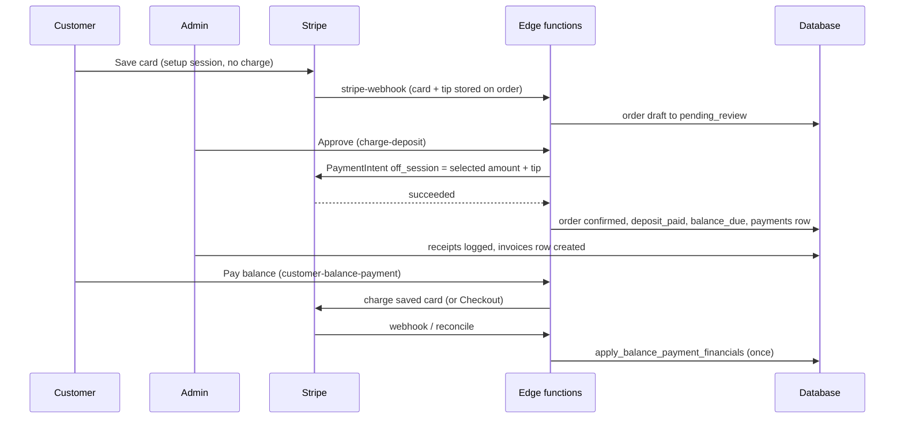

# Payments and Receipts

Scope: describes the application as deployed in Production (branch main; Supabase project qaagfafagdpgzcijnfbw).

## Overview

The payment system supports Stripe card (online), cash and check. All monetary values are stored as integers in cents. The `payments` table records collected payments and is the ledger of what has been collected. The `transaction_receipts` table is an audit log of financial events (see Reconciliation).

Related references: column-level detail in [DATABASE_SCHEMA.md](DATABASE_SCHEMA.md), request/response detail in [API_REFERENCE.md](API_REFERENCE.md), screens in [FRONTEND_REFERENCE.md](FRONTEND_REFERENCE.md), diagrams in [DIAGRAMS.md](DIAGRAMS.md). Pricing, totals and the order lifecycle are in [ORDERS_AND_WORKFLOW.md](ORDERS_AND_WORKFLOW.md); email and SMS wording in [EMAIL_SYSTEM.md](EMAIL_SYSTEM.md); Stripe and Twilio setup in [INTEGRATIONS.md](INTEGRATIONS.md).

### How money moves, end to end

The business model is **card on file first, charge on approval**: nothing is charged when a customer books. The card is saved with a Stripe setup-mode session, an admin reviews the booking, and approval charges the saved card off-session.

| Moment | Who | Mechanism | Money moved | Order fields written |
|---|---|---|---|---|
| Booking submitted | Customer | `stripe-checkout` `bookingMode` (setup) | None | `stripe_customer_id`, `stripe_payment_method_id`, card brand/last4, `tip_cents` (webhook) |
| Admin Approve | Admin | `charge-deposit` | Selected payment amount + tip | `status`, `deposit_paid_cents`, `balance_due_cents`, `tip_cents`, `stripe_payment_status = paid` |
| Admin Approve, deposit 0 | Admin | direct update | None | `status`, `stripe_payment_status = paid` |
| Customer approves admin edits | Customer | `charge-deposit` (or none if the deposit was already paid / is 0) | Selected amount + tip | as above |
| Admin invoice accepted | Customer | setup session then `charge-deposit` (the portal calls it only while the order is not yet `confirmed`; the webhook confirms an invoice order when the card is saved) | Selected amount + tip | as above |
| Balance paid in portal | Customer | `customer-balance-payment` (saved card, else Checkout) | Balance (+ tip) | `balance_paid_cents`, `balance_due_cents`, `tip_cents` via the RPC |
| Charge saved card from calendar task | Admin | `charge-deposit` with type `balance` (tip sent as 0) | Chosen amount | `balance_paid_cents`, `balance_due_cents`, and `tip_cents` (set to the tip in the request, here 0, replacing the stored value) |
| Cash or check received | Admin / crew | `record-cash-payment` / `record-check-payment` | Cash or check | deposit/balance fields, `tip_cents`, maybe `status` |
| Refund | Admin | `stripe-refund` | Money back to the card | `order_refunds` rows and `total_refunded_cents` (from `stripe-refund`); the negative `payments` row and the `refund` receipt come later from the `charge.refunded` webhook |

---

## Payment Types

| Type | How it's recorded |
|---|---|
| Stripe card | Recorded by `stripe-webhook`, `charge-deposit` (saved card), `customer-balance-payment` and `reconcile-balance-payment`, depending on the flow |
| Apple Pay / Google Pay | Stripe Checkout Sessions are created with `payment_method_types: ["card"]`. Wallet payments are stored with the Stripe payment method type (`card`). |
| Cash | Admin records manually via `record-cash-payment` edge function |
| Check | Admin records manually via `record-check-payment` edge function (requires check number) |

---

## Transaction Types

`payments.type` and `transaction_receipts.transaction_type` have different allowed values.

**`payments.type`** (CHECK constraint `payments_type_check`): `deposit`, `balance`, `incidental` only.

| Type | Meaning |
|---|---|
| `deposit` | Initial deposit collected at order confirmation |
| `balance` | Remaining balance collected at or after event |
| `incidental` | Negative-amount payment record created by the `charge.refunded` webhook handler when a Stripe refund fires. Uses negative `amount_cents` (the charge's cumulative `amount_refunded`), `status = succeeded`, the same `stripe_payment_intent_id` as the original payment, fee 0, net equal to the negative amount, and references the original payment via `refunded_payment_id`. |

Status: partially implemented. The first refund on a PaymentIntent is recorded by the webhook. The handler finds the original payment by PaymentIntent id with a single-row lookup; once an `incidental` row (which carries the same PaymentIntent id) exists, a later refund on the same charge matches two rows and the handler returns without adding a payments row, receipt or `order_refunds` row. Refunds made through `stripe-refund` still write their own `order_refunds` rows.

Production payments at the time of writing: `deposit`/`card`/`succeeded` 104, `balance`/`card`/`succeeded` 62, `balance`/`cash`/`succeeded` 23; no `incidental` rows.

**`transaction_receipts.transaction_type`** (CHECK constraint): `deposit`, `balance`, `refund`, `tip`, `full_payment`.

`tip`, `full_payment` and `refund` are valid only in `transaction_receipts`, never in `payments`. A tip is part of a card charge's `payments.amount_cents` and gets its own `tip` receipt row.

---

## Payments Table

The `payments` table records payment events. Columns:

| Column | Type | Purpose |
|---|---|---|
| `id` | uuid | Primary key |
| `order_id` | uuid | Which order this payment is for (FK, ON DELETE CASCADE) |
| `type` | text | `deposit`, `balance` or `incidental` (see above). The column is `type`, not `payment_type`. |
| `amount_cents` | integer | Payment amount in cents. Includes any tip for card charges and cash/check payments. |
| `stripe_payment_intent_id` | text | Stripe PaymentIntent ID (null for cash/check). Indexed (`idx_payments_stripe_payment_intent`), non-unique: the database has no unique constraint or unique index on this column, although comments in the balance-payment functions and the webhook describe one (`23505` handling). |
| `status` | text | Payment status, default `pending`. No CHECK constraint. Values the code writes: `pending` (default), `succeeded`, `failed` (webhook), `cancelled` (`rejectOrder`); Production rows hold `succeeded` only. No code writes or reads a `refunded` status. |
| `created_at` | timestamptz | When the payment was recorded |
| `paid_at` | timestamptz | When payment was confirmed |
| `failed_at` | timestamptz | When payment failed (if applicable) |
| `updated_at` | timestamptz | Last update |
| `payment_method` | text | `card`, `cash`, `check`, or (from `charge-deposit`) `bank_account`, or the Stripe payment method type (the webhook and balance paths store the Stripe type, normally `card`). |
| `payment_brand` | text | Card brand (Visa, Mastercard, etc.) |
| `payment_last4` | text | Last four digits of card |
| `ledger_sequence` | bigint | Auto-incrementing sequence for ordered financial ledger (indexed) |
| `stripe_fee_amount` | integer | Stripe processing fee in cents |
| `stripe_net_amount` | integer | Net amount after Stripe fee in cents |
| `currency` | text | Currency code (typically `usd`) |
| `refunded_payment_id` | uuid | FK to original payment if this is a refund |
| `order_financials_applied` | boolean | Not null, default false. Set by `apply_balance_payment_financials` |

### Ledger Sequence

`ledger_sequence` is an auto-incrementing big integer that provides a total ordering of all payment events across the entire system. Events can be sorted by `ledger_sequence` to get the exact order in which payments were processed, independent of timestamp precision.

### Stripe Fee Tracking

`stripe_fee_amount` and `stripe_net_amount` are populated from the Stripe charge's balance transaction by `charge-deposit`, `customer-balance-payment` and the webhook balance handler (and by `reconcile-balance-payment`). Cash and check rows leave them null; the webhook refund row stores fee 0 and net equal to the negative amount.

### Financial Application Flag

`order_financials_applied` is used only for BALANCE flows. The `apply_balance_payment_financials(p_pi_id, p_order_id, p_balance_cents, p_tip_cents, p_pm_id, p_customer_id)` RPC (SECURITY DEFINER; the application calls it with the service role key from edge functions, although EXECUTE is granted to `anon`, `authenticated` and `service_role` in Production) locks the first `payments` row whose `stripe_payment_intent_id` matches (`FOR UPDATE`, no ordering), and if the flag is false it adds the balance to `balance_paid_cents`, subtracts it from `balance_due_cents` (floored at 0), adds the tip to `tip_cents` only when the tip is above 0, and updates `stripe_payment_method_id` and `stripe_customer_id` when supplied, then sets the flag, all in one transaction. If the flag is already true it only patches the payment method and customer IDs. If no payment row exists it changes nothing. It returns `(applied, payment_row_found)`. It never touches `deposit_paid_cents` or `total_refunded_cents`; deposit and refund paths do not use the flag.

The flag is not set by `charge-deposit` (whose balance path writes the order totals itself and inserts its `payments` row with the flag false). PaymentIntents created by `charge-deposit` carry `payment_type` equal to the selected payment type; for a balance charge that is `balance`, the type for which the webhook's `payment_intent.succeeded` handler calls this RPC with the amount received (tip metadata absent), so when that event is processed after the `payments` row has been inserted the RPC applies the balance (and `balance_due_cents` reduction) a second time, and when it is processed before the row exists the RPC finds no row and changes nothing.

Status: partially implemented. The race protection is in place for `customer-balance-payment`, the Checkout balance path and the reconcile function. The calendar "Charge to Card" path (`charge-deposit`, type `balance`) is outside the flag, and the webhook's balance handling of its PaymentIntent is not distinguished from the flagged paths.

---

## Stripe Integration

### Checkout Flow

The `stripe-checkout` edge function (verify_jwt true) creates Stripe Checkout Sessions only (no direct PaymentIntents). It:

1. Reads the Stripe secret key from `admin_settings` (not from env vars).
2. Applies rate limiting using IP + order ID + `checkout` as the key.
3. Performs server-side blackout date check — returns error code `DATE_BLACKED_OUT` or `SAME_DAY_PICKUP_BLACKED_OUT` if the date is blocked. The check is skipped in `setupMode`.
4. Supports three session modes:
   - `bookingMode`: Checkout `mode: setup` with `payment_type: 'booking_request'`. No charge at booking; card is saved.
   - `setupMode`: Checkout `mode: setup` with `payment_type: 'card_update'` (card update).
   - otherwise: `mode: payment` with `payment_type: 'deposit'`, line item "Deposit" (or "Deposit + Tip").
   `invoiceMode` only changes the redirect URLs of setup mode; it is not a pay-later invoice.
5. Sets Stripe session metadata: `order_id`, `payment_type`, `deposit_amount`, `tip_cents`.
6. Returns `{ url, sessionId }` to the frontend. The frontend redirects to the URL; the success URL is `/payment-complete?...`.

Further rules of `stripe-checkout`: a Stripe customer is created (email, name, `order_id` metadata) the first time and its id saved on the order (`stripe_customer_id`); later sessions reuse it. The redirect origin is the request `Origin` header, then the `origin` in the body, then `https://bouncepartyclub.com`. The body is `{ orderId, depositCents, tipCents, customerEmail, customerName, setupMode, invoiceMode, invoiceLinkToken, paymentState, bookingMode, origin }`; it is rejected with 400 "Missing required fields" when `orderId` is missing, or when `depositCents` is missing and neither `setupMode` nor `bookingMode` is set, and with 404 "Order not found", 500 "Stripe not configured". Limit: 5 requests per minute per IP and order (429 with `Retry-After`).

| Mode | Success URL | Cancel URL |
|---|---|---|
| `bookingMode` | `/payment-complete?session_id={CHECKOUT_SESSION_ID}&order_id=<id>` | `/payment-canceled?order_id=<id>` |
| `setupMode` + `invoiceMode` | `/customer-portal/<id>?invoice_card_saved=true&session_id=...[&t=<token>]` | `/customer-portal/<id>?card_update_canceled=true[&t=<token>]` |
| `setupMode` (card update) | `/customer-portal/<id>?card_updated=true&session_id=...` plus the customer's earlier choices as `pa`, `cpa`, `tip`, `kop` (1/0), `spb` | `/customer-portal/<id>?card_update_canceled=true` |
| payment mode | `/payment-complete?session_id=...&order_id=<id>` | `/payment-canceled?order_id=<id>` |

Companion functions: `get-session-metadata` (no auth; returns a session's metadata, payment status and total so the Payment Complete page can show the tip) is used by the app. Deployed utility functions that no current screen calls: `get-stripe-publishable-key` (returns the publishable key from settings for browser card forms), `get-payment-method` (signed-in callers; returns card brand and last four for a payment method id), `checkout-bridge` (a small page that posts `BPC_CHECKOUT_COMPLETE` with the order and session ids to the opener window and closes itself) and `fix-payment-method` (repair by order id). The Production project also has deployed functions that have no source in the main branch of the repository: `verify-payment`, `backfill-card-details`, `create-order-short-link`, `submit-contact-inquiry` and `get-streetview-heading`; this document does not describe them.

#### Saved card lifecycle

1. **Capture.** A setup-mode Checkout Session saves the card on the Stripe customer. `checkout.session.completed` (or `setup_intent.succeeded`) stores `stripe_payment_method_id`, `payment_method_brand`, `payment_method_last_four` and `stripe_customer_id` on the order. The browser fallback `save-payment-method-from-session` (verify_jwt true; the callers send the anon key; it retrieves the Checkout session, then its setup intent or payment method, and copies the payment method, customer id, brand and last four onto the order id in the request; it does not check that the session belongs to that order; used by the Payment Complete page and the portal return paths) does the same when the webhook has not; `fix-payment-method` can repair an order by finding its Checkout session at Stripe.
2. **Validation before every off-session charge** (`validatePaymentMethod`): the payment method must still be attached to the customer ("Payment method no longer attached to customer"), exist ("Payment method not found") and, for cards, not be expired ("Card has expired (M/YYYY)"). The expiry moment is taken as the first day of the expiry month, so a card is treated as expired as soon as its expiry month begins (a card marked 10/2026 fails from 1 October 2026). A card whose expiry month starts within the next 30 days is accepted with a warning that the caller does not show. Non-card payment methods pass. On success `payment_method_validated_at`, `payment_method_exp_month`, `payment_method_exp_year` and `payment_method_last_four` are stored. Failures return `needsNewCard: true` to the caller.
3. **Card update.** The portal's card-update controls ("Update Card" in the Payment tab; "Update", "Update Payment Method" and "Add Payment Method" in the approval modal; the "Update Payment Method" button of the decline email, which links to the portal) open a setup-mode session; on return the new payment method replaces the old and the customer continues where they left off.
4. **Clearing.** An admin edit that adds or removes items clears `stripe_payment_method_id` and sets `stripe_payment_status = unpaid`, so the customer must provide a card again when approving. The two other clearing conditions (higher deposit than captured; paid in full then total increased) are described in [ORDERS_AND_WORKFLOW.md](ORDERS_AND_WORKFLOW.md#payment-method-clearing) with their status.
5. **Expiry watch.** The database function `check_expiring_cards()` (no caller in the application) lists orders that have a saved payment method with a recorded expiry, are not `completed`, `cancelled` or `void`, and whose expiry month starts between today and 30 days ahead (order, customer email and name, `M/YYYY` expiry text, days left), for reminder use.
6. **Admin visibility.** The pending-order card's Payment Management box shows "Payment method on file - <brand> ending <last4>" (with "You can charge the customer's card for remaining balance or damage fees."), or "Previous card payment found - <brand> ending <last4>" with "No saved payment method on file - card cannot be charged again.", or "No saved payment method found" with "Customer needs to complete checkout before you can charge a card." (the code uses an em dash where this document uses a hyphen).
7. **Backfill.** The Settings tab "Payment Method Backfill" section, button "Backfill Payment Methods" (`backfill-payment-methods`), fills `payment_method`, brand and last4 on `payments` rows that have a PaymentIntent id and no payment method, from Stripe. Status: partially implemented. The function and its Settings button are in place. The function checks the caller's `user_roles.role` against the upper-case values `ADMIN` and `MASTER` while Production stores lower-case role values (`master`, `customer`), so a successful run from the Settings tab is not yet active.

### Webhook Processing (`stripe-webhook` edge function)

`stripe-webhook` (verify_jwt false) builds its Stripe client from the env var `STRIPE_SECRET_KEY` and verifies signatures with the env var `STRIPE_WEBHOOK_SECRET` (this is the one place the secret key is not read from `admin_settings`). A missing secret returns 500; a missing signature header or a bad signature returns 400.

After verification, the idempotency system (`_shared/webhook-idempotency.ts`, table `stripe_webhook_events` with status `processing`/`succeeded`/`failed`, attempts, last_error) is checked: a `succeeded` event is skipped (200, `already_processed`); an event `processing` for less than 5 minutes is skipped (`currently_processing`); a stale (over 5 minutes) or `failed` event is retried with attempts incremented.

**Handled webhook events:**

| Event | Action |
|---|---|
| `checkout.session.completed` | Requires `metadata.order_id` (otherwise skipped). For `mode: setup` with a setup intent (the booking path, and also the `card_update` and invoice setup sessions, since `payment_type` is not checked there) it reads the payment method from the setup intent, stores payment method id, brand, last4 and customer id, saves `tip_cents` when above 0, and writes `status` only when the current status is `draft`, `quote` or `pending_review`: `pending_review`, or `confirmed` if an `invoice_links` row with `link_type = 'invoice'` exists; it then calls `order-lifecycle` (`enter_confirmed` with `charged_now` for an admin invoice, `enter_pending_review` otherwise, only when the status was advanced). For payment-mode sessions it calls `handleBalancePayment` when `payment_type = 'balance'` and `handleDepositPayment` otherwise |
| `payment_intent.succeeded` | Updates the `payments` row (status `succeeded`, `paid_at`, method/brand/last4). For `payment_type = 'balance'` calls `apply_balance_payment_financials` with the amount received minus the `tip_cents` metadata; for `payment_type = 'deposit'` writes `deposit_paid_cents` (amount received minus the stored tip) / `stripe_payment_status` and may advance status (skipped if `stripe_payment_status` is already `paid` with a deposit recorded). PaymentIntents typed `full` or `custom` (from `charge-deposit`) match neither branch |
| `payment_intent.payment_failed` | Sets the `payments` row to `failed` with `failed_at` |
| `charge.refunded` | Inserts a negative-amount `incidental` payment row in `payments` (referenced via `refunded_payment_id`, same `stripe_payment_intent_id` as the original); creates an `order_refunds` record; logs a `refund` transaction receipt. Idempotent: skips the payments insert if an `incidental` row already references the payment, and skips `order_refunds` if the `stripe_refund_id` exists. `order_refunds.status` is `succeeded` when the charge is marked refunded, otherwise `pending`, with `refunded_by` null and `reason` equal to the charge's refund reason or "refund"; the amount recorded is the charge's cumulative `amount_refunded`. The receipt note is "Refund for charge <id>" plus the refund reason when present. |
| `setup_intent.succeeded` | Reads `order_id` from the SetupIntent's own metadata (skipped when absent). `stripe-checkout` puts `order_id` on the Checkout session metadata only and passes no `setup_intent_data`, so for the app's setup sessions this handler normally has nothing to act on; when it does run it saves payment method id, brand, last4 and customer id and advances `draft`/`quote`/`pending_review` the same way (`enter_confirmed` with `zero_due_with_card` for an admin invoice) |

### Balance Payment Reconciliation (`reconcile-balance-payment`)

1. Callers insert (or look up) the payment row.
2. Both the webhook and the reconcile function call `apply_balance_payment_financials()`, which locks the first `payments` row matching the PaymentIntent (`FOR UPDATE`) and checks `order_financials_applied`.
3. Only the first caller to set the flag updates the order totals; later callers see the flag and return without double-writing.

Other balance paths exist beyond `reconcile-balance-payment`: `customer-balance-payment` (verify_jwt false; card-on-file off-session charge or Checkout, inserts a `balance` payment, calls `apply_balance_payment_financials`, logs a receipt) and `stripe-charge` (admin charge for `balance` or `damage`).

Status: partially implemented. `stripe-charge` is deployed as an admin-only function for charging a saved card for a `balance` or `damage` amount (it updates `balance_paid_cents` or `damage_charged_cents`), and the `PaymentManagement` component that would call it is in the code base. It is not mounted in any current admin screen, and the Task Detail "Charge to Card" button uses `charge-deposit` instead. The function compares the caller's `user_roles.role` with the upper-case values `ADMIN` and `MASTER`, while Production stores lower-case role values, so a call from a current user returns 403 "Admin access required". Its `payments` insert uses the columns `stripe_payment_method_id`, `payment_type` and `description`, which the `payments` table does not have, so no `payments` row would be written, and it creates no receipt.

### Deposit Charge Race Protection (`charge-deposit`)

`charge-deposit` (verify_jwt true) uses the `orders.payment_lock` boolean column (default false) to prevent double-charging. It does not use `deposit_paid_cents` as a sentinel.

1. Atomically runs `UPDATE orders SET payment_lock = true WHERE id = ? AND payment_lock = false`.
2. If no row is updated (another caller holds the lock), returns `409 Conflict` ("already being processed").
3. If an error occurs before Stripe succeeds, the lock is released (`payment_lock = false`).
4. After a successful charge, the post-charge order update writes the real totals and clears `payment_lock`.

Also: if `deposit_paid_cents` already covers the amount, it confirms without charging; it re-checks availability server side (409/503); and for balance charges it re-reads the current balance.

`charge-deposit` requires a valid JWT (the anon key is accepted for customer-side calls from the portal) and takes amounts from the request body. It does not check the caller's role or that the caller owns the order; its limits are the rate limit, the order checks listed below and the payment lock. It is called by `approveOrder` (admin session token, order id only), by the customer portal (`ApprovalModal`, the admin-invoice return path) and by the calendar task "Charge to Card" button.

#### `charge-deposit` order of operations

Request: `{ orderId, paymentAmountCents?, tipCents?, selectedPaymentType? }`. Missing amounts fall back to the order (`customer_selected_payment_cents`, else `deposit_due_cents`; `tip_cents`; `customer_selected_payment_type`, else `deposit`). `selectedPaymentType = balance` makes it a balance charge; any other value (`deposit`, `full`, `custom`) is a deposit-path charge.

1. Client identification and rate limit (10 per minute per IP and order; 400 "Invalid request: unable to identify client" when neither IP nor order id is available; 400 "Missing orderId"); load Stripe key from settings (500 "Stripe not configured"); load the order (404 "Order not found"), custom fees and discounts.
2. Must have a Stripe customer and a payment method (a missing method is looked up from the Stripe customer's first card and saved): else 400 "No payment method on file for this order". Amount must be above 0: else 400 "No deposit amount configured for this order".
3. Deposit path only: if `deposit_paid_cents` already covers the amount, the order is set to `confirmed` with the selection saved, `order-lifecycle` `enter_confirmed` (`already_paid`) runs and `{ success: true, alreadyCharged: true }` is returned without charging.
4. Availability check against blocking orders (409 / 503 as listed in Availability and Blackout Dates).
5. Claim the order (`payment_lock`); another caller holding it gets 409 "This order is already being processed. Please refresh and try again."
6. Balance path only: re-read balance; if nothing is due `{ success: true, alreadyCharged: true }`; if the amount exceeds the balance due 409 "The balance due has changed. Please refresh and try again."
7. Validate the payment method (expired / detached / missing: 400 with `needsNewCard`).
8. Create and confirm an off-session PaymentIntent for `amount + tip` (metadata `order_id`, `payment_type`). Not succeeded: lock released, 400 "Payment could not be completed (status: X). Please try again or contact support."; a Stripe card error is returned as 500 with Stripe's message (this is what the approval screen shows as a decline).
9. **After the charge succeeded** (failures from here never look like a decline): deposit path writes `status = confirmed`, `deposit_paid_cents = amount`, `stripe_payment_status = paid`, `balance_due_cents = max(0, total - amount)` (total = stored components + custom fees - discounts), `tip_cents`, the selection, and clears the lock. Balance path writes `balance_paid_cents += amount`, `balance_due_cents = max(0, due - amount)`, `tip_cents` = the tip in the request (replacing the stored value, not adding to it), the selection, and keeps `status`. If this order update fails the function logs a changelog row (`change_type = payment_error`, note beginning `PARTIAL_CHARGE_FAILURE: Stripe charged N cents (PI: ...) but order DB update failed`) and replies `{ success: false, chargeSucceeded: true, error: "Payment was processed but order update failed. Please contact support." }`; the lock stays set, which the admin Payments tab shows as "Payment processing error detected".
10. Deposit path: `order-lifecycle` `enter_confirmed` with `charged_now`.
11. Read card details and Stripe fee/net from the charge, insert the `payments` row (`type` deposit or balance, `amount_cents` = amount + tip, fee, net; a failure is logged only).
12. Deposit path: send the customer the "Booking Confirmed - Receipt for Order #XXXXXXXX" email (event details, items, fees, discount, tax, tip, total, deposit paid, balance due, payment method, "Track Your Order" button to the plain portal URL, what happens next). The Total and Balance Due printed in this email are computed without the same-day weekday delivery fee and take "Deposit Paid" as the payment amount.
13. Return `{ success: true, paymentDetails: { paymentIntentId, chargeId, amountCents (gross incl. tip), paymentMethod, paymentBrand, paymentLast4 } }`.

Worked example (rules from the pricing examples): total $352.50, customer chose the default deposit $50.00 at checkout and a 15% tip ($52.88). Approve charges $102.88. Result: `deposit_paid_cents` 5000, `tip_cents` 5288, `balance_due_cents` 30250, one `payments` row of 10288 (type `deposit`), receipts of $50.00 (deposit) and $52.88 (tip) grouped under one `receipt_group_id`.

### Tip Handling

Tips are included in the total Stripe charge amount but tracked separately:
- `charge amount = payment_amount + tip_cents`
- `deposit_paid_cents` is set to `payment_amount` only (tip excluded)
- `tip_cents` is stored separately on the order
- `payments.amount_cents` and the `paymentDetails.amountCents` returned by `charge-deposit` are the gross amount (payment + tip); `orderApprovalService` subtracts the tip when it needs the deposit amount
- `balance_due_cents` is a stored column written by several writers (not computed at read time); the relationship is `total - deposit_paid_cents - balance_paid_cents`

### Stripe Refunds (`stripe-refund` edge function)

Admin-only (requires the caller's single `user_roles` row to be `admin` or `master`, lower-case). Accepts `orderId`, `amountCents`, and `reason`. Calls Stripe's refund API, then records one `order_refunds` row per Stripe refund (allocating across the order's payments newest first, capped at the captured amount minus pending/succeeded refunds; returns 207 if the DB insert fails) and increments `orders.total_refunded_cents` through the `increment_order_refunded_cents` RPC. It does NOT log a transaction receipt; the `refund` receipt is logged only later by the `charge.refunded` webhook. It does not require the order to be cancelled (it warns in the function log). The maximum refundable amount is the sum of the order's succeeded `payments` rows that carry a PaymentIntent id (including any negative `incidental` rows the webhook added, which carry the same PaymentIntent id) minus the sum of `order_refunds` rows with status `pending` or `succeeded`.

---

## Admin Direct Card Charge from Task Detail

Admins can charge the saved card on file directly from the Calendar Task Detail Modal without navigating to the full order detail.

**When available:** A charge button appears when:
- `balance_due_cents > 0` (balance is outstanding)
- `stripe_payment_method_id` is set on the order (a card is saved)

**Display:** The card is shown as "Card on File: Brand •••• last4" from `payment_method_brand` and `payment_method_last_four` on the order; the button reads "Charge $X to Card".

**How it works:**
1. Admin clicks the button, which charges the whole `balance_due_cents` (the amount is not editable)
2. The screen calls `charge-deposit` with the admin session token and `{ orderId, paymentAmountCents: <balance due>, tipCents: 0, selectedPaymentType: 'balance' }`
3. Edge function charges off-session and records the balance payment
4. `balance_paid_cents` and `balance_due_cents` updated on the order (and `tip_cents` set to 0)
5. Admin sees the alert "Successfully charged $X to <card>. A receipt has been sent to the customer." and the task card refreshes; failures show "Failed to charge card: <message>"

Status: partially implemented. The balance charge is made and the balance payment is recorded. A customer receipt email and a `transaction_receipts` row are not yet produced on this path (the customer email is sent for deposit charges), although the success alert says a receipt has been sent.

---

## Customer Balance Payment (portal Payment tab)

Where: customer portal, **Payment** tab (`PaymentTab`), available once money has been collected or the order is confirmed/in progress/completed. It shows the order total, amount already paid (deposit + balance paid, tip excluded), and balance due, plus a tip selector (none, 10%, 15%, 20% of the order total, or custom). With no balance due the tab reads "No balance due. You may still add a tip for the crew below." and the button becomes "Add Tip of $X".

Button text: "Pay Balance Now", "Pay $X" (balance + tip) or "Add Tip of $X". With a saved card a confirmation dialog first shows the card ("Visa ···· 4242 will be charged"), the balance, the tip and the total, with **Update Card**, Cancel and "Charge $X".

`customer-balance-payment` (no login; body `{ orderId, amountCents, tipCents }`, both rounded to whole cents, the sum must be above 0 or 400 "Invalid request: orderId required and total must be > 0."; the function does not compare `amountCents` with the order's balance due, the portal sends `balance_due_cents`) then runs one of two paths:

- **Path A, card on file.** If the order has a Stripe customer and payment method and `validatePaymentMethod` passes, create an off-session PaymentIntent for balance + tip (metadata `order_id`, `payment_type = balance`, `tip_cents`, `source = customer_balance_payment_edge_fn`, description "Balance payment for Order #X"). On success: read card details and fees; insert the `payments` row first (`type = balance`, amount = balance + tip, `order_financials_applied = false`); call `apply_balance_payment_financials` (adds the balance to `balance_paid_cents`, subtracts it from `balance_due_cents`, adds the tip to `tip_cents`, marks the payment applied); save card brand/last4; log a `balance` transaction receipt (note "Balance payment ($X) + tip ($Y)" or "Customer portal balance payment"); email the customer "Payment Received - Order #XXXXXXXX" (itemized, with the payment method and remaining balance); respond `{ success: true }` and the portal toasts "Payment processed successfully!". If the charge is declined, needs authentication, or does not succeed (the intent is cancelled), the function falls through to Path B.
- **Path B, no usable card or card failed.** A Stripe Checkout Session (payment mode, card only) with line items "Order Balance Payment" (Order #X) and, if a tip was chosen, "Crew Tip" ("Thank you for tipping the crew!"), metadata `order_id`, `payment_type = balance`, `tip_cents`; success returns to `/customer-portal/<id>?payment=success&session_id=...`, cancel to `/customer-portal/<id>?tab=payment&tip=<cents>`. The portal redirects the customer to the returned `url`. On return, the portal calls `reconcile-balance-payment`, which verifies the session with Stripe (must be a paid payment-mode session whose metadata order id and `payment_type = balance` match), inserts the payment row first, applies the financials through the same RPC, logs the receipt, and emails "Payment Received - Order #X"; the webhook performs the same steps independently, and whichever runs second finds the payment already applied.

The portal also re-reads the order on a realtime change so the new balance shows without a refresh.

#### Worked example

Total $352.50, deposit $50.00 paid at approval (balance due $302.50). The customer pays the balance with a 20% tip: tip = round(35250 x 0.20) = $70.50, charge = $302.50 + $70.50 = $373.00. After the RPC: `balance_paid_cents` 30250, `balance_due_cents` 0, `tip_cents` previous tip + 7050, one `payments` row of 37300 (type `balance`), one `balance` receipt of $373.00.

## Rate limits

`check_rate_limit(identifier, endpoint, max_requests, window_seconds)` counts requests per key `<prefix>|ip:<address>|id:<order or user id>` in the `rate_limits` table and returns a block (HTTP 429, `Retry-After`) when exceeded; a key whose count reaches three times the maximum is blocked for 5 minutes (`retry_after` 300). A database error or exception in the check lets the request through. The key prefixes are `checkout`, `deposit`, `charge` and `refund`. Functions that call it, and their limits:

| Function | Limit | Key |
|---|---|---|
| `stripe-checkout` | 5 per 60 s | IP + order |
| `charge-deposit` | 10 per 60 s | IP + order |
| `stripe-charge` | 3 per 60 s | IP + user |
| `stripe-refund` | 2 per 60 s | IP + user |

Limits are also configured for `customer-balance-payment` (5/60 s), `customer-cancel-order` (3/300 s), `save-signature`, `send-invoice` (10/60 s) and `send-sms-notification` (20/60 s); those functions do not currently call the limiter. A request with no identifiable IP and no order id is refused with 400 "Invalid request: unable to identify client". The database function `cleanup_old_rate_limits()` removes stale counters when it is run.

## Where totals, balances and tips are computed

| Writer | Computes | Formula |
|---|---|---|
| Checkout (`createOrderBeforePayment`) | `deposit_due_cents`, `balance_due_cents` | chosen amount (default deposit when none); max(0, total - chosen amount), with the quoted tax removed from the total when `apply_taxes_by_default` is false |
| Admin invoice builder (`generateInvoice`) | `deposit_due_cents`, `balance_due_cents` | deposit (override or `deposit_per_unit_cents` x quantity, clamped to the total); max(0, total - deposit) |
| `charge-deposit` deposit path | `balance_due_cents` | max(0, stored components + custom fees - discounts - amount) |
| `charge-deposit` balance path | `balance_paid_cents`, `balance_due_cents` | previous + amount; max(0, previous due - amount) |
| `apply_balance_payment_financials` | same as above plus tip | exactly once per PaymentIntent |
| `record_cash_payment` / `record_check_payment` | `deposit_paid_cents` or `balance_paid_cents`, `balance_due_cents`, `tip_cents` | balance due = max(0, total - deposit paid - balance paid), where total = scalar columns without weekday delivery + custom fees - `amount_cents` of discounts (a percentage discount counts as 0) |
| `orderSaveService` | `balance_due_cents` after edits | max(0, new total - deposit paid - balance paid); unchanged when refunds exist |
| `increment_order_refunded_cents` | `total_refunded_cents` | previous + refunded amount |
| `getPaymentStatus(order)` | derived status shown in the UI | paid in full when deposit paid + balance paid >= deposit due + balance due; deposit paid when deposit paid > 0; otherwise payment due |

Tip is always stored separately in `tip_cents` and is never part of the total or balance. For card charges `payments.amount_cents` includes the tip, so admin screens show deposit as ledger deposits minus the order tip.

---

## Order Approval and Deposit Charging (`src/lib/orderApprovalService.ts`)

When an admin approves an order:

1. Idempotency guard: aborts if order is already `confirmed`, `cancelled`, or `void`.
2. Availability re-checked to prevent overbooking.
3. **Zero-deposit path:** If `deposit_due_cents <= 0`, sets the order to `confirmed` with `stripe_payment_status = 'paid'` (no actual charge), sends customer SMS and email, calls `enterConfirmed` with `waived`, and stops. No invoice and no transaction receipt are created on this path.
4. **Standard deposit path:** Calls `charge-deposit` edge function with only the order id, so the charge is the customer's selected payment amount (deposit, full or custom) plus the stored tip. The response includes `paymentDetails: { paymentIntentId, chargeId, amountCents, paymentMethod, paymentBrand, paymentLast4 }`. The actual Stripe charge amount is the source of truth — not `deposit_due_cents`.
5. Transaction receipt logged via `logGroupedTransactions()` (deposit + tip as grouped receipts if applicable). This happens before the invoice is created.
6. Invoice created with status `paid` (the charge excluding tip covers the order total), `partial` (it is above 0 but below the total) or `sent` (0).
7. Customer receives SMS then email confirmation, then `enterConfirmed` with `charged_now`.

If `charge-deposit` fails (a declined card, and also any other non-success response such as a missing payment method or an availability conflict), a custom email and SMS are sent with a link to the Customer Portal to update the payment method. Order stays unapproved until the admin retries; the error is thrown to the admin UI.

**Force Approve** (admin override) skips the deposit charge entirely and confirms without collecting payment. Calls `enterConfirmed()` with `paymentOutcome: 'waived'`. No customer notification and no invoice.

### Payment Outcome Values

The `paymentOutcome` parameter passed to `order-lifecycle` controls how the order's financial state is recorded:

| Value | Meaning |
|---|---|
| `waived` | Admin waived the deposit |
| `already_paid` | Payment was collected earlier |
| `charged_now` | Deposit just charged successfully |
| `zero_due_with_card` | Zero deposit, card saved for future use |
| `full_paid` | Full amount collected |
| `custom_paid` | Custom amount collected |
| `cash` | Cash payment outside Stripe |

Only `waived`, `already_paid`, `cash` and `charged_now` bypass the unpaid-deposit check in `enter_confirmed`.

---

## Customer Approval Modal (`src/components/customer-portal/ApprovalModal.tsx`)

The `ApprovalModal` component shown during the customer order-change approval flow displays contextual payment messaging based on payment state:

| State | Message Shown | Button Text |
|---|---|---|
| Deposit already paid | Heading "No payment required": "Your $X deposit is already on file. Any price changes will be added to your remaining balance due at the event." | **Confirm Changes** |
| Zero deposit due, card on file | Heading "No deposit required today": "Your card will be kept on file for the final payment due at your event." (plus " Any tip you added will be collected with the final payment." when a new tip was chosen) | **Confirm Booking** |
| Zero deposit due, no card on file | Heading "Payment method required": "No card is on file. Please add a payment method before confirming so we can collect the balance at your event." and an "Add Payment Method" button | **Confirm Booking** (disabled until card added) |
| Deposit due | "Payment Amount Selected" with the amount (base plus tip), "Balance due day of event: $Y" when the amount is below the total, and "Includes $T crew tip" | **Confirm & Pay** |
| After a failed charge | "Payment Declined" box with the message from the function and an "Update Payment Method" button (a small "Update" link next to the card line does the same) | unchanged |

The "already paid" path (when `deposit_paid_cents > 0` or `stripe_payment_status === 'paid'`) skips the Stripe charge entirely and confirms the order without collecting additional payment. When the customer arrived with an invoice-link token the status change goes through the `approve_order_changes` RPC; otherwise through a direct `orders` update.

---

## Payment Success Screen ("Request Received")

The payment success screen (`src/components/payment/PaymentSuccessState.tsx`, heading "Request Received!") shown after checkout completion displays the event date using a timezone-safe parse: `new Date(event_date + 'T12:00:00')`. This prevents the date from rendering one day early due to UTC midnight interpretation when the raw `YYYY-MM-DD` string is passed directly to `new Date()`.

---

## Cash and Check Payments

Both are processed through their respective edge functions (verify_jwt true), which require `admin`, `crew`, or `master` role.

The workflow:

1. A database RPC (`record_cash_payment` or `record_check_payment`, SECURITY DEFINER) executes as a single transaction. It rejects `void`/`cancelled` orders, a non-positive amount, and a payment (excluding tip) larger than the effective balance due, where effective balance = max(0, `balance_due_cents` - `balance_paid_cents`) (falling back to the computed total when `balance_due_cents` is null) and the guard applies only while that value is above 0; classifies the payment as `deposit` (when a deposit is required and none is paid yet) or `balance`; writes the `payments` row with `amount_cents = amount + tip` and `payment_method` `cash`/`check`; updates `deposit_paid_cents` / `balance_paid_cents` / `balance_due_cents` / `tip_cents` on the order; moves `pending_review` or `awaiting_customer_approval` orders to `confirmed`; and logs to `order_changelog` (`change_type` `cash_payment` / `check_payment`).
2. Only after the RPC succeeds does the function log the transaction receipt and send the customer a receipt email (both are best-effort, non-atomic).

Check payments require a non-empty check number. It is not stored on `payments`. The RPC writes it to `order_changelog.notes` as "Check number: N", and it is included in the receipt and receipt email.

**Where admins and crew record them.** Calendar task detail (`TaskDetailModal`, the drop-off or pick-up task of a confirmed order) shows **Record Cash Payment** and **Record Check Payment** whenever the order's balance due is above 0. The person types the **total amount received** (the field is prefilled with the balance due, plus a check number for checks); the screen splits it: balance payment = the smaller of the amount received and the balance due, **tip = anything received above the balance due**. A breakdown (Balance due / Balance payment / Tip / Total received) is shown before confirming with "Record cash payment from <customer>? Balance payment: $X, Tip: $Y". Success toasts: "Cash payment of $X recorded successfully!" or "Cash payment recorded! Balance: $X + Tip: $Y = $Z" (and the equivalent with "(Check #N)"). Failures show "Failed to record payment: <message>"; the RPC's validation errors (order not found, void/cancelled order, payment exceeds the balance due) come back as HTTP 422 and other errors as 500.
- Role: `master`, `admin` or `crew` (lower-case role names, compared after lower-casing), checked against the caller's `user_roles` row; a missing or invalid token returns 401, a wrong role 403. Production `user_roles` holds `master` and `customer` rows only at the time of writing. The functions do not call `order-lifecycle`, so no admin "BOOKING CONFIRMED" alert is sent and `confirmed_admin_alerted` stays false for an order confirmed this way; the admin receives the transaction-receipt email instead.
- The record functions answer `{ success, paymentType, newBalanceDue, receiptNumber, statusChanged }`; a status change writes a second `order_changelog` row (`field_changed` = `status`) with the same `cash_payment` / `check_payment` change type.
- Classification: the first cash or check payment on an order that requires a deposit and has none paid is recorded as the **deposit**; everything after is a **balance** payment. `payments.amount_cents` = amount + tip; `orders.tip_cents` increases by the tip; `balance_due_cents` is recalculated from the order total (components + custom fees - discounts) minus deposit paid minus balance paid. If the order was `pending_review` or `awaiting_customer_approval` it becomes `confirmed`, which also creates the crew tasks.
- Best-effort side effects after the transaction: a `transaction_receipts` row of the same type (note "Cash payment recorded by admin" or "Check payment recorded by admin | Check #N", with "includes tip $X"; subject to the Deduplication status above), the admin transaction-receipt email, and the customer email "Payment Received - Order #XXXXXXXX" with a banner "PAID IN CASH" / "PAID BY CHECK - Check #N - received and recorded by staff", itemized totals, tip and the remaining balance.
- Example: balance due $302.50; the customer hands over $320.00 in cash. Balance payment $302.50, tip $17.50, payment row of $320.00, balance due 0, one `balance` receipt of $320.00.

---

## Transaction Receipt Logging (`src/lib/transactionReceiptService.ts`)

Receipts are written to `transaction_receipts` with a sequential receipt number from a database sequence. The number looks like `RCP-YYYYMMDD-NNNNN` (for example `RCP-20260402-10055`); the date is the day the number was generated (`CURRENT_DATE` in the database, whose time zone is UTC, so an evening Detroit payment can carry the next day's date) and `NNNNN` is `receipt_number_seq` padded to 5 digits (it can exceed 5 digits), starting at 10001. The number is the column default of `receipt_number`.

### `transaction_receipts` Table Schema

| Column | Type | Purpose |
|---|---|---|
| `id` | uuid | Primary key |
| `transaction_type` | text | `deposit`, `balance`, `tip`, `full_payment`, `refund` |
| `order_id` | uuid | Which order (FK, ON DELETE SET NULL) |
| `customer_id` | uuid | Which customer (FK, ON DELETE SET NULL) |
| `payment_id` | uuid | FK to `payments` row (ON DELETE SET NULL) |
| `amount_cents` | integer | Transaction amount in cents |
| `payment_method` | text | `card`, `cash`, `check` |
| `payment_method_brand` | text | Card brand (Visa, Mastercard, etc.) |
| `stripe_charge_id` | text | Stripe charge ID (for Stripe transactions) |
| `stripe_payment_intent_id` | text | Stripe PaymentIntent ID |
| `receipt_number` | text | Unique receipt number (unique constraint; generated by `generate_receipt_number()`) |
| `receipt_group_id` | uuid | Groups related transactions (e.g., deposit + tip from same charge); indexed |
| `receipt_sent_to_admin` | boolean | Whether admin receipt email was sent |
| `admin_notified_at` | timestamptz | When admin was notified |
| `transaction_date` | timestamptz | When the transaction occurred |
| `notes` | text | Optional notes (e.g., check number) |
| `created_at` | timestamptz | Record creation timestamp |
| `updated_at` | timestamptz | Last update |

**RLS:** SELECT for admin users and for customers on their own receipts; INSERT for authenticated admin users; INSERT for `anon` ("System can insert transaction receipts"). There are no UPDATE or DELETE policies, so rows cannot be changed or deleted through the API by normal users.

Status: partially implemented. The client functions `sendAdminTransactionReceipt` and `sendGroupedAdminNotification` send the admin receipt email. Recording `receipt_sent_to_admin` / `admin_notified_at` on the receipt row is not yet active for those client functions: they run the update from the browser, and the table has no UPDATE policy for browser roles, so no row changes (in Production all 84 `deposit` and 7 `tip` receipts, which are logged from the browser, have `receipt_sent_to_admin` false). The server helper `_shared/transaction-logger.ts`, used by balance, cash and check receipts, does set both columns after its email is sent.

### Deduplication

The database enforces two unique indexes with `NULLS NOT DISTINCT`: `unique_receipt_pi_type` on `(stripe_payment_intent_id, transaction_type)` and `unique_receipt_charge_type` on `(stripe_charge_id, transaction_type)`. This lets a deposit and a tip from the same Stripe charge coexist. The client `logTransaction` pre-checks the same keys (PaymentIntent first, else charge) and falls back to the 23505 error; the server helper `_shared/transaction-logger.ts` has no pre-check and relies on the constraint (returning null on duplicate).

Status: partially implemented. Card receipts are unique per charge and type as intended. Cash and check receipts have no PaymentIntent or charge id, and with `NULLS NOT DISTINCT` two NULLs count as equal, so the second cash (or check) receipt of the same `transaction_type` collides with the first one anywhere in the table; the insert is rejected, `logTransaction` returns null (the record function answers `receiptNumber: null`) and no admin transaction-receipt email is sent for it. In Production there are 23 cash `payments` rows and one cash `transaction_receipts` row. The receipt number sequence still advances for a rejected insert.

### Grouped Receipts

When a single Stripe charge covers multiple transaction types (e.g., deposit + tip), `logGroupedTransactions()` assigns a shared `receipt_group_id` (UUID) so they can be displayed together in a single admin receipt email.

### Admin Notifications

Admin receipt emails come from `sendGroupedAdminNotification` (client) and `sendAdminNotification` in `_shared/transaction-logger.ts` (server). The email is fire-and-forget — a send failure does not block the payment flow. The client email shows receipt number, transaction type, amount, order number, customer name and email, payment method brand, date, event date and notes.

---

## Stripe Refunds

The `stripe-refund` edge function (admin/master only) calls Stripe's refund API, then creates records in the `order_refunds` table and increments `orders.total_refunded_cents`.

### `order_refunds` Table Schema

| Column | Type | Purpose |
|---|---|---|
| `id` | uuid | Primary key |
| `order_id` | uuid | Which order |
| `amount_cents` | integer | Refund amount in cents |
| `reason` | text | Reason for the refund (not null) |
| `stripe_refund_id` | text | Stripe refund ID for cross-referencing |
| `refunded_by` | uuid | Admin user who initiated the refund (FK to `auth.users`; null when the row comes from the webhook) |
| `status` | text | `pending`, `succeeded` or `failed` (CHECK constraint) |
| `created_at` | timestamptz | When the refund was initiated |

When Stripe confirms the refund via the `charge.refunded` webhook, `handleChargeRefunded` creates a negative-amount `incidental` record in `payments` and logs a `refund` receipt. `stripe-refund` increments `total_refunded_cents`.

**Where refunds are issued.**

| Screen | Availability | Inputs | Notes |
|---|---|---|---|
| Order detail > Payments tab ("Refund Payment" > "Issue Refund") | Any order with at least one succeeded Stripe payment | Amount ($, min 0.01) and a free-text reason ("e.g., Customer request, Weather cancellation, Equipment issue") | Confirm dialog "Issue refund of $X to <customer>? Reason: ... This action cannot be undone." Toast "Refund of $X processed successfully!" or "Failed to process refund: ..." |
| Pending-order card > Payment Management > "Issue Refund" | Only when the order is `cancelled`, has Stripe payments and something is still refundable | Amount (with a Max button, never above the refundable amount) and a reason from: Order Cancellation, Customer Request, Duplicate Charge, Fraudulent Charge, Other | Shows Total Refunded and Available; "Pending refund in progress" while a refund is pending; "Process Refund" button |
| Calendar task detail > "Payments Received" > "Refund" | Any task whose order has at least one succeeded payment (cash payments included in the list, although only Stripe payments can be refunded) | Amount ($) and a free-text reason ("e.g., Customer request, Weather cancellation") | "Issue Refund" button; calls `stripe-refund` |

The refundable amount shown is the succeeded payments total minus succeeded and pending refunds. Reasons `duplicate` and `fraudulent` are passed to Stripe as such; every other reason is sent to Stripe as `requested_by_customer`. The reason string the screen sends is stored unchanged on `order_refunds.reason` (free text from the two text screens; the option value `cancellation`, `requested_by_customer`, `duplicate`, `fraudulent` or `other` from the pending-order card, so only that card can trigger the Stripe `duplicate` / `fraudulent` reasons). Errors from `stripe-refund`: 401 Unauthorized, 403 "Admin access required", 400 "Invalid request. orderId and positive amountCents required", 404 "Order not found", 404 "No successful Stripe payments found for this order", 400 "Refund amount exceeds maximum refundable amount. Max: N cents", 400 "No eligible payment found to refund", 429 after 2 requests per minute. A tip is refunded like any other part of a charge; refunds are never applied to cash or check payments (they have no PaymentIntent). The customer sees refunds only as payment-list entries and in the cancellation text; no refund email is sent by the application.

Status: partially implemented. Refunds issued through `stripe-refund` write `order_refunds` rows and update `orders.total_refunded_cents`; the negative `payments` row and the `refund` receipt for the first refund on a PaymentIntent come from the `charge.refunded` webhook. Updating `orders.total_refunded_cents` from the `charge.refunded` webhook (for refunds issued directly in the Stripe dashboard) is not yet active. In Production `order_refunds` and `stripe_webhook_events` hold no rows at the time of writing.

---

## Payment Amount Tracking (Orders Table)

The `orders` table tracks payment progress with these columns (all in cents):

| Column | Meaning |
|---|---|
| `deposit_due_cents` | Deposit required at confirmation |
| `deposit_paid_cents` | Amount collected toward deposit (excludes tip) |
| `balance_due_cents` | Remaining balance (stored; updated by several writers) |
| `balance_paid_cents` | Amount collected toward balance |
| `tip_cents` | Tip collected (tracked separately, excluded from balance calculations) |
| `total_refunded_cents` | Total amount refunded (updated by `stripe-refund`) |
| `damage_charged_cents` | Amount charged for equipment damage |

Order totals are recomputed from components (subtotal, fees, tax, custom fees, discounts, weekday delivery fee) by `calculateTotalFromOrder` in `orderSummary.ts`.

Payment status is derived (not stored) using `getPaymentStatus(order)` from `src/lib/constants/statuses.ts`.

### Balance Due Calculation

The relationship is `total - deposit_paid_cents - balance_paid_cents`, excluding the tip, which is tracked separately in `tip_cents`. This is applied by `orderSaveService` on edits; `charge-deposit` on the deposit path uses order total minus the payment amount.

---

## Customer-Selected Payment Amount

At checkout, customers can choose how much to pay:

- `customer_selected_payment_cents` — what the customer indicated they would pay
- `customer_selected_payment_type` — the checkout code uses `deposit`, `full` or `custom`; admin balance charges pass `balance` to `charge-deposit`

These columns are read by `charge-deposit` (the amount to charge), the customer approval screens (original amount and type) and the pending-order card summary.

Rules: `deposit` = the default or admin-overridden deposit; `full` = the order total; `custom` = any amount from the deposit up to the total (below the deposit: "Minimum amount is $X"; above: "Maximum amount is $X"; empty: "Amount is required"; at checkout submit a custom amount is clamped into the range). The admin-invoice acceptance screen ("Payment amount must be at least $X") and the customer approval screen apply the same lower limit, and the approval screen can also keep the original amount ("Keep original payment amount") unless it is now below the new deposit. The chosen amount sets `deposit_due_cents` at checkout and is what `charge-deposit` charges on approval, so a customer who chose "full" is charged the full total (plus tip) when the admin approves, leaving `balance_due_cents` 0. Example: total $352.50, custom $200.00: `deposit_due_cents` 20000, approval charges $200.00 (+ tip), balance due $152.50.

---

## Receipts and emails by path

Three different things are called a receipt: the **customer email**, the **`transaction_receipts` row** (admin audit log, numbered `RCP-YYYYMMDD-NNNNN`) with its **admin email** ("Transaction Receipt RCP-... - DEPOSIT", server version "Transaction Receipt RCP-... - Deposit Payment", grouped version "Grouped Transaction Receipt - N Items - $X"), and the printable **receipt page** (`/receipt/<orderId>/<paymentId>`) the customer opens from the portal payment list.

| Path | Customer email (subject) | `transaction_receipts` rows |
|---|---|---|
| Booking submitted | "Booking Request Received - Bounce Party Club" (sent once by the Payment Complete page) | none |
| Admin Approve (card charged) | "Booking Confirmed - Receipt for Order #X" from `charge-deposit`, and a second email with the same subject from the browser approval flow | `deposit`, plus `tip` when a tip was charged, sharing one `receipt_group_id` (logged by the browser after the charge; one grouped admin email) |
| Admin Approve with deposit 0 / Force Approve | zero-deposit approval sends the confirmation SMS and email; force approve sends nothing | none |
| Customer approves edits (deposit due) | `charge-deposit` booking-confirmed email | none |
| Customer approves edits (deposit already paid or 0) | none for already paid; "Booking Confirmed - Order #X" (no deposit today) for zero deposit | none |
| Portal balance by saved card | "Payment Received - Order #X" | `balance` (server logger; admin email "Transaction Receipt ... - Balance Payment") |
| Portal balance by Checkout | "Payment Received - Order #X" (webhook or reconcile, whichever applies the payment) | `balance` |
| Stripe Checkout payment-mode deposit (legacy page only) | "Deposit Received - Order #X" | none |
| Admin invoice sent | "Invoice from Bounce Party Club" (`send-invoice`) | none |
| Admin invoice accepted, no card needed | "Booking Confirmed - Receipt for Order #X" (browser, with SMS) | none |
| Cash / check | "Payment Received - Order #X" with PAID IN CASH / PAID BY CHECK banner | `deposit` or `balance`, amount = payment + tip; only the first cash and the first check receipt of each type can be stored (see Deduplication) |
| Calendar task "Charge to Card" | none (balance path of `charge-deposit`), although the screen's alert says a receipt was sent | none |
| Refund | none | `refund` (negative amount) from the webhook, first refund per PaymentIntent |
| Customer cancels | cancellation SMS only | none |

Receipt page content: the order summary (items, fees, discounts, custom fees, tax, tip, total, deposit and balance) and the payment (method, amount, date). Admin transaction emails carry the receipt number, type, amount, order number, customer, payment method and brand, date, event date and notes.

Receipt numbers are generated at insert time by `generate_receipt_number()` from `receipt_number_seq` (starting 10001), formatted with the database date; the sequence is shared by all receipt types.

## Invoices (accounting snapshots)

`invoices` rows are accounting records, not customer-facing bills. They are created (a) by the browser after a successful admin Approve (status `paid` when the amount charged excluding tip covers the order total, `partial` when it is above 0, otherwise `sent`; `due_date` = event date; number from `generate_invoice_number()` = `INV-<year>-<4-digit counter>`, or `INV-<timestamp>` if the function fails; failure to insert is logged only) and (b) manually from the Invoices tab ("Generate Manual Invoice", status `draft`). Paying later does not update the row: balance payments, cash and check payments, refunds and tips never touch `invoices.paid_amount_cents` or `status`. Fee columns stored: subtotal, tax, travel, surface, same-day pickup, generator (and a weekday-delivery column that approval does not fill), total and paid. The customer-facing "invoice" is an order plus an invoice link (see [ORDERS_AND_WORKFLOW.md](ORDERS_AND_WORKFLOW.md#invoice-system)).

## Webhook details

- **Metadata the app puts on sessions and intents:** `order_id`, `payment_type` (`booking_request`, `card_update`, `deposit`, `balance`, or for `charge-deposit` intents `deposit`, `full`, `custom` or `balance`), `deposit_amount`, `tip_cents`, `source`.
- **Status advance rule.** The webhook moves an order forward (`draft`/`quote`/`pending_review` only) and never moves a confirmed, in-progress, completed or cancelled order backwards. Admin-invoice orders (an `invoice` link exists) advance to `confirmed` with `enter_confirmed` (`charged_now`, or `zero_due_with_card` from `setup_intent.succeeded`); standard orders advance to `pending_review` with `enter_pending_review`. Lifecycle sources recorded in the changelog note: `webhook_setup_session_checkout`, `webhook_setup_session_admin_invoice`, `webhook_checkout_deposit_standard`, `webhook_checkout_deposit_admin_invoice`, `webhook_pi_deposit_standard`, `webhook_pi_deposit_admin_invoice`, `webhook_setup_intent_standard`, `webhook_setup_intent_admin_invoice`.
- **Tip from setup sessions.** `tip_cents` metadata of a booking session is saved to `orders.tip_cents`; it is charged later with the approval charge.
- **Failure handling.** Errors in balance/refund ledger writes are thrown so the event is marked `failed` and Stripe retries (the webhook answers 500 with the error message); an error updating the order in the setup, deposit and setup-intent handlers is only logged, so the event is still marked `succeeded`; email and receipt side effects are best-effort. The idempotency table `stripe_webhook_events` keeps `stripe_event_id`, `event_type`, `payload`, `status`, `attempts`, `last_error`.
- **Stripe fee data.** On balance payments the webhook expands the PaymentIntent's latest charge and balance transaction to store `stripe_fee_amount` and `stripe_net_amount`; refunds store fee 0 and net equal to the negative amount.

## Notification Reliability (`src/lib/notificationReliability.ts`)

The system tracks email and SMS notification failures. The counter is per channel (email / SMS) in the table `notification_system_status`, maintained through the RPCs `record_notification_failure`, `record_notification_success` and `get_unresolved_failures_count`. When a channel reaches three or more consecutive failures (`shouldNotifyAdmin`), the admin is alerted by `NotificationFailuresAlert`. The count is per channel, not per notification type.

---

## Reconciliation

For audit queries, the `order_refunds`, `payments`, and `transaction_receipts` tables can be joined on `order_id` and `stripe_payment_intent_id`.

- Receipts are logged by admin approval charges (browser), the webhook balance path and refunds, `customer-balance-payment`, `reconcile-balance-payment`, cash and check (the first of each type; see Deduplication).
- Deposit and tip can coexist as separate receipts for the same Stripe charge (deduplication key includes `transaction_type`)
- Refunds issued through `stripe-refund` are traceable via `stripe_refund_id` on `order_refunds`
- `order_financials_applied` on `payments` prevents double-counting of balance payments when the webhook or reconcile function is retried (it is not used for deposits or refunds)

Status: partially implemented. Transaction receipts are logged on the paths listed above. A receipt row is not yet logged for the webhook deposit path (which sends an email), the admin Task Detail balance charge, customer-portal `charge-deposit` approvals, or zero-deposit approvals (which create no payment). Stored cash and check receipts are limited to one per transaction type (Deduplication status), and the browser-logged receipts do not record the admin-notified flags (Transaction Receipt Logging status).
